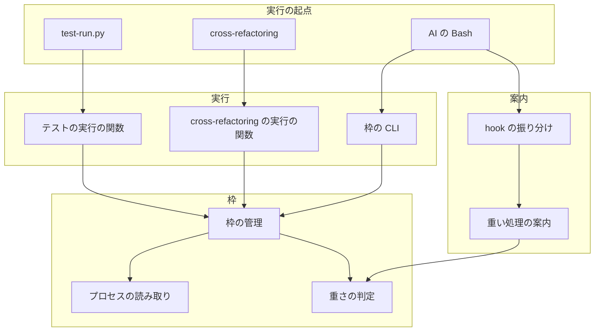
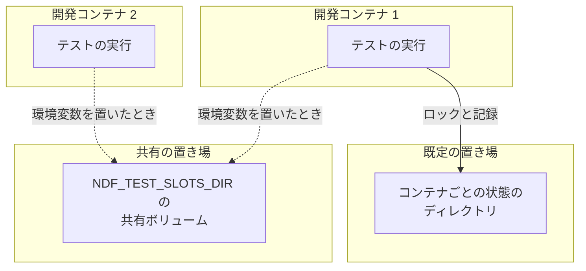
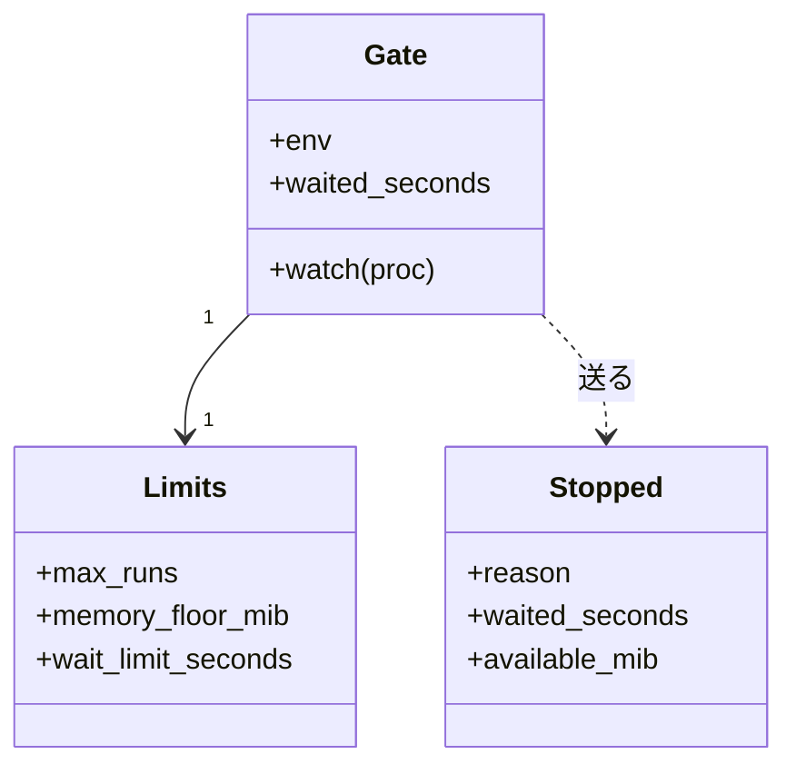
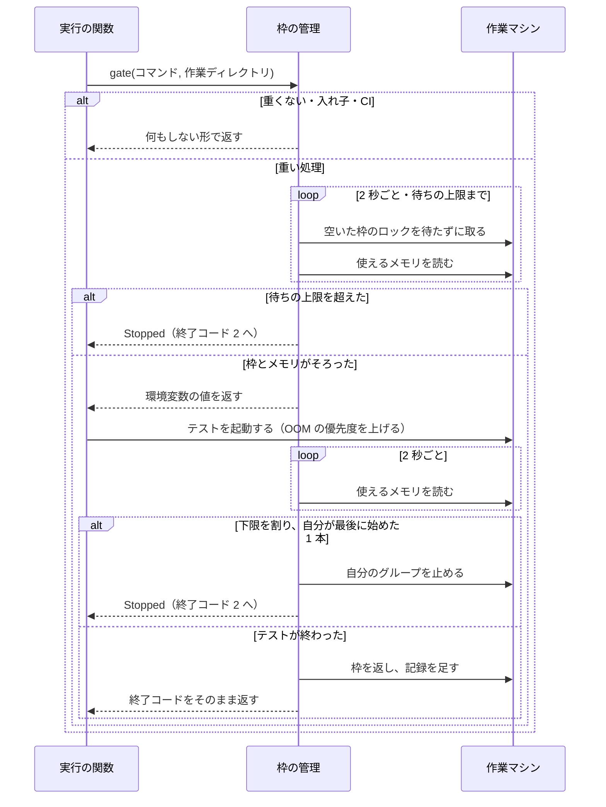
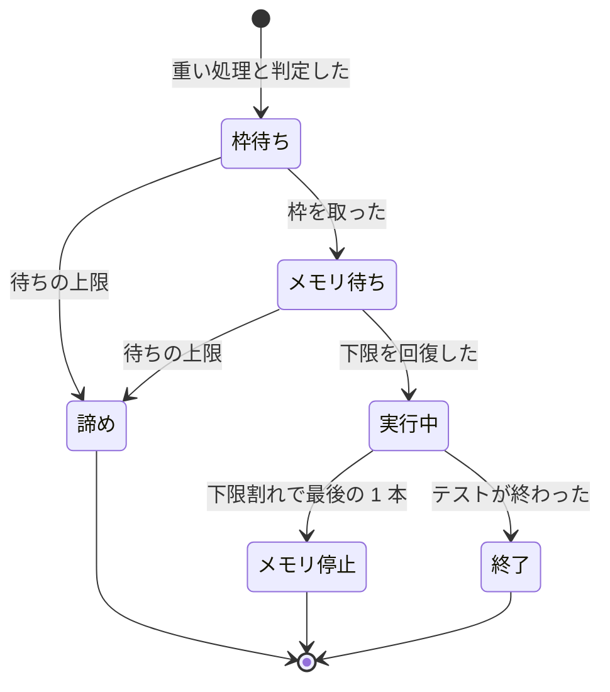

# テストの同時実行: 重いテストを作業マシンの上限に収め、メモリが足りなければ NDF が待つか止める（#2711）

## 目的

- **今どうなっているか**: レーンや担当が全体テストを別々に起動し、本数は誰にも数えられていない。全体テスト 6 本の同時実行で使えるメモリが 7.4 GB まで減り、21 GiB のホストでは 5〜6 本のときに OOM Killer が本体を 2 回落とした（#621）
- **誰に効くか**: 並列の計画と単独の開発ループを同じ作業マシンで動かす利用者と、落とされると作業が中断する conductor・担当
- **変えると何が成り立つか**: `-n 4` の全体テストは CPU 8 個・メモリ 30 GiB の作業マシンで同時に 2 本までに収まる。使えるメモリがメモリの下限を割ると、OOM Killer より先に NDF がテストを待たせるか止め、本体は動き続ける

## 適用範囲

- **働く範囲**: 利用先のリポジトリでも働く。`.ndf/project.json` の `test.suites` を宣言したリポジトリが対象で、設定が無くても既定の上限が効く。宣言の無いリポジトリの AI の直接の実行は判定できず、枠に入らない。GitHub Actions では働かない
- **プロジェクトごとに違うもの**: テストのコマンドと実行器の名前は宣言（`test.suites`）から読む。上限・メモリの下限・待ちの上限は新しい設定ファイル `.ndf/resources.json` で受ける。作業マシンごとに違う枠の置き場は環境変数 `NDF_TEST_SLOTS_DIR` で受ける
- **当たるモード**: すべてのモード（テストを走らせるステップと、AI の Bash の実行）

## あるべき姿の根拠

| 根拠 | 種類 | 何を示すか |
| --- | --- | --- |
| 「OOM Killer対策(pytestなどによるCPUやメモリの使いつぶしが見られる)」（2026-11-07、#2711 の依頼の原文） | 利用者の指示の原文 | CPU とメモリの両方を抑える |
| 全体テスト 1 本（`-n 4`）のプロセスの木のメモリは PSS で 1,216 MiB。計測した 568 秒の間に、使えるメモリは 10,112 MiB から 8,180 MiB へ減った。この間 load average は 12〜16 で、テストは 44% まで進んだ（2026-11-07 の実測。下の「実測」） | 実測 | 1 本は 1.2〜1.9 GiB で、6 本で 7〜12 GiB を使う。起票時の「6 本で残り 7.4 GB」と合う。同じ時間の load average は CPU の数の 1.5〜2 倍で、CPU が先に効く |
| 直近 400 件の会話の記録で、Bash の直接の実行 101 件に対し `test-run.py` は 39 件（#2711 の本文）。調査の最中も `python3 -m pytest … -n 3` と `uv run pytest -q` が動いていた（`ps`、2026-11-07） | 実測 | スクリプトの経路だけでは 7 割の実行が枠の外に残る |
| STD1・STD3 | 外部の一次情報 | カーネルのロックは持ち主の記述子が閉じると解け、異常終了でも枠が戻る |
| PRD1・PRD2 | 外部の一次情報 | メモリの不足は使えるメモリの割合で判定し、OOM Killer より先に利用者の空間で止める形が定着している |

### 実測

計測は 2026-11-07 05:12〜05:21 UTC に、この worktree で宣言の全体テストを 1 本起動し、プロセスの木の `smaps_rollup` を 3 秒ごとに足した。

| 項目 | 値 |
| --- | --- |
| 計測の範囲 | 568 秒で打ち切った時点で全体の 44%（要した全体の時間は未確認） |
| PSS の山 / RSS の山 | 1,216 MiB / 1,395 MiB（511 秒の時点。プロセス 16 個） |
| 使えるメモリ | 開始 10,112 MiB、最小 8,180 MiB（同じ時間に動いた他の実行を含む） |
| スワップの空き | 1〜19 MiB（合計 8,191 MiB） |
| 同じ時間の負荷 | load average 12.60〜16.78（CPU 8 個） |

別の session を起こして親から離れたプロセスは木に入らない。後半の 56% の山は未確認である（「未確認のまま残ること」）。

要求と受け入れ条件は #2711 の本文にある（コピーは [issue-2711-requirements.md](issue-2711-requirements.md) ）。この文書は「どう作るか」だけを扱う。

データ構造と入出力の契約は [issue-2711-design-contracts.md](issue-2711-design-contracts.md) に、決定の記録は [issue-2711-design-decisions.md](issue-2711-design-decisions.md) にある。

## ドメインモデル

### コンテキスト

| コンテキスト | 何の語が 1 つの意味に決まるか |
| --- | --- |
| NDF の開発ワークフロー（`ndf-workflow`） | 作業マシン・重い処理・テストの枠・メモリの下限・枠の置き場 |

1 つのコンテキストに収まる。

### 集約

| 集約 | 持ち主（書き換えてよいもの） | 根 | エンティティ | 値オブジェクト |
| --- | --- | --- | --- | --- |
| テストの枠 | `lib/test_slots.py` | 枠の置き場 | 枠 1 つ（番号・ロック・持ち主の記述） | 上限の値（本数・メモリの下限・待ちの上限） |
| 枠の記録 | `lib/test_slots.py` | 記録のファイル | — | 実行 1 本の行 |

`test-slot.py`・`lib/test_triage.py`・cross-refactoring の実行の関数は、集約を呼ぶだけでファイルを直接読み書きしない。

### 不変条件

| # | 集約 | 条件 | 破れたときの扱い |
| --- | --- | --- | --- |
| I1 | テストの枠 | 上限 N の実行は番号 0〜N-1 の枠だけを使う。同じ枠の置き場の重い処理の同時実行は、動いている実行の上限のうち最大の値以下で、上限が同じ実行どうしの同時実行はその上限以下である | NDF の自動テストが落ちる |
| I2 | テストの枠 | 持ち主のプロセスが SIGKILL で消えても、枠は 10 秒以内に空く | NDF の自動テストが落ちる |
| I3 | テストの枠 | 枠を持つ実行の子孫のテストは枠を取らず、待たない | NDF の自動テストが落ちる |
| I4 | テストの枠 | 枠とメモリの待ちはテストの時間の上限と全体テストの実測に数えない | NDF の自動テストが落ちる |
| I5 | テストの枠 | 実行が止めるのは自分の起こしたプロセスグループだけで、本体・ラッパー・他の実行へシグナルを送らない | NDF の自動テストが落ちる |
| I6 | テストの枠 | 1 回の下限割れで止めるのは最後に始めた 1 本で、次に止めるまで 30 秒空ける | NDF の自動テストが落ちる |
| I7 | テストの枠 | テストのコマンドの文字列を書き換えず、出力と終了コードをそのまま返す | NDF の自動テストが落ちる |
| I8 | テストの枠 | メモリを測れない・枠の置き場を使えない・記録を書けないときは、テストを走らせ、結果を変えない | NDF の自動テストが落ちる |
| I9 | テストの枠 | 待ちを諦めた・メモリで止めた実行は、落ちたテストとして数えない（終了コード 2） | NDF の自動テストが落ちる |
| I10 | テストの枠 | 既定の上限は 1 を下回らない | NDF の自動テストが落ちる |
| I11 | 枠の記録 | 記録は 30 日か 10,000 行で古い方から消える | NDF の自動テストが落ちる |

### ドメインイベント

| # | イベント | 発生元 | 受け手 |
| --- | --- | --- | --- |
| E1 | テストの実行が要求された | `test-run.py`・cross-refactoring・AI の Bash | テストの枠 |
| E2 | テストの枠を取った | テストの枠 | 実行本人 |
| E3 | 枠の空きを待った | テストの枠 | 枠の記録 |
| E4 | 使えるメモリを確かめて開始した | テストの枠 | 実行本人 |
| E5 | テストが終わり枠を返した | 実行本人 | 待っている実行 |
| E6 | メモリが下限を割り、テストを止めた | 実行本人の監視 | 枠の記録・呼んだ工程 |
| E7 | 待ちを諦めた | テストの枠 | 枠の記録・呼んだ工程 |
| E8 | 記録に残した | テストの枠 | 記録を読むコマンド |
| E9 | 使いつぶしが起きたかを読んだ | 記録を読むコマンド | 人・conductor（#2710 の監視も読める） |

### 用語

| 用語 | 意味 | 用語集への反映 |
| --- | --- | --- |
| 作業マシン | NDF の作業を動かす 1 台のマシン。同じカーネルとメモリを共有する範囲を指す | 追加（要求で反映済み） |
| 重い処理 | 作業マシンの CPU とメモリを多く使うテストの実行。宣言のテストのコマンドによる全体テストと、並列の指定を持つ範囲テストを指す。静的解析は含まない | 追加（要求で反映済み） |
| テストの枠 | 1 台の作業マシンで同時に走らせてよい重い処理の本数の上限と、その数え方 | 追加（要求で反映済み） |
| メモリの下限 | 使えるメモリがこの値を割ると、重い処理を始めず、動いているものを止める境の値 | 追加（要求で反映済み） |
| 枠の置き場 | テストの枠のロックと記録を置くディレクトリ。同じ置き場を見る実行どうしが同じ番号の枠を取り合う | 追加 |

## 機能一覧

| # | 機能 | 誰が使うか |
| --- | --- | --- |
| F1 | 重い処理を上限の本数に収める | `test-run.py`・cross-refactoring・AI の Bash の実行 |
| F2 | メモリが足りなければ開始を待つ | 同上 |
| F3 | 実行中にメモリが下限を割ったら最後に始めた 1 本を止める | 同上 |
| F4 | AI が Bash で打つ重い処理を枠の経路へ案内する | Claude Code・Codex で動く AI |
| F5 | 上限・メモリの下限・待ちの上限をプロジェクトで変える | リポジトリの管理者 |
| F6 | 待った・止めた・諦めた回数と OOM Killer の増分を読む | 人・conductor |

## 決定の記録

決定 1〜14 は [issue-2711-design-decisions.md](issue-2711-design-decisions.md) にある。

## 構成要素

| 要素 | 責務 |
| --- | --- |
| 重さの判定（`lib/test_weight.py`。新設） | 宣言とコマンドの語から、重い処理かを決める純粋な関数。ファイルもプロセスも触らない |
| 枠の管理（`lib/test_slots.py`。新設） | 設定の読み取りと既定の算出、枠の取得と待ち、メモリの監視、待ちの秒の帳簿、記録の読み書き |
| 枠の CLI（`scripts/test-slot.py`。新設） | `run`（1 本のコマンドを枠の下で走らせる）と `report`（記録を読む） |
| 重い処理の案内（`hook_lib/test_guard.py`。新設） | Bash の重い処理を拒否し、`test-slot.py run` で包んだコマンドを示す |
| hook の振り分け（`scripts/hook.py`） | Claude Code と Codex の PreToolUse で案内を呼ぶ |
| プロセスの読み取り（`lib/procs.py`） | 使えるメモリ（cgroup の残りとの小さい方）、OOM Killer の回数、OOM の優先度を上げる操作を足す |
| テストの実行（`lib/test_triage.py`） | `run_command` が枠の下で起動する。`run_within` が待ちの秒を上限から除く |
| cross-refactoring の実行（`refactor_lib/process.py`・`refactor.py`） | `run_with_timeout` が枠の下で起動し、待ちの後に想定最大時間の残りで切り直す。待ちの諦めとメモリの停止を `Unreachable` と同じ場所で受ける |
| テストのスクリプト（`scripts/test-run.py`） | 待ちの諦めとメモリの停止を終了コード 2 で返す。待った秒を結果に載せ、実測から除く |
| テストのステップの上限（`supervise_lib/steps.py`） | ステップの `timeout` へ待ちの上限を足す |
| 並列の作業の文書（`skills/development-workflow/references/parallel-work.md`） | 必須ルール 6 から枠の設定と `report` へ参照を張る |
| テストの環境（リポジトリの根の `conftest.py`） | テストの実行中は枠を持つ扱いにする |

### 呼び出しの関係



この図は呼び出しの関係だけを描き、ステップの上限・文書・テストの環境は含めない。

### 配置

配置は変わらない。枠の置き場だけが新しく増える。



### ファイルの置き場所

```text
plugins/ndf/scripts/
├── test-slot.py              # 新設
├── test-run.py
├── hook.py
├── hook_lib/test_guard.py    # 新設
├── lib/test_slots.py         # 新設
├── lib/test_weight.py        # 新設
├── lib/test_triage.py
├── lib/procs.py
└── supervise_lib/steps.py
plugins/ndf/skills/cross-refactoring/scripts/
├── refactor.py
└── refactor_lib/process.py
```

## 構造



| 型 | 責務 |
| --- | --- |
| `Limits` | 設定と既定から決まる 3 つの値。誤った設定は `SlotConfigError` を送る |
| `Gate` | `test_slots.gate(command, cwd, ...)` の `with` が返す。重くないコマンドと入れ子では何もしない形で返る。出るときに枠を返し、記録を書く |
| `Stopped` | 待ちの諦めとメモリの停止で送る例外。`container_reach.Unreachable` と同じく呼び出し元を素通りし、スクリプトの出口で受ける |

実行の関数の形は次のとおりで、`Gate` は `Popen` の前後だけに入る。

```python
with test_slots.gate(command, cwd) as held:                  # 取れるまで待つ。諦めたら Stopped
    proc = subprocess.Popen(command, env={**env, **held.env}, ...)
    held.watch(proc)                                         # 監視のスレッドを始める
    ...今の待ち方のまま...
                                                             # 出るときに監視の停止なら Stopped
```

## データ構造

データ構造は [issue-2711-design-contracts.md の「データ構造」](issue-2711-design-contracts.md#データ構造) にある。

## 入出力の契約

入出力の契約は [issue-2711-design-contracts.md の「入出力の契約」](issue-2711-design-contracts.md#入出力の契約) にある。

## 処理の流れ

### 実行の流れ



メモリを測れないときは、待たず監視も止めて記録に `measured: false` を残す。枠の置き場を使えないときは、枠を取らずに走らせ、結果の注記に残す（I8）。

### 実行の状態



メモリ待ちの間は枠を持ち続け、待ちの上限は枠待ちとの合計で数える。

## 非機能の実現方式

| 大項目 | 要求の条件 | 実現方式 | 確かめ方 |
| --- | --- | --- | --- |
| 性能・拡張性 | 待ちが起きないとき、枠の処理がテストの開始へ足す時間は 1 秒以内 | ロックを待たずに試し、使えるメモリは psutil で 1 回読む。`test-run.py --help` の起動は 0.16 秒、`psutil` と `filelock` の読み込みは 0.10 秒（2026-11-07） | 空いた作業マシンで枠の取得から起動までの秒を測る |
| 運用・保守性 | 記録は直近 30 日か 10,000 行で古い方から消え、際限なく増えない | 記録を足すときに排他の中で行数を見て、超えたら原子的に書き直す | 10,001 行と 31 日前の行を置いて 1 行足し、残りの行を見る |
| システム環境 | Linux と macOS で動く。macOS で使えるメモリを測れない項目は受け入れ条件 12（メモリを読めなくても始まり、記録に残す）に従う | `filelock` と `psutil` は両方で動く。cgroup・OOM の回数・OOM の優先度は Linux だけで働き、読めなければ `None` を返す | Linux のテストで読めない場合を差し替えて確かめる。macOS の実機は未確認 |

## 設計の結果

| 課題 | 扱い | 取り込み先 | 触るファイル |
| --- | --- | --- | --- |
| #2711 | 実装する | — | `plugins/ndf/scripts/test-slot.py`、`plugins/ndf/scripts/test-run.py`、`plugins/ndf/scripts/hook.py`、`plugins/ndf/scripts/hook_lib/test_guard.py`、`plugins/ndf/scripts/lib/test_slots.py`、`plugins/ndf/scripts/lib/test_weight.py`、`plugins/ndf/scripts/lib/test_triage.py`、`plugins/ndf/scripts/lib/procs.py`、`plugins/ndf/scripts/lib/README.md`、`plugins/ndf/scripts/supervise_lib/steps.py`、`plugins/ndf/scripts/tests/`、`plugins/ndf/skills/cross-refactoring/scripts/refactor.py`、`plugins/ndf/skills/cross-refactoring/scripts/refactor_lib/process.py`、`plugins/ndf/skills/development-workflow/references/parallel-work.md`、`conftest.py`、`docs/glossary/`、`docs/glossary.md` |

## テスト設計

| 受け入れ条件・不変条件 | どの振る舞いで縛るか | どう壊したら落ちるべきか |
| --- | --- | --- |
| 受け入れ条件 1・I1 | 上限 2 で実プロセス 4 本を同時に起動し、同時の本数が 2 以下で 4 本とも終わる | 空きの確認をロックなしに変える |
| I1（上限の違う実行） | 共通の置き場で上限 1 の実行 2 本と上限 2 の実行 2 本を同時に起動し、全体の同時の本数が 2 以下、上限 1 の実行の同時の本数が 1 以下で、4 本とも終わる | 上限 1 の実行に番号 1 の枠も試させる |
| 受け入れ条件 2 | 上限 1 で `test-run.py`・`run_with_timeout`・`test-slot.py run` を同時に起動し、同時に 1 本である。Claude Code と Codex の入力で hook が拒否を返す | 片方の関数から枠を外す。Codex の入力の形を読まない |
| 受け入れ条件 3・I10 | CPU とメモリの入力ごとの既定の上限（8・30 GiB で 2、片方半分で 1、最小で 1） | 式を片方の軸だけにする。下限 1 を外す |
| 受け入れ条件 4 | 設定の 3 つの値が効く。誤った値で走らず、終了コード 2 と直す箇所が出る | 誤った値を既定へ落とす |
| 受け入れ条件 5 | 上限に達していても、並列の指定の無い 1 ファイルの実行は待たない | 判定をすべて重いにする |
| 受け入れ条件 6・I3 | 上限 1 で枠を持つ実行の中から起動しても待たない | 環境変数の値を子へ渡さない |
| 受け入れ条件 7・I2 | 持ち主を SIGKILL で止めると、待っていた実行が 10 秒以内に始まる | ロックをファイルの有無へ変える。記述子を子へ受け継ぐ |
| 受け入れ条件 8・I4 | 待った分が上限に数えられず、実測にも入らず、結果の JSON に載る。2 本目の suite の残りも減らない | `run_within` の差し引きを外す |
| 受け入れ条件 9・I9 | 上限を超えると走らず終了コード 2、`summary` に秒と理由。triage が変更起因へ入れない | `Stopped` を失敗の終了コードへ変える |
| 受け入れ条件 10 | 下限を割る入力で始まらず、回復で始まる | 開始の前の判定を外す |
| 受け入れ条件 11・I5・I6 | 2 本のうち後に始めた 1 本だけが終了コード 2 で止まり、先の 1 本と親が動き続ける。30 秒の間は次を止めない | 先に始めた方を止める。間隔を外す。親のグループへ送る |
| 受け入れ条件 11・I6（上限の違う実行） | 共通の置き場で上限 1 の実行が番号 0 の枠で先に始まり、上限 2 の実行が番号 1 の枠で後に始まる。下限を割ると、上限 2 の実行だけが終了コード 2 で止まり、上限 1 の実行は動き続ける | 下限割れの判定が読む範囲を自分の上限の番号までに限る |
| 受け入れ条件 12・I8 | メモリを読めないと始まり、記録に測れないと残る。置き場を書けなくても走る | 読めないときに待つ |
| 受け入れ条件 13 | 待った・止めた・諦めた実行で項目のそろった行が 1 行ずつ残る | 項目を落とす |
| 受け入れ条件 14 | 期間の中の回数と秒、OOM の回数の増分が JSON で読める。回数が減った行で負にならない | 差を単純な最後と最初の差にする |
| 受け入れ条件 15・I7 | 出力と終了コード 0・1 が枠の無い実行と同じである | コマンドを包むか出力を飲む |
| 受け入れ条件 16 | 宣言の `factory` の形の vitest が同じ判定に入る。`test_weight.py` にリポジトリの語が無い | 判定に `pytest` を直書きする |
| 受け入れ条件 17 | `git diff` で `.github/workflows/` のテストのコマンドに差分が無い | CI の `-n auto` を変える |
| I11 | 古い行と超えた行が足す時点で消える | 切り詰めを外す |
| 決定 4 の判定 | `grep pytest .` や `echo pytest -n 4` は重くない | コマンドの位置を見ずに語を探す |
| 決定 9 | `supervise.py` のステップの `timeout` が待ちの上限の分だけ増え、cross-refactoring が残りの無いときに打ち切りで返る | 足す値を `with_margin` の中へ入れる |
| 決定 12 | `GITHUB_ACTIONS` があると枠を取らない | 判定を外す |

## 未確認のまま残ること

| 項目 | 内容 |
| --- | --- |
| 全体テストの山の残り | 測れたのは全体の 44% までである。後半で山が 2 GiB を超えると、下限の根拠が変わる。リリース後に `report` の使えるメモリと、全体を通した計測で確かめる |
| vitest の重さ | `factory` の全体テストのメモリの山は測っていない |
| 別の開発コンテナとの共有 | このホストには `ai-plugins-dev-1`・`-2` など 10 個以上の開発コンテナがあり（`docker ps`、2026-11-07）、既定ではコンテナごとに上限が効く。このホストで `NDF_TEST_SLOTS_DIR` を `/work` の下へ置くかを設計承認ゲートで利用者が決める。置かない場合、効くのはメモリの下限だけである |
| 枠の持ち主の SIGKILL | `test-slot.py` だけが SIGKILL で消えると、枠は空くがテストは別のセッションで走り続ける。監視も消える。頻度は未測定で、#2291 の子プロセスの停止と同じ問題である |
| 既定の 30 分の待ち | レーン 6 本・上限 2 本で全体テストが 10 分を超えると、最後の実行は 30 分に近づく。リリース後に諦めの回数を見て値を直す |
| 開始の直前のメモリ | 下限ちょうどで始めた実行は、すぐ下限を割って止まることがある。回数は `report` の `memory_stopped` で見る |
| 判定をすり抜ける実行 | `make test` のように宣言の語を持たないコマンドは枠に入らない。宣言の無いリポジトリの AI の直接の実行も入らない。Kiro と agy は hook が届かない |
| macOS の実機 | 動作は確かめていない |
| テストの揺れ（#2093・#1967） | 枠で解消するかは未確認である |

## 外部の調査

| 種類 | 調べるか | 理由 |
| --- | --- | --- |
| 標準・仕様 | 調べる | ロックの解ける条件、OOM の優先度、cgroup の委任がカーネルの定めに左右される |
| 主要な製品 | 調べる | メモリ不足の先回りと、hook で実行を止める形に既製の解き方がある |
| ライブラリとサービス | 調べる | 計数セマフォとメモリの読み取りに既存の部品がある |

### 標準・仕様

| # | 標準・仕様 | 何を定めているか | 設計への反映 | 出典 |
| --- | --- | --- | --- | --- |
| STD1 | `flock(2)` | ロックは開いたファイル記述に紐づき、すべての記述子が閉じると解ける。`fork` と `dup` は同じロックを指す | 枠を持つ間だけ記述子を持ち、テストへ受け継がせない（決定 1） | https://man7.org/linux/man-pages/man2/flock.2.html （2026-11-07） |
| STD2 | GNU make の jobserver | パイプのトークンを読んで枠を得て、書き戻して返す。エラーでも返すことを求める | 異常終了で戻らない形のため採らない（決定 1） | https://www.gnu.org/software/make/manual/html_node/POSIX-Jobserver.html （2026-11-07） |
| STD3 | cgroup v2 | `memory.high`・`memory.max`・`memory.oom.group`。非特権の利用には書き込みの委任が要る | 使わない（決定 7） | https://docs.kernel.org/admin-guide/cgroup-v2.html （2026-11-07）、手元の `touch` |
| STD4 | PSI | `some` と `full` の時間の割合でメモリの圧を示す | 要求の判定は使えるメモリで行い、PSI は使わない。`parallel-measure.py` の判定のまま | https://docs.kernel.org/accounting/psi.html （2026-11-07） |
| STD5 | `oom_score_adj` | -1000〜+1000 の値を選ばれやすさへ足す | テストの値を 500 に上げる（決定 7） | https://man7.org/linux/man-pages/man5/proc_pid_oom_score_adj.5.html （2026-11-07）、手元の書き込み |

### 主要な製品

| # | 製品 | どう解いているか | 設計への反映 | 出典 |
| --- | --- | --- | --- | --- |
| PRD1 | earlyoom | 使えるメモリとスワップの両方が 10% を割ると、利用者の空間からプロセスを止める | 10% と、OOM Killer より先に止める形に倣う。スワップは条件にしない（決定 5・6） | https://github.com/rfjakob/earlyoom （2026-11-07） |
| PRD2 | systemd-oomd | cgroup v2 と PSI を見て、cgroup 1 つへ SIGKILL を送る。systemd の全面的な管理が前提 | 開発コンテナで前提を満たさないため採らない（決定 6） | https://www.freedesktop.org/software/systemd/man/latest/systemd-oomd.service.html （2026-11-07） |
| PRD3 | Codex の hook | PreToolUse は `deny` を受ける。`updatedInput` は `permissionDecision: allow` と組でだけ受ける。hook は信頼の登録が要り、完全な強制の境界でない | 拒否の形を使う（決定 3） | https://learn.chatgpt.com/docs/hooks.md （2026-11-07） |
| PRD4 | Claude Code の hook | PreToolUse の `updatedInput` は引数全体を置き換える。サブエージェントの Tool 呼び出しにも発火する | 拒否の形を使う。担当の実行にも効く（決定 3） | https://code.claude.com/docs/en/hooks （2026-11-07） |

### ライブラリとサービス

| # | 候補 | 版 | ライセンス | 最後のリリースの日付 | 終了のアナウンス | 要件を満たすか | 出典 |
| --- | --- | --- | --- | --- | --- | --- | --- |
| LIB1 | `psutil`（今の依存 `procs`） | 7.2.2 | BSD-3-Clause | 2026-01-28 | 無し | 満たす。`available` は Linux で MemAvailable、macOS でも読める | https://pypi.org/pypi/psutil/json ・ https://psutil.io/api/ （2026-11-07） |
| LIB2 | `filelock`（今の依存 `locks`。リポジトリの固定は 4.0.3） | 4.2.9 | MIT | 2026-11-04 | 無し | 満たす。`lib/locks.py` の包みを使う | https://pypi.org/pypi/filelock/json （2026-11-07） |
| LIB3 | `pytest-xdist` | 3.8.0 | MIT | 2025-07-01 | 無し | 満たさない。`-n auto` の数え方は変えられるが、複数の実行をまたぐ上限の仕組みは文書に無い | https://pypi.org/pypi/pytest-xdist/json ・ https://pytest-xdist.readthedocs.io/en/stable/distribution.html （2026-11-07） |
| LIB4 | GNU `sem` | 未確認 | GPL-3.0 以降 | 未確認 | 未確認 | 満たさない。計数セマフォはあるが、外部コマンドを足し、持ち主が死んだときの扱いが文書に無い | https://www.gnu.org/software/parallel/sem.html （2026-11-07） |

### 確かめられなかったこと

| 対象 | 試した手段 | 結果と理由 |
| --- | --- | --- |
| psutil 7.2 の安定版の `available` の定義 | https://psutil.readthedocs.io/en/latest/ | `psutil.io` へ転送された。読めたのは開発版の文書である |
| LIB4 の版と最後のリリースの日付 | https://www.gnu.org/software/parallel/sem.html | ページに載っていない。採らないため、これ以上調べていない |

調べた量: 候補 13 件・取得の試み 29 回。
