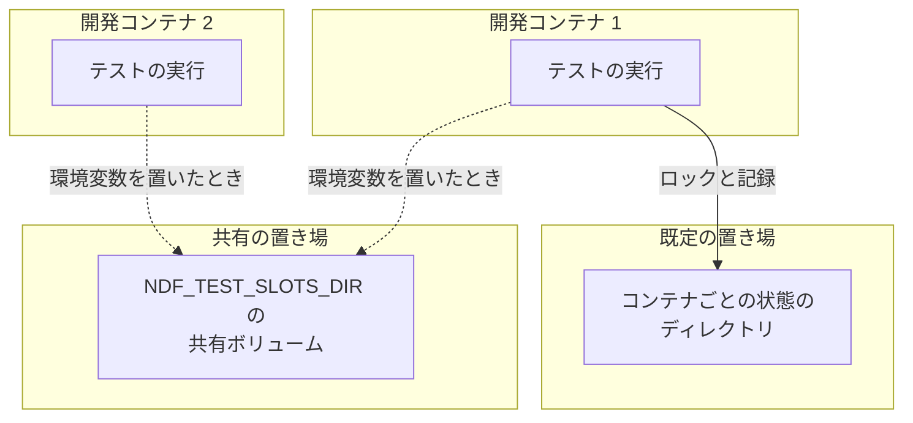
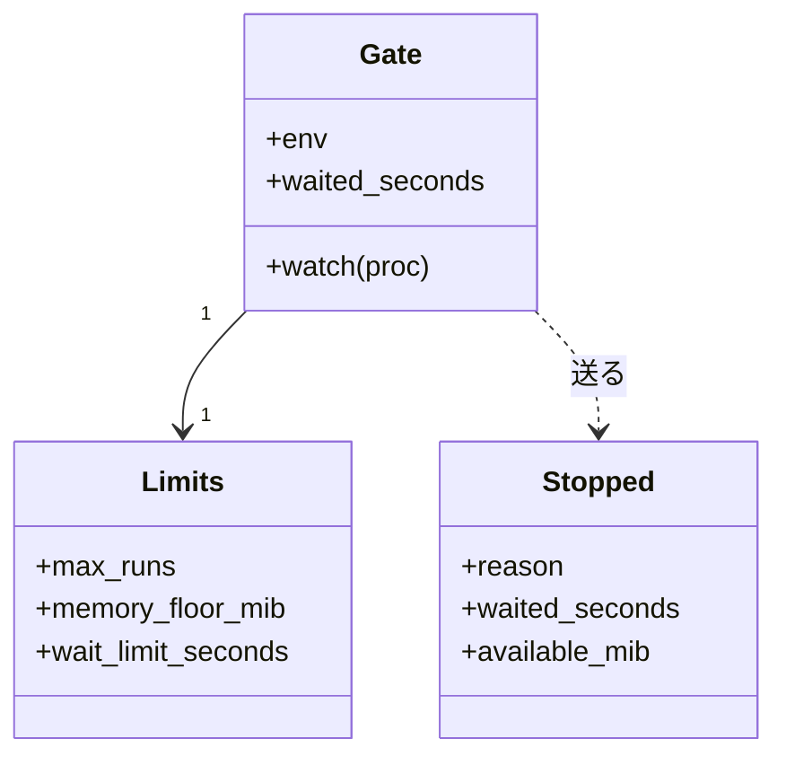
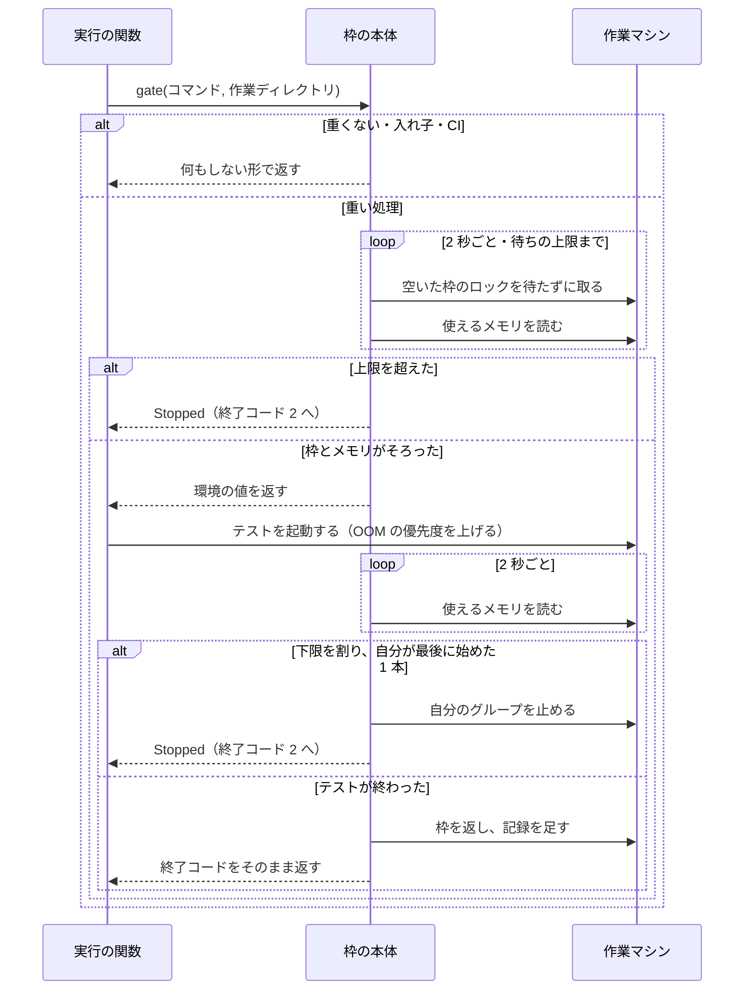
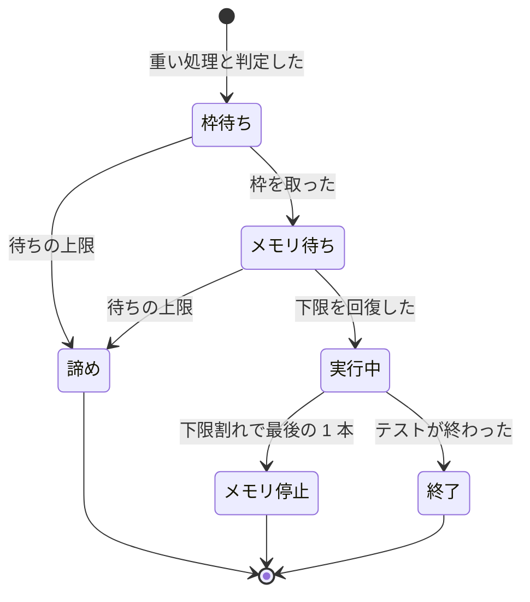

# テストの同時実行: 重いテストを作業マシンの上限に収め、メモリが足りなければ NDF が待つか止める（#2711）

## 目的

- **今どうなっているか**: レーンや担当が全体テストを別々に起動し、本数は誰にも数えられていない。全体テスト 6 本の同時実行で使えるメモリが 7.4 GB まで減り、21 GiB のホストでは 5〜6 本のときに OOM Killer が本体を 2 回落とした（#621）
- **誰に効くか**: 並列の計画と単独の開発ループを同じ作業マシンで動かす利用者と、落とされると作業が中断する conductor・担当
- **変えると何が成り立つか**: `-n 4` の全体テストは CPU 8 個・メモリ 30 GiB の作業マシンで同時に 2 本までに収まる。使えるメモリがメモリの下限を割ると、OOM Killer より先に NDF がテストを待たせるか止め、本体は動き続ける

## 適用範囲

- **働く範囲**: 利用先のリポジトリでも働く。`.ndf/project.json` の `test.suites` を宣言したリポジトリが対象で、設定が無くても既定の上限が効く。宣言の無いリポジトリの AI の直接の実行は判定できず、枠に入らない。GitHub Actions では働かない
- **プロジェクトごとに違うもの**: テストのコマンドと実行器の名前は宣言（`test.suites`）から読む。上限・メモリの下限・待ちの上限は新しい設定ファイル `.ndf/resources.json` で受ける。作業マシンごとに違う枠の置き場は環境変数 `NDF_TEST_SLOTS_DIR` で受ける
- **当たるモード**: すべてのモード（テストを走らせるステップと、AI の Bash の実行）

## あるべき姿の根拠

| 根拠 | 種類 | 何を示すか |
| --- | --- | --- |
| 「OOM Killer対策(pytestなどによるCPUやメモリの使いつぶしが見られる)」（2026-11-07、#2711 の依頼の原文） | 利用者の指示の原文 | CPU とメモリの両方を抑える |
| 全体テスト 1 本（`-n 4`）のプロセスの木のメモリは PSS で 1,216 MiB。計測した 568 秒の間に、使えるメモリは 10,112 MiB から 8,180 MiB へ減った。この間 load average は 12〜16 で、テストは 44% まで進んだ（2026-11-07 の実測。下の「実測」） | 実測 | 1 本は 1.2〜1.9 GiB で、6 本で 7〜12 GiB を使う。起票時の「6 本で残り 7.4 GB」と合う。同じ時間の load average は CPU の数の 1.5〜2 倍で、CPU が先に効く |
| 直近 400 件の会話の記録で、Bash の直接の実行 101 件に対し `test-run.py` は 39 件（#2711 の本文）。調査の最中も `python3 -m pytest … -n 3` と `uv run pytest -q` が動いていた（`ps`、2026-11-07） | 実測 | スクリプトの経路だけでは 7 割の実行が枠の外に残る |
| STD1・STD3 | 外部の一次情報 | カーネルのロックは持ち主の記述子が閉じると解け、異常終了でも枠が戻る |
| PRD1・PRD2 | 外部の一次情報 | メモリの不足は使えるメモリの割合で判定し、OOM Killer より先に利用者の空間で止める形が定着している |

要求と受け入れ条件は #2711 の本文にある（コピーは [issue-2711-requirements.md](issue-2711-requirements.md) ）。この文書は「どう作るか」だけを扱う。

### 実測

計測は 2026-11-07 05:12〜05:21 UTC に、この worktree で宣言の全体テストを 1 本起動し、プロセスの木の `smaps_rollup` を 3 秒ごとに足した。

| 項目 | 値 |
| --- | --- |
| 計測の範囲 | 568 秒で打ち切った時点で全体の 44%（要した全体の時間は未確認） |
| PSS の山 / RSS の山 | 1,216 MiB / 1,395 MiB（511 秒の時点。プロセス 16 個） |
| 使えるメモリ | 開始 10,112 MiB、最小 8,180 MiB（同じ時間に動いた他の実行を含む） |
| スワップの空き | 1〜19 MiB（合計 8,191 MiB） |
| 同じ時間の負荷 | load average 12.60〜16.78（CPU 8 個） |

別の session を起こして親から離れたプロセスは木に入らない。後半の 56% の山は未確認である（「未確認のまま残ること」）。

## ドメインモデル

### コンテキスト

| コンテキスト | 何の語が 1 つの意味に決まるか |
| --- | --- |
| NDF の開発ワークフロー（`ndf-workflow`） | 作業マシン・重い処理・テストの枠・メモリの下限・枠の置き場 |

1 つのコンテキストに収まる。

### 集約

| 集約 | 持ち主（書き換えてよいもの） | 根 | エンティティ | 値オブジェクト |
| --- | --- | --- | --- | --- |
| テストの枠 | `lib/test_slots.py` | 枠の置き場 | 枠 1 つ（番号・ロック・持ち主の記述） | 上限の値（本数・メモリの下限・待ちの上限） |
| 枠の記録 | `lib/test_slots.py` | 記録のファイル | — | 実行 1 本の行 |

`test-slot.py`・`lib/test_triage.py`・cross-refactoring の実行の関数は、集約を呼ぶだけでファイルを直接読み書きしない。

### 不変条件

| # | 集約 | 条件 | 破れたときの扱い |
| --- | --- | --- | --- |
| I1 | テストの枠 | 同じ枠の置き場で、同じ上限を使う重い処理の同時実行は上限以下である | テストが落ちる |
| I2 | テストの枠 | 持ち主のプロセスが SIGKILL で消えても、枠は 10 秒以内に空く | テストが落ちる |
| I3 | テストの枠 | 枠を持つ実行の子孫のテストは枠を取らず、待たない | テストが落ちる |
| I4 | テストの枠 | 枠とメモリの待ちはテストの時間の上限と全体テストの実測に数えない | テストが落ちる |
| I5 | テストの枠 | 実行が止めるのは自分の起こしたプロセスグループだけで、本体・ラッパー・他の実行へシグナルを送らない | テストが落ちる |
| I6 | テストの枠 | 1 回の下限割れで止めるのは最後に始めた 1 本で、次に止めるまで 30 秒空ける | テストが落ちる |
| I7 | テストの枠 | テストのコマンドの文字列を書き換えず、出力と終了コードをそのまま返す | テストが落ちる |
| I8 | テストの枠 | メモリを測れない・枠の置き場を使えない・記録を書けないときは、テストを走らせ、結果を変えない | テストが落ちる |
| I9 | テストの枠 | 待ちを諦めた・メモリで止めた実行は、落ちたテストとして数えない（終了コード 2） | テストが落ちる |
| I10 | テストの枠 | 既定の上限は 1 を下回らない | テストが落ちる |
| I11 | 枠の記録 | 記録は 30 日か 10,000 行で古い方から消える | テストが落ちる |

### ドメインイベント

| # | イベント | 発生元 | 受け手 |
| --- | --- | --- | --- |
| E1 | テストの実行が要求された | `test-run.py`・cross-refactoring・AI の Bash | テストの枠 |
| E2 | テストの枠を取った | テストの枠 | 実行本人 |
| E3 | 枠の空きを待った | テストの枠 | 枠の記録 |
| E4 | 使えるメモリを確かめて開始した | テストの枠 | 実行本人 |
| E5 | テストが終わり枠を返した | 実行本人 | 待っている実行 |
| E6 | メモリが下限を割り、テストを止めた | 実行本人の監視 | 枠の記録・呼んだ工程 |
| E7 | 待ちを諦めた | テストの枠 | 枠の記録・呼んだ工程 |
| E8 | 記録に残した | テストの枠 | 記録を読むコマンド |
| E9 | 使いつぶしが起きたかを読んだ | 記録を読むコマンド | 人・conductor（#2710 の監視も読める） |

### 用語

| 用語 | 意味 | 用語集への反映 |
| --- | --- | --- |
| 作業マシン | NDF の作業を動かす 1 台のマシン。同じカーネルとメモリを共有する範囲を指す | 追加（要求で反映済み） |
| 重い処理 | 作業マシンの CPU とメモリを多く使うテストの実行。宣言のテストのコマンドによる全体テストと、並列の指定を持つ範囲テストを指す。静的解析は含まない | 追加（要求で反映済み） |
| テストの枠 | 1 台の作業マシンで同時に走らせてよい重い処理の本数の上限と、その数え方 | 追加（要求で反映済み） |
| メモリの下限 | 使えるメモリがこの値を割ると、重い処理を始めず、動いているものを止める境の値 | 追加（要求で反映済み） |
| 枠の置き場 | テストの枠のロックと記録を置くディレクトリ。同じ置き場を見る実行どうしが同じ上限を共有する | 追加 |

## 外部の調査

| 種類 | 調べるか | 理由 |
| --- | --- | --- |
| 標準・仕様 | 調べる | ロックの解ける条件、OOM の優先度、cgroup の委任がカーネルの定めに左右される |
| 主要な製品 | 調べる | メモリ不足の先回りと、hook で実行を止める形に既製の解き方がある |
| ライブラリとサービス | 調べる | 計数セマフォとメモリの読み取りに既存の部品がある |

### 標準・仕様

| # | 標準・仕様 | 何を定めているか | 設計への反映 | 出典 |
| --- | --- | --- | --- | --- |
| STD1 | `flock(2)` | ロックは開いたファイル記述に紐づき、すべての記述子が閉じると解ける。`fork` と `dup` は同じロックを指す | 枠を持つ間だけ記述子を持ち、テストへ受け継がせない（決定 1） | https://man7.org/linux/man-pages/man2/flock.2.html （2026-11-07） |
| STD2 | GNU make の jobserver | パイプのトークンを読んで枠を得て、書き戻して返す。エラーでも返すことを求める | 異常終了で戻らない形のため採らない（決定 1） | https://www.gnu.org/software/make/manual/html_node/POSIX-Jobserver.html （2026-11-07） |
| STD3 | cgroup v2 | `memory.high`・`memory.max`・`memory.oom.group`。非特権の利用には書き込みの委任が要る | 使わない（決定 7） | https://docs.kernel.org/admin-guide/cgroup-v2.html （2026-11-07）、手元の `touch` |
| STD4 | PSI | `some` と `full` の時間の割合でメモリの圧を示す | 要求の判定は使えるメモリで行い、PSI は使わない。`parallel-measure.py` の判定のまま | https://docs.kernel.org/accounting/psi.html （2026-11-07） |
| STD5 | `oom_score_adj` | -1000〜+1000 の値を選ばれやすさへ足す | テストの値を 500 に上げる（決定 7） | https://man7.org/linux/man-pages/man5/proc_pid_oom_score_adj.5.html （2026-11-07）、手元の書き込み |

### 主要な製品

| # | 製品 | どう解いているか | 設計への反映 | 出典 |
| --- | --- | --- | --- | --- |
| PRD1 | earlyoom | 使えるメモリとスワップの両方が 10% を割ると、利用者の空間からプロセスを止める | 10% と、OOM Killer より先に止める形に倣う。スワップは条件にしない（決定 5・6） | https://github.com/rfjakob/earlyoom （2026-11-07） |
| PRD2 | systemd-oomd | cgroup v2 と PSI を見て、cgroup 1 つへ SIGKILL を送る。systemd の全面的な管理が前提 | 開発コンテナで前提を満たさないため採らない（決定 6） | https://www.freedesktop.org/software/systemd/man/latest/systemd-oomd.service.html （2026-11-07） |
| PRD3 | Codex の hook | PreToolUse は `deny` を受ける。`updatedInput` は `permissionDecision: allow` と組でだけ受ける。hook は信頼の登録が要り、完全な強制の境界でない | 拒否の形を使う（決定 3） | https://learn.chatgpt.com/docs/hooks.md （2026-11-07） |
| PRD4 | Claude Code の hook | PreToolUse の `updatedInput` は引数全体を置き換える。サブエージェントの Tool 呼び出しにも発火する | 拒否の形を使う。担当の実行にも効く（決定 3） | https://code.claude.com/docs/en/hooks （2026-11-07） |

### ライブラリとサービス

| # | 候補 | 版 | ライセンス | 最後のリリースの日付 | 終了のアナウンス | 要件を満たすか | 出典 |
| --- | --- | --- | --- | --- | --- | --- | --- |
| LIB1 | `psutil`（今の依存 `procs`） | 7.2.2 | BSD-3-Clause | 2026-01-28 | 無し | 満たす。`available` は Linux で MemAvailable、macOS でも読める | https://pypi.org/pypi/psutil/json ・ https://psutil.io/api/ （2026-11-07） |
| LIB2 | `filelock`（今の依存 `locks`。リポジトリの固定は 4.0.3） | 4.2.9 | MIT | 2026-11-04 | 無し | 満たす。`lib/locks.py` の包みを使う | https://pypi.org/pypi/filelock/json （2026-11-07） |
| LIB3 | `pytest-xdist` | 3.8.0 | MIT | 2025-07-01 | 無し | 満たさない。`-n auto` の数え方は変えられるが、複数の実行をまたぐ上限の仕組みは文書に無い | https://pypi.org/pypi/pytest-xdist/json ・ https://pytest-xdist.readthedocs.io/en/stable/distribution.html （2026-11-07） |
| LIB4 | GNU `sem` | 未確認 | GPL-3.0 以降 | 未確認 | 未確認 | 満たさない。計数セマフォはあるが、外部コマンドを足し、持ち主が死んだときの扱いが文書に無い | https://www.gnu.org/software/parallel/sem.html （2026-11-07） |

### 確かめられなかったこと

| 対象 | 試した手段 | 結果と理由 |
| --- | --- | --- |
| psutil 7.2 の安定版の `available` の定義 | https://psutil.readthedocs.io/en/latest/ | `psutil.io` へ転送された。読めたのは開発版の文書である |
| LIB4 の版と最後のリリースの日付 | https://www.gnu.org/software/parallel/sem.html | ページに載っていない。採らないため、これ以上調べていない |

調べた量: 候補 13 件・取得の試み 29 回。

## 機能一覧

| # | 機能 | 誰が使うか |
| --- | --- | --- |
| F1 | 重い処理を上限の本数に収める | `test-run.py`・cross-refactoring・AI の Bash の実行 |
| F2 | メモリが足りなければ開始を待つ | 同上 |
| F3 | 実行中にメモリが下限を割ったら最後に始めた 1 本を止める | 同上 |
| F4 | AI が Bash で打つ重い処理を枠の経路へ案内する | Claude Code・Codex で動く AI |
| F5 | 上限・メモリの下限・待ちの上限をプロジェクトで変える | リポジトリの管理者 |
| F6 | 待った・止めた・諦めた回数と OOM Killer の増分を読む | 人・conductor |

## 構成要素

| 要素 | 責務 |
| --- | --- |
| 重さの判定（`lib/test_weight.py`。新設） | 宣言とコマンドの語から、重い処理かを決める純粋な関数。ファイルもプロセスも触らない |
| 枠の本体（`lib/test_slots.py`。新設） | 設定の読み取りと既定の算出、枠の取得と待ち、メモリの監視、待ちの秒の帳簿、記録の読み書き |
| 枠の CLI（`scripts/test-slot.py`。新設） | `run`（1 本のコマンドを枠の下で走らせる）と `report`（記録を読む） |
| 重い処理の案内（`hook_lib/test_guard.py`。新設） | Bash の重い処理を拒否し、`test-slot.py run` で包んだコマンドを示す |
| hook の振り分け（`scripts/hook.py`） | Claude Code と Codex の PreToolUse で案内を呼ぶ |
| プロセスの読み取り（`lib/procs.py`） | 使えるメモリ（cgroup の残りとの小さい方）、OOM Killer の回数、OOM の優先度を上げる操作を足す |
| テストの実行（`lib/test_triage.py`） | `run_command` が枠の下で起動する。`run_within` が待ちの秒を上限から除く |
| cross-refactoring の実行（`refactor_lib/process.py`・`refactor.py`） | `run_with_timeout` が枠の下で起動し、待ちの後に想定最大時間の残りで切り直す。止まりを `Unreachable` と同じ場所で受ける |
| テストのスクリプト（`scripts/test-run.py`） | 止まりを終了コード 2 で返す。待った秒を結果に載せ、実測から除く |
| テストのステップの上限（`supervise_lib/steps.py`） | ステップの `timeout` へ待ちの上限を足す |
| 並列の作業の文書（`skills/development-workflow/references/parallel-work.md`） | 必須ルール 6 から枠の設定と `report` へ参照を張る |
| テストの環境（リポジトリの根の `conftest.py`） | テストの実行中は枠を持つ扱いにする |


この図は呼び出しの関係だけを描き、ステップの上限・文書・テストの環境は含めない。

配置は変わらない。枠の置き場だけが新しく増える。



置き場所:

```text
plugins/ndf/scripts/
├── test-slot.py              # 新設
├── test-run.py
├── hook.py
├── hook_lib/test_guard.py    # 新設
├── lib/test_slots.py         # 新設
├── lib/test_weight.py        # 新設
├── lib/test_triage.py
├── lib/procs.py
└── supervise_lib/steps.py
plugins/ndf/skills/cross-refactoring/scripts/
├── refactor.py
└── refactor_lib/process.py
```

## 構造



| 型 | 責務 |
| --- | --- |
| `Limits` | 設定と既定から決まる 3 つの値。誤った設定は `SlotConfigError` を送る |
| `Gate` | `test_slots.gate(command, cwd, ...)` の `with` が返す。重くないコマンドと入れ子では何もしない形で返る。出るときに枠を返し、記録を書く |
| `Stopped` | 待ちの諦めとメモリの停止で送る例外。`container_reach.Unreachable` と同じく呼び出し元を素通りし、スクリプトの出口で受ける |

実行の関数の形は次のとおりで、`Gate` は `Popen` の前後だけに入る。

```python
with test_slots.gate(command, cwd) as held:                  # 取れるまで待つ。諦めたら Stopped
    proc = subprocess.Popen(command, env={**env, **held.env}, ...)
    held.watch(proc)                                         # 監視のスレッドを始める
    ...今の待ち方のまま...
                                                             # 出るときに監視の停止なら Stopped
```

## データ構造

枠の置き場は `NDF_TEST_SLOTS_DIR` → `${XDG_STATE_HOME}/ndf/test-slots` → `~/.local/state/ndf/test-slots` の順に決まる。

```text
<枠の置き場>/
├── slot-0.lock  slot-1.lock …   # 枠 1 つにつき 1 つ。消さない
├── slot-0.json  slot-1.json …   # 今の持ち主の記述
├── stop.json                    # 最後にメモリで止めた時刻（.lock で守る）
└── events.jsonl                 # 枠の記録（.lock で守る）
```

持ち主の記述（`slot-<番号>.json`）:

| 項目 | 型 | 空 | 内容 |
| --- | --- | --- | --- |
| `started_at` | 数 | 可 | テストを始めた epoch 秒。メモリを待つ間は `null` |
| `worktree` | 文字列 | 不可 | 実行の作業ディレクトリ |
| `pid` | 数 | 不可 | 持ち主のプロセス番号。読むのは人だけで、判定には使わない（PID 名前空間が違うと通じないため） |

記録の 1 行（`events.jsonl`）。重い処理 1 本の終わりに 1 行を足す。

| 項目 | 型 | 空 | 内容 |
| --- | --- | --- | --- |
| `at` | 文字列 | 不可 | 終わった時刻（UTC の ISO 8601） |
| `worktree` | 文字列 | 不可 | 実行の作業ディレクトリ |
| `kind` | 文字列 | 不可 | `whole` / `scope` / `direct`（判定の結果） |
| `waited_seconds` | 数 | 不可 | 枠とメモリを待った秒 |
| `available_mib` | 数 | 可 | 終わりか止めた時の使えるメモリ。測れなければ `null` |
| `measured` | 真偽 | 不可 | メモリを測れたか |
| `oom_kill` | 数 | 可 | その時点の OOM Killer の回数 |
| `result` | 文字列 | 不可 | `finished` / `gave_up` / `memory_stopped` / `interrupted` |

CRUD:

| 機能 | 枠のロック | 持ち主の記述 | `stop.json` | 記録 |
| --- | --- | --- | --- | --- |
| F1・F2 | 作る・消す（解除） | 作る・更新・消す | — | 作る |
| F3 | 読む | 読む | 読む・更新 | 作る |
| F6 | — | — | — | 読む |

## 入出力の契約

### 設定 `.ndf/resources.json`

| キー | 型 | 既定 | 誤りの扱い |
| --- | --- | --- | --- |
| `test_slots.max_runs` | 1 以上の整数 | 次の式 | 0 以下・数でないと `SlotConfigError` |
| `test_slots.memory_floor_mib` | 1 以上の整数 | 次の式 | 同上 |
| `test_slots.wait_limit_seconds` | 1 以上の整数 | 1800 | 同上 |

```text
max_runs の既定         = max(1, min(CPU の数 // 4, 全体のメモリ // 14 GiB))
memory_floor_mib の既定 = max(2 GiB, 全体のメモリの 10%)
```

CPU の数は cgroup の上限があればその値、全体のメモリは cgroup の上限があれば物理メモリとの小さい方を使う。設定の読み取りは `decl.setting_path` の順（呼ばれた木 → メインディレクトリ）に従う。設定ファイルを書き換えるコマンドは作らない。

### `test-slot.py run`

| 項目 | 内容 |
| --- | --- |
| 入力 | `test-slot.py run [--wait-limit <秒>] -- <シェルのコマンド 1 つ>`。作業ディレクトリは呼ばれた位置 |
| 出力（走った） | コマンドの標準出力と標準エラーをそのまま流し、コマンドの終了コードを返す |
| 失敗の形 | 諦めた・メモリで止めた: 標準エラーへ共通の結果の JSON（`status: stopped`、`summary` に待った秒と理由）、終了コード 2。設定の誤り: 同じ JSON で `items` に直す箇所を載せ、走らせずに終了コード 2 |
| シグナル | SIGTERM・SIGINT・SIGHUP を受けるとプロセスグループを止めて枠を返し、記録に `interrupted` を残す |
| 互換性 | 新設 |

### `test-slot.py report`

| 項目 | 内容 |
| --- | --- |
| 入力 | `test-slot.py report [--since <7d のような期間>]`。既定は 7 日 |
| 出力 | 共通の結果の JSON。`metrics` に `waited_runs`・`waited_seconds`・`memory_stopped`・`gave_up`・`oom_kill_increase` |
| 失敗の形 | 記録が無ければ 0 件で終了コード 0。期間の誤りは終了コード 2 |
| 互換性 | 新設 |

`oom_kill_increase` は、期間の中の行と今の回数を時刻の順に並べ、隣どうしの差のうち正の値を足した値である。再起動で回数が減っても負にならない。

### `test-run.py` の結果

| 項目 | 内容 |
| --- | --- |
| 追加 | `metrics.waited_seconds`（`scope` と `whole`） |
| 止まり | `Stopped` と `SlotConfigError` を受けて `status: stopped`・終了コード 2。`summary` に待った秒と理由、設定の誤りなら直す箇所を載せる |
| 互換性 | 既存のキーと項目は変えない。通ると 0、落ちると 1 を保つ |

### hook の拒否

Bash の重い処理に `permissionDecision: deny` を返す。理由の文に、次の形のそのまま打てるコマンドと、待ちが長いときは Bash の上限を延ばすことを載せる。

```text
python3 <プラグインの根>/scripts/test-slot.py run -- '<元のコマンド>'
```

`test-slot.py` と `test-run.py` を含むコマンド、枠を持つ実行の中（`NDF_TEST_SLOT_HELD` がある）、宣言が読めないときは通す。

### 重さの判定

`test_weight.is_heavy(words_by_command, suites)` は次のどれかで真を返す。`suites` は宣言の種別がテストの suite だけを渡す。

| # | 条件 | 例 |
| --- | --- | --- |
| 1 | 文字列が宣言の `command` と一致するか、単純コマンドの語の並びが宣言の `command` の最後の単純コマンドと一致する | `npm --prefix factory run check` |
| 2 | 宣言の `runner` がコマンドの位置にあり、並列の指定を持つ | `python3 -m pytest a.py -n 3` |
| 3 | 宣言の `runner` がコマンドの位置にあり、対象が無いか `.` だけである | `uv run pytest -q` |

- コマンドの位置は、ラッパー（`env`・`timeout` など）と `uv run`・`python -m`・`npx` の後ろの語、またはパスの最後の要素が `runner` と一致する語を指す
- 並列の指定は `-n`・`--numprocesses`・`-j`・`--jobs`・`--parallel`・`--maxWorkers` の表を `test_weight.py` だけが持つ
- 語の並びは `lib/shparse.py` の構文木から作る。語の並び（`list`）で渡されたコマンドはそのまま読む

## 処理の流れ



メモリを測れないときは、待たず監視も止めて記録に `measured: false` を残す。枠の置き場を使えないときは、枠を取らずに走らせ、結果の注記に残す（I8）。

実行の状態:



メモリ待ちの間は枠を持ち続け、待ちの上限は枠待ちとの合計で数える。

## 非機能の実現方式

| 大項目 | 要求の条件 | 実現方式 | 確かめ方 |
| --- | --- | --- | --- |
| 性能・拡張性 | 待ちが起きないとき、枠の処理がテストの開始へ足す時間は 1 秒以内 | ロックを待たずに試し、使えるメモリは psutil で 1 回読む。`test-run.py --help` の起動は 0.16 秒、`psutil` と `filelock` の読み込みは 0.10 秒（2026-11-07） | 空いた作業マシンで枠の取得から起動までの秒を測る |
| 運用・保守性 | 記録は直近 30 日か 10,000 行で古い方から消え、際限なく増えない | 記録を足すときに排他の中で行数を見て、超えたら原子的に書き直す | 10,001 行と 31 日前の行を置いて 1 行足し、残りの行を見る |
| システム環境 | Linux と macOS で動く。macOS で使えるメモリを測れない項目は受け入れ条件 12 に従う | `filelock` と `psutil` は両方で動く。cgroup・OOM の回数・OOM の優先度は Linux だけで働き、読めなければ `None` を返す | Linux のテストで読めない場合を差し替えて確かめる。macOS の実機は未確認 |

## 決定の記録

### 決定 1: 異常終了でも枠が戻るよう、番号付きのカーネルのロックで枠を作る

枠の数だけ `slot-<番号>.lock` を置き、`lib/locks.py` の `try_exclusive` で空いた番号を待たずに取る。持ち主のプロセスが消えるとカーネルがロックを解くため、生死の判定も持ち主の番号も要らず、別の PID 名前空間の持ち主も同じ扱いになる。`flock` が同じボリュームを付けた 2 つのコンテナの間で働くことは #2660 の設計で測ってある。

ロックの記述子はテストへ受け継がせない。受け継がせると、打ち切りの後に残る子プロセス（#2291）が枠を持ち続けるためである。GNU make のトークンの方式は、異常終了でトークンが戻らないため採らない。`sem` は GPL で、死んだ持ち主の扱いが文書に無いため採らない。

- 作り方: 自前で作る・ライブラリやサービスを使う
- 比べた候補: STD1 / STD2 / LIB2 / LIB4

根拠: Value 5 / Value 6（MVV 版 6）

### 決定 2: 経路ごとの差を無くすため、枠の処理を 2 つの実行の関数と 1 つの CLI に同じ部品で入れる

`test_triage.run_command`・`refactor_lib.process.run_with_timeout`・`test-slot.py run` が同じ `test_slots.gate` を呼ぶ。cross-refactoring の全体テストと着手前のテストは `run_command` でなく `run_with_timeout` を通る（`wholetest.py:52`・`baseline.py:71`。`rg 'run_with_timeout\('` で定義の外に 10 箇所）ため、両方へ入れる。呼び出し元（`run_within` の 8 箇所）は変えない。

コマンドを `test-slot.py run` で包んで起動する形は採らない。プロセスが 1 段増え、テストの上限の秒を別のプロセスへ渡すことになる。

根拠: Value 7（MVV 版 6）

### 決定 3: 承認の流れと実行の見た目を変えないよう、AI の Bash の重い処理は拒否して包んだコマンドを示す

Claude Code と Codex の PreToolUse で、重い処理を `deny` し、`test-slot.py run` で包んだコマンドを理由に載せる。AI が 1 回打ち直す費用はあるが、同じ経路が 2 つのランタイムで動き、既存の guard と同じ拒否の形で済む。

`updatedInput` による書き換えは 2 つのランタイムにあるが採らない。Codex は `permissionDecision: allow` と組でだけ受け付けるため（PRD3）、書き換えたコマンドが利用者の確認を通らずに走る形になり、hook が権限の判定を肩代わりする。AI が打っていないコマンドが走ることにもなる。

hook は判定の失敗で通し、Codex の hook は信頼の登録が要るため（PRD3）、すべての実行を捕まえる形にはならない。残った実行はメモリの実測を通じて、枠の下の実行の待ちと停止へ反映される。

- 作り方: 自前で作る
- 比べた候補: PRD3 / PRD4

根拠: Value 6 / Value 7（MVV 版 6）

### 決定 4: どの経路でも同じ判定になるよう、重い処理の判定を語の読み取りの 1 関数にする

3 つの経路が `test_weight.is_heavy` を使う。宣言の `runner` と `command` だけを照らし、実行器の一覧をコードに持たない。並列の指定の語の表だけを持つ。

テストの戦略と種別はコマンドの語を見ない決まり（#1334 の I1）がある。この判定は戦略を変えず、コマンドへの加工もしない読み取りであるため、I1 と I2 の範囲の外に置く。`test_no_command_parsing.py` は今の形のまま通る。vitest のように指定なしで並列に走る実行器の範囲テストは軽い側に入る。呼ぶ側が種別を渡す形は、AI の直接の実行で種別が分からないため採らない。

根拠: Value 6（MVV 版 6）

### 決定 5: CPU が先に効く実測に合わせ、既定の上限を CPU 4 個と 14 GiB につき 1 本とする

1 本が `-n 4` で 4 個の CPU を使うため、CPU の割り算が主な上限になる。実測の 1 本は 1.2〜1.9 GiB で、メモリの割り算を 1 本の値で作ると 30 GiB で 15 本になり、効かない。14 GiB は 1 本のテストの重さではなく、本体・担当・テスト環境を含むレーン 1 本分の見込みである（このホストの使用量は 31,552 MiB のうち 18,758 MiB。`free`、2026-11-07）。受け入れ条件 3 の 30 GiB で 2、半分で 1 を満たす。`-n` の値は読まず、4 を定数に置く。読むと宣言の無い実行で値が決まらないためである。

実行中の安全はこの式でなくメモリの下限が持つ。下限は 1 本の山（2 GiB）を下回らず、割合は earlyoom の既定の 10% に揃える。スワップは見ない。このホストのスワップは常に空きが 1〜19 MiB で（2026-11-07）、earlyoom のようにスワップとの両方を条件にしても結果が変わらず、スワップに余裕のあるマシンではメモリが尽きた後の遅い実行を許すためである。

待ちの上限は全体テストの上限 `UNKNOWN_DURATION_LIMITS.whole_timeout` と同じ 1800 秒にする。

根拠: Value 4 / Value 3（MVV 版 6）

### 決定 6: 他の実行を止める権限を持たせないよう、下限割れの判定は各実行が自分で行い、最後に始めた 1 本だけが自分を止める

実行ごとの監視のスレッドが 2 秒ごとに使えるメモリを読む。下限を割ったら持ち主の記述を読み、自分より後に始めた生きた実行が無ければ、`stop.json` の時刻を排他の中で見て、前の停止から 30 秒経っていれば自分のグループを止める。止めるのは常に自分の子だけなので、番号の使い回しや別のコンテナへのシグナルが起きない。

常駐の監視プロセスは、起動と寿命の管理が増え、別の PID 名前空間のプロセスを止められないため採らない。earlyoom と systemd-oomd は特権か systemd の管理下を前提にし、開発コンテナの中で使えず、何を止めるかも本体を含めて選ぶ。

- 作り方: 自前で作る・標準に倣う
- 比べた候補: PRD1 / PRD2 / STD4

根拠: Value 3 / Value 5（MVV 版 6）

### 決定 7: cgroup のメモリ上限は使わず、テストの OOM の優先度だけを上げる

起動した直後のテストの `oom_score_adj` を 500 に上げる。枠と監視をすり抜けた急な増加でも、OOM Killer が本体でなくテストを選ぶ。権限なしで上げられることを手元で確かめた（`/proc/self/oom_score_adj` を 0 から 500 へ、2026-11-07）。

cgroup の上限（S6）は採らない。このコンテナの `/sys/fs/cgroup` は読み取り専用で（`touch` が Read-only file system、2026-11-07）、書くには委任が要る（STD3）。テスト環境のコンテナは別の cgroup で動き、macOS にも無い。

- 作り方: 標準に倣う
- 比べた候補: STD3 / STD5

根拠: Value 6（MVV 版 6）

### 決定 8: 利用者の環境を黙って変えないよう、枠の置き場の既定は状態のディレクトリとし、別の開発コンテナとの共有は環境変数で選ぶ

既定の置き場は開発コンテナごとに別で（`~` は overlay、`/work` は共有のボリューム。`stat -f`、2026-11-07）、コンテナの間で本数は共有しない。使えるメモリの実測はホスト全体を見るため、受け入れ条件 10・11 はコンテナをまたいで効く。共有したい作業マシンは `NDF_TEST_SLOTS_DIR` を共有のボリュームへ向ける。`/work` のような置き場を既定に埋め込むと、特定の開発環境の形が既定に入る。このホストで置くかは利用者の判断に任せる（「未確認のまま残ること」）。

根拠: Value 6 / C6（MVV 版 6）

### 決定 9: 待ちをテストの時間に数えないよう、プロセスの中の帳簿から差し引き、想定最大時間だけは待ちを数える

`test_slots.waited_since(started)` が今のプロセスの待ちの秒を返す。`run_within` がこれを経過から除き、全体テストの実測も同じ値を除く。呼び出し元の 8 箇所は変えない。`supervise.py` のテストのステップは `timeout` に待ちの上限を足す。待ちは余裕でなく別の時間であるため、`with_margin` の外で足す。

cross-refactoring の想定最大時間は数える。利用者へ約束した壁時計の上限で、超えて走らせない決まり（#1932 原則 1）がある。`run_with_timeout` は待ちの後に残りで上限を切り直し、残りが 1 秒未満なら今の打ち切りの形で返す。

根拠: Value 3 / Value 7（MVV 版 6）

### 決定 10: 解析で上書きされないよう、設定を `.ndf/resources.json` に置く

`.ndf/project.json` の `test` は解析（`project-decl.py` の `measure_test`）が作り直す。利用者の値を置くと書き換えの対象になる。`.ndf/supervise.json` は `supervise.py` の設定で、AI の直接の実行の設定を置く先として名前が合わない。#2710 の閾値も同じファイルへ置ける形にする。

根拠: Value 6 / Value 8（MVV 版 6）

### 決定 11: 回数の増分をいつでも読めるよう、待ちの有無に関わらず重い処理 1 本ごとに 1 行を残す

受け入れ条件 13 は待った・止めた・諦めた実行の行を求める。全部の実行を残すと、行ごとの OOM Killer の回数から増分を求められ、待ちが起きなかった期間も読める。`report` はこの行だけを読み、別の常駐は要らない。SIGKILL で消えた実行の行は残らない。

根拠: Value 4（MVV 版 6）

### 決定 12: テストの枠が CI と自分のテストを遅らせないよう、GitHub Actions とテストの実行中は枠を取らない

環境変数 `GITHUB_ACTIONS` があるときは何もしない（前提 2）。リポジトリの根の `conftest.py` はテストの実行中 `NDF_TEST_SLOT_HELD` を置き、テストが起動する `test-run.py` が本物の枠を待たない。枠そのもののテストはこの値を外し、一時の置き場を使う。

根拠: Value 1（MVV 版 6）

### 決定 13: 1 スプリントに収めるため、分けずに 1 課題で進める

新設は 4 ファイルで、既存の変更は呼び出しの差し込みに限る。経路を分けると、先に出した経路だけが枠を持ち、残りが枠の外で走る期間ができる。

根拠: Value 2（MVV 版 6）

## テスト設計

| 受け入れ条件・不変条件 | どの振る舞いで縛るか | どう壊したら落ちるべきか |
| --- | --- | --- |
| 受け入れ条件 1・I1 | 上限 2 で実プロセス 4 本を同時に起動し、同時の本数が 2 以下で 4 本とも終わる | 空きの確認をロックなしに変える |
| 受け入れ条件 2 | 上限 1 で `test-run.py`・`run_with_timeout`・`test-slot.py run` を同時に起動し、同時に 1 本である。Claude Code と Codex の入力で hook が拒否を返す | 片方の関数から枠を外す。Codex の入力の形を読まない |
| 受け入れ条件 3・I10 | CPU とメモリの入力ごとの既定の上限（8・30 GiB で 2、片方半分で 1、最小で 1） | 式を片方の軸だけにする。下限 1 を外す |
| 受け入れ条件 4 | 設定の 3 つの値が効く。誤った値で走らず、終了コード 2 と直す箇所が出る | 誤った値を既定へ落とす |
| 受け入れ条件 5 | 上限に達していても、並列の指定の無い 1 ファイルの実行は待たない | 判定をすべて重いにする |
| 受け入れ条件 6・I3 | 上限 1 で枠を持つ実行の中から起動しても待たない | 環境の値を子へ渡さない |
| 受け入れ条件 7・I2 | 持ち主を SIGKILL で止めると、待っていた実行が 10 秒以内に始まる | ロックをファイルの有無へ変える。記述子を子へ受け継ぐ |
| 受け入れ条件 8・I4 | 待った分が上限に数えられず、実測にも入らず、結果の JSON に載る。2 本目の suite の残りも減らない | `run_within` の差し引きを外す |
| 受け入れ条件 9・I9 | 上限を超えると走らず終了コード 2、`summary` に秒と理由。triage が変更起因へ入れない | `Stopped` を失敗の終了コードへ変える |
| 受け入れ条件 10 | 下限を割る入力で始まらず、回復で始まる | 開始の前の判定を外す |
| 受け入れ条件 11・I5・I6 | 2 本のうち後に始めた 1 本だけが終了コード 2 で止まり、先の 1 本と親が動き続ける。30 秒の間は次を止めない | 先に始めた方を止める。間隔を外す。親のグループへ送る |
| 受け入れ条件 12・I8 | メモリを読めないと始まり、記録に測れないと残る。置き場を書けなくても走る | 読めないときに待つ |
| 受け入れ条件 13 | 待った・止めた・諦めた実行で項目のそろった行が 1 行ずつ残る | 項目を落とす |
| 受け入れ条件 14 | 期間の中の回数と秒、OOM の回数の増分が JSON で読める。回数が減った行で負にならない | 差を単純な最後と最初の差にする |
| 受け入れ条件 15・I7 | 出力と終了コード 0・1 が枠の無い実行と同じである | コマンドを包むか出力を飲む |
| 受け入れ条件 16 | 宣言の `factory` の形の vitest が同じ判定に入る。`test_weight.py` にリポジトリの語が無い | 判定に `pytest` を直書きする |
| 受け入れ条件 17 | `git diff` で `.github/workflows/` のテストのコマンドに差分が無い | CI の `-n auto` を変える |
| I11 | 古い行と超えた行が足す時点で消える | 切り詰めを外す |
| 決定 4 の判定 | `grep pytest .` や `echo pytest -n 4` は重くない | コマンドの位置を見ずに語を探す |
| 決定 9 | `supervise.py` のステップの `timeout` が待ちの上限の分だけ増え、cross-refactoring が残りの無いときに打ち切りで返る | 足す値を `with_margin` の中へ入れる |
| 決定 12 | `GITHUB_ACTIONS` があると枠を取らない | 判定を外す |

## 設計の結果

| 課題 | 扱い | 取り込み先 | 触るファイル |
| --- | --- | --- | --- |
| #2711 | 実装する | — | `plugins/ndf/scripts/test-slot.py`、`plugins/ndf/scripts/test-run.py`、`plugins/ndf/scripts/hook.py`、`plugins/ndf/scripts/hook_lib/test_guard.py`、`plugins/ndf/scripts/lib/test_slots.py`、`plugins/ndf/scripts/lib/test_weight.py`、`plugins/ndf/scripts/lib/test_triage.py`、`plugins/ndf/scripts/lib/procs.py`、`plugins/ndf/scripts/lib/README.md`、`plugins/ndf/scripts/supervise_lib/steps.py`、`plugins/ndf/scripts/tests/`、`plugins/ndf/skills/cross-refactoring/scripts/refactor.py`、`plugins/ndf/skills/cross-refactoring/scripts/refactor_lib/process.py`、`plugins/ndf/skills/development-workflow/references/parallel-work.md`、`conftest.py`、`docs/glossary/`、`docs/glossary.md` |

## 未確認のまま残ること

| 項目 | 内容 |
| --- | --- |
| 全体テストの山の残り | 測れたのは全体の 44% までである。後半で山が 2 GiB を超えると、下限の根拠が変わる。リリース後に `report` の使えるメモリと、全体を通した計測で確かめる |
| vitest の重さ | `factory` の全体テストのメモリの山は測っていない |
| 別の開発コンテナとの共有 | このホストには `ai-plugins-dev-1`・`-2` など 10 個以上の開発コンテナがあり（`docker ps`、2026-11-07）、既定ではコンテナごとに上限が効く。このホストで `NDF_TEST_SLOTS_DIR` を `/work` の下へ置くかを設計承認ゲートで利用者が決める。置かない場合、効くのはメモリの下限だけである |
| 枠の持ち主の SIGKILL | `test-slot.py` だけが SIGKILL で消えると、枠は空くがテストは別のセッションで走り続ける。監視も消える。頻度は未測定で、#2291 の子プロセスの停止と同じ問題である |
| 既定の 30 分の待ち | レーン 6 本・上限 2 本で全体テストが 10 分を超えると、最後の実行は 30 分に近づく。リリース後に諦めの回数を見て値を直す |
| 開始の直前のメモリ | 下限ちょうどで始めた実行は、すぐ下限を割って止まることがある。回数は `report` の `memory_stopped` で見る |
| 上限の違う 2 つのプロジェクト | 同じ置き場で上限が違うと、それぞれが自分の番号の範囲だけを使うため、作業マシン全体の本数は大きい方の上限まで増える |
| 判定をすり抜ける実行 | `make test` のように宣言の語を持たないコマンドは枠に入らない。宣言の無いリポジトリの AI の直接の実行も入らない。Kiro と agy は hook が届かない |
| macOS の実機 | 動作は確かめていない |
| #2093・#1967 の揺れ | 枠で解消するかは未確認である |
