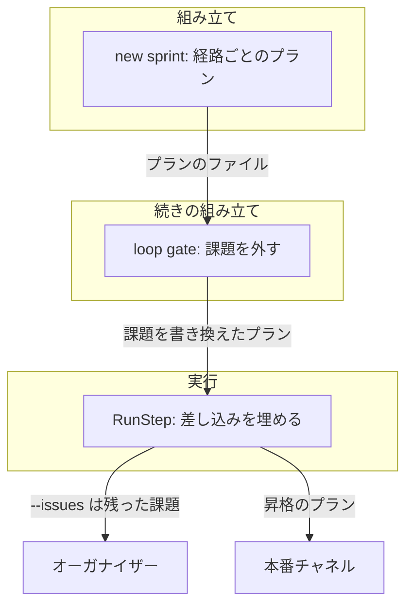
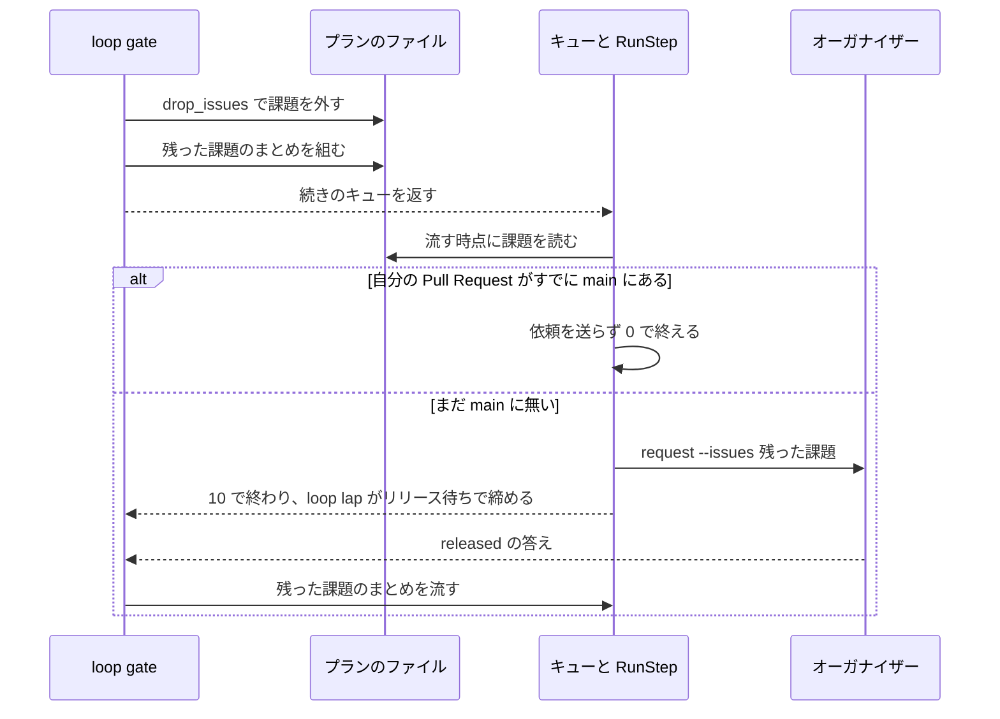

# 並列の計画のレーン: `loop sprint` が組んだプランを手で置き換えずに流し切る（#2717）

## 目的

- **今どうなっているか**: 昇格でリリースするリポジトリのレーンで、conductor が昇格のプランをリリースの依頼へ手で置き換えている（volareinc/carul の周回 8・14）。設計承認ゲートで課題を外した周回では、リリースの依頼のコマンドに外した課題が残る
- **誰に効くか**: 並列の計画でレーンを回す conductor と、依頼を受けるオーガナイザー
- **変えると何が成り立つか**: レーンは組まれたプランをそのまま流し、外した課題に確定仕様化・閉じる判定・リリースの依頼が掛からない

## 適用範囲

- **働く範囲**: NDF を使うすべてのリポジトリの、並列の計画のレーンと開発ループ
- **プロジェクトごとに違うもの**: リリースの経路。`.ndf/supervise.json` の `release.form` と `.ndf/project.json` の `delivery` の宣言で受ける。新しい設定は足さない
- **当たるモード**: `standard`（工程の変更）。効く相手は `pace: auto` で組む開発ループの周回と、1 スプリントのレーン

## あるべき姿の根拠

| 根拠 | 種類 | 何を示すか |
| --- | --- | --- |
| 利用者の答え「未決 5: CD のリポジトリのレーンは昇格を直接流す（設計のまま）」（ https://github.com/devbasex/ai-plugins/issues/2623 の、2026-11-07 の利用者の答えの節） | 利用者の指示の原文 | 昇格の経路ではレーンが昇格のプランをそのまま流す |
| レーンの判定を真にして `route_waves` を実行した結果 `[('本番', ['promote'])]`（要求の「確かめた事実」の 1） | 実測 | 組み立ては昇格のプランを組んでいる。直す先はプランの形でなく手順書である |
| 周回 8 の答えの読み取りと main へのマージの差 16 時間 45 分（要求の「確かめた事実」の 5） | 実測 | 昇格を依頼へ置き換えると、本番へ届く前に周回が完了で締まる |
| 3 件の周回から 2 件を外すと、計画の `課題` は `[153]`、コマンドは `--issues 153 191 117`（要求の「確かめた事実」の 4） | 実測 | 課題の一覧のコピーがコマンドの中にあることが、依頼の一覧が古くなる原因である |

要求と受け入れ条件は #2717 の本文にある（コピーは `issues/issue-2717-requirements.md`）。この文書は「どう作るか」だけを扱う。

## ドメインモデル

### コンテキスト

| コンテキスト | 何の語が 1 つの意味に決まるか |
| --- | --- |
| NDF の開発ワークフロー（`ndf-workflow`） | プラン・ステージ・周回・レーン・まとめ |
| NDF のリリース（`ndf-release`） | リリースの経路・昇格のプラン・リリースの依頼 |

`ndf-workflow` が `ndf-release` の語を読む関係は、共有カーネルとする。どちらも NDF の同じリポジトリが持ち、共有するのは「リリースの経路」と「プランの `課題`」の 2 つである。

### 集約

| 集約 | 持ち主（書き換えてよいもの） | 根 | エンティティ | 値オブジェクト |
| --- | --- | --- | --- | --- |
| プラン | 組み立て（`supervise.py new`）が作り、組んだ後は続きの組み立て（`loop gate` の `drop_issues`）だけが `課題` を書き換える | プラン | ステップ | 課題の一覧・コマンド |
| 周回 | ループの記録（`sprint_loop`） | 周回 | 周回の結果 | 残った課題（`issues_kept`）・保留のまとめ（`close_plans`） |

ステップの実行はプランを読むだけで、`課題` を書き換えない。周回はプランをファイルのパスで参照する。

まとめのプランも同じ持ち主の規則に従う。`build_close` は `supervise.py new close` で残った課題のまとめを別のプランとして新しく作り、元のまとめの `課題` を書き換えない。どのまとめを流すかは周回が `close_plans` に持つ。不変条件 I5 を周回の行に置くのは、このためである。

### 不変条件

| # | 集約 | 条件 | 破れたときの扱い |
| --- | --- | --- | --- |
| I1 | プラン | リリースの経路が昇格のリポジトリのレーンでは、本番のステージは昇格のプラン 1 本で、リリースの依頼のプランを持たない | テストで落とす |
| I2 | プラン | テンプレートで出すリポジトリのレーンでは、本番のステージはリリースの依頼のプランである | テストで落とす |
| I3 | プラン | リリースの依頼のプランは、課題の一覧を `課題` だけに持つ。流すコマンドの `--issues` は流す時点の `課題` と一致する | テストで落とす |
| I4 | プラン | 設計承認ゲートで課題を外した周回の続きのプランの `課題` は、外した課題を含まない | テストで落とす |
| I5 | 周回 | リリース待ちで締めた周回が答えの後に流すまとめの `課題` は、残った課題と一致する | テストで落とす |
| I6 | プラン | 設計承認ゲートで課題を外さなかった周回のプランの課題の一覧は、組んだときのままである | テストで落とす |

### ドメインイベント

番号は要求のドメインイベントを引き継ぐ。

| # | イベント | 発生元 | 受け手 |
| --- | --- | --- | --- |
| E1 | 周回のプランを組んだ | `loop sprint` | conductor（パイプラインを流す） |
| E2 | 課題を人の判断待ちへ移した | `loop gate`（`move_to_waiting`） | 続きの組み立て（`continuation`） |
| E3 | 続きのプランから外した課題を除いた | `drop_issues` | ステップの実行（`{plan_issues}` を埋める） |
| E4 | 残った課題のまとめを組み直した | `build_close` | 周回の `close_plans` |
| E5 | 本番のステージが流れた | キュー | テンプレートの経路はオーガナイザー、昇格の経路は `loop lap` |
| E6 | 周回をリリース待ちで締めた | `handle_release_pending` | 周回の境の `loop select` |
| E7 | 答えの後にまとめを流した | `finish_pipeline` | `loop finish` |

### 用語

| 用語 | 意味 | 用語集への反映 |
| --- | --- | --- |
| 課題の差し込み | リリースの依頼のプランのコマンドが、課題の番号の代わりに持つ `{plan_issues}`。ステップを流す時点に、プランの `課題` の空白区切りで埋まる | 追加（`ndf-workflow`） |
| リリースの依頼 | レーンがリリース承認ゲートの手前で、リリースをオーガナイザーへ頼むために送る 1 件のメッセージ。テンプレートで出すリポジトリのレーンだけが送る | 意味の変更（`ndf-workflow`） |

## 機能一覧

| # | 機能 | 誰が使うか |
| --- | --- | --- |
| F1 | レーンの本番のステージをリリースの経路ごとに読み、組まれたプランをそのまま流す | レーンの conductor |
| F2 | 設計承認ゲートで課題を外した周回で、リリースの依頼に残った課題だけを載せる | オーガナイザー（依頼を受ける側） |
| F3 | 設計承認ゲートで課題を外した周回で、リリースの後のまとめが残った課題だけに掛かる | レーンの conductor と利用者 |

## 構成要素

文脈と配置は変わらない。レーンがオーガナイザーへ依頼を送る経路も、昇格の Pull Request を本番チャネルへ出す経路も、今のままである。

| 要素 | 責務 | 変更 |
| --- | --- | --- |
| `supervise_lib/steps.py` の `RunStep` | コマンドの `{plan_issues}` を、プランの `課題` の空白区切りで埋める | 変える |
| `lib/parallel_release.py` の `plan_release_request` | 依頼のコマンドに課題の番号でなく `{plan_issues}` を置く | 変える |
| `supervise_lib/plan.py` の説明 | `{plan_issues}` の置き換えを `{state_dir}` の隣に書く | 変える |
| `lib/parallel_plan.py` の `render_md`・`render_handoff` | 並列の計画の文書の「レーンに共通の決まり」と、引継ぎ文書の「進め方（利用者の指示）」を、リリースの経路ごとの動きと、手で置き換えないことに書き換える | 変える |
| `references/parallel.md`・`references/loop.md`・`references/asking.md` | レーンの本番のステージをリリースの経路ごとに示す | 変える |
| 確定仕様 `ndf-production-release-record.md` | 昇格の経路が置き換えの対象でないことと、`prod_plans` を通る経路を書く | 変える |
| 用語集（`docs/glossary/glossary.json`・`docs/glossary.md`） | 用語の表の 2 語を反映する | 変える |
| `lib/sprint_loop_gate.py` の `drop_issues`・`continuation`・`handle_release_pending` | 課題を外し、まとめを組み直し、周回をリリース待ちで締める | 変えない。受け入れ条件 3・6・7 の退行のテストで守る |
| `supervise_lib/sprint.py` の `prod_plans`・`sprint_routes.py` の `route_waves` | 経路ごとの本番のステージを組む | 変えない。受け入れ条件 1・2 の退行のテストで守る |
| オーガナイザー（`lib/parallel_run.py`・`lib/parallel_release.py`・Factory の `factory/api/src/organizer/control.ts`） | 範囲の決定と依頼への答え | コードは変えない。Factory の経路では、依頼の `issues` が範囲の対応づけの入力になるため、結果が変わる場合がある（決定 5） |



手順書・確定仕様・用語集は実行に関わらないため、図に載せない。

## 決定の記録

### 決定 1: 課題の一覧の置き場を 1 つにするため、リリースの依頼のコマンドは番号の代わりに差し込みを持つ

依頼のコマンドに番号を埋めると、プランの `課題` と 2 か所に一覧が残り、片方だけが書き換わる。差し込みなら `drop_issues` を変えずに、流す時点の `課題` がコマンドへ入る。`{state_dir}` と同じ形で、`steps.py` の 1 行で済む。

| 採らなかった形 | 理由 |
| --- | --- |
| `drop_issues` がコマンドの文字列から番号を消す | シェルのコマンドを文字列として編集することになり、一覧のコピーも残る。`sprint_loop_gate.py` は行数の例外を持つファイルで、要求が例外を上げないと定めている |
| `loop gate` がプランを組み直す | 組み立ての引数が周回の記録に無い |

根拠: Value 7 / Value 8（MVV 版 6）

### 決定 2: 昇格の経路は組み立てを変えず、手順書と並列の計画の文書を直す

実行で確かめたとおり、組み立ては昇格のプランを組む。手で置き換えが起きた原因は、手順書と並列の計画の文書が経路を分けずに「本番を自分で出さない」と書いていることにある。利用者の答えのとおり直接流す。

組み上がったプランの手での編集を検知する形は採らない。要求の「含まない」にあり、決まりを足すより原因の文を直す方が小さい。

根拠: Value 7 / Value 5（MVV 版 6）

### 決定 3: レーンが最初に読む決まりを同じ変更で直すため、並列の計画の文書と引継ぎ文書の行を変更に含める

「レーンは本番を自分で出さない」の文は、受け入れ条件 9〜11 の文書の外の 3 か所にもある。手順書だけを直すと同じ文が残るため、受け入れ条件の文書と同じ扱いで書き換える。

| 場所 | 今の文 | 読み手 |
| --- | --- | --- |
| 並列の計画の文書（`lib/parallel_plan.py:303`、`render_md`） | レーンは本番を自分で出さず、リリースの依頼を送る | レーンの conductor |
| 引継ぎ文書（`lib/parallel_plan.py:329`、`render_handoff`） | リリースは自分で出さず、オーガナイザーへリリースの依頼を送る | レーンの conductor。節「進め方（利用者の指示）」として最初に読む |
| `references/asking.md` の 72 行目 | 本番のステージはリリースの依頼のプランになる | レーンの conductor |

生成する 2 つの文書の文は、宣言を読まずに経路ごとの動きを 1 行で書く。計画を組む時点で宣言を読むと、宣言を直した後に文書が古くなる。経路の判定は `prod_plans` と `route_waves` が持つ。

根拠: Value 7（MVV 版 6）

### 決定 4: 表のコピーを作らないため、2 つの手順書は別の軸の表を持つ

`parallel.md` の「レーンの側」が、経路ごとの本番のステージとレーンがすることの表を持つ。`loop.md` の「並列の計画のレーン」は、経路ごとの周回の締め方の表を持ち、詳細は `parallel.md` を指す。どちらにも「昇格の経路ではレーンが昇格のプランをそのまま流す」と「組み上がったプランを手で置き換えない」を書く。`parallel.md` の外のオーガナイザーのレーンの表の「本番のステージ」の行も、テンプレートで出すリポジトリの動きとして書き直す。

同じ表を 2 つの文書へ写す形は採らない。片方だけが古くなる。

根拠: Value 8（MVV 版 6）

### 決定 5: オーガナイザーの範囲の判定のコードは変えず、Factory の経路で結果が変わることを設計承認ゲートで見る

範囲の内訳は `parallel_release.py` の `map_lanes`（46 行目）が、レーンの `input.issues` と Pull Request の閉じる課題から決める。この値の出所が、オーガナイザーの種類で違う。

| オーガナイザー | レーンの `input.issues` の出所 | この設計の影響 |
| --- | --- | --- |
| 1 台の中（`parallel.py`） | 並列の計画のレーンの入力 | 無い。依頼の `issues` は入らない |
| 外（Factory） | 依頼の `issues` を集めた値 | ある。外した課題が入力から消える |

`lib/parallel*.py`・`parallel.py`・`factory/api/src/organizer/`・`factory/runner/src/organizer.ts` で `issues` を検索した結果は次のとおりである。

| 当たった箇所 | 値 |
| --- | --- |
| 依頼を書く側の引数 | `a.issues` |
| 1 台の中の計画のレーンの入力 | `input.issues` |
| Factory の依頼の読み取り | `factory/runner/src/organizer.ts:95` が依頼の `issues` を読む |
| Factory のレーンの集約 | `control.ts:365` が依頼の `issues` をレーンへ集め、674 行目が `batch.json` の `lanes[].issues` へ出す |
| 外のオーガナイザーのレーンの入力 | `parallel_external.py:158` の `ln.get("issues")`。値は上の `lanes[].issues` である |

依頼の鍵を見るのは、1 台の中では `parallel_lane.py` の形の検査（`for k in ("prs", "issues")`）だけである。

Factory の経路で、依頼の `prs` に載らず、外した課題だけを閉じる Pull Request が範囲にあると、対応づけの結果が変わる。`plan_of` と `map_lanes` を実行した結果は次のとおりである（Pull Request 10 は依頼の `prs` にあり #153 を閉じ、11 は依頼の `prs` に無く #191 を閉じる）。

```text
lanes[].issues = [153, 191, 117] → レーン a: prs [10, 11]、orphans []
lanes[].issues = [153]           → レーン a: prs [10]、orphans [11]
```

変わるのは提示の表だけである。`orphans` を読むのは提示の表（`parallel_release.py:69`・`75`）、提示の記録（`parallel_external.py:257`）、コマンドの出力（`parallel.py:249`・`parallel_external_cli.py:67`）で、`lib/parallel_run.py` と Factory のコードには当たらない。リリースの範囲は承認資料の Pull Request で決まり、答える依頼は `answerable` が依頼の `prs` で決めるため、どちらも `issues` の影響を受けない。

外した課題はそのレーンのリリースに含まれないため、この結果を受け入れてコードは変えない。要求の境界の「確認してから行う」に当たるかは入力の変化として判断が分かれるため、設計承認ゲートで利用者が確かめる（「未確認のまま残ること」）。

根拠: Value 7（MVV 版 6）

### 決定 6: #2623 と #2707 の実装を待たずに入れ、節の持ち主は `parallel.md` の「レーンの側」とする

この課題の手順書の変更は、`parallel.md` の「レーンの側」と外のオーガナイザーのレーンの 1 行、`loop.md` の「並列の計画のレーン」に閉じる。#2623 と #2707 は同じファイルの別の節を主に変えるため、先に入れて、衝突は後から入る側の取り込みで解く。リリースの工程を CD へ移す #2623 が経路の扱いを変えるときは、この表の行を直す。

昇格で `record` が落ちる不具合 #2568（未解決。親は #2663）も待たない。依存するのは、キューの先頭のステージが昇格のプランである周回（昇格だけの周回）に限られる。検査のステージと同じキューで流す周回では、`{queue_prs}` が前のステージの Pull Request で埋まる（`supervise_lib/queue.py:229`）。受け入れ条件 12 の「昇格のプランが流れ切る」は、#2568 が閉じるまでは、検査のステージと同じキューで流す周回で確かめる。

根拠: Value 1（MVV 版 6）

## 外部の調査

省く: プランの差し込みは既存の `{state_dir}` と同じ形の項目を 1 つ足すもので、レーンの本番のステージの扱いは利用者の答えとプロジェクトの中の取り決めだけで決まる。外部の標準・製品・ライブラリの判断が要らない。

## 入出力の契約

| 約束 | 変更 |
| --- | --- |
| `parallel.py request` の引数 | 変えない |
| リリースの依頼の形（`contracts/forms/parallel-request.json`） | 変えない。`issues` の値だけが残った課題になる |
| プランのステップの `cmd` | 差し込み `{plan_issues}` を足す。埋まる値はプランの `課題` の番号の空白区切りで、`課題` が空なら空文字である |

## 処理の流れ

### リリースの経路ごとのレーンの本番のステージ

レーンの本番のステージは、手順書に次の 2 つの表で書く。行の値は今のコードの振る舞いである。

開発ループの周回（`pace: auto`）:

| リリースの経路 | 本番のステージ | レーンがすること | 周回の締め方 |
| --- | --- | --- | --- |
| テンプレートで出す | リリースの依頼のプラン | 依頼を送る | リリース待ち。答えの後にまとめを流す |
| 昇格 | 昇格のプラン | そのまま流す | 同じキューでまとめを流して締める |
| マージで届く | 導入の確認のプラン | そのまま流す | 同じキューでまとめを流して締める |
| 手で届ける | 手で行うリリースのステージ | 今のまま変えない（要求の「含まない」） | 今のまま変えない |

1 スプリントのレーン:

| リリースの経路と進め方 | 本番のステージ | レーンがすること | 締め方 |
| --- | --- | --- | --- |
| テンプレートで出す | リリースの依頼のプラン | 依頼を送り、`parallel.py await` で答えを待つ | `released` の後にまとめのステージを流す |
| 昇格・`pace: normal` | 昇格のプラン | そのまま流す。`promote` がリリース承認ゲートで終わり、問いをオーガナイザーへ送る。承認の答えの後に `--from promote-approved` で続ける | 昇格のプランはまとめを持たない。流れ切った後に conductor が `new close` のプランを流す |
| 昇格・`pace: fast`・`auto` | 昇格のプラン | そのまま流す。MVV 判定が通ると本番チャネルへマージする | 同上 |
| マージで届く・`pace: fast`・`auto` | 導入の確認のプラン | そのまま流す | 同上 |
| マージで届く・`pace: normal` | 置かない | 無し | conductor が `new close` のプランを流す |
| 手で届ける | 手で行うリリースのステージ | 今のまま変えない（要求の「含まない」） | 今のまま変えない |

### 課題を外した周回の続きの流れ

設計承認ゲートで課題を外した周回の、続きの流れ（テンプレートで出すリポジトリ）。



シーケンス図に載せていない場合の動きは次のとおりである。

| 場合 | 動き |
| --- | --- |
| 差し込みを埋めた後の `request` が失敗した | 今と同じくステップの失敗として止まる |
| 昇格の経路 | 差し込みを持たず、昇格のプランの `課題` を `drop_issues` が書き換えるだけである |
| 昇格の経路で MVV 判定が通らなかった | `gate2_returned` で止まる |
| 昇格だけの周回で `record` が `{queue_prs}` の未置換で落ちた | 本番チャネルへのマージの後に落ちる（#2568）。判断のステップ `judge-record` へ進むが、やり直しても同じ文字列のままなので止める。リリース記録は残らず、まとめは流れない。手で置き換えていた周回はこの経路を通らなかったため、この設計で置き換えをやめると昇格だけの周回がこの経路に入る。#2568 の実例では、まとめを後から流し直して通った |

## 設計の結果

| 課題 | 扱い | 取り込み先 | 触るファイル |
| --- | --- | --- | --- |
| #2717 | 実装する | — | `plugins/ndf/scripts/supervise_lib/steps.py`、`plugins/ndf/scripts/supervise_lib/plan.py`、`plugins/ndf/scripts/lib/parallel_release.py`、`plugins/ndf/scripts/lib/parallel_plan.py`、`plugins/ndf/scripts/tests/`、`plugins/ndf/skills/development-workflow/references/`、`docs/specifications/ndf-production-release-record.md`、`docs/glossary/glossary.json`、`docs/glossary.md` |

## テスト設計

| 受け入れ条件・不変条件 | どの振る舞いで縛るか | どう壊したら落ちるべきか |
| --- | --- | --- |
| 受け入れ条件 1 / I1 | レーンの判定を真にして昇格の経路の `pace: auto` のスプリントを組むと、本番のステージは `promote` 1 本である | `route_waves` が `prod_plans` を通るように変えると落ちる |
| 受け入れ条件 1 / I1 | レーンの判定を真にして昇格の経路の `pace: normal` のスプリントを組むと、本番のステージは `promote` 1 本で、`promote` のステップはリリース承認ゲートで終わる | `sprint_plans` の経路のステージがレーンの判定を通るように変えると落ちる |
| 受け入れ条件 2 / I2 | レーンの判定を真にしてテンプレートの経路で組むと、本番のステージは `release-request` である | `prod_plans` がレーンを見ないように変えると落ちる |
| 受け入れ条件 3 / I4 | 昇格の経路の周回で 3 件中 2 件を外すと、昇格のプランの `課題` は 1 件である | `drop_issues` が昇格のプランを飛ばすと落ちる |
| 受け入れ条件 4 / I3 | 3 件の周回で 2 件を外して依頼のステップを流すと、打ったコマンドの `--issues` は 1 件である。組んだプランの `cmd` に課題の番号が無い | 組み立てが番号を埋め戻す、`RunStep` が差し込みを埋めないと落ちる |
| 受け入れ条件 5 / I3 | 同じ周回の依頼の記録の `issues` は 1 件である | コマンド以外の経路で元の一覧を渡すと落ちる |
| 受け入れ条件 6 / I4 | 同じ周回の続きのキューのまとめの `課題` は 1 件である（既存の `test_gate_1_points_the_held_close_at_the_close_without_the_waiting_issue` を保つ） | `continuation` がまとめを組み直さないと落ちる |
| 受け入れ条件 7 / I5 | 同じ周回をリリース待ちで締め、`released` の答えで組まれるパイプラインのまとめの `課題` は 1 件である | `handle_release_pending` が組み直す前のまとめを控えると落ちる |
| 受け入れ条件 8 / I6 | 課題を外さなかった周回では、3 種類のプランの `課題` と、依頼の `--issues` が組んだときの全件である | 差し込みが `課題` 以外を読むと落ちる |
| 差し込みの境界 | `課題` が空のプランでは `--issues` の値が空で、`request` が断らない | 差し込みが `None` などの文字を埋めると落ちる |
| 受け入れ条件 9〜11 | レビューで文書を読んで確かめる。`.md` の文言を照合するテストは書かない | — |
| 受け入れ条件 12 | リリース後テストで、開発対象リポジトリのレーンの次の周回のプランのディレクトリに `*.bak` が無く、本番のステージが流れ切ったことを見る。#2568 が閉じるまでは、検査のステージと同じキューで流す周回で見る（決定 6） | — |

既存の `test_release_request_plan_has_one_gate_step` は、番号の代わりに差し込みを期待する形へ直す。

## 未確認のまま残ること

| 項目 | 内容 |
| --- | --- |
| レーンの昇格を直接流すか（要求の未決 1） | 設計承認ゲートで利用者が決める。この設計は利用者の 2026-11-07 の答えのとおり直接流す形で書いた。覆るときは、オーガナイザーが昇格を組む変更が加わる |
| レーンの直接の昇格で MVV 判定が通らなかったときの問い | コードを読んだ範囲では、`handle_gate2` にレーンの分岐は無く、ループは `gate2_returned` で止まる。問いが `ndf-gate:2` としてオーガナイザーへ届き、`loop hold-question` で質問待ちへ移れるかは、動かしていない。実例の周回か、リリース後テストで確かめる |
| 1 スプリントのレーンの昇格のリリース承認ゲート | 手順書の表のとおり問いがオーガナイザーへ送られ、`--from promote-approved` で続くかは、コードと手順書を読んだ範囲の結果で、動かしていない。昇格の経路の `pace: normal` のレーンの実例か、リリース後テストで確かめる |
| Factory の経路で、外した課題を閉じる Pull Request が提示の表の「レーンの無い Pull Request」へ移ること | 実行で確かめた（決定 5）。要求の境界の「確認してから行う」に当たるかは、設計承認ゲートで利用者が決める。発生する頻度は未確認である |
| 受け入れ条件 12 と #2568 の関係 | 要求の前提 3 は受け入れ条件が #2568 の解決に依存しないと書くが、昇格だけの周回に限って依存する。この設計は検査のステージと同じキューで流す周回で確かめる形にした（決定 6）。前提 3 の文を課題の本文で直すかは、設計承認ゲートで利用者が決める |
| 他のレーンの `develop` の変更が直接の昇格に入ること | 要求の「含まない」にある。未決 1 の材料として残す |
| 設計の結果のステージの `--design` に外した課題が残ること | `continuation` は `--design` の番号を書き換えない。外した課題の設計 PR はマージされていないため「読めなかった設計の課題」として報告に載り、実装のプランは今の振る舞いで流れる。報告の文だけに表れる。課題の一覧のコピーが残る箇所として、確定仕様化のときに見直す |
