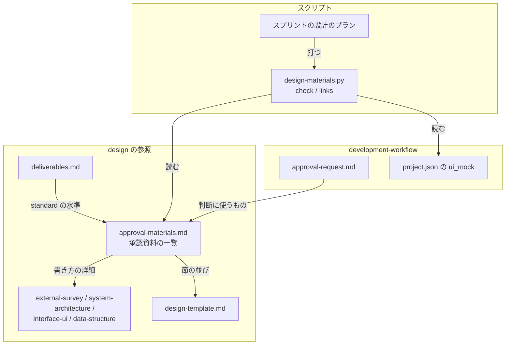
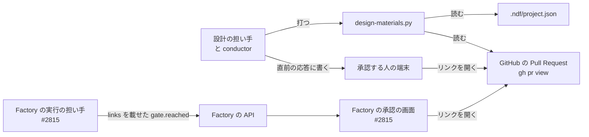
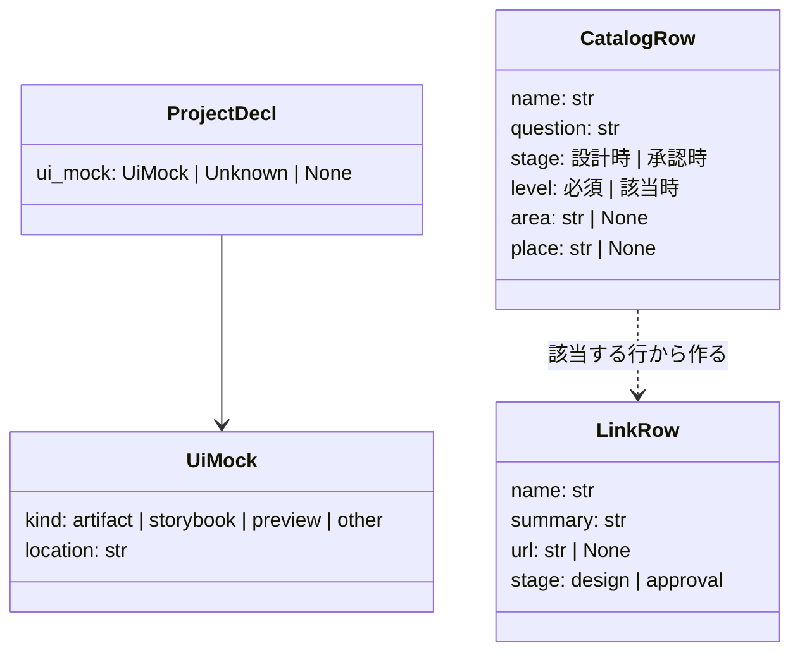
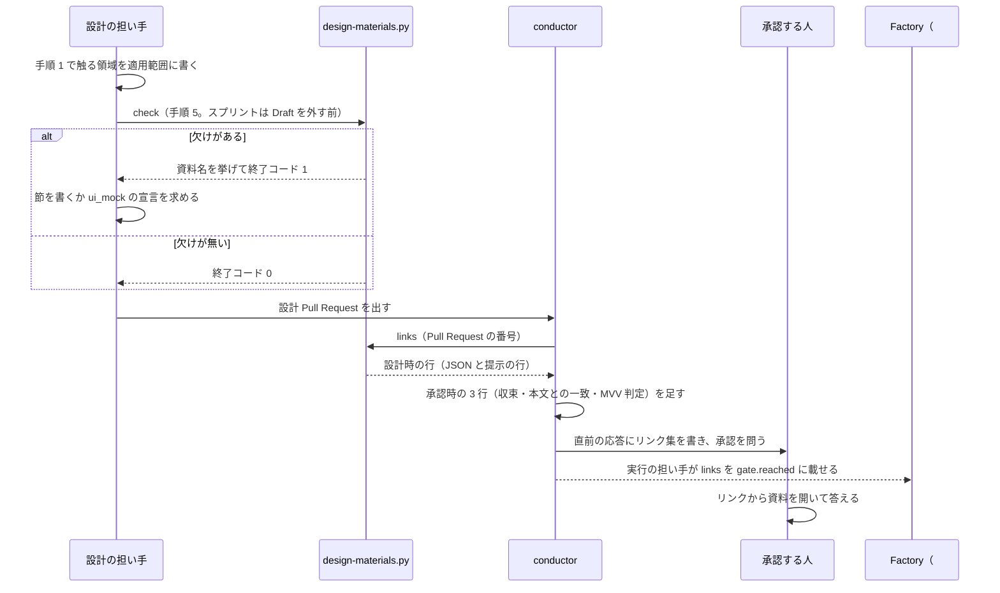

# 設計承認ゲートの承認資料: 一覧で過不足を決め、CLI と Factory でリンク集として開ける（#2721）

## 目的

- **今どうなっているか**: 設計で書く成果物の多く（データ構造の図・画面・技術の選定・非機能・構成図）が設計承認ゲートの提示に現れない。動作する画面モックと周辺システムとの関係は、書き方の定義も無い。承認する人は設計文書を探して読むまで判断できない
- **誰に効くか**: 設計承認ゲートで承認する人と、`standard` の設計を書く担い手
- **変えると何が成り立つか**: 承認資料が 1 つの一覧で過不足なく決まり、欠けた資料は検査が名前で挙げる。承認する人は CLI でも Factory でも、資料 1 件 1 行のリンク集から各資料を開いて判断できる

## 適用範囲

- **働く範囲**: NDF を使うすべてのリポジトリの、`standard` の設計と設計承認ゲート。Factory の画面は規定までで、実装は #2815 が持つ
- **プロジェクトごとに違うもの**: 画面モックの表現方法。`.ndf/project.json` の新しい欄 `ui_mock` で受ける。ほかに新しい設定は足さない
- **当たるモード**: `standard`。`legacy-refactor` の設計 Pull Request はリンク集の組み立てだけを使う。`light` / `operation` / `documentation` の工程は変えない
- **触る領域**: 構成要素・型と振る舞い・呼び出される約束・非機能・ドメインモデル（Factory の画面は規定だけで作らないため、画面に当たらない）

## あるべき姿の根拠

| 根拠 | 種類 | 何を示すか |
| --- | --- | --- |
| 依頼の原文「メインのコンソールや Web 画面はリンク集となり、各リンクをたどって見れるようにすることが望ましい」（要求の「依頼（原文）」） | 利用者の指示の原文 | 提示の本体は資料 1 件 1 行のリンク集にする |
| 依頼の原文「画面モック（動作するもの）…プロジェクトでの表現方法の定義を必須とする」 | 利用者の指示の原文 | 画面モックの置き場はプロジェクトの設定で宣言し、無いときは止める |
| arc42 の 12 節・C4 モデルの 4 階層と補助の図（STD1・STD2） | 外部の一次情報 | 構成要素・文脈・配置・実行時の振る舞い・決定・品質・リスク・用語を、別々の問いとして持つ |
| Google の設計文書の「cross-cutting concerns such as security, privacy, and observability」（PRD1） | 外部の一次情報 | セキュリティ・ログとアラートは、周辺との接し方として必ず問う |
| `grep -rn "モック" plugins/ndf/skills/design plugins/ndf/skills/development-workflow` が 0 件（要求の「今の定義」） | 実測 | 画面モックの書き方と置き場の定義が今は無い |

要求と受け入れ条件は #2721 の本文にある（コピーは `issues/issue-2721-requirements.md`）。この文書は「どう作るか」だけを扱う。
決定の記録は [issue-2721-design-decisions.md](issue-2721-design-decisions.md) に分けた。

## ドメインモデル

### コンテキスト

| コンテキスト | 何の語が 1 つの意味に決まるか |
| --- | --- |
| NDF の開発ワークフロー（`ndf-workflow`） | 承認資料・承認資料の一覧・リンク集・画面モック・デザインイメージ・技術スタックの一覧・周辺システムとの関係・触る領域 |
| Factory（`ndf-factory`） | 承認の依頼の事象・承認の画面 |

`ndf-workflow` と `ndf-factory` の関係は公開された言語（Published Language）とする。リンク集の 1 行の形（資料名・要旨・リンク・作る段階）を先に固め、NDF はその形で出し、Factory はその形で受ける。互いの実装は独立して変えられる。

### 集約

| 集約 | 持ち主（書き換えてよいもの） | 根 | エンティティ | 値オブジェクト |
| --- | --- | --- | --- | --- |
| 承認資料の一覧 | `design/references/approval-materials.md` を変える Pull Request だけ | 一覧 | 資料の行 | 水準・作る段階・該当の判定（触る領域）・置き場の節 |
| 設計文書 | 設計の担い手（`design`） | 設計文書 | 節 | 触る領域の行・`無し（<理由>）` の行 |
| プロジェクトの宣言 | 利用者と `project-decl.py write` | 宣言 | — | 画面モックの表現方法（`ui_mock`） |
| リンク集 | 設計時の行は `design-materials.py links`、承認時の行は conductor | リンク集 | 行 | 資料名・要旨・リンク |

検査（`design-materials.py check`）は 3 つの集約を読むだけで、どれも書き換えない。

### 不変条件

| # | 集約 | 条件 | 破れたときの扱い |
| --- | --- | --- | --- |
| I1 | 承認資料の一覧 | 資料名は重複しない。水準は `必須` か `該当時`、作る段階は `設計時` か `承認時` で、`該当時` の行は既知の触る領域を 1 つ持つ | 検査とリンク集の組み立てが、一覧の壊れた行を挙げて終了コード 2 で止まる |
| I2 | 設計文書 | 該当する資料の置き場の節が、本文を持って存在する | 検査が資料名を 1 件ずつ挙げて終了コード 1 で終わる |
| I3 | 設計文書 | 触る領域の行が無いときは、`該当時` の資料をすべて該当として扱う | （判定の規則。破れる経路は無い。I2 の検査が欠けを挙げる） |
| I4 | プロジェクトの宣言 | 触る領域に画面がある（か判定できない）設計では、画面モックの表現方法が宣言されている | 検査が「画面モックの表現方法が未宣言」を挙げて終了コード 1 で終わる。画面が無い設計では挙げない |
| I5 | リンク集 | 該当しない資料の行を出さない。必須で対象が無い資料は `無し（<理由>）` の 1 行で出す | 組み立てがこの規則でだけ行を作る |
| I6 | リンク集 | 1 行は資料名・改行を含まない 120 字以内の要旨・リンクで、資料の中身を写さない | 要旨を 120 字で切り、末尾に `…` を付ける |

### ドメインイベント

| # | イベント | 発生元 | 受け手 |
| --- | --- | --- | --- |
| E1 | 設計で触る領域を決めた | 設計の担い手（手順 1） | 設計文書の触る領域の行 |
| E2 | 該当する資料の一覧が決まった | `design-materials.py`（一覧と触る領域から） | 検査とリンク集の組み立て |
| E3 | 資料を書いた（画面を変えるなら、画面モックを宣言どおりの置き場に置いた） | 設計の担い手 | 検査 |
| E4 | 資料の欠けの検査を通した | `design-materials.py check`（単発は手順 5、スプリントは Draft を外す前） | 設計 Pull Request の作成か Draft の解除 |
| E5 | 設計 Pull Request を出した | `pr` | リンク集の組み立て |
| E6 | CLI で承認の提示を組み立てた | conductor（`design-materials.py links` の行に承認時の 3 行を足す） | 承認する人 |
| E7 | Factory に承認の依頼と資料のリンク集が届いた | 実行の担い手（`factory/runner/`。#2815） | Factory の承認の画面 |
| E8 | 承認する人がリンク集から資料を開いて承認か差し戻しを答えた | 承認する人 | 差し戻しの記録（`gate-rejections.jsonl`） |

### 用語

| 用語 | 意味 | 用語集への反映 |
| --- | --- | --- |
| 承認資料の一覧 | 設計承認ゲートで示しうる資料を、資料名・判断する問い・作る段階・水準・該当の判定・形式・書き方の詳細・根拠・置き場の節とともに並べた正本の表 | 追加（要求で足した行の正本を `approval-materials.md` へ移す） |
| 画面モック | 画面を変える変更で、承認する人が実際に操作して挙動を確かめられる試作の画面。見た目だけを示すデザインイメージとは別の資料 | 追加（同上） |
| デザインイメージ | 画面の見た目を示す画像か、見た目の値（色・寸法・字面）の記述 | 追加（同上） |
| 技術スタックの一覧 | 変更が使うインフラ・外部サービス・ライブラリと、それぞれを採った理由（新規のものは比べた候補、自作するものは既存のライブラリを採らなかった理由）を並べた表 | 追加（同上） |
| 周辺システムとの関係 | 変更が接する既存の機能と外部の系（セキュリティ・データ分析・ログ出力とアラートを含む）と、その接し方 | 追加（同上） |
| リンク集 | 承認の提示の本体の形。資料 1 件につき 1 行で、資料名・要旨・開くリンクを並べる | 追加（同上） |
| 触る領域 | 設計の手順 1 で決める、変更が触る設計の領域。語は `design` の手順 1 の表の 7 つ（構成要素・型と振る舞い・永続データ・呼び出される約束・画面・非機能・ドメインモデル）に限る | 追加 |

## 外部の調査

| 種類 | 調べるか | 理由 |
| --- | --- | --- |
| 標準・仕様 | 調べる | 設計文書と決定の記録の書式（arc42・C4 モデル・ADR）と、見出しへのリンクの規則に事実上の標準がある |
| 主要な製品 | 調べる | 設計レビューの資料を主要な組織がどう組んでいるか（Google の設計文書・Rust の RFC）を比べる |
| ライブラリとサービス | 調べる | 動作する画面モックの置き場（Storybook・Chromatic・プレビュー環境・Claude の artifact）と、検査に使える手元の部品を比べる |

### 標準・仕様

| # | 標準・仕様 | 何を定めているか | 設計への反映 | 出典 |
| --- | --- | --- | --- | --- |
| STD1 | arc42 | 設計文書の 12 節（Introduction & Goals・Constraints・Context & Scope・Solution Strategy・Building Block View・Runtime View・Deployment View・Crosscutting Concepts・Architectural Decisions・Quality Requirements・Risks & Technical Debt・Glossary） | 一覧の行の分け方（文脈・構成要素・実行時の振る舞い・配置・決定・品質・リスク・用語を別の問いにする）と根拠の列 | https://arc42.org/overview （2026-11-08） |
| STD2 | C4 モデル | 4 階層（System context・Container・Component・Code）と補助の図（system landscape・dynamic・deployment） | 構成要素の行と周辺システムとの関係の行を分け、文脈図と配置図を周辺の行に置く | https://c4model.com/ （2026-11-08） |
| STD3 | ADR（Architectural Decision Record） | 「captures a single AD and its rationale」。MADR・Nygard・Y-Statement のテンプレート | 決定の記録を 1 行に保ち、採らなかった案と理由を同じ行の資料にする | https://adr.github.io/ と https://adr.github.io/adr-templates/ （2026-11-08） |
| STD4 | Nygard の ADR の書式 | title・context・decision・status・consequences | 決定の記録の行の根拠 | https://cognitect.com/blog/2011/11/15/documenting-architecture-decisions （2026-11-08） |
| STD5 | Design Tokens Format Module 2025.10 | 見た目の値の交換形式（`$value` が必須、`$type`・`$description` は任意）。W3C の標準の過程に無い Community Group の文書 | デザインイメージの「見た目の値の記述」の形として指す（`interface-ui.md` の既存の記述を引き継ぐ） | https://www.designtokens.org/tr/drafts/format/ （2026-11-08） |
| STD6 | GitHub の見出しへのリンク | 小文字にし、空白をハイフンへ、ほかの空白と記号を除く。重なれば `-1` から番号を足す | リンク集の URL のアンカーを、既存の `md.heading_anchor` で作る | https://docs.github.com/en/get-started/writing-on-github/getting-started-with-writing-and-formatting-on-github/basic-writing-and-formatting-syntax （2026-11-08） |

### 主要な製品

| # | 製品 | どう解いているか | 設計への反映 | 出典 |
| --- | --- | --- | --- | --- |
| PRD1 | Google の設計文書 | Context and scope・Goals and non-goals・The actual design（system-context diagram・APIs・data storage）・Alternatives considered・Cross-cutting concerns。cross-cutting は「security, privacy, and observability」を必ず考える節 | 周辺システムとの関係の行に、セキュリティ・データ分析・ログとアラートの観点を固定で置く | https://www.industrialempathy.com/posts/design-docs-at-google/ （2026-11-08） |
| PRD2 | Rust の RFC のテンプレート | Summary・Motivation・Guide-level explanation・Reference-level explanation・Drawbacks・Rationale and alternatives・Prior art・Unresolved questions・Future possibilities | 外部の調査（Prior art）と未確認のまま残ること（Unresolved questions）を独立した行にする | https://github.com/rust-lang/rfcs/blob/master/0000-template.md （2026-11-08） |

### ライブラリとサービス

| # | 候補 | 版 | ライセンス | 最後のリリースの日付 | 終了のアナウンス | 要件を満たすか | 出典 |
| --- | --- | --- | --- | --- | --- | --- | --- |
| LIB1 | `plugins/ndf/scripts/lib/md.py`（Markdown の節・表・見出しのアンカーを読む既存の部品） | リポジトリの HEAD | リポジトリの LICENSE | — | 無し | 満たす。節の範囲・表のセル・アンカーを読める | `plugins/ndf/scripts/lib/md.py`（2026-11-08） |
| LIB2 | Storybook | 10.6 | 未確認 | 未確認 | 無し | 満たす（部品と画面を単独で動かせる。静的に組んで公開し、レビューで操作できる） | https://storybook.js.org/docs と https://storybook.js.org/docs/sharing/publish-storybook （2026-11-08） |
| LIB3 | Chromatic | 未確認 | 未確認 | 未確認 | 無し | 満たす（Pull Request ごとに公開した Storybook のリンクをチェックに出す） | https://storybook.js.org/docs/sharing/publish-storybook （2026-11-08） |
| LIB4 | Vercel のプレビュー環境 | — | 未確認 | — | 無し | 満たす（ブランチと Pull Request ごとに URL が付く） | https://vercel.com/docs/deployments/environments （2026-11-08） |
| LIB5 | Claude の artifact | — | 未確認 | — | 無し | 満たす（小さな対話できる画面を作り、共有のリンクで開ける。Claude Code から非公開の URL で公開できる） | https://support.claude.com/en/articles/9487310-what-are-artifacts-and-how-do-i-use-them （2026-11-08） |
| LIB6 | `plugins/ndf/scripts/design-survey.py`（設計文書の決定を読む既存の検査） | リポジトリの HEAD | リポジトリの LICENSE | — | 無し | 一部。設計文書のまとまりを読む部分は使えるが、責務は決定の 2 行の検査 | `plugins/ndf/scripts/design-survey.py`（2026-11-08） |

### 確かめられなかったこと

| 対象 | 試した手段 | 結果と理由 |
| --- | --- | --- |
| LIB2〜LIB5 のライセンス・最後のリリースの日付・版 | 試していない | 依存として足さず、画面モックの表現方法の値の種類として名前を使うだけのため、取得の対象から外した |
| ADR の管理ツール（adr-tools・log4brains）が資料の欠けを検査できるか | 試していない | 検査の対象は設計文書の節であり、ADR の 1 ファイル 1 決定の形と合わないため調べなかった |
| Design Tokens Format Module の 39,945 字より後の節 | https://www.designtokens.org/tr/drafts/format/ | 取得の結果が要約だけで返り、原文を読めなかった。設計は先頭の節（`$value`・`$type`・`$description`）だけに拠る |

調べた量: 候補 14 件・取得の試み 13 回。

## 技術スタックの一覧

| # | 種類 | 名前 | 新規か既存か | 使う理由 | 比べた候補 |
| --- | --- | --- | --- | --- | --- |
| T1 | ライブラリ | `lib/md.py`・`lib/design_docs.py`・`lib/step_result.py`・`lib/project_decl.py` | 既存 | 節・表・アンカーの読み取り、文書のまとまり、結果の形、宣言の読み取りを既に持つ | LIB1・LIB6 |
| T2 | 自作 | `design-materials.py` | 新規 | 一覧の表と設計文書の節を突き合わせる検査は、手元の取り決め（一覧の列・触る領域の語）に依り、既存のツールに当たるものが無い | LIB1・LIB6・STD3 |
| T3 | インフラ・サービス | GitHub（`gh`） | 既存 | Pull Request の head ブランチを読み、URL を作る | — |

## 機能一覧

| # | 機能 | 誰が使うか |
| --- | --- | --- |
| F1 | 承認資料の一覧で、設計で書く資料と承認で見る資料を確かめる | 設計の担い手・承認する人 |
| F2 | 設計文書の欠けた資料を名前で知る | 設計の担い手・supervisor |
| F3 | 画面モックの表現方法をプロジェクトの設定に宣言する | 利用者 |
| F4 | CLI の提示のリンク集から資料を開いて承認する | 承認する人 |
| F5 | Factory の承認の画面のリンク集から資料を開いて承認する（規定まで。実装は #2815） | 承認する人 |

## 構成要素

| 要素 | 新設 / 変更 | 責務 |
| --- | --- | --- |
| `plugins/ndf/skills/design/references/approval-materials.md` | 新設 | 承認資料の一覧の正本（下の「承認資料の一覧」の表）。行の意味・水準の読み方・リンク集の 1 行の形を持つ |
| `plugins/ndf/skills/design/references/deliverables.md` | 変更 | 要否表から `standard` の列を外し、`standard` の水準は一覧が持つと書く。`standard` の省いた理由の書き先を「設計文書の該当の節の `無し（<理由>）`」に変える。`light` / `operation` / `legacy-refactor` の列と行は変えない |
| `plugins/ndf/skills/design/references/design-template.md` | 変更 | 適用範囲に触る領域の行を足す。節「技術スタックの一覧」「周辺システムとの関係」「画面」（「画面モック」「デザインイメージ」）を足し、「入出力の契約」を API だけの節にする。節と実装計画の対応の表へ 3 行を足す |
| `plugins/ndf/skills/design/references/external-survey.md` | 変更 | 技術スタックの一覧の書き方（種類・新規か既存か・使う理由・比べた候補）。調査の表の番号で候補を指す |
| `plugins/ndf/skills/design/references/system-architecture.md` | 変更 | 周辺システムとの関係の書き方（文脈図・配置図と、観点 5 行の表） |
| `plugins/ndf/skills/design/references/interface-ui.md` | 変更 | 画面モックとデザインイメージの書き方。画面モックは宣言された置き場へのリンクを節に置く |
| `plugins/ndf/skills/design/references/data-structure.md` | 変更 | データの流れの図（どのデータがどの構成要素と外部の系を通るか）の書き方 |
| `plugins/ndf/skills/design/SKILL.md` | 変更 | 手順 1 で触る領域を適用範囲に書く。手順 5 で `design-materials.py check` を打つ（`standard` だけ） |
| `plugins/ndf/skills/development-workflow/references/approval-request.md` | 変更 | 設計 Pull Request の「判断に使うもの」を一覧の参照に置き換え、提示の本体をリンク集にする。`documentation` の企画承認とリリース承認ゲートの節は変えない |
| `plugins/ndf/skills/development-workflow/references/project-analysis.md` | 変更 | `ui_mock` は解析で書かず利用者が書く、と答え方の表に 1 行足す |
| `plugins/ndf/scripts/design-materials.py` | 新設 | `check`（欠けの検査）と `links`（リンク集の設計時の行）。一覧の表を実行時に読む |
| `plugins/ndf/scripts/project_lib/model.py` | 変更 | `UiMock`（`kind`・`location`）を足し、`ProjectDecl` に省略できる `ui_mock` を足す |
| `plugins/ndf/skills/development-workflow/schemas/project.schema.json` | 変更（生成物） | `project-decl.py schema` で作り直す |
| `plugins/ndf/scripts/supervise_lib/procedures.py`・`plugins/ndf/scripts/supervise_lib/sprint_waves.py`・`plugins/ndf/scripts/supervise_lib/paths.py` | 変更 | スプリントの設計のプランに、欠けの検査（`materials-check`・`fix-materials`・`materials-recheck`）とリンク集の組み立て（`materials-links`）を足す。`gate` の入力に `materials-links` を足す |
| `plugins/ndf/contracts/entrypoints/plugins__ndf__scripts__design-materials.py.json` | 新設（生成物） | エントリポイントの契約。既存の生成の手順で作る |
| `plugins/ndf/scripts/tests/test_design_materials.py` | 新設 | 検査とリンク集の入出力のテスト |
| `docs/glossary/glossary.json`・`docs/glossary.md` | 変更 | 用語の 7 語の正本を `approval-materials.md` に向け（`pending_source` を `source` へ）、`glossary.py render` で作り直す |



## 承認資料の一覧

`approval-materials.md` に置く表の中身である（受け入れ条件 1〜5）。列「置き場の節」の `設計:` は設計文書、`要求:` は仕様のコピーの見出しで、見出しの階層は問わない。`—` は承認時に conductor が足す行である。

| # | 資料名 | 判断する問い | 作る段階 | 水準 | 該当の判定 | 形式 | 書き方の詳細 | 根拠 | 置き場の節 |
| --- | --- | --- | --- | --- | --- | --- | --- | --- | --- |
| M1 | 目的 | 何ができず、変えると何が成り立つか | 設計時 | 必須 | — | 箇条書き | `design-template.md` の「承認する人が読む欄」 | 今の定義・PRD1 | 設計: 目的 |
| M2 | 適用範囲 | どこまで効き、プロジェクトごとに違うものを何で受けるか | 設計時 | 必須 | — | 箇条書き | 同上 | 今の定義・STD1 | 設計: 適用範囲 |
| M3 | あるべき姿の根拠 | 変更後の形が適切だと言える根拠は何か | 設計時 | 必須 | — | 表 | 同上 | 今の定義・PRD2 | 設計: あるべき姿の根拠 |
| M4 | 起票者の推定 | 利用者がまだ決めていない条件は何か | 設計時 | 必須 | — | 表 | `requirements-design` | 今の定義 | 要求: 起票者の推定 |
| M5 | 要求と受け入れ条件 | 何を満たせば完了か | 設計時 | 必須 | — | チェックリスト | `requirements-design` | 今の定義 | 要求: 受け入れ条件 |
| M6 | ドメインモデル（コンテキスト・集約・不変条件・ドメインイベント） | 業務の境界と、守る条件・起きる出来事は何か | 設計時 | 必須 | — | 表 | `domain-model.md` | 今の定義 | 設計: ドメインモデル |
| M7 | 用語 | 新しく足す語・意味を変える語は何か | 設計時 | 必須 | — | 表 | `domain-model.md` | 今の定義・STD1 | 設計: 用語 |
| M8 | 外部の調査（標準・仕様、主要な製品と競合、ライブラリとサービス） | 業界の解き方と使える候補を比べたか | 設計時 | 必須 | — | 表 | `external-survey.md` | 今の定義・PRD2 | 設計: 外部の調査 |
| M9 | 技術スタックの一覧（新規のインフラ・サービス、使うライブラリ、自作するライブラリとビジネスロジック） | 何に依存し、何を自作するか。それぞれなぜか | 設計時 | 必須 | — | 表 | `external-survey.md` の「技術スタックの一覧」 | 利用者の指示の原文・STD1 | 設計: 技術スタックの一覧 |
| M10 | 機能一覧 | 誰が何をできるようになるか | 設計時 | 必須 | — | 表 | `deliverables.md` の「機能一覧表」 | 今の定義 | 設計: 機能一覧 |
| M11 | 構成要素（構成要素図・パッケージ構成） | 何を作り何を変え、責務はどこで分かれるか | 設計時 | 必須 | — | 表・`graph`・ツリー | `system-architecture.md` | 今の定義・STD1・STD2 | 設計: 構成要素 |
| M12 | 周辺システムとの関係（文脈図・配置図・セキュリティ・データ分析・ログ出力とアラート） | 変更が接する既存の機能と外部の系はどこで、どう接するか | 設計時 | 必須 | — | `graph`・表 | `system-architecture.md` の「周辺システムとの関係」 | 利用者の指示の原文・STD2・PRD1 | 設計: 周辺システムとの関係 |
| M13 | 型の構造（クラス図。オブジェクト図は型だけで伝わらないとき） | 変更が触る型はどう関係するか | 設計時 | 必須 | — | `classDiagram`・`graph` | `structure-behavior.md` | 今の定義・STD2 | 設計: 構造 |
| M14 | データ構造の図（ER 図・テーブル定義・CRUD 図・データの流れの図） | どのデータをどう持ち、誰がどう読み書きし、どこへ流れるか | 設計時 | 該当時 | 触る領域「永続データ」 | `erDiagram`・表・`graph` | `data-structure.md` | 利用者の指示の原文・PRD1 | 設計: データ構造 |
| M15 | 処理の流れ（処理の流れの図。状態遷移図は状態を持つとき） | どの順序と状態で動くか | 設計時 | 必須 | — | `sequenceDiagram`・`graph`・`stateDiagram-v2` | `structure-behavior.md` | 今の定義・STD1・STD2 | 設計: 処理の流れ |
| M16 | 入出力の契約（API 仕様記述） | 呼ぶ側との約束はどう変わるか | 設計時 | 該当時 | 触る領域「呼び出される約束」 | OpenAPI など | `interface-api.md` | 今の定義・PRD1 | 設計: 入出力の契約 |
| M17 | 画面の仕様（画面一覧・遷移図・項目定義・状態） | 画面のどこがどう変わるか | 設計時 | 該当時 | 触る領域「画面」 | 表・`graph` | `interface-ui.md` | 今の定義 | 設計: 画面 |
| M18 | 画面モック | 操作して挙動を確かめられるか | 設計時 | 該当時 | 触る領域「画面」 | 宣言された置き場へのリンク | `interface-ui.md` の「画面モック」 | 利用者の指示の原文・LIB2・LIB3・LIB4・LIB5 | 設計: 画面モック |
| M19 | デザインイメージ | 見た目がどうなるか | 設計時 | 該当時 | 触る領域「画面」 | 画像か見た目の値の記述 | `interface-ui.md` の「見た目の値」 | 利用者の指示の原文・STD5 | 設計: デザインイメージ |
| M20 | 非機能の実現方式 | 非機能の条件をどう満たすか | 設計時 | 必須 | — | 表 | `nonfunctional.md` | 今の定義・STD1 | 設計: 非機能の実現方式 |
| M21 | 決定の記録 | 何を選び、何を採らなかったか | 設計時 | 必須 | — | 小見出し | `decisions.md` | 今の定義・STD3・STD4 | 設計: 決定の記録 |
| M22 | テスト設計 | 受け入れ条件と不変条件をどう確かめるか | 設計時 | 必須 | — | 表 | `design-template.md` の「テスト設計に書く粒度」 | 今の定義 | 設計: テスト設計 |
| M23 | 未確認のまま残ること | 何が決まらずに残り、いつ決まるか | 設計時 | 必須 | — | 表 | `design-template.md` | 今の定義・STD1・PRD2 | 設計: 未確認のまま残ること |
| M24 | レビューの収束の状態 | ほかの担当が指摘を出し尽くしたか | 承認時 | 必須 | — | 1 行 | `cross-review` | 今の定義 | — |
| M25 | 本文との一致 | Pull Request の本文が設計文書と一致するか | 承認時 | 必須 | — | 1 行 | `approval-request.md` | 今の定義 | — |
| M26 | MVV 判定 | MVV に照らして進めてよいか | 承認時 | 必須 | — | 1 行 | `pace.md` の「MVV 判定」 | 今の定義 | — |

水準の `必須` は、対象が無いときに置き場の節へ `無し（<理由>）` を書くことを求める。設計時の行は 23 行で、そのうち `該当時` は M14・M16・M17・M18・M19 の 5 行である。

### 今の定義との対応（受け入れ条件 4）

要否表の 20 行（`deliverables.md` の「モード × 成果物の要否」）の対応:

| 要否表の行 | 一覧の行 |
| --- | --- |
| 承認する人が読む欄 | M1・M2・M3 |
| ドメインモデルの節 | M6・M7 |
| 外部の調査 | M8 |
| 機能一覧表 | M10 |
| 構成要素図 | M11 |
| システム構成図（文脈・配置） | M12 |
| クラス図 | M13 |
| オブジェクト図 | M13 |
| パッケージ・モジュール構成 | M11 |
| ER 図・テーブル定義・CRUD 図（3 行） | M14 |
| 処理の流れ・状態遷移図（2 行） | M15 |
| 画面一覧・遷移図・項目定義 | M17 |
| API 仕様記述 | M16 |
| 非機能設計表 | M20 |
| 決定の記録 | M21 |
| テスト設計 | M22 |
| 未確認のまま残ること | M23 |

`approval-request.md` の設計 Pull Request の「判断に使うもの」の 12 行の対応:

| 提示の項目 | 一覧の行 |
| --- | --- |
| 目的・適用範囲・あるべき姿の根拠 | M1・M2・M3 |
| 用語 | M7 |
| 起票者の推定 | M4 |
| 決めたこと | M21 |
| 作るもの | M11 |
| 満たすこと | M5 |
| 未確認のまま残ること | M23 |
| レビューの収束の状態 | M24 |
| 本文との一致 | M25 |
| MVV 判定 | M26 |

一覧にあって今の定義に無い行は M9・M18・M19 の 3 行で、依頼の 4 項目のうち技術スタックと画面に当たる。データ構造の図（M14）と周辺システムとの関係（M12）は今の行を含めて広げた。

## 周辺システムとの関係



| 観点 | 接する相手 | 接し方 | この変更で変わること |
| --- | --- | --- | --- |
| 既存の機能 | 外部の調査の検査（`design-survey.py`）・用語チェック・本文の決定の同期（`pr-body-decisions.sh`） | 同じ設計文書を読む。互いの出力は使わない | 無し。スプリントの設計のプランで、外部の調査の検査の後に並ぶ |
| 外部の系 | GitHub（`gh pr view` で head ブランチと URL を読む） | 読むだけ。書き込まない | `links` が読む。`gh` が使えないときは URL の代わりにリポジトリの中のパスを出す |
| セキュリティ（認証・認可・秘密） | `ui_mock.location` | URL かパスを書く欄で、秘密を書かない | `project-decl.py write` の秘密の形の値を捨てる既存の規則がそのまま掛かる。新しい認証・認可は無い |
| データ分析（計測・集計） | 承認の答えの記録（`gate-rejections.jsonl`） | 変えない | 無し（提示の形だけが変わり、答えの記録の形は変わらない） |
| ログ出力とアラート | スクリプトの結果の 1 行の JSON（`step_result`） | 既存の形で出す | 無し（新しいログとアラートは足さない） |

## 構造



`CatalogRow` と `LinkRow` は `design-materials.py` の中の型で、ほかのスクリプトへ出さない。`LinkRow` の形だけを、結果の JSON と Factory の `links` で共有する。

## 入出力の契約

### `design-materials.py`

```text
python3 design-materials.py check (--issue N... | --file PATH...) [--root DIR]
python3 design-materials.py links (--issue N... | --file PATH...) [--pr N] [--out PATH] [--root DIR]
```

- `--issue` / `--file` の読み方は `design-survey.py` と同じである。`--issue` は HEAD の `issues/` から番号でつながる設計文書と仕様のコピーを読み、`--file` は worktree から読む。文書を読む部分は `lib/design_docs.py` を共有する
- 一覧の表は `design/references/approval-materials.md` から読む（スクリプトからの相対パス）
- 触る領域の行は、設計文書の「適用範囲」の節の `触る領域` で始まる箇条（`- **触る領域**: 画面・永続データ`）から読む。区切りは `・`・`、`・`,`。値 `無し` は該当時の資料が無いことを表す
- 画面モックの表現方法は `project_decl.read_project_decl(root)` の `ui_mock` から読む

`check` の結果（`lib/step_result.py` の形の 1 行の JSON）:

| 終了コード | status | items の `rule` |
| --- | --- | --- |
| 0 | ok | 無し |
| 1 | stopped | `missing`（該当する資料の節が無いか本文が空）・`mock_link_missing`（画面モックの節にリンクもパスも無い）・`ui_mock_undeclared`（画面を変える設計で表現方法が未宣言）・`unknown_area`（触る領域の行に 7 語の外の語がある） |
| 2 | stopped | `catalog_broken`（一覧の表が I1 を満たさない）・文書か git を読めない |
| 3 | stopped | `--issue` で文書が 1 つも見つからない |

items の 1 件は `{"name": "<資料名>", "rule": "<上の値>", "text": "<置き場の節か、読んだ行>"}` である。`missing` は 1 資料 1 件で、資料名だけで欠けが分かる。

`links` の結果: items に設計時の行を一覧の順で並べる。1 件は次の形で、Factory の承認の依頼の事象の `links` の 1 件と同じ形である（公開された言語）。

| キー | 型 | 中身 |
| --- | --- | --- |
| `name` | 文字列（1〜100 字） | 資料名（一覧の「資料名」の括弧の前） |
| `summary` | 文字列（0〜120 字、改行なし） | 要旨（下の規則） |
| `url` | 文字列か `null` | 節を開く URL。`--pr` か今のブランチの Pull Request があれば `https://github.com/<所有者>/<名前>/blob/<head ブランチ>/<パス>#<アンカー>`、無ければ `<パス>#<アンカー>`。節が無ければ `null` |
| `stage` | `design` / `approval` | 作る段階。`links` が出すのは `design` だけ |

要旨の規則:

| 資料 | 要旨 |
| --- | --- |
| 決定の記録 | `決定 <N> 件` |
| 要求と受け入れ条件 | `受け入れ条件 <N> 件` |
| 起票者の推定 | `<N> 件（承認で確かめる）`。行が無ければ `無し` |
| 用語 | `追加 <a> 語・意味の変更 <b> 語` |
| 外部の調査 | `候補 <N> 件`。省いたときは `省く: <理由>` |
| 未確認のまま残ること | `<N> 件` |
| 画面モック | 節の最初のリンクの文字（URL は `url` に入る） |
| ほか | 節の最初の文の行（Markdown の記号を除く） |
| 節が無い | `未確認（節が無い）` |

`--out` を渡すと、同じ行を CLI の提示の形（`- <資料名>: <要旨> <URL>`）で書く。URL の前後に半角の空白を置く（`document-style` のルール 12）。

### `.ndf/project.json` の `ui_mock`

```json
{"ui_mock": {"kind": "storybook", "location": "https://<所有者>.github.io/<名前>/pr-{pr}/"}}
```

| キー | 型 | 中身 |
| --- | --- | --- |
| `kind` | `artifact` / `storybook` / `preview` / `other` | 表現方法の種類（LIB5 / LIB2・LIB3 / LIB4 / それ以外） |
| `location` | 文字列（1 字以上） | 画面モックを置く場所。URL のテンプレートかリポジトリの中のパス。`{pr}` と `{branch}` を差し込める |

欄は省略できる（今の宣言はそのまま読める）。`{"unknown": "<理由>"}` と空の欄は未宣言として扱う。

### Factory の承認の画面

規定まで（受け入れ条件 12）。実装は #2815 が持つ。

承認の依頼の事象（`gate.reached`）の本文に、省略できる `links` を足す。

| キー | 型 | 中身 |
| --- | --- | --- |
| `links` | 配列（0〜40 件）。省略できる | 1 件は上の `links` の結果の 1 件と同じ形（`name`・`summary`・`url`・`stage`）。並びは提示の順 |

`material`（承認資料の本文）は残す。`links` を持たない事象は、今と同じ表示になる。

| 画面 | 何をする場所か |
| --- | --- |
| スプリントの詳細の承認の欄 | 答えを待っている承認の依頼のリンク集を、資料名・要旨・開くの 3 列で並べる。行は CLI のリンク集と同じ並び |
| 承認待ちの一覧 | 変えない。行からスプリントの詳細へ移る |

| 状態 | 表示 |
| --- | --- |
| 読み込み中 | 今の読み込み中の表示 |
| `links` が無い | リンク集の欄を出さない |
| `links` が空 | 「資料のリンクが届いていない」 |
| `url` が `null` の行 | 開くの列に「未確認」 |
| 読み込みの誤り | 今の誤りの表示と読み直し |

開くの列は新しいタブで開く。見えるのは、今のスプリントの詳細を見られる人と同じである。

## 処理の流れ



図は実行する要素だけを描く。構成要素の表のうち参照の文書（`.md`）・生成物（スキーマと契約）・テスト・用語集は実行の順序を持たないため図に現れない。`project_lib/model.py` は `design-materials.py` が宣言を読むときに通る。

スプリントの設計のプランでは、`survey-recheck` の後に `materials-check` を打つ。落ちれば `fix-materials`（直しは 1 回）→ `materials-recheck` を通す。その後の `materials-links` の出力を `gate` の入力に足す。`fix-materials` は欠けた節を書き、`ui_mock_undeclared` は直さずに「判断が要る」と返す（宣言はプロジェクトの設定で、共通原則の C7 に当たる）。

## 非機能の実現方式

| 大項目 | 条件 | 実現方式 |
| --- | --- | --- |
| 運用・保守性 | 一覧の正本は 1 か所。検査はコマンド 1 つで結果が出る | 一覧は `approval-materials.md` の 1 つの表で、要否表と `approval-request.md` は行を写さずに指す。`design-materials.py check` は表を実行時に読むため、行を足すとスクリプトを変えずに検査に効く（該当時の行に新しい領域を使うときだけ、7 語の語彙を変える） |
| 性能・拡張性 | 提示の本体は資料 1 件 1 行で、中身を写さない | リンク集の行は最大 26 行、要旨は 120 字で切る（I6）。Factory の `links` は 40 件までで、今の承認資料の本文の上限（256 KiB）とは別に数える |

## 決定の記録

[issue-2721-design-decisions.md](issue-2721-design-decisions.md) に分けた。

## テスト設計

| 受け入れ条件・不変条件 | どの振る舞いで縛るか | どう壊したら落ちるべきか |
| --- | --- | --- |
| 1・2・3・5・I1 | 出荷する `approval-materials.md` を `check` が読むと終了コード 2 にならず、表の資料名が重複せず、水準と作る段階が 2 値で、該当時の行が既知の領域を持つ | 表の行を重ねる・水準に 3 つ目の値を書く・該当時の行の領域を消すと、`catalog_broken` で 2 になる |
| 4・6・14・15 | 設計承認ゲートで承認する人が、この文書の「今の定義との対応」の表と外部の調査の表、`deliverables.md` の差分（`light` / `operation` / `legacy-refactor` の列が変わらない）を見る | （文書の対応で、テストで縛らない。`.md` の文言を照合するテストを書かない） |
| 7・I2 | 該当する資料の節が無い設計文書を `check` に渡すと、資料名ごとに `missing` が出て終了コード 1。すべてあれば 0 | 節の有無を見ずに 0 を返す・欠けを 1 件にまとめると落ちる |
| 7・I3 | 触る領域の行が無い設計文書では、該当時の 5 行もすべて `missing` の対象になる | 行が無いときに該当時を外すと落ちる |
| 8・I4 | `ui_mock` の無い宣言で、触る領域に画面がある設計を渡すと `ui_mock_undeclared` で 1 | 宣言を見ずに通すと落ちる |
| 9・I4 | `ui_mock` の無い宣言で、画面の無い設計を渡すと `ui_mock_undeclared` が出ない | 画面の有無によらず挙げると落ちる |
| 10・I6 | `links` が該当する資料ごとに 1 件を出し、URL が設計文書の節のアンカーか画面モックのリンクを指す。要旨は改行を含まず 120 字以内 | アンカーを付けない・要旨に節の本文を写すと落ちる |
| 11・I5 | 該当しない資料の行を出さず、必須の節が `無し（<理由>）` なら要旨がその 1 行になる | 該当しない行を出す・`無し` の行を落とすと落ちる |
| 12 | 承認の依頼の事象の `links` の 1 件と、`links` の結果の 1 件が同じキーを持つ | （#2815 の契約テストで縛る） |
| 13 | #2815 が起票され、この文書から番号で指されている | （起票の事実。テストで縛らない） |
| 16 | 全体テストと Skill の frontmatter の検査が通る | （CI と手元の実行で確かめる） |
| `ui_mock` の形 | `project-decl.py check` が `kind` の 4 値の外と空の `location` を拒み、欄の無い宣言を通す | 欄を必須にすると、今の宣言が落ちる |
| スプリントの設計のプラン | 組んだプランで `survey-recheck` の次が `materials-check` で、`gate` の入力に `materials-links` がある | 検査のステップを足さないと落ちる |

## 設計の結果

| 課題 | 扱い | 取り込み先 | 触るファイル |
| --- | --- | --- | --- |
| #2721 | 実装する | — | `plugins/ndf/skills/design/references/approval-materials.md`、`plugins/ndf/skills/design/references/deliverables.md`、`plugins/ndf/skills/design/references/design-template.md`、`plugins/ndf/skills/design/references/external-survey.md`、`plugins/ndf/skills/design/references/system-architecture.md`、`plugins/ndf/skills/design/references/interface-ui.md`、`plugins/ndf/skills/design/references/data-structure.md`、`plugins/ndf/skills/design/SKILL.md`、`plugins/ndf/skills/development-workflow/references/approval-request.md`、`plugins/ndf/skills/development-workflow/references/project-analysis.md`、`plugins/ndf/skills/development-workflow/schemas/project.schema.json`、`plugins/ndf/scripts/design-materials.py`、`plugins/ndf/scripts/project_lib/model.py`、`plugins/ndf/scripts/supervise_lib/procedures.py`、`plugins/ndf/scripts/supervise_lib/sprint_waves.py`、`plugins/ndf/scripts/supervise_lib/paths.py`、`plugins/ndf/scripts/tests/`、`plugins/ndf/contracts/`、`docs/glossary/glossary.json`、`docs/glossary.md` |

## 出し直しの指摘への対応

| 項目 | 指摘 | 対応 | 直した箇所・直せない理由 |
| --- | --- | --- | --- |
| lproc:1-1 | 要求文書の検査（requirements-check）が終了コード 2 で止まった原因を確かめて直す。検査の側の不具合なら PR 本文に書き、別の課題へ回す。決定 6 は設計のとおりでよい | 直した | 原因: 設計の工程は要求を書く前に検査を打ち、要求のコピーがまだ無いと終了コード 2 を返して要求を書く工程へ進む。終了コード 2 はこの想定どおりの分岐である。設計のブランチで `spec-copy.py check 2721 issues/issue-2721-requirements.md` を打ち直すと終了コード 0（本文と一致）を返す。要求文書に直す箇所は無い。分岐の終了コード 2 を PR 本文と MVV 判定が失敗として扱うのは検査の側の不具合で、既存の課題 #1502 に回した。PR #2818 の本文の「テスト」の節に記載した。決定 6 は変えず、[決定の記録](issue-2721-design-decisions.md) の決定 6 の S6 の記述を「利用者が採った（2026-11-09）」にした |

## 未確認のまま残ること

| 項目 | 内容 |
| --- | --- |
| 要否表の `standard` の列を指していた記述 | 列を外したとき、ほかの Skill と文書が「要否表の `standard`」を指していないか。実装の最初に `grep -rn "standard" plugins/ndf/skills/design` と参照のチェックで洗い出す |
| 既存の設計文書 | `issues/` と `docs/specifications/` の設計文書は新しい節を持たない。書き直さない（要求の「含まない」）。検査は新しく書く設計文書だけに掛かる |
| ai-plugins の `ui_mock` の値 | ai-plugins は Factory の画面を持つ。値は #2815 の設計で決めて宣言する（C7。設計承認ゲートで人が見る） |
| 要旨の「最初の文の行」の読みやすさ | 節の書き出しが表や図のとき、要旨が意味を持たない。実装で実際の設計文書 3 件に `links` を打って確かめ、合わなければ規則を直す |
| Factory の実行の担い手が `links` の結果を受け取る経路 | ステージの出力から読むか、ファイルで渡すか。#2815 の設計で決める |
