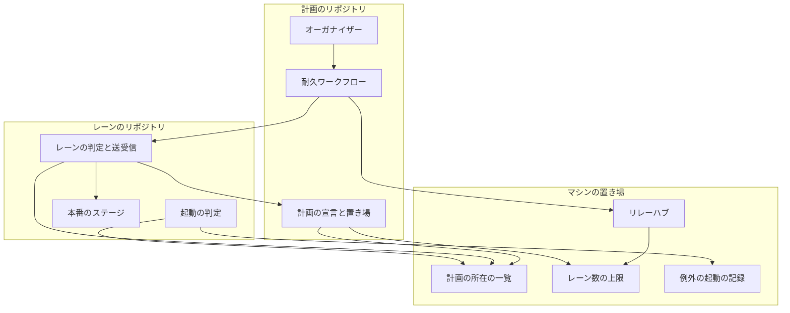
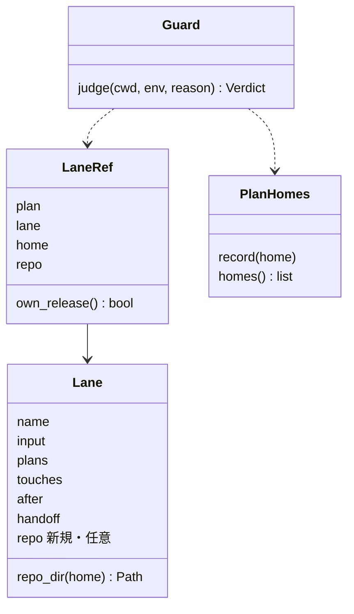
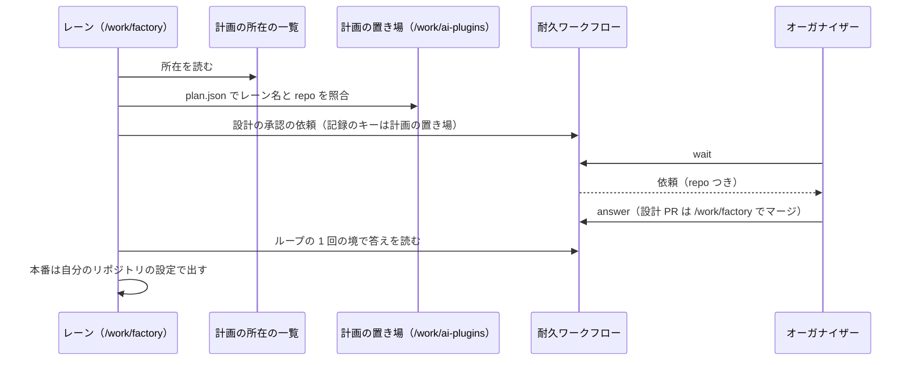
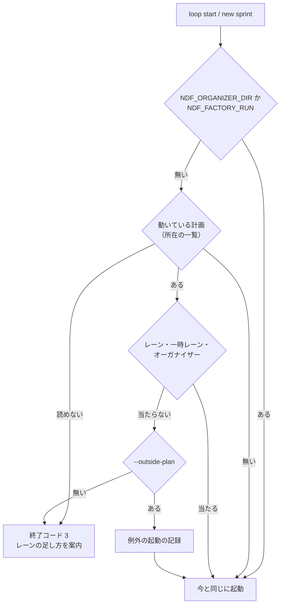
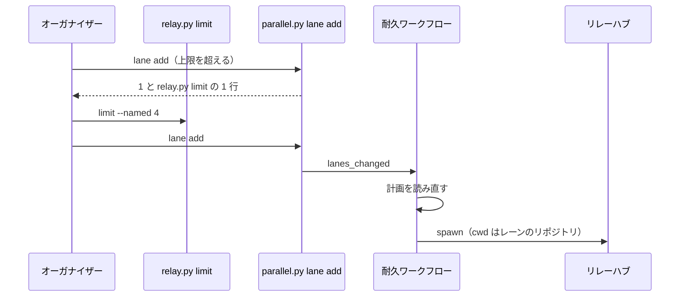

# 並列の計画: 別のリポジトリのセッションもレーンにし、計画の外の開発を止めて、人との窓口をオーガナイザー 1 つにする（#2733）

## 目的

- **今どうなっているか**: レーンの判定・依頼の送り先・答えの読み先が、セッションのリポジトリの `.ndf/parallel/` だけを見る。2026-11-07 の計画 p3 では、`/work/factory` で動く `factory1` の設計の問いがオーガナイザーへ届かず、自分の画面に出た。計画の外で開発を始めるセッションも止める仕組みが無い。並行開発の語（統括役・ランナー・ライン・周回）と supervisor の主と代行の向きが、用語集・手順書・実際の動きと食い違う
- **誰に効くか**: 並列の計画を動かし、問いへ答える利用者。計画の外で作業を始めようとする開発者
- **変えると何が成り立つか**: 別のリポジトリのレーンの問いと承認もオーガナイザーの依頼の一覧に載り、計画の外の開発の起動はレーンの足し方の案内とともに止まる。並行開発の語と supervisor の定義が `docs/ndf-parallel-model.md` と用語集で一致する

## 適用範囲

- **働く範囲**: 利用先のリポジトリでも働く。別のリポジトリのレーンは、計画と同じマシン（実行の形 A: 1 台）で、同じ利用者が動かすものに限る。Factory の実行ジョブ（`NDF_ORGANIZER_DIR` か `NDF_FACTORY_RUN` がある）は今の振る舞いのまま
- **プロジェクトごとに違うもの**: レーンのリポジトリの場所は計画の宣言（`plan.json` のレーンの `repo`）で受ける。リリースの手段はレーンのリポジトリの `.ndf/` の設定を読む。レーン数の上限はマシンの設定（`relay.py limit`）で受ける
- **当たるモード**: `standard`

## あるべき姿の根拠

| 根拠 | 種類 | 何を示すか |
| --- | --- | --- |
| 「計画外のセッションは基本不許可とします。必要な場合はレーン数上限を変更し計画にレーンを追加する」「factory1はp3計画に入れてください」「オーガナイザーを経由して人とのやり取りを行います」（#2733 の依頼の原文、2026-11-07） | 利用者の指示の原文 | 窓口はオーガナイザー 1 つ。計画の外は止め、必要ならレーンとして足す |
| 「docs/ndf-parallel-model を仮の正本とし、用語集、他の設計およびスクリプトをこれに合わせる修正」（同） | 利用者の指示の原文 | 語と規定の正本は並行開発のモデルの文書。辻褄が合わなければ文書を直す |
| 計画の状態・耐久ワークフローの記録・リレーハブの登録簿は、すでに `$XDG_STATE_HOME`（既定 `~/.local/state`）の下か、計画の置き場の絶対パスから導くキーで持つ（`relay_lib/common.py:86`・`lib/durable_keys.py:30`・`lib/parallel_lane.py:36`） | 実測（コード） | 計画の置き場の絶対パスが分かれば、どのリポジトリのセッションからも同じ記録を開ける。足りないのは「どこに計画があるか」の一覧だけである |
| STD1 | 外部の一次情報 | マシンの利用者ごとの、再起動をまたいで残す状態の置き場の標準 |
| PRD1・PRD2 | 外部の一次情報 | 「ランナー」をジョブを動かすマシンと呼ぶ製品と、アプリケーションと呼ぶ製品の両方がある |

要求と受け入れ条件は #2733 の本文にある（コピーは [issue-2733-requirements.md](issue-2733-requirements.md) ）。この文書は「どう作るか」だけを扱い、次の 2 つを別の文書に分けた。

| 中身 | 文書 |
| --- | --- |
| 決定の記録 | [issue-2733-design-decisions.md](issue-2733-design-decisions.md) |
| 語の置き換え・supervisor の定義・欠けているレーンの規定 | [issue-2733-design-terms.md](issue-2733-design-terms.md) |

## ドメインモデル

### コンテキスト

変更は 1 つのコンテキストに収まる。

| コンテキスト | 何の語が 1 つの意味に決まるか |
| --- | --- |
| `ndf-workflow` | 計画の置き場・レーンのリポジトリ・計画の所在の一覧・別のリポジトリのレーン・計画の外のセッション・例外の起動・レーン数の上限 |

Factory（`ndf-factory`）の語は、語の決定（ランナー）で意味を変える。Factory の側は並行開発のモデルの文書と用語集に順応者の関係で従い、サービスのコードの語は volareinc/nd-factory の課題で直す。

### 集約

| 集約 | 持ち主（書き換えてよいもの） | 根 | エンティティ | 値オブジェクト |
| --- | --- | --- | --- | --- |
| 並列の計画の宣言 | `parallel.py` の `init`・`lane`（新規）。検査は `lib/parallel_plan.py` | 計画 | レーン | レーンのリポジトリ・入力・触る場所 |
| 計画の所在の一覧 | 新規 `lib/parallel_homes.py`。書くのは `parallel.py init`・`start`・`lane add` だけ | マシン | 所在（計画の置き場 1 つにつき 1 件） | 計画の置き場の絶対パス・書いた時刻 |
| 並列の進行 | 耐久ワークフローの `_Run`（今のまま） | 計画の実行 | 問い | 問いのレーンのリポジトリ（一覧の表示） |
| レーン数の上限 | リレーハブ（`relay_lib/hub.py`）。書くのは `relay.py limit` だけ | マシン | — | 上限の値 |
| 例外の起動の記録 | 新規 `lib/parallel_guard.py` | マシン | 例外の起動（1 回 1 行） | 理由・リポジトリ・時刻 |

### 不変条件

| # | 集約 | 条件 | 破れたときの扱い |
| --- | --- | --- | --- |
| I1 | 並列の計画の宣言 | レーンの `repo` を省くと、計画の置き場のリポジトリのレーンとして扱う。省いた計画は今と同じに検査・起動・リリースされる | テストで落とす |
| I2 | 並列の計画の宣言 | `repo` は絶対パスで、Git のメインディレクトリ（`decl.main_dir` が自分自身を返す）を指す。指さなければ検査の規則 `I20` で断る | 検査が終了コード 1 で断る |
| I3 | 並列の計画の宣言 | 課題・マイルストーンの重なり（検査の規則 `I19`）・触る場所の重なり（検査の規則 `I4`。不変条件の I4 とは別）・引継ぎ文書の名前の重なりは、同じリポジトリのレーンの間だけで判定する | テストで落とす |
| I4 | 計画の所在の一覧 | 一覧は計画の置き場を指すだけで、計画の中身を写さない。指す先に計画が無い所在は、読む側が読み飛ばす | テストで落とす |
| I5 | 並列の進行 | レーンの側が依頼を送る・答えを読む・止める指示を読むときは、レーンのリポジトリではなく計画の置き場を使う。耐久ワークフローの記録のキーは変えない | テストで落とす |
| I6 | 並列の進行 | オーガナイザーの側がレーンの記録（ループの記録・引継ぎ文書）を読み書きするときと、レーンの設計 PR をマージするときは、そのレーンのリポジトリを使う | テストで落とす |
| I7 | 並列の進行 | 別のリポジトリのレーンはリリースの依頼を送らず、自分のリポジトリの設定で本番を出す。まとめたリリースの中身（リリースの依頼の一覧・レーンへの対応づけ）に入らない | テストで落とす |
| I8 | 並列の進行 | 問いの一覧の各行は、レーンのリポジトリを計画の宣言から導いて持つ。依頼の本文から読まない | テストで落とす |
| I9 | 例外の起動の記録 | 開発ループかスプリントの起動は、動いている計画があるマシンで、レーン・一時レーン・オーガナイザーのどれでもなく、例外の起動の指定も無ければ、終了コード 3 で止まる。止まったときは何も始めない | テストで落とす |
| I10 | 例外の起動の記録 | 動いている計画が無いマシン、Factory の実行ジョブ（`NDF_ORGANIZER_DIR` か `NDF_FACTORY_RUN`）では、起動の判定は今と同じに通す | テストで落とす |
| I11 | 例外の起動の記録 | 計画の所在の一覧にある計画の状態を読めないときは、動いている計画として扱って止め、読めなかった計画を出力に出す | テストで落とす |
| I12 | レーン数の上限 | 上限の値は、マシンの設定 → `NDF_RELAY_MAX_NAMED` → 既定 3 の順で決まる。リレーハブの起動の判定と計画の検査は同じ値を使う | テストで落とす |
| I13 | 並列の計画の宣言 | 動いている計画へのレーンの追加と書き換えは、上限を含む計画の検査を通ったときだけ書く。上限を超えるときは、上限の変え方の 1 行を出して何も書かない | 終了コード 1 で断る |

### ドメインイベント

要求の E1〜E10 の番号を引き継ぐ。

| # | イベント | 発生元 | 受け手 |
| --- | --- | --- | --- |
| E1 | 別のリポジトリのレーンを計画へ登録した | `parallel.py init`・`lane add` | 計画の所在の一覧・耐久ワークフロー（`lanes_changed`） |
| E2 | 別のリポジトリのレーンが起動した | 耐久ワークフロー（`relay.py spawn` をレーンのリポジトリで打つ） | リレーハブ |
| E3 | そのレーンが承認ゲートか区分つきの問いに当たり、依頼を送った | レーン（`lane_gate1`・問いの hook） | 耐久ワークフロー |
| E4 | オーガナイザーが依頼を受け取り、人へ問うか自分で決めた | オーガナイザー | 人 |
| E5 | 答えがそのレーンへ戻り、レーンがループの 1 回の境で読んだ | オーガナイザー（`parallel.py answer`） | レーン |
| E6 | そのレーンが自分のリポジトリのチャネルへリリースした | レーン | レーンのリポジトリ |
| E7 | 計画の外のセッションが開発ループかスプリントを始めようとして、止められた | 起動の判定（`parallel_guard`） | セッション・例外の起動の記録（例外のときだけ） |
| E8 | レーン数の上限を変え、計画へレーンを足した | オーガナイザー（`relay.py limit`・`parallel.py lane add`） | リレーハブ・耐久ワークフロー |
| E9 | 並行開発の語を置き換えた | 語の置き換えのスプリントのマージ | 用語集・手順書・確定仕様 |
| E10 | 置き換えの後に、旧い語で書かれた記録と出力を読んだ | 動いていた計画の再開 | スクリプト（識別子は変わらないので今のまま読む） |

### 用語

| 用語 | 意味 | 用語集への反映 |
| --- | --- | --- |
| 計画の置き場 | 並列の計画のファイルを置くメインディレクトリの `.ndf/parallel/<計画名>/`。計画を作ったリポジトリに 1 つある | 追加（`ndf-workflow`） |
| レーンのリポジトリ | レーンが開発するリポジトリのメインディレクトリ。計画の宣言のレーンの `repo` で指し、省くと計画の置き場のリポジトリ | 追加（`ndf-workflow`） |
| 計画の所在の一覧 | マシンにある計画の置き場を指す一覧（`$XDG_STATE_HOME/ndf/parallel/homes/`）。別のリポジトリのセッションがレーンの判定と計画の外の判定に使う | 追加（`ndf-workflow`） |
| 例外の起動 | 計画の外のセッションが、理由を添えた明示の指定（`--outside-plan <理由>`）で開発ループかスプリントを始めること。理由はマシンの記録に残る | 追加（`ndf-workflow`） |

語の決定で意味を変える語（リレーハブ・ランナー・ライン・周回・supervisor・conductor など）は [issue-2733-design-terms.md](issue-2733-design-terms.md) の「用語集の変更」にある。

## 外部の調査

| 種類 | 調べるか | 理由 |
| --- | --- | --- |
| 標準・仕様 | 調べる | マシンの利用者ごとの状態の置き場に標準がある。計画の所在の一覧の置き場を決める |
| 主要な製品 | 調べる | 語の決定 1（ランナー）が、業界でジョブを動かす側をどう呼ぶかに依る |
| ライブラリとサービス | 調べる | 依存している耐久ワークフローのライブラリで、別のリポジトリから同じ記録を開けるかを決める |

### 標準・仕様

| # | 標準・仕様 | 何を定めているか | 設計への反映 | 出典 |
| --- | --- | --- | --- | --- |
| STD1 | XDG Base Directory Specification 0.8 | `$XDG_STATE_HOME`（既定 `$HOME/.local/state`）は再起動をまたいで残す状態を置く。`$XDG_RUNTIME_DIR` はログインの間だけで、再起動やログアウトで消える | 計画の所在の一覧・レーン数の上限・例外の起動の記録を `$XDG_STATE_HOME/ndf/` の下に置く。計画は再起動をまたいで続くため、ランタイムの置き場は使わない | https://specifications.freedesktop.org/basedir-spec/latest/ （2026-11-07） |

### 主要な製品

| # | 製品 | どう解いているか | 設計への反映 | 出典 |
| --- | --- | --- | --- | --- |
| PRD1 | GitHub Actions のセルフホストランナー | ランナーは「ジョブを実行するために配置・管理するシステム」で、そこへ入れるソフトウェアを「ランナーのアプリケーション」と呼び分ける | 語の決定 1: ランナーはマシン、Factory のプログラムは「ランナーのエージェント」と呼び分ける | https://docs.github.com/en/actions/concepts/runners/self-hosted-runners （2026-11-07） |
| PRD2 | GitLab Runner | GitLab Runner は「ジョブを動かすアプリケーション」で、設定ファイルを読んで動かす常駐のプロセスを runner manager、実行の方式を executor と呼ぶ | 業界の語は割れている。どちらを採っても用語集で 1 語 1 意味に決める必要がある根拠に使う | https://docs.gitlab.com/runner/ （2026-11-07） |

### ライブラリとサービス

| # | 候補 | 版 | ライセンス | 最後のリリースの日付 | 終了のアナウンス | 要件を満たすか | 出典 |
| --- | --- | --- | --- | --- | --- | --- | --- |
| LIB1 | DBOS（依存済みの耐久ワークフロー） | 3.4.0 | MIT | 2026-10-28 | 無し | 満たす。記録は計画の置き場の絶対パスのハッシュで 1 ファイル（`durable_keys.record_path`）で、別のリポジトリのプロセスからも同じパスで開ける。新しい依存は要らない | https://pypi.org/pypi/dbos/json （2026-11-07） |

### 確かめられなかったこと

| 対象 | 試した手段 | 結果と理由 |
| --- | --- | --- |
| — | — | 無し |

調べた量: 候補 4 件・取得の試み 5 回。

## 機能一覧

| # | 機能 | 誰が使うか |
| --- | --- | --- |
| F1 | 計画の宣言で、レーンを別のリポジトリに置く | オーガナイザー |
| F2 | 別のリポジトリのセッションが、自分の属する計画とレーンを判定する | レーン |
| F3 | 別のリポジトリのレーンの承認ゲートと問いがオーガナイザーへ届き、答えが戻る | 利用者・オーガナイザー・レーン |
| F4 | 別のリポジトリのレーンが、自分のリポジトリへリリースする | レーン |
| F5 | 計画の外のセッションの開発ループとスプリントの起動を止め、レーンの足し方を案内する | 開発者 |
| F6 | 例外の起動を理由つきで通し、記録する | 開発者 |
| F7 | レーン数の上限を変え、動いている計画へレーンを足す・レーンの役割を書き換える | オーガナイザー・利用者 |
| F8 | 並行開発の語と規定を、並行開発のモデルの文書と用語集にそろえる | 読み手全員 |

## 構成要素

### 責務

| 要素 | 責務 |
| --- | --- |
| 計画の宣言（`lib/parallel_plan.py`） | `Lane` に任意の `repo` を足し、`repo_dir(home)` で解く。`I20`（`repo` の形）を足し、検査の規則 `I19`・`I4`・引継ぎ文書の重なりをリポジトリごとに判定する。`write_all` は引継ぎ文書をレーンのリポジトリへ書く。`plan.md` の表にリポジトリの列を足す。上限の値は `relay_lib.limits` から読む |
| 計画の所在の一覧（新規 `lib/parallel_homes.py`） | 所在の書き込み・一覧の読み出し（ファイルだけ。pydantic と DBOS を import しない）。指す先に計画が無い所在は読み飛ばす |
| レーンの判定（`lib/parallel_files.py`・`lib/parallel_lane.py`） | 探す先を「自分のメインディレクトリ + 計画の所在の一覧」にする。`lane_of` は計画の置き場とレーンのリポジトリを持つ `LaneRef` を返す。レーンのリポジトリと自分のメインディレクトリが一致する計画だけを当てる |
| レーンの側の送受信（`lib/parallel_lane.py`・`lib/sprint_loop_record.py`・`lib/sprint_loop_gate.py`・`lib/sprint_loop.py`・`lib/parallel_hold.py`・`supervise_lib/sprint.py`・`supervise_lib/engine.py`・`hook_lib/ask_guard.py`・`parallel.py` の `request-ask`・`await`） | 依頼・答え・止める指示の置き場を `LaneRef.home`（計画の置き場）から求める |
| リリースの経路（`supervise_lib/sprint.py` の `prod_plans`） | 別のリポジトリのレーンは、リリースの依頼のプランでなく、今の本番のステージ（レーンのリポジトリの設定）を組む |
| オーガナイザーの側（`lib/parallel_run.py`・`lib/parallel_repo.py`・`lib/parallel_answer.py`・`lib/parallel_release.py`） | レーンの起動・ループの記録と引継ぎ文書の読み出し・設計 PR のマージをレーンのリポジトリで行う。まとめたリリースの対応づけ（`map_lanes`）から別のリポジトリのレーンを外す。`lanes_changed` を受けて計画を読み直す。問いの一覧の各行へリポジトリを足す |
| 起動の判定（新規 `lib/parallel_guard.py`） | 計画の外のセッションの判定・例外の起動の記録・止めたときの統一 JSON レポートの組み立て |
| 起動のエントリポイント（`lib/sprint_loop.py` の `cmd_start`・`supervise.py` の `new sprint`） | 何かを書く前に起動の判定を呼ぶ。`--outside-plan <理由>` を受ける |
| レーンの追加と書き換え（新規 `lib/parallel_lane_cli.py`、`parallel.py lane`） | 宣言の書き換えを検査に通して書き、`plan.md` と引継ぎ文書を書き直し、耐久ワークフローへ `lanes_changed` を送る |
| レーン数の上限（新規 `relay_lib/limits.py`、`relay.py limit`） | マシンの設定の読み書き。`hub.max_named` と計画の検査が同じ関数を使う |
| 契約（`contracts/`） | `parallel.py` の `lane`、`relay.py` の `limit`、`sprint-state.py loop start` と `supervise.py new` の `--outside-plan`、ファイル 3 種、`plan.json` の `repo`、inbox の `lanes_changed` |
| 用語集の検査（`glossary.py` の `word_pattern`） | カタカナだけの廃止語を、前後がカタカナのときに一致させない（決定 12） |
| 手順書・確定仕様・用語集・エージェント定義・並行開発のモデルの文書 | [issue-2733-design-terms.md](issue-2733-design-terms.md) の表のとおり |

### 構成要素の関係



契約・手順書・用語集の検査（`glossary.py`）は計画の実行の流れに加わらないため図に含めない。起動のエントリポイントは起動の判定（GD）に含め、レーンの追加と書き換えは「処理の流れ」の「レーンを足す」の図に描く。

### 配置

すべて同じマシンの同じ利用者のプロセスで動く。境界をまたぐのはファイルの読み書きだけで、流れるのは計画の置き場の絶対パス・依頼・答えである。秘密は流さない。

```text
plugins/ndf/scripts/
├── parallel.py                     # lane を足す
├── relay.py                        # limit を足す（relay_lib/__init__.py の副命令の表）
├── supervise.py                    # new sprint の --outside-plan
├── glossary.py                     # 変更: カタカナの廃止語の境界
├── hook_lib/ask_guard.py           # 変更
├── relay_lib/
│   ├── limits.py                   # 新規: レーン数の上限
│   └── hub.py                      # 変更
├── supervise_lib/
│   ├── sprint.py                   # 変更
│   └── engine.py                   # 変更
└── lib/
    ├── parallel_homes.py           # 新規: 計画の所在の一覧
    ├── parallel_guard.py           # 新規: 起動の判定
    ├── parallel_lane_cli.py        # 新規: lane add / set
    ├── parallel_plan.py            # 変更
    ├── parallel_files.py           # 変更
    ├── parallel_lane.py            # 変更
    ├── parallel_run.py             # 変更
    ├── parallel_repo.py            # 変更
    ├── parallel_answer.py          # 変更
    ├── parallel_release.py         # 変更
    ├── parallel_hold.py            # 変更
    ├── sprint_loop.py              # 変更
    ├── sprint_loop_gate.py         # 変更
    └── sprint_loop_record.py       # 変更
```

**行数の許容リストに載るファイル（`parallel_run.py` 721・`sprint_loop_record.py` 536・`parallel.py` 500）は上限を超えない。** 足す処理は新規のモジュールへ置き、既存のファイルには呼び出しだけを足す。

## 構造



`LaneRef.own_release()` は `repo != home` で真になる。外のオーガナイザーのレーン（`--external`）は今と同じ 2 つ組を返す経路を残し、`LaneRef` の `home` を持たない。

## データ構造

### 計画の宣言のレーン（`plan.json`、変更）

| 列 | 型 | 空を許すか | 意味 |
| --- | --- | --- | --- |
| `repo` | 文字列（絶対パス） | 許す | レーンのリポジトリのメインディレクトリ。空（キーが無い）は「計画の置き場のリポジトリ」。`version` は 1 のまま（足したキーは任意で、今の計画はそのまま読める） |

```json
{"name": "lfactory", "repo": "/work/factory", "input": {"kind": "sprint", "issues": [54]}, "plans": 1, "touches": ["infra/"]}
```

### 計画の所在の一覧（新規、`$XDG_STATE_HOME/ndf/parallel/homes/<置き場のハッシュ 12 字>.json`）

```json
{"home": "/work/ai-plugins", "at": "2026-11-07T12:00:00+09:00"}
```

所在 1 つにつき 1 ファイルで、一時ファイルからの置き換えで書く。消さない（指す先に計画が無ければ読み飛ばす。I4）。ハッシュは `durable_keys` と同じ sha256 の先頭 12 字である。

### レーン数の上限（新規、`$XDG_STATE_HOME/ndf/relay/hub/limits.json`）

```json
{"max_named": 4, "at": "2026-11-07T12:00:00+09:00", "by": "relay.py limit"}
```

### 例外の起動の記録（新規、`$XDG_STATE_HOME/ndf/parallel/outside-plan.jsonl`）

```json
{"at": "2026-11-07T12:00:00+09:00", "repo": "/work/factory", "entry": "loop start", "reason": "計画 p3 の終了の直前の hotfix", "plans": ["/work/ai-plugins:p3"]}
```

追記だけで、上書きしない。

### 機能ごとの読み書き

| 機能 | 計画の宣言 | 計画の所在の一覧 | レーン数の上限 | 例外の起動の記録 |
| --- | --- | --- | --- | --- |
| F1 宣言 | 作る | 作る | 読む | — |
| F2 判定 | 読む | 読む | — | — |
| F5 止める | 読む | 読む | — | — |
| F6 例外 | 読む | 読む | — | 作る |
| F7 足す・変える | 更新 | 作る | 更新・読む | — |

## 入出力の契約

| 名前 | 入力 | 出力 | 失敗の形 | 互換性 |
| --- | --- | --- | --- | --- |
| `parallel.py lane <計画名> add --from <JSON>` | レーン 1 本の宣言 | 検査を通れば `plan.json`・`plan.md`・引継ぎ文書を書き、inbox へ `{kind: lanes_changed}` を送る（0）。`metrics.lane`・`metrics.next`（起動を待つ 1 行） | 検査の誤り 1（上限を超えると `items` に `relay.py limit --named <n>` の 1 行）。計画が無い・書けない 2 | 新規 |
| `parallel.py lane <計画名> set --lane <名> --from <JSON>` | 書き換えるキー（`input`・`plans`・`touches`・`after`・`handoff`）。`name` と `repo` は変えられない | 同上。ループ名を変えたら `plan.md` と引継ぎ文書を書き直す | 同上。`name`・`repo` を渡すと 1 | 新規 |
| `relay.py limit [--named <n>]` | 正の整数。省くと読むだけ | `metrics.max_named`・`metrics.source`（`file`・`env`・`default`）（0） | 正の整数でない 1 | 新規 |
| `sprint-state.py loop start` / `supervise.py new sprint` | 任意の `--outside-plan <理由>` を足す | 通るときは今と同じ。止めるときは `status: blocked`・`summary`（止めた理由）・`items`（動いている計画・レーンの足し方の手順の置き場・`relay.py limit` と `parallel.py lane add` の 1 行）・`next`（例外の起動の 1 行） | 止めるときは終了コード 3。理由が空の `--outside-plan` は 1 | 追加。計画が無いマシンでは変わらない |
| `parallel.py init` / `check` | `repo` を持つレーン | `I20` を足す。`plan.md` にリポジトリの列。所在を一覧へ書く（`init`・`start`） | `I20` は 1 | 追加 |
| `parallel.py wait` の `questions`（届いている依頼の `items`） | 変えない | 各行に `repo`（レーンのリポジトリ）を足す | 変えない | 追加。既存のキーは変えない |
| inbox のメッセージ `lanes_changed` | — | `_Run.take` が耐久ステップで計画を読み直し、足したレーンを起動の候補に入れる | 読み直せなければ前の計画のまま続け、`wait` の通知に出す | 新規 |
| 問いの hook | 変えない | 別のリポジトリのレーンでも区分つきの問いをオーガナイザーへ送る | 送れなければ今と同じく画面へ出さずに失敗を記録する | 変えない |

### 値の集合への追加

| 足す値 | 足す先 | 変える箇所 |
| --- | --- | --- |
| レーンの `repo` | 計画の宣言のキー | 検査の規則 `I19`・`I4`・引継ぎ文書の重なりの判定、`write_all`、`render`（`plan.md`）、`check` の `release` の警告（レーンのリポジトリごとに見る）、`map_lanes`、`lane_waits`・`loop_records`、`step_spawn`（`relay_proc` の `cwd`）、`parallel_answer` の設計 PR のマージ、`contracts/files` の `plan.json` |
| `lanes_changed` | inbox の `kind` | `_Run.take`、`parallel.md` の inbox の表 |
| `blocked` の終了コード 3 | `loop start`・`new sprint` の終了の形 | 両方の契約の `exit`、`loop.md` の起動の節 |

変えない箇所は次の 3 つである。

| 箇所 | 変えない中身 |
| --- | --- |
| 外のオーガナイザーの経路（`parallel_external.py`） | `NDF_ORGANIZER_DIR` は計画の所在の一覧より先に判定する |
| 耐久ワークフローの記録のキー（`record_identity`） | — |
| 答え待ちの停止の数え方（`parallel_hold`） | レーン名で数え、リポジトリに依らない |

## 処理の流れ

### 別のリポジトリのレーンの問いの往復



### 起動の判定



オーガナイザーはラッパーの作業ディレクトリの役割のファイル（`role.json` の `organizer`）で、一時レーンは同じファイルの `helper` で判定する。

### レーンを足す



上限を変えるのは人の指示を受けたときだけである（要求の E8）。オーガナイザーは手順書の案内に従い、上限の値を人へ問うてから打つ。

## 非機能の実現方式

| 大項目 | 要求の条件 | 実現方式 | 確かめ方 |
| --- | --- | --- | --- |
| 運用・保守性 | 5 で止めたとき、止めた理由と案内が統一 JSON レポートの形で出る。別のリポジトリのレーンの問いは、オーガナイザーの一覧で同じリポジトリのレーンの問いと区別できる | 止めるときは `status: blocked` の統一 JSON レポートを 1 行で出す。問いの一覧の各行に計画の宣言から導いた `repo` を足し、オーガナイザーの手順書の問い方へリポジトリを添える | 単体テストでレポートの形を検査する。結合テストで一覧の `repo` を見る |
| 移行性 | 動いている計画 p3 を止めずに入れられる。語の置き換えはループの 1 回の境で入れ、置き換え前の状態の記録をそのまま読む。`factory1` は、この課題が入った後にレーンとして登録し直す | `repo` は任意のキーで、無ければ今の振る舞い。計画の所在の一覧は `start` のほか、一覧に無い計画を `lane add` が初めて書くので、p3 は再起動せずに所在を持てる。識別子は変えない | 既存のテストの全量。p3 で `lane add` を 1 度打つ（受け入れ条件 7） |
| セキュリティ | 別のリポジトリのレーンが書くのは、同じマシンの同じ利用者が持つ計画の状態の置き場だけである。秘密を依頼と答えに載せない | 新しい置き場はすべて `$XDG_STATE_HOME/ndf/` の下に 0700 のディレクトリで作る。計画の所在の一覧が指す置き場の持ち主が自分でなければ読み飛ばす。依頼と答えの形は変えない | 他の利用者が持つ置き場を指す所在を読み飛ばす単体テスト |

## 決定の記録

決定の記録は [issue-2733-design-decisions.md](issue-2733-design-decisions.md) にある。

## テスト設計

| 受け入れ条件・不変条件 | どの振る舞いで縛るか | どう壊したら落ちるべきか |
| --- | --- | --- |
| 1・I5 | リポジトリ X の計画にリポジトリ Y の `repo` を持つレーンを書き、所在の一覧に X があるとき、Y のメインディレクトリからの `lane_of` が計画名・レーン・X を返す | 探す先を自分のメインディレクトリだけに戻す。記録のキーを Y から求める |
| 2・I8 | 2 つの一時リポジトリで、Y のレーンの設計の承認が X の依頼の一覧に 1 件載り、行の `repo` が Y になる。答えると Y のループの 1 回の境で読める | `repo` を依頼の本文から読む。答えの置き場を Y から求める |
| I6 | Y のレーンの設計 PR のマージと、`lane_waits` のループの記録の読み出しが Y で行われる | マージや読み出しを X の `cwd` で行う |
| 3・I7 | Y のレーンの本番のステージが、リリースの依頼のプランでなく今の本番のプランになり、X のまとめたリリースの対応づけに Y のレーンが入らない | `own_release` を無視する。`map_lanes` で Y の課題番号を X の PR と照合する |
| 4 | Y のレーンの問いが、答え待ちの依頼の件数にレーン名で 1 件ずつ数えられる | 数え方をリポジトリで絞る |
| 5・I9 | 所在の一覧に動いている計画があるとき、レーンでもオーガナイザーでもないセッションの `loop start` と `new sprint` が終了コード 3 で止まり、何も書かず、`items` に手順の置き場と `next` に例外の 1 行が出る。`--outside-plan` で起動し、記録に 1 行残る | 判定を書き込みの後へ動かす。理由の空の指定を通す |
| 6・I10 | 所在の一覧が無い、または計画がどれも動いていないマシンと、Factory の実行ジョブで、`loop start` が今と同じに起動する | 止まった計画も動いていると数える。`NDF_ORGANIZER_DIR` を見ない |
| I11 | 所在の一覧の計画の状態が読めないとき、止めて読めなかった計画を出す | 読めない計画を読み飛ばす |
| 7・I13 | `lane add` が上限の中なら書いて `lanes_changed` を送り、耐久ワークフローが読み直したレーンを起動の候補に入れる。手順書のコマンドを実際の計画で 1 度通す（実装の PR に記録） | 送ったメッセージを読み直しに使わない |
| 8・I12・I13 | 上限を超える `lane add` が 1 で何も書かず、`items` に `relay.py limit --named <n>` が出る。`relay.py limit` の値をリレーハブと計画の検査が同じに読む | 片方だけが設定のファイルを読む |
| I1・17 | `repo` の無い計画の検査・起動・まとめたリリースが今と同じに動く（既存の並列の計画のテストの全量） | `repo` の無いレーンを別のリポジトリと扱う |
| I2 | 相対パス・存在しないパス・worktree のパスの `repo` を `I20` で断る | 形を見ずに受ける |
| I3 | X と Y のレーンが同じ課題番号を持っても `I19` にならない。同じ Y の 2 レーンなら `I19` になる | 重なりをリポジトリを見ずに判定する |
| I4 | 指す先に計画が無い所在・持ち主の違う置き場を読み飛ばす | 読み飛ばさずに失敗する |
| 18 | `NDF_ORGANIZER_DIR` があるとき `lane_of` は `--external` を返し、起動の判定は通す | 所在の一覧を外のオーガナイザーより先に見る |
| 9・9a・10〜16 | [issue-2733-design-terms.md](issue-2733-design-terms.md) の「確かめ方」 | — |

## 設計の結果

| 課題 | 扱い | 取り込み先 | 触るファイル |
| --- | --- | --- | --- |
| #2733 | 実装する | — | `plugins/ndf/scripts/`（`glossary.py` を含む）、`plugins/ndf/contracts/`、`plugins/ndf/skills/`、`plugins/ndf/agents/`、`docs/specifications/`、`docs/glossary/glossary.json`、`docs/glossary.md`、`docs/ndf-parallel-model.md` |
| #2727 | 取り込む | #2733 | — |

## 未確認のまま残ること

| 項目 | 内容 |
| --- | --- |
| PR 2723 のマージ | 2026-11-08 時点で PR 2723 は開いたまま（`gh pr view 2723` の `state` が `OPEN`）。実装はマージの後に始める（要求の前提 8）。マージされないまま実装へ進む扱いは、設計承認ゲートで利用者が決める（要求の未決） |
| 語の決定と止める強さ | 語は PR 2723 の文書の語の決定（2026-11-07）と利用者の指示（受け入れ条件 9a・12）で設計した。止める強さ（止めて案内し、明示の例外だけ通す）は設計承認ゲートで利用者が確かめる（要求の未決）。差し戻された語は [issue-2733-design-terms.md](issue-2733-design-terms.md) の表の該当行だけを直す |
| 別のリポジトリのレーンのリリース承認ゲートの届き方 | 本番のステージの承認ゲートが、問いの hook の区分つきの問いとしてオーガナイザーへ届くことを、今のレーンの経路（`asking.md` の「並列の計画のレーン」）から読んだ。実際に届くかは実装の結合テストで確かめる。届かなければ `request-gate2` に自分のリポジトリのリリースの形を足す |
| `relay.py restart` の作業ディレクトリ | 再起動が登録簿の `cwd` を引き継ぐことはコードから読んだ（`hub.py:275`）。別のリポジトリのレーンで確かめていない。実装の結合テストで確かめる |
| 不変条件 I68 とランナーの語 | 語の決定 1 を採ると、I68 の文の「ランナー」は旧い意味（ランナーのエージェント）のまま残る（受け入れ条件 16 で文を変えないため）。扱いは [issue-2733-design-terms.md](issue-2733-design-terms.md) の「I68 の扱い」 |
| スプリントの分け方 | 別のリポジトリのレーンと起動の判定（受け入れ条件 1〜8・17・18）、統括役・ランナー・ライン・supervisor の定義と規定（9・9a・10・11・13〜16。置き換え 約 510 行）、周回の言い換え（12 の周回。651 行）の 3 つに分ける見込み。決めるのは `implementation-plan` |
