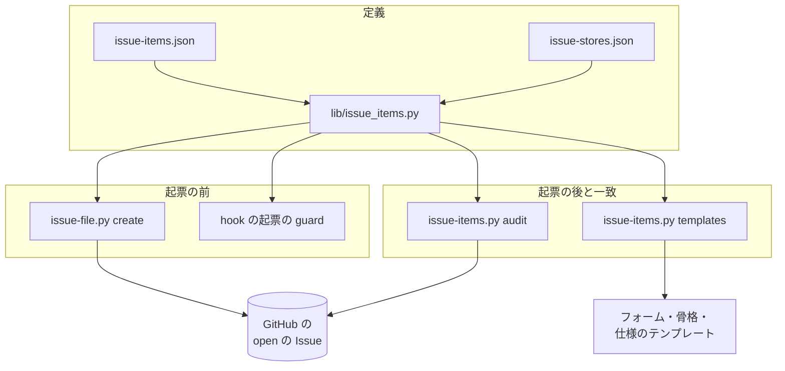
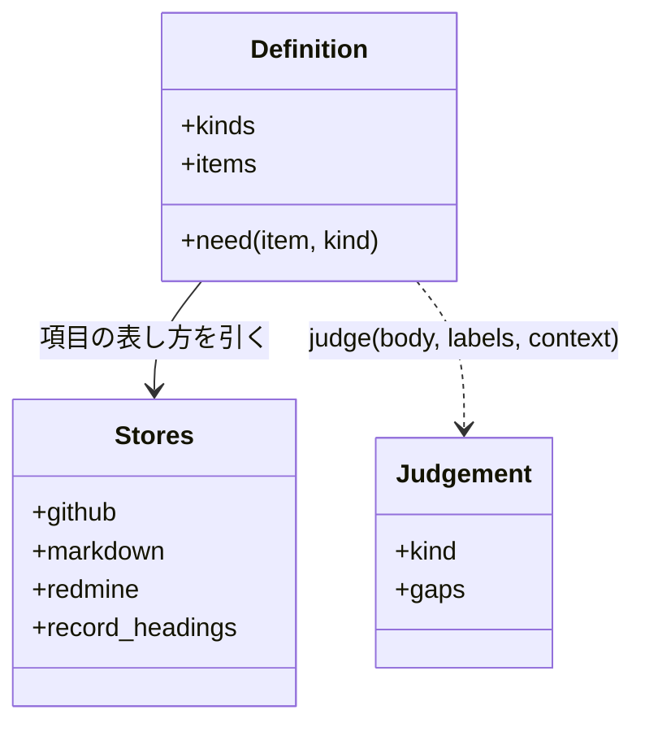
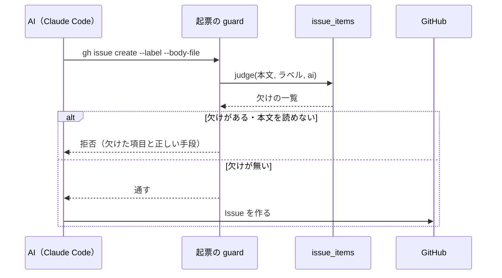

# Issue の記載項目: 種類ごとに何を書くかを 1 か所で定め、起票の前と後に確かめる（#2737）

## 目的

- **今どうなっているか**: Issue の本文の形が 3 系統（GitHub のフォーム・`out-of-scope` の 6 節・要求の本文）に分かれ、直近 300 件の 40% はどの形にも当たらない。何を書けば足りるかの一覧が無く、AI が手で打つ起票を確かめる仕組みも無い
- **誰に効くか**: Issue を読む人と、Issue を入力に動く開発ループ（要求・設計・棚卸し）
- **変えると何が成り立つか**: 種類ごとの必須の項目が 1 つのファイルで決まり、フォーム・骨格・仕様のテンプレートがそれに揃い、欠けた起票が起票の前（AI）か後（Web を含む）に見つかる

## 適用範囲

- **働く範囲**: NDF を使うすべてのリポジトリ。起票の前の検査は Claude Code の上の AI の起票、起票の後の検査は課題の置き場が GitHub のリポジトリで働く。一致の検査は ai-plugins の継続的統合で働く
- **プロジェクトごとに違うもの**: 記載項目の定義は設定で受ける（`.ndf/issue-items.json` があれば NDF の既定の定義の代わりに読む）。課題の置き場は `.ndf/project.json` の `issues.primary` で受ける
- **当たるモード**: `standard`

## あるべき姿の根拠

| 根拠 | 種類 | 何を示すか |
| --- | --- | --- |
| 依頼（原文）「issueに記載すべきことが網羅できていない」「issue templateを使っていないissueが多すぎる」「依頼原文は一番最後とする」 | 利用者の指示の原文 | 項目の一覧を作ること、使わない起票を減らすこと、原文を最後に置くこと |
| 直近 300 件の 40% がどのテンプレートにも当たらず、フォームの利用は 0 件（要求の実測）。字面の違う見出しは 395 種類（[付録](issue-2737-design-headings.md)） | 実測 | 定義とテンプレートの一致と、起票の前後の検査が要る |
| PRD1（GitHub のフォームの `validations.required` と `blank_issues_enabled`）・PRD4（Jira の種類の階層）・PRD5（Redmine のトラッカー） | 外部の一次情報 | 種類で必須の欄を変える形と、種類を課題の置き場の欄に置く形が主要な製品で共通である |
| STD3・STD4（Mozilla・Chromium のバグ報告）・STD1（INVEST の Testable）・STD2（Given/When/Then） | 外部の一次情報 | 不具合の必須の項目（再現手順・期待する結果・実際の結果・環境）と、受け入れ条件の水準 |

要求と受け入れ条件は #2737 の本文にある（コピーは `issues/issue-2737-requirements.md`）。この文書は「どう作るか」だけを扱う。
受け入れ条件 1 と 5 の調査の表は付録 [issue-2737-design-headings.md](issue-2737-design-headings.md) にある。

## ドメインモデル

### コンテキスト

| コンテキスト | 何の語が 1 つの意味に決まるか |
| --- | --- |
| NDF の課題の棚卸し（`ndf-issue-upkeep`） | Issue の種類・記載項目・必須の項目・該当時の項目・記載の水準・記載項目の定義・起票の前の検査・起票の後の検査・課題の置き場 |

1 つのコンテキストに収まる。開発ループの工程（要求・棚卸し）は、この定義を検査のコマンドとして呼ぶだけで、語を持ち込まない。

### 集約

| 集約 | 持ち主（書き換えてよいもの） | 根 | エンティティ | 値オブジェクト |
| --- | --- | --- | --- | --- |
| 記載項目の定義 | 人（Pull Request で `issue-items.json` を直す）。読むのは `lib/issue_items.py` だけ | 定義 | 項目 | 種類・区分（必須 / 該当時 / 不要）・水準・該当する条件 |
| 置き場ごとの表し方 | 人（Pull Request で `issue-stores.json` を直す） | 置き場 | 項目の表し方 | 表し方の型（節 / ラベル / 欄 / マイルストーン） |
| テンプレート | 人（フォーム・`out-of-scope` の骨格・仕様のテンプレート） | テンプレート | 欄・節 | 受け持つ種類 |

Issue の本文は GitHub が持ち、この変更では書き換えない（書き換えは #2738）。検査は本文を読んで判定するだけである。

### 不変条件

| # | 集約 | 条件 | 破れたときの扱い |
| --- | --- | --- | --- |
| I1 | 記載項目の定義 | すべての項目が 4 種類のそれぞれに「必須」「該当時」「不要」のどれか 1 つを持つ | 定義を読む時点で止め、終了コード 2 で項目と種類を返す |
| I2 | 記載項目の定義 | すべての項目が水準の文を 1 つ以上持ち、該当時を 1 つでも持つ項目は該当する条件の文を持つ | I1 と同じ |
| I3 | 置き場ごとの表し方 | 定義のすべての項目が、GitHub・markdown・Redmine のそれぞれで表し方を 1 つに解決できる。項目の識別子ごとの表し方があればそれを使い、無ければその置き場の「ほかの項目」の表し方を使う（プロジェクト独自の項目はこちらで受け付ける）。どちらも無い置き場があれば破れとする。定義に無い識別子の表し方は使わずに読み飛ばす | I1 と同じ |
| I4 | テンプレート | テンプレートは受け持つ種類の必須の項目をすべて含み（フォームでは必須欄）、定義に無い項目名の節・欄を持たない | 一致の検査が終了コード 1 で、テンプレートと項目の名前を返す |
| I5 | 記載項目の定義 | 「依頼（原文）」の節は、書き手が書く節の最後に置く。後ろに置いてよいのは工程が足す節だけである | 本文の判定が「順序」の欠けとして返す |
| I6 | 本文の判定 | 種類が 1 つに決まらない本文（種類のラベルが 0 個か 2 個以上）は「種類が不明」として欠けに数える | 起票の前なら止め、起票の後なら一覧に載せる |
| I7 | 起票の前の検査 | 必須の項目（と、条件が機械で決まる該当時の項目）が 1 つでも欠けた本文では Issue を作らない | `issue-file.py create` は終了コード 1、hook は拒否 |
| I8 | 起票の前の検査 | GitHub を呼ばず、本文とラベルと起票の引数だけで判定する | 判定の関数が GitHub の呼び出しを持たない |
| I9 | 起票の後の検査 | GitHub を読めないとき、欠け 0 件と報告しない | 終了コード 2 で「読めなかった」を返す |
| I10 | 起票の後の検査 | 対象は open の Issue だけ。課題の置き場が GitHub でなければ検査しない | 置き場が GitHub 以外なら終了コード 0 で「検査しなかった」と置き場の名前を返す |

### ドメインイベント

| # | イベント | 発生元 | 受け手 |
| --- | --- | --- | --- |
| E1 | 起票者が Issue の種類を決めた | 起票者（AI・人・フォームの選択） | 本文の判定（種類のラベルで読む） |
| E2 | 起票者が本文を書いた | 起票者 | 起票の前の検査（E3）か GitHub（Web） |
| E3 | 起票の前の検査が本文を判定した | `issue-file.py create`・hook の起票の guard | 起票者（欠けた項目と正しい起票の手段） |
| E4 | Issue を起票した | `issue-file.py create`・`gh issue create`・Web のフォーム | 起票の後の検査（E5） |
| E5 | 起票の後の検査が open の Issue を判定した | `issue-items.py audit`（棚卸しの手順と #2738 が打つ） | 棚卸しの担い手（一覧） |
| E6 | 欠けた項目を直した | 棚卸しの担い手・#2738 | 起票の後の検査（次の判定） |
| E7 | 記載項目の定義を改めた | 人（Pull Request） | 一致の検査（継続的統合） |

### 用語

| 用語 | 意味 | 用語集への反映 |
| --- | --- | --- |
| 一致の検査 | 記載項目の定義と、フォーム・`out-of-scope` の骨格・仕様のテンプレートが食い違っていないかを確かめる検査。継続的統合で動く | 追加（`ndf-issue-upkeep`） |
| 工程が足す節 | 起票の後に工程が本文へ書き足す節（進行・承認ゲートの答え・閉じた理由・再発など）。起票者は書かない | 追加（`ndf-issue-upkeep`） |
| 置き場ごとの表し方 | 記載項目を、課題の置き場ごとにどの欄・節・ラベルで表すかの対応 | 追加（`ndf-issue-upkeep`） |

## 外部の調査

| 種類 | 調べるか | 理由 |
| --- | --- | --- |
| 標準・仕様 | 調べる | 受け入れ条件の書き方（INVEST・Given/When/Then）とバグ報告の項目に、広く参照される形がある |
| 主要な製品 | 調べる | GitHub・GitLab・Linear・Jira・Redmine が、種類と必須の欄をどう持つかを比べる（受け入れ条件 2） |
| ライブラリとサービス | 調べる | Issue の本文を検査する既存の Action と、フォームの YAML とシェルのコマンドを読む既存の依存を比べる |

### 標準・仕様

| # | 標準・仕様 | 何を定めているか | 設計への反映 | 出典 |
| --- | --- | --- | --- | --- |
| STD1 | INVEST（Bill Wake） | 良いストーリーの 6 性質。Testable は「受け入れテストを書けるほど明確」、Estimable は順位付けに足る見積もり | 受け入れ条件をすべての種類で扱い、水準を「確かめられる結果」にする。見積は該当時の項目 | https://xp123.com/articles/invest-in-good-stories-and-smart-tasks/ （2026-11-08） |
| STD2 | Gherkin の参照（Given / When / Then） | Given は既知の状態、When は操作、Then は観測できる結果。"An outcome should be on an observable output." | 受け入れ条件の水準に「観測できる結果」を置く（要求の `acceptance-criteria.md` の形と同じ） | https://cucumber.io/docs/gherkin/reference/ （2026-11-08） |
| STD3 | Mozilla のバグ報告の書き方 | 題・版・OS・再現手順（"the most important part"）・頻度・期待する結果・実際の結果、1 件 1 報告 | 不具合の必須の項目を事象・期待する結果・再現手順・環境にする。再現しないときは頻度を書く | https://bugzilla.mozilla.org/page.cgi?id=bug-writing.html （2026-11-08） |
| STD4 | Chromium のバグ報告の指針 | 最新版で確かめる、概要・再現手順・期待する振る舞い、スクリーンショット | 環境の水準に「確かめた版」を置く | https://www.chromium.org/for-testers/bug-reporting-guidelines/ （2026-11-08） |

### 主要な製品

| # | 製品 | どう解いているか | 設計への反映 | 出典 |
| --- | --- | --- | --- | --- |
| PRD1 | GitHub | フォームは欄ごとに `validations.required` を持ち、`labels`・`type` を自動で付ける。`blank_issues_enabled: false` で Read・Triage の権限者は設定済みのテンプレートだけを見る。組織の Issue の種類は既定で task・bug・feature | フォームの必須欄を定義の必須の項目から決める。種類はラベルで表す。白紙の Issue の設定は未決 4 として利用者へ渡す | https://docs.github.com/en/communities/using-templates-to-encourage-useful-issues-and-pull-requests/syntax-for-issue-forms ・ https://docs.github.com/en/communities/using-templates-to-encourage-useful-issues-and-pull-requests/configuring-issue-templates-for-your-repository ・ https://docs.github.com/en/issues/tracking-your-work-with-issues/using-issues/managing-issue-types-in-an-organization （いずれも 2026-11-08） |
| PRD2 | GitLab | `.gitlab/issue_templates/` の Markdown のテンプレート。必須を強制する仕組みは無く、quick actions でラベル・担当者・マイルストーンを付ける。本体の Bug テンプレートは Summary・再現手順・現在の振る舞い・期待する振る舞い・ログ・Possible fixes | 必須を強制しない置き場では、起票の後の検査で拾う。直し方の案を該当時の項目にする | https://docs.gitlab.com/user/project/description_templates/ ・ https://gitlab.com/gitlab-org/gitlab/-/raw/master/.gitlab/issue_templates/Bug.md （2026-11-08） |
| PRD3 | Linear | 必須は title と status。テンプレートは team・priority・assignee・estimate・labels などの既定値と説明文を持ち、フォームのテンプレートでは欄を必須にできる。「Issue は明確な成果を持つ作業を書く」 | 優先・担当・見積は本文でなく課題の置き場の欄に置く（未決 5）。目的に「変えると何が成り立つか」を求める | https://linear.app/docs/issue-templates ・ https://linear.app/method/write-issues-not-user-stories ・ https://linear.app/docs/creating-issues （2026-11-08） |
| PRD4 | Jira | 種類（work type）は Epic・Story・Task・Bug・Subtask の階層。"A bug is a problem which impairs or prevents the functions of a product." | 種類を 4 つ（不具合・機能・調査・運用）で始め、親子は関連の項目で表す | https://support.atlassian.com/jira-cloud-administration/docs/what-are-issue-types/ （2026-11-08） |
| PRD5 | Redmine | トラッカーが種類を表す（"defines the nature of the issue"。既定は bug・feature・support）。Subject・Description・Priority・Due date・Estimation time などの欄を持つ | Redmine の表し方で、種類をトラッカー、題を Subject、優先を Priority、見積を Estimation time に対応させる | https://www.redmine.org/projects/redmine/wiki/RedmineIssues （2026-11-08） |

### ライブラリとサービス

| # | 候補 | 版 | ライセンス | 最後のリリースの日付 | 終了のアナウンス | 要件を満たすか | 出典 |
| --- | --- | --- | --- | --- | --- | --- | --- |
| LIB1 | issue-ops/validator（GitHub Action） | v4.0.0 | MIT | 2025-12-04 | 無し | 一部。フォームから作られた Issue を、そのフォームに照らして確かめる。AI の起票の前（Claude Code の上）では動かず、`out-of-scope` の骨格と仕様のテンプレートは対象外 | `gh api repos/issue-ops/validator` と `releases/latest`（2026-11-08） |
| LIB2 | benelan/need-info-action（GitHub Action） | v2.0.0 | MIT | 2022-12-28 | 無し（最後の push は 2023-03-07） | 一部。ラベルを契機に本文の必須の語を確かめる。起票の前では動かず、定義との一致は確かめない | `gh api repos/benelan/need-info-action` と `releases/latest`（2026-11-08） |
| LIB3 | ruamel.yaml（既存の依存。`lib/yamlio.py` が包む） | 0.19.1 | MIT | 2026-01-02 | 無し | 満たす。フォームの YAML を読む | `uv.lock` の `ruamel-yaml`（2026-11-08） |
| LIB4 | tree-sitter-bash（既存の依存。`lib/shparse.py` が包む） | 0.25.1 | MIT | 2025-12-02 | 無し | 満たす。hook で `gh issue create` の引数を構文木から読む（token の guard と同じ部品） | `uv.lock` の `tree-sitter-bash`（2026-11-08） |

### 確かめられなかったこと

| 対象 | 試した手段 | 結果と理由 |
| --- | --- | --- |
| Atlassian の受け入れ条件の解説 | https://www.atlassian.com/work-management/project-management/acceptance-criteria （2 回） | HTTP 200 だが本文に届かず、ナビゲーションだけを読んだ |
| Atlassian のユーザーストーリーの解説 | https://www.atlassian.com/agile/project-management/user-stories （2 回） | 同上 |
| ISO/IEC/IEEE 29119-3（インシデント報告の項目） | https://www.iso.org/standard/79429.html | HTTP 403 |
| Redmine の担当者・状態・対象バージョンの欄の名前 | 上の PRD5 のページ | ページに名前が出てこない。表し方の表では Redmine の既定の欄の名前を使い、未確認と書く |

調べた量: 候補 13 件・取得の試み 25 回。

## 機能一覧

| # | 機能 | 誰が使うか |
| --- | --- | --- |
| F1 | 種類ごとの記載項目・区分・水準を 1 つのファイルで読む | 起票者・レビューする人・検査のスクリプト |
| F2 | 課題の置き場ごとに、項目をどの欄・節・ラベルで表すかを読む | 起票者・検査のスクリプト |
| F3 | `issue-file.py create` が起票の前に本文を判定し、欠けがあれば起票しない | `out-of-scope` を通す AI |
| F4 | Claude Code の上で AI が直接打つ `gh issue create` を、起票の前に判定して止める | Claude Code の上の AI |
| F5 | open の Issue の欠けを一覧にする（起票の後の検査） | 棚卸しの担い手・#2738 |
| F6 | 定義とテンプレートの一致を継続的統合で確かめる | 定義かテンプレートを直す人 |
| F7 | フォーム 3 つ・`out-of-scope` の骨格・仕様のテンプレートを定義の項目名で書く | Web の起票者・AI |

## 構成要素

| 要素 | 責務 |
| --- | --- |
| `plugins/ndf/scripts/data/issue-items.json`（新規） | 記載項目の定義の既定。課題の置き場に依らない語で書く |
| `plugins/ndf/scripts/data/issue-stores.json`（新規） | 置き場ごとの表し方（GitHub・markdown・Redmine）と、工程が足す節の見出しの一覧 |
| `plugins/ndf/scripts/lib/issue_items.py`（新規） | 定義と表し方を読み（`.ndf/issue-items.json` があればそれを読む）、I1〜I3 を確かめる。本文とラベルと文脈から欠けを返す純粋な判定 |
| `plugins/ndf/scripts/issue-items.py`（新規） | `audit`（起票の後の検査）と `templates`（一致の検査）の 2 つの副命令。1 行の JSON で返す |
| `plugins/ndf/scripts/issue-file.py`（変更） | `create` の骨格の検査（`SKELETON`・`skeleton_gaps`）を `issue_items` の判定に置き換える |
| `plugins/ndf/scripts/hook_lib/issue_guard.py`（新規） | Claude Code の PreToolUse（Bash）で `gh issue create` を見つけ、本文とラベルを読み、欠けがあれば拒否する |
| `plugins/ndf/scripts/hook.py`（変更） | `_guards` に起票の guard を足す（Claude Code の PreToolUse・Bash だけ） |
| `.github/ISSUE_TEMPLATE/*.yml`（変更） | 欄の名前を項目名にし、必須の項目を必須欄にする |
| `plugins/ndf/skills/out-of-scope/SKILL.md`（変更） | 本文の骨格を定義の項目名にし、種類のラベルを付けて起票すると書く。定義のファイルを指す |
| `plugins/ndf/skills/requirements-design/references/spec-template.md`（変更） | 不具合のときの 4 節を足し、定義のファイルを指す |
| `plugins/ndf/skills/backlog-refinement/SKILL.md`（変更） | 棚卸しの手順で `issue-items.py audit` を打つ |
| `.github/workflows/script-structure.yml`（変更） | 一致の検査を継続的統合で打つ |
| `plugins/ndf/contracts/`（変更） | `issue-items.py` の契約を足す（`check-ndf-contracts.py` が求める） |



図は定義を読む関係だけを描く。図に含めない要素は、guard を配線する `hook.py`、`audit` を打つ手順を持つ `backlog-refinement`、
`templates` を打つ継続的統合のジョブ、契約の一覧である。フォーム・骨格・仕様のテンプレートは `TP` の 1 つの箱にまとめた。

### パッケージ・モジュール構成

```text
plugins/ndf/scripts/
├── data/
│   ├── issue-items.json      # 記載項目の定義（既定）
│   └── issue-stores.json     # 置き場ごとの表し方
├── lib/issue_items.py        # 読み込みと判定（標準ライブラリだけ。hook の経路から呼ぶ）
├── hook_lib/issue_guard.py   # 起票の guard
├── issue-items.py            # audit / templates
└── issue-file.py             # create の判定を差し替える
```

## 構造



`judge(body, labels, context)` は `Judgement`（決まった種類か `None`、欠けの一覧）を返す純粋な関数である。`context` は
機械で決まる該当時の条件のキー（`ai`・`origin`）の真偽を持つ。

## データ構造

### 記載項目の定義（`issue-items.json`）

| キー | 型 | 意味 |
| --- | --- | --- |
| `version` | 整数 | 形の版。今は 1 |
| `kinds` | 文字列の配列 | `["不具合", "機能", "調査", "運用"]` |
| `items[].id` | 文字列 | 項目の識別子（`symptom` など）。表し方の表のキーになる |
| `items[].name` | 文字列 | 項目名。GitHub と markdown では節の見出しの語になる |
| `items[].need` | 種類 → `必須` / `該当時` / `不要` | 4 種類すべてを持つ（I1） |
| `items[].level` | 文字列 | 水準（I2） |
| `items[].when` | `{"text": 文字列, "key": "ai" / "origin" / null}` | 該当する条件。`key` を持つ条件だけを起票の前の検査が機械で判定する |
| `last` | 項目の識別子 | 書き手が書く節の最後に置く項目（`request`） |

定義の中身（既定）は次の表である。題と種類は本文の節ではなく課題の置き場の欄に置く（表し方の表）。

| 項目 | 不具合 | 機能 | 調査 | 運用 | 該当する条件 | 水準 |
| --- | --- | --- | --- | --- | --- | --- |
| 題 | 必須 | 必須 | 必須 | 必須 | — | `<対象>: <何が起きるか / 何ができるようになるか>` の 1 行 |
| 種類 | 必須 | 必須 | 必須 | 必須 | — | 4 つのうち 1 つだけ |
| 目的 | 不要 | 必須 | 必須 | 必須 | — | 今どうなっているか・誰に効くか・変えると何が成り立つかを書く |
| 事象 | 必須 | 不要 | 不要 | 不要 | — | 観測した結果を、出力・終了コード・画面のとおりに書く |
| 期待する結果 | 必須 | 不要 | 不要 | 不要 | — | 不具合が無ければ何が起きるべきだったかを 1 文以上 |
| 再現手順 | 必須 | 不要 | 不要 | 不要 | — | 打った手順と前の状態。再現しないときは頻度と「再現しない」 |
| 環境 | 必須 | 不要 | 不要 | 不要 | — | 確かめた版（NDF の版かコミット）・ランタイム・OS |
| 影響 | 必須 | 該当時 | 不要 | 必須 | 既存の振る舞い・公開インタフェース・データが変わるとき | 誰の何が、どの範囲で困るか・変わるか |
| 対象範囲 | 該当時 | 必須 | 必須 | 必須 | 直す範囲を絞るとき | 含むものと含まないものを 1 行ずつ以上 |
| 受け入れ条件 | 該当時 | 必須 | 必須 | 必須 | 期待する結果のほかに確かめる条件があるとき | 1 行 1 条件の観測できる結果。調査は答える問いと答えの形。起票の時点は案でよい |
| 起票者の推定 | 該当時 | 該当時 | 該当時 | 該当時 | AI が起票するとき（`ai`） | 利用者の原文に無く推して足した条件を 1 行 1 つ、推した出所つき。0 件なら「無し」 |
| 前提 | 該当時 | 該当時 | 該当時 | 該当時 | 決められない点を前提に置くとき | 後から成否を判定できる文 |
| 未決 | 該当時 | 該当時 | 該当時 | 該当時 | 決まっていないことがあるとき | 項目・誰が決めるか・期限 |
| 原因の見当 | 該当時 | 不要 | 不要 | 不要 | 原因を調べたとき | 確かめた事実か推定かを分けて書く |
| 調べた事実 | 該当時 | 該当時 | 該当時 | 該当時 | 起票者が調べた・観測した事実や具体例を添えるとき | 手段（コマンド・URL）と日付を添える |
| 直し方の案 | 該当時 | 該当時 | 該当時 | 該当時 | 起票者に案があるとき | 案と採らない案。決定として扱わない |
| 由来 | 該当時 | 該当時 | 該当時 | 該当時 | 作業の途中で見つけたとき（`origin`） | 見つけた作業（`PR #<番号>` か `issue #<番号>`）・場所・その作業の範囲外とした理由 |
| 関連 | 該当時 | 該当時 | 該当時 | 該当時 | 関係する Issue・Pull Request があるとき | 番号と関係（親子・同じ原因・重複の候補） |
| 優先 | 該当時 | 該当時 | 該当時 | 該当時 | 棚卸しで順位を決めたとき | 高・中・低のどれか |
| 担当 | 該当時 | 該当時 | 該当時 | 該当時 | 着手する人が決まったとき | 1 人以上 |
| 見積 | 該当時 | 該当時 | 該当時 | 該当時 | 見積もったとき | 値と、見積もった手段（`estimate`） |
| 時期 | 該当時 | 該当時 | 該当時 | 該当時 | 着手するスプリントが決まったとき | スプリントの名前 |
| 用語・ドメインイベント・非機能の条件・検証手段・前提とする取り決め・境界（6 項目） | 該当時 | 該当時 | 該当時 | 該当時 | 要求の工程（`requirements-design`）が書くとき | 仕様のテンプレートの各節の書き方 |
| 依頼（原文） | 該当時 | 該当時 | 該当時 | 該当時 | 利用者の依頼から起票したとき | 依頼をそのまま引用し、書き手と日付を添える。書き手が書く節の最後に置く |
| 工程が足す節 | 該当時 | 該当時 | 該当時 | 該当時 | 工程が書き足すとき | 工程が決めた形（進行・承認ゲートの答え・閉じた理由・再発など） |

6 項目の行は、定義のファイルでは 1 項目 1 行に分けて持つ（表を短くするためにここだけまとめた）。項目は 30 個である。

### 置き場ごとの表し方（`issue-stores.json`）

| 項目 | GitHub | markdown（`issues/` の下のファイル） | Redmine |
| --- | --- | --- | --- |
| 題 | 題の欄 | H1 | 題名（Subject） |
| 種類 | ラベル（不具合 `bug`・機能 `enhancement`・調査 `investigation`・運用 `operation`） | 先頭の `種類: <種類>` の行 | トラッカー |
| 優先 | ラベル（`priority: high` / `medium` / `low`） | `優先: <値>` の行 | 優先度（Priority） |
| 担当 | 担当者の欄（assignee） | `担当: <名前>` の行 | 担当者（欄の名前は未確認） |
| 見積 | 本文の節 `## 見積` | 節 `## 見積` | 予定工数（Estimation time） |
| 時期 | マイルストーン | `時期: <スプリント>` の行 | 対象バージョン（欄の名前は未確認） |
| 工程が足す節 | 工程が足す節（見出しの語の一覧 `record_headings` で見分ける） | 同左 | 注記（journal） |
| ほかの項目 | 本文の節。見出しは H2 か H3 で、語は項目名か「項目名: 補足」「項目名（補足）」 | 同左 | 説明（Description）の中の見出し |

「ほかの項目」の行は、ファイルでは置き場ごとの既定の表し方として持ち、上の行に識別子の無い項目（既定の定義の残りの項目と、
`.ndf/issue-items.json` で足したプロジェクト独自の項目）すべてに使う（I3）。

フォームから作られた本文は欄ごとに `### <欄の名前>` の見出しになり、空の欄は `_No response_` になる。判定は H3 も見出しとして読み、
`_No response_` だけの節を空として扱う。

### テンプレートと項目の対応

| テンプレート | 受け持つ種類 | 欄・節（`*` は必須欄） |
| --- | --- | --- |
| `bug_report.yml` | 不具合（`bug`） | 事象* ・期待する結果* ・再現手順* ・環境: ランタイム* ・環境: NDF の版* ・環境: OS* ・環境: 関係する Skill・影響* ・受け入れ条件・原因の見当・直し方の案 |
| `feature_request.yml` | 機能（`enhancement`） | 目的* ・対象範囲* ・受け入れ条件* ・影響: ランタイム* ・直し方の案（採らない案を含む） |
| `skill_proposal.yml` | 機能（`enhancement`） | 目的* ・目的: 既存 Skill との違い* ・対象範囲: Skill 名* ・対象範囲: 対象の工程* ・対象範囲: 導入先のランタイム* ・受け入れ条件* ・直し方の案: 手順の骨子 |
| `out-of-scope` の骨格 | 4 種類 | 目的・事象・期待する結果・再現手順・環境・影響・対象範囲・受け入れ条件・起票者の推定・由来（種類に当たらない節は起票者が削る） |
| 仕様のテンプレート | 4 種類 | 起票者の推定・目的・事象・期待する結果・再現手順・環境（後の 4 つは不具合のとき）・前提・対象範囲・ドメインイベント・用語・受け入れ条件・非機能の条件・影響・検証手段・前提とする取り決め・境界・未決・依頼（原文） |

## 入出力の契約

### `issue-items.py audit [--repo <所有者>/<リポジトリ>]`

| 項目 | 内容 |
| --- | --- |
| 入力 | `--repo`（省くと `gh repo view` のリポジトリ）。`.ndf/project.json` の `issues.primary`（無ければ `github` と読む）、`.ndf/issue-items.json`（任意） |
| 出力 | 1 行の JSON（`tool` は `issue-items`）。`items` は欠けのある Issue ごとに `{"kind": "issue", "name": "#<番号>", "result": "missing", "missing": [<項目名>...]}`。`metrics` は `{"checked": <件数>, "missing": <件数>, "store": <置き場>}` |
| 成功 | 欠け 0 件: 終了コード 0・`ok`。置き場が GitHub でない: 終了コード 0・`ok`・summary「検査しなかった: 課題の置き場は <名前>」・`metrics.checked` は `null` |
| 失敗の形 | 欠け 1 件以上: 1・`stopped`。GitHub を読めない・定義が I1〜I3 を破る: 2・`stopped`（「読めなかった」）。引数の誤り: 2 |
| 互換性 | 新しいコマンド。既存の呼び出し側は無い |

### `issue-items.py templates [--root <リポジトリ>]`

| 項目 | 内容 |
| --- | --- |
| 入力 | `<root>/.github/ISSUE_TEMPLATE/*.yml`（`config.yml` を除く）、`plugins/ndf/skills/out-of-scope/SKILL.md` と `plugins/ndf/skills/requirements-design/references/spec-template.md` の ` ```markdown ` のブロックの見出し |
| 出力 | 1 行の JSON。`items` は食い違いごとに `{"kind": "template", "name": <テンプレートのパス>, "item": <項目名>, "result": "missing" / "not-required" / "unknown" / "kind"}` |
| 成功 | 食い違い 0 件: 0・`ok` |
| 失敗の形 | 食い違い 1 件以上: 1。テンプレートか定義を読めない: 2 |
| 互換性 | 新しいコマンド。継続的統合のジョブ `script-structure` の手順に足す |

### `issue-file.py create`（変更）

| 項目 | 内容 |
| --- | --- |
| 入力 | 今と同じ引数。種類は `--label` のうち種類のラベルで読む |
| 判定 | `judge(本文, ラベル, {"ai": true, "origin": true})`。必須の項目・`ai` と `origin` の該当時の項目・順序を見る |
| 失敗の形 | 欠けがある: 終了コード 1・`items` に `{"heading": <項目名>, "result": "missing" / "empty" / "order" / "kind"}`。今の `heading` と `result` の形を保つ |
| 互換性 | **6 節の今の本文は受け付けない**（決定 4）。呼び出し元は `out-of-scope` だけで、骨格を同じ変更で書き換える |

### hook の起票の guard（Claude Code の PreToolUse・Bash）

| 項目 | 内容 |
| --- | --- |
| 対象 | コマンドの位置で起動する `gh issue create`（`env`・`command` などの包みを挟んでよい）。`-R` / `--repo` が今のリポジトリ（`git remote get-url origin`）と違うときは判定しない |
| 本文の読み方 | `--body` / `-b` の文字列、`--body-file` / `-F` のファイル（`cwd` からの相対）、`--body "$(cat <<'EOF' … EOF)"` のヒアドキュメント。ラベルは `--label` / `-l`（繰り返しとカンマ区切り） |
| 拒否 | 欠けがある、または本文をこの 3 つの形で読めない（標準入力・変数・`--web`）: `permissionDecision: deny`。理由に欠けた項目名・定義のファイルのパス・正しい手段（範囲外の課題は `issue-file.py create`、それ以外は `--label <種類のラベル> --body-file <ファイル>`）を書く |
| 通す | 欠けが無い。guard の中の例外（hook の決まりどおり判定せずに通す） |

## 処理の流れ



起票の後の検査は、棚卸しの担い手が `audit` を打ち、open の Issue をすべて読んでから 1 件ずつ `judge(本文, ラベル, {})` で判定する。
文脈が空なので、必須の項目と順序だけを見る（起票した者が AI かは GitHub から決められない）。

## 非機能の実現方式

| 大項目 | 要求の条件 | 実現方式 | 確かめ方 |
| --- | --- | --- | --- |
| 運用・保守性 | 起票の前と後の検査、一致の検査の結果は 1 行の JSON で返る | `audit`・`templates`・`issue-file.py create` は `lib/step_result.py` の `result` と `emit` で返す。hook は hook の出力の形（拒否の理由の文）で返す | 各コマンドの出力を `step_result.py` の形の検査に通すテスト |
| 性能・拡張性 | 起票の前の検査は GitHub を呼ばず、本文だけで判定する | `judge` は引数だけを読む純粋な関数で、GitHub の部品（`gh_rest`・`gh_call`）を import しない。guard が読むのは手元のファイルと `git remote` だけ | `gh` を呼べない状態で guard と `create` の判定が動くテスト |

## 決定の記録

### 決定 1: どの起票の経路も同じ規則で判定するため、記載項目の定義を JSON の 1 ファイルに置き、表し方を別のファイルに分ける

判定・一致の検査・フォームの欄の対応を同じデータから導くため、定義は機械が読める JSON にする（用語集の `glossary.json` と同じ形）。
置き場ごとの表し方は受け入れ条件 17 のとおり別のファイルにし、定義の語を置き場に依らない語に保つ。Markdown の表を正本にして
読む案は、表の書式の揺れで読み違えるため採らない。

- 作り方: 自前で作る
- 比べた候補: LIB1 / LIB2 / PRD1

根拠: Value 5 / Value 6 / Value 8（MVV 版 6）

### 決定 2: プロジェクトが自分の項目を持てるよう、`.ndf/issue-items.json` があれば既定の定義の代わりにそのまま読む

既定と上書きを項目ごとに合成すると、合成の規則（消す・足す・水準だけ変える）が新しく要る。ファイル単位で置き換えれば、
読む側は「どちらか 1 つ」だけを扱えばよい。表し方のファイルは置き換えない（GitHub のラベルの名前などは NDF の判定が使う）。
プロジェクト独自の項目（表し方のファイルに識別子の無い項目）は、各置き場の「ほかの項目」の表し方（本文の節・Redmine の説明の中の見出し）で表す。
このため、設定のファイルだけで独自の項目を足せ、表し方のファイルを直す必要は無い（I3）。

根拠: Value 6 / Value 3（MVV 版 6）

### 決定 3: Web の起票と AI の起票を同じ所で拾うため、起票の後の検査は棚卸しの手順で打つ

継続的統合の定期実行にすると、#2738 で書き換え終わるまで毎回落ち続け、落ちること自体が読まれなくなる。起票の hook では
Web の起票を拾えない。棚卸し（`backlog-refinement`）は open の Issue を一覧で見る工程で、欠けの一覧を同じ判断の材料にできる。
#2738 は書き換えの完了判定に同じコマンドを使う。

根拠: Value 3 / Value 5（MVV 版 6）

### 決定 4: 判定を 1 通りに保つため、`out-of-scope` の今の 6 節の本文を起票の前の検査で受け付けない

6 節の本文を書くのは `out-of-scope` の骨格だけで、骨格は同じ変更で定義の項目名に書き換える。古い見出しを別名として受けると、
判定と一致の検査が別名の表を持ち、定義が 1 か所でなくなる。open の Issue に残る 6 節の本文は起票の後の検査が一覧に出し、
#2738 が書き換える（「何を見つけたか」→ 事象、「直さないと何が起きるか」→ 影響、「どこで見つけたか」「なぜこの変更の範囲外なのか」→ 由来）。

根拠: Value 3 / Value 7（MVV 版 6）

### 決定 5: 本文を読む人と開発ループが同じ所を見るよう、優先・担当・時期は課題の置き場の欄に置き、見積だけを本文の節に置く

ラベル・担当者・マイルストーンは GitHub の一覧と絞り込みで使え、棚卸しの手順もそこを読む（PRD3・PRD5 も欄に置く）。本文にも
書くと 2 か所が食い違う。GitHub には見積の欄が無いため、見積は本文の `## 見積` の節に置く。

根拠: Value 8（MVV 版 6）

### 決定 6: 工程が本文へ足す節と両立させるため、「依頼（原文）」は書き手が書く節の最後に置き、その後ろには工程が足す節だけを許す

進捗記録（`projects-sync.sh`）は本文の末尾へ `## 進行` を足す。原文を文字どおり本文の最後にすると、進捗記録を打った時点で
すべての要求の本文が順序の違反になる。工程が足す節は見出しの語の一覧（`record_headings`）で見分ける。

根拠: Value 2 / Value 7（MVV 版 6）

### 決定 7: AI が直接打つ起票も起票の前に止めるため、Claude Code の hook に起票の guard を足し、本文を読めない形も止める

`gh issue create` は `issue-file.py` を通らないため、スクリプトの中の判定だけでは止まらない。本文を標準入力や変数で渡す形を
通すと、その形で書けば検査を避けられる。拒否の理由に `--body-file` で渡す手段を書くので、AI は打ち直せる。guard の中の例外は
hook の決まりどおり通す（hook が落ちると Tool の呼び出しが全部止まる）。

- 作り方: 自前で作る
- 比べた候補: LIB1 / LIB2 / LIB4

根拠: Value 5 / Value 7（MVV 版 6）

### 決定 8: 外部の起票者の負担と検査の両立のため、不具合の受け入れ条件と対象範囲を該当時にし、種類はラベルで表す

不具合では期待する結果がそのまま直ったと言える条件になり、受け入れ条件を必須にすると同じ内容を 2 度書かせる（STD3）。
種類はフォームが自動で付けるラベルで表し、AI の起票では `--label` で付ける。調査と運用のラベル（`investigation`・`operation`）は
実装で作る。

根拠: Value 2 / Value 6（MVV 版 6）

## テスト設計

| 受け入れ条件・不変条件 | どの振る舞いで縛るか | どう壊したら落ちるべきか |
| --- | --- | --- |
| 受け入れ条件 3・4・I1・I2 | 既定の定義を読むと 30 項目すべてが 4 種類の区分と水準を持ち、該当時の項目は条件を持つ | 1 項目の区分を空にする・水準を消すと読み込みが終了コード 2 で止まる |
| I3・受け入れ条件 17 | 定義の全項目が 3 つの置き場で表し方を 1 つに解決できる。表し方のファイルに識別子の無い独自の項目を足した定義は、各置き場の「ほかの項目」の表し方で読み込める | Redmine の「ほかの項目」の表し方を消すと、識別子ごとの表し方を持たない項目があるため読み込みが終了コード 2 で止まる |
| 受け入れ条件 6・I5 | 「依頼（原文）」の後ろに工程が足す節でない節がある本文は「順序」の欠けになり、`## 進行` だけが後ろにある本文は欠けにならない | 順序の判定を外すと前者が通る |
| 受け入れ条件 7 | `templates` が今のフォーム 3 つを、種類の必須の項目がすべて必須欄にあるとして通す | フォームから必須欄を 1 つ消す・`required` を外すと 1 で項目とフォームの名前が出る |
| 受け入れ条件 8・9・I4 | `out-of-scope` の骨格と仕様のテンプレートの見出しがすべて項目名で、必須の項目をすべて含む | 骨格から「影響」を消す・項目に無い見出しを足すと 1 でテンプレートと項目の名前が出る |
| 受け入れ条件 10・I7 | 必須の項目が 1 つ欠けた本文で `create` を打つと終了コード 1 で欠けた項目名が返り、課題を作る関数が呼ばれない | 判定を飛ばすと課題を作る関数が呼ばれる |
| 受け入れ条件 11 | Claude Code の PreToolUse で、欠けた本文の `gh issue create` が拒否され、理由に項目名と正しい手段が入る。標準入力の本文も拒否される。`-R` が別のリポジトリなら通す | guard を配線から外すと拒否されない |
| 受け入れ条件 12・I6 | 種類のラベルが無い本文と 2 つある本文は「種類が不明」になる | 種類の判定を外すと必須の項目の判定へ進む |
| 受け入れ条件 13 | `audit` が欠けのある open の Issue の番号と項目を並べ、0 件なら 0、1 件以上なら 1 で終わる。フォームの `### ` の見出しと `_No response_` を読む | 欠けの数を終了コードに反映しないと 1 件でも 0 になる |
| 受け入れ条件 14・I9 | GitHub を読めないとき `audit` は終了コード 2 で「読めなかった」を返す | 読めない結果を空の一覧として扱うと 0 になる |
| 受け入れ条件 15・I10 | `audit` は open の Issue だけを読む | 一覧の状態を `all` にすると閉じた Issue が載る |
| 受け入れ条件 16 | 新しい骨格どおりの本文と種類のラベルで `create` が今と同じく承認資料（終了コード 10）へ進む | 判定が由来の節を欠けと読むと 1 になる |
| 受け入れ条件 18・I10 | `issues.primary` が `redmine` の宣言で `audit` が終了コード 0 と「検査しなかった」と置き場の名前を返す | 置き場の判定を外すと GitHub を読みに行く |
| I8・非機能（性能） | `gh` を呼べない状態でも guard と `create` の判定が結果を返す | 判定の中で GitHub を呼ぶと失敗になる |
| 非機能（運用・保守性） | `audit`・`templates`・`create` の出力が `step_result.py` の形を満たす | 出力の形を崩すと形の検査で落ちる |
| 受け入れ条件 1・2・5 | 調査は設計文書と付録にある（テストの対象外） | — |

## 設計の結果

| 課題 | 扱い | 取り込み先 | 触るファイル |
| --- | --- | --- | --- |
| #2737 | 実装する | — | `plugins/ndf/scripts/data/issue-items.json`、`plugins/ndf/scripts/data/issue-stores.json`、`plugins/ndf/scripts/lib/issue_items.py`、`plugins/ndf/scripts/issue-items.py`、`plugins/ndf/scripts/issue-file.py`、`plugins/ndf/scripts/hook.py`、`plugins/ndf/scripts/hook_lib/issue_guard.py`、`plugins/ndf/scripts/tests/`、`plugins/ndf/contracts/`、`.github/ISSUE_TEMPLATE/`、`.github/workflows/script-structure.yml`、`plugins/ndf/skills/out-of-scope/`、`plugins/ndf/skills/requirements-design/references/spec-template.md`、`plugins/ndf/skills/backlog-refinement/SKILL.md` |

## 未確認のまま残ること

| 項目 | 内容 |
| --- | --- |
| 白紙の Issue を許す設定（未決 4） | 利用者が設計承認ゲートで決める。推奨は `blank_issues_enabled: false`（Read・Triage の権限者はフォームだけを見る。PRD1）。起票の後の検査は設定に依らず白紙の Issue も拾う |
| 「依頼（原文）」の置き場（決定 6） | 利用者の原文「一番最後」を、工程が足す節を除いた最後と読んだ。利用者が設計承認ゲートで確かめる |
| ヒアドキュメントの本文を構文木から読めるか | `lib/shparse.py` が `$(cat <<'EOF' … EOF)` の中身を返せるかは未確認。読めなければその形も「読めない形」として拒否され、`--body-file` で打ち直すことになる。実装の最初に確かめる |
| ラベルの無い起票先 | gh CLI（2.103.3）は無いラベルを自動で作らず、`could not add label: '<名前>' not found` で起票ごと失敗する（gh の実行ファイルの文言で確かめた。GitHub へ起票しての確認はしていない）。guard の拒否の案内は、起票先にラベルが無ければラベルを作らずに止め、`.ndf/issue-items.json` の `kind_labels` で名前を合わせるよう利用者へ戻す（C7）と示す。このリポジトリでは実装で `investigation`・`operation` を作る |
| `bash -c` の中や `gh api` での起票 | guard はコマンドの位置の `gh issue create` だけを見る。ほかの形の起票は起票の後の検査で拾う |
| 受け入れ条件 16 の前提の確認 | 今の 6 節の本文で `create` が骨格の検査を通ることを、実装の前に確かめて課題の本文に書く |
| Redmine の担当者・対象バージョンの欄の名前 | 一次情報のページに名前が無かった（外部の調査の「確かめられなかったこと」） |
| 項目ごとの実例 | 付録の表で「見つからなかった」とした項目は、語の検索で当たらなかったものである。読んでいない Issue に実例がある可能性は残る |
