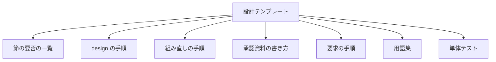
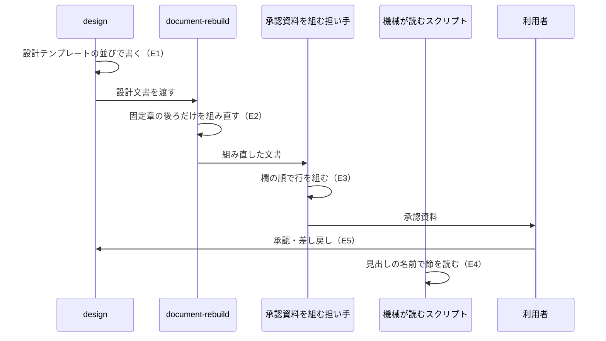

# design: 設計文書の冒頭でこの設計の目指すことを読み、承認に使う節を詳細より前に並べる（#2741）

## この設計の MVV

- **Mission（この設計で目指すこと）**: 設計承認ゲートで承認する人が、設計文書を上から読むだけで、何を目指し何を決めたかを判断できるようにする
- **Vision（この設計で達成する姿）**: 今は、設計文書が「目的」の現状の説明から始まり、決定の記録が 180 行目、未確認のまま残ることが末尾にある（例は要求の「依頼（原文）」の 412 行の文書）。この設計の後は、冒頭の「この設計の MVV」で目指すことを読み、続く数節で判断すること・未確認・決定を読み、詳細は後ろで必要な節だけを開く
- **Value（この設計の価値）**: 承認する人は、詳細を読む前に差し戻すかを決められる。設計テンプレート・組み直し・承認資料が同じ並びを指すため、並びを変えるときに直すのは設計テンプレート 1 か所になる

## 適用範囲

- **働く範囲**: NDF を導入したすべてのリポジトリで、`design` が新しく書く設計文書。既にある設計文書は書き換えない（要求の前提 4）
- **プロジェクトごとに違うもの**: 無し。節の名前と並びはプロジェクトの設定で変えない
- **当たるモード**: `standard` と、設計 Pull Request を出す `legacy-refactor`。`light` と `operation` は独立した設計文書を作らないため、並びは変わらない

## 利用者が判断すること

| # | 出所 | 項目 | この設計での扱い |
| --- | --- | --- | --- |
| 1 | 未決 | 判断に使う項目を節ごと前へ移すか、冒頭に要約の節を置くか | 決定 2 で節ごと前へ移すと決めた。設計承認ゲートで確かめる |
| 2 | 未決 | 「今どうなっているか」を「この設計の MVV」のどの欄で持つか | 決定 1 で Vision の欄に「今は」の文として持つと決めた |
| 3 | 未決 | #2721 と同じスプリントで承認資料の書き方を変えるときの競合 | 決定 5 で、並びの正本を設計テンプレートに置き、承認資料はその順を指すだけにすると決めた |
| 4 | 起票者の推定 S1 | 並びの細部 | 決定 3 の並び。起票時の案と違い、外部の調査を末尾に置き、あるべき姿の根拠を決定の記録の後ろに置く |
| 5 | 起票者の推定 S2・S3 | 「目的」を「この設計の MVV」に置き換え、節の名前でプロジェクト MVV と区別する | 決定 1 |
| 6 | 起票者の推定 S5 | 並びの根拠を外部の資料と過去の指摘から示す | 下の「あるべき姿の根拠」 |
| 7 | 起票者の推定 S6・S7 | 関わる文書とスクリプトが同じ並びを前提にする | 決定 5・6・7 |
| 8 | 境界「確認してから行う」 | 承認資料の行「起票者の推定」を「利用者が判断すること」へ改める | 決定 4。承認資料の項目を変えるため、設計承認ゲートで確かめる |

## 未確認のまま残ること

| 項目 | 内容 |
| --- | --- |
| 利用先での読みやすさ | 並びが利用者の「読み手が求める順」に合うかは、リリース後に利用先のリポジトリで書かれた次の設計文書を利用者が読んで確かめる（要求の検証手段の手動確認） |
| #2721 の設計との並び | #2721 の設計文書はまだ無い（`issues/` に `issue-2721-design*.md` が無い。2026-11-08 に `design/issue-2721` の worktree で確かめた）。#2721 が承認資料の一覧を作るときに、この設計の欄の順を引き継ぐかは #2721 の設計で決まる |

## 決定の記録

### 決定 1: 承認する人が冒頭で目指すことを読めるよう、「目的」を「この設計の MVV」に置き換え、今の状態は Vision の文で持つ

「目的」は 3 行のうち 1 行目が今の状態で、目指すことが後ろに来る。Mission・Vision・Value の 3 つの欄にし、Mission を 1 文の目指すことにする。今の状態は「今は〜。この設計の後は〜」の 2 文で Vision に置く。達成する姿は、今との差として読むと何が変わるかが分かるためである。Value には、誰に何が良くなるかを書く。今の「誰に効くか」はここへ移る。

今の状態を独立した 4 つ目の欄にする形は採らない。欄が増えるほど、冒頭で目指すことを読むまでの行が増える。

根拠: Value 2 / Value 8（MVV 版 6）

### 決定 2: 正本を 1 か所に保つため、承認に使う項目は要約の節を足さずに節ごと前へ移す

決定の記録・未確認のまま残ること・要求の未決と起票者の推定の扱いを、節のまま詳細の節より前へ置く。冒頭に要約の節を置くと、同じ決定が要約と本体の 2 か所に書かれ、直したときに片方が古くなる。機械が読む見出しは名前で節を探し、節の順に依存しない（決定 6 の確かめ）。そのため、節を移しても読む側を変えずに済む。

要約の節を置き、詳細の節を後ろに残す形は採らない。決定の見出しは要約しないで承認資料へ並べる決まり（`approval-request.md`）があり、要約の節を置く理由が無い。

根拠: Value 8 / Value 5（MVV 版 6）

### 決定 3: 承認する人が判断に使う順に読めるよう、節を「目指すこと → 範囲 → 判断すること → 決定 → 根拠 → 詳細 → 証拠」の順に並べる

並びは次のとおりにする。承認に使う節は、H1 → この設計の MVV → 適用範囲 → 利用者が判断すること → 未確認のまま残ること → 決定の記録 → あるべき姿の根拠 → 管理上の注記の順に置く。詳細の節は、ドメインモデル → 機能一覧 → 構成要素 → 構造 → データ構造 → 入出力の契約 → 処理の流れ → 非機能の実現方式 → 設計の結果 → テスト設計 → 外部の調査の順に続ける。

外部の様式はどれも、要約と目指すことを先頭に置き、詳細を後ろに置く（STD1・STD2・STD4・PRD1）。KEP は承認の確認の一覧を要約より前に置き（STD2）、MADR は選んだ結論を比べた案の長所と短所より前に置く（STD3）。Rust RFC と PEP は未解決の問いを末尾に置く（STD1・STD4）。この設計では利用者の指示（#2741）と過去の承認での問い直し（#772）に従い、判断すること・未確認を前に置く。判断する数行の表は短く、決定の本文より先に読める。外部の調査は決定を支える証拠であり、決定の記録から番号（`STD1` など）で指すため末尾に置く。

起票時の案（S1）のとおり、あるべき姿の根拠を決定より前に置く形は採らない。承認する人は結論を読んでから根拠を確かめる（STD3 の結論の位置と同じ）。

根拠: Value 2 / Value 4（MVV 版 6）

### 決定 4: 要求の未決と起票者の推定を設計がどう扱ったかを読めるよう、節「利用者が判断すること」を足し、承認資料の行の出所にする

要求の未決は設計の工程が決め、起票者の推定は設計承認ゲートで利用者が確かめる。今は承認資料が仕様のコピーから起票者の推定だけを載せ、設計がそれをどう扱ったかは決定の記録を読まないと分からない。節「利用者が判断すること」は、未決と起票者の推定の 1 行ずつに、この設計での扱い（決定の番号・未確認へ回した・承認で確かめる）を書く。承認資料の行「起票者の推定」は「利用者が判断すること」へ改め、出所をこの節にする。節が無い設計文書（古い並び）は、今と同じく仕様のコピーの起票者の推定を載せる。

未決と起票者の推定を「未確認のまま残ること」に混ぜる形は採らない。未確認の節はリリースの材料が「未検証・残る危険」として読み（`release_lib/materials.py`）、設計で決めた項目まで危険として載る。

根拠: Value 2 / Value 8（MVV 版 6）

### 決定 5: #2721 と競合しないよう、承認資料では行の出所と並びだけを変え、並びの正本は設計テンプレートに置く

承認資料の書き方（`approval-request.md`）で変えるのは、設計 PR の行に関わる 4 つだけである。「目的」の行の名前と出所、「起票者の推定」の行の名前と出所（決定 4）、行の並び、行の並びを列挙した 2 か所の文である。並びは設計テンプレートの「承認する人が読む欄」が持ち、承認資料はそこを指す。#2721 は承認資料の項目を 1 つの一覧へまとめる。どちらが先にマージされても、後の側は欄の名前と順を設計テンプレートから引き継げばよい。

#2721 の設計を待ってから進める形は採らない。#2721 の設計文書はまだ無く（未確認のまま残ることの 2 行目）、待つと #2741 の利用者の指摘が直らない。

根拠: Value 3 / Value 8（MVV 版 6）

### 決定 6: 並びを変えても機械の読み取りが変わらないことを、既存の単体テストへ新しい並びの文書を足して縛る

設計文書の節を読むスクリプトは 5 つある（設計の結果・未確認・外部の調査と決定の 2 行・テストの名前の照合・本文の決めたことの照合）。どれも節を見出しの名前で探す。それぞれの単体テストに、同じ内容を新しい並びで書いた文書を足し、古い並びの文書と項目の数と中身が一致することを確かめる。節の並びを落とす新しい検査は作らない（要求の対象範囲の「含まない」）。

根拠: Value 1 / Value 5（MVV 版 6）

### 決定 7: 組み直しで並びが崩れないよう、`document-rebuild` が動かさない章を H1 から「あるべき姿の根拠」までにする

`document-rebuild` は、別の Skill が固定した章を動かさない（`document-rebuild` の共通ルール K3）。固定する範囲を、H1 と「この設計の MVV」から「あるべき姿の根拠」までの章にする。範囲には決定の記録が入るため、組み直しが決定の順を入れ替えることもない。確定事項を伝える文書の目的別ガイドは、固定章の後ろ（ドメインモデル以降）にだけ当てる。

根拠: Value 7 / Value 8（MVV 版 6）

## あるべき姿の根拠

| 根拠 | 種類 | 何を示すか |
| --- | --- | --- |
| 利用者の指示（#2741 の「依頼（原文）」、2026-11-07） https://github.com/devbasex/ai-plugins/issues/2741 | 利用者の指示の原文 | 冒頭に「この設計の MVV」を置き、節を読み手が求める順にする |
| 設計承認ゲートでの利用者の指摘「titleからして何を言ってるか分かりません。それぞれ目的を明らかにして全部書き直し」（2026-09-19） https://github.com/devbasex/ai-plugins/issues/785 | 利用者の指示の原文 | 承認する人は最初に目的を読む |
| 設計承認ゲートで利用者の問いが 9 回になった（用語・適用範囲・あるべき姿の根拠を問われた。2026-09-17〜18） https://github.com/devbasex/ai-plugins/issues/772 | 実測 | 承認に使う項目が文書の先頭に無いと、承認する人が問い直す |
| KEP のテンプレートが承認の確認の一覧を要約より前に置く（STD2。 https://raw.githubusercontent.com/kubernetes/enhancements/master/keps/NNNN-kep-template/README.md 、2026-11-08 取得） | 外部の一次情報 | 承認する人の判断に使う項目を詳細より前に置く |
| MADR が選んだ結論を比べた案より前に置く（STD3。 https://raw.githubusercontent.com/adr/madr/main/template/adr-template.md 、2026-11-08 取得） | 外部の一次情報 | 決定は結論を先に読む |
| Google の Design Doc が背景・目標と非目標を先に、設計の詳細を後に置く（PRD1。 https://www.industrialempathy.com/posts/design-docs-at-google/ 、2026-11-08 取得） | 外部の一次情報 | 目指すことと範囲を詳細より前に置く |

要求と受け入れ条件は #2741 の本文にある（コピーは `issues/issue-2741-requirements.md`）。この文書は「どう作るか」だけを扱う。

## ドメインモデル

### コンテキスト

| コンテキスト | 何の語が 1 つの意味に決まるか |
| --- | --- |
| NDF の開発の工程（`ndf-workflow`） | 設計文書・承認する人が読む欄・この設計の MVV・承認資料 |

1 つのコンテキストに収まる。

### 集約

| 集約 | 持ち主（書き換えてよいもの） | 根 | エンティティ | 値オブジェクト |
| --- | --- | --- | --- | --- |
| 設計文書の節の並び | `design` の `references/design-template.md` | 承認する人が読む欄 | 節（見出しと書き方） | 節の名前・置く順 |

承認資料の書き方・`document-rebuild` の固定章・節の要否の一覧・機械が読むスクリプトは、この集約を節の名前で参照する。並びを持たない。

### 不変条件

| # | 集約 | 条件 | 破れたときの扱い |
| --- | --- | --- | --- |
| I1 | 設計文書の節の並び | テンプレートの H1 の直後の最初の H2 は「この設計の MVV」で、H2「目的」は無い | 実装の確かめ（`grep -n '^## '`）で直す |
| I2 | 設計文書の節の並び | 承認に使う節（利用者が判断すること・未確認のまま残ること・決定の記録）は、ドメインモデルと詳細の節より前にある | 同上 |
| I3 | 設計文書の節の並び | 「承認する人が読む欄」の置く順の記述は、テンプレートの見出しの順と一致する | 同上 |
| I4 | 設計文書の節の並び | 承認資料の設計 PR の先頭の行・`document-rebuild` の固定章・節の要否の一覧は、欄の名前と順を指し、H2「目的」を指さない | 同上 |
| I5 | 設計文書の節の並び | 機械が読む見出しの名前は変わらず、古い並びと新しい並びの同じ内容の文書から同じ項目を読む | 単体テストが落ちる |

### ドメインイベント

| # | イベント | 発生元 | 受け手 |
| --- | --- | --- | --- |
| E1 | 設計文書を書いた | `design` | `document-rebuild` |
| E2 | 設計文書を組み直した | `document-rebuild` | 承認資料を組む担い手 |
| E3 | 承認資料を組んだ | 承認資料を組む担い手（`approval-request.md`） | 利用者 |
| E4 | 機械が設計文書の節を読んだ | 設計の結果・決定の照合・外部の調査の照合・リリースの材料・本文の決めたことの照合 | スプリントの工程・リリースの工程 |
| E5 | 利用者が設計を承認した・差し戻した | 利用者 | `design`（差し戻し）・`implementation-plan`（承認） |

### 用語

| 用語 | 意味 | 用語集への反映 |
| --- | --- | --- |
| この設計の MVV | 設計文書の冒頭の節。Mission はこの設計で目指すこと、Vision はこの設計で達成する姿、Value はこの設計の価値。MVV 判定の基準ではない | 追加（要求のコミットで済み） |
| 承認する人が読む欄 | 設計文書のうち、設計承認ゲートで承認する人が判断に使う節の並び。正本は `design` の `references/design-template.md` の同名の節 | 追加（要求のコミットで済み） |
| 利用者が判断すること | 設計文書の節。要求の未決と起票者の推定の 1 行ずつに、この設計での扱いを書く | 追加 |

## 機能一覧

| # | 機能 | 誰が使うか |
| --- | --- | --- |
| F1 | 設計文書の冒頭で、この設計で目指すこと・達成する姿・価値を読む | 承認する人 |
| F2 | 判断すること・未確認・決定を、詳細より前で読む | 承認する人 |
| F3 | 承認資料の先頭の行を、設計文書と同じ順で読む | 承認する人 |
| F4 | 組み直しても、承認に使う節の並びが保たれる | 設計を書く担い手 |
| F5 | 古い並びと新しい並びの設計文書を、機械が同じように読む | スプリントとリリースの工程 |

## 構成要素

| 要素 | 責務 |
| --- | --- |
| 設計テンプレート（`design/references/design-template.md`。変える） | 節の並びと「承認する人が読む欄」の書き方の正本。`legacy-refactor` の書き方の並びも持つ。節を 1 つ足すため、「各節が実装計画のどこへつながるか」の表にも「利用者が判断すること」の行を足す |
| 節の要否の一覧（`design/references/deliverables.md`。変える） | 承認する人が読む欄の中身を新しい欄の名前で挙げる |
| `design` の手順（`design/SKILL.md`。変える） | 手順 3 の「先に書く欄」を新しい欄の名前で指す |
| 組み直しの手順（`document-rebuild/SKILL.md`・`references/format-markdown.md`・`references/purpose-decided.md`。変える） | 動かさない章の範囲、今の状態の置き場、確定事項のガイドを当てる範囲 |
| 承認資料の書き方（`development-workflow/references/approval-request.md`。変える） | 設計 PR の行の名前・出所・並び |
| 要求の手順（`requirements-design/SKILL.md`。変える） | 要求の「目的」が設計文書のどの欄の出所になるか |
| 用語集（`docs/glossary/glossary.json`・`docs/glossary.md`。変える） | 「利用者が判断すること」を足す |
| 機械が読むスクリプトの単体テスト（変える） | 新しい並びの文書を入力に足す |

型とクラスを変えないため、構造の節は作らない。永続データと入出力の契約も変えないため、データ構造と入出力の契約の節は作らない。

矢印は「節の名前と並びを参照する」を表す。

## 処理の流れ

図には、設計文書を書く・組み直す・読む担い手だけを描く。構成要素の表のうち、設計テンプレート・節の要否の一覧・`design` の手順・要求の手順・用語集は、`design` と `document-rebuild` が書くときに読むもので、図に含めない。単体テストは機械が読むスクリプトを縛るもので、これも図に含めない。

## 非機能の実現方式

| 大項目 | 実現方式 |
| --- | --- |
| 移行性 | 既存の設計文書は移さない。機械が読む見出しの名前を変えず、読む側は名前で節を探すため、古い並びと新しい並びが `issues/` に並んでも同じスクリプトが読む（決定 6 のテストで縛る）。承認資料の行「利用者が判断すること」は、節が無い古い文書では今と同じく仕様のコピーの起票者の推定を載せる（決定 4） |

## 設計の結果

| 課題 | 扱い | 取り込み先 | 触るファイル |
| --- | --- | --- | --- |
| #2741 | 実装する | — | `plugins/ndf/skills/design/references/design-template.md`、`plugins/ndf/skills/design/references/deliverables.md`、`plugins/ndf/skills/design/SKILL.md`、`plugins/ndf/skills/document-rebuild/SKILL.md`、`plugins/ndf/skills/document-rebuild/references/format-markdown.md`、`plugins/ndf/skills/document-rebuild/references/purpose-decided.md`、`plugins/ndf/skills/development-workflow/references/approval-request.md`、`plugins/ndf/skills/requirements-design/SKILL.md`、`docs/glossary/glossary.json`、`docs/glossary.md`、`plugins/ndf/scripts/tests/test_design_results_rewrite.py`、`plugins/ndf/scripts/tests/test_release_materials.py`、`plugins/ndf/scripts/tests/test_design_survey.py`、`plugins/ndf/scripts/tests/test_design_match.py`、`plugins/ndf/scripts/tests/test_pr_body_decisions.py` |

## テスト設計

`.md` の文言を照合するテストは書かない（`AGENTS.md` の「DON'T」）。文書の条件は実装の確かめで見る。

| 受け入れ条件・不変条件 | どの振る舞いで縛るか | どう壊したら落ちるべきか |
| --- | --- | --- |
| 1・I1 | テンプレートの `grep -n '^## '` の 1 行目が「この設計の MVV」（実装の確かめ） | 「目的」を残すと 1 行目が変わる |
| 2 | テンプレートの「この設計の MVV」に 3 つの欄があり、欄の表に書き方がある（実装の確かめ） | 欄を 1 つ消すと見つからない |
| 3・I2 | 同じ出力で、利用者が判断すること・未確認・決定の記録がドメインモデルより上（実装の確かめ） | 決定の記録を後ろへ戻すと順が崩れる |
| 4 | この設計文書のあるべき姿の根拠に、外部の一次情報（STD2・STD3・PRD1。URL と取得日は外部の調査の表）と利用者の指摘（#785・#772 の URL）がある | — |
| 5・I3 | 「承認する人が読む欄」の置く順の文とテンプレートの見出しを並べて見る（実装の確かめ） | 片方だけ直すと食い違う |
| 6・I4 | `grep -n '目的' plugins/ndf/skills/document-rebuild/SKILL.md` の固定章の段落に H2「目的」が無い（実装の確かめ） | 範囲を直し忘れると残る |
| 7・I4 | 承認資料の行の並びと欄の並びを並べて見る（実装の確かめ） | 行を入れ替えると食い違う |
| 8・I4 | `deliverables.md` とテンプレートの `legacy-refactor` の書き方に「目的」が無い（実装の確かめ） | 直し忘れると残る |
| 9 | `glossary.py check --file issues/issue-2741-design.md` が通り、`render` 後の `docs/glossary.md` に 3 語が載る | 用語集へ足し忘れると check が新しい語を挙げる |
| 10・I5 | 5 つのスクリプトの既存の単体テストが、変更の前と同じく通る | 見出しの名前を変えると、古い並びの文書から読めなくなる |
| 11・I5 | 5 つのスクリプトそれぞれで、同じ内容を新しい並びで書いた文書から読んだ項目が、古い並びの文書と一致する | 読み取りが「次の節の見出し」の名前や位置に依存するように壊すと、新しい並びの文書で項目が欠ける |
| 12 | テンプレートの `wc -l` が 500 以下（実装の確かめ） | — |

## 外部の調査

| 種類 | 調べるか | 理由 |
| --- | --- | --- |
| 標準・仕様 | 調べる | 設計文書・提案文書の節の並びに、広く使われているテンプレートがある |
| 主要な製品 | 調べる | 大きな組織の設計文書の書き方が公開されている |
| ライブラリとサービス | 調べない | 文書の節の並びを決める変更で、使う部品が無い。読む側は既存の Markdown のパーサー（`md`）をそのまま使う |

### 標準・仕様

| # | 標準・仕様 | 何を定めているか | 設計への反映 | 出典 |
| --- | --- | --- | --- | --- |
| STD1 | Rust RFC のテンプレート | Summary → Motivation → 説明 → Drawbacks → Rationale and alternatives → Prior art → Unresolved questions の順 | 要約を先に置く。未解決の問いは末尾に置く形を採らない（決定 3） | https://raw.githubusercontent.com/rust-lang/rfcs/master/0000-template.md （2026-11-08） |
| STD2 | Kubernetes の KEP のテンプレート | Release Signoff Checklist を Summary より前に置き、Motivation（Goals・Non-Goals）→ Proposal → Design Details の順 | 承認に使う項目を詳細より前に置く（決定 3） | https://raw.githubusercontent.com/kubernetes/enhancements/master/keps/NNNN-kep-template/README.md （2026-11-08） |
| STD3 | MADR（Markdown の ADR のテンプレート） | Context and Problem Statement → Decision Drivers → Considered Options → Decision Outcome → Pros and Cons of the Options | 結論を比べた案と根拠より前に置く（決定 3） | https://raw.githubusercontent.com/adr/madr/main/template/adr-template.md （2026-11-08） |
| STD4 | Python の PEP のテンプレート（PEP 12） | Abstract → Motivation → Specification → Rationale → … → Open Issues の順 | 要約を先に置く。Open Issues を後ろに置く形を採らない（決定 3） | https://raw.githubusercontent.com/python/peps/main/peps/pep-0012/pep-NNNN.rst （2026-11-08） |

### 主要な製品

| # | 製品 | どう解いているか | 設計への反映 | 出典 |
| --- | --- | --- | --- | --- |
| PRD1 | Google の Design Doc（元 Google の技術者による解説） | Context and scope → Goals and non-goals → The actual design（概要から詳細へ）→ Alternatives considered の順。設計文書をトレードオフを書き残す場所とする | 目指すことと範囲を先に置き、詳細を後に置く（決定 3） | https://www.industrialempathy.com/posts/design-docs-at-google/ （2026-11-08） |

### 確かめられなかったこと

| 対象 | 試した手段 | 結果と理由 |
| --- | --- | --- |
| Amazon の 6 ページの文書の節の並び | 試していない | 公開の一次情報の置き場を知らず、上限より先に STD1〜STD4・PRD1 で並びの傾向が揃ったため |

調べた量: 候補 5 件・取得の試み 5 回。

## 出し直しの指摘への対応

| 項目 | 指摘 | 対応 | 直した箇所・直せない理由 |
| --- | --- | --- | --- |
| lproc:1-1 | CI の pytest（pytest / pytest (0/2)）の失敗を直す | 直した | 落ちたのは `plugins/ndf/scripts/tests/test_parallel_hold_flow.py` の 1 件（ほか 5713 件は成功）。実装はレーンを起こす操作が返った後に再開の印を消す（`plugins/ndf/scripts/lib/parallel_hold.py:262-264`）ため、テストを印が消えるまで待ってから確かめる形に直した。手元でこのファイルの 37 件が 3 回続けて通る |
| lproc:1-2 | 要求文書の検査が終了コード 2 で止まり、要求文書を「見つからない」と報告する件の原因を確かめて直す | 直した | 原因は検査の側にある。この検査は要求を書く前（15:28:56 UTC）に打たれ、要求文書は後の要求のステップ（15:32:49 UTC のコミット）で作られた。終了コード 2 は要求のステップへ進む想定どおりの分岐で、要求を書いた後の再検査は終了コード 0 で通った。手元でも `spec-copy.py check 2741 issues/issue-2741-requirements.md` が終了コード 0 を返す。承認の材料がこの分岐を失敗として載せる不具合は課題 #1502 （ https://github.com/devbasex/ai-plugins/issues/1502 ）へ回し、その旨を PR 本文の「要求文書の検査の終了コード 2 について」に書いた |
