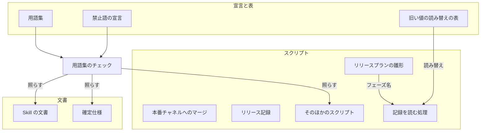
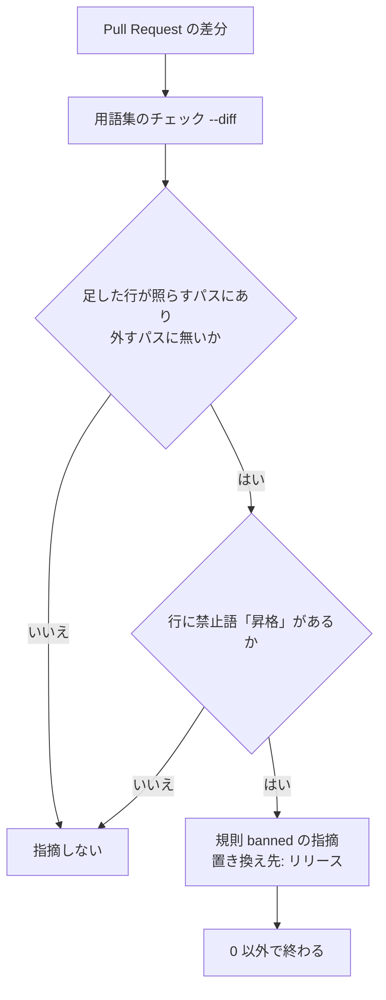

# 用語「昇格」の廃止: 本番チャネルへ入れる道筋もリリースと呼び、承認資料と記録に定義の無い語を出さない（#2748）

## 目的

- **今どうなっているか**: ベースブランチから本番チャネルへ変更を入れる Pull Request とその工程を、NDF は「昇格」と呼んでいる。用語集の語は「昇格の Pull Request」「昇格のプラン」「昇格の承認資料」の 3 つだけで、「昇格」そのものは定義されていない。それでもリリース承認ゲートの問い・承認資料・記録のフェーズ名（「リリース（昇格）」）に出る
- **誰に効くか**: リリース承認ゲートで承認する利用者と、記録・確定仕様を読む担当者
- **変えると何が成り立つか**: 本番へのデプロイを「リリース」の 1 語で呼び、道筋の違いは「リリースの経路」の値だけが持つ。用語集のチェックが「昇格」を新しく書いた行を落とす

## 適用範囲

- **働く範囲**: このリポジトリの文書（`plugins/`・確定仕様・用語集）と、NDF を導入したすべてのリポジトリで NDF が出す文言（承認資料・停止の理由・記録のフェーズ名・自動で作る Pull Request の題）
- **プロジェクトごとに違うもの**: 無し（語は NDF の用語集が持つ。禁止語の宣言はこのリポジトリの `.ndf/glossary.json` だけを変える）
- **当たるモード**: すべてのモード（リリースの経路が merge で、ベースブランチと本番チャネルが違うリポジトリのリリースで文言が変わる）

## あるべき姿の根拠

| 根拠 | 種類 | 何を示すか |
| --- | --- | --- |
| 「昇格は廃止。「リリース」を使う」（利用者、2026-11-07） | 利用者の指示の原文 | 置き換え先の語は「リリース」を使う形にする |
| 「「リリースプラン」と混じっても困らない」（利用者、2026-11-07） | 利用者の指示の原文 | 経路の違いを語で区別せず、既存の「リリースプラン」へ寄せてよい |
| PRD1・PRD2 | 外部の一次情報 | 主要な製品はコマンドの識別子に英語の `promote` を使い、操作の対象を「リリース」（ビルドの成果物）と呼ぶ。識別子の `promote` は業界で流通している語である |
| #2620（廃止した語 `配布`をリリースとデプロイへ分けた）の確定仕様 `docs/specifications/ndf-deploy-and-release-terms.md` | 実測（既存の形） | 確定仕様の書き換え・禁止語の宣言・旧い値の読み替えの表で語を廃止する形が既にある |

要求と受け入れ条件は #2748 の本文にある（コピーは [issue-2748-requirements.md](issue-2748-requirements.md) ）。この文書は「どう作るか」だけを扱う。

## ドメインモデル

### コンテキスト

| コンテキスト | 何の語が 1 つの意味に決まるか |
| --- | --- |
| NDF の開発ワークフロー（`ndf-workflow`） | リリース・リリースプラン・本番チャネル・承認資料 |
| NDF のリリース（`ndf-release`） | リリースの経路・リリースの Pull Request・リリースの承認資料・比べた先端・確かめたコミット |

2 つのコンテキストは共有カーネルの関係である。同じ用語集（`docs/glossary/glossary.json`）を同じ担い手が持ち、`ndf-release` の語は `ndf-workflow` の「リリース」をそのまま使う。

### 集約

| 集約 | 持ち主（書き換えてよいもの） | 根 | エンティティ | 値オブジェクト |
| --- | --- | --- | --- | --- |
| 用語集 | `docs/glossary/glossary.json`（`docs/glossary.md` は `glossary.py render` が作る） | 用語集 | 語の行 | 廃止した語・意味・識別子 |
| 禁止語の宣言 | `.ndf/glossary.json` の `check.banned` | 宣言 | — | 禁止語・照らすパス・外すパス |
| 旧い値の読み替えの表 | `plugins/ndf/scripts/data/legacy-values.json` | 表 | 値の集合（`phase` など） | 旧い値 → 新しい値の対応 |
| リリースプラン（経路 merge で本番チャネルへ入れるもの） | `plugins/ndf/scripts/supervise_lib/delivery_templates.py` の `plan_promote` | プラン | ステップ | フェーズ名・ステップの識別子 |

### 不変条件

| # | 集約 | 条件 | 破れたときの扱い |
| --- | --- | --- | --- |
| I1 | 用語集 | 語の欄に「昇格」を含む行が無く、「昇格」「昇格の Pull Request」「昇格のプラン」「昇格の承認資料」の 4 語がそれぞれ 1 つの語の廃止した語の欄にある。意味の欄にも「昇格」「経路 promote」が無い | `glossary.py check --rules structure` が意味の欄の禁止語を落とす。語の欄と廃止した語の欄は実装の確認のコマンドで見る |
| I2 | 用語集 | 廃止した語「昇格」から引ける置き換え先は「リリース」の 1 つだけである | 禁止語の指摘が置き換え先を 2 つ並べるか「用語集の語」と出す |
| I3 | 旧い値の読み替えの表 | 旧いフェーズ名「リリース（昇格）」と`配布（昇格）`は、新しいフェーズ名「リリース（本番チャネルへのマージ）」へ読み替わる。新しいフェーズ名は表の新しい値の欄にあり、旧い値の欄に無い | 表の読み込みが終了コード 2 で止まる（表の形の誤り）。読み替えが漏れると、旧い記録の所要時間の集計とキューの判定が別のフェーズとして扱う |
| I4 | リリースプラン | ステップの識別子（`verify`・`prepare`・`mvv`・`note`・`promote`・`promote-approved`・`record`）とその順序、引数 `--promote`、承認資料のファイル名 `approval-promote.md`、`merged-steps.py promote` のサブコマンドは変わらない | 既存のステージの並びのテストと、エントリポイントの契約のチェックが落ちる |
| I5 | 禁止語の宣言 | 照らすパスの中で「昇格」を足した行を、規則 `banned` が置き換え先「リリース」を添えて落とす | Pull Request の用語集のチェックが通り、新しい「昇格」が入る |
| I6 | 禁止語の宣言 | 照らすパスに残る「昇格」は、外すパスにある行（「権限昇格」の 2 ファイル・旧い値の表とそのテスト）だけである | 受け入れ条件 4 の検索に、外していない行が出る |

### ドメインイベント

| # | イベント | 発生元 | 受け手 |
| --- | --- | --- | --- |
| E1 | 用語集で「昇格」と、それを含む 3 つの語を廃止した語にした | 実装（用語集の書き換え） | 用語集の構造の検査・`glossary.py render` |
| E2 | 「リリースの経路」の意味の欄と、ほかの語の意味の欄をコードの値に合わせた | 実装（用語集の書き換え） | 実装の確認のコマンド（受け入れ条件 3） |
| E3 | `plugins/` と確定仕様の「昇格」を置き換え先の語へ書き換えた | 実装（文言の書き換え） | 受け入れ条件 4・5 の検索 |
| E4 | 禁止語の宣言に「昇格」を足した | 実装（`.ndf/glossary.json`） | 用語集のチェック（`glossary.py check --diff`） |
| E5 | 新しい行に「昇格」を書いた Pull Request が、用語集のチェックで落ちた | 以後の Pull Request | Pull Request の作成者（指摘の置き換え先） |
| E6 | 動いているループが、旧いフェーズ名を持つ記録か報告を読んだ | 実装のマージ後の再開 | 旧い値の読み替え（`legacy_values.to_current`） |

### 用語

| 用語 | 意味 | 用語集への反映 |
| --- | --- | --- |
| リリース | 本番へのデプロイ。フェーズの名前でもある。ベースブランチから本番チャネルへ変更を入れることもリリースと呼び、道筋の違いはリリースの経路の値が持つ | 意味の変更（`ndf-workflow`。廃止した語に「昇格」を足す） |
| リリースの Pull Request | 本番チャネルへ変更を入れる Pull Request。リリースの雛形では `release/v<版>` が、経路 merge ではベースブランチが head になる | 追加（`ndf-release`。廃止した語「昇格の Pull Request」） |
| リリースプラン | リリースの手順をステップの列として持つプラン | 意味は変えない（`ndf-workflow`。廃止した語に「昇格のプラン」を足す） |
| リリースの承認資料 | リリース承認ゲートで利用者か MVV 判定が見る承認資料。承認したコミットの欄を持ち、本番チャネルへマージしてよいのは、この欄の SHA がリリースの Pull Request の先端のときだけである | 追加（`ndf-release`。廃止した語「昇格の承認資料」） |

「用語集への反映」の列は、実装を終えた時点の用語集を示す。用語集の「昇格の Pull Request」「昇格のプラン」「昇格の承認資料」の 3 行は、実装が消して上の表の語の廃止した語へ移す。設計の Pull Request が用語集へ入れるのは「追加」の 2 語だけで、意味の変更と廃止した語の対応は実装の最初のタスク（用語集・禁止語の宣言・旧い値の読み替えの表）が入れる。設計の Pull Request で廃止した語にすると、用語集のチェック（`glossary.py check --diff`）がこの設計文書の足した行の「昇格」を指摘し、継続的統合が落ちるためである（#2620 と同じ扱い）。

## 外部の調査

| 種類 | 調べるか | 理由 |
| --- | --- | --- |
| 標準・仕様 | 調べない | 語の置き換えは、プロジェクトの用語集と利用者の指示で決まる。識別子の命名を定める公開の仕様は、この判断に関わらない |
| 主要な製品 | 調べる | ベースから本番へ進める操作を、主要なデプロイの製品がどの語と識別子で呼ぶかを見て、識別子 `promote` を残すかを決める |
| ライブラリとサービス | 調べる | 旧い値の読み替えを、既存の仕組みで足りるかを決める |

### 主要な製品

| # | 製品 | どう解いているか | 設計への反映 | 出典 |
| --- | --- | --- | --- | --- |
| PRD1 | Google Cloud Deploy | 既存のリリースをデリバリー パイプラインの次のターゲットへ進める操作を `gcloud deploy releases promote` と呼ぶ。進める対象は「リリース」である | 識別子 `promote` は業界で流通している語で、操作の対象をリリースと呼ぶ形と両立する（決定 2） | https://docs.cloud.google.com/deploy/docs/promote-release?hl=ja （2026-11-09、HTTP 200。本文は英語で返った） |
| PRD2 | Heroku Pipelines | ステージングのアプリのビルドの成果物を本番のアプリへ再ビルドせずに進める操作を `heroku pipelines:promote` と呼ぶ。日本語の文書は「プロモート」と書く | 日本語の文書でも識別子は `promote` のまま残る（決定 2） | https://devcenter.heroku.com/ja/articles/pipelines （2026-11-09、HTTP 200） |

### ライブラリとサービス

| # | 候補 | 版 | ライセンス | 最後のリリースの日付 | 終了のアナウンス | 要件を満たすか | 出典 |
| --- | --- | --- | --- | --- | --- | --- | --- |
| LIB1 | 旧い値の読み替えの仕組み（`plugins/ndf/scripts/lib/legacy_values.py` と `scripts/data/legacy-values.json`。#2620 が作ったリポジトリの中の部品） | このリポジトリの `develop`（`1820438f3`） | リポジトリと同じ | — | 無し | 満たす。集合 `phase` に旧い値を足せば、記録を読む 5 か所（`estimate.py`・`estimate_records.py`・`slow_step.py`・`queue.py`・`current_plan`）が新しい値として読む | `plugins/ndf/scripts/lib/legacy_values.py`（2026-11-09） |

### 確かめられなかったこと

| 対象 | 試した手段 | 結果と理由 |
| --- | --- | --- |
| Google Cloud Deploy の日本語の文書が `promote` をどう訳しているか | https://docs.cloud.google.com/deploy/docs/promote-release?hl=ja の取得 | HTTP 200 だが本文は英語で返り、日本語の訳語は確かめられなかった。決定 2 は識別子が英語の `promote` であることだけを使う |
| 「権限昇格」を定める公的な用語集の項目 | 検索「IPA 権限昇格 脆弱性 用語 site:ipa.go.jp」 | 脆弱性の取り扱いのガイドラインは出たが、「権限昇格」を定義する項目は結果に無かった。決定 4 は、この語が NDF のリリースの意味でないこと（要求の前提 3）だけを使う |

調べた量: 候補 3 件・取得の試み 5 回。

## 機能一覧

| # | 機能 | 誰が使うか |
| --- | --- | --- |
| F1 | 用語集で「昇格」と 3 つの語を廃止した語にし、置き換え先の語を引ける | 文書の書き手・用語集のチェック |
| F2 | 承認資料・停止の理由・ヘルプ・自動で作る Pull Request の題・記録のフェーズ名で、「昇格」の代わりに「リリース」を使う語を出す | リリース承認ゲートで承認する利用者 |
| F3 | 旧いフェーズ名を持つ記録と報告を、新しいフェーズ名と同じに読む | 動いているループ（集計・キュー） |
| F4 | 「昇格」を新しく書いた行を、用語集のチェックが置き換え先を添えて落とす | Pull Request の作成者 |
| F5 | 確定仕様の「昇格」を置き換え先の語で読める | 確定仕様の読み手 |

## 構成要素

| 要素 | 責務 |
| --- | --- |
| 用語集（`docs/glossary/glossary.json` → `docs/glossary.md`） | 置き換え先の語と廃止した語の対応を持つ（F1）。「昇格」の 4 語の扱いは「用語」の表のとおり。「導入の確認」「比べた先端」「確かめたコミット」の意味の欄から「昇格」「経路 promote」を除く |
| 禁止語の宣言（`.ndf/glossary.json`） | `check.banned.words` に「昇格」を足す。`check.banned.exclude` に「権限昇格」の 2 ファイルを足す（F4、決定 4） |
| 旧い値の読み替えの表（`legacy-values.json`） | 集合 `phase` に「リリース（昇格）」→「リリース（本番チャネルへのマージ）」を足し、`配布（昇格）`の行を同じ新しい値へ向け直す（F3、決定 3） |
| リリースプランの雛形（`delivery_templates.py`） | フェーズ名を「リリース（本番チャネルへのマージ）」にする。docstring・コメント・停止の理由・`handoff_step` の文言を置き換え表で書き換える（F2） |
| 本番チャネルへのマージ（`merged_lib/merge.py`・`merged-steps.py`） | 自動で作る Pull Request の題を `リリース: <head> → <base>` に、承認資料の題・ヘルプ・停止の理由を置き換え表で書き換える（F2、決定 5） |
| リリース記録（`release_lib/record.py`・`release-steps.py`） | 記録の本文の段階の注記とヘルプを書き換える（F2） |
| そのほかのスクリプト（`sprint-close.py`・`sprint_routes.py`・`lib/sprint_loop_gate.py`・`lib/approved_commit.py`・`lib/parallel_plan.py`・`lib/delivery.py`） | 停止の理由・起動指示の文言・リリースの経路の注記・コメントを書き換える（F2） |
| Skill の文書（`release`・`development-workflow` の参照） | 本文の「昇格」を置き換え表で書き換える（F2） |
| テスト | 文言とフェーズ名を期待するテストを新しい値に合わせ、旧い値の読み替えのテストを足す（F3）。テストの説明文の「昇格」も書き換える |
| 確定仕様（`docs/specifications/` の `README.md` を含む 12 ファイル） | 「昇格」を置き換え表で書き換える。フェーズ名の一覧は新しい値にする（F5、決定 6） |
| 前提 3 の残りの 2 ファイル（`playwright-kit` のテスト・`docs/ndf-experiments.md`）と棚卸しのテストの入力 | 別の意味の「昇格」を別の語へ書き換える（決定 4） |

### 置き換え表

文言を書き換えるときは、この表の 1 行を当てる。表に無い言い回しは、行の意味に合わせて同じ語を使う。

| 置き換える語 | 置き換え先 |
| --- | --- |
| 昇格の Pull Request（昇格の PR） | リリースの Pull Request |
| 昇格のプラン | リリースプラン（経路 merge で本番チャネルへ入れるリリースプラン） |
| 昇格の承認資料 | リリースの承認資料 |
| 昇格の経路 | リリースの Pull Request で届く経路（経路 merge） |
| 昇格する・昇格させる | 本番チャネルへ入れる |
| 昇格のマージ | リリースの Pull Request のマージ |
| 昇格（名詞の単独） | リリース |
| リリース（昇格）（フェーズ名） | リリース（本番チャネルへのマージ） |

### 構成要素図



テストと前提 3 の残りのファイルは、用語集のチェックが照らす対象（`plugins/**`・`docs/**`）に含まれるため図では「そのほかのスクリプト」「Skill の文書」と同じ辺で表す。記録の書き手（M・R）は文言を出すだけで、読み戻す値を持たない（決定 3）。

### パッケージ構成

```text
.ndf/glossary.json                         # 禁止語の宣言（変える）
docs/
├── glossary/glossary.json                 # 用語集の正本（変える）
├── glossary.md                            # render で作り直す
├── ndf-experiments.md                     # 別の意味の 2 行を書き換える
└── specifications/                        # README.md を含む 12 ファイルを書き換える
plugins/
├── ndf/
│   ├── scripts/
│   │   ├── data/legacy-values.json        # phase の対応を足す
│   │   ├── supervise_lib/                 # delivery_templates.py・sprint_routes.py
│   │   ├── merged_lib/merge.py
│   │   ├── release_lib/record.py
│   │   ├── lib/                           # sprint_loop_gate・approved_commit・parallel_plan・delivery
│   │   ├── merged-steps.py・release-steps.py・sprint-close.py
│   │   └── tests/                         # 期待値と説明文、旧い値のテスト
│   └── skills/
│       ├── release/                       # SKILL.md・references/release-steps.md
│       ├── development-workflow/references/
│       └── backlog-refinement/tests/fixtures/overhaul-20261101.json
└── playwright-kit/skills/playwright-kit-ops/tests/test_pytest_terminal_summary.py
```

## 構造

型は変えない。変えるのはリリースプランの「フェーズ」の値と、旧い値の読み替えの表の集合 `phase` の行だけである。

| 値の集合 | 変える前 | 変えた後 | 旧い値の扱い |
| --- | --- | --- | --- |
| `phase`（記録とプランのフェーズ名） | `リリース（昇格）` | `リリース（本番チャネルへのマージ）` | 表の `phase` に `リリース（昇格）` → 新しい値を足す。`配布（昇格）` の行の新しい値も同じ値へ向け直す（表は旧い値から旧い値への連鎖を許さない） |
| ステップの識別子・引数・ファイル名 | `promote` など | 変えない | 対象外（決定 2） |

**値の集合へ値を足すため、集合 `phase` を前提にした既存の規則を判定した。** コードの 4 つの規則はすべて `to_current("phase", …)` を通すか表の新しい値の欄から集合を作るため、新しい値にもそのまま当てはまり、コードに変える対象は無い。当てはまらないのは確定仕様の値の一覧だけで、構成要素の表に載せた。

| 規則 | 場所 | 新しい値に当てはまるか |
| --- | --- | --- |
| リリースプランの Pull Request をキューの報告から外す | `supervise_lib/queue.py` の `RELEASE_PHASES`（表の新しい値の欄から作る） | 当てはまる。新しい値は表の新しい値の欄に入る |
| 見積もりの記録の完了したフェーズ | `estimate.py`・`lib/estimate_records.py` | 当てはまる（読んだ直後に読み替える） |
| 遅いステップの履歴 | `lib/slow_step.py` の `read_history` | 当てはまる（両辺を読み替えて比べる） |
| 前の版が組んだプランのフェーズ | `legacy_values.current_plan` | 当てはまる |
| 確定仕様のフェーズ名の一覧 | `docs/specifications/ndf-deploy-and-release-terms.md` の値の表 | 当てはまらない。新しい値へ書き換える（構成要素の「確定仕様」） |

## 処理の流れ

読み戻す値を持つのはフェーズ名だけで、図はその読み替えと禁止語の検査の 2 つの流れを示す。文言だけを変える要素（リリースプランの雛形のフェーズ名以外の文言・本番チャネルへのマージ・リリース記録・そのほかのスクリプト・Skill の文書・確定仕様・テスト・前提 3 の残りのファイル）は処理の順序を変えないため、図に含めない。

```mermaid
sequenceDiagram
  participant Loop as 動いているループ
  participant Rd as 記録を読む処理
  participant LV as 旧い値の読み替え
  participant Tb as 旧い値の読み替えの表
  Loop->>Rd: 報告・記録を読む（フェーズ: リリース（昇格））
  Rd->>LV: to_current("phase", 値)
  LV->>Tb: 集合 phase を引く
  Tb-->>LV: リリース（本番チャネルへのマージ）
  LV-->>Rd: 新しい値
  Rd-->>Loop: 新しい値と同じに集計・判定する
```



## 非機能の実現方式

| 大項目 | 実現方式 |
| --- | --- |
| 移行性 | 識別子（ステップ・引数・承認資料のファイル名・サブコマンド）を変えない（決定 2）ため、マージの前に始まったスプリントの状態ファイル・承認資料・開いているリリースの Pull Request はそのまま読める。開いている Pull Request は head と base で探すため、旧い題のままでも見つかる（決定 5）。表示の値で読み戻すのはフェーズ名だけで、旧い値は旧い値の読み替えの表が新しい値へ変える（決定 3）。書かれた記録は書き換えない |

## 決定の記録

### 決定 1: 経路の違いを語で区別しないため、4 語の置き換え先を「リリース」を含む既存の語と 2 つの新しい語にする

「昇格」は「リリース」の廃止した語にする。「昇格のプラン」は既存の「リリースプラン」の廃止した語にする。雛形の `plan_promote` は `release_plan` を呼んで組むリリースプランの 1 つで、意味の欄を変えずに 1 語 1 意味が保てるためである。「昇格の Pull Request」と「昇格の承認資料」は、新しい語「リリースの Pull Request」「リリースの承認資料」の廃止した語にする。どちらも意味を本番チャネルへ入れる Pull Request とリリース承認ゲートの承認資料に広げ、リリースの雛形の `release/v<版>` の Pull Request も同じ語で呼ぶ。`release` の参照は既にその Pull Request を「リリースの Pull Request」と書いている。

「リリースのプラン」を別の語として足す形は採らない。「リリースプラン」と表記だけが違う語が 2 つの意味を持つ。新しい語「リリースの Pull Request」には識別子の欄（`promotion_pr`）を引き継がない。意味が雛形の経路を含むため、経路 merge だけの識別子と対応しなくなる。

根拠: Value 8（MVV 版 6）

### 決定 2: 動いているループと公開の契約を壊さないため、識別子 `promote` などは変えない

ステップの識別子 `promote`・`promote-approved`、引数 `--promote`、承認資料のファイル名 `approval-promote.md`、`merged-steps.py promote` のサブコマンド、関数名 `plan_promote` は変えない。`merged-steps.py` と `release-steps.py` の入出力はエントリポイントの契約（`plugins/ndf/contracts/entrypoints/`）に載り、状態ファイルと承認資料のファイル名は動いているスプリントが読む。英語の `promote` は主要な製品がリリースを本番側へ進める操作の識別子に使う語で（PRD1・PRD2）、利用者が問うた「定義されていない日本語の語」には当たらない。

識別子も `release` 系へ改名する形は採らない。`plugins/` の 34 ファイル 252 行に加え、契約・状態ファイル・承認資料のファイル名の旧い値を読む仕組みが要る。既存の `release` の識別子（`release-steps.py`・リリースの雛形）とも重なる。

- 作り方: 標準に倣う
- 比べた候補: PRD1 / PRD2

根拠: Value 6 / Value 1（MVV 版 6）

### 決定 3: 記録を読む処理を変えずに旧い記録を読むため、フェーズ名の旧い値を既存の読み替えの表に足す

フェーズ名を「リリース（本番チャネルへのマージ）」にし、`legacy-values.json` の集合 `phase` に旧い値「リリース（昇格）」を足す。記録を読む 5 か所は既に表を通すため、読む側のコードは変えない。表は新しい値が旧い値の欄に現れることを拒むため、既存の`配布（昇格）`の行も新しい値へ直に向け直す。新しい値は、ほかのリリースプランのフェーズ名（「リリース」「リリース（リリース承認ゲート）」「リリース（CD の結果）」）と重ならないよう、本番チャネルへマージすることを括弧で示す。

記録の本文の段階の注記（`stage_note`）・停止の理由・自動で作る Pull Request の題は、読み戻す処理が無い（記録を読む `parse_record` は段階の注記を読まない）。そのため表に足さず、文言だけを変える。

- 作り方: 自前で作る
- 比べた候補: LIB1

根拠: Value 7（MVV 版 6）

### 決定 4: 別の意味の「昇格」で禁止語の指摘が出ないよう、セキュリティの用語だけを照らす範囲から外し、残りは別の語へ書き換える

`qa-security-scan` の「権限昇格」（`02-auth-checklist.md`・`03-report-template.md`）は、セキュリティの診断の分野の語で、言い換えると読み手が知っている語から離れる。そのため 2 ファイルを `.ndf/glossary.json` の `check.banned.exclude` に足し、本文は変えない。`playwright-kit` のテストの説明文 4 行は「outcome=failed に変える」の形へ、`docs/ndf-experiments.md` の 2 行は「本体へ移すか消すかを決めたら」へ書き換える（`AGENTS.md` の「効いた実験版は安定版の経路で本体へ移す」と同じ語）。棚卸しのテストの入力（`overhaul-20261101.json`）の課題の題 1 行も「リリースの Pull Request で届く経路」へ書き換える。題の文字列を照合するテストは無い。

4 ファイルすべてを外す形は採らない。外したファイルでは、リリースの意味の「昇格」を新しく書いても検査が落とさない。

根拠: Value 8（MVV 版 6）

### 決定 5: 承認する利用者が自動で作られた Pull Request の題で定義の無い語に当たらないよう、題を「リリース: <head> → <base>」にする

`merged-steps.py promote` が作る Pull Request の題と本文、承認資料の題（`#<番号> のリリース（<head> → <base>。リリース承認ゲート）`）を置き換え表で書き換える。開いている Pull Request は head と base で探す（`_open_promote_pr`）ため、マージの前に旧い題で作られた Pull Request もそのまま使われる。

根拠: Value 2（MVV 版 6）

### 決定 6: 確定仕様を今の語で読めるよう、#2620 の先例どおり確定仕様を書き換え、変更履歴と `docs/archive/` は書き換えない

確定仕様は今の仕組みを説明する文書で、廃止した語が残ると読み手が用語集で引けない。変更履歴と `docs/archive/` は書いた時点の記録で、禁止語の宣言の外すパス（`docs/archive/**`・`docs/changelog/**`）にも既に入っている。

根拠: Value 8（MVV 版 6）

### 決定 7: 受け入れ条件 4・5 の検索に、廃止を宣言する行だけが残ることを許す

受け入れ条件 1 は用語集の廃止した語の欄に「昇格」を求め、受け入れ条件 7 は禁止語の宣言に「昇格」を求める。そのため受け入れ条件 4 の検索（`.ndf` を含む）と受け入れ条件 5 の検索（`docs/glossary` と `docs/glossary.md` を含む）は、次の行を 0 にできない。実装はこれらの行を残し、ほかの行が 0 であることで受け入れ条件 4・5 を満たしたとする。

| 検索 | 残る行 |
| --- | --- |
| 受け入れ条件 4 | `.ndf/glossary.json` の禁止語の行、`legacy-values.json` と `test_legacy_values.py` の旧い値の行、`qa-security-scan` の「権限昇格」の 2 行（決定 4） |
| 受け入れ条件 5 | `docs/glossary/glossary.json` と `docs/glossary.md` の廃止した語の欄の行 |

#2620 の先例でも、廃止した語 `配布`は用語集の 2 ファイルの廃止した語の欄に残っている（`docs/glossary.md` 23 行・`glossary.json` 25 行。2026-11-09 の `grep -c '配布'`）。

根拠: Value 8（MVV 版 6）

## テスト設計

| 受け入れ条件・不変条件 | どの振る舞いで縛るか | どう壊したら落ちるべきか |
| --- | --- | --- |
| 受け入れ条件 1・I1 | 用語集の語の欄に「昇格」が無く、4 語がそれぞれ 1 つの語の廃止した語の欄にある（実装の確認で `jq` を打ち、結果を PR に載せる） | 4 語のどれかを廃止した語の欄から外すと、確認の結果に欠ける語が出る |
| 受け入れ条件 2 | `glossary.py check --rules structure` が 0 で終わる | 廃止した語を同じコンテキストの生きた語と重ねると、規則 `schema` で落ちる |
| 受け入れ条件 3 | 「リリースの経路」の意味の欄の値が `delivery.py` の `TEMPLATE`・`MERGE`・`MANUAL`・`NONE` と一致し、どの意味の欄にも「経路 promote」が無い（実装の確認のコマンド） | 意味の欄に `promote` を経路として書き戻すと、確認のコマンドが行を出す |
| 受け入れ条件 4・5・I6 | 検索の結果が決定 7 の残る行だけになる（実装の確認） | 置き換え表を当て漏らすと、残る行の外に行が出る |
| 受け入れ条件 6・I3 | 旧いフェーズ名「リリース（昇格）」と`配布（昇格）`を `to_current("phase", …)` に与えると新しい値になる。旧いフェーズ名を持つ報告をキューに与えると、新しい値の報告と同じに Pull Request の一覧から外れる。旧いフェーズ名の履歴を遅いステップの集計に与えると、新しい値の行と同じに数える（`test_legacy_values.py` に足す） | 表の行を消すと、旧い値がそのまま返り、キューが旧い報告の Pull Request を一覧へ入れる |
| I3（表の形） | 表を読み込むと新しい値が旧い値の欄に無い | `配布（昇格）`を「リリース（昇格）」へ向けたまま残すと、表の読み込みが終了コード 2 で止まる |
| 受け入れ条件 7・8・I5・I2 | 照らすパスのファイルへ「昇格」を含む行を足した差分で `glossary.py check --diff origin/develop` が規則 `banned` を出し、置き換え先に「リリース」を示して 0 以外で終わる（要求の検証手段のとおり作業ブランチで確かめ、結果を PR に載せる。禁止語の検査の仕組みは既存のテストが縛る） | 禁止語の宣言から「昇格」を外すと指摘が出ない。「昇格」を 2 つの語の廃止した語の欄に置くと、置き換え先が 2 つ並ぶ |
| 受け入れ条件 9・I4 | リリースプランのステップの識別子と順序が変わらない（既存の `test_supervise_pace_verify.py`・`test_sprint_loop.py`・`test_supervise_new.py`）。フェーズ名を期待する `test_supervise_new.py` は新しい値に合わせる。全体テストが通る | ステップの識別子を変えると、既存のテストとエントリポイントの契約のチェックが落ちる |

## 設計の結果

| 課題 | 扱い | 取り込み先 | 触るファイル |
| --- | --- | --- | --- |
| #2748 | 実装する | — | `.ndf/glossary.json`、`docs/glossary/glossary.json`、`docs/glossary.md`、`docs/ndf-experiments.md`、`docs/specifications/`、`plugins/ndf/scripts/data/legacy-values.json`、`plugins/ndf/scripts/supervise_lib/delivery_templates.py`、`plugins/ndf/scripts/supervise_lib/sprint_routes.py`、`plugins/ndf/scripts/merged_lib/merge.py`、`plugins/ndf/scripts/merged-steps.py`、`plugins/ndf/scripts/release_lib/record.py`、`plugins/ndf/scripts/release-steps.py`、`plugins/ndf/scripts/sprint-close.py`、`plugins/ndf/scripts/lib/sprint_loop_gate.py`、`plugins/ndf/scripts/lib/approved_commit.py`、`plugins/ndf/scripts/lib/parallel_plan.py`、`plugins/ndf/scripts/lib/delivery.py`、`plugins/ndf/scripts/tests/`、`plugins/ndf/skills/release/`、`plugins/ndf/skills/development-workflow/references/`、`plugins/ndf/skills/backlog-refinement/tests/fixtures/overhaul-20261101.json`、`plugins/playwright-kit/skills/playwright-kit-ops/tests/test_pytest_terminal_summary.py` |

## 未確認のまま残ること

| 項目 | 内容 |
| --- | --- |
| 受け入れ条件 4・5 の読み方 | 受け入れ条件 4・5 は文字どおりには受け入れ条件 1・7 と両立しない。決定 7 の読み方でよいかを設計承認ゲートで利用者が確かめる |
| 起票者の推定（要求の S1〜S6） | 要求の「起票者の推定」は、設計承認ゲートで利用者が確かめるまで利用者の決定として扱わない |
| 実機の承認資料 | 実装のリリース後、最初のリリース承認ゲートの承認資料と問いに「昇格」が出ないことを利用者が見る（要求の検証手段の手動確認） |
| `RELEASE_PHASES` が「リリース（CD の結果）」を含まないこと | キューの判定の集合は表の新しい値の欄から作るため、表に無い「リリース（CD の結果）」は入らない。CD の結果のプランが Pull Request を報告するかは確かめていない。この課題の変更は集合の作り方を変えない |
