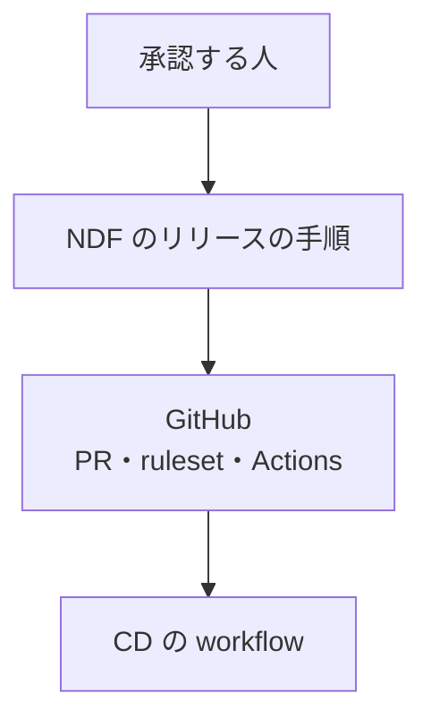
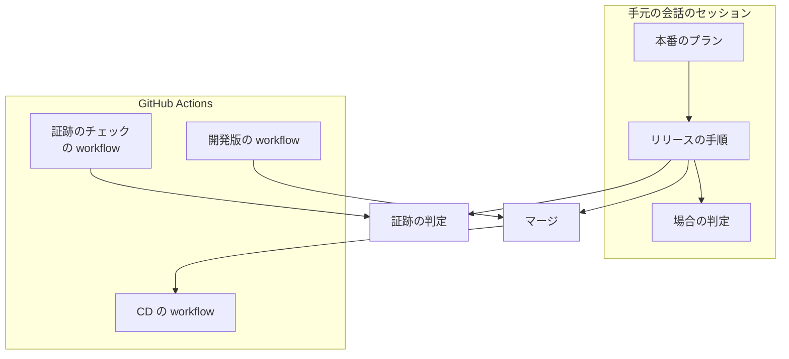
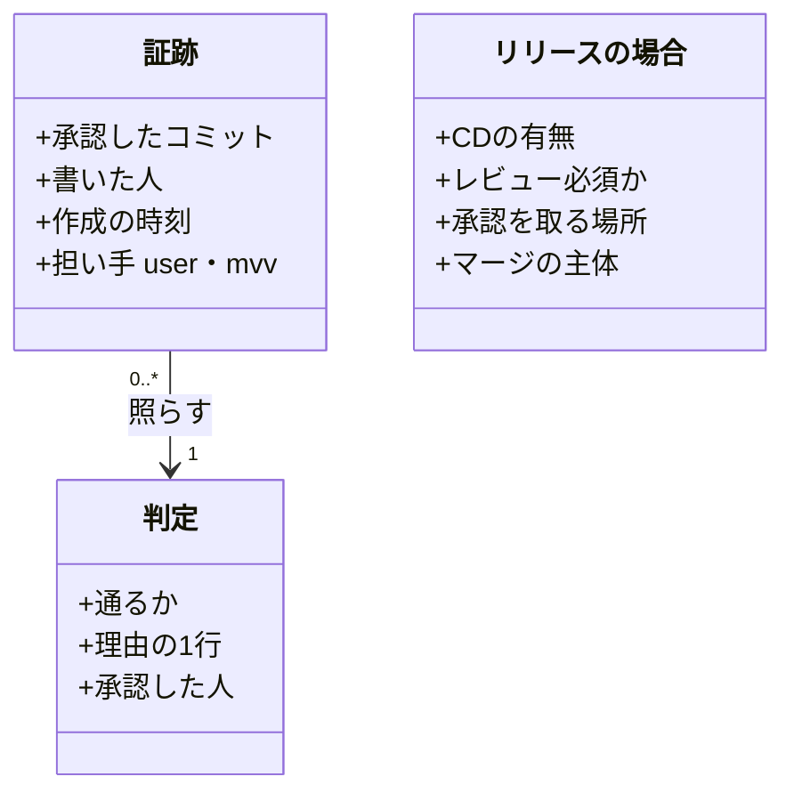
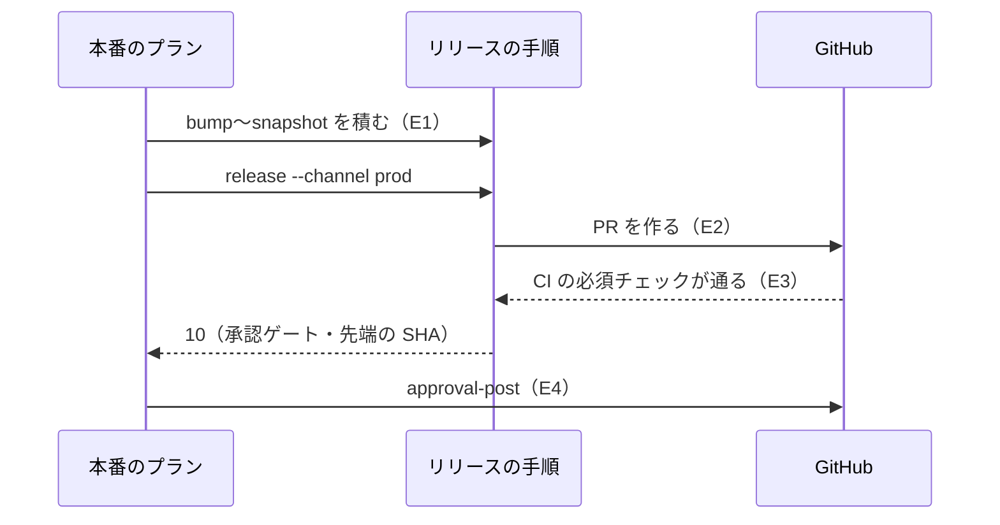
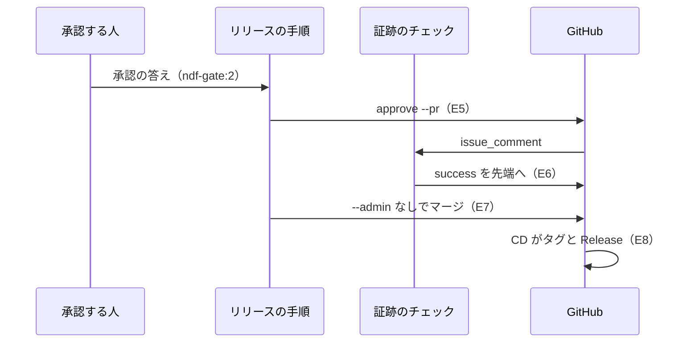
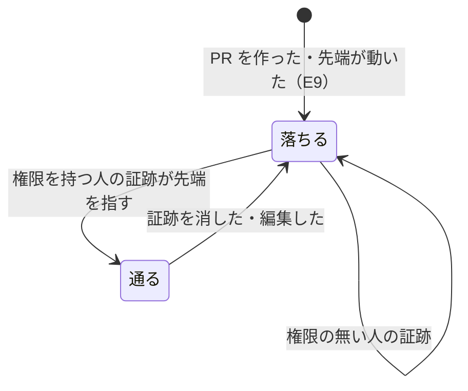
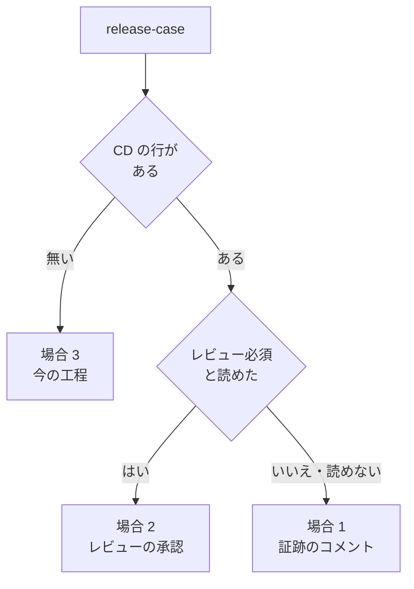

# release: リリース承認をマージの前にリリースの PR へ残し、本番と開発版の反映を GitHub の workflow で起こす（#2773）

## 具体例で見る

リリースの PR は、リリース用ブランチ `release/v<版>` を main へ入れる Pull Request である。この設計の中心は、**人が承認したコミットと、マージする時点のリリースの PR の先端（いちばん新しいコミット）が同じときだけ、main へのマージを通す**ことである。

### 場面 1: 承認の後に別のコミットが足された

1. v10.28.0 のリリースの PR の先端がコミット `0123abc` のときに、人がリリースを承認した
2. 承認の後、誰かが `release/v10.28.0` へ別のコミット `89abcde` を push した。人は `89abcde` を見ていない

| | 今の NDF | この変更が入った版 |
| --- | --- | --- |
| 承認の記録 | 会話の問いの答えだけ。手元のファイル（`.gitignore` の対象）に書かれ、GitHub の上には残らない | リリースの PR にコメント「承認したコミット: `0123abc…`（40 桁）」が残る。誰がいつ承認したかを PR の画面で読める |
| `89abcde` が足されたとき | 気付かない。管理者の権限の迂回（`--admin`）でマージし、承認していない `89abcde` が本番へ入る | PR のチェック `ndf/release-approval` が落ち、「証跡 0123abc ≠ 先端 89abcde」と出る。main の ruleset がマージを受け付けない。本番のプランは終了コード 10 で止まり、人に承認し直しを求める |
| 人がすること | 何もしない（気付けない） | `89abcde` を見て、よければ承認し直す。新しい承認のコメントが付くとチェックが通り、マージできる |

### 場面 2: 承認の後にスプリントのブランチが更新された

1. スプリント A と B を集めた v10.28.0 のリリースを承認した
2. 承認の後、スプリント A のブランチに修正が push され、リリース用ブランチが組み直された

今の NDF は組み直しに気付かず、承認した時点と違う A を本番へ入れる。この変更が入った版では、組み直しでリリースの PR の先端が変わるため、場面 1 と同じくチェックが落ちてマージが止まる。組み直さなければ、本番へ入るのは承認した時点の A のままである。どちらの場合も、承認していない中身は本番へ入らない（#3168 の 2 つの穴。#3168 はこの課題へ統合した）。

### マージの後

マージの後は、main への push で workflow がタグ `ndf--v<版>` と GitHub Release を作る（今と同じ）。開発版のデプロイも会話のセッションの外の workflow で進む。人が承認した後に会話のセッションが切れても、反映は止まらない。

### 語の言い換え

- **承認の証跡**: リリースの PR に置く、承認したコミットの SHA を書いたコメント。マージの判定はこのコメントだけを読む
- **証跡のチェック**: PR の先端と証跡の SHA を比べ、PR に `ndf/release-approval` の結果を付ける workflow。main の ruleset がこの結果を必須にする
- **場合 1〜3**: リポジトリの形による分かれ方。場合 1 は CD があり PR のレビューを必須にしないリポジトリ（ai-plugins）で、上の証跡で判定する。場合 2 は CD があり PR のレビューを必須にするリポジトリで、レビューの承認を承認として扱い、承認したレビューのコミットと先端を比べる。場合 3 は CD の無いリポジトリで、今の本番の経路のまま

## 目的

- **今どうなっているか**: 本番のリリースは会話のセッションで `release-steps.py release --channel prod` を打って行う。承認の記録は手元の承認資料（`.gitignore` の対象）にしか残らない。main へのマージは管理者の権限の迂回（`gh pr merge --admin`）で行い、main の ruleset は承認の有無を見ていない。開発版のデプロイも会話のセッションの中で終わる
- **誰に効くか**: リリースを承認する人と、後から「誰がいつ何を承認したか」を確かめる人。NDF を使うリポジトリのうち CD を持つもの
- **変えると何が成り立つか**: 承認はマージの前にリリースの PR のコメントとして残り、main は承認したコミットと先端が一致しない限りマージを受けない。マージの後は workflow がタグと GitHub Release を作り、会話のセッションの外で反映が進む

## 適用範囲

- **働く範囲**: 証跡の書き手・3 つの場合の判定・手順書の変更は NDF を使うすべてのリポジトリで働く。証跡のチェックの workflow と ruleset の変更は ai-plugins だけである（ほかのリポジトリの ruleset は変えない）
- **プロジェクトごとに違うもの**: CD の有無は `.ndf/project.json` の `delivery` で受ける。レビュー必須かは本番チャネルの ruleset を API で読む。開発版の workflow の名前は `.ndf/supervise.json` の `release` の宣言で受ける
- **当たるモード**: リリースの工程（`release`）と、`development-workflow` のマージからリリースまでの工程。モードは `standard`

## あるべき姿の根拠

| 根拠 | 種類 | 何を示すか |
| --- | --- | --- |
| 利用者の指示「リリース承認 -> mainへのmerge -> 自動的にデプロイ」「承認の証跡はPRにコメントの形で記録する」（2026-11-08） | 利用者の指示の原文 | 承認をマージの前へ移し、証跡を PR のコメントに置く |
| 利用者の指示「CD があり、レビューが必須の場合、改めて証跡を記録したりチェックしたりする機構は不要」（2026-11-08） | 利用者の指示の原文 | 場合 2 は PR のレビューの承認をリリース承認とみなす |
| 利用者の指示「CIによるテストが通ってからリリースに入るようにworkflowを組んでください」（2026-11-08） | 利用者の指示の原文 | リリースの手順から全体テストを外し、CI の通過を起動の条件にする |
| STD1（ruleset の必須ステータスチェックはアプリを出元に限れる） | 外部の一次情報 | 証跡のチェックの結果を GitHub Actions のアプリ以外が付けても、マージを通さない |
| STD2（`GITHUB_TOKEN` が起こした出来事は新しい workflow を起動しない） | 外部の一次情報 | 開発版の PR は手元で作り、本番のマージは利用者のアカウントで行う |
| `gh api repos/devbasex/ai-plugins/rulesets/22332172` の出力（2026-11-13） | 実測 | main は承認 1 件と管理者の迂回（`bypass_mode: pull_request`）を持ち、必須チェックの出元を限っていない |

要求と受け入れ条件は #2773 の本文にある（コピーは [issue-2773-requirements.md](issue-2773-requirements.md) ）。この文書は「どう作るか」だけを扱う。決定の記録は [issue-2773-design-decisions.md](issue-2773-design-decisions.md) にある。ファイルと関数の粒度の詳細設計は [issue-2773-design-detail.md](issue-2773-design-detail.md) にある。

## ドメインモデル

### コンテキスト

| コンテキスト | 何の語が 1 つの意味に決まるか |
| --- | --- |
| リリース（`ndf-release`） | リリースの PR・承認の証跡・証跡のチェック・承認権限・リリースの場合 |
| 開発の工程（`ndf-workflow`） | マージからリリースまでの工程と、承認ゲート |

リリースが供給者、開発の工程が顧客の関係（顧客 / 供給者）。開発の工程はリリースの場合の判定の結果（承認を取る場所とマージの主体）だけを受け取り、判定の中身を持たない。

GitHub の API（ruleset・コメント・commit status・権限）は、リリースの側の 1 つのモジュールで読む。読んだ値はリリースの語へ変えてから判定へ渡し、判定は GitHub の応答の形に依存しない。

### 集約

| 集約 | 持ち主（書き換えてよいもの） | 根 | エンティティ | 値オブジェクト |
| --- | --- | --- | --- | --- |
| リリースの PR | 本番のリリースの手順（`release-steps.py release --channel prod`） | リリースの PR | 承認資料のコメント | 先端のコミット・宛先 |
| 承認の証跡 | 証跡の書き手（`release_lib/approval_trail.py` の書く関数。`approve --pr` と `promote` が呼ぶ） | 証跡のコメント | — | 承認したコミット・書いた人・作成の時刻 |
| 証跡のチェックの結果 | 証跡のチェックの workflow | 先端のコミットへの commit status | — | 判定（通る / 落ちる）・理由の 1 行 |
| リリースの場合 | 場合の判定（`lib/release_case.py`） | リリースの場合 | — | CD の有無・レビュー必須か・承認を取る場所・マージの主体 |

承認の証跡と証跡のチェックの結果は、リリースの PR を番号と先端の SHA で参照し、PR を書き換えない。

証跡のチェックの結果は先端の SHA に付く commit status で、同じ SHA を先端に持つ main 宛ての PR のすべてに効く。そのため判定は「PR 番号と先端の SHA の組」を、main 宛ての開いた PR のうちその SHA を先端に持つものが 1 本だけのときに限って通す（I10）。同じ先端の PR が 2 本以上あれば、どの PR の証跡でも通さない。

人が手で PR に置いたコメントは、集約の外の入力として扱う。書き手を通らないコメントも、証跡の判定が同じ書式の解釈（印と `承認したコミット:` の行）に掛け、合わなければ数えない。書式の検査を受け持つのは証跡の判定だけである。

### 不変条件

| # | 集約 | 条件 | 破れたときの扱い |
| --- | --- | --- | --- |
| I1 | 証跡のチェックの結果 | 承認権限を持つ人の最新の証跡が指すコミットと PR の先端が等しいときだけ通る | 落ち、証跡のコミットと先端の SHA を理由の 1 行に出す |
| I2 | 証跡のチェックの結果 | 証跡が 1 件も無い PR では落ちる | 落ち、「証跡が無い」を理由に出す |
| I3 | 承認の証跡 | 承認権限（admin か maintain）を持たない人の証跡は判定に数えない。権限を読めない人の証跡も数えない | 数えずに判定し、該当があれば理由に書いた人を出す |
| I4 | 承認の証跡 | 承認した人と時刻は、GitHub がコメントに付けた作成者と作成の時刻で読み、本文の記述を判定に使わない。作成の後に編集されたコメント（`updated_at` が `created_at` と違うもの）は証跡に数えない | 本文に人や時刻が書かれていても判定は変わらない。編集された証跡は数えず、該当があれば理由に「編集された証跡」を出す |
| I5 | 証跡のチェックの結果 | 判定の処理は既定ブランチの定義で動き、PR のコードを取り出して実行しない | PR が workflow や判定のスクリプトを書き換えても判定は変わらない |
| I6 | リリースの PR | リリースの手順は承認を求めた後にリリースのブランチへコミットを足さない | 足せば先端が動き、I1 で落ちる |
| I7 | リリースの PR | 場合 1・2 の本番の経路（`release --channel prod` と `merged-steps.py promote`）は、CI の必須チェックが通った先端でだけ main へマージし、管理者の迂回を使わない | GitHub がマージを拒み、手順は止まって理由を出す |
| I8 | リリースの場合 | 場合 2（CD があり、レビューが必須）では証跡を書かず、証跡のチェックを待たない。承認したコミットは、必須レビューの承認者として有効な人（共同作業者の権限の API の `permission` が `admin` か `write`）の最新の承認（`APPROVED`）のレビューが付いたコミット（レビューの `commit_id`）で読み、先端と一致したときだけマージする。read・triage の権限の人と、権限を読めない人の承認は照合に使わない | 一致しなければマージせず 10 で止まり、レビューの承認のやり直しを求める。有効な人の承認が無ければ同じく 10 で止まる |
| I9 | リリースの場合 | 場合 3（CD が無い）の工程は今の `release` の工程と同じに進む | — |
| I10 | 証跡のチェックの結果 | main 宛ての開いた PR のうち、判定する PR のほかに同じ先端の SHA を持つ PR があれば落ちる | 落ち、同じ先端を持つほかの PR の番号を理由に出す。ほかの PR が閉じると判定し直す。`success` を付けた実行は付けた後に読み直し、同じ先端の PR が増えていれば `failure` に付け直す（別の PR の実行と並んでも `success` が残らない） |

### ドメインイベント

| # | イベント | 発生元 | 受け手 |
| --- | --- | --- | --- |
| E1 | リリースのブランチに版上げ・CHANGELOG・トークン消費の記録のコミットを積み終えた | 本番のプラン（bump〜snapshot） | 本番のリリースの手順 |
| E2 | main 宛てのリリースの PR を作った | 本番のリリースの手順 | CI・証跡のチェックの workflow |
| E3 | リリースの PR の先端で CI の必須チェックが通った | CI | 本番のリリースの手順（承認資料を置く） |
| E4 | 承認資料を PR にコメントで置いた | 承認資料の投稿（`approval-post`） | 承認する人・リリース承認ゲート |
| E5 | 承認権限を持つ人が、承認したコミットを書いた証跡のコメントを PR に置いた | 証跡の書き手 | 証跡のチェックの workflow |
| E6 | 証跡のチェックが通った | 証跡のチェックの workflow | GitHub のマージの判定・本番のリリースの手順 |
| E7 | リリースの PR を main へマージした | 本番のリリースの手順 | CD（`release-cd.yml`） |
| E8 | CD がタグ `ndf--v<版>` と GitHub Release を作った | CD | リリース記録（`cd-result`・`record`） |
| E9 | 承認の後に PR の先端が動いた | push | 証跡のチェックの workflow（落ちに変える） |
| E10 | 開発版のデプロイの workflow が develop の版で終わった | 開発版の workflow | 開発版のプラン（結果を待つ） |

### 用語

| 用語 | 意味 | 用語集への反映 |
| --- | --- | --- |
| リリースの場合 | CD の有無とレビュー必須の有無で決まる 3 つの場合（CD があり、レビューなしでマージできる / CD があり、レビューが必須 / CD が無い）。承認を取る場所とマージの主体を決める | 追加（`ndf-release`） |
| 承認資料のコメント | 承認を求める時点の承認資料を、リリースの PR へ置いたコメント。証跡とは別の印を持ち、判定に数えない | 追加（`ndf-release`） |
| 開発版の workflow | 手元で作った開発版の PR を、CI の必須チェックが通るのを待って develop へマージする GitHub Actions の workflow | 追加（`ndf-release`） |
| リリースの PR | 本番チャネル（main）へ版を入れる Pull Request。版上げまでのコミットを積み終えた状態で承認を求める | 追加（`ndf-release`） |
| 承認の証跡 | リリースの PR に置いた、承認したコミットの 40 桁の SHA を書いたコメント（証跡の印と `承認したコミット:` の行を持つ）。承認ラベルや承認ゲートの記録は含まない | 追加（`ndf-release`）。`ndf-workflow` の同名の語（承認ゲートの記録・承認ラベル・承認資料の承認の記録）とは別の意味で、このコンテキストの中ではこの意味だけを使う |
| 証跡のチェック | リリースの PR に承認の証跡があり、書かれたコミットが PR の先端と一致し、書いた人が承認権限を持つときだけ通る必須ステータスチェック | 追加（`ndf-release`） |
| 承認権限 | リリースの承認の証跡を書いてよい権限。リポジトリの admin か maintain | 追加（`ndf-release`） |

## 外部の調査

| 種類 | 調べるか | 理由 |
| --- | --- | --- |
| 標準・仕様 | 調べる | 必須チェックの出元の限り方・workflow の起動の文脈・commit status と権限の API が、証跡のチェックの作り方を決める |
| 主要な製品 | 調べる | デプロイの前に人の承認を取る仕組み（GitHub Environments・GitLab）と、条件を満たしたら自動でマージする仕組みを比べる |
| ライブラリとサービス | 調べる | workflow の中で承認を取る既存の action と、API を呼ぶ既存の action を比べる |

### 標準・仕様

| # | 標準・仕様 | 何を定めているか | 設計への反映 | 出典 |
| --- | --- | --- | --- | --- |
| STD1 | GitHub の ruleset の規則（必須ステータスチェック） | 必須チェックごとに出元のアプリを選べる。「If the status is set by any other person or integration, merging won't be allowed.」アプリは `statuses:write` で導入済みで、最近チェックを出していることが条件 | 証跡のチェックを GitHub Actions のアプリ（id 15368）に限って必須にする（決定 1） | https://docs.github.com/en/repositories/configuring-branches-and-merges-in-your-repository/managing-rulesets/available-rules-for-rulesets （2026-11-13） |
| STD2 | GitHub Actions の起動の出来事 | `issue_comment` と `pull_request_target` は既定ブランチの定義で動き、`GITHUB_SHA` は既定ブランチの最新。`GITHUB_TOKEN` が起こした出来事は `workflow_dispatch` と `repository_dispatch` を除き新しい実行を作らない | 判定を既定ブランチの定義で動かす（決定 2）。開発版の PR を手元で作る（決定 9）。本番のマージを利用者のアカウントで行う（決定 8） | https://docs.github.com/en/actions/writing-workflows/choosing-when-your-workflow-runs/events-that-trigger-workflows （2026-11-13） |
| STD3 | GitHub の commit status の API | push の権限で SHA ごとに付けられる。同じ名前（context）では最新が効く。SHA と名前ごとに 1000 件まで | 判定の結果を PR の先端の SHA へ commit status で付ける（決定 1） | https://docs.github.com/en/rest/commits/statuses （2026-11-13） |
| STD5 | GitHub のコメントの編集の権限 | 「anyone with write access to a repository can edit comments on discussions, pull requests, and commits.」書き込み権限を持つ人は他人の PR のコメントを編集できる | 作成の後に編集された証跡を数えない（決定 3） | https://docs.github.com/en/communities/moderating-comments-and-conversations/managing-disruptive-comments （2026-11-13） |
| STD4 | GitHub の共同作業者の権限の API | `role_name` が割り当てた役割の名前（admin・maintain・write など）を返す。`permission` は maintain を write へ丸める | 承認権限を `role_name` で読む（決定 4） | https://docs.github.com/en/rest/collaborators/collaborators （2026-11-13） |

### 主要な製品

| # | 製品 | どう解いているか | 設計への反映 | 出典 |
| --- | --- | --- | --- | --- |
| PRD1 | GitHub Environments の必須レビュアー | ジョブがその環境へ入る前に、指定した最大 6 人のうち 1 人の承認を待つ。Free は public のリポジトリだけ | 承認がマージの後のジョブに付くため採らない（要求の S1）。承認を待つ間ランナーを占める | https://docs.github.com/en/actions/managing-workflow-runs-and-deployments/managing-deployments/managing-environments-for-deployment （2026-11-13） |
| PRD2 | GitLab のデプロイの承認 | 保護した環境へのデプロイを承認がそろうまで止め、承認者と履歴をデプロイに残す。Premium 以上 | 承認の記録をデプロイの対象（ここではリリースの PR）に残す形に倣う | https://docs.gitlab.com/ci/environments/deployment_approvals/ （2026-11-13） |
| PRD3 | GitHub の自動マージ | 必須のレビューとチェックが通ったら PR をマージする。リポジトリの設定で有効にする必要がある | 開発版のデプロイには使わない（決定 9）。ai-plugins は `allow_auto_merge: false`（`gh api repos/devbasex/ai-plugins` 2026-11-13） | https://docs.github.com/en/pull-requests/collaborating-with-pull-requests/incorporating-changes-from-a-pull-request/automatically-merging-a-pull-request （2026-11-13） |

### ライブラリとサービス

| # | 候補 | 版 | ライセンス | 最後のリリースの日付 | 終了のアナウンス | 要件を満たすか | 出典 |
| --- | --- | --- | --- | --- | --- | --- | --- |
| LIB1 | trstringer/manual-approval | v1.13.1 | MIT | 2026-06-27 | 無し | 満たさない。workflow の実行の中で課題を作って承認を待つため、承認がマージの後になり、待つ間ランナーを占める | `gh api repos/trstringer/manual-approval/releases/latest`（2026-11-13） |
| LIB2 | actions/github-script | v9.0.0 | MIT | 2026-04-09 | 無し | 一部。API を呼べるが、判定を YAML の中の JavaScript に書くことになり、判定を Python のスクリプトに置く取り決め（要求の「前提とする取り決め」）に合わない | `gh api repos/actions/github-script/releases/latest`（2026-11-13） |
| LIB3 | GitHub CLI（`gh`） | ランナーに入っている版 | MIT | — | 無し | 満たす。既存の `release-cd.yml` と NDF のスクリプトが使っている | `.github/workflows/release-cd.yml`（2026-11-13） |

### 確かめられなかったこと

| 対象 | 試した手段 | 結果と理由 |
| --- | --- | --- |
| ruleset の「Require workflows to pass before merging」の提供範囲（組織か・料金プラン）と、定義を読む ref | STD1 の URL | ページにこの規則の節が無い。取得は成功したが記述が無い |
| `pull_request_target` の節の原文 | STD2 の URL | ページが 92,507 字中 39,872 字で切れ、この節は要約でしか読めていない |
| `GITHUB_TOKEN` で付けた commit status が、ruleset の出元の判定で GitHub Actions のアプリ（15368）と見なされるか | STD1・STD3 の URL | 両ページに記述が無い。「未確認のまま残ること」へ移す |
| `GITHUB_TOKEN` で共同作業者の権限の API を読めるか | STD4 の URL | 必要な権限の記述が無い。「未確認のまま残ること」へ移す |

調べた量: 候補 10 件・取得の試み 16 回。

## 機能一覧

| # | 機能 | 誰が使うか |
| --- | --- | --- |
| F1 | リリースの場合を判定し、承認を取る場所とマージの主体を返す | `development-workflow`・本番のプラン |
| F2 | 版上げを積んだリリースの PR を作り、CI を待って承認資料をコメントで置く | 本番のプラン |
| F3 | 承認の答えを証跡のコメントとして PR に書く | conductor（承認の後）・MVV 判定（`pace: fast` / `auto`） |
| F4 | 証跡と PR の先端・書いた人の権限を照らし、結果を先端へ付ける | GitHub（証跡のチェックの workflow） |
| F5 | 証跡が先端と一致したら管理者の迂回なしで main へマージし、CD の結果を読む | 本番のプラン |
| F6 | 開発版の PR を workflow が CI の通過の後に develop へマージし、プランが結果を待つ | 開発版のプラン |
| F7 | CD のある場合の検査のプランから全体テストを外し、CI の結果だけで判定する | 検査のプラン |
| F8 | 手順書が 3 つの場合と、workflow を起動して結果を待つ形を書く | 利用者・AI |

## 構成要素

| 要素 | 責務 |
| --- | --- |
| 証跡のチェックの workflow（`.github/workflows/release-approval.yml`。新設） | main 宛ての PR の出来事（`pull_request_target`）とコメントの出来事（`issue_comment`）で起動し、既定ブランチの判定のスクリプトを呼ぶ。PR のコードを取り出さない |
| 証跡の判定（`release_lib/approval_trail.py`。新設） | 証跡のコメントの書式の解釈、承認権限の照合、先端との比較を純粋な関数で行う。GitHub の読み書き（コメント・権限・commit status）は同じモジュールの別の関数に分ける |
| 開発版の workflow（`.github/workflows/release-dev.yml`。新設） | `workflow_dispatch` で PR の番号を受け、宛先が develop で版に接尾辞があることを確かめ、CI の通過を待って迂回なしでマージする |
| 場合の判定（`lib/release_case.py`。新設） | `delivery` の宣言と本番チャネルの ruleset（読めなければ従来のブランチ保護）から 3 つの場合を決める |
| リリースの手順（`release-steps.py`） | 副コマンドを足す（`approval-check`・`approval-post`・`release-case`）。`approve --pr` で証跡を書く。`release --channel prod` を場合ごとの経路へ分け、`release --channel dev` は宣言があれば開発版の workflow を起動して待つ |
| 承認の照合（`release_lib/approval.py`・`release_lib/promotion.py`） | 場合 1・2 では手元の承認資料と許可リストの照合を使わない。場合 1 は証跡の判定で、場合 2 は最新の承認のレビューのコミットで先端を比べる。場合 3 は今のまま |
| マージ（`merged_lib/merge.py`・`merged-steps.py`） | `merge-when-green` に管理者の迂回を使わない引数（`--no-admin`）を足す。`promote` は場合 1・2 で `--no-admin` を渡し、場合 1 ならマージの前に証跡を書く |
| 本番と開発版のプランのテンプレート（`supervise_lib/release_templates.py`・`supervise_lib/delivery_templates.py`） | 本番のプランを「版上げ → リリースの PR → 承認資料 → 承認ゲート → 証跡 → マージ → CD の結果」に並べ替え、承認資料のステップを開発版のプランから移す |
| 検査のプランのテンプレート（`supervise_lib/templates.py`・`supervise_lib/verify_steps.py`） | 場合 1・2 では全体テストのステップを置かない（全体テストを外す関数へ場合を渡す） |
| 必須チェックの照合（`scripts/check-required-checks.py`・`scripts/required-checks-allow.json`） | API で付ける commit status の名前を宣言として受け、ジョブの名前と別に照合する |
| 手順書（`release`・`merged`・`development-workflow` の Skill と `docs/versioning-and-distribution.md`） | 3 つの場合と、workflow を起動して結果を待つ形を書く。会話の中でタグを打つ手順を残さない |
| 宣言（`.ndf/supervise.json` の `release.dev_workflow`） | 開発版の workflow のファイル名。無ければ開発版は今のまま手元でマージする |

### 文脈



GitHub（ruleset の評価・Actions の実行基盤・API）はこちらが変えられない外部の系である。ruleset の値は人が変える（「人へ残す判断」）。

### 構成要素の関係



### 配置

| 実行の単位 | どこで動くか | 使うトークン | 境界をまたぐもの |
| --- | --- | --- | --- |
| 本番のプラン・リリースの手順・証跡の書き手 | 手元の会話のセッション | 利用者の `gh` の認証 | PR の作成・コメント・マージ（利用者のアカウントで行うため、main への push が CD を起動する） |
| 証跡のチェックの workflow | GitHub のランナー | `GITHUB_TOKEN`（`contents: read`・`pull-requests: read`・`issues: read`・`statuses: write`） | PR の先端の SHA への commit status |
| 開発版の workflow | GitHub のランナー | `GITHUB_TOKEN`（`contents: write`・`pull-requests: write`・`checks: read`・`actions: write`） | develop へのマージ |
| CD の workflow | GitHub のランナー | `GITHUB_TOKEN`（`contents: write` はジョブだけ。今のまま） | タグと GitHub Release |

## 構造



証跡の判定は「証跡の並び・書いた人ごとの権限・PR の先端」を受けて判定を返す純粋な関数である。終了コードと出力は持たず、commit status へ書くのは呼び手（`approval-check`）である。

## 入出力の契約

### 証跡のコメントの書式

```markdown
<!-- ndf:release-approval -->
## リリース承認

承認したコミット: `0123456789abcdef0123456789abcdef01234567`
担い手: user
```

- 印（`<!-- ndf:release-approval -->`）を持つコメントだけを証跡として読む。`承認したコミット:` の行の 40 桁の 16 進を 1 つ読み、無い・2 つ以上なら証跡として数えない
- `担い手:` は監査のための記述で、判定に使わない（I4）。承認した人と時刻は GitHub のコメントの `user.login` と `created_at` で読む
- `updated_at` が `created_at` と違う（作成の後に編集された）コメントは証跡に数えない（I4）。書き込み権限を持つ人は他人のコメントを編集できる（STD5）ため、編集を数えると書いた人と承認したコミットの組が崩れる。承認をやり直すときは新しい証跡を置く
- 承認資料のコメントは別の印（`<!-- ndf:release-approval-request -->`）を持ち、証跡に数えない

### commit status

| 項目 | 値 |
| --- | --- |
| 付ける先 | PR の先端の SHA |
| 名前（context） | `ndf/release-approval` |
| 状態 | 通る `success` / 落ちる `failure`。判定の途中で読めないものがあれば `error` |
| 説明（description） | 理由の 1 行。例: `証跡 0123abc ≠ 先端 89abcde` / `証跡が無い` / `承認権限の無い alice の証跡だけがある` / `承認: bob 2026-11-13T09:00:00Z` |

### 副コマンド

| 名前 | 入力 | 出力（成功） | 失敗の形 | 互換性 |
| --- | --- | --- | --- | --- |
| `release-steps.py approval-check --pr <番号>` | PR の番号。リポジトリは `GITHUB_REPOSITORY` か `--root` の origin | commit status を付け、判定を `lib/step_result.py` の 1 行の JSON で出して 0 | 宛先が本番チャネルでない PR は何も付けずに 0。API の失敗は `error` を付けて 1 | 新設 |
| `release-steps.py approval-post --pr <番号> --approval <資料>` | PR と承認資料のファイル | 承認資料のコメントを置いて 0。同じ先端・同じ本文の承認資料のコメントがあれば置かずに 0 | 資料の承認したコミットが PR の先端と違えば置かずに 3。投稿の失敗は 1 | 新設 |
| `release-steps.py approve --pr <番号> --approved-sha <SHA> --by user\|mvv` | PR・承認したコミット・担い手 | 証跡のコメントを置いて 0。同じ SHA の編集されていない証跡を同じ人が既に置いていれば置かずに 0 | SHA が PR の先端と違えば置かずに 10（承認資料を作り直す）。投稿の失敗は 1 | `--pr` を足す。`--approval` を渡す今の形は場合 3 のために残す |
| `release-steps.py release-case [--root <dir>]` | 宣言と ruleset | `metrics` に `case`（`cd-no-review` / `cd-review` / `no-cd`）・`approval_place`・`merger`・`reason` を出して 0 | 宣言を読めなければ 3 | 新設 |
| `release-steps.py release --channel prod --version <版>` | 版。場合 1・2 では承認したコミットを受けない | 場合 1: 証跡が先端と一致し CI が通っていればマージして 0。証跡が無ければ PR を作って CI を待ち、10（承認ゲート。`metrics.approved_sha` は先端・`metrics.main_pr`）。場合 2: 最新の承認のレビューのコミットが先端と一致すればマージして 0、未承認か一致しなければ 10 | 場合 1・2 で `--approved-sha` か `--approval` を渡すと 3。先端が証跡と違えば 10 | 場合 3 は今の引数と振る舞いのまま |
| `release-steps.py release --channel dev --version <版>` | 版 | 宣言 `release.dev_workflow` があれば開発版の workflow を起動して終わりまで待ち、結論が成功なら 0 | 結論が失敗なら 1、待ちの上限なら 75 | 宣言が無ければ今のまま |
| `merged-steps.py merge-when-green <番号> --no-admin` | 今の引数に足す | `gh pr merge` を `--admin` なしで打つ | GitHub が拒めば今と同じ形で止まる | 足すだけ。既定は今のまま |

### workflow

| workflow | 起動 | 権限 | 中身 |
| --- | --- | --- | --- |
| 証跡のチェック（`release-approval.yml`） | `pull_request_target`（宛先 main、`opened`・`synchronize`・`reopened`・`edited`・`closed`）と `issue_comment`（`created`・`edited`・`deleted`） | 上の「配置」の表 | 既定ブランチを取り出し、`approval-check --pr <番号>` を打つ。PR でないコメントと、作成・編集・削除の前後の本文に証跡の印（`ndf:release-approval`）を含まないコメントでは起動しない。PR が閉じたときは、その先端の SHA を持つ main 宛ての開いた PR を判定し直す（I10）。コメントの編集・削除でも判定し直し、編集された証跡は数えない。同時実行は PR ごとに 1 本（`cancel-in-progress: true`）。PR をまたぐ実行の順序には頼らず、`success` を付けた後に同じ先端の開いた PR と証跡を読み直し、結果が変われば `failure` に付け直す（I10） |
| 開発版（`release-dev.yml`） | `workflow_dispatch`（入力 `pr`） | 上の「配置」の表 | 宛先と版の接尾辞を確かめ、`merge-when-green <pr> --no-cleanup --no-admin` を打つ |

## 処理の流れ

### 本番（場合 1）: 承認資料を置くまで



### 本番（場合 1）: 承認の後



マージの後は今の `cd-result` と `record` が CD の結果を読み、リリース記録を書く。

### 証跡のチェックの結果（先端ごと）



先端が動くと新しい先端には証跡が無いため、状態は新しい SHA の上で「落ちる」から始まる。

### 場合ごとの分かれ目



### 開発版

開発版のプランが bump〜notes を積む。`release --channel dev` は手元で PR（`release/v<版>` → develop）を作り、開発版の workflow を `gh workflow run` で起動して結論を待つ。workflow は CI の必須チェックが通るまで待ってからマージする（E10）。

処理の流れの図に描かない構成要素:

| 構成要素 | 図に描かない理由 |
| --- | --- |
| 開発版の workflow | この節の文で書く |
| 証跡の判定 | 証跡のチェックの workflow とリリースの手順の中で呼ぶ |
| 承認の照合とマージ | リリースの手順の中 |
| 検査のプランのテンプレート・必須チェックの照合・手順書・宣言 | どれも実行の流れに現れない |

## 非機能の実現方式

| 大項目 | 要求の条件 | 実現方式 | 確かめ方 |
| --- | --- | --- | --- |
| 可用性 | CD の実行が途中で落ちても、再実行でタグと GitHub Release のうち無いものだけを作る | `release-cd.yml` と `publish` を変えない | 既存の `test_release_cd.py` が通る |
| 運用・保守性 | 証跡のチェックが落ちた理由は、チェックの結果の要約に 1 行で出る | commit status の説明に理由の 1 行を書く | 判定のテストで理由の文を確かめ、リリース後テストで PR の画面に出ることを見る |
| 移行性 | 承認数を 0 にする変更は、証跡のチェックが必須チェックとして通ることを 1 回確かめた後に行う。戻すときは承認数を 1 に戻す | 決定 12 の順で進める。必須チェックへ足した後、マージしない確認用の PR で証跡のチェックが必須チェックとして通ることを確かめてから承認数を 0 にする。移行の途中は本番のリリースを出さない | `gh api repos/devbasex/ai-plugins/rulesets/22332172` の出力と、確認用の PR のマージの判定に出る必須チェックの状態 |
| セキュリティ | workflow の権限は必要な範囲に限る | 証跡のチェックは読み取りと `statuses: write` だけ、開発版は develop へのマージに要るものだけ。秘密は置かず `GITHUB_TOKEN` だけを使う | `python3 scripts/check-repo-secrets.py` と workflow の `permissions` の目視 |

**残るリスク**: 書き込み権限を持つ人は、PR に別の workflow を足し、同じ名前の commit status を GitHub Actions のアプリから付けられる。この設計はこれを防げない。ruleset に管理者の迂回（`bypass_mode: pull_request`）も残り、管理者は証跡なしでマージできる。NDF は迂回を使わない（I7）。前者は要求の信用の表で「防がない」とした行に当たり、2026-11-13 の設計承認で受け入れた（今の共同作業者は admin の 1 人だけで起きない）。**共同作業者を足すとき、とくに書き込み権限だけの人を足すときに見直し**、ruleset の必須の workflow（既定ブランチの定義だけを数える）で塞ぐかを決める。後者は要求の信用の表の外である。

## テスト設計

| 受け入れ条件・不変条件 | どの振る舞いで縛るか | どう壊したら落ちるべきか |
| --- | --- | --- |
| 受け入れ条件 1 | 宣言 `release.dev_workflow` があると `release --channel dev` が workflow を起動して結論を待ち、無いと今の手元のマージを行う | 宣言があっても手元でマージするように壊す |
| 受け入れ条件 2 | 本番の経路が自分でタグを打たず、CD の結果を読む | 場合 1 で `publish.tag_and_release` を呼ぶように壊す |
| 受け入れ条件 3・F3 | `approve --pr` が印と 40 桁の SHA を持つコメントを置き、同じ SHA なら置き直さない | 印を書かない・同じ証跡を 2 度置くように壊す |
| 受け入れ条件 4・10・I4 | 判定が承認した人と時刻をコメントの作成者と作成の時刻から返し、本文の人・時刻を読まない。作成の後に編集された証跡を数えない | 本文の `担い手:` や時刻の行を判定へ使う・時刻を `updated_at` で読む・編集された証跡を数えるように壊す |
| 受け入れ条件 5・I1 | 証跡の SHA と先端が違えば落ち、説明に両方の短い SHA が出る | 前方一致で比べる・説明から SHA を落とすように壊す |
| 受け入れ条件 6・I2 | 証跡が無い PR で落ちる（承認資料のコメントだけでも落ちる） | 承認資料の印を証跡として読むように壊す |
| 受け入れ条件 7・I3 | `role_name` が write・triage・読めない人の証跡では落ち、admin・maintain なら通る | `permission` で判定して maintain を落とす、読めない人を通すように壊す |
| 受け入れ条件 8 | 移行の手順で ruleset の必須チェックに出元 15368 が入る | 手動確認（決定 12 の確認用の PR）。コードのテストは置かない |
| 受け入れ条件 9・I5 | 証跡のチェックの workflow が `pull_request_target` と `issue_comment` だけで起動し、PR の head を取り出さない | workflow の起動に `pull_request` を足す・PR の head を取り出すように壊すと、workflow の YAML を読むテストが落ちる |
| 受け入れ条件 11・12・I7 | ruleset の API の出力に `ndf/release-approval` と承認数 0 があり、場合 1・2 の `release --channel prod` と `promote` が `--no-admin` を渡す | 本番の経路か場合 1 の `promote` が `--admin` を渡すように壊す |
| 受け入れ条件 13・I6 | 選んで集める取り込み方でも、承認の後にリリースのブランチへコミットを足すと `release --channel prod` が 10 で止まる（場合 1 は証跡、場合 2 は承認のレビューのコミットとの比較） | 許可リストの許容を場合 1 に残す・場合 2 でレビューのコミットを比べないように壊す |
| 受け入れ条件 14 | 本番のプランの並びで、bump〜snapshot が承認ゲートの前、証跡とマージが後にある | approve を先頭へ戻すように壊す |
| 受け入れ条件 15・I7 | 開発版の workflow と本番の経路が CI の必須チェックの通過を待ってからマージする | 待ちを外して即マージするように壊す |
| 受け入れ条件 16 | 場合 1・2 の検査のプランと本番のプランに `test-run.py whole` のステップが無い（場合 3 を対象から外す解釈は「人へ残す判断」） | 場合 1 で test-all を置くように壊す |
| 受け入れ条件 17 | `release-case` が宣言と ruleset の組ごとに 3 つの場合を返し、ai-plugins の宣言と承認数 0 の ruleset で場合 1 になる。読めない ruleset は場合 1 | 読めない ruleset を場合 2 にするように壊す |
| 受け入れ条件 18・I8 | 場合 2 では証跡を書かず、最新の承認のレビューのコミットが先端と一致すれば証跡なしでマージし、違えば 10 で止まる | 場合 2 で `approve --pr` を呼ぶ・レビューのコミットを比べずにマージするように壊す |
| 受け入れ条件 18・I8 | 場合 2 で、旧先端への write 権限の人の承認と新先端への read 権限の人の承認が並ぶと 10 で止まる | 権限を見ずに最新の `APPROVED` を採るように壊す |
| 受け入れ条件 6・I2・I10 | 同じ先端の SHA を持つ main 宛ての開いた PR が 2 本あると、証跡のある PR でも落ち、説明にもう一方の番号が出る。一方が閉じると判定し直して通る | 同じ先端のほかの PR を数えずに判定するように壊す |
| I10（並んだ実行） | 証跡のある PR A の判定が `success` を付けた後に、同じ先端の PR B が開いたと読み直しで分かると、A の実行が `failure` に付け直す（読み直しの `open_prs_at` を偽物にして B を返させる） | `success` の後の読み直しを外すように壊す |
| 受け入れ条件 19・I9 | 場合 3 の本番の経路が今のテストを通る | 既存の `test_release_steps.py` の本番の経路のテストが落ちる |
| 受け入れ条件 20 | 手順書の検査（参照切れ・指示書のチェック）が通る | 文言のテストは書かない。リリース後テストで手順どおりに出せることを確かめる |
| 受け入れ条件 21 | 秘密の検査が通り、workflow が `GITHUB_TOKEN` だけを使う | workflow に `secrets.` の参照を足すと、workflow の YAML を読むテストが落ちる |
| 決定 13 | 宣言した commit status の名前が必須にあっても、ジョブが無いことを理由に落ちない | 宣言を読まないように壊す |

## 設計の結果

| 課題 | 扱い | 取り込み先 | 触るファイル |
| --- | --- | --- | --- |
| #2773 | 実装する | — | `.github/workflows/release-approval.yml`（新設）、`.github/workflows/release-dev.yml`（新設）、`plugins/ndf/scripts/release_lib/approval_trail.py`（新設）、`plugins/ndf/scripts/lib/release_case.py`（新設）、`plugins/ndf/scripts/lib/README.md`、`plugins/ndf/scripts/release-steps.py`、`plugins/ndf/scripts/release_lib/approval.py`、`plugins/ndf/scripts/release_lib/promotion.py`、`plugins/ndf/scripts/merged_lib/merge.py`、`plugins/ndf/scripts/merged-steps.py`、`plugins/ndf/scripts/supervise_lib/release_templates.py`、`plugins/ndf/scripts/supervise_lib/delivery_templates.py`、`plugins/ndf/scripts/supervise_lib/templates.py`、`plugins/ndf/scripts/supervise_lib/verify_steps.py`、`plugins/ndf/contracts/limits.json`、`scripts/check-required-checks.py`、`scripts/required-checks-allow.json`、`.ndf/supervise.json`、`plugins/ndf/skills/release/SKILL.md`、`plugins/ndf/skills/release/references/release-steps.md`、`plugins/ndf/skills/merged/SKILL.md`、`plugins/ndf/skills/development-workflow/SKILL.md`、`plugins/ndf/skills/development-workflow/references/production-merge.md`、`docs/versioning-and-distribution.md`、`plugins/ndf/scripts/tests/test_release_approval_trail.py`（新設）、`plugins/ndf/scripts/tests/test_release_case.py`（新設）、`plugins/ndf/scripts/tests/test_release_steps.py`、`plugins/ndf/scripts/tests/test_release_selected.py`、`plugins/ndf/scripts/tests/test_step_scripts.py`、`plugins/ndf/scripts/tests/test_supervise_layout.py`、`plugins/ndf/scripts/tests/test_supervise_ci_only.py`、`tests/test_check_required_checks.py` |

## 人へ残す判断

| 判断 | 当たるレッドライン | なぜ当たるか |
| --- | --- | --- |
| `protect main` の必須ステータスチェックへ `ndf/release-approval`（出元 GitHub Actions のアプリ 15368）を足す | C2 | main へマージできる条件が変わる。PR の外の操作のため、実行の前に止めて人へ戻す |
| `protect main` の承認数を 1 から 0 にする | C2 | レビューの承認なしでマージできる人の範囲が変わる。同じく実行の前に止めて人へ戻す |
| 受け入れ条件 16（リリースの手順が全体テストを流さない）を場合 1・2 に限り、場合 3 は受け入れ条件 19（今の工程から変わらない）を優先する | 無し（要求の解釈） | 要求の 2 つの受け入れ条件が場合 3 で両立しない。2026-11-13 の設計承認で設計どおりと決まった |
| `.ndf/supervise.json` の `release` の宣言へ `dev_workflow` を足す | C7 | 利用者の設定の書き換え。実装の中でコミットし、リリース承認ゲートで人が見る |

## 未確認のまま残ること

| 項目 | 内容 |
| --- | --- |
| `GITHUB_TOKEN` で付けた commit status の出元 | ruleset が出元 15368（GitHub Actions）の status として数えるかは文書に無い。決定 12 の手順 3（確認用の PR）で、マージの判定に出る必須チェックの状態を見て分かる。数えなければ必須チェックを外して止まり、承認数は 1 のまま残る |
| 移行の途中に本番のリリースが要るときの承認者 | リリースの PR の作成者のほかに、`protect main` のコードオーナーとしてレビューを承認できる人がいるかは確かめていない。いなければ移行の途中のリリースは場合 2 のレビューの承認を待って止まる（決定 12） |
| 編集の他に `updated_at` を変える操作 | コメントの編集のほかに `updated_at` が変わる操作（隠す・リアクションなど）があるかは確かめていない。変わるなら、その証跡は数えられず落ちる側に倒れ、置き直せば通る |
| `GITHUB_TOKEN` で共同作業者の権限を読めるか | public の ai-plugins で `role_name` を読めるかは、この workflow を main へ入れた後の最初の実行で分かる。読めなければ判定は落ち（決定 4）、説明に「権限を読めない」と出る |
| 開発版の workflow のマージが起こす push | `GITHUB_TOKEN` によるマージは develop への push の workflow（lint・pytest の push の起動）を起こさない（STD2）。PR の上で同じチェックが通っているため影響は無い見込みで、最初の開発版のデプロイで develop の実行の一覧を見て確かめる |
