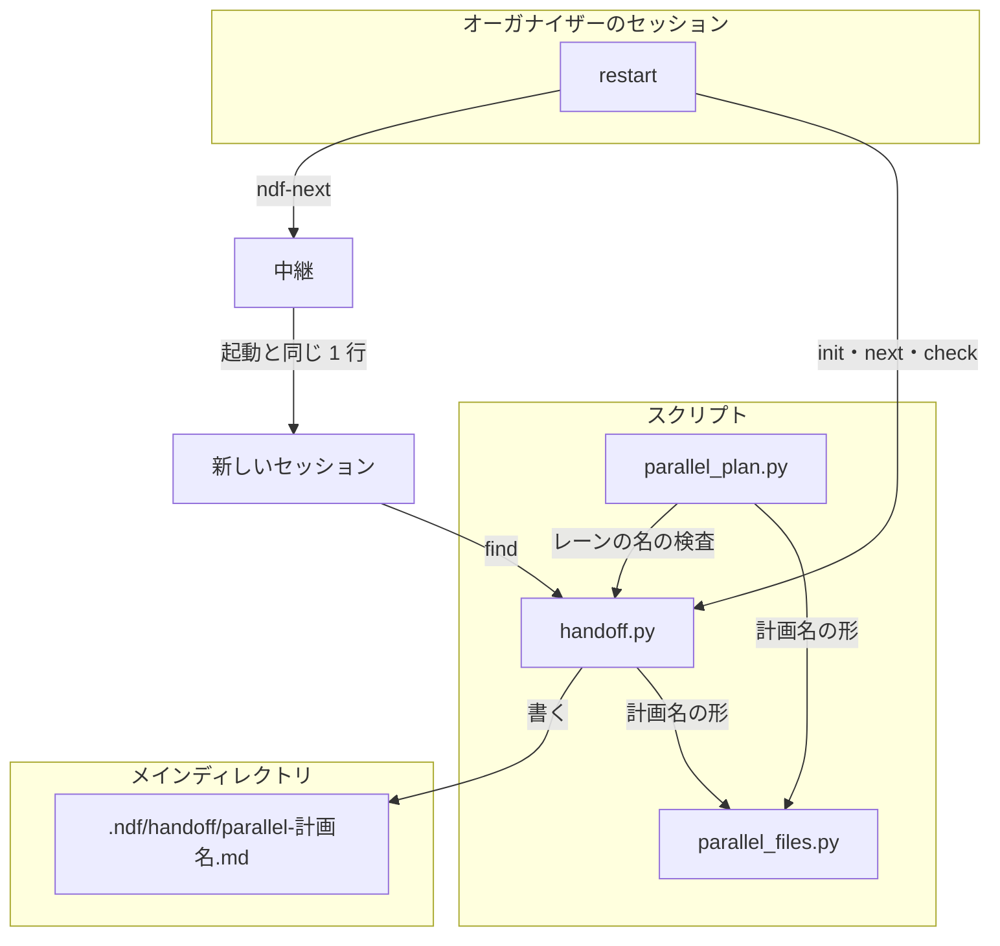
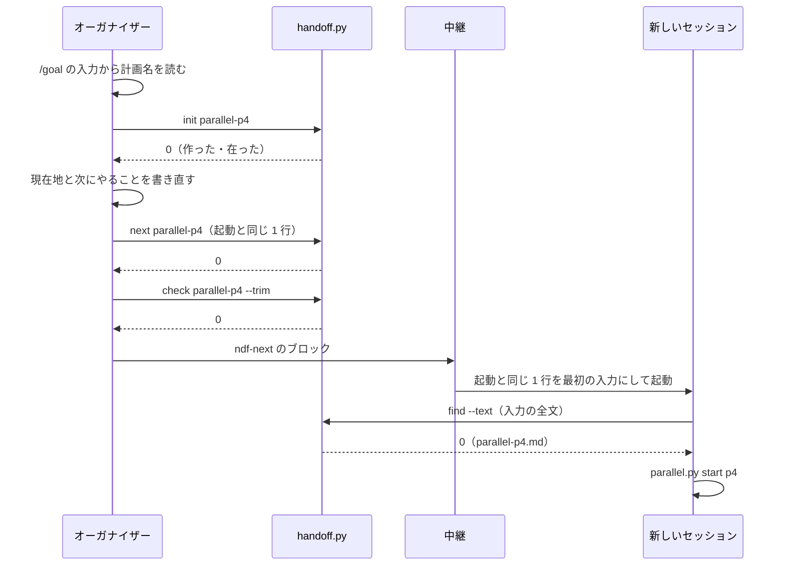

# 引継ぎ文書: オーガナイザーのセッションを、引継ぎ文書 parallel-<計画名> を置いて /ndf:restart で切り替えられる（#2778）

## 目的

- **今どうなっているか**: 並列の進め方の文書はオーガナイザーの引継ぎ文書を `.ndf/handoff/parallel-<計画名>.md` と定めている。一方、引継ぎ文書を扱うスクリプト（`handoff.py`）は 4 つの名の形（`loop-`・`sprint-`・`milestone-`・`issue-`）しか受け付けず、`path`・`init`・`next`・`check` が終了コード 2 で断る。`restart` は `next` が 0 以外ならブロックを出さずに止まるため、オーガナイザーは `/ndf:restart` で切り替えられない
- **誰に効くか**: 並列の計画を回すオーガナイザーのセッションと、それを使う利用者
- **変えると何が成り立つか**: オーガナイザーのセッションで `/ndf:restart` を打つと、引継ぎ文書 `parallel-<計画名>` に起動と同じ 1 行が置かれ、`ndf-next` のブロックが出てセッションが切り替わる。既存の 4 つの形の扱いは変わらない

## 適用範囲

- **働く範囲**: NDF を使うすべてのリポジトリ（引継ぎ文書は利用先のリポジトリのメインディレクトリの `.ndf/handoff/` に置く）
- **プロジェクトごとに違うもの**: 無し（計画名は引数の名で受ける。設定は足さない）
- **当たるモード**: `standard`

## あるべき姿の根拠

| 根拠 | 種類 | 何を示すか |
| --- | --- | --- |
| 2026-11-09 にコミット 451146564（ndf 10.27.49）で `handoff.py path parallel-p4` が終了コード 2 を返した（#2778 の「事象」） | 実測 | 並列の進め方の文書が定める名を、引継ぎ文書のスクリプトが受け付けない |
| `skills/development-workflow/references/parallel.md` の「セッションの切り替え」 | 既存の規則 | オーガナイザーの引継ぎ文書の名は `parallel-<計画名>`、再開コマンドは起動と同じ 1 行である。名をそちらへ合わせれば、並列の進め方の文書を変えずに済む |
| `lib/parallel_plan.py` の `PLAN_RE`（`^[a-z0-9][a-z0-9_-]{0,23}$`） | 既存の規則 | 計画名の形は並列の計画の側に 1 つだけある。引継ぎ文書の名はその形を組み込めば、計画名と名が 1 対 1 に対応する |

要求と受け入れ条件は #2778 の本文にある（コピーは [issue-2778-requirements.md](issue-2778-requirements.md)）。この文書は「どう作るか」だけを扱う。

## ドメインモデル

### コンテキスト

| コンテキスト | 何の語が 1 つの意味に決まるか |
| --- | --- |
| 開発の工程（`ndf-workflow`） | 引継ぎ文書・引継ぎの対象・オーガナイザー・並列の計画・計画名 |

1 つのコンテキストの中で閉じる。中継（ラッパー）の側（`ndf-relay`）は `ndf-next` のブロックを受けるだけで、この変更では変えない。

### 集約

| 集約 | 持ち主（書き換えてよいもの） | 根 | エンティティ | 値オブジェクト |
| --- | --- | --- | --- | --- |
| 引継ぎ文書 | conductor（`handoff.py` の `init`・`next`・`check --trim`・`remove` を打つ）。オーガナイザーも conductor の役割の 1 つとしてここに入る | 本体（`<名>.md`） | 引継ぎの履歴（`<名>-history.md`） | 名（引継ぎの対象の種類と鍵の組）・再開コマンド |
| 並列の計画 | `parallel.py`（`init`・`lane`）。この変更では変えない | 計画の宣言（`plan.json`） | レーン | 計画名・レーンの引継ぎ文書の名 |

引継ぎ文書は並列の計画を計画名（文字列）だけで参照し、計画の宣言を読まない（ほかの集約を ID で参照する規則）。
並列の計画のレーンの引継ぎ文書の名は、引継ぎ文書の名の規則で検査する（今と同じ）。

### 不変条件

| # | 集約 | 条件 | 破れたときの扱い |
| --- | --- | --- | --- |
| I1 | 引継ぎ文書 | 名は `parallel-<計画名>`・`loop-<名>`・`sprint-<名>`・`milestone-<番号>`・`issue-<番号>` のどれかの形で、`-history` で終わらない | `handoff.py` が終了コード 2 で断り、何も書かない。summary に 5 つの形を並べる |
| I2 | 引継ぎ文書 | `parallel-` の後ろは計画名の形（並列の計画の `PLAN_RE`）に合う | I1 と同じ |
| I3 | 引継ぎ文書 | 既存の 4 つの形の名の受け付けと、`find` の一致の規則は変わらない | 既存の `test_handoff.py` が落ちる |
| I4 | 引継ぎ文書 | `find` で本体 `parallel-<X>` が一致するのは、入力に `--parallel <X>`（空白は 1 個以上）か `parallel-<X>` があり、その後ろに英数字・`_`・`-` が続かないときだけである。裸の `<X>` では一致しない | 一時レーンの入力（`--parallel-helper <X> ...`）がオーガナイザーの文書に当たる・`--parallel p40` が `parallel-p4` に当たる |
| I5 | 並列の計画 | レーンの引継ぎ文書の名は `parallel-` の形をとらない | 計画の検査が誤りの種類 `I5` で断る（今の振る舞いと同じ結果） |
| I6 | 引継ぎ文書 | オーガナイザーのセッションの再開コマンドは起動と同じ 1 行で、文書のパスを足さない | `/goal` の終わりの条件に「の続きから」が混ざり、新しいセッションの終わりの判定が変わる |

### ドメインイベント

| # | イベント | 発生元 | 受け手 |
| --- | --- | --- | --- |
| E1 | オーガナイザーがカットポイントに達した | 文脈の残量・利用者の `/ndf:restart` | オーガナイザーの conductor（`restart` を通す） |
| E2 | `restart` が引継ぎ文書の名を `parallel-<計画名>` に決めた | `restart` の手順 2（`/goal` の入力の `--parallel <計画名>`） | `handoff.py init` |
| E3 | `handoff.py init` が引継ぎ文書を作った（在れば変えない） | `handoff.py` | オーガナイザーの conductor（「現在地」「次にやること」を書き直す） |
| E4 | `handoff.py next` が「次に実行するコマンド」に起動と同じ 1 行を置いた | `handoff.py` | `handoff.py check` |
| E5 | `handoff.py check --trim` が形と行数を確かめた | `handoff.py` | `restart` の手順 3（ブロックを出す） |
| E6 | `restart` が `ndf-next` のブロックを出し、中継が新しいセッションへ切り替えた | `restart`・中継 | 新しいセッション |
| E7 | 新しいセッションが `find` で引継ぎ文書を読み、オーガナイザーを再開した | 新しいセッションの `development-workflow` | `parallel.py start <計画名>` |

### 用語

| 用語 | 意味 | 用語集への反映 |
| --- | --- | --- |
| 引継ぎの対象 | 引継ぎ文書 1 本が受け持つ仕事のまとまり（並列の計画・開発ループ・スプリント・マイルストーン・課題のどれか）。名の頭（`parallel-` / `loop-` / `sprint-` / `milestone-` / `issue-`）になる | 意味の変更（並列の計画と開発ループを足す） |

## 外部の調査

省く: 既存の形の延長である。引継ぎ文書の名の集合へ、同じ形（種類の頭 + 鍵）の名を 1 つ足し、鍵の形はプロジェクトの中の既存の規則（計画名の `PLAN_RE`）で決まる。外部の判断は要らない。

## 機能一覧

| # | 機能 | 誰が使うか |
| --- | --- | --- |
| F1 | 引継ぎ文書 `parallel-<計画名>` を作る・パスを引く・再開コマンドを置く・形を確かめる・消す | オーガナイザーの conductor |
| F2 | 名指しの無い再開の入力（`--parallel <計画名>` を含む）から引継ぎ文書 `parallel-<計画名>` を探す | 新しいセッションの `development-workflow` |
| F3 | オーガナイザーのセッションの `/ndf:restart` で、名を `parallel-<計画名>` に決め、起動と同じ 1 行を再開コマンドにしてブロックを出す | オーガナイザーの conductor・利用者 |
| F4 | 計画名の形に合わない `parallel-` の名と、5 つの形のどれでもない名を断る | `handoff.py` を打つすべての conductor |

## 構成要素

| 要素 | 責務 |
| --- | --- |
| `scripts/lib/parallel_files.py`（変える） | 計画名の形（アンカーを付けない正規表現の文字列 `PLAN_NAME` と、それを組んだ `PLAN_RE`）の唯一の定義を持つ。pydantic を import しない今の性質を保つ |
| `scripts/lib/parallel_plan.py`（変える） | `PLAN_RE` を `parallel_files` から受ける（定義を持たない）。レーンの引継ぎ文書の名の検査で、`parallel-` の形を断る（I5） |
| `scripts/handoff.py`（変える） | 名の 5 つの形を `NAME_RE` の 1 か所に持つ（`parallel-` は `parallel_files.PLAN_NAME` を組み込む）。断る summary に 5 つの形を並べる。`match_words` に `parallel-<計画名>` の一致の規則を足す（I4）。先頭の説明の「共通」の行を直す |
| `scripts/tests/test_handoff.py`（変える） | 受け入れ条件 1〜5・8 と I1〜I4 を縛る |
| `scripts/tests/test_parallel_plan.py`（変える） | I5 を縛る |
| `skills/development-workflow/references/handoff.md`（変える） | 「置き場と名」の表の先頭に並列の計画の行を足す。`find` の一致の規則の表に `parallel-<X>` の行を足す。「作る・更新する」の 3 に、オーガナイザーの再開コマンドは文書のパスを含めない例外を書く（I6） |
| `skills/restart/SKILL.md`（変える） | 手順 2 の名の一覧を 5 つの形にする。「再開コマンドを決める」の表の先頭に、オーガナイザーのセッションの行（起動と同じ 1 行。文書なしでも同じ）を足す |
| `docs/glossary/glossary.json`・`docs/glossary.md`（変える） | 「引継ぎの対象」の意味を 5 つの種類にする（この設計の変更に含めてある） |

型（クラス）は足さず変えないため、クラス図は作らない。変わるのは `handoff.py` のモジュールの定数と 2 つの関数、`parallel_plan.py` の検査 1 つである。

### 名の集合に依る既存の規則の判定

名の集合へ `parallel-` を足すにあたり、集合を前提にした規則を、名の頭と `NAME_RE` での検索（`grep -rn "NAME_RE\|handoff\.\|milestone-<番号>\|sprint-<" plugins/ndf/scripts plugins/ndf/skills`）と、オーガナイザーの切り替えが通る手順（`restart` → `handoff.py` → `ndf-next` → `development-workflow` の「新しい会話で戻す」）の読み通しで集めた。当てはまらず変える規則は上の表に載せた。

| 規則 | 当てはまるか | 扱い |
| --- | --- | --- |
| `handoff.py` の `NAME_RE`・`handoff_name` の summary | 当てはまらない | 変える |
| `handoff.py` の `match_words`（種類ごとの分岐。`parallel` は既定の分岐へ落ち、裸の計画名で一致する） | 当てはまらない | 変える（I4） |
| `parallel_plan.py` のレーンの引継ぎ文書の名の検査（`NAME_RE` を使うため、足すと `parallel-` のレーンを通す） | 当てはまらない | 変える（I5） |
| `handoff.md` の「置き場と名」・`find` の一致の規則・「再開コマンドは文書のパスを含める」 | 当てはまらない | 変える |
| `restart` の手順 2 の名の一覧・「再開コマンドを決める」の 1 行目 | 当てはまらない | 変える |
| 用語集の「引継ぎの対象」 | 当てはまらない | 変える |

## 入出力の契約

`handoff.py` のコマンドの形・終了コード・出力の JSON の形は変えない。変わるのは、受け付ける名の集合・断るときの summary の文言・`find` の候補と一致の規則の 3 つである。

| 入力 | 終了コード | 出力 |
| --- | --- | --- |
| `path parallel-p4`・`path .ndf/handoff/parallel-p4.md` | 0（`--exists` で本体が無ければ 1） | `items[0]` に `name: parallel-p4`・`path`・`history`・`exists` |
| `init parallel-p4 --title "並列の計画 p4"` | 0 | 本体が無ければテンプレートから作る。あれば変えない |
| `next parallel-p4`（標準入力に再開コマンド）・`check parallel-p4 [--trim]`・`remove parallel-p4` | 今の 4 つの形と同じ | 今の 4 つの形と同じ |
| `parallel-`・`parallel-P4`・`parallel-p4-history`・`parallel-_a`・25 字以上の計画名・5 つの形のどれでもない名 | 2 | summary: `名が parallel-<計画名>・loop-<名>・sprint-<名>・milestone-<番号>・issue-<番号> の形でない: <名>` |

`find --text` の一致の規則（`handoff.md` の表へ足す行）:

| 名 | 入力に次の語があれば一致 |
| --- | --- |
| `parallel-<X>` | `--parallel <X>`（空白は 1 個以上）、または `parallel-<X>`。どちらも前が英数字・`_`・`-` でなく、後ろに英数字・`_`・`-` が続かない |

一致の例:

| 入力 | 本体 `parallel-p4` に一致するか |
| --- | --- |
| `/goal /ndf:development-workflow --parallel p4 -- 終わり: [ndf-parallel] finished p4 の行を出したとき` | する |
| `.ndf/handoff/parallel-p4.md の続きから` | する |
| `--parallel p40 -- ...` | しない |
| `--parallel-helper p4 3 <提示> -- ...`（一時レーン） | しない |

## 処理の流れ

分岐は今の `restart` の規則のとおりである。`init` が 2 か `next` が 0 以外ならブロックを出さずに理由を報告し、`init` が 3 なら文書なしで起動と同じ 1 行のブロックを出す。中継の外では再開コマンドを示して終える。
`/goal` の入力から計画名を読めないとき（前提 4）は、オーガナイザーの行を飛ばして `restart` の次の行へ進む。

## 非機能の実現方式

| 大項目 | 条件 | 実現方式 |
| --- | --- | --- |
| 運用・保守性 | 名の形の定義は `handoff.py` の 1 か所に置き、副命令ごとに分けない | 5 つの名の形は `handoff.py` の `NAME_RE` だけが持ち、6 つの副命令と並列の計画の検査がそれを使う。`parallel-` の鍵の形は計画名の形を組み込み、計画名の形そのものは `parallel_files.py` の 1 か所に置く（決定 3） |

## 決定の記録

### 決定 1: オーガナイザーのセッションを他の対象より先に見分けるため、名の表の先頭に並列の計画の行を置く

名は上から最初に当たる行で決まる。オーガナイザーの `/goal` の入力には `--parallel <計画名>` があり、会話の中でマイルストーンや課題の番号にも触れうる。並列の計画の行を後ろに置くと、それらの行が先に当たり、`milestone-` や `issue-` の文書へ起動と同じ 1 行が書かれる。
`--parallel <計画名>` は起動の 1 行にだけ現れる語で、オーガナイザーでないセッションが当たることは無い。
表の途中（開発ループの後など）に置く形は採らない。オーガナイザーのセッションが開発ループを持つことは無く、途中に置いても先頭と結果が同じで、判断の順だけが読みにくくなる。

根拠: Value 7（MVV 版 6）

### 決定 2: 一時レーンや別の計画の入力でオーガナイザーの文書を拾わないよう、`find` の一致を `--parallel <X>` と `parallel-<X>` に限る

今の `find` は `sprint-` と `loop-` の名を裸の鍵でも一致させる。`parallel-` を同じ規則に入れると、一時レーンの入力（`--parallel-helper p4 ...`）や、計画名を本文に含むほかの入力がオーガナイザーの文書に当たり、候補が 2 本以上になって利用者へ聞く分岐（終了コード 10）へ進む。
オーガナイザーの起動の 1 行は必ず `--parallel <計画名>` を含むため、この語と文書の名そのものに限っても、オーガナイザーの再開は取りこぼさない。
裸の鍵でも一致させる形は、上の誤った一致を生むため採らない。

根拠: Value 2 / Value 7（MVV 版 6）

### 決定 3: 計画名と引継ぎ文書の名が食い違わないよう、計画名の形を `parallel_files.py` の 1 か所に置き、`handoff.py` と `parallel_plan.py` がそれを使う

`handoff.py` に計画名の正規表現を写すと、計画名の上限（24 字）を変えたときに片方だけが変わり、作れる計画に引継ぎ文書を作れない状態が生まれる。
`parallel_files.py` は標準ライブラリだけを使う小さな部品で、`handoff.py` が import しても依存は増えない。
`handoff.py` から `parallel_plan.py` を import する形は採らない。`parallel_plan.py` は pydantic を要し、`restart` が打つ `handoff.py` の依存（今は `md` だけ）が増える。

根拠: Value 7 / Value 8（MVV 版 6）

### 決定 4: レーンの引継ぎ文書がオーガナイザーの文書と同じ名にならないよう、レーンの宣言では `parallel-` の名を断る

並列の計画の検査は、レーンの引継ぎ文書の名を `handoff.NAME_RE` で確かめる。名の集合へ `parallel-` を足すと、この検査も `parallel-` の名を通すようになり、同じリポジトリのレーンがオーガナイザーと同じ文書へ書く宣言が通る。
検査に `parallel-` を断る条件を足し、レーンの宣言で受け付ける名を今と同じ 4 つの形に保つ。
レーン用の名の正規表現を別に持つ形は採らない。名の形の定義が 2 か所に分かれ、非機能の条件に合わない。

根拠: Value 7（MVV 版 6）

### 決定 5: `/goal` の終わりの条件を変えないため、オーガナイザーの再開コマンドは起動と同じ 1 行とし、文書のパスを足さない

`/goal` の入力は `--` の後ろが終わりの条件である。「`<文書のパス>` の続きから」を末尾へ足すと終わりの条件の一部として読まれ、`--` の前へ差し込むと並列の進め方の文書が定める起動の 1 行の形から外れる。
新しいセッションは、名指しの無い入力として `find` で文書を探す。決定 2 の一致の規則により、起動の 1 行だけで `parallel-<計画名>` に当たる。
引継ぎの規則の正本の「再開コマンドは文書のパスを含める」には、この例外を書く。

根拠: Value 7（MVV 版 6）

## テスト設計

| 受け入れ条件・不変条件 | どの振る舞いで縛るか | どう壊したら落ちるべきか |
| --- | --- | --- |
| 受け入れ条件 1 | `.ndf/` のある一時のリポジトリで `init parallel-p4 --title ...` が 0 を返し、メインディレクトリの `.ndf/handoff/parallel-p4.md` がテンプレートの中身になる | `NAME_RE` から `parallel-` を外すと落ちる |
| 受け入れ条件 2 | 課題の事象の再開コマンドを標準入力に渡した `next parallel-p4` が 0 を返し、「次に実行するコマンド」の節がその 1 行のブロックになる。続く `check parallel-p4 --trim` が 0 を返す | `next` か `check` が名の検証で 2 を返すと落ちる |
| 受け入れ条件 3 | `path .ndf/handoff/parallel-p4.md --exists` が文書のあるとき 0、無いとき 1。`remove parallel-p4` の後に本体と履歴が無い | パスからの名の取り出しで `parallel-` を断ると落ちる |
| 受け入れ条件 4・I4 | `parallel-p4.md` だけがあるとき、`find --text` が上の一致の例の表の 4 行どおりに 0 か 1 を返す | 裸の鍵で一致させると一時レーンの行で、後ろの境界を外すと `p40` の行で落ちる |
| 受け入れ条件 5・I1・I2 | `parallel-`・`parallel-P4`・`parallel-p4-history`・25 字の計画名・`plan-p4` が 2 を返し、summary に `parallel-<計画名>` が載る | 鍵の形を緩める（`.*` など）と落ちる |
| 受け入れ条件 6 | テストを書かない（`.md` の文言を照合するテストは書かない）。設計 Pull Request と実装 Pull Request のレビューで、正本の 2 つの表と `restart` の 2 か所を見る | — |
| 受け入れ条件 7・I6 | リリース後テストで、中継の下のオーガナイザーで `/ndf:restart` を打ち、ブロックが出て切り替わり、新しいセッションが `parallel.py start <計画名>` で同じ計画を続けることを見る | `restart` が文書のパスを足すと、新しいセッションの `/goal` の終わりの条件が変わる |
| 受け入れ条件 8・I3 | 既存の `test_handoff.py` がそのまま通る | 既存の 4 つの形の正規表現か一致の規則を変えると落ちる |
| I5 | レーンの `handoff` に `parallel-p4` を書いた計画の検査が、誤りの種類 `I5` で断る | レーンの検査を `NAME_RE` だけにすると落ちる |
| 決定 3 | 計画名の上限を `parallel_files.py` で変えると、`handoff.py` と計画の検査の両方が同じ名を受け付ける（25 字の計画名を両方が断る） | `handoff.py` に正規表現を写すと、一方だけ変えたときに食い違う（テストでは両方が 25 字を断ることを縛る） |

## 設計の結果

| 課題 | 扱い | 取り込み先 | 触るファイル |
| --- | --- | --- | --- |
| #2778 | 実装する | — | `plugins/ndf/scripts/handoff.py`、`plugins/ndf/scripts/lib/parallel_files.py`、`plugins/ndf/scripts/lib/parallel_plan.py`、`plugins/ndf/scripts/tests/test_handoff.py`、`plugins/ndf/scripts/tests/test_parallel_plan.py`、`plugins/ndf/skills/development-workflow/references/handoff.md`、`plugins/ndf/skills/restart/SKILL.md` |

## 未確認のまま残ること

| 項目 | 内容 |
| --- | --- |
| 新しいセッションが引継ぎ文書を読むか | `development-workflow` は `--parallel <計画名>` があると判定の手順へ進まず `parallel.md` の手順 1（`parallel.py start`）へ進む。「新しい会話で戻す」の 0 行目（引継ぎ文書を読む）がこの経路でも先に通るかは、文書からは決まらない。計画の状態は耐久ワークフローが持つため、読まなくても受け入れ条件 7 の再開は成り立つ。読まれるかは受け入れ条件 7 のリリース後テストで見る |
| コンテキスト量の hook の案内 | `hook_lib/token_guard.py` の止めるときの文面は、再開コマンドを「`/goal <次> .ndf/handoff/<名>.md の続きから`」と案内し、決定 5 と合わない。この hook が止めるのは `supervise.py` のプラン・工程 Skill・工程のサブエージェントの起動だけで（`shell_checks.starts_plan` は `supervise.py` を含まないコマンドで偽を返す）、オーガナイザーはそれらを起動しない（`parallel.md` の「手順」）。オーガナイザーの会話で hook が止めた実例は未確認で、この変更では文面を変えない |
