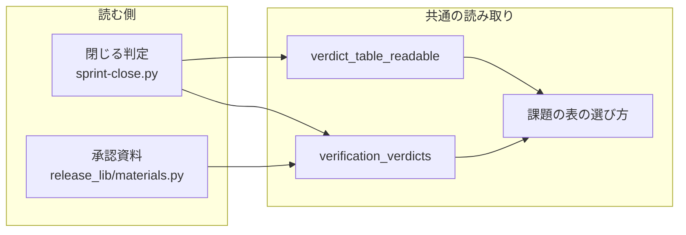
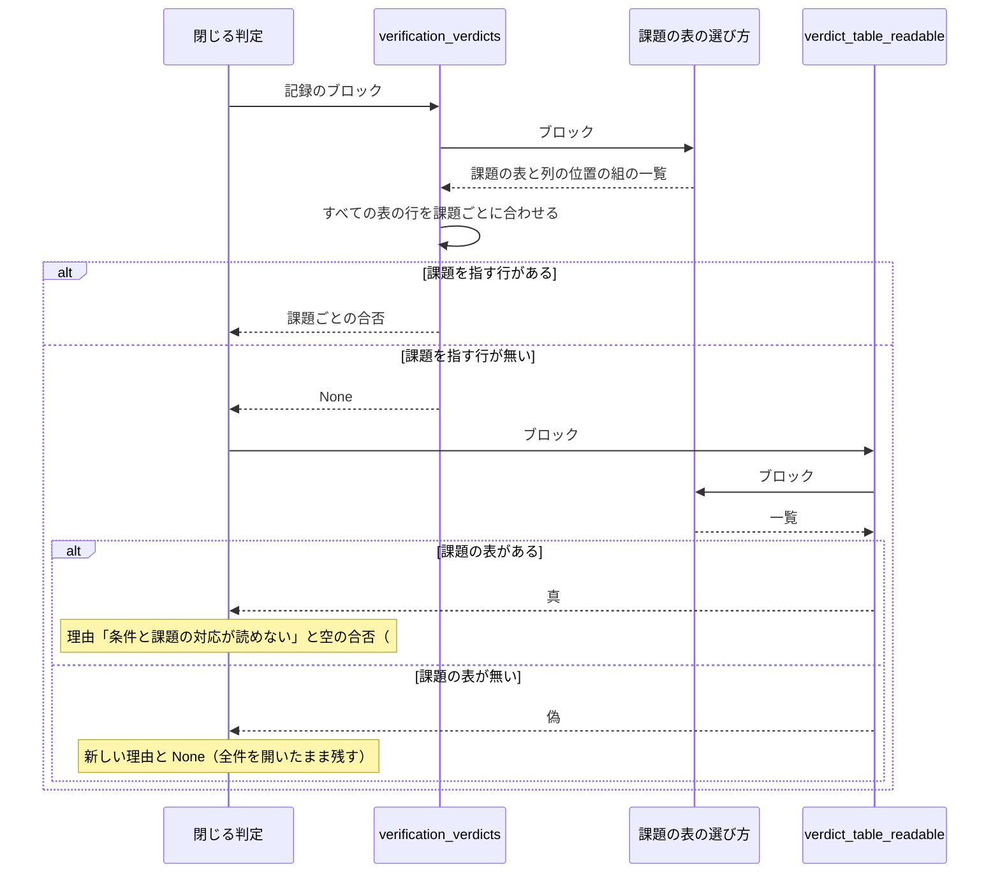

# リリース後テストの記録の読み取り: 補足の表が先にあっても課題の表から合否を読み、課題を閉じる（#2803）

## 目的

- **今どうなっているか**: リリース後テストの記録で、課題ごとの合否の表より前に別の表（例: 主なテストの実行）があると、課題と合否を読む関数が先頭の表だけを見て「読めない」と返す。その結果、受け入れ条件をすべて満たした課題も、理由「条件と課題の対応が読めない」で開いたまま残り、理由からは表の順が原因だと分からない
- **誰に効くか**: スプリントのまとめで課題を閉じる工程（`sprint-close.py`）と、リリースの承認資料を読む人
- **変えると何が成り立つか**: 記録の中の表の順に依らず、課題の表から合否を読んで課題を閉じる。課題の表が 1 つも無いときは、そのことを名指しする理由で開いたまま残る

## 適用範囲

- **働く範囲**: NDF を使うすべてのリポジトリ。リリース後テストの記録を読む 2 か所（課題を閉じる判定とリリースの承認資料）で働く
- **プロジェクトごとに違うもの**: 無し（記録の書式は NDF が決め、プロジェクトの設定で変えない）
- **当たるモード**: `standard`

## あるべき姿の根拠

| 根拠 | 種類 | 何を示すか |
| --- | --- | --- |
| v10.27.41 のリリース後テスト（ https://github.com/devbasex/ai-plugins/pull/2794#issuecomment-6720512398 ）で、2 つの表の順を手で入れ替えると #2624 が `would_close` になり閉じられた（要求の依頼の原文、2026-11-08） | 実測 | 原因が表の選び方だけにあり、表の行の読み方と閉じる条件は今のままでよい |
| 補足の表なし・課題の表が先頭の形で `verification_verdicts` が `{(devbasex/ai-plugins, 2624): IssueRows(all_pass=True, passed={1})}` を返す（要求の受け入れ条件 6 の前提の確認、10.27.44） | 実測 | 課題の表 1 つの形の結果を、変更後も同じに保つ基準になる |
| 要求の前提 3「表を読む規則は閉じる判定と承認資料が共有する 1 か所で直す」 | 利用者の指示の原文に基づく要求 | 直す場所は `plugins/ndf/scripts/lib/acceptance.py` の 1 か所である |

要求と受け入れ条件は #2803 の本文にある（コピーは `issues/issue-2803-requirements.md`）。この文書は「どう作るか」だけを扱う。

## ドメインモデル

### コンテキスト

| コンテキスト | 何の語が 1 つの意味に決まるか |
| --- | --- |
| リリース（`ndf-release`） | リリース後テストの記録・課題の表・補足の表・リリースの承認資料 |
| 開発の工程（`ndf-workflow`） | スプリントのまとめで課題を閉じる判定と、開いたまま残す理由 |

リリースが記録の書式を決め、開発の工程がそれを読む関係を「公開された言語」とする。記録の書式は
`release-verification` の SKILL.md と `progress-tracking` の「リリース記録」の表に文書化されている。
読む側（閉じる判定・承認資料）は、共通の読み取り（`lib/acceptance.py`）を通してだけ表を読む。

### 集約

| 集約 | 持ち主（書き換えてよいもの） | 根 | エンティティ | 値オブジェクト |
| --- | --- | --- | --- | --- |
| リリース後テストの記録 | `release-verification` の worker（投稿する側。この変更では書き換えない） | 記録のブロック | — | 課題の表・補足の表・課題ごとの合否（`IssueRows`） |
| 閉じる判定の結果 | `sprint-close.py` | 課題ごとの結果の項目 | — | 結果（`would_close` / `kept_open` など）・理由の文言 |

課題ごとの合否（`IssueRows`）は、記録のブロックから毎回導く値であり、保存しない。

### 不変条件

| # | 集約 | 条件 | 破れたときの扱い |
| --- | --- | --- | --- |
| I1 | リリース後テストの記録 | 課題ごとの合否は、ブロックの中の課題の表だけから導く。補足の表の行は合否にも合格した条件の番号にも入らない | 補足の表の行を読めば誤って閉じうるため、テストで落とす |
| I2 | リリース後テストの記録 | 課題ごとの合否は、ブロックの中の表の順に依らない（補足の表を前に置いても後ろに置いても同じ結果） | 表の順で結果が変われば #2803 の不具合の再発。テストで落とす |
| I3 | リリース後テストの記録 | 課題の表が 2 つ以上あれば、どれかの表に合格でない行を持つ課題は合格でない。合格した条件の番号は、どの表でも不合格・保留の行を持たない番号だけ | 合格でない課題を閉じる。テストで落とす |
| I4 | 閉じる判定の結果 | 課題の表が 1 つも無いときの理由は、課題を指す行が無いときの理由（「条件と課題の対応が読めない」）と異なる文言で、`課題` と `結果` の列を持つ表が無いことを名指しする | 原因の分からない理由が残る。テストで落とす |
| I5 | 閉じる判定の結果 | 課題の表はあるが課題を指す行が 1 行も無いときは、すべての条件をマージ前に確かめた課題だけを判定へ進め、ほかは「条件と課題の対応が読めない」で開いたまま残す（#2144 の振る舞い） | 退行。既存のテストで落とす |

### ドメインイベント

| # | イベント | 発生元 | 受け手 |
| --- | --- | --- | --- |
| E1 | リリース後テストの記録をリリース記録の Pull Request へ投稿した | `release-verification` の worker | 閉じる判定・リリースの承認資料 |
| E2 | 記録のブロックから課題の表を選んだ | 共通の読み取り（`lib/acceptance.py`） | E3 |
| E3 | 選んだ表の行を課題ごとに合わせ、合否と合格した条件の番号を得た | 共通の読み取り（`lib/acceptance.py`） | 閉じる判定（`sprint-close.py`）・承認資料（`release_lib/materials.py`） |
| E4 | 課題を閉じた、または理由を添えて開いたまま残した | `sprint-close.py` | スプリントのまとめの結果 JSON |

### 用語

| 用語 | 意味 | 用語集への反映 |
| --- | --- | --- |
| 課題の表 | リリース後テストの記録のうち、見出しに `課題` と `結果` の両方の列を持つ表。スプリントの課題を閉じる判定とリリースの承認資料が、課題ごとの合否をここから読む | 追加（`ndf-release`。要求の工程で足し済み） |
| 補足の表 | リリース後テストの記録のうち、課題の表でない表（例: 主なテストの実行の表）。課題を閉じる判定にも承認資料にも使わない | 追加（`ndf-release`。要求の工程で足し済み） |

## 外部の調査

省く: プロジェクトの中の取り決め（リリース後テストの記録の書式）だけで形が決まる変更で、表の解析は既存の GFM のパーサー（`lib/md.py`）の使い方を変えずに、選ぶ表を広げるだけである

## 機能一覧

| # | 機能 | 誰が使うか |
| --- | --- | --- |
| F1 | 記録のブロックから課題の表をすべて選び、行を課題ごとに合わせて合否を返す | 閉じる判定・承認資料（共通の読み取り） |
| F2 | 課題の表が 1 つも無いときに、それを名指しする理由で課題を開いたまま残す | 閉じる判定 |
| F3 | 記録の書式の説明に、課題の表だけが読まれ補足の表は読まれないことを書く | 記録を書く worker・人 |

## 構成要素

| 要素 | 責務 |
| --- | --- |
| 共通の読み取り（`plugins/ndf/scripts/lib/acceptance.py`）の課題の表の選び方（新しい内部関数） | ブロックの表のうち、見出しに `課題` と `結果` の両方を持つ表と、その列の位置の組をすべて返す。純粋な処理で、GitHub を呼ばない |
| 同じファイルの `verification_verdicts` | 選んだ課題の表すべての行を、1 つの表と同じ規則で課題ごとに合わせる。課題の表が無いか、課題を指す行が 1 行も無ければ None を返す（今の契約のまま） |
| 同じファイルの `verdict_table_readable` | 課題の表が 1 つ以上あるかを返す（先頭の表だけを見ない） |
| 閉じる判定（`plugins/ndf/scripts/sprint-close.py`）の `_verify_verdicts` と理由の定数 | 課題の表が無いときは新しい理由（決定 3）で、課題を指す行が無いときは今の理由「条件と課題の対応が読めない」で返す |
| 承認資料（`plugins/ndf/scripts/release_lib/materials.py`） | 変えない。`acceptance.version_verdicts` を通して共通の読み取りの結果を受け取る |
| 記録の書式の説明（`plugins/ndf/skills/release-verification/SKILL.md` の「出力物」） | 課題の表だけが読まれ、2 つ以上なら合わせて読まれ、補足の表はどの判定にも使われないことを書く |
| 閉じる条件の説明（`plugins/ndf/skills/progress-tracking/SKILL.md` の「リリース記録」） | 読む表の選び方と、課題の表が無いときの新しい理由を書く。今の「表の `課題` の列の頭が…」の段落を直す |



承認資料は `version_verdicts` を通して `verification_verdicts` を呼ぶ。図では `version_verdicts` を省いた。
書式の説明の 2 つ（`release-verification` と `progress-tracking` の SKILL.md）は、コードから呼ばれないため図に含めない。

### 閉じる判定の理由に値を足す変更の確かめ

閉じる判定の `kept_open` の理由に値を 1 つ足す。理由の文言を前提にする規則を、次のコマンドで集めた（テストを除く）。

```bash
grep -rn "対応が読めない\|NO_MAPPING" plugins/ndf --include=*.py --include=*.md
```

集めた結果は次の 4 件である。

| 規則 | 新しい理由に当てはまるか |
| --- | --- |
| `sprint-close.py:111` の定数 `NO_MAPPING` | 当てはまらない値を別に足す（構成要素の表の閉じる判定の行） |
| `sprint-close.py:249` の `_verify_verdicts` | 当てはまらない。変える（同上） |
| `sprint-close.py:275`・`:320` の、`NO_MAPPING` と空の合否のときだけマージ前の確認へ進める分岐 | 当てはまる。新しい理由は合否が None の組で返り、今の「表が読めない」と同じ「全件を開いたまま残す」の分岐へ進む |
| `progress-tracking/SKILL.md:295` の閉じる条件の説明 | 当てはまらない。変える（構成要素の表の閉じる条件の説明の行） |

## 構造

型は変えない。`IssueRows` と `verification_verdicts` の返り値の形（`{(リポジトリ, 番号): IssueRows}` か None）はそのままにする。
変わるのは関数の中の処理の順序（1 つの表を読む → 選んだ表を順に読む）と、閉じる判定の分岐の数（理由が 1 つ増える）である。

## 処理の流れ



承認資料の経路は `version_verdicts` が `verification_verdicts` の None を空の合否に置き換えるだけで、
`verdict_table_readable` を呼ばない。

課題ごとの合わせ方は今の 1 つの表のときと同じで、選んだ表を記録の中に現れる順に読み、同じ課題の行を 1 つの集計に足す。

| 行 | 合わせ方 |
| --- | --- |
| `結果` が `合格` で始まる行 | 番号があれば合格の番号に足す |
| それ以外の行 | 課題を合格でないとし、番号があれば不合格の番号に足す |
| 最後 | 合格した条件の番号 = 合格の番号 − 不合格の番号 |

## 決定の記録

### 決定 1: 補足の表を許したまま閉じる判定を止めないため、課題の表をすべて読み、課題の表でない表を飛ばす

見出しに `課題` と `結果` を持つ表を課題の表とし、すべて読むことで、表の順と数に
依らず同じ結果になる（不変条件 I1・I2）。
worker が記録に補足の表を置くことは、検証の中身を伝える手段として役に立ち、書式で禁じても書いた時点で
閉じる判定が止まる点は変わらない。

「`課題` と `結果` の列を持つ最初の表だけを読む」形は採らない。課題の表を 2 つに分けて書いた記録で、2 つ目の表の
不合格の行を見落として閉じうるためである。「表を 1 つに限り、外れたら止める」形も採らない（要求の対象範囲の「含まない」）。

根拠: Value 7 / Value 1（MVV 版 6）

### 決定 2: 課題ごとの合否を表の数に依らず 1 つの規則で決めるため、すべての課題の表の行を 1 つの表の行として合わせる

行をまとめて今の規則（どれかの行が合格でなければ合格でない、合格の番号から不合格の番号を引く）へ通す。
こうすると、課題の表が 1 つのときの結果は変わらず（受け入れ条件 6）、2 つのときも合格でない行が勝つ（不変条件 I3）。
表ごとに合否を出してから合わせると、表をまたいだ同じ条件の番号の扱い（片方で合格・片方で不合格）の規則が別に要る。

表ごとに「最後の表が勝つ」とする形は採らない。表の順に結果が左右され、I2 と食い違うためである。

根拠: Value 7（MVV 版 6）

### 決定 3: 開いたまま残した理由から直す場所が分かるよう、課題の表が無いときの理由を「リリース後テストの記録に `課題` と `結果` の列を持つ表が無い」とする

理由の文言は、記録の何を直せばよいか（列の名前）をそのまま示す。ブロックに表が 1 つも無いときも、同じく
課題の表が無いため同じ理由にする。課題の表はあるが課題を指す行が無いときは、今の「条件と課題の対応が読めない」の
まま残す（#2144 の振る舞い。不変条件 I5）。
表の有無で理由を 2 つに分ける形は採らない。どちらも直す内容（課題の表を置く）が同じで、理由を増やしても
読み手の次の一手が変わらないためである。

根拠: Value 8（MVV 版 6）

## テスト設計

| 受け入れ条件・不変条件 | どの振る舞いで縛るか | どう壊したら落ちるべきか |
| --- | --- | --- |
| 受け入れ条件 1・I1・I2 | 補足の表が先・課題の表が後のブロックで、`verification_verdicts` が補足の表を外したブロックと同じ結果（課題 A がすべて合格・合格した条件 {1}）を返す | 先頭の表だけを読むように戻すと None になって落ちる。補足の表の行を課題の行として読むと結果が変わって落ちる |
| 受け入れ条件 2 | 同じブロックで、受け入れ条件 1 つの課題 A を `sprint-close.py --dry-run` で判定すると `would_close` になる | 先頭の表だけを読むように戻すと `kept_open`（「条件と課題の対応が読めない」）になって落ちる |
| 受け入れ条件 3 | 同じブロックを読む承認資料で、課題 A の受け入れ条件 1 が未確認の条件に載らない | 承認資料が共通の読み取りを通さず先頭の表を読むと載って落ちる |
| 受け入れ条件 4・I3 | 課題の表が 2 つあり、課題 A が 1 つ目で `合格`・2 つ目で `不合格` のとき、合格でなく、閉じる判定で閉じない | 最初の課題の表だけを読む、または後の表が前の表を上書きするように壊すと合格になって落ちる |
| 受け入れ条件 5・I4 | 補足の表だけのブロックで、閉じる判定の理由が「リリース後テストの記録に `課題` と `結果` の列を持つ表が無い」になり、「条件と課題の対応が読めない」でない | 課題の表が無いときも今の理由を返すように戻すと落ちる |
| 受け入れ条件 6 | 課題の表だけのブロックで、既存のテスト（`test_sprint_close_acceptance.py`・`test_sprint_close_merge_green.py`・`test_release_materials.py`）がすべて通る | 1 つの表のときの合わせ方を変えると既存のテストが落ちる |
| 受け入れ条件 7・I5 | 課題を指す行が無い課題の表（導入の確認の行だけ）で、マージ前にすべての条件を確かめた課題だけが閉じ、ほかは「条件と課題の対応が読めない」で残る（既存の 2 件のテスト）。補足の表が先にあっても同じになる | 課題の表の有無の判定を先頭の表に戻すと、補足の表が先のときに新しい理由へ流れて落ちる |
| 受け入れ条件 8 | `release-verification` の SKILL.md の記録の書式の節に、`課題` と `結果` の列を持たない表はどの判定にも使わないことが書かれている | 文言を照合するテストは書かない（`AGENTS.md`）。設計 PR とリリース後テストで人と worker が読んで確かめる |

## 設計の結果

| 課題 | 扱い | 取り込み先 | 触るファイル |
| --- | --- | --- | --- |
| #2803 | 実装する | — | `plugins/ndf/scripts/lib/acceptance.py`、`plugins/ndf/scripts/sprint-close.py`、`plugins/ndf/skills/release-verification/SKILL.md`、`plugins/ndf/skills/progress-tracking/SKILL.md`、`plugins/ndf/scripts/tests/test_sprint_close_acceptance.py`、`plugins/ndf/scripts/tests/test_release_materials.py` |

## 未確認のまま残ること

| 項目 | 内容 |
| --- | --- |
| 確定仕様の追随 | `docs/specifications/ndf-sprint-close-acceptance-criteria.md`・`ndf-release-approval-materials.md` は表の読み方を今の形で書いている。確定仕様は実装の後の `plan-to-spec` で直す |
| 実物の記録での確かめ | 手動確認（補足の表が先にある記録を `sprint-close.py --dry-run` で読む）は、PR #2794 の記録が既に手で並べ替えられているため、同じ並びの記録を手元で作って確かめる。本番の記録での確かめは、次に補足の表を前に置いたリリース後テストで行う |
