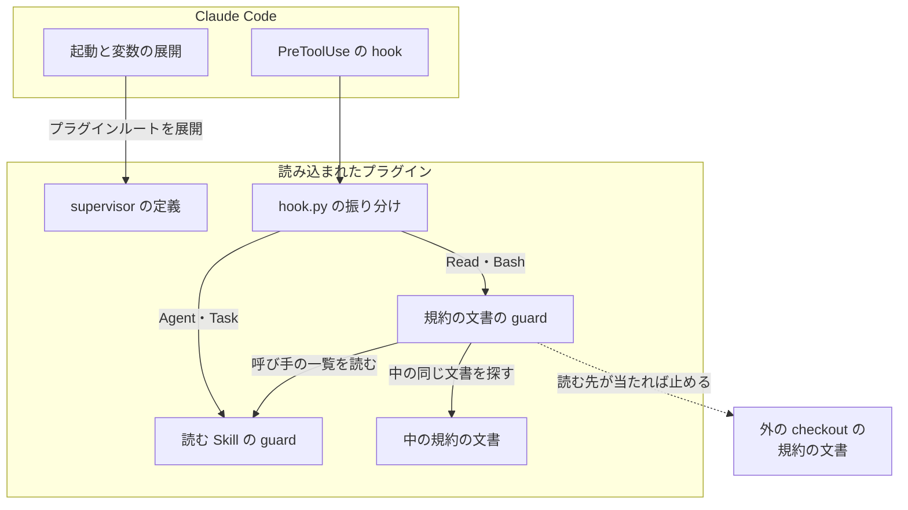
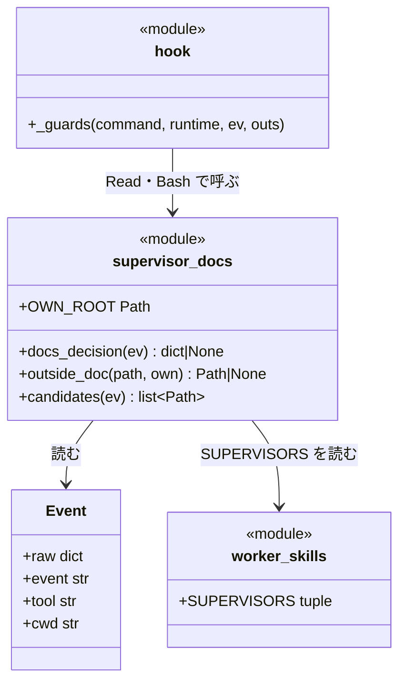
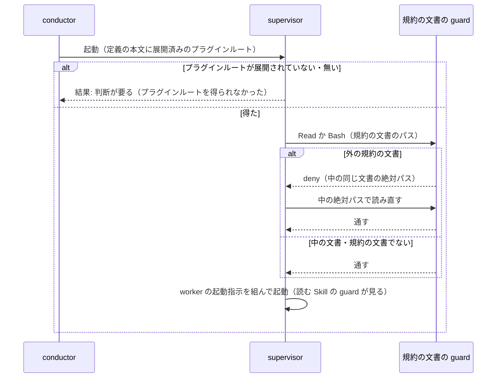

# supervisor の規約の文書: 読み込まれたプラグインから読み、外の文書は hook が止めて中のパスを返す（#2813）

## 目的

- **今どうなっているか**: Agent の 3 層で回すフェーズの supervisor（`ndf:supervisor` / `ndf:supervisor-waits`）は、worker の起動指示を組むために規約の文書を読む。その文書を、読み込まれたプラグインでなく別の checkout から読むことがある。別の checkout とは、開発中のリポジトリのメインディレクトリ（`/work/ai-plugins/plugins/ndf` など）である。supervisor の定義は文書を相対の名前で指すだけで、プラグインルートを渡していない
- **誰に効くか**: `--plugin-dir` か導入したキャッシュの NDF で 3 層を回す利用者。読み込まれたプラグインと読んだ checkout の版が違うと、違う版の規則で組んだ起動指示が worker へ届く
- **変えると何が成り立つか**: supervisor は定義に展開されたプラグインルートから規約の文書を絶対パスで読む。外の規約の文書を読もうとすると hook が止め、読み込まれたプラグインの中の同じ文書の絶対パスを返す

## 適用範囲

- **働く範囲**: NDF を Claude Code へ導入したすべてのリポジトリ。Codex には Agent の supervisor が無いため働かない
- **プロジェクトごとに違うもの**: 無し（プロジェクトの設定を読まない。判定は hook 自身のプラグインルートと読む先のパスだけで決まる）。止めるときは環境変数 `NDF_SUPERVISOR_DOCS_GUARD=0`
- **当たるモード**: すべてのモード（Agent の supervisor を起動するフェーズ全般）

## あるべき姿の根拠

| 根拠 | 種類 | 何を示すか |
| --- | --- | --- |
| STD2 | 外部の一次情報 | プラグインのエージェントの Markdown の本文では `${CLAUDE_PLUGIN_ROOT}` がプラグインの導入先の絶対パスへ置き換わる |
| 実起動（2026-11-09、Claude Code 2.1.319） | 実測 | 本文に `${CLAUDE_PLUGIN_ROOT}` を置いた試験用のエージェントを `claude -p --plugin-dir /tmp/ndf2813-6SFT/p` で起動し、エージェントが `/tmp/ndf2813-6SFT/p` を答えた |
| STD1 | 外部の一次情報 | PreToolUse の hook の入力にはサブエージェントの `agent_type` が入り、`deny` の理由は呼び出した側の Claude へ渡る |
| #2399 のマージ前の手動確認の記録（`/work/ai-plugins/.ndf/loop/lproc/lap-2/sprint/6-check-state/work/manual-2399/finding.md`） | 実測 | 作業場所に `plugins/ndf` が無いとき、supervisor が `find /work/ai-plugins/plugins/ndf/...` でメインディレクトリの規約の文書を探して読んだ |

要求と受け入れ条件は #2813 の本文にある（コピーは [issue-2813-requirements.md](issue-2813-requirements.md) ）。この文書は「どう作るか」だけを扱う。

## ドメインモデル

### コンテキスト

| コンテキスト | 何の語が 1 つの意味に決まるか |
| --- | --- |
| NDF の開発ワークフロー（`ndf-workflow`） | 3 層（conductor・supervisor・worker）・起動指示・規約の文書・読み込まれたプラグイン・プラグインルート |

1 つのコンテキストに収まる。hook は同じコンテキストの語（プラグインルート・規約の文書）をそのまま使い、翻訳しない。

### 集約

| 集約 | 持ち主（書き換えてよいもの） | 根 | エンティティ | 値オブジェクト |
| --- | --- | --- | --- | --- |
| supervisor の定義 | `plugins/ndf/agents/supervisor.md`・`supervisor-waits.md`（2 本は frontmatter を除いて同じ本文） | 定義の本文 | — | プラグインルート（Claude Code が起動時に展開する絶対パス） |
| 規約の文書の読み込み | supervisor（読む先を選ぶ）。hook は止めるか通すかだけを決め、読む先を書き換えない | Tool の呼び出し 1 回（Read か Bash） | — | 読む先のパス・プラグインルート・中の同じ文書のパス |

### 不変条件

| # | 集約 | 条件 | 破れたときの扱い |
| --- | --- | --- | --- |
| I1 | 規約の文書の読み込み | supervisor が Read と Bash で読む規約の文書は、読み込まれたプラグインのプラグインルートの下にある | hook が呼び出しを止め、理由に中の同じ文書の絶対パス（無ければ中の `skills/` の絶対パス）を書く |
| I2 | supervisor の定義 | 定義の本文はプラグインルートを展開された絶対パスで持ち、得られないときは別の checkout を探さず `結果: 判断が要る` で返すと書く | 定義の段落が欠ける。2 本の本文の一致は既存のテスト（`test_supervisor_agents.py`）が見る |
| I3 | 規約の文書の読み込み | supervisor 以外（メインセッション・`ndf:worker`・ほかのエージェント）の読み込みは判定しない。会話の記録も読まない | hook が呼び手の `agent_type` だけを見て通す |
| I4 | 規約の文書の読み込み | 読み込まれたプラグインの中の規約の文書と、規約の文書でないファイルの読み込みは止めない | hook が通す |
| I5 | 規約の文書の読み込み | `NDF_SUPERVISOR_DOCS_GUARD=0` のとき・判定の途中で失敗したときは止めない | hook が判定をせずに通す（hook の原則「どの失敗も終了コード 0 で通す」） |

### ドメインイベント

| # | イベント | 発生元 | 受け手 |
| --- | --- | --- | --- |
| E1 | conductor が supervisor を起動した | conductor（Agent の呼び出し） | Claude Code（定義の本文を展開して supervisor を始める） |
| E2 | supervisor が読み込まれたプラグインのプラグインルートを得た | Claude Code（定義の本文の `${CLAUDE_PLUGIN_ROOT}` の展開） | supervisor |
| E3 | supervisor が規約の文書を読んだ | supervisor（Read か Bash） | 規約の文書の guard |
| E4 | 外の規約の文書の読み込みを検出した | 規約の文書の guard（PreToolUse の `deny`） | supervisor（理由の中の絶対パス） |
| E5 | supervisor が読み込まれたプラグインの中の同じ文書を読み直した | supervisor | 規約の文書の guard（通す） |
| E6 | supervisor が worker を起動した | supervisor | 読む Skill の guard（#2399。この変更で振る舞いは変わらない） |

### 用語

| 用語 | 意味 | 用語集への反映 |
| --- | --- | --- |
| 規約の文書の guard | supervisor が Read と Bash で読み込まれたプラグインの外の規約の文書を読もうとしたとき、PreToolUse の hook で止め、中の同じ文書の絶対パスを理由で返す判定 | 追加 |
| 読み込まれたプラグイン | 要求で追加済みの語。意味は変えない | — |
| 規約の文書 | 要求で追加済みの語。意味は変えない。判定の範囲は「決定 4」が決める | — |

## 外部の調査

| 種類 | 調べるか | 理由 |
| --- | --- | --- |
| 標準・仕様 | 調べる | プラグインルートの渡し方と、Tool の呼び出しを見て止める手段は、Claude Code のプラグインと hook の仕様が決める |
| 主要な製品 | 調べない | 課題は Claude Code のプラグインの読み込みの仕組みの中に閉じる。ほかの製品の解き方は、使える手段（変数の展開・hook の入出力）を変えない |
| ライブラリとサービス | 調べる | Bash のコマンドからパスを取り出す手段を、すでに依存しているものから選ぶ |

### 標準・仕様

| # | 標準・仕様 | 何を定めているか | 設計への反映 | 出典 |
| --- | --- | --- | --- | --- |
| STD1 | Claude Code の hooks の仕様（PreToolUse） | 入力にサブエージェントの `agent_id`・`agent_type` が入る。出力の `permissionDecision` は `allow` / `deny` / `ask` / `defer`。`deny` の理由は呼び出した側の Claude へ渡る。`additionalContext` は Tool の結果と並んで Claude へ渡る。hook の環境変数に `CLAUDE_PLUGIN_ROOT` がある | 呼び手の判定を `agent_type` で行い、外の文書は `deny` で止めて理由に中のパスを書く（決定 2） | https://code.claude.com/docs/en/hooks （2026-11-09） |
| STD2 | Claude Code のプラグインの仕様（変数の展開） | `${CLAUDE_PLUGIN_ROOT}` は Skill・コマンド・エージェントの Markdown の本文のどこでも置き換わる。Bash の Tool で打つコマンドの環境には入らない | supervisor の定義の本文にプラグインルートを置く（決定 1） | https://code.claude.com/docs/en/plugins-reference （2026-11-09） |
| STD3 | Claude Code のサブエージェントの仕様 | プラグインのエージェントの frontmatter の `hooks` は無視される。SubagentStart の hook は `additionalContext` を会話の先頭へ入れるだけで止められない | エージェントだけに効く hook は作れないため、プラグインの `hooks/claude.json` の PreToolUse で呼び手を見分ける（決定 1・決定 2） | https://code.claude.com/docs/en/sub-agents 、 https://code.claude.com/docs/en/hooks （2026-11-09） |

### ライブラリとサービス

| # | 候補 | 版 | ライセンス | 最後のリリースの日付 | 終了のアナウンス | 要件を満たすか | 出典 |
| --- | --- | --- | --- | --- | --- | --- | --- |
| LIB1 | tree-sitter-bash（`lib/shparse.py` と `hook_lib/words.py` が既に使う） | 0.25.1 | MIT | 2025-12-02 | 無し | 満たす。引用・置換・パイプを解いた語の並びが得られ、既存の guard と同じ分け方になる | https://pypi.org/pypi/tree-sitter-bash/json 、`pyproject.toml` の `shparse`（2026-11-09） |
| LIB2 | tree-sitter（LIB1 の実行系） | 0.26.0 | MIT | 2026-06-30 | 無し | 満たす（LIB1 と組で使う） | https://pypi.org/pypi/tree-sitter/json （2026-11-09） |
| LIB3 | Python 標準の `shlex` | Python 3 の標準ライブラリ | PSF | Python の版に従う | 無し | 一部。引用は解くが、パイプ・`;`・`$(…)` で語が割れず、既存の guard と分け方が違う | `python3 -c "import shlex; print(shlex.split('find /a -name x|head'))"` の出力 `['find', '/a', '-name', 'x|head']`（2026-11-09） |

### 確かめられなかったこと

| 対象 | 試した手段 | 結果と理由 |
| --- | --- | --- |
| `--plugin-dir` と導入済みのキャッシュの両方に同じ名前 `ndf` があるとき、どちらが読み込まれるかの仕様 | 試していない（hooks・plugins-reference・sub-agents の 3 ページの読み取りの範囲で記述を見つけていない） | 仕様としては未確認。実測では、#2399 の手動確認（`manual-2399/finding.md` の 3 行目）で `init` の `plugins` の `ndf` は `--plugin-dir` の 1 つだけだった |

調べた量: 候補 6 件・取得の試み 6 回。

## 機能一覧

| # | 機能 | 誰が使うか |
| --- | --- | --- |
| F1 | supervisor が定義からプラグインルートを得て、規約の文書を絶対パスで読む | supervisor |
| F2 | プラグインルートを得られないとき、別の checkout を探さず `結果: 判断が要る` で返す | supervisor（返った報告を conductor が読む） |
| F3 | supervisor が外の規約の文書を Read か Bash で読もうとすると止め、中の同じ文書の絶対パスを返す | supervisor（hook が判定する） |
| F4 | 判定を環境変数で止める | 利用者 |

## 構成要素

| 要素 | 責務 |
| --- | --- |
| supervisor の定義（`plugins/ndf/agents/supervisor.md`・`supervisor-waits.md`） | 変える。本文に段落を 1 つ足し、プラグインルート `${CLAUDE_PLUGIN_ROOT}` から規約の文書を絶対パスで読むこと・得られないときの返し方・hook に止められたときの読み直しを書く（F1・F2） |
| 規約の文書の guard（`plugins/ndf/scripts/hook_lib/supervisor_docs.py`、新設） | 作る。PreToolUse の Read と Bash を見て、supervisor が外の規約の文書を読むなら `deny` を返す。判定だけを持ち、入力を書き換えない（F3・F4） |
| hook の振り分け（`plugins/ndf/scripts/hook.py`） | 変える。Claude Code の PreToolUse の Read と Bash で規約の文書の guard を hook の締め切りの中で打ち、途中の失敗は通す。冒頭の表に行を足す |
| 読む Skill の guard（`plugins/ndf/scripts/hook_lib/worker_skills.py`） | 変えない。呼び手の一覧 `SUPERVISORS` を規約の文書の guard が読み込んで使う（同じ役割の定数を 2 つ持たない） |
| hook の登録（`plugins/ndf/hooks/claude.json`） | 変えない。PreToolUse の matcher に Read と Bash が既にある |
| 用語集（`docs/glossary/glossary.json`・`docs/glossary.md`） | 変える。「規約の文書の guard」を足し、`glossary.py render` で作り直す |

### 構成要素図



### システムの文脈と配置

変更はすべて読み込まれたプラグインの中で動く。外部の系は Claude Code（エージェントの本文の展開と hook の起動）だけで、ネットワークや別のプロセスを足さない。外の checkout は判定の対象として読まれるパスであり、hook はそこへ書き込まない。

### パッケージ構成

```text
plugins/ndf/
├── agents/
│   ├── supervisor.md            # 段落を足す
│   └── supervisor-waits.md      # 同じ段落を足す
└── scripts/
    ├── hook.py                  # 振り分けを足す
    ├── hook_lib/
    │   ├── supervisor_docs.py   # 新設
    │   └── worker_skills.py     # 変えない（SUPERVISORS を読まれる）
    └── tests/
        └── test_supervisor_docs_guard.py   # 新設
```

## 構造

変更が触る型は、hook の入力を包む `Event`（`hook_lib/payload.py`、変えない）と、新設のモジュールの関数だけである。



関数の名前は実装（`tdd-cycle`）で決めてよい。決まっているのは、判定のエントリポイントが 1 つで `hook.py` の振り分けからだけ呼ばれることと、判定が入力を書き換えないことである。

## 入出力の契約

### supervisor の定義に足す段落

2 本の定義の本文に、同じ段落を足す（文面は実装で整えてよい。次の 4 点を含む）。

| # | 含めること |
| --- | --- |
| 1 | 読み込まれたプラグインのプラグインルートは `${CLAUDE_PLUGIN_ROOT}` であり、規約の文書はこの下（`<プラグインルート>/skills/<Skill>/SKILL.md`・`references/`）を絶対パスで読む。例に `agent-layers.md` の絶対パスを 1 つ書く |
| 2 | 別の checkout（開発中のリポジトリの `plugins/ndf` など）を探して読まない。版が違うと違う規則で起動指示を組むためである |
| 3 | 上のパスが `$` で始まる（展開されていない）か、そのディレクトリが無いときは、プラグインルートを得られなかったとして `結果: 判断が要る` で返し、理由にそのことを書く |
| 4 | 外の規約の文書を読もうとして hook に止められたら、理由に書かれた中の絶対パスを読み直す |

### 規約の文書の guard の判定

`hook.py` の振り分けが、Claude Code の PreToolUse の Read と Bash でだけ呼ぶ。上から順に見て、最初に当たった行で決まる。

| # | 条件 | 結果 |
| --- | --- | --- |
| 1 | `NDF_SUPERVISOR_DOCS_GUARD=0` | 通す |
| 2 | 呼び手の `agent_type` が `ndf:supervisor`・`ndf:supervisor-waits` のどちらでもない | 通す（会話の記録を読まない） |
| 3 | 読む先の候補（下の「読む先の候補」）のどれも外の規約の文書でない | 通す |
| 4 | Read で、外の規約の文書の中の同じ相対パスの文書が読み込まれたプラグインにある | 止める。理由に中の同じ文書の絶対パス |
| 5 | Read で、中に同じ相対パスの文書が無い | 止める。理由に中の `skills/` の絶対パスと、この版に同じ文書が無いこと |
| 6 | Bash で、コマンドに外の規約の文書のパスがある | 止める。理由に当たったパス・中のプラグインルートの絶対パスと、パスを置き換えて打ち直すこと。当たったパスと同じ相対パスのファイルが中にあれば（`cat <外の文書>` など）、中の同じ文書の絶対パスも入れる |
| 7 | 判定の途中で失敗した | 通す |

**読む先の候補**: Read は `tool_input.file_path`。Bash は `tool_input.command` を `hook_lib/words.py` の語の並びへ分け、`/` を含む語を取る。`~` は展開し、相対パスは入力の `cwd` から解く。変数（`$SCRIPTS` など）は展開しない。

**外の規約の文書**: 候補のパスについて、パス自身とその祖先のうち `.claude-plugin/plugin.json` を持つ最も近いディレクトリをプラグインルートとみなし、次をすべて満たすもの。シンボリックリンクは解決して比べる。

| # | 条件 |
| --- | --- |
| 1 | そのプラグインの `plugin.json` の `name` が、読み込まれたプラグインの `name`（`ndf`）と同じ |
| 2 | そのプラグインルートが、読み込まれたプラグインのプラグインルート（hook 自身のプラグインルート）と違う |
| 3 | プラグインルートからの相対パスが、`.`（プラグインルート自身）・`skills`・`skills/<Skill>`・`skills/<Skill>/SKILL.md`・`skills/<Skill>/references/` の下のどれか |

### 止めたときの出力

既存の guard と同じ形（`token_guard.deny`）で返す。

```json
{
  "hookSpecificOutput": {
    "hookEventName": "PreToolUse",
    "permissionDecision": "deny",
    "permissionDecisionReason": "<理由>"
  }
}
```

理由に入れる項目:

| 項目 | Read（中にある） | Read（中に無い） | Bash |
| --- | --- | --- | --- |
| 外の規約の文書を読もうとしたこと（当たったパス） | 入れる | 入れる | 入れる |
| 中の同じ文書の絶対パス | 入れる | — | 当たったパスと同じ相対パスのファイルが中にあるとき入れる |
| 中の `skills/` の絶対パスと、この版に同じ文書が無いこと | — | 入れる | — |
| 中のプラグインルートの絶対パスと、パスを置き換えて打ち直すこと | — | — | 入れる |
| 止める環境変数 `NDF_SUPERVISOR_DOCS_GUARD=0` | 入れる | 入れる | 入れる |

## 処理の流れ



図の「規約の文書の guard」は、Claude Code の PreToolUse の hook から `hook.py` の振り分けを経て呼ばれる（構成要素図）。最後の起動は読む Skill の guard が見る。hook の登録と用語集は実行の流れに現れないため、この図に描かない。判定の中の順序は「規約の文書の guard の判定」の表の 1 から 7 である。呼び手が supervisor でなければ 2 で抜け、候補のパスを解かない。

## 非機能の実現方式

| 大項目 | 条件 | 実現方式 |
| --- | --- | --- |
| 性能・拡張性 | supervisor 以外の呼び出しでは呼び手の判定だけで抜け、会話の記録を読まない | 判定の 2 行目で `agent_type` を見て抜ける。会話の記録はどの経路でも読まない。Bash の語の分解とパスの解決は supervisor の呼び出しでだけ行う。hook の登録（matcher）を変えないため、hook の起動の回数は増えない |
| 運用・保守性 | 検出は環境変数で切れる。切り方を確定仕様に書く | `NDF_SUPERVISOR_DOCS_GUARD=0` で判定の 1 行目で抜ける（`token_guard._off` を使い、既存の guard と同じ読み方）。確定仕様の作成（`plan-to-spec`）で切り方を書く |

## 決定の記録

### 決定 1: supervisor がプラグインルートを推測なしで得るため、定義の本文に `${CLAUDE_PLUGIN_ROOT}` を置く

Claude Code はプラグインのエージェントの本文で `${CLAUDE_PLUGIN_ROOT}` を読み込まれたプラグインの絶対パスへ置き換える（STD2）。2026-11-09 に Claude Code 2.1.319 で試験用のエージェントを起動し、展開されたパスが返ることを確かめた。起動のたびに Claude Code が値を入れるため、conductor の書き方や `resolve.sh` の候補の順に左右されない。展開されなかったときは本文に `$` で始まる文字列が残るため、supervisor が得られなかったことを見分けられる。

conductor の起動指示の項目に足す形は採らない。conductor が書き忘れると supervisor は推測で探し、起票の時点の観測と同じことが起きる。SubagentStart の hook の `additionalContext` で渡す形も採らない。同じ値を得るために hook の事象の登録を 1 つ増やすことになり、本文の展開で足りる（STD3）。

- 作り方: 標準に倣う
- 比べた候補: STD2 / STD3

根拠: Value 7 / Value 5（MVV 版 6）

### 決定 2: 違う版の規約で起動指示を組まないため、外の規約の文書の読み込みは警告でなく止める

止めれば外の文書の中身が supervisor の文脈へ入らない。理由に中の同じ文書の絶対パスを書くため、supervisor はそのまま読み直せる（STD1。`deny` の理由は呼び出した側の Claude へ渡る）。止めた呼び出しは supervisor の会話の記録に Tool の結果として残るため、別の記録のファイルを持たない。

警告（`additionalContext`）だけを返す形は採らない。外の文書の中身が文脈へ入った後に警告が届き、どちらの規約で組むかが supervisor の判断に残る。記録だけを残す形は、組まれた起動指示を後から追えても、違う規約の起動指示が worker へ届くことを防がない。

- 作り方: 自前で作る・標準に倣う
- 比べた候補: STD1 / STD3

根拠: Value 7 / Value 1（MVV 版 6）

### 決定 3: 起票の時点の経路（`find`）を塞ぐため、Bash のコマンドに現れるパスも対象にし、Grep と Glob は対象にしない

観測された読み方は Bash の `find /work/ai-plugins/plugins/ndf/...` であり、Read だけを見ても塞がらない。コマンドの語の分解は既存の guard と同じ `hook_lib/words.py`（LIB1・LIB2）を使い、引用・パイプ・置換を解いた語からパスを取る。変数で組んだパス（`$SCRIPTS/../skills/...`）は展開しないため対象にならない。プラグインルートより上を指すパス（`/work/ai-plugins/plugins` など）も、祖先に `plugin.json` を持つディレクトリが無いため対象にならない。止めると、作業場所の外のディレクトリを探すすべての操作が判定の対象に入るためである。

`shlex` で分ける形は採らない。パイプや `;` で語が割れず、`find /a -name x|head` の `x|head` が 1 語になる（LIB3）。Grep と Glob を対象に入れる形は採らない。どちらも hook の matcher に無く、入れるとすべてのセッションの Grep と Glob で hook が起動する。supervisor の定義は Read で絶対パスを読むと書き、残る経路は「未確認のまま残ること」に置く。

- 作り方: ライブラリやサービスを使う
- 比べた候補: LIB1 / LIB2 / LIB3

根拠: Value 7 / Value 3（MVV 版 6）

### 決定 4: 規約の文書でないファイルと別のプラグインを止めないため、判定の範囲を同じ名前のプラグインの `skills/` の下に限る

規約の文書とするのは、次の 3 つをすべて満たすときだけである。

| # | 条件 |
| --- | --- |
| 1 | 読む先の祖先に `.claude-plugin/plugin.json` がある |
| 2 | その `name` が、読み込まれたプラグインと同じ `ndf` である |
| 3 | 相対パスが `skills/<Skill>/SKILL.md`・`references/` の下にある（Bash の探索ではプラグインルート・`skills`・Skill のディレクトリ自身も） |

プラグインルートの形は、パスの文字列（`plugins/ndf/skills/`）で決めない。導入したキャッシュ（`~/.claude/plugins/cache/ai-plugins/ndf/<版>/`）の形が、リポジトリの形と違うためである。

`scripts/` の下は対象にしない。supervisor が打つ `stage-skills.py` の出どころは読む Skill の guard が見ている。ほかのプラグイン（`playwright-kit` など）と `~/.claude/skills/` の Skill は、名前が違うか `plugin.json` を持たないため対象にならない。

根拠: Value 6（MVV 版 6）

### 決定 5: 版の違う文書が入る経路を残さないため、開発中のリポジトリの checkout は変更の対象であっても supervisor には読ませない

NDF を開発するリポジトリでは、作業場所の `plugins/ndf/skills/` が変更の対象になる。この文書を supervisor が Read で読むと、決定 4 の条件に当たり止まる。supervisor の役割は起動指示を組むことで、変更の対象を読んで直すのは worker である（worker の読み込みは判定しない）。止めた理由に `NDF_SUPERVISOR_DOCS_GUARD=0` を書き、どうしても読ませたい起動では利用者が切れる。

変更の対象として読むときだけ通す例外は置かない。「変更の対象」は hook の入力から見分けられず、例外の条件が supervisor の申告に頼ることになる。

根拠: Value 3（MVV 版 6）

### 決定 6: 呼び手の一覧を 1 か所に置くため、`SUPERVISORS` は読む Skill の guard のものを使う

規約の文書の guard は `hook_lib/worker_skills.py` の `SUPERVISORS` を読み込み、同じ値を自分で持たない。supervisor の定義が増えたときに 1 か所を直せば 2 つの guard が揃う。

根拠: Value 7（MVV 版 6）

## テスト設計

| 受け入れ条件・不変条件 | どの振る舞いで縛るか | どう壊したら落ちるべきか |
| --- | --- | --- |
| 受け入れ条件 1 | マージ前の手動確認: 作業場所を `plugins/ndf` を持たない独立した git リポジトリにし、`claude -p --plugin-dir <スプリントの worktree の plugins/ndf>` で conductor から設計のフェーズの supervisor を起動する。supervisor の会話の記録から Read の `file_path` と Bash のコマンドに現れる規約の文書のパスを抜き出し、すべてがプラグインルートの下にあることを確かめる。記録のパスを Pull Request に残す | 定義の段落を外すと、外の checkout のパスが記録に現れる（または hook の `deny` が記録に残る） |
| 受け入れ条件 2 | マージ前の手動確認: プラグインのコピーの supervisor の定義で `${CLAUDE_PLUGIN_ROOT}` を展開されない文字列に置き換えて起動し、supervisor が別の checkout を探さずに `結果: 判断が要る`（理由にプラグインルートを得られなかったこと）で返すことを確かめる | 段落の 3 点目を外すと、supervisor が `find` などで別の checkout を探す |
| 受け入れ条件 3・I1 | 単体テスト: 呼び手が `ndf:supervisor` で、別に作ったプラグインルート（`plugin.json` の `name` が `ndf`）の `skills/<Skill>/references/<文書>` を Read する合成の入力を与えると、`deny` が返り、理由に hook 自身のプラグインルートの下の同じ文書の絶対パスが入る。Bash の `find <外のプラグインルート> -name <文書>` と `cat <外の文書>` も `deny` になり、`cat <外の文書>` の理由には中の同じ文書の絶対パスが入る。`ndf:supervisor-waits` も同じ | 判定を外す・理由からパスを抜く（Bash の理由から中の同じ文書の絶対パスを抜くことを含む）・Bash を見ないように壊すと落ちる |
| 受け入れ条件 3（中に無い文書） | 単体テスト: 外のプラグインにだけある相対パスを Read すると `deny` で、理由に中の `skills/` の絶対パスが入る | 中に無いときに通すように壊すと落ちる |
| 受け入れ条件 4 | 設計文書（この文書の「入出力の契約」「決定 3」「未確認のまま残ること」）と、確定仕様の「扱わないもの」に、検出の手段と働かない経路（変数で組んだパス・プラグインルートより上を指すパス・Grep・Glob・Codex）が書かれていることをレビューで見る | — |
| 受け入れ条件 5・I3 | 単体テスト: 外の規約の文書への Read を、呼び手の `agent_type` が無い（メインセッション）・`ndf:worker`・ほかのエージェントの入力で与えると、何も返らない。存在しない `transcript_path` を与えても結果が変わらない | 呼び手を見ずに判定する・会話の記録を読みに行くように壊すと落ちる |
| 受け入れ条件 6・I4 | 単体テスト: supervisor の入力で、hook 自身のプラグインルートの下の規約の文書（シンボリックリンク経由を含む）、作業場所の文書、課題の仕様のコピー、外のプラグインの `scripts/` の下、`name` が違うプラグインの `skills/` の下を読むと、何も返らない | 範囲を広げる（`plugin.json` の名前を見ない・`scripts/` も対象にする）・自分のプラグインを外とみなすように壊すと落ちる |
| 受け入れ条件 7 | `plugins/ndf/scripts/tests/test_worker_skills_guard.py` と全体テスト（`uv run --frozen --project . --all-extras pytest plugins/ndf/scripts/tests -q -n 4`）が通る。`test_supervisor_agents.py` が 2 本の定義の本文の一致を見る | 片方の定義だけに段落を足すと落ちる |
| I2 | 受け入れ条件 1・2 の手動確認と、2 本の本文の一致のテスト | 上と同じ |
| I5 | 単体テスト: `NDF_SUPERVISOR_DOCS_GUARD=0` で外の文書の Read を与えると何も返らない。外のプラグインの `plugin.json` が壊れている（JSON でない）入力でも例外を出さずに通す | 環境変数を読まない・例外を上げるように壊すと落ちる |

## 設計の結果

| 課題 | 扱い | 取り込み先 | 触るファイル |
| --- | --- | --- | --- |
| #2813 | 実装する | — | `plugins/ndf/agents/supervisor.md`、`plugins/ndf/agents/supervisor-waits.md`、`plugins/ndf/scripts/hook.py`、`plugins/ndf/scripts/hook_lib/supervisor_docs.py`（新設）、`plugins/ndf/scripts/tests/test_supervisor_docs_guard.py`（新設）、`docs/glossary/glossary.json`、`docs/glossary.md` |

## 未確認のまま残ること

| 項目 | 内容 |
| --- | --- |
| 同じ名前のプラグインが 2 つ読み込まれるとき | 両方の hook が走ると、互いの文書を外とみなして止め合う。#2399 の手動確認では `init` の `plugins` の `ndf` は 1 つだけだったが、仕様の記述では確かめていない。受け入れ条件 1 の手動確認でも `init` の `plugins` を記録し、`ndf` が 1 つであることを見る |
| 検出が働かない経路 | 変数で組んだパス（`$SCRIPTS/../skills/...`）、プラグインルートより上を指すパス（`grep -rn <語> /work/ai-plugins/plugins`・`find /work/ai-plugins -name agent-layers.md` など。パス自身とその祖先に `plugin.json` を持つディレクトリが無いため外の規約の文書とみなさず、`grep` では外の文書の中身が supervisor へ届く）、Grep と Glob の Tool、Bash の中で別のスクリプトがパスを組んで読む場合、Codex などほかのランタイム。確定仕様の「扱わないもの」に載せる |
| 展開の挙動の版による違い | 本文の `${CLAUDE_PLUGIN_ROOT}` の展開は Claude Code 2.1.319 で確かめた。ほかの版では未確認で、展開されないときは段落の 3 点目により `結果: 判断が要る` で止まる |
