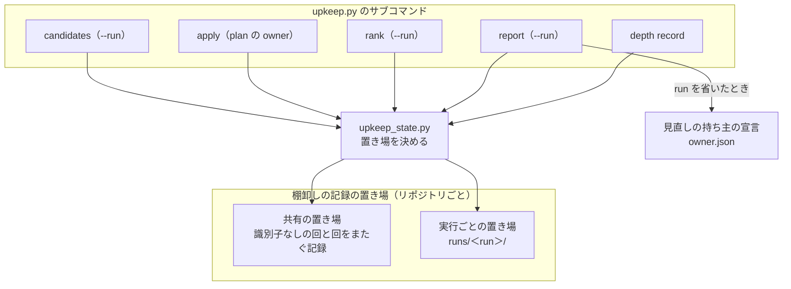
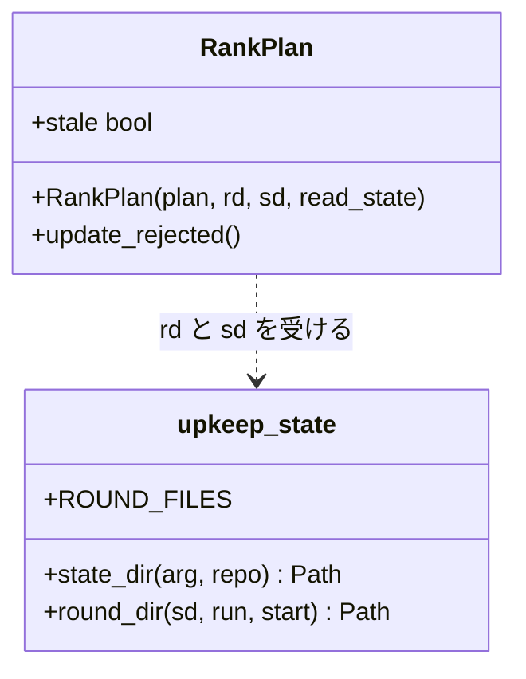
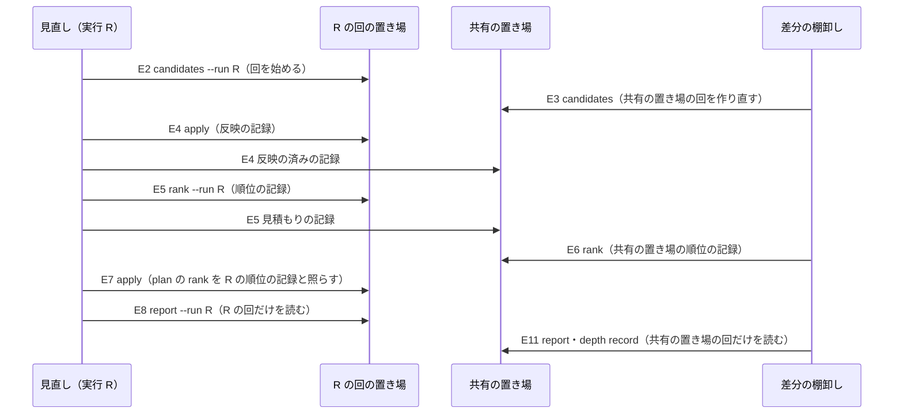
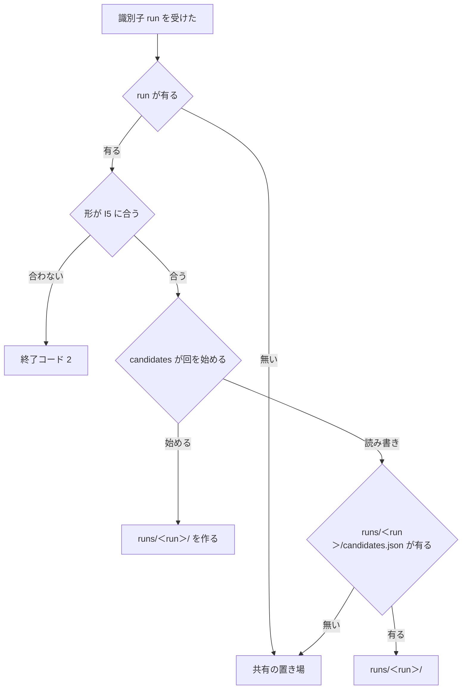

# 棚卸し: 見直しと大整理が、並行する差分の棚卸しに上書きされない自分の記録から報告を組む（#2847）

## 目的

- **今どうなっているか**: 棚卸しの記録の置き場はリポジトリごとに 1 つで、差分の棚卸しは見直しの持ち主を取らずに同じ置き場へ書く。2026-11-08 の開発ループ lcore の 2 回目 では、見直しが集めた値は対象 283 件・open 283 件だった。見直しの報告は別のレーンの差分の棚卸しの値（対象 10 件・open 281 件）を返し、深さの記録にもその値が写った
- **誰に効くか**: 並列の計画で棚卸しを流す開発ループと、その報告と深さの記録を読んで見直し・大整理の起動を判定する仕組み（`depth due`）と人
- **変えると何が成り立つか**: 見直し・大整理の報告と深さの記録が、その実行自身が集めた候補・反映・順位の値だけを載せる。差分の棚卸しの報告も、並行する見直しの値を読まない

## 適用範囲

- **働く範囲**: NDF の棚卸し（`backlog-refinement`）を使うすべてのリポジトリ。記録の置き場は利用先のリポジトリごとに分かれる
- **プロジェクトごとに違うもの**: 無し（記録の置き場の場所は今と同じく `$NDF_UPKEEP_STATE_DIR` と `--state-dir` の引数で受ける）
- **当たるモード**: `standard`

## あるべき姿の根拠

| 根拠 | 種類 | 何を示すか |
| --- | --- | --- |
| STD1（git の worktree） | 外部の一次情報 | 並行して動く作業ごとに状態を分けて置き、すべての作業で共有する状態だけを共通の置き場に残す形が、広く使われるツールで採られている |
| PRD1（Terraform のワークスペース） | 外部の一次情報 | 1 つの置き場の中で、状態を名前つきの単位ごとに分ければ、別の単位の状態を読まない |
| 2026-11-08 の見直しの報告（#2847 の「依頼（原文）」） | 実測 | 記録の置き場を 1 つにしたまま持ち主を取らない実行が書くと、見直しの対象と open の件数が別の実行の値になる |

要求と受け入れ条件は #2847 の本文にある（コピーは [issue-2847-requirements.md](issue-2847-requirements.md)）。この文書は「どう作るか」だけを扱う。

## ドメインモデル

### コンテキスト

| コンテキスト | 何の語が 1 つの意味に決まるか |
| --- | --- |
| 課題の棚卸し（`ndf-issue-upkeep`） | 棚卸しの実行・棚卸しの回・棚卸しの記録の置き場・候補の記録 |

1 つのコンテキストの中で閉じる。開発ループのまとめのステップ（`ndf-workflow`）は今の呼び出しのまま変えない。

### 集約

| 集約 | 持ち主（書き換えてよいもの） | 根 | エンティティ | 値オブジェクト |
| --- | --- | --- | --- | --- |
| 棚卸しの回 | その回を始めた実行の `candidates`・`apply`・`rank` | 候補の記録 | 反映の記録・順位の記録 | 実行の識別子（`run`）・回の置き場のパス |
| 回をまたぐ記録 | `upkeep.py` の `apply`（反映の済み）と `rank`（見積もり・退けた移動）。この変更では変えない | — | 反映の済みの記録・見積もりの記録・人が退けた移動 | — |

見直しの持ち主の宣言（`.ndf/backlog/owner.json`）はこの変更で変えず、実行の識別子を読むだけにする。棚卸しの回は、
実行の識別子を名前に持つ置き場で他の回と区別する（ほかの集約を ID で参照する規則）。

### 不変条件

| # | 集約 | 条件 | 破れたときの扱い |
| --- | --- | --- | --- |
| I1 | 棚卸しの回 | 実行 R が `candidates --run R` で回を始めた後、R の回の候補・反映・順位の記録を書き換え・消去するのは R の実行だけである | 別の実行は R の置き場のパスを組み立てないため起きない。起きたら不具合として扱う |
| I2 | 棚卸しの回 | 実行 R の回があるとき、R の `apply`・`rank`・`report` は R の回の記録だけを読み、共有の置き場の候補・反映・順位の記録を混ぜない | 起きない作りにする。R の回に候補の記録が無ければ、R の回は始まっていないと判定する |
| I3 | 棚卸しの回 | 実行の識別子を渡さない呼び出しと、回を始めていない実行は、共有の置き場の回を読み書きする（今と同じ振る舞い）。ただし `--depth review` / `overhaul` を渡した `report` は、`--run` を省くと持ち主の宣言の実行を識別子に補い、その実行の回が始まっていればその回を読む（I2・決定 3） | 既存の棚卸しのテストが落ちる |
| I4 | 回をまたぐ記録 | 反映の済みの記録・見積もりの記録・人が退けた移動は共有の置き場だけに置き、実行の回の置き場に置かない | 2 度書きを防げない・`unscored` の判定が見直しの見積もりを読まない |
| I5 | 棚卸しの回 | 実行の識別子は、英数字で始まり英数字・`.`・`_`・`-` だけからなる 64 文字以内の値だけを受ける（`..` を含まない） | 終了コード 2 で止まり、記録を 1 つも書かない |

### ドメインイベント

| # | イベント | 発生元 | 受け手 |
| --- | --- | --- | --- |
| E1 | 見直しが持ち主になった | まとめのステップの `owner claim` | 見直しの本体（`owner status` の `run` を読む） |
| E2 | 見直しが候補を集めた | 見直しの `candidates --depth review --run R` | R の回の置き場（回を始める） |
| E3 | 別の実行が候補を集めた | 別のレーンの `candidates --depth diff` | 共有の置き場 |
| E4 | 見直しが区分を反映した | 見直しの `apply`（plan の `owner` が R） | R の回の置き場（反映の記録）・共有の置き場（反映の済みの記録） |
| E5 | 見直しが順位を算出した | 見直しの `rank --scores --run R` | R の回の置き場（順位の記録）・共有の置き場（見積もりの記録） |
| E6 | 別の実行が順位を算出した | 別のレーンの `rank` | 共有の置き場 |
| E7 | 見直しが順位の表を書いた | 見直しの `apply`（plan の `rank` に E5 の要約値） | GitHub のマイルストーンの説明 |
| E8 | 見直しが報告を組んだ | `report --depth review --run R` | E9 の `depth record` |
| E9 | 見直しが深さの記録を残した | `depth record --depth review --run R` | `depths.jsonl`（`depth due` が読む） |
| E10 | 見直しが持ち主を手放した | まとめのステップの `owner release` | 次の `owner claim` |
| E11 | 差分の棚卸しが報告と深さの記録を残した | 別のレーンの `report`・`depth record --depth diff` | `depths.jsonl` |

### 用語

| 用語 | 意味 | 用語集への反映 |
| --- | --- | --- |
| 棚卸しの回 | 1 回の `candidates` から始まり、続く `apply`・`rank`・`report` が読み書きする候補・反映・順位の記録のまとまり。実行の識別子を渡した `candidates` は、その実行の回を実行ごとの置き場に始める | 追加 |
| 実行ごとの置き場 | 棚卸しの記録の置き場の下に、実行の識別子ごとに置く棚卸しの回のディレクトリ（`runs/<run>/`） | 追加 |
| 棚卸しの記録の置き場 | `upkeep.py` が記録を置くディレクトリ。`$NDF_UPKEEP_STATE_DIR` の下にリポジトリごとに置き、回をまたぐ記録と、識別子を渡さない実行の棚卸しの回（共有の置き場）と、実行ごとの置き場を持つ | 意味の変更 |

## 外部の調査

| 種類 | 調べるか | 理由 |
| --- | --- | --- |
| 標準・仕様 | 調べる | 並行する作業ごとの状態と共有の状態の分け方に、広く使われるツールの定まった形がある |
| 主要な製品 | 調べる | 1 つの置き場の中で状態を名前つきの単位に分ける製品の形を比べる |
| ライブラリとサービス | 調べる | 分けずに排他で守る場合に使う錠のライブラリを、プロジェクトが既に依存しているものから確かめる |

### 標準・仕様

| # | 標準・仕様 | 何を定めているか | 設計への反映 | 出典 |
| --- | --- | --- | --- | --- |
| STD1 | git の worktree の状態の分け方 | `HEAD`・`index` などは worktree ごとの私的なディレクトリ（`$GIT_DIR/worktrees/<id>`）に置き、`refs/` と `config` は共通のディレクトリ（`$GIT_COMMON_DIR`）で共有する | 候補・反映・順位の記録を実行ごとの置き場へ、反映の済み・見積もり・退けた移動を共有の置き場へ分ける | https://git-scm.com/docs/git-worktree （2026-11-08） |

### 主要な製品

| # | 製品 | どう解いているか | 設計への反映 | 出典 |
| --- | --- | --- | --- | --- |
| PRD1 | Terraform のワークスペース | 1 つの置き場（backend）に名前つきのワークスペースごとの状態を持ち、あるワークスペースの操作は別のワークスペースの状態を読まない。既定のワークスペース（`default`）は名前を渡さない操作が使う | 実行の識別子を名前にした置き場を足し、識別子を渡さない呼び出しは今の置き場（共有の置き場）を使う | https://developer.hashicorp.com/terraform/language/state/workspaces （2026-11-08） |

### ライブラリとサービス

| # | 候補 | 版 | ライセンス | 最後のリリースの日付 | 終了のアナウンス | 要件を満たすか | 出典 |
| --- | --- | --- | --- | --- | --- | --- | --- |
| LIB1 | filelock（プロジェクトは `plugins/ndf/scripts/lib/locks.py` で包んで 4.0.3 を使う） | 4.2.9 | MIT | 2026-11-04 | 無し | 満たさない。錠は同時の書き込みを順に並べるが、見直しは回を最大 5400 秒持つため、差分の棚卸しを待たせるか締め出すことになる。別の実行の書き込みを自分の記録として読むことは、順に並べても防げない | https://pypi.org/project/filelock/ （2026-11-08）・`pyproject.toml` の `locks` |

### 確かめられなかったこと

| 対象 | 試した手段 | 結果と理由 |
| --- | --- | --- |
| 無し | — | — |

調べた量: 候補 3 件・取得の試み 3 回。

## 機能一覧

| # | 機能 | 誰が使うか |
| --- | --- | --- |
| F1 | 見直し・大整理が、実行の識別子を渡して自分の棚卸しの回を始める | 見直し・大整理を流す AI（まとめのステップの work） |
| F2 | 見直し・大整理の反映・順位の算出・報告が、自分の回の記録だけを読み書きする | 同上 |
| F3 | 差分の棚卸しが、並行する見直しの記録を読まずに報告と深さの記録を残す | 差分の棚卸しを流す AI |
| F4 | 識別子を渡さない呼び出しが、今と同じ置き場で動く | 既存の手順・テスト・手で打つ人 |

## 構成要素

| 要素 | 責務 |
| --- | --- |
| `upkeep_state.py`（新設） | 棚卸しの記録の置き場（共有の置き場）と、実行の識別子から棚卸しの回の置き場を決める唯一の部品。識別子の形を確かめる（I5） |
| `upkeep.py` の `candidates` | `--run` を受け、渡されたら実行ごとの置き場に回を始める。候補の記録に `metrics.run` を書く。回の置き場の反映と順位の記録だけを消す |
| `upkeep.py` の `apply` | plan の `depth` が `review` / `overhaul` のとき、plan の `owner` の実行の回を読み書きする。反映の済みの記録は共有の置き場に書く |
| `upkeep_rank_cmd.py` の `rank` と順位の plan の確認（`RankPlan`） | `rank` は `--run` を受け、順位の記録を回の置き場へ、見積もりの記録を共有の置き場へ書く。`RankPlan` は順位の記録を回の置き場から、人が退けた移動を共有の置き場から読む |
| `upkeep_report.py` の `report` | `--run`（省くと今と同じく持ち主の宣言の実行）の回の候補・反映・順位の記録から報告を組む |
| `upkeep_depth.py` の `depth record` | 差分の棚卸しの値を共有の置き場の回から写す（置き場は `upkeep_state.py` で決める） |
| 手順の文書（`SKILL.md`・`references/review.md`・`references/overhaul.md`・`references/depths.md`） | 見直し・大整理の `candidates`・`rank` に `--run <run>` を渡す手順と、差分の棚卸しどうしの取り違えが残ることを書く |



手順の文書は呼び出しの関係を持たないため、図に含めない。

## 構造

変更が触る型と関数だけを載せる。`upkeep_state` はクラスを持たないモジュールで、図では関数の置き場として描く。



| 関数・型 | 入力 | 返り | 振る舞い |
| --- | --- | --- | --- |
| `state_dir(arg, repo)` | `--state-dir` の値、リポジトリ | 共有の置き場のパス | 今の `upkeep.py` の `_state_dir` を移す。中身は変えない |
| `round_dir(sd, run, start=False)` | 共有の置き場、実行の識別子か `None`、回を始めるか | 回の置き場のパス | `run` が `None` なら `sd`。形が I5 に合わなければ終了コード 2。`start` なら `sd/runs/<run>/` を作って返す。そうでなければ `sd/runs/<run>/candidates.json` があるときだけ `sd/runs/<run>/` を、無ければ `sd` を返す |
| `RankPlan(plan, rd, sd, read_state)` | plan、回の置き場、共有の置き場 | — | 順位の記録（`rank.json`）は `rd` から、人が退けた移動（`rejected.json`）は `sd` から読み書きする |

## データ構造

置き場は一時ディレクトリにあり、版を上げても候補・反映・順位の記録を引き継がない（要求の前提 3）。移行はしない。

```text
$NDF_UPKEEP_STATE_DIR/<owner>--<name>/       共有の置き場
├── candidates.json      識別子を渡さない実行の回（今と同じ）
├── apply.json
├── rank.json
├── ledger.json          回をまたぐ記録（反映の済み）
├── estimates.json       回をまたぐ記録（見積もり）
├── rejected.json        回をまたぐ記録（人が退けた移動）
└── runs/
    └── <run>/           実行ごとの置き場（candidates --run で作る）
        ├── candidates.json
        ├── apply.json
        └── rank.json
```

| 項目 | 内容 |
| --- | --- |
| 回の主キー | 実行の識別子（`owner claim` が返す UUID）。識別子を渡さない回は共有の置き場の 1 つだけ |
| 候補の記録に足すキー | `metrics.run`: 回を始めた実行の識別子。空（`null`）は「共有の置き場の回」で、「不明」ではない |
| 消す時点 | `candidates` は自分の回の置き場の `apply.json`・`rank.json` だけを消す。実行ごとの置き場のディレクトリは消さない。一時ディレクトリにあり、1 つの回の記録は候補 283 件の回でも数百 KB に収まるため |
| 時系列の扱い | 回の記録は次の `candidates` で上書きする（今と同じ）。過去の回の値は深さの記録（`depths.jsonl`）が行として残す |

CRUD 図（C 作る・R 読む・U 書き換える・D 消す。「回」は回の置き場、「共」は共有の置き場）:

| 機能 | 候補の記録 | 反映の記録 | 順位の記録 | 反映の済み | 見積もり | 退けた移動 |
| --- | --- | --- | --- | --- | --- | --- |
| `candidates` | C（回） | D（回） | D（回） | — | R（共） | — |
| `apply` | R（回） | CRU（回） | R（回） | RU（共） | — | RU（共） |
| `rank` | — | — | C（回） | — | RU（共） | R（共） |
| `report` | R（回） | R（回） | R（回） | — | — | — |
| `depth record --depth diff` | R（共） | R（共） | — | — | — | — |

## 入出力の契約

| サブコマンド | 入力の変更 | 出力の変更 | 失敗の形 | 互換性 |
| --- | --- | --- | --- | --- |
| `candidates` | `--run <run>` を足す（任意） | `metrics.run`（識別子か `null`）を足す | 識別子の形が I5 に合わなければ終了コード 2・記録を書かない | 渡さなければ今と同じ置き場に書く |
| `rank` | `--run <run>` を足す（任意） | 無し | 同上 | 渡さない、または R の回が始まっていなければ共有の置き場に書く |
| `apply` | 無し（plan の `owner` を回の識別子に使う。`depth: diff` では使わない） | 無し | 回の置き場に候補の記録が無ければ今と同じ終了コード 3（「candidates を打ってから plan を作る」） | R の回が始まっていなければ共有の置き場を読み書きする |
| `report` | 無し（今の `--run`、省くと持ち主の宣言の実行を回の識別子にも使う。`--depth` も `--run` も無ければ識別子なし） | 無し | 識別子の形が I5 に合わなければ終了コード 2 | 同上 |
| `depth record` | 無し | 無し | 無し | 差分の棚卸しの値を共有の置き場から写す（今と同じ） |

出力のキーの意味は変えない（要求の「境界」の「確認してから行う」に当たる変更は無い）。

## 処理の流れ

2026-11-08 の順序（E2 → E3 → E4 → E5 → E6 → E7 → E8）を、変更後の置き場で描く。



回の置き場を決める分岐:



## 非機能の実現方式

| 大項目 | 条件 | 実現方式 |
| --- | --- | --- |
| 運用・保守性 | 実行を区別する方法を 1 か所に置く | 置き場を決める関数は `upkeep_state.py` の `state_dir` と `round_dir` だけにする。5 つのサブコマンドはこの 2 つを呼び、パスを組み立てない。`upkeep.py` の `_state_dir` と `ctx.state_dir`・`state_dir_of` の受け渡しはこの部品の呼び出しに置き換える |
| 移行性 | 版を上げた直後の `rank` が前の見積もりの記録を引き継ぐ | 見積もりの記録は共有の置き場の同じパス（`estimates.json`）に残す（I4）。候補・反映・順位の記録の移行はしない |

## 決定の記録

### 決定 1: 見直しの記録を並行する実行に上書きさせないため、持ち主の実行の候補・反映・順位の記録を実行ごとの置き場へ分ける

見直しと大整理は 1 つの回を最大 5400 秒（まとめのステップの打ち切り）持つ。その間も差分の棚卸しは別のレーンで流れる。
回の記録を実行ごとの置き場へ分ければ、別の実行は R の置き場のパスを組み立てず、待たずに自分の回を書ける（STD1・PRD1 と同じ形）。

錠で書き込みを順に並べる形は採らない。見直しの回の間、差分の棚卸しを最大 5400 秒待たせるか締め出すことになる。並べても、
別の実行が書いた候補の記録を自分の記録として読むことは防げない。記録に実行の識別子を付けて食い違いを拒む形も採らない。
拒んでも、差分の棚卸しの `candidates` が見直しの反映と順位の記録を消すことは防げない（受け入れ条件 2）。

- 作り方: 自前で作る・標準に倣う
- 比べた候補: STD1 / PRD1 / LIB1

根拠: Value 7 / Value 6（MVV 版 6）

### 決定 2: 識別子を渡さない呼び出しを今と同じに動かすため、実行の回が始まっていなければ共有の置き場を読む

`apply` と `report` は、実行 R の回の置き場に候補の記録が無ければ共有の置き場を読み書きする。要求の「影響」は、足した引数を
渡さない呼び出しが今と同じに動くことを求める。既存の棚卸しのテスト（193 件）は、持ち主を取る前に識別子なしの `candidates` を
打ってから持ち主の plan で `apply` する。回が始まったかの判定を候補の記録の有無に置くのは、回の根が候補の記録だからである。

実行の回だけを読み、無ければ止める形は採らない。識別子を渡さずに `candidates` を打つ既存の手順とテストが、`apply` の終了コード 3 で止まる。

根拠: Value 6 / Value 1（MVV 版 6）

### 決定 3: 別のレーンの実行が持ち主の置き場へ書かないよう、回の識別子は呼び出しが明示的に渡す

`candidates` と `rank` は `--run` で、`apply` は plan の `owner` で、`report` は今の `--run`（省くと持ち主の宣言）で回の識別子を受ける。
持ち主の宣言はリポジトリのメインディレクトリに 1 つで、別のレーンのプロセスも同じ宣言を読む。宣言から識別子を自動で選ぶと、
差分の棚卸しの `candidates` と `rank` も見直しの置き場へ書き、取り違えの向きが逆になるだけである。`report` だけは宣言の実行を
既定に使う。`report` は書かず、`--depth review|overhaul` を渡したときだけ宣言を読む（今の振る舞い）。

宣言の中の pid と呼び出したプロセスを照らして持ち主かを見分ける形は採らない。まとめのステップでは宣言の pid が supervise.py である。
`upkeep.py` は work ステップの言語モデルが打つ孫以下のプロセスのため、プロセスの祖先をたどる仕組みが新たに要る。

根拠: Value 7（MVV 版 6）

### 決定 4: 大整理も自分の回を持つよう、大整理の手順の最初に `candidates --depth review --run <run>` を置く

大整理の `apply` は記録のリポジトリを候補の記録で確かめ、報告の `open_before` も候補の記録から取る。今の手順は `candidates` を
打たず、先に流れた差分の棚卸しの共有の置き場の記録に頼っている。大整理の回を始めれば、受け入れ条件 4 の値が大整理自身の
記録になる。`candidates` の深さは `review` を使う（`open` の件数は深さによらず open の全件で、記録のリポジトリも同じ）。

`candidates` に `--depth overhaul` を足す形は採らない。大整理が候補の記録から使うのはリポジトリと open の件数だけで、深さを
足しても読む値は変わらない。

根拠: Value 5 / Value 7（MVV 版 6）

### 決定 5: 範囲を目の前の取り違えに絞るため、差分の棚卸しどうしの取り違えはこの変更で防がず、残ることを手順の文書に書く

差分の棚卸しは持ち主を取らず、実行の識別子を持たない。防ぐには、まとめのステップで差分の棚卸しにも識別子を発行し、`apply` に
`--run` を足して手順を変える必要がある。そうすると範囲がまとめのステップ（`sprint_close_steps.py`）まで広がる。この変更の部品
（`round_dir`）は識別子を受ければ差分の棚卸しにも同じく働くため、後で識別子を渡す変更だけで防げる。
残ることは `references/depths.md` の「記録」に書く。

根拠: Value 2 / Value 3（MVV 版 6）

## テスト設計

| 受け入れ条件・不変条件 | どの振る舞いで縛るか | どう壊したら落ちるべきか |
| --- | --- | --- |
| 受け入れ条件 1・I2 | 見直しの `candidates --run R` の後に別の実行の `candidates --depth diff` を打っても、`report --depth review --run R` の `targets`・`by_route`・`open_before` が見直しの `candidates` の値と一致する | `report` が共有の置き場を読むように戻すと落ちる |
| 受け入れ条件 2・I1 | 同じ順序で見直しが `apply` を打つと、報告の `verdicts`・`applied`・`closed` が見直しの `apply` と一致し、別の実行の `candidates` の後も R の `apply.json`・`rank.json` が残る | `candidates` が回の置き場でなく共有の置き場を消すように戻すと落ちる |
| 受け入れ条件 3・I2 | 見直しの `rank --run R` の後に別の実行の `rank` を打っても、見直しの `apply`（plan の `rank` に R の `digest`）が順位の表を書き（`tables.failed` が空・終了コード 20 で止まらない）、報告の `ranked` が R の `rank` と一致する | `RankPlan` が順位の記録を共有の置き場から読むように戻すと落ちる |
| 受け入れ条件 4・I2 | 大整理の `candidates --run R` の後に別の実行が `candidates`・`rank` を打っても、`report --depth overhaul --run R` の `open_before`・`closed`・`created` が大整理の記録の値になり、大整理の `apply.json` が残る | 同上 |
| 受け入れ条件 5・I3 | 見直しの回が並行していても、差分の棚卸しの `report` の `targets` と `depth record --depth diff` の行の `open_before` が差分の棚卸しの `candidates` の値と一致する | `candidates --run` が共有の置き場に書くように壊すと落ちる |
| 受け入れ条件 6・I3 | 識別子を渡さない既存の棚卸しのテスト（193 件）がそのまま通る。同じ実行で `candidates --run R` を打ち直すと R の前の `apply`・`rank` を報告に混ぜない | `round_dir` が回の無い実行で止まるように壊すと既存のテストが落ちる |
| 受け入れ条件 6・I4 | 見直しの `rank --run R` が書いた見積もりを、後の差分の棚卸しの `candidates` の `unscored` が読む。R の `apply` が書いた反映の済みの記録で、別の実行の `apply` が同じ課題を 2 度書かない | 見積もりか反映の済みの記録を回の置き場に置くように壊すと落ちる |
| 受け入れ条件 7 | 2 つの実行が同じ記録の置き場を共有して E2 → E3 → E4 → E5 → E6 → E7 → E8 を交互に流す結合テストが 1〜3 と 5 を確かめる | 変更前のコードでは `--run` を受けないため落ちる |
| I5 | `--run ../x` と空の識別子で `candidates`・`rank`・`report` が終了コード 2 で止まり、置き場の外にファイルを作らない | 形の確認を外すと落ちる |

## 設計の結果

| 課題 | 扱い | 取り込み先 | 触るファイル |
| --- | --- | --- | --- |
| #2847 | 実装する | — | `plugins/ndf/skills/backlog-refinement/scripts/upkeep_state.py`（新設）、`plugins/ndf/skills/backlog-refinement/scripts/upkeep.py`、`plugins/ndf/skills/backlog-refinement/scripts/upkeep_rank_cmd.py`、`plugins/ndf/skills/backlog-refinement/scripts/upkeep_report.py`、`plugins/ndf/skills/backlog-refinement/scripts/upkeep_depth.py`、`plugins/ndf/skills/backlog-refinement/tests/test_upkeep_script.py`、`plugins/ndf/skills/backlog-refinement/SKILL.md`、`plugins/ndf/skills/backlog-refinement/references/review.md`、`plugins/ndf/skills/backlog-refinement/references/overhaul.md`、`plugins/ndf/skills/backlog-refinement/references/depths.md` |

## 未確認のまま残ること

| 項目 | 内容 |
| --- | --- |
| 差分の棚卸しどうしの取り違え | 2 つのレーンの差分の棚卸しが重なると、共有の置き場の回を互いに上書きする（決定 5）。重なる頻度は未計測。`depths.md` に残ることを書き、起票するかは設計承認ゲートで決める |
| `--run` の渡し忘れ | 見直し・大整理が `candidates` に `--run` を渡し忘れると、回は共有の置き場に始まり、今と同じ取り違えが起きうる（決定 2 の互換のため止めない）。`rank` だけ渡し忘れた場合は、`apply` が「plan の rank が rank.json と合わない」で止まる。渡し忘れの頻度はリリース後の手動確認（要求の「検証手段」）で見る |
| 回をまたぐ記録の同時の書き込み | 見直しと差分の棚卸しの `apply`・`rank` が同時に反映の済みの記録・見積もりの記録を書くと、後に書いた側の内容だけが残りうる。要求の範囲の外（前提 4） |
| 実行ごとの置き場の残り | 実行ごとの置き場のディレクトリは消さず、一時ディレクトリの掃除に任せる。溜まる量は未計測 |
