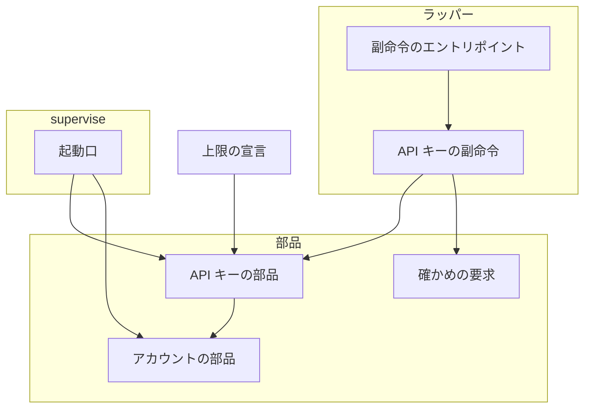
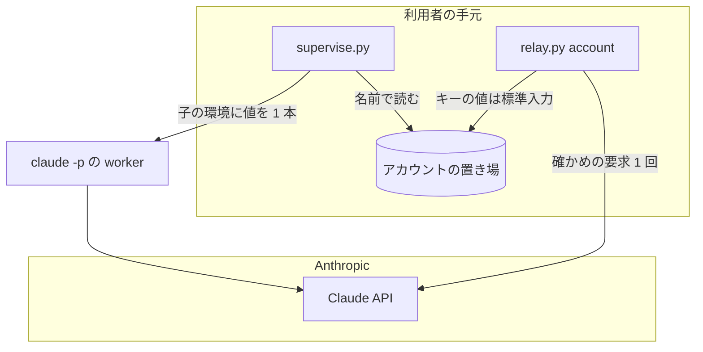
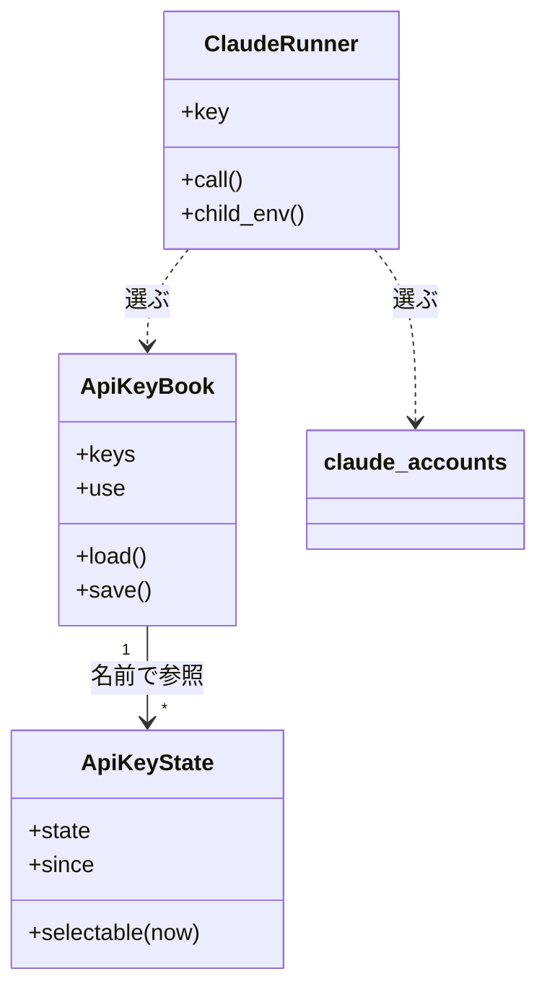
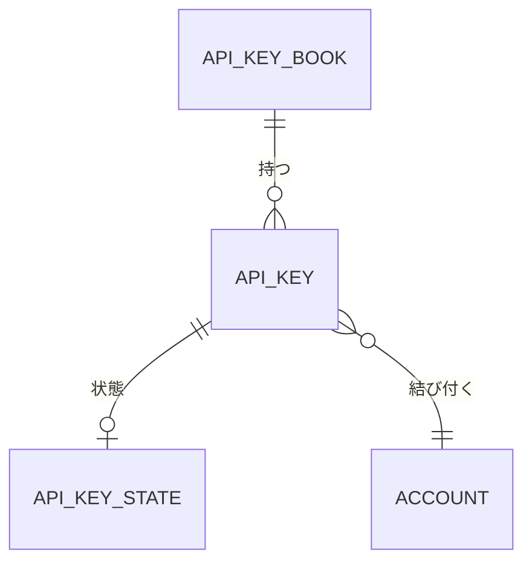
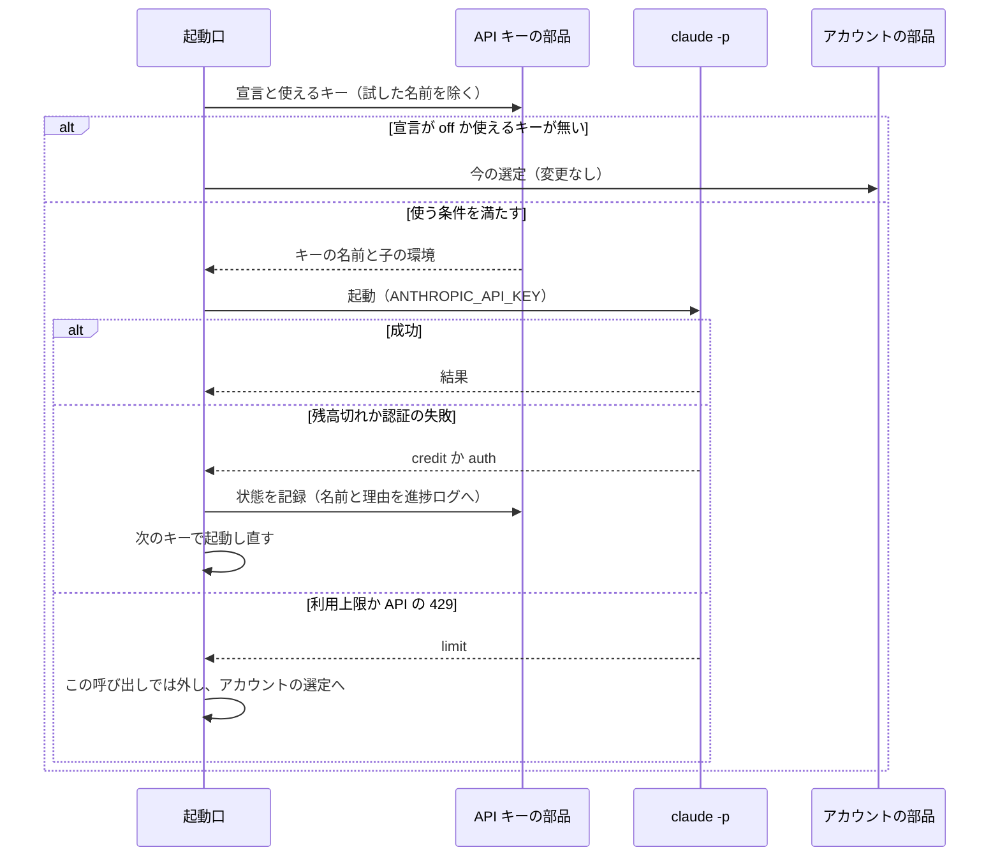
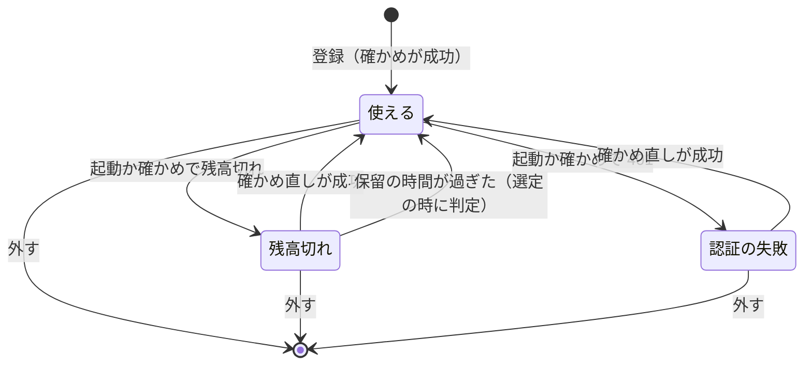

# relay の API キーの登録: サブスクリプションの API クレジットで worker の claude -p を動かす（#2855）

## 目的

- **今どうなっているか**: 並列の計画で worker の `claude -p` はすべてサブスクリプションのログインで動き、利用上限（5 時間・週）に当たると待つか従量の接続へ移る。Max・Ultra・Team に毎月付く API クレジット（利用上限と別枠）を NDF から使う手段が無い
- **誰に効くか**: `supervise.py` で並列の計画を回す利用者
- **変えると何が成り立つか**: 登録した API キーで worker の `claude -p` を動かせ、その分だけ利用上限の消費を逃がせる。残高が尽きてもステップは止まらず、サブスクリプションのログインへ戻る

## 適用範囲

- **働く範囲**: NDF を導入したすべてのリポジトリ。置き場は利用者の手元（アカウントの置き場）で、リポジトリごとの設定は持たない
- **プロジェクトごとに違うもの**: 無し（API キーと使い方の宣言は利用者ごとに置き場へ持つ。リポジトリに依らない）
- **当たるモード**: `standard`

## あるべき姿の根拠

| 根拠 | 種類 | 何を示すか |
| --- | --- | --- |
| STD1 | 外部の一次情報 | 月の API クレジットは利用上限と別枠で、リンクした組織の API キーで動かす `claude -p` を払える。対話の Claude Code は払えない |
| STD2 | 外部の一次情報 | `-p` では `ANTHROPIC_API_KEY` がサブスクリプションのログインより先に必ず使われる |
| STD3 | 外部の一次情報 | 残高切れの文言（"Your credit balance is too low to access the Anthropic API."）と、API の失敗の形（401 は認証の失敗） |
| 実測 1（2026-11-09、`claude` 2.1.319） | 実測 | 偽の値を `ANTHROPIC_API_KEY` に入れた `claude -p --output-format json` は、OAuth のログインがあっても `api_error_status` 401・`result` "Invalid API key · Fix external API key" で 0.6 秒で終わる |
| 依頼の原文 | 利用者の指示 | 「relay.pyのアカウントとして登録できるようにしたい」「apiキーは複数登録できるようにする」 |

要求と受け入れ条件は #2855 の本文にある（コピーは [issue-2855-requirements.md](issue-2855-requirements.md) ）。この文書は「どう作るか」だけを扱う。

## ドメインモデル

### コンテキスト

| コンテキスト | 何の語が 1 つの意味に決まるか |
| --- | --- |
| NDF のラッパー（`ndf-relay`） | 登録済みアカウント・従量の接続・登録済み API キー・残高切れ・API キーの使い方の宣言 |

1 つのコンテキストに収まる。`supervise.py` の起動口はこのコンテキストの部品（アカウントの置き場の部品）を読むだけで、語を持ち込まない。

### 集約

| 集約 | 持ち主（書き換えてよいもの） | 根 | エンティティ | 値オブジェクト |
| --- | --- | --- | --- | --- |
| API キーの登録簿 | API キーの部品（`lib/claude_api_keys.py`） | 登録簿 | 登録済み API キー | キーの名前・キーの値・結び付いたアカウントの名前・使い方の宣言 |
| API キーの状態 | API キーの部品 | 状態の記録 | キーごとの状態 | 状態（使える・残高切れ・認証の失敗）・観測の時刻 |
| 登録済みアカウント（既存） | アカウントの部品（`lib/claude_accounts.py`） | — | — | — |

登録簿と状態を別の集約に分けるのは、worker の起動のたびに書く状態の更新で、キーの値を持つファイルを書き直さないためである。状態は登録簿をキーの名前で参照する。登録済みアカウントは名前だけで参照し、この変更では書き換えない。

### 不変条件

| # | 集約 | 条件 | 破れたときの扱い |
| --- | --- | --- | --- |
| I1 | API キーの登録簿 | キーの名前は登録済みアカウントの名前とも予約の名前 `metered` とも重ならない（OAuth の `add` の側でも同じ規則で拒む） | 登録を拒み、理由を表示して終了コード 1 |
| I2 | API キーの登録簿 | 結び付いたアカウントの名前は、登録の時点で登録済みアカウントである | 登録を拒む（終了コード 1） |
| I3 | API キーの登録簿 | 保存するのは確かめが成功したキーだけで、書きかけを残さない | 確かめの失敗・書けないときは保存せず終了コード 1 |
| I4 | API キーの登録簿 | 登録簿のファイルは 0600 で、キーの値は登録簿のファイルの外（画面・進捗ログ・判断の記録・状態の記録・`account list`）に出ない | 出力の組み立てに値を渡す経路を作らない。テストが偽の値の文字列を数える |
| I5 | API キーの登録簿 | キーの値が入るのは、`supervise.py` の起動口が作る `claude -p` の環境だけである。ラッパーが起こす対話のセッションの環境には入らない | ラッパーの起動の経路は登録簿を読まない。既存の外す処理（`FOREIGN_AUTH_ENV`）が親の値も外す |
| I6 | API キーの登録簿 | 使い方の宣言が無い・読めないときは「使わない」として動く | 宣言が壊れていれば 1 行表示し、「使わない」で動く |
| I7 | API キーの状態 | 残高切れか認証の失敗の状態のキーは選ばない（残高切れは保留の時間が過ぎるまで） | 選定の候補から外す |
| I8 | API キーの状態 | 同じ状態からは同じキーを選ぶ（名前の順の先頭） | — |

### ドメインイベント

| # | イベント | 発生元 | 受け手 |
| --- | --- | --- | --- |
| E1 | API キーを確かめた | 登録の副命令・確かめ直す副命令 | 登録の副命令（E2 へ進むか決める） |
| E2 | API キーを登録した | 登録の副命令 | 起動口（次の起動から候補に入る） |
| E3 | worker の起動で API キーを選んだ | 起動口 | 進捗ログ（`account` の行） |
| E4 | API キーで worker の `claude -p` が終わった | `claude -p` の 1 回の呼び出し | 起動口（結果を読み分ける） |
| E5 | 残高切れを受けた | 起動口 | 状態の記録・進捗ログ |
| E6 | 認証の失敗を受けた | 起動口 | 状態の記録・進捗ログ |
| E7 | 同じ呼び出しを起動し直した | 起動口 | 進捗ログ（`account` の行） |
| E8 | API キーの状態が使えるへ戻った | 確かめ直す副命令 | 状態の記録 |
| E9 | API キーを外した | 外す副命令 | 登録簿・状態の記録 |

### 用語

| 用語 | 意味 | 用語集への反映 |
| --- | --- | --- |
| 登録済み API キー | 利用者が `relay.py account` の副命令で預けた Anthropic の API キー。名前と、結び付いた登録済みアカウントを持ち、worker の `claude -p` にだけ使う | 追加（要求の時点で反映済み） |
| 残高切れ | API キーの要求が "credit balance is too low" で失敗した状態。そのキーは解除の条件を満たすまで候補から外れる | 追加（要求の時点で反映済み） |
| API キーの使い方の宣言 | 登録済み API キーを worker にいつ使うかを決める 1 つの設定。値は「使わない」「常に使う」「上限に近いとき使う」で、既定は「使わない」 | 意味の変更（値の 3 つを足す） |
| API キーの登録簿 | 登録済み API キーと使い方の宣言を持つ、アカウントの置き場の 1 つのファイル（0600） | 追加 |

## 外部の調査

| 種類 | 調べるか | 理由 |
| --- | --- | --- |
| 標準・仕様 | 調べる | API クレジットの適用範囲・認証の優先順位・失敗の形は Anthropic の公式の文書が決める |
| 主要な製品 | 調べる | 複数の API キーの使い分けと失敗した鍵の一時的な除外は、LLM のゲートウェイが同じ問題を解いている |
| ライブラリとサービス | 調べる | 確かめの要求を SDK で打つか、秘密の保存を OS のキーチェーンに任せるかを決める |

### 標準・仕様

| # | 標準・仕様 | 何を定めているか | 設計への反映 | 出典 |
| --- | --- | --- | --- | --- |
| STD1 | API credits for Max, Ultra, and Team plans（公式の文書と Help Center） | クレジットが払うのは Claude API・Agent SDK と、リンクした組織の API キーで動かす `claude -p`。対話の Claude Code・GitHub Action・IDE の拡張・デスクトップの起動は `-p` でも払わない。残高が尽きると "Your credit balance is too low to access the Anthropic API." を返す。買ったクレジットがあればそちらから払う | 使う範囲を `supervise.py` の起動口の `claude -p` に限る（決定 2）。残高切れを文言で読む（決定 6）。買ったクレジットへの課金は抑えない（決定 8） | https://platform.claude.com/docs/en/about-claude/api-credits-for-subscribers ・ https://support.claude.com/en/articles/17154008-monthly-api-credits-for-max-ultra-and-team-plans （2026-11-09） |
| STD2 | Claude Code の Authentication precedence | 優先順位は クラウドの提供元 → `ANTHROPIC_AUTH_TOKEN` → `ANTHROPIC_API_KEY` → `apiKeyHelper` → `CLAUDE_CODE_OAUTH_TOKEN` → プロファイル → サブスクリプションのログイン。`-p` では `ANTHROPIC_API_KEY` を必ず使う | 子の環境に `ANTHROPIC_API_KEY` を入れ、上位の変数を外す（決定 3） | https://code.claude.com/docs/en/authentication （2026-11-09） |
| STD3 | Claude API errors | 失敗は `{"type":"error","error":{"type","message"}}` の JSON。401 は `authentication_error`、400 は `invalid_request_error`（使用の上限を含む）、429 は `rate_limit_error`（月の支出の上限を含む） | 確かめの要求の結果を本文の型と文言で読み分ける（決定 5） | https://platform.claude.com/docs/en/api/errors （2026-11-09） |

### 主要な製品

| # | 製品 | どう解いているか | 設計への反映 | 出典 |
| --- | --- | --- | --- | --- |
| PRD1 | LiteLLM の Router | 同じモデルの複数の配備（鍵）を `order` の小さい順に試し、429・401 などで配備を `cooldown_time`（既定 5 秒）だけ外し、尽きたら別の群へ移る | 順は利用者が決められる固定の規則にし、失敗した鍵を一定の時間だけ外す形に倣う（決定 4・決定 7） | https://docs.litellm.ai/docs/routing （2026-11-09） |
| PRD2 | Claude Code の `apiKeyHelper` | 設定のスクリプトが鍵を返し、環境変数に値を置かずに渡せる | 採らない。実測で 401 の後に起動が 60 秒で終わらなかった（決定 3） | https://code.claude.com/docs/en/authentication （2026-11-09）、実測 2 |

### ライブラリとサービス

| # | 候補 | 版 | ライセンス | 最後のリリースの日付 | 終了のアナウンス | 要件を満たすか | 出典 |
| --- | --- | --- | --- | --- | --- | --- | --- |
| LIB1 | `anthropic`（Python SDK） | 2.6.0 | Apache-2.0 | 2026-11-05 | 無し | 確かめの要求は打てる。ラッパーの環境（標準ライブラリだけ）に依存を足すことになる | https://pypi.org/pypi/anthropic/json （2026-11-09） |
| LIB2 | `keyring` | 25.7.0 | MIT | 2025-11-16 | 無し | OS のキーチェーンへ保存できる。ヘッドレスのコンテナで使えるキーチェーンの有無は確かめていない | https://pypi.org/pypi/keyring/json （2026-11-09） |
| LIB3 | `litellm` | 1.108.3 | MIT | 2026-11-07 | 無し | 鍵の使い分けはできるが、`claude -p` の子の認証を選ぶ用途に合わない（API を中継する形） | https://pypi.org/pypi/litellm/json （2026-11-09） |
| LIB4 | 既存の `lib/claude_usage.py` の `http_json`（標準ライブラリの `urllib`） | リポジトリの現行 | リポジトリと同じ | — | 無し | 確かめの要求を打てる。失敗の応答の本文を捨てるため、本文を返すよう直す | `plugins/ndf/scripts/lib/claude_usage.py` （2026-11-09） |

### 確かめられなかったこと

| 対象 | 試した手段 | 結果と理由 |
| --- | --- | --- |
| 残高切れのときの `claude -p --output-format json` の `result` と `api_error_status` | 試していない | 残高の尽きた API キーが手元に無い。実装では公式の 2 つの文言（STD1）の共通部分 "credit balance" と "too low" で読む |
| `supervise.py` が起こす `claude -p` が、課金の上で Agent SDK の利用として扱われるか（Claude Code の利用と扱われないか） | STD1 を読んだ | 公式の文書は「自分で API キーで動かす `claude -p`」を払うと書き、GitHub Action・IDE の拡張・デスクトップからの起動は払わないと書く。ラッパーの対話のセッションの中から起こした `claude -p` の扱いは書かれていない。リリース後テストで確かめる |
| ヘッドレスのコンテナでの `keyring` のキーチェーン | 試していない | LIB2 を採らないため確かめていない |

調べた量: 候補 9 件・取得の試み 10 回。

## 機能一覧

| # | 機能 | 誰が使うか |
| --- | --- | --- |
| F1 | API キーを名前を付けて登録する（確かめてから保存） | 利用者・代わりに打つ AI |
| F2 | 登録済み API キーを外す | 利用者・代わりに打つ AI |
| F3 | 登録済み API キーを確かめ直し、使える状態へ戻す | 利用者・代わりに打つ AI |
| F4 | API キーの使い方の宣言を読む・変える | 利用者・代わりに打つ AI |
| F5 | `account list` で API キーの名前・結び付いたアカウント・状態を見る | 利用者 |
| F6 | worker の `claude -p` を、宣言に従って登録済み API キーで起動する | `supervise.py` |
| F7 | 残高切れ・認証の失敗を受けたら、状態を記録して別のキーかサブスクリプションのログインで起動し直す | `supervise.py` |

## 構成要素

| 要素 | 責務 |
| --- | --- |
| API キーの部品（`lib/claude_api_keys.py`、新設） | 登録簿と状態の記録の読み書き（0600）・名前の検査・選定・子の環境の組み立て・状態の遷移。置き場の場所はアカウントの部品の `store_dir()` を使う |
| 確かめの要求（`lib/claude_usage.py` に足す） | Messages API へ 1 回の短い要求を打ち、結果を「使える・認証の失敗・残高切れ・通信の失敗・その他」に読み分ける。`http_json` は失敗の応答の本文も返す |
| API キーの副命令（`relay_lib/api_keys.py`、新設） | `add-api-key`・`api-key-use` の中身と、`list`・`remove`・`check` の API キーの分岐 |
| 副命令のエントリポイント（`relay_lib/accounts.py`） | 副命令の登録と分岐。既存の副命令の出力は変えない |
| アカウントの部品（`lib/claude_accounts.py`） | 名前の衝突の検査に API キーの名前を足す（OAuth の `add` も API キーの名前を拒む）。ほかは変えない |
| 起動口（`supervise_lib/claude.py` の `ClaudeRunner` と `call_claude`） | 呼び出しごとに宣言を読み、API キーを選んで子の環境を組む。結果から残高切れを読み、状態を記録して起動し直す |
| 上限の宣言（`contracts/limits.json`） | 残高切れの保留の秒と、確かめの要求の待ちの上限 |



### 配置



境界をまたいで値が流れるのは、利用者から登録の副命令への標準入力（かファイル）、副命令から Claude API への確かめの要求、起動口から子の `claude -p` の環境の 3 つだけである。ラッパーが起こす対話のセッションへは流れない。

### 置き場所

```text
plugins/ndf/
├── contracts/limits.json            # 残高切れの保留・確かめの待ち（変更）
├── scripts/lib/
│   ├── claude_api_keys.py           # 新設
│   ├── claude_accounts.py           # 名前の衝突の検査（変更）
│   └── claude_usage.py              # 確かめの要求・失敗の本文（変更）
├── scripts/relay_lib/
│   ├── accounts.py                  # 副命令の登録と分岐（変更）
│   └── api_keys.py                  # 新設
├── scripts/supervise_lib/claude.py  # 起動口（変更）
├── scripts/tests/                   # テストを足す
└── skills/development-workflow/references/relay-accounts.md  # 使い方の節を足す
```

## 構造



- `ClaudeRunner` に今の呼び出しの API キーの名前（`key`。無ければ None）を足す。既存の `account`（アカウントの名前か `metered`）とは別に持ち、`key` があるときは `account` を変えない（API キーを外したときに元のアカウントの選定へそのまま戻るため）
- `call_claude` の結果に `credit`（残高切れ）を足す。`limit` と `auth` より先に判定する

## データ構造

置き場はアカウントの置き場（`${NDF_ACCOUNTS_DIR:-<共有の設定ディレクトリ>/ndf/accounts}/`）。2 つのファイルを足す。既存のファイルの形は変えない。



**`api-keys.json`（API キーの登録簿。0600）**

| 列 | 型 | 空を許すか | 意味 |
| --- | --- | --- | --- |
| `version` | 整数 | 許さない | 形の版。`1` |
| `use` | 文字列 | 許す | 使い方の宣言。`off`・`always`・`near-limit`。無いときは `off` |
| `keys.<名前>.key` | 文字列 | 許さない | キーの値。このファイルの外へ出さない |
| `keys.<名前>.account` | 文字列 | 許さない | 結び付いた登録済みアカウントの名前。登録の後にアカウントを外しても残る（選定には使わず、一覧に出すだけ） |
| `keys.<名前>.added_at` | ISO 8601 | 許さない | 登録した時刻（UTC） |

**`api-key-state.json`（API キーの状態。0600）**

| 列 | 型 | 空を許すか | 意味 |
| --- | --- | --- | --- |
| `<名前>.state` | 文字列 | 許さない | `ok`・`credit_low`・`auth_failed` |
| `<名前>.since` | ISO 8601 | 許さない | 今の状態になった時刻 |
| `<名前>.checked_at` | ISO 8601 | 許す | 最後に確かめた時刻。空は「登録の後に確かめ直していない」 |

状態の行が無いキーは `ok` として扱う。値を持たないため 0600 は必須ではないが、置き場のほかのファイルに揃える。

**CRUD**

| 機能 | 登録簿 | 状態 | 登録済みアカウント |
| --- | --- | --- | --- |
| F1 登録 | C・U | U（`ok`） | R |
| F2 外す | U | D（その名前の行） | — |
| F3 確かめ直す | R | U | — |
| F4 宣言 | R・U | — | — |
| F5 一覧 | R（値を除く） | R | R |
| F6 起動 | R | R | R |
| F7 起動し直す | R | U | — |

**時系列の扱い**: 状態は上書きする。過去の遷移は進捗ログの `api_key` の行（キーの名前・理由・時刻）が持つ。状態の記録が持つのは選定に要る最新の観測だけで、履歴を状態から再構成する用途は無いためである。

**移行**: 無い。2 つのファイルが無ければ登録 0 本・宣言 `off` として動く。

**読み書きの規則**: 書くときは同じディレクトリの一時ファイルへ 0600 で書いて置き換える（既存の `_write` と同じ）。排他はアカウントの部品の `.locks/` に `api-keys.lock` を取る。読めない・壊れているときは登録 0 本として動き、起動口は進捗ログと標準エラーへ 1 行出す（非機能の可用性）。

## 入出力の契約

副命令は既存の `relay.py account` の共通の約束（`--yes`・`--json`・端末でなければ入力を待たず、足りない引数を名前で示して終了コード 2）に従う。

| 名前 | 入力 | 成功の出力 | 失敗の形 |
| --- | --- | --- | --- |
| `account add-api-key <名前> --account <アカウント> [--key-file <パス>]` | キーの値は標準入力（端末なら表示しない入力、端末でなければ標準入力の 1 行目）か `--key-file`。値を引数では受けない | 文: `登録した: <名前>（アカウント <アカウント>）` と、買ったクレジットか自動チャージがあると尽きた後もそちらから払われる旨の 1 行（標準エラー）。JSON: `{"ok":true,"command":"add-api-key","name","account","replaced"}` | 名前の衝突・アカウントが無い: `reason` `name_conflict`・`not_registered`（1）。確かめの失敗: `auth_failed`・`credit_low`・`network`・`unclassified`（1）。値が空: `missing_args`（2）。書けない: `write_failed`（1） |
| `account api-key-use [off\|always\|near-limit]` | 値を省くと今の宣言を出す | 文: `API キーの使い方: <値>`。JSON: `{"ok":true,"command":"api-key-use","use"}` | 値が違う: `invalid_name`（2） |
| `account check <API キーの名前>` | 登録済み API キーの名前 | 文: `使える: <名前>`。状態を `ok` に戻す | 確かめの失敗は状態を変えずに `reason` で返す（1） |
| `account remove <API キーの名前>` | 登録済み API キーの名前 | 文: `外した: <名前>（API キー）` | — |
| `account list` | — | 既存の行の後に、キーごとに `{"name","kind":"api_key","account","state","since"}`。表では「識別」の列に結び付いたアカウント、「状態」の列に `使える`・`残高切れ`・`認証の失敗` | — |

**互換性**: `check` と `remove` は、名前が登録済み API キーのときだけ新しい分岐へ入る。`metered`・OAuth のアカウントの名前・どちらでもない名前のときの出力と終了コードは変えない（受け入れ条件 14）。`add` は名前が登録済み API キーと重なるときだけ `name_conflict` で拒む。

**確かめの要求**: `POST https://api.anthropic.com/v1/messages`（`NDF_API_KEY_CHECK_URL` で差し替えられる）、`max_tokens` 1、モデルは上限の宣言の隣に置く定数（`NDF_API_KEY_CHECK_MODEL` で差し替えられる）。読み分けは次のとおり。

| 応答 | 結果 |
| --- | --- |
| 200 | 使える |
| 401 か `error.type` が `authentication_error` | 認証の失敗 |
| `error.message` に "credit balance" と "too low" の両方を含む | 残高切れ |
| 通信の失敗 | 通信の失敗 |
| それ以外 | その他（状態コードと `error.type` だけを表示し、`message` は値を含みうるので表示しない） |

## 処理の流れ

起動口の 1 回の呼び出しは次の順で進む。図の参加者は起動口・API キーの部品・`claude -p`・アカウントの部品の 4 つである。



**使う条件**（宣言ごと）:

| 宣言 | API キーで起動する条件 |
| --- | --- |
| `off`（既定） | 起動しない。起動口の振る舞いは変更の前と同じ |
| `always` | 使えるキーがあれば、すべての呼び出しで |
| `near-limit` | 次のどれか。(1) アカウントの選定（`choose`）が候補を返さない、(2) 選んだ候補の使用率が切り替えの閾値（`NDF_ACCOUNT_SWITCH_AT`、既定 90）以上、(3) この呼び出しで利用上限に当たり、替えるアカウントが無い（従量の接続へ移る前と、解除を待つ前に試す） |

**子の環境**: 起動したときの環境から、`STRIPPED_AUTH_ENV`（OAuth のトークンとスコープ・`ANTHROPIC_AUTH_TOKEN`・Bedrock と Vertex の変数・既存の `ANTHROPIC_API_KEY`）と、従量の接続の宣言のキーを外し、親のアカウントの環境を元へ戻して（`leave_account`）から、`ANTHROPIC_API_KEY` に選んだ 1 本の値と、`NDF_CLAUDE_API_KEY_NAME` にその名前を足す。従量の接続の `--settings` は付けない（`NDF_CLAUDE_ACCOUNT` を外すため、既存の判定のまま付かない）。

**入れ子の起動**: worker の中で起動した `supervise.py` は、`NDF_CLAUDE_API_KEY_NAME` があれば、起動したときの API キーをその名前として扱い、残高切れなら同じく状態を記録する。

**API キーの状態の遷移**:



認証の失敗から自動では戻らない。失効・削除したキーは時間で戻らないためである。保留の時間が過ぎた残高切れのキーは、状態の記録は `credit_low` のまま選定の候補に入り、次に成功した起動で `ok` に書き換える。

## 非機能の実現方式

| 大項目 | 要求の条件 | 実現方式 | 確かめ方 |
| --- | --- | --- | --- |
| 可用性 | 残高切れ・認証の失敗で worker のステップを止めない。置き場が壊れていれば API キーを使わずに今の振る舞いで動き、壊れていることを 1 行表示する | 起動口が状態を記録して同じ呼び出しを起動し直す。キーが尽きたら `key` を外して既存のアカウントの選定へ進む。登録簿が読めなければ登録 0 本として扱い、最初の呼び出しの前に標準エラーと進捗ログへ 1 行出す（壊れた従量の接続の宣言と同じ扱い） | 偽の `claude` が残高切れ・401 を返す結合テストで、ステップが成功で終わり、2 回目の起動がサブスクリプションのログインの環境であること。壊れた登録簿で既存のテストが通ること |
| セキュリティ | キーの値は 0600 のファイルにだけ置き、画面・記録・ログに出さない。子の環境へ渡すのは選んだ 1 本だけで、ラッパーの対話のセッションへは渡さない。秘密の検査が通る | 値を受けるのは標準入力とファイルだけ（引数で受けない）。出力の組み立て（一覧・結果の JSON・進捗ログの行）は値を持たない型（名前・アカウント・状態）から作る。確かめの失敗の表示は状態コードと型だけ。ラッパーの起動の経路は登録簿を読まない | 偽のキーの値の文字列が、標準出力・標準エラー・進捗ログ・`account list` に 0 回であることをテストで数える。ラッパーの区間の起動の環境に値が無いこと。`python3 scripts/check-repo-secrets.py` |
| 運用・保守性 | 状態の確認と解除が利用者のコマンドで完結する | `account list` に状態、`account check <名前>` で解除 | 副命令のテスト |
| 移行性 | 置き場に新しいファイルを足すだけで、既存のファイルの形を変えない | 2 つのファイルを足すだけ。無ければ登録 0 本・`off` | 登録 0 本で既存のテストがそのまま通ること |

**残るリスク**: worker の `claude -p` の中で動く道具（Bash など）は、子の環境の `ANTHROPIC_API_KEY` を読める。OAuth のアカウントの子が設定ディレクトリの認証ファイルを読めるのと同じ水準で、環境の値を worker から隠す手段は採らない（決定 3）。

## 決定の記録

### 決定 1: 値がシェルの履歴とプロセスの一覧に残らないよう、キーの値を標準入力とファイルでだけ受ける

コマンドラインの引数は `ps` とシェルの履歴に残る。標準入力なら、AI が代わりに打つときも `printf '%s' "$KEY" | relay.py account add-api-key ...` で対話なしに渡せる（受け入れ条件 1）。端末から打つときは表示しない入力で受ける。

引数での受け取りは採らない。#1468 の `--code` は 10 分で切れる 1 回きりのコードで、長く効くキーとは漏れたときの重さが違う。

- 作り方: 自前で作る
- 比べた候補: LIB2

根拠: Value 1（MVV 版 6）・C1

### 決定 2: 対話のセッションへ値を入れないよう、使う範囲を supervise.py の起動口の claude -p に限る

API クレジットは対話の Claude Code を払わない（STD1）。起動口（`ClaudeRunner`）は `supervise.py` のすべての `claude -p`（work・drive の worker・判定・遅れの判定・Pull Request）の唯一の呼び出し元なので、ここに置けば受け入れ条件 5 の「worker の `claude -p`」を 1 か所で満たす。

cross-review の担当の CLI（未決 6）は含めない。担当は `lib/assignee_env.py` の別の経路で起動し、失敗の後の振り替え（`assignment.after_no_result`）も別の規則を持つ。含めるとこの 2 つの経路に同じ選定と状態の遷移を足すことになる。起動口で使った結果を見てから、別の課題で広げる。

根拠: Value 1 / Value 7（MVV 版 6）

### 決定 3: 公式に定まった経路で渡すため、子の環境の ANTHROPIC_API_KEY に値を入れる

`-p` では `ANTHROPIC_API_KEY` が必ずサブスクリプションのログインより先に使われる（STD2）。実測 1 でも、OAuth のログインがある設定ディレクトリのまま、偽の値で 401 が 0.6 秒で返った。上位の `ANTHROPIC_AUTH_TOKEN` と Bedrock・Vertex の変数は外す。

`apiKeyHelper`（PRD2）は環境に値を置かずに済むが採らない。偽の値の `apiKeyHelper` を `--settings` で渡した `claude -p` は、401 の後に 60 秒で終わらなかった（実測 2: 2026-11-09、`claude` 2.1.319、`timeout 60` で打ち切り）。失敗が速く返らないと、残高切れから起動し直す経路が待ちで詰まる。

- 作り方: 標準に倣う
- 比べた候補: STD2 / PRD2

根拠: Value 4（MVV 版 6）

### 決定 4: 同じ状態から同じキーを選ぶため、使えるキーの中から名前の順の先頭を選ぶ

残高は API キーでは読めない（要求の前提 3）。残りの量で比べられないため、量に基づく順は根拠の無い推定になる。名前の順なら、利用者が名前の付け方で順を決められ、同じ状態から必ず同じキーを選ぶ（受け入れ条件 8）。結び付いたアカウントの使用率の順は採らない。API クレジットは利用上限と別枠で、アカウントの使用率はキーの残高と関係しない。Team の残高は組織の他のメンバーも使うため、なお読めない。

- 作り方: 自前で作る
- 比べた候補: PRD1

根拠: Value 5（MVV 版 6）

### 決定 5: 確かめに要る依存を増やさないため、確かめの要求を既存の urllib の部品で打つ

ラッパーの環境は標準ライブラリだけで動く（`lib/claude_usage.py` の冒頭、#1389 の決定 13）。Messages API への 1 回の要求は既存の `http_json` で打てる。足りないのは失敗の応答の本文を返すことだけで、本文を返すよう直す（既存の呼び出し元は状態コードだけを見るので、本文を足しても振る舞いは変わらない）。

`anthropic` の SDK（LIB1）は採らない。1 回の要求のためにラッパーの環境へ依存を足すことになる。確かめを `claude -p` で打つ形も採らない。起動ごとに設定と道具の定義を送るため、1 回の費用が Messages API の `max_tokens` 1 より大きい。

- 作り方: 自前で作る・標準に倣う
- 比べた候補: LIB1 / LIB4 / STD3

根拠: Value 6（MVV 版 6）

### 決定 6: 残高が尽きても止めないため、残高切れを文言で読み、起動し直す

残高切れの文言は公式の 2 つの形（STD1。API の "Your credit balance is too low ..." と Claude Code の "Credit balance too low ..."）がある。共通部分の "credit balance" と "too low" の両方を含むかを、大文字と小文字を問わずに見る。既存の利用上限の判定より先に見る。上限の判定の文言には当たらないが、順を固定して読み違えを防ぐ。

利用上限か API の 429 に当たった API キーは、この呼び出しでだけ外してアカウントの選定へ進む。状態には記録しない。429 の多くは一時的で、記録するとキーが不要に候補から外れ続ける。

根拠: Value 1（MVV 版 6）

### 決定 7: 月の付与で戻るキーを使い直せるよう、残高切れの保留を時間で解く

請求の周期の日付は NDF から読めない。残高切れのキーは上限の宣言の `claude-api-keys.credit-hold`（既定 86,400 秒＝24 時間）だけ候補から外し、過ぎたら次の起動で 1 回だけ試す。尽きたままなら残高切れの応答は数秒で返り、費用はかからない（STD1: 尽きた組織への要求は止まり、課金されない）。認証の失敗は時間で解かず、確かめ直す副命令でだけ戻す。

一定の時間だけ外して戻す形は LiteLLM の `cooldown_time`（PRD1）と同じである。値は秒の単位で上限の宣言の 1 か所に置き、使った結果で見直す。

- 作り方: 自前で作る
- 比べた候補: PRD1

根拠: Value 3 / Value 5（MVV 版 6）

### 決定 8: 費用の上限を Console の機能に任せるため、買ったクレジットへの課金を NDF の側で抑えない

月の API クレジットを使い切った後、組織に買ったクレジットか自動チャージがあると要求はそちらから払われ、NDF は検出できない（要求の前提 5）。NDF の側で回数の上限を持っても、何回で月のクレジットが尽きるかは読めないため、上限の値に根拠が無い。費用の上限は Console の workspace の spend limit（STD1）で利用者が決める。登録の副命令はこのことを 1 行表示する。

この決定は未決 5（利用者が決める）に当たる。設計承認ゲートで利用者が確かめる。

根拠: Value 3（MVV 版 6）・C1

### 決定 9: 閾値を 1 つに保つため、「上限に近いとき使う」の閾値に既存の切り替えの閾値を使う

アカウントを替える判断と API キーへ移る判断は、どちらも「このアカウントの利用上限をこれ以上使わない」の判断である。閾値を別に持つと、2 つの値の大小で振る舞いが変わる組み合わせが生まれる。既存の `NDF_ACCOUNT_SWITCH_AT` を読む。

根拠: Value 5（MVV 版 6）

## テスト設計

| 受け入れ条件・不変条件 | どの振る舞いで縛るか | どう壊したら落ちるべきか |
| --- | --- | --- |
| 1 | 端末でない標準入力とファイルからキーを受けて登録できる。引数の位置にキーを渡すと引数の誤り（2） | 標準入力を読まないように壊す |
| 2・I3 | 偽の宛先が 401・残高切れ・通信の失敗を返すと、理由を出して 1 で終わり、登録簿が作られない | 確かめの前に保存するように壊す |
| 3・I4 | 偽のキーの値の文字列が、すべての副命令の標準出力・標準エラー・`--json` の出力・進捗ログ・状態の記録に 0 回。登録簿は 0600 | 一覧の行にキーの値を含めるように壊す。0644 で書くように壊す |
| 4・I1・I2 | 2 本を登録して 1 本ずつ外せる。同じ名前で置き換わる。アカウントの名前・`metered`・無いアカウントへの結び付けは拒む。OAuth の `add` は API キーの名前を拒む | 衝突の検査を外す |
| 5・I5 | `always` で worker の子の環境に `ANTHROPIC_API_KEY` が 1 本入り、OAuth のトークンと `ANTHROPIC_AUTH_TOKEN` が無い。ラッパーの区間の起動の環境に値が無い | ラッパーの起動の経路で登録簿を読むように壊す |
| 6・I6 | 宣言が無い・壊れているときは `off` として動く。3 つの値を設定し読み返せる | 既定を `always` にするように壊す |
| 7 | `off` のとき、子の環境・アカウントの選定・上限の後の切り替えが変更の前と同じ（既存のテストがそのまま通る） | `off` でもキーを選ぶように壊す |
| 8・I7・I8 | 使えるキーが 2 本以上で、同じ状態から名前の順の先頭を選ぶ。残高切れ（保留の中）・認証の失敗のキーは選ばない。保留が過ぎた残高切れは選ぶ | 順を辞書の順で無くすように壊す。状態を見ないように壊す |
| 9 | 偽の `claude` が残高切れを返すと、状態が `credit_low` になり、次のキー、無ければサブスクリプションのログインの環境で同じ呼び出しが起動し直され、ステップが成功で終わる | 残高切れを失敗としてそのまま返すように壊す |
| 10 | 401 でも 9 と同じく起動し直し、状態は `auth_failed`。進捗ログにキーの名前と理由の行が 1 行（値は無い） | 進捗ログへ書かないように壊す |
| 11 | `account list` に名前・結び付いたアカウント・状態が出る（文と JSON） | 状態の列を落とすように壊す |
| 12 | `account check <名前>` が成功すると状態が `ok` に戻る。失敗なら状態を変えない | 成功しても状態を書かないように壊す |
| 13 | 登録 0 本で、既存の `relay.py account`・ラッパーの区間・worker の起動のテストがそのまま通る | 登録 0 本でも子の環境を組み直すように壊す |
| 14 | OAuth と `metered` の `add`・`list`・`remove`・`check` の出力と終了コードが変わらない（既存のテストがそのまま通る） | `check` の誤りの文を変えるように壊す |
| `near-limit` の条件 | 使用率が閾値未満なら使わず、閾値以上・候補なし・上限に当たった後なら使う | 閾値の比較を逆にするように壊す |

## 設計の結果

| 課題 | 扱い | 取り込み先 | 触るファイル |
| --- | --- | --- | --- |
| #2855 | 実装する | — | `plugins/ndf/scripts/lib/claude_api_keys.py`（新設）、`plugins/ndf/scripts/lib/claude_accounts.py`、`plugins/ndf/scripts/lib/claude_usage.py`、`plugins/ndf/scripts/relay_lib/api_keys.py`（新設）、`plugins/ndf/scripts/relay_lib/accounts.py`、`plugins/ndf/scripts/supervise_lib/claude.py`、`plugins/ndf/contracts/limits.json`、`plugins/ndf/scripts/tests/`、`plugins/ndf/skills/development-workflow/references/relay-accounts.md` |

## 未確認のまま残ること

| 項目 | 内容 |
| --- | --- |
| 課金の扱い | `supervise.py` が起こす `claude -p` が API クレジットで払われるか（Claude Code の利用と扱われないか）。リリース後テストで、宣言を `always` にした worker が 1 回成功し、その間サブスクリプションの使用率が増えないことと、Console の Billing に使った分が出ることを確かめる。払われず残高切れが返るときは、受け入れ条件 9 の経路でサブスクリプションへ戻り、ステップは止まらない |
| 残高切れの `claude -p` の出力 | `result` の文言と `api_error_status` は実物で確かめていない。実装は公式の 2 つの文言の共通部分で読み、リリース後テストで実物を得たらテストの偽の応答を合わせる |
| 確かめの要求のモデル | 確かめに使うモデルの ID は版で変わる。存在しないモデルは 404 の「その他」で失敗するため、実装で現行の安いモデルを定数に置き、差し替えの変数を残す |
| 未決 5 の承認 | 買ったクレジットへの課金を NDF の側で抑えない（決定 8）は、設計承認ゲートで利用者が決める |
