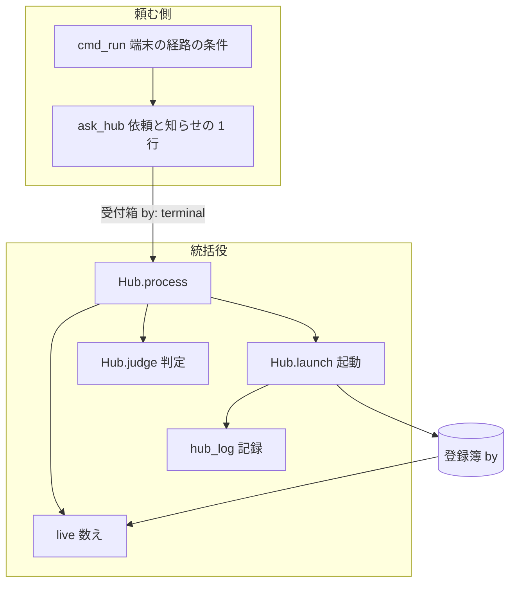
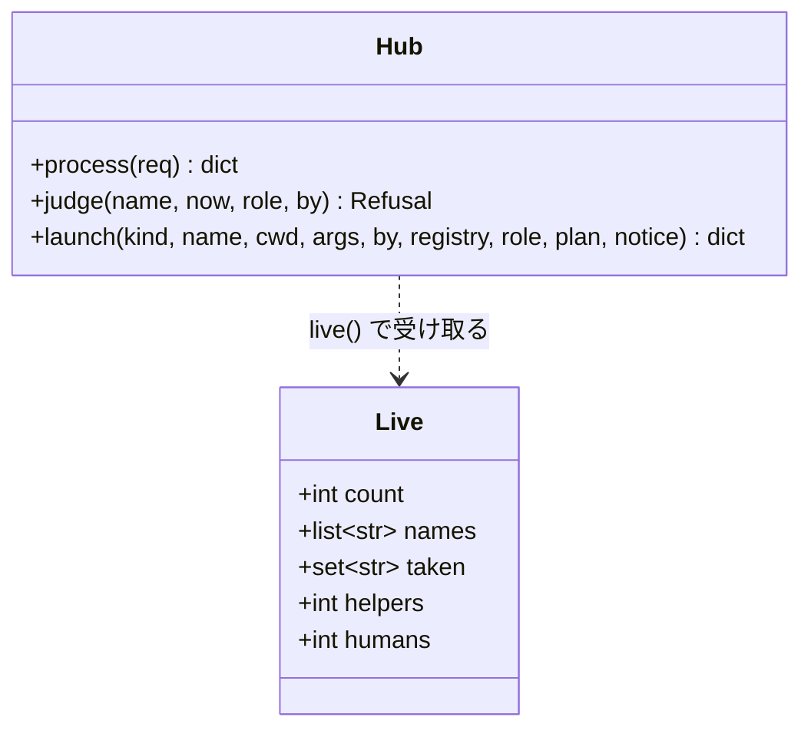
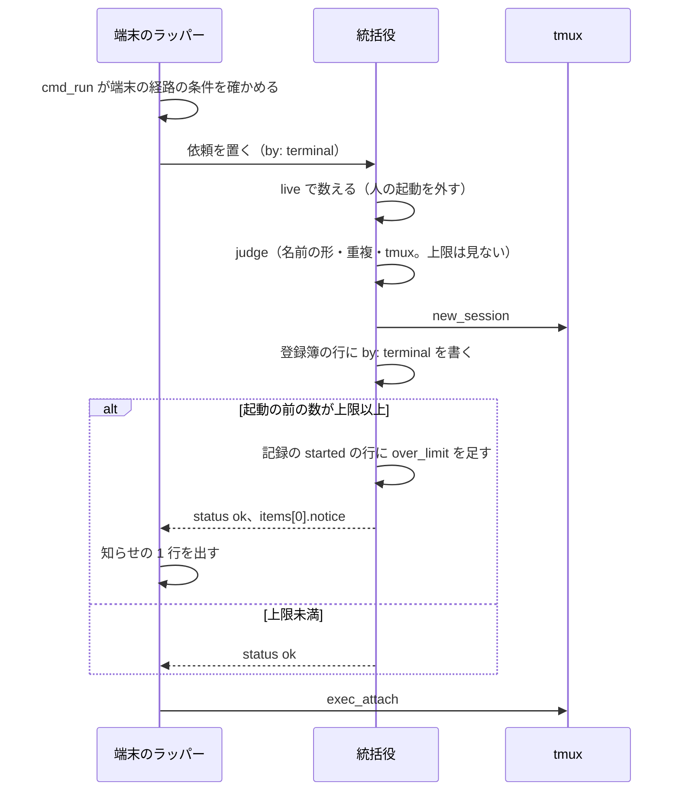

# relay の上限: 人が端末から打った claude は上限に達していても起動し、上限の数にも入れない（#2862）

## 目的

- **今どうなっているか**: 並列のレーンが 3 本動いていると、利用者が端末で `claude` と打っても、統括役が上限（既定 3）で起動を断る。回避は `command claude` だけで、そのセッションは区切りの再起動とアカウントの切り替えを使えない
- **誰に効くか**: 並列の計画を動かしながら、手元で別の作業を始めたい利用者
- **変えると何が成り立つか**: 端末から打った起動は上限で断られず、上限を超えたことだけを 1 行で知らせる。上限の数にも入れないため、AI がレーンを起動できる余地は減らない。AI が自分で起動を増やす経路の歯止めは今のまま残る

## 適用範囲

- **働く範囲**: NDF を導入したすべてのリポジトリ（ラッパー `relay.py run` の統括役の振る舞い）
- **プロジェクトごとに違うもの**: 無し（上限の値は今と同じく統括役の環境変数 `NDF_RELAY_MAX_NAMED` で受ける）
- **当たるモード**: `standard`

## あるべき姿の根拠

| 根拠 | 種類 | 何を示すか |
| --- | --- | --- |
| 「上限に達しても、人間が明示的に起動した場合は起動するようにしてください」 | 利用者の指示の原文（2026-11-09） | 人の起動を上限で断らない形が求められている |
| 2026-11-09、この作業の Bash の Tool で `[ -t 0 ]`・`[ -t 1 ]` がどちらも偽、`env \| grep -c NDF_RELAY_DIR` が 1 | 実測 | AI の Bash の Tool から打つ `claude` は、端末の 2 本目の経路（`run.py` の `cmd_run`）へ入らない。経路で人と AI を分けられる |

要求と受け入れ条件は #2862 の本文にある（コピーは [issue-2862-requirements.md](issue-2862-requirements.md) ）。この文書は「どう作るか」だけを扱う。

## ドメインモデル

### コンテキスト

| コンテキスト | 何の語が 1 つの意味に決まるか |
| --- | --- |
| relay の複数セッションの統括（確定仕様 `docs/specifications/ndf-relay-multi-session-supervisor.md` ） | 統括役・名前つきのラッパー・登録簿・上限・人の起動・AI の起動 |

1 つのコンテキストの中の変更で、コンテキストマップの関係は変わらない。

### 集約

| 集約 | 持ち主（書き換えてよいもの） | 根 | エンティティ | 値オブジェクト |
| --- | --- | --- | --- | --- |
| 起動の判定 | 統括役（`hub.py` の `Hub`）だけ | 登録簿（`registry.json`） | 登録簿の行（名前・作業ディレクトリ・引数・`by`・役割） | 起動の依頼（`kind`・`name`・`by`）、動いているラッパーの数え（`Live`）、断り（`Refusal`）、統括役の記録の 1 行 |

頼む側（`hub_client.py`）は受付箱へ依頼を置くだけで、登録簿と数えに触れない。この持ち主の分け方は今と同じである。

### 不変条件

| # | 集約 | 条件 | 破れたときの扱い |
| --- | --- | --- | --- |
| I1 | 起動の判定 | AI の起動（依頼の `by` が `spawn`・`restart`・`block:<作業ディレクトリ>`）を通した直後の、上限に数えるラッパーの数は上限以下である。上限に数えるラッパーは、今の数え方（統括役・名前つき・名前の無いラッパーの和から、役割 `organizer` を 1 本・役割 `helper` をすべて外す）から、さらに人の起動で動いているラッパーを外したものである | 統括役が理由 `limit`・終了コード 3 で断る |
| I2 | 起動の判定 | 人の起動（依頼の `by` が `terminal`）は上限で断らない。名前の形・名前の重複・tmux の有無は AI の起動と同じく判定する | 名前の形・重複・tmux の理由で断る（今のまま） |
| I3 | 起動の判定 | 動いているラッパーを人の起動として数から外すのは、登録簿の行の `by` が `terminal` で、その行の tmux のセッションが在るときだけである | 行が残っていてもセッションが無ければ外さない（数にも入らない。今のまま） |
| I4 | 起動の判定 | 登録簿の行の `by` は、その名前を最後に起動した依頼の `by` である。人の起動で始めたラッパーを `relay.py restart` で起動し直すと、行の `by` は `restart` になり、以後は上限に数える | 上書きは `launch` の 1 か所だけで行う |
| I5 | 起動の依頼 | `by: terminal` の依頼を置くのは、端末の 2 本目の経路（起動の印 `NDF_RELAY_SPAWNED` が無く、`NDF_RELAY_DIR` が無く、標準入力と標準出力がどちらも端末）だけである。`relay.py spawn`・`relay.py restart`・起動のブロックが `by` を変える手段を持たない | 経路の条件が 1 つでも欠けると依頼を置かない（今のまま） |
| I6 | 起動の判定 | 上限を超えて起動した人の起動は、統括役の記録の `started` の行と端末の 1 行の両方に、上限の数と動いている名前の並びを残す | 記録と知らせを書けなくても起動は進める |
| I7 | 起動の判定 | `relay.py ls` は、数から外したラッパーも今と同じく 1 行として出す。数の名前の並び（`Live.names`）からも外さない | — |

### ドメインイベント

| # | イベント | 発生元 | 受け手 |
| --- | --- | --- | --- |
| E1 | 利用者が端末で `claude` を打った | 利用者 | ラッパー（`run.py` の `cmd_run`） |
| E2 | ラッパーが統括役を取れず、`by: terminal` の起動の依頼を置いた | ラッパー（`hub_client.py` の `ask_hub`） | 統括役 |
| E3 | 統括役が名前の形・重複・tmux の有無を判定し、上限は判定しなかった | 統括役（`Hub.judge`） | 統括役（`Hub.launch`） |
| E4 | 統括役が tmux のセッションを起動し、登録簿の行に `by: terminal` を書いた | 統括役（`Hub.launch`） | 登録簿 |
| E5 | 上限を超えていたことを、端末へ 1 行で知らせ、統括役の記録に残した | 統括役（記録）とラッパー（端末の 1 行） | 利用者・統括役の記録 |
| E6 | 端末が起動したセッションへ結び付いた | ラッパー（`tmux.exec_attach`） | 利用者 |
| E7 | AI が `relay.py spawn`・`restart`・起動のブロックで起動を頼んだ | conductor・オーガナイザー | 統括役 |
| E8 | 統括役が E7 の上限を、人の起動を外した数で判定した | 統括役（`live` と `Hub.judge`） | 統括役 |

### 用語

| 用語 | 意味 | 用語集への反映 |
| --- | --- | --- |
| 人の起動 | 端末で利用者が打った `claude` が、統括役へ `by: terminal` で頼んだ起動（端末の 2 本目）。上限で断らず、上限の数にも入れない | 追加 |
| AI の起動 | 依頼の `by` が `spawn`・`restart`・`block:<作業ディレクトリ>` の起動。上限で判定する | 追加 |

## 外部の調査

省く: 外部の判断が要らない変更である。人の起動の見分け方（既存の依頼の `by`）・数え方・知らせの形は、確定仕様の統括役の取り決めの中だけで決まる。

## 機能一覧

| # | 機能 | 誰が使うか |
| --- | --- | --- |
| F1 | 人の起動を上限で断らずに起動する | 利用者 |
| F2 | 上限の数から人の起動で動いているラッパーを外す | 統括役（AI の起動の判定） |
| F3 | 上限を超えた人の起動を、端末の 1 行と統括役の記録に残す | 利用者・記録を読む人 |
| F4 | 確定仕様と使い方の上限の説明を、人の起動を数えない形にする | 読み手 |

## 構成要素

| 要素 | 責務 | この変更 |
| --- | --- | --- |
| 数え（`hub.py` の `live` と `Live`） | 動いているラッパーを数え、上限に数える数・名前の並び・取られている名前を返す | 人の起動で動いているラッパーを `count` から外し、その数を新しい欄 `humans` に持つ（I1・I3・I7） |
| 判定（`hub.py` の `Hub.judge`） | 名前の形・重複・上限・tmux の有無で断るかを決める | 引数 `by` を足し、`terminal` のときだけ上限を見ない（I2） |
| 依頼の処理（`hub.py` の `Hub.process`・`Hub.launch`） | 依頼を読み、判定し、tmux のセッションを起動し、登録簿と記録を書く | 人の起動で上限を超えていたら、結果の項目と記録の行に知らせの 1 行を足す（I6） |
| 記録（`hub.py` の `hub_log`） | 統括役の記録へ 1 行を足す | 省略できる引数 `over_limit` を足し、与えられたときだけ行に欄を足す（I6） |
| 端末の依頼（`hub_client.py` の `ask_hub`） | 統括役へ端末の 2 本目を頼み、断られたら理由を出し、通ったら結び付く | 結果の項目に知らせがあれば、結び付く前に 1 行出す（I6）。経路の条件は変えない（I5） |
| 確定仕様（`docs/specifications/ndf-relay-multi-session-supervisor.md` ） | 統括役の不変条件・判定・検査の表 | 上限の不変条件・決定の表・検査の表を、人の起動を数えない形にする |
| 使い方（`plugins/ndf/skills/development-workflow/references/relay.md` ） | 利用者向けの上限の説明 | 「複数のループを並べる（統括役）」の上限の段落を、人の起動は断らず数えない形にする |



図には文書の 2 つ（確定仕様・使い方）を含めない。どちらも処理の流れに現れない説明の置き場である。

## 構造



- `Live.humans` は既定 0 を持ち、`Live` を位置引数で作る既存の呼び出しと既存のテスト（`test_parallel_plan.py` の `hb.live(...)`）を変えずに通す
- `Hub.judge` の `by` は既定 `None`（AI の起動と同じ扱い）。呼び出し元は `Hub.process` とテストだけである（`grep -rn 'judge(' plugins/ndf/scripts --include=*.py` で、`hub.py:408` と `test_relay_hub.py:92`・`test_parallel_plan.py:174`〜`177` だけが当たる）

## データ構造

登録簿・依頼のファイル・結果のファイルの形は変えない。`by` は登録簿の行と依頼に既に載っている（`hub.py:455`・`hub_client.py:39`）。

統括役の記録（`hub-log.jsonl`）の `started` の行にだけ、上限を超えた人の起動のときに欄を 1 つ足す。

| 欄 | 型 | いつ載るか | 中身 |
| --- | --- | --- | --- |
| `at`・`event`・`name`・`reason` | 今のまま | 今のまま | `started` の行の `reason` は今と同じく依頼の `by`（`terminal`） |
| `over_limit` | オブジェクト | 人の起動で、起動の前の数が上限以上のときだけ | `{"cap": <上限>, "running": [<動いている名前の並び。名前の無いものは "-">]}` |

例:

```json
{"at": "2026-11-09T13:20:46+09:00", "event": "started", "name": "t2", "reason": "terminal", "over_limit": {"cap": 3, "running": ["t1", "lcore", "lproc", "lacct"]}}
```

`hub-log.jsonl` を読むコードはリリース対象に無い（`grep -rn 'hub-log\|HUB_LOG' --include=*.py plugins | grep -v tests` は `hub.py` の定義・注記・書き込みの 3 行だけ）。欄を足しても既存の読み手は無い。

## 入出力の契約

`relay.py` の副命令の引数と終了コードは変えない。変わるのは、端末の 2 本目の結果と、端末へ出る行である。

| 対象 | 今 | 変更後 |
| --- | --- | --- |
| 人の起動で上限に達しているときの結果 | `status: stopped`・`items[0].result: limit`・終了コード 3 | `status: ok`・`items[0].result: started`・終了コード 0。`items[0].notice` に知らせの 1 行 |
| 人の起動で上限に達していないときの結果 | `status: ok` | 今のまま（`notice` を載せない） |
| 端末に出る行（上限を超えたとき） | `ndf-relay: 起動しない（同時に動かすラッパーの上限 3 に達した（動いている: t1, lcore, lproc, lacct））` | `ndf-relay: 同時に動かすラッパーの上限 3 を超えて起動する（動いている: t1, lcore, lproc, lacct）。端末から起動したものは上限に数えない` |
| AI の起動で上限に達しているときの結果 | `limit`・終了コード 3 | 今のまま |

- 知らせの 1 行の文は統括役が作り（`Hub.process`）、頼む側は `items[0].notice` をそのまま `say` で出す。文を作る場所を 1 か所にする
- 端末へは、結び付く（`tmux.exec_attach`）前に出す。tmux は結び付いている間は画面を切り替えるため、行は結び付きを外した後の端末と、統括役の記録で読める

## 処理の流れ



「起動の前の数」は、人の起動を外す前の数（`now.count + now.humans`）である。人の起動を数えなかった場合に今のコードなら断っていた起動を、知らせの対象にする。

AI の起動（`spawn`・`restart`・起動のブロック）の流れは今のまま変えず、`judge` の上限の判定が `now.count`（人の起動を外した数）を見る点だけが変わる。

## 非機能の実現方式

| 大項目 | 条件 | 実現方式 |
| --- | --- | --- |
| 運用・保守性 | 上限を超えた起動は、端末の 1 行と統括役の記録の両方から後で分かる | 統括役の記録の `started` の行の `over_limit` 欄と、端末の `items[0].notice` の 1 行（I6） |
| セキュリティ | 上限を外す経路は `by: terminal` の 1 つだけで、AI の起動の経路から `by` を変える手段を足さない | `relay.py spawn`・`restart` の引数と起動のブロックの形は変えない（`hub_client.py:219`・`413`・`182` の固定の値のまま）。受付箱は所有者だけが書けるため、`by` は信頼の境界でなく経路の区別である（確定仕様の I8。同じ所有者の AI が受付箱へ直接書くことは要求の前提 3 のとおり対象外） |

## 決定の記録

### 決定 1: 既にある経路の区別を使うため、人の起動を依頼の `by` が `terminal` であることで見分ける

依頼の `by` は端末の 2 本目の経路（`ask_hub`）だけが `terminal` を書く。経路へ入る条件（`NDF_RELAY_SPAWNED` が無い・`NDF_RELAY_DIR` が無い・標準入力と標準出力が端末）は、AI の Bash の Tool からは満たせないことを実測で確かめた。新しい印を足さずに、うっかりと権限の無い人を防ぐ強さ（要求の前提 3）を満たす。

採らなかった案: 起動の側で環境変数（人の起動を表す印）を立てる案は採らない。統括役は依頼のファイルしか見ず、依頼は環境変数を載せない（`hub_client.py` の `put_request`）ため、結局は依頼の欄へ写すことになり、`by` と同じ情報を 2 つ持つ。

根拠: Value 7（MVV 版 6）

### 決定 2: 起動した直後のラッパーと同じ引き方にするため、数から外すかを登録簿の行の `by` と tmux のセッションの有無で決める

上限の数は、起動した直後でロックの前のラッパーを登録簿の行と tmux のセッションから数えている（`live`）。人の起動かも同じ登録簿の行から引けば、ロックの前と後で判定が変わらない。行が残っていてもセッションが無いものは外さない（I3）。前景で統括役を兼ねる `t1` は tmux のセッションを持たないため、仮に同じ名前の古い行が残っていても数から外れない（要求の前提 6）。

採らなかった案: 作業ディレクトリへ人の起動の印のファイルを書く案は採らない。ロックの前のラッパーはまだ作業ディレクトリを持たないため、登録簿の行も引く必要があり、引き方が 2 つになる。印を書くための環境変数を起動へ渡す手間も増える。

根拠: Value 7（MVV 版 6）

### 決定 3: 再起動の経路を AI の起動に揃えるため、`relay.py restart` は登録簿の行の `by` を `restart` に上書きする今の振る舞いを残す

人の起動で始めたラッパーも、`restart` で起動し直した後は上限に数える（I4）。`restart` は端末を持たない依頼の経路で、人と AI を `by` でしか見分けられない（要求の前提 5）。上書きは今の `launch` の振る舞いで、コードを変えない。

採らなかった案: 元の行の `by` を引き継ぐ案は採らない。AI が人の起動のラッパーを `restart` するたびに上限に数えない起動が生まれ、AI の起動の歯止めを外す経路になる。

根拠: 根拠なし（MVV 版 6）

### 決定 4: 既存の読み手を変えないため、記録の印を `reason` でなく新しい欄 `over_limit` に置く

`started` の行の `reason` は今、依頼の `by` を持つ。ここへ上限の情報を混ぜると、`reason` を経路として読む使い方が壊れる。欄を足すのは上限を超えたときだけにし、ほかの行の形は変えない。

採らなかった案: `reason` に `terminal over-limit` のように書き足す案は採らない。1 つの欄に 2 つの意味を持たせることになる。

根拠: Value 8（MVV 版 6）

### 決定 5: 知らせの文を作る場所を 1 つにするため、統括役が文を作り、結果の `items[0].notice` で端末へ渡す

断りの理由の文は今も統括役が作り、頼む側はそのまま出している（`ask_hub` の `say(f"起動しない（{res.get('summary', '')}）")`）。知らせも同じ置き場で作ると、上限の数と名前の並びを持つ統括役の側だけで文が決まる。`summary` は起動の成功の文として `relay.py spawn` の出力と共有しているため変えず、項目に欄を足す。

根拠: Value 7（MVV 版 6）

## テスト設計

| 受け入れ条件・不変条件 | どの振る舞いで縛るか | どう壊したら落ちるべきか |
| --- | --- | --- |
| AC1・I2・I6 | 上限 3・数えるラッパー 3 本で `by: terminal` の依頼を処理すると、`status: ok`、`items[0].notice` に上限の数と名前の並びが入る。`ask_hub` は通った結果の `notice` を結び付く前に 1 行出す。端末から打つ通しのテスト（今の `test_limit_refuses_from_terminal_and_spawn`）は、3 本目の端末が起動して知らせの行が出る形に変える | `judge` が `by` を見ずに上限で断ると落ちる。`notice` を出さないと落ちる |
| AC2・I1 | 同じ前提で `by` が `spawn`・`restart`・`block:x` の依頼は `limit`・終了コード 3 で断る | `by` が `terminal` 以外でも上限を外すと落ちる |
| AC3・I1・I3 | 上限 3、数えるラッパー 2 本と登録簿の行の `by` が `terminal` でセッションの在るラッパー 2 本のとき、`spawn` は上限で断られない。同じ行でセッションが無ければ数えない | `live` が `by: terminal` の行を数えると落ちる。セッションの有無を見ずに外すと（I3）落ちる |
| AC4 | 既存の `test_default_limit_is_three_and_counts_every_running_wrapper`・`test_limit_counts_launched_before_lock` が変更なしで通る | 人の起動の無い状態の数え方を変えると落ちる |
| AC5・I2 | `by: terminal` でも名前の形・名前の重複・tmux が無いときは今の理由で断る | 人の起動で判定の全体を飛ばすと落ちる |
| AC6・I5 | `relay.py spawn`・`relay.py restart`・起動のブロックが置く依頼のファイルの `by` が `terminal` でない | どれかの経路が `terminal` を書くと落ちる |
| AC7・I5 | `NDF_RELAY_SPAWNED` が在る・`NDF_RELAY_DIR` が在る・標準入力か標準出力が端末でない、のどれか 1 つで依頼を置かない | 条件を 1 つ外すと落ちる |
| AC8・I6 | 上限を超えた人の起動の `started` の行に `over_limit`（上限と名前の並び）が載り、上限未満の人の起動と AI の起動の行には載らない | 欄を書かない、または常に書くと落ちる |
| AC9・I7 | 上限を超えて起動した端末の 2 本目が `relay.py ls` の行に出る | `live.names` や一覧から外すと落ちる |
| I4 | 登録簿の行の `by` が `terminal` の名前を `restart` で起動し直すと、行の `by` が `restart` になり、以後の `live` が数える | `restart` が元の `by` を引き継ぐと落ちる |
| AC10 | 確定仕様の上限の不変条件・検査の表と、`relay.md` の上限の説明が人の起動を数えない形になっている。文言のテストは書かず、設計と実装の Pull Request のレビューで確かめる | — |

## 設計の結果

| 課題 | 扱い | 取り込み先 | 触るファイル |
| --- | --- | --- | --- |
| #2862 | 実装する | — | `plugins/ndf/scripts/relay_lib/hub.py`、`plugins/ndf/scripts/relay_lib/hub_client.py`、`plugins/ndf/scripts/tests/test_relay_hub.py`、`docs/specifications/ndf-relay-multi-session-supervisor.md`、`plugins/ndf/skills/development-workflow/references/relay.md`、`docs/glossary/glossary.json`、`docs/glossary.md` |

## 未確認のまま残ること

| 項目 | 内容 |
| --- | --- |
| 知らせの 1 行の見え方 | 結び付く前に出した行は、tmux が画面を切り替える間は見えず、結び付きを外した後に端末で読める想定である。実機での見え方は未確認。要求の検証手段の手動確認（並列のレーンを 3 本動かして端末から `claude` を打つ）で確かめる |
| 人の起動の数 | 人の起動に別の上限を設けない（要求の前提 4）。同じコンテナの資源を人の起動が使い切る場合の振る舞いは、利用者が止めることに任せ、この変更では測らない |
