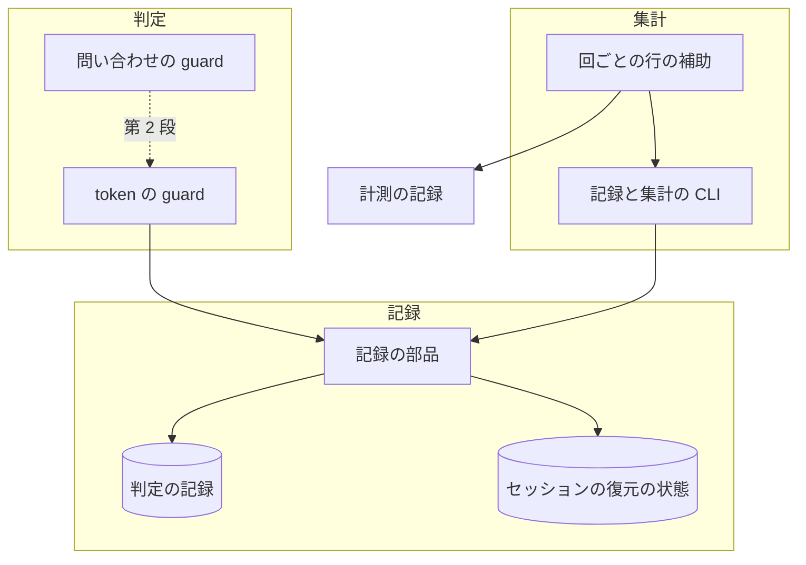
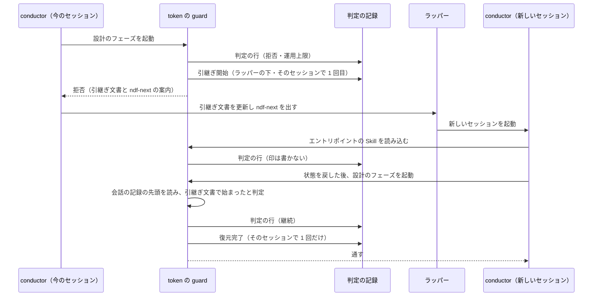
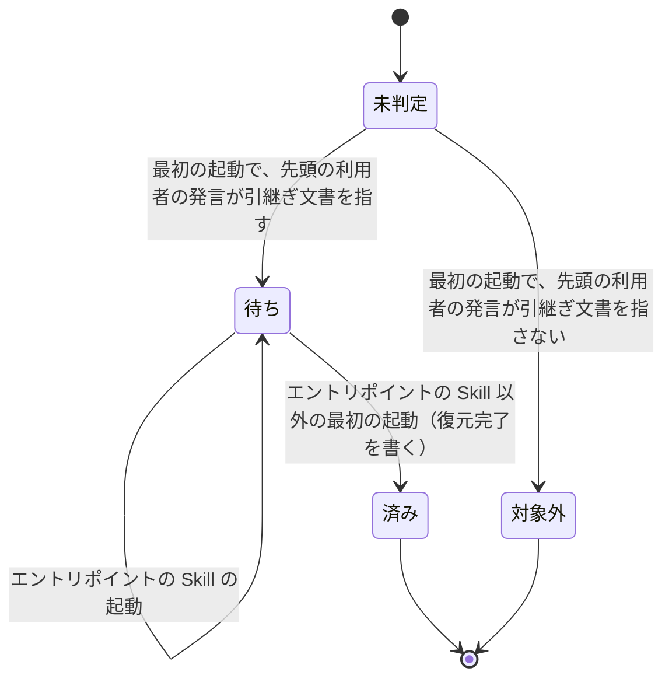
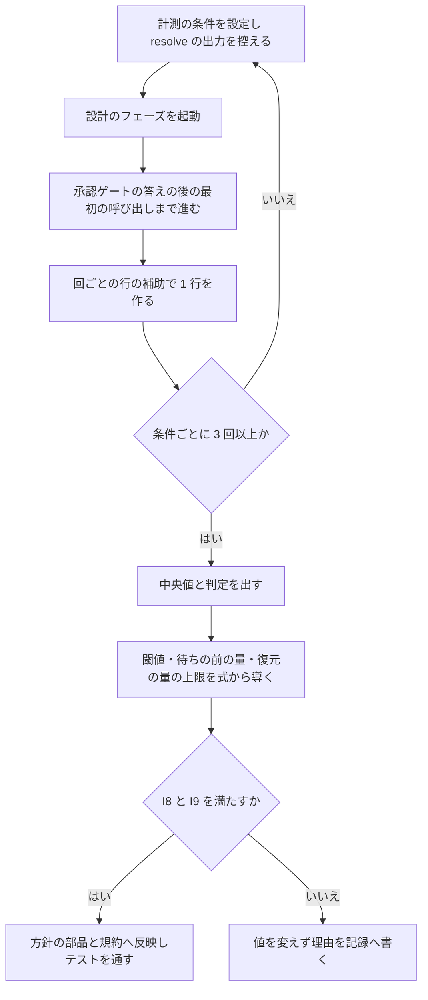
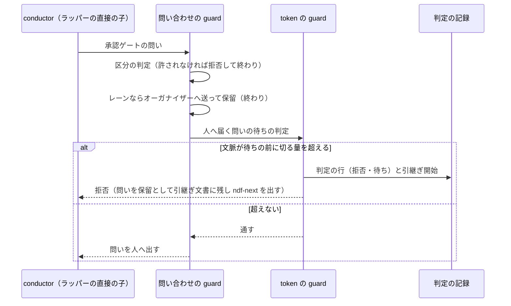

# conductor の文脈: 続けるか切るかを実測できるよう記録を揃え、その結果で切る閾値と待ちの前の規則を決める（#2908）

## 目的

- **今どうなっているか**: conductor の費用の 71% は文脈が 20 万 token を超える呼び出しにある（PR #2905）。続けるか切るかを比べる材料のうち、新しいセッションが状態を戻し終えた印（「復元完了」）は判定の記録に 0 行で、引継ぎの印も作業の識別子が課題番号の形でないため集計に結び付かない。比べられないまま閾値を決めることになる
- **誰に効くか**: ラッパーの下で長く動く conductor（オーガナイザー・レーン・単独の `/goal` の会話）の費用を払う利用者
- **変えると何が成り立つか**: 切った回ごとに引継ぎの区間と復元の区間が集計に現れ、「続ける」と「閾値で切る」を同じ物差しで比べられる。比べた結果から、閾値・待ちの前に切る規則・復元の量の上限を数値の根拠つきで決められる

## 適用範囲

- **働く範囲**: NDF を入れたすべてのリポジトリの Claude Code の conductor。記録の印と集計の変更は利用先のリポジトリでも働く。計測そのものはこのリポジトリのスプリントで行う
- **プロジェクトごとに違うもの**: 閾値は今どおり環境変数 `NDF_CONTEXT_LIMIT` と設定 `.ndf/context.json` で受ける。計測の条件の切り替えもこの 2 つだけで行う
- **当たるモード**: どのモードでも conductor の工程の起動に掛かる（モードに依らない）

## あるべき姿の根拠

| 根拠 | 種類 | 何を示すか |
| --- | --- | --- |
| STD1: キャッシュの寿命は 5 分か 1 時間で、使うたびに延びる。1 時間の書き込みは入力の 2 倍、Opus 5.5 の読み込みは 0.05 倍 | 外部の一次情報 | 待ちが 1 時間を超えると文脈の全体を 2 倍の単価で書き直すこと。切って小さな文脈で待つ利点の上限がここで決まる |
| 判定の記録の集計（2026-11-08〜11-09 の 263 行）: 判定 239 行・引継ぎ開始 24 行・再起動 0 行・復元完了 0 行。引継ぎ開始の作業の識別子 24 行はすべて課題番号の形でない（`loop-lcore`・パスなど） | 実測 | 集計が「不明」になる原因が、印を手で打つ手順と識別子の形にあること |
| 人の答えの待ち（`AskUserQuestion` 732 回）は中央値 231.5 秒・p90 6,281.5 秒（PR #2905 の `usage/tool_wait.csv`） | 実測 | 待ちの一部が 1 時間を超え、キャッシュの寿命が切れること |
| 試行方式の費用の式は復元の量 Q と復元の区間の呼び出し数 q の標本 3 つ以上を要する（`work-vessels.md` の「会話を替えて続けるか」） | 既存の仕様 | 印が揃えば、閾値を式から導けること |

要求と受け入れ条件は #2908 の本文にある（コピーは [issue-2908-requirements.md](issue-2908-requirements.md)）。この文書は「どう作るか」だけを扱う。

**この課題は 2 つの段で進む。** 閾値・待ちの前に切る規則・復元の量の上限は、計測の結果が出るまで値を決められないためである。

| 段 | 何をするか | いつ |
| --- | --- | --- |
| 第 1 段 | 印を自動で打つ・作業の識別子を揃える・集計を時間で区切れるようにする・回ごとの行を作る補助を入れる・計測の手順を書く | このスプリントで実装する |
| 第 2 段 | 6 回以上を計測し、記録を書き、決めた値を hook と規約へ反映する | 第 1 段のリリースの後、実際のスプリントの設計のフェーズで計測してから |

第 2 段の形（何を決め、どこを変えるか）もこの文書で決める。計測の結果が変えるのは値と、待ちの前に切る規則を入れるかどうかだけである。

## ドメインモデル

### コンテキスト

| コンテキスト | 何の語が 1 つの意味に決まるか |
| --- | --- |
| NDF の開発ワークフロー（`ndf-workflow`） | 再起動の方針・運用上限・引継ぎの区間・復元の区間・復元の量・再起動の理由・計測の条件 |

1 つのコンテキストに収まる。

### 集約

| 集約 | 持ち主（書き換えてよいもの） | 根 | エンティティ | 値オブジェクト |
| --- | --- | --- | --- | --- |
| 判定の記録（リポジトリごとの追記の記録） | 記録の部品（`lib/context_decisions.py`）。hook と記録の CLI はこの部品を通して追記だけをする | リポジトリの記録 | 判定の行・印の行（引継ぎ開始・復元完了）・再起動の行 | 方針と値・理由・作業の識別子 |
| セッションの復元の状態 | token の guard（`hook_lib/token_guard.py`） | セッション | — | 状態（未判定・待ち・済み・対象外） |
| 再起動の方針 | 方針の部品（`lib/context_policy.py`） | 適用値 | — | 運用上限・判断開始の値・容量の余白 |
| 計測の記録 | 計測を行う担い手（第 2 段） | 計測の文書 | 計測の回 | 計測の条件・費用の内訳・所要・待ち |

### 不変条件

| # | 集約 | 条件 | 破れたときの扱い |
| --- | --- | --- | --- |
| I1 | 判定の記録 | 引継ぎ文書で始まったセッションには「復元完了」の印が 1 行だけ付く。付く時点は、エントリポイントの Skill（`development-workflow`・`issue-plan-strategy`）を除く最初の工程の起動の直前である | 2 行目を書かない。エントリポイントの Skill の起動では書かない |
| I2 | 判定の記録 | 引継ぎ文書で始まっていないセッションには「復元完了」の印を書かない | 書かない |
| I3 | 判定の記録 | ラッパーの直接の子の conductor を hook が止めたとき、そのセッションに「引継ぎ開始」の印が 1 行付く | 2 回目以降の拒否では書かない |
| I4 | 判定の記録 | 印を書けなくても、hook の判定（継続・拒否）と拒否の文面は変わらない | 書けない失敗を飲み、判定を返す |
| I5 | 判定の記録 | サブエージェントの中の起動では判定も印も書かない | 今どおり何もしない |
| I6 | 判定の記録 | 記録の CLI へ渡した作業の識別子は、課題番号を含めば昇順の `#<番号>` の並びに直して書く。含まずセッションの識別子があれば空で書き、読むときにそのセッションの前の行の値で補う | 渡した文字のままで書かない |
| I7 | 判定の記録 | 集計に時間の区切りを渡すと、区切りの中の呼び出し（会話・サブエージェント・使用量の帳簿）だけを数える。渡さなければ今と同じ値を返す | — |
| I8 | 再起動の方針 | 第 2 段で決める閾値は 200,000 以下である | 反映しない |
| I9 | 再起動の方針 | 待ちの前に切る規則を入れるなら、復元の量の上限 < 待ちの前に切る量 ≤ 閾値 である | 反映しない（新しいセッションがすぐ同じ規則で止まる） |
| I10 | 計測の記録 | 記録に会話の ID・会話の本文・生の記録を置かない | 置かない（`docs/metrics/` の規約） |

### ドメインイベント

| # | イベント | 発生元 | 受け手 |
| --- | --- | --- | --- |
| E1 | 計測の条件を設定した | 計測を行う conductor（設定 `.ndf/context.json`） | token の guard（判定の値） |
| E2 | conductor がフェーズを起動した | conductor | token の guard（判定の行） |
| E3 | 文脈が閾値を超えた | token の guard | 判定の記録 |
| E4 | 承認ゲートか人の判断の待ちに入ろうとした | conductor（`AskUserQuestion`） | 問い合わせの guard。第 2 段で規則を入れれば token の guard |
| E5 | hook が次の工程を止めた | token の guard | conductor（拒否の文面） |
| E6 | 「引継ぎ開始」を記録した | token の guard（ラッパーの下の拒否）か conductor（記録の CLI） | 判定の記録 |
| E7 | 新しいセッションが起動した | ラッパー | token の guard（セッションの復元の状態） |
| E8 | 「復元完了」を記録した | token の guard（最初の工程の起動） | 判定の記録 |
| E9 | フェーズレポートを受け取った | supervisor・キュー | conductor |
| E10 | 計測の条件ごとに集計した | 計測の補助（回ごとの行） | 計測の記録 |
| E11 | 閾値・待ちの前の規則・復元の量の上限を決めた | 計測を行う担い手 | 計測の記録 |
| E12 | hook と規約へ反映した | 第 2 段の実装 | 方針の部品・`context-window.md` |

### 用語

| 用語 | 意味 | 用語集への反映 |
| --- | --- | --- |
| 計測の条件 | 続けるか切るかを比べるときの 2 つの設定。「続ける」は試行方式で運用上限を窓 − 容量の余白まで上げた設定、「閾値で切る」は試行方式で判断開始の値と運用上限を候補の閾値にした設定 | 追加 |
| 計測の回 | 計測の条件 1 つで、フェーズの起動からその後の承認ゲートの答えを受けた最初の呼び出しまでを 1 回として数えたもの | 追加 |
| 待ちの前に切る規則 | 承認ゲートか人の判断の問いを出す直前に、文脈が決めた量を超えていれば会話を切り、新しいセッションで問いを出し直す規則 | 追加 |
| 復元の量 | 切った後の新しいセッションが「復元完了」を記録した時点の文脈の量 | 既存の語（変えない） |
| 再起動の理由 | 工程境界で会話を切った・止めたときの理由 | 既存の語。第 2 段で待ちの前に切る規則を入れたときだけ「待ち」を足して意味を変える |

## 外部の調査

| 種類 | 調べるか | 理由 |
| --- | --- | --- |
| 標準・仕様 | 調べる | 費用の比べ方はキャッシュの寿命と単価で決まる。単価と寿命の正本はモデル提供者の文書にある |
| 主要な製品 | 調べる | 実行環境（Claude Code）が文脈を減らす手段として何を勧め、hook がどう止めるかを確かめる |
| ライブラリとサービス | 調べない | 変えるのは既存の記録の部品と集計の CLI の振る舞いで、外部に置き換えられる部品が無い。記録の形と置き場は既存の仕様（`docs/specifications/ndf-context-restart-policy.md`）が決めている |

### 標準・仕様

| # | 標準・仕様 | 何を定めているか | 設計への反映 | 出典 |
| --- | --- | --- | --- | --- |
| STD1 | プロンプトキャッシュ | 寿命は 5 分（既定）か 1 時間。使うたびに延びる。書き込みは 5 分 1.25 倍・1 時間 2 倍、読み込みは 0.1 倍（Opus 5.5 は 0.05 倍） | 第 2 段の閾値と待ちの前の量の式の単価に使う。要求の前提 4 の換算表と一致する | https://platform.claude.com/docs/en/build-with-claude/prompt-caching （2026-11-09） |

### 主要な製品

| # | 製品 | どう解いているか | 設計への反映 | 出典 |
| --- | --- | --- | --- | --- |
| PRD1 | Claude Code の hook | PreToolUse で `permissionDecision: "deny"` を返すと Tool の呼び出しを止め、理由を Claude に示す。UserPromptSubmit が起動の引数で渡した最初の入力に発火するかは書かれていない | 印は PreToolUse の判定の中で書き、最初の入力の受け取りに頼らない（決定 2） | https://code.claude.com/docs/en/hooks （2026-11-09） |
| PRD2 | Claude Code の費用の手引き | 文脈を減らす手段として作業ごとの `/clear`、指示付きの `/compact`、自動圧縮、サブエージェントへの委譲を挙げる | 要約で詰めるより切って入り直す既存の規約（`context-window.md`）と矛盾しない。比べる 2 つの条件に要約を入れない | https://code.claude.com/docs/en/costs （2026-11-09） |

### 確かめられなかったこと

| 対象 | 試した手段 | 結果と理由 |
| --- | --- | --- |
| UserPromptSubmit が起動の引数の最初の入力に発火するか | https://code.claude.com/docs/en/hooks | 取得したページに記述が無い。長いページの後半は読み切れていない。この設計は発火に頼らない |

調べた量: 候補 3 件・取得の試み 3 回。

## 機能一覧

| # | 機能 | 誰が使うか |
| --- | --- | --- |
| F1 | 引継ぎ文書で始まったセッションの「復元完了」を、最初の工程の起動のときに自動で記録する | ラッパーの下の conductor（hook が代わりに打つ） |
| F2 | ラッパーの下で hook が止めたとき、「引継ぎ開始」を自動で記録する | ラッパーの下の conductor（hook が代わりに打つ） |
| F3 | 記録の CLI へ渡した作業の識別子を、集計が結び付けられる形に揃える | 手で印を打つ conductor（カットポイント・独立性・手動で切るとき） |
| F4 | 作業ごとの集計を時間で区切り、復元の量をセッションごとに出す | 計測を行う担い手 |
| F5 | スプリントの設計のフェーズ 1 回分から、計測の記録の 1 行を作る | 計測を行う担い手 |
| F6 | 計測の手順と記録の形を決め、第 2 段で記録を書く | 計測を行う担い手・設計承認ゲートで読む人 |
| F7 | 計測の結果から閾値を決め、hook の既定値と規約へ反映する（第 2 段） | すべての conductor |
| F8 | 計測の結果から待ちの前に切る規則の要否を決め、要るなら hook と規約へ入れる（第 2 段） | ラッパーの下の conductor |
| F9 | 計測の結果から復元の量の上限を決め、規約へ書く（第 2 段） | 新しいセッションで状態を戻す conductor |

## 構成要素

| 要素 | 責務 | 段 |
| --- | --- | --- |
| token の guard（`hook_lib/token_guard.py`） | 工程の起動の判定（今どおり）。F1 のセッションの復元の状態を持ち、最初の工程の起動で「復元完了」を書く。F2 のラッパーの下の拒否で「引継ぎ開始」を書く | 1 |
| 記録の部品（`lib/context_decisions.py`） | 会話の記録の先頭だけを読んで引継ぎ文書で始まったかを返す関数を足す（集計の判定と同じ正規表現と同じ「最初の利用者の発言」の読み方を共有する）。復元の状態のファイルを `sessions/<sid>.restore.json` に置く | 1 |
| 記録と集計の CLI（`context-policy.py`） | `record` の作業の識別子を I6 のとおり揃える。`report` に時間の区切り（`--from`・`--until`）と、セッションごとの復元の量を足す | 1 |
| 回ごとの行の補助（`scripts/experimental/context-trial.py`） | スプリントの設計のフェーズの起動の時刻と、承認ゲートの答えの後の最初の呼び出しの時刻を見つけ、`report` を区切って打ち、計測の記録の 1 行（会話の ID を含まない）を出す | 1 |
| 実験版の台帳（`docs/ndf-experiments.md`） | 回ごとの行の補助の 1 行 | 1 |
| 規約（`context-window.md`・`relay.md`） | 第 1 段: 印を hook が打つ場面と、手で打つ場面（カットポイント・独立性・手動）を書き分ける。第 2 段: 閾値・待ちの前に切る規則・復元の量の上限 | 1・2 |
| 計測の記録（`docs/metrics/context-restart-trial/<集計日>.md`） | 計測の回の表・条件ごとの中央値・判定・決めた値と導いた式。`docs/metrics/README.md` の一覧に 1 行 | 2 |
| 方針の部品（`lib/context_policy.py`） | 第 2 段: 現行方式の運用上限の既定値（値の正本）。待ちの前に切る規則を入れるなら、理由の語「待ち」と待ちの前に切る量の既定値 | 2 |
| 問い合わせの guard（`hook_lib/ask_guard.py`） | 第 2 段で規則を入れるなら: 問いが人へ届くと決まった後（区分が許され、オーガナイザーへ送らないとき）に token の guard の待ちの判定を呼ぶ | 2 |



置き場所（変える範囲）:

```text
plugins/ndf/scripts/
├── hook_lib/token_guard.py        （第 1 段: 印。第 2 段: 待ちの判定）
├── hook_lib/ask_guard.py          （第 2 段: 規則を入れるときだけ）
├── lib/context_decisions.py       （第 1 段: 先頭の読み・復元の状態）
├── lib/context_policy.py          （第 2 段: 既定値・理由の語）
├── context-policy.py              （第 1 段: record の識別子・report の区切りと復元の量）
└── experimental/context-trial.py  （第 1 段で新設）
docs/metrics/context-restart-trial/ （第 2 段で新設）
```

## 処理の流れ

### 第 1 段: 印が付く流れ（閾値で切る条件の 1 回）



失敗の経路:

- 会話の記録の先頭が読めない・状態のファイルを書けない → 印を書かずに判定を返す（I4）。そのセッションは次の起動でも判定し直す
- 引継ぎ文書で始まっていない → 状態を「対象外」にして以後は読まない（I2）
- ラッパーの外で止めた → 引継ぎ開始を書かない（利用者が続けると決めれば同じ起動が通るため、切るとは限らない）

### 第 1 段: セッションの復元の状態



「済み」と「対象外」から「待ち」へは戻らない（I1・I2）。先頭が読めないときは「未判定」のまま残す。

### 第 2 段: 計測から反映まで



D の 1 行は、回ごとの行の補助が記録と集計の CLI の集計を時間で区切って打ち、その出力から作る。

### 第 2 段: 待ちの前に切る規則（入れると決めたときだけ）



図に含めない要素: 実験版の台帳（文書の 1 行）と規約（`context-window.md`・`relay.md`。文書の更新）。

## 計測の手順（第 2 段で行う）

| 項目 | 決めたこと |
| --- | --- |
| 比べるフェーズ | スプリントの設計のフェーズ（設計のキューの起動から、設計承認ゲートの答えを受けた最初の呼び出しまで）。決定 3 |
| 計測の条件 | 「続ける」: `{"version": 1, "policy": "trial", "trial": {"decide_from": 950000, "limit": 950000}, "margin": 50000}`（窓 1,000,000 − 余白 50,000）。「閾値で切る」: `{"version": 1, "policy": "trial", "trial": {"decide_from": 200000, "limit": 200000}, "margin": 50000}`。決定 4 |
| 切り替え | 起動の前にメインディレクトリの `.ndf/context.json` を書き、`context-policy.py resolve` の出力の要約を計測の記録の列へ書く。計測を終えたら消す。コミットしない |
| 回の順 | スプリントごとに「続ける」「閾値で切る」を交互に置く（時期による偏りを両方へ散らす） |
| 標本に入れる回 | 起動の時点の文脈が 200,000 を超えている回だけ。超えていなければ 2 つの条件は同じに動くため、その回は「対象外」と理由を記録に残す。報告が無い回も外し、理由を残す |
| 回数 | 条件ごとに 3 回以上（要求の前提 3）。3 回に満たないまま 10 スプリントを過ぎたら、その件数で記録を書き、閾値はその条件の結果に依らずに決めた理由を添える |
| 費用の比べ方 | 判定は会話の側（conductor・引継ぎの区間・復元の区間の和）の中央値で行う。NDF が起動した分は列に載せるが判定に使わない。サブエージェントは新しい文脈で始まり、conductor の文脈の量に依らないためである |
| 所要 | フェーズの起動からキューの終わり（設計のフェーズのレポート）を受けた時刻まで。人の待ちは含めず、待ちの回数と各回の秒は別の列に置く。引継ぎと復元の時間は含める |

計測の記録の 1 行の列: 回・計測の条件・方針と値（`resolve` の要約）・起動の時点の文脈・費用（会話の側の USD、内訳: conductor / 引継ぎの区間 / 復元の区間）・token の内訳（入力・出力・読込・書込 5 分・書込 1 時間）・NDF が起動した分の USD・所要の秒・人の待ちの回数と各回の秒・切った回数・復元の量。

### 第 2 段で値を導く式

単価は STD1 と要求の前提 4 の換算表（100 万 token あたり。読込 r = 0.2、書込 1 時間 w = 8、出力 o = 20 USD）を使う。記号は試行方式の式（`work-vessels.md`）と同じで、値はすべて計測の回の中央値である。k は「続ける」の回の conductor の呼び出し数、m は「続ける」の回のキャッシュの切れの数、Q・q・h・H は「閾値で切る」の回の復元の量・復元の区間の呼び出し数・引継ぎの区間の呼び出し数・引継ぎの区間の出力 token である。

| 決める値 | 式 | 決め方 |
| --- | --- | --- |
| 閾値 T | 損益の分かれ目 C\* = (o·H + w·Q + q·r·Q + k·r·Q + m·w·Q) ÷ (k·r + m·w − h·r) | 「閾値で切る」の会話の側の費用の中央値が「続ける」より小さければ、T = min(200,000, C\* を 10,000 単位に切り上げた値)。大きいか同じなら T = 200,000 のままにし、200,000 を超えて上げない理由（要求の前提 6）を記録に書く。分母が 0 以下なら切る利点が無いので 200,000 のまま |
| 待ちの前に切る量 W | P を計測の期間の設計承認ゲートの待ちのうち 3,600 秒を超えた割合として、W\* = (o·H + w·Q + q·r·Q + P·w·Q) ÷ (P·w − h·r) | P·w − h·r ≤ 0 か W\* > T なら規則は要らない（hook とテストを変えず、理由を記録に書く）。それ以外は W = W\* を 10,000 単位に切り上げた値で規則を入れる |
| 復元の量の上限 R | T で切ってもなお得になる Q の最大 = (k·r·T + m·w·T − h·r·T − o·H) ÷ (w + q·r + k·r + m·w) | 10,000 単位に切り下げる。I9 を満たさなければ R を W − 10,000 まで下げる。「閾値で切る」の各回の Q が R を超えたら、その回と理由（引継ぎ文書の行数・読み直した文書）を記録に書く |

## 決定の記録

### 決定 1: 値を決める前に比べる材料を揃えるため、印の自動化と計測の補助を先にリリースし、値の反映は計測の後に回す

計測には、印が付いた「閾値で切る」の回が 3 回以上要る。今の記録は復元完了が 0 行で、手で打つ手順のままでは同じことが繰り返される。印と集計の変更をこのスプリントでリリースし、その後のスプリントの設計のフェーズで計測する。

閾値と待ちの前の規則を先に入れて後から直す進め方は採らない。受け入れ条件 4 は、規則が要らないと決めた場合に hook とテストを変えないことを求めており、先に入れるとこの条件を満たせない。

スプリント PR がこの課題を閉じるため、第 2 段は別の課題として続ける。起票するかは設計承認ゲートで人が確かめる（「未確認のまま残ること」）。

根拠: Value 1 / Value 4（MVV 版 6）

### 決定 2: 印の打ち忘れを手順で防がずに無くすため、「復元完了」と「引継ぎ開始」を hook が打つ

「復元完了」は手順書（`relay.md`）に打つと書かれているが、再開の手順の表（`context-window.md` の「新しい会話で戻す」）に無く、0 行だった。hook はすべての工程の起動を見ているため、エントリポイントの Skill を除く最初の起動を「状態を戻し終えた時点」として書ける。引継ぎ文書で始まったかは、会話の記録の先頭（最初の利用者の発言まで）を 1 セッションに 1 回だけ読んで判定し、結果をセッションの状態のファイルに持つ。末尾の usage だけを読む判定の重さは変えない。

「引継ぎ開始」は、ラッパーの下で hook が止めた時点で切ることが決まるため、そこで書く。ラッパーの外の拒否は利用者が続けることを選べるので書かない。カットポイント・独立性・手動で conductor が自分で切るときは、今どおり記録の CLI で打つ。

UserPromptSubmit の hook で最初の入力を見て印の準備をする形は採らない。起動の引数の最初の入力に発火するかが公式の文書から確かめられない（PRD1）。

- 作り方: 自前で作る
- 比べた候補: PRD1

根拠: Value 5 / Value 7（MVV 版 6）

### 決定 3: 1 回ごとの条件を揃えるため、比べるフェーズをスプリントの設計のフェーズにする

スプリントの目録では、設計承認ゲートの後のマージ・実装・検査は 1 つのキューの続き（`--then`）で流れ、conductor が実装だけを起動する点が無い。設計のフェーズは conductor の起動 1 回で始まり、設計承認ゲートの問いで終わるため、起動の時点の文脈と、待ちの後の書き直しの費用を同じ回の中で測れる。待ちの前に切る規則の要否を同じ標本から導ける。

実装のフェーズは採らない。conductor の起動の単位にならず、人の待ちを含まないため、受け入れ条件 4 の材料が別に要る。

根拠: Value 4（MVV 版 6）

### 決定 4: 比べる差を閾値だけにするため、2 つの条件を試行方式の設定で作る

現行方式はカットポイントごとに文脈の量に依らず切るため、「閾値で切る」を現行方式で作ると、切った理由に閾値とカットポイントが混ざる。2 つの条件とも試行方式にし、判断開始の値と運用上限を同じ値にして費用の判断帯を通らないようにする。違いは運用上限の値だけになる。

切り替えは既存の設定ファイルで行い、新しい切り替えの仕組みは作らない（要求の前提 1）。環境変数はラッパーの起動のときに決まり、スプリントごとに替えられないため使わない。設定の書き換えは共通原則の C7 に当たり、この設計の承認で人が見る。

根拠: Value 1 / C7（MVV 版 6）

### 決定 5: 計測の費用を増やさないため、測るためだけのフェーズを流さず、実際のスプリントで計測する

測るためだけに設計のフェーズを 6 回流すと、NDF が起動した分（過去の 3 スプリントの設計のプラン 5 本で 1 本あたり 1.4〜7.9 USD。各プランの状態のファイルの `llm.cost`）を 6 回払う。実際のスプリントで測れば、増える費用は 2 つの条件の会話の側の差だけで、1 回あたり数 USD の見込みである（文脈 30 万 token の読み込み 1 回が 0.06 USD、1 時間の書き直し 1 回が 2.4 USD）。代わりに、6 回が揃うまでスプリント 6 回以上の期間が要る。

根拠: Value 3 / Value 4（MVV 版 6）

### 決定 6: 集計の区分を 1 か所に保つため、回ごとの区切りは集計の CLI に足し、行を作る補助は実験版に置く

回ごとの費用は、作業ごとの集計（conductor・NDF が起動した分・引継ぎの区間・復元の区間）を時間で区切ったものである。区切りを集計の CLI に足せば、区分の数え方は今の 1 か所のまま使える。フェーズの起動と承認ゲートの答えの時刻を見つけて 1 行にする部分は、この計測のときだけ呼ぶため実験版に置き、計測を終えたら台帳に行き先を書く。

区分の数え方をコピーした集計を実験版に別に持つ形は採らない。同じ役割の関数が 2 つになる。

根拠: Value 7 / Value 9（MVV 版 6）

### 決定 7: 印の行を集計に結び付けるため、記録の CLI の作業の識別子を課題番号の並びへ揃える

手で打った「引継ぎ開始」24 行は、作業の識別子が `loop-lcore` やパスで、課題番号で引く集計に入らなかった。課題番号を含めば番号の並びに直す。含まずセッションの識別子があれば空で書き、読むときに同じセッションの前の行で補う既存の規則に任せる。渡した文字を拒むと印を打つ手順が止まり、記録が欠けるため拒まない。

根拠: Value 7（MVV 版 6）

### 決定 8: 待ちの前に切る規則を入れるなら、問いが人へ届くと決まった後に判定する

第 2 段で規則を入れるとき、判定は問い合わせの guard が問いを通すと決め、オーガナイザーへ送らないと決まった後に呼ぶ。区分の無い問いは問い合わせの guard が先に止め、レーンの問いはオーガナイザーへ送られて人を直接待たないためである。対象はラッパーの直接の子の conductor だけで、理由の語は「待ち」を足す（記録の集計で運用上限の拒否と分けるため）。ラッパーの外では止めない。人が新しい会話へ貼り付ける操作が増えるためである。

今の規約「承認ゲートの承認より前に `ndf-next` を出さない」は、「問いを出した後、答えを得るまでは `ndf-next` を出さない」に改める。問いの前に切るのは hook が待ちの前に止めたときだけで、引継ぎ文書の「次にやること」に問いを保留として残し、新しいセッションが状態を戻した後に問いを出し直す。

根拠: Value 2 / Value 5（MVV 版 6）

## テスト設計

| 受け入れ条件・不変条件 | どの振る舞いで縛るか | どう壊したら落ちるべきか |
| --- | --- | --- |
| I1 | 先頭が引継ぎ文書を指す会話で、エントリポイントの Skill の起動の後に工程を起動すると、復元完了の行が 1 行だけ増え、その文脈の量が起動の直前の量である | エントリポイントの Skill の起動で印を書くようにする・2 回目の起動でも書くようにすると落ちる |
| I2 | 先頭が引継ぎ文書を指さない会話では、何度起動しても復元完了が書かれない | 先頭を読まずに書くようにすると落ちる |
| I3 | ラッパーの直接の子で止めると引継ぎ開始が 1 行増え、続けて止めても増えない。ラッパーの外で止めると増えない | ラッパーの判定を外す・回数の印を外すと落ちる |
| I4 | 状態のファイルの置き場を書けなくしても、判定と拒否の文面が印の無いときと同じである | 書けない失敗を投げるようにすると落ちる |
| I5（受け入れ条件 7） | サブエージェントの中の起動では判定の行も印も増えない。既存の 3 本（`test_token_guard.py`・`test_token_guard_supervisor_cut.py`・`test_context_policy_hook.py`）が通る | サブエージェントの判定を外すと落ちる |
| I6 | 課題番号を含む識別子は昇順の番号の並びで書かれ、含まない識別子はセッションの前の行の値で集計される | 渡した文字のまま書くようにすると落ちる |
| I7 | 区切りを渡すと区切りの外の呼び出しが数えられず、渡さなければ今の出力と一致する | 区切りを会話の行だけに当ててサブエージェントと帳簿に当てないと落ちる |
| 受け入れ条件 6 | 印が両方そろった会話の組を集計すると、引継ぎの区間と復元の区間が「不明」でない。復元の量がセッションごとに出る | どちらかの印を外すと「不明」に戻る |
| F5・I10 | スプリントの記録と会話の記録の組から作った 1 行に、会話の ID が現れない | 会話の ID を列に入れると落ちる |
| I8・受け入れ条件 3（第 2 段） | 既定値で解決した運用上限が決めた値で、文脈がその値を 1 超えると止まり、同じ値では止まらない | 既定値を 200,000 より上げると落ちる |
| I9・受け入れ条件 4（第 2 段・規則を入れるときだけ） | ラッパーの直接の子が承認ゲートの問いを出すとき、文脈が待ちの前に切る量を超えていれば止まり、超えていなければ止まらない。区分の無い問いは問い合わせの guard の拒否が出る | 待ちの判定を問い合わせの guard の前に置くと、区分の無い問いの拒否の理由が変わって落ちる |
| 受け入れ条件 1・2・5（第 2 段） | テストにしない。計測の記録の表と、表から再計算した中央値で示す（要求の「前提とする取り決め」） | — |

## 非機能の実現方式

| 大項目 | 要求の条件 | 実現方式 | 確かめ方 |
| --- | --- | --- | --- |
| 性能・拡張性 | hook の判定は今どおり会話の記録の最後の `usage` と較正したファイルだけを読み、判定のために LLM を呼ばない | 判定の入力は変えない。先頭の読みは印を書くためだけに 1 セッション 1 回、最初の利用者の発言までで止め、結果を状態のファイルに持つ | 2 回目以降の起動で会話の記録の先頭を読まないことをテストで縛る |
| 運用・保守性 | 閾値は今どおり `NDF_CONTEXT_LIMIT` と `.ndf/context.json` で変えられる。値の正本は hook のコードの既定値 1 か所で、文書は値をコピーせずに指すか、コピーする場合は既存の文書の検査が食い違いを落とす | 第 2 段の値は方針の部品の定数 1 か所に置く。規約は値を書く箇所で定数の名前を添える | 第 2 段の実装で、規約の値と定数を `python3 scripts/check-doc-staleness.py` が照らすかを確かめる（照らさなければ規約は値をコピーせずに指す） |
| セキュリティ | `docs/metrics/` へ置く記録に、会話の ID・会話の本文・生の記録を含めない | 回ごとの行の補助は会話の ID を列に持たない。記録は集計値だけを書く | テスト設計の F5 の行と、書いた後の `python3 scripts/check-repo-secrets.py` |

## 設計の結果

| 課題 | 扱い | 取り込み先 | 触るファイル |
| --- | --- | --- | --- |
| #2908 | 実装する | — | `plugins/ndf/scripts/hook_lib/token_guard.py`、`plugins/ndf/scripts/lib/context_decisions.py`、`plugins/ndf/scripts/context-policy.py`、`plugins/ndf/scripts/experimental/context-trial.py`（新設）、`plugins/ndf/scripts/tests/test_context_policy_hook.py`、`plugins/ndf/scripts/tests/test_context_policy.py`、`plugins/ndf/skills/development-workflow/references/context-window.md`、`plugins/ndf/skills/development-workflow/references/relay.md`、`docs/ndf-experiments.md` |

上の表は第 1 段のファイルである。第 2 段で触るファイル（`lib/context_policy.py`・`hook_lib/ask_guard.py`・`docs/metrics/context-restart-trial/`・`docs/metrics/README.md` と、規約・テスト）は、計測の後の課題で扱う。

## 未確認のまま残ること

| 項目 | 内容 |
| --- | --- |
| 第 2 段の課題の起票 | スプリント PR がこの課題を閉じるため、計測と値の反映（受け入れ条件 1〜6）は別の課題で続ける。起票するかと、そのときの題は設計承認ゲートで人が確かめる |
| 計測が揃う時期 | 標本に入れる回は起動の時点の文脈が 200,000 を超える回に限るため、スプリント 6 回で揃うとは限らない。揃わないときの扱いは「計測の手順」の回数の行 |
| 設計承認ゲートの待ちの長さ | 進め方 `fast`・`auto` のスプリントでは MVV 判定が承認ゲートを通し、人の待ちが生じない。待ちのある回が少ないと P が 0 に寄り、待ちの前に切る規則は要らないと決まりやすい |
| 窓の大きさ | 「続ける」の条件は窓 1,000,000 を前提にしている。statusline が窓を書かないと容量を見ないため、運用上限 950,000 だけで判定される |
| 規約の値と定数の照合 | 第 2 段で、規約に書いた閾値と定数の食い違いを既存の文書の検査が落とすかは未確認（非機能の実現方式の運用・保守性の行） |
