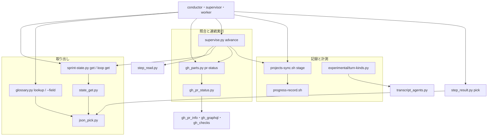
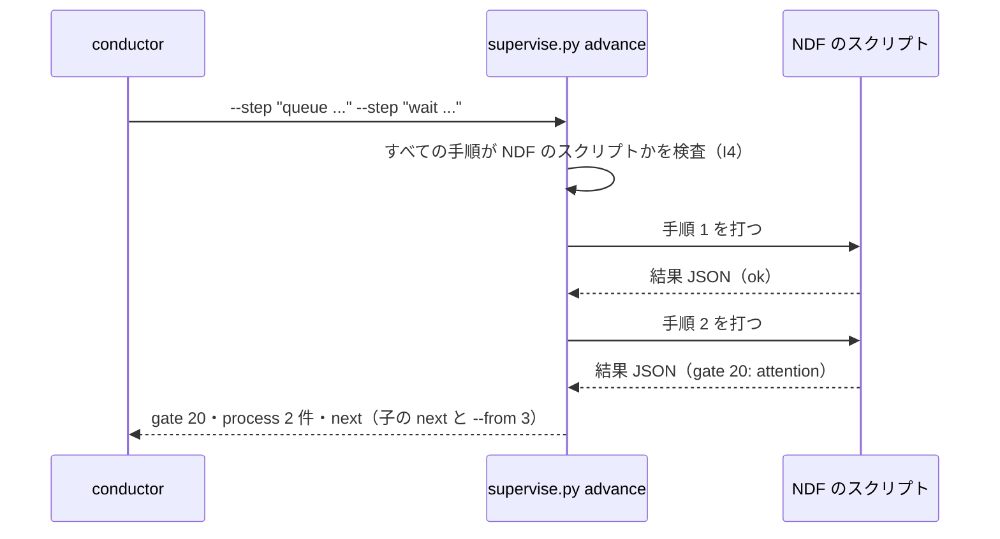
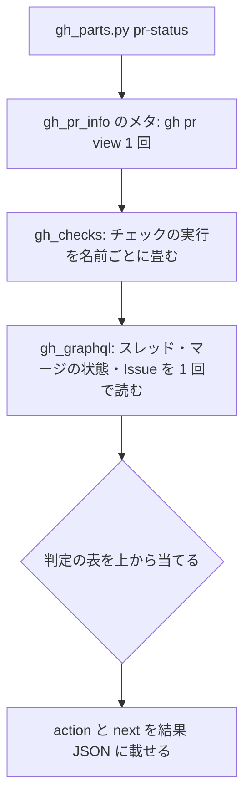
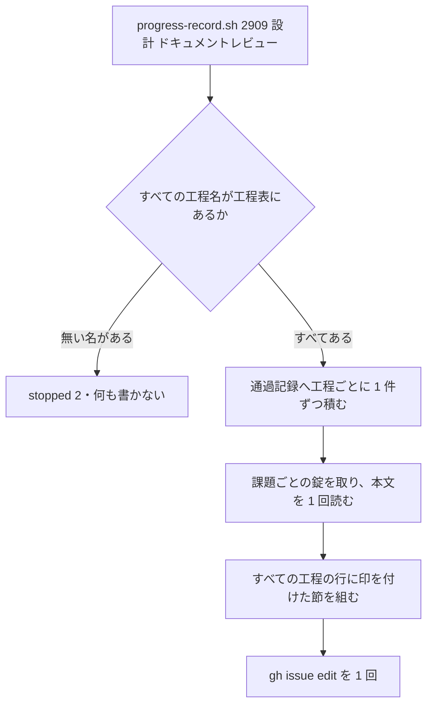

# 機械的なターン: 状態の取り出し・PR の照合・手順の連続実行・進行のまとめ記録を 1 回の実行で返す（#2909）

## 目的

- **今どうなっているか**: AI は状態ファイルと結果 JSON を `python -c` で読み直している。`gh pr view` と `gh pr checks` を続けて打ち、NDF のスクリプトと進捗記録を 1 行ずつ打っている。2026-10-13〜2026-11-09 の Tool の呼び出し約 7 万回のうち、この 4 つの型が合わせて約 2 割を占める（下の「基準の割合」）
- **誰に効くか**: conductor・supervisor・worker として NDF の工程を進める AI と、その費用を払う利用者
- **変えると何が成り立つか**: 4 つの操作のそれぞれで、AI がスクリプトの結果 JSON を 1 回読めば次の 1 手を決められる。読み直しと往復の Tool の呼び出しが減る

## 適用範囲

- **働く範囲**: NDF を使うすべてのリポジトリ。ターンの型を数える手段（実験版）だけは、手元の transcript を読む利用者の環境で働く
- **プロジェクトごとに違うもの**: リポジトリ名・PR と Issue の番号・状態ファイルのパス・工程名は引数で受ける。既定の値に ai-plugins の名前を持たない
- **当たるモード**: `standard`

## あるべき姿の根拠

| 根拠 | 種類 | 何を示すか |
| --- | --- | --- |
| STD1（JSON Pointer） | 外部の一次情報 | JSON の中の 1 つの値を、依存を足さずに文字列 1 つで指す形が標準として定まっている |
| PRD1（`gh pr checks` の終了コード） | 外部の一次情報 | PR の照合の結果を、成功・失敗・実行中で分けて終了コードに載せる形が広く使われている |
| PRD2（GitHub のマージの状態） | 外部の一次情報 | PR をマージできるかを、衝突・遅れ・塞がりの値で 1 回の照会から得られる |
| 2026-10-13〜2026-11-09 の transcript の集計（下の「基準の割合」） | 実測 | 状態の読み直し・PR の照合・スクリプトの 1 行打ち・進行の連打が Tool の呼び出しの約 2 割を占める |
| PR #2905 の分析（`usage/mechanical_turns*.csv`） | 実測 | 状態の取り出し・PR と CI の照合・スクリプトの往復の型に直近 4 週で約 $680、進行の連打に全期間で $164 が掛かった（課題の本文の目的の表） |

要求と受け入れ条件は #2909 の本文にある（コピーは [issue-2909-requirements.md](issue-2909-requirements.md)）。この文書は「どう作るか」だけを扱う。

## ドメインモデル

### コンテキスト

| コンテキスト | 何の語が 1 つの意味に決まるか |
| --- | --- |
| 開発の工程（`ndf-workflow`） | スプリントの状態・開発ループの記録・工程の進行・結果 JSON・機械的なターン・ターンの型・手順の連続実行 |

1 つのコンテキストの中で閉じる。GitHub とは**腐敗防止層**の関係にする。PR の照合は、GitHub の語を
NDF の次の 1 手の語へ訳してから返す。

| 訳す前（GitHub の語） | 訳した後（NDF の次の 1 手の 4 つの語） |
| --- | --- |
| チェックの状態（`queued`・`in_progress`・`completed` と `conclusion`）と、マージの状態（`MergeStateStatus`） | 待つ・直す・マージへ進める・人へ戻す |

訳す層は今の `lib/gh_*` の部品が持ち、GitHub の語を工程の側へ持ち込まない。

### 集約

| 集約 | 持ち主（書き換えてよいもの） | 根 | エンティティ | 値オブジェクト |
| --- | --- | --- | --- | --- |
| スプリントの状態 | `sprint-state.py` の `init`・`update`・`gate`・`next`（この変更では変えない） | スプリント | 計画の行・承認ゲートの記録 | 計画の次の欄・PR の番号 |
| 開発ループの記録 | `lib/sprint_loop.py` と `lib/sprint_loop_cli.py`（この変更では変えない） | ループ | ループの 1 回・人の判断待ち | 止まった理由・消費と予算 |
| 用語集 | `glossary.py`（この変更では読むだけ） | 用語集 | 語 | コンテキストの id |
| Issue の進行の節 | `progress-record.sh` | Issue の `## 進行` の節 | 工程の行 | 工程名・印の時刻・見出し行（モード・進め方） |
| 通過記録 | `workflow-common.sh` の `wf_record_progress`（この変更では変えない） | 課題ごとの通過記録 | 工程の 1 件 | 工程名・モード・進め方 |

新しく足す 3 つの読み取り（スプリントの状態・開発ループの記録・用語集）は、どの集約も書き換えない。
手順の連続実行と PR の照合は状態を持たず、集約を作らない。

### 不変条件

| # | 集約 | 条件 | 破れたときの扱い |
| --- | --- | --- | --- |
| I1 | すべて | 新しい副命令・選択肢を渡さない呼び出しの標準出力と終了コードは、変更の前と同じである | 既存のテストが落ちる。直すまでマージしない |
| I2 | スプリントの状態・開発ループの記録・用語集 | 取り出しの副命令（`get`・`loop get`・`lookup`）と `--field` は、状態ファイルと用語集を書き換えない | 書き込みが起きたらテストが落ちる |
| I3 | — | 手順の連続実行は、前の手順の結果 JSON の `status` が `ok` のときだけ次の手順を打ち、1 つの手順を 1 回の実行で 2 度打たない | 止まった手順で終わり、`process` に打った手順だけが載る |
| I4 | — | 手順の連続実行は、NDF のプラグインの `scripts/` と `skills/*/scripts/` の外のコマンドを打たない。NDF のスクリプトでも、渡されたコマンドをそのまま走らせる副命令（中継の副命令。`lib/gh_parts.py body-lock`・`lib/post_queue.py retry`・`supervise.py advance` 自身）は打たない。外のコマンドか中継の副命令が 1 つでもあれば、何も打たずに止まる | 終了コード 2 の `stopped` で、該当する手順を `gaps` に載せる |
| I5 | Issue の進行の節 | 複数の工程を 1 回で渡すと、本文の書き換えは 1 回で、すべての工程の行に印が付く | 本文を書けなければ、どの工程にも印を付けずに `stopped`（6）で返す |
| I6 | 通過記録 | 複数の工程を 1 回で渡すと、通過記録には工程ごとに 1 件ずつ積まれる | 積めなければ今と同じく標準エラーへ `NOTE:` を残して続ける |
| I7 | — | PR の照合の次の 1 手は、待つ・直す・マージへ進める・人へ戻すの 4 つのうち 1 つだけで、下の「PR の照合の判定」の順で決まる | テストが落ちる |
| I8 | — | ターンの型を数える手段は、会話の本文・会話の ID・コマンドの文字列を出力しない | テストが落ちる |
| I9 | — | 手順の連続実行の `--step` に `supervise.py queue`・`supervise.py run` があれば、文脈が上限を超えた conductor の工程の起動を止める既存の Bash の hook が、`advance` の呼び出しを工程の起動として判定する。判定は手順を 1 つも打つ前に行う | hook が `advance` の呼び出しを拒否し、どの手順も打たれない |

### ドメインイベント

| # | イベント | 発生元 | 受け手 |
| --- | --- | --- | --- |
| E1 | AI が工程の切れ目で次の操作を決める必要に当たった | 前の操作の終了・承認ゲートの答え・待ちの終了 | 取り出しの副命令か PR の照合を打つ AI |
| E2 | AI が取り出しか PR の照合を 1 回打った | AI | `sprint-state.py`・`glossary.py`・`gh_parts.py` |
| E3 | 結果 JSON の `next` か `metrics` に次の 1 手の材料が載った | E2 の副命令 | AI（次の 1 手を決める）と手順の連続実行（`status` で続けるかを決める） |
| E4 | 手順の連続実行が、判断の要らない手順を続けて実行した | `supervise.py advance` | AI（止まった理由を `next` で読む） |
| E5 | 工程の進行を、複数の工程についてまとめて記録した | `progress-record.sh`（`projects-sync.sh` から呼ばれる場合を含む） | Issue の本文・通過記録・ボード |
| E6 | リリースの後、ターンの型ごとの件数と割合を数えた | ターンの型を数える手段（リリース後テストで打つ） | 受け入れ条件 9 の判定 |
| E7 | 基準の割合と比べて、候補ごとに半分以下かを判定した | リリース後テストの担い手 | 半分を超えた候補の扱いを決める利用者 |

### 用語

| 用語 | 意味 | 用語集への反映 |
| --- | --- | --- |
| 機械的なターン | AI が判断を伴わずに行う Tool の呼び出し。出力の読み解き・状態の照合・スクリプトを 1 行打つ・手書きの待ち・本文の転記 | 追加（要求の段階で反映済み） |
| ターンの型 | 機械的なターンを、何をしたか（変換・照合・往復・待ち・転記）と打ったコマンドで分けた分類 | 追加（要求の段階で反映済み） |
| 手順の連続実行 | 判断の要らない NDF の手順のスクリプトを、結果 JSON が `ok` の間だけ続けて打ち、`gate` か `stopped` で止まって理由を返すこと（`supervise.py advance`） | 追加 |

## 外部の調査

| 種類 | 調べるか | 理由 |
| --- | --- | --- |
| 標準・仕様 | 調べる | JSON の中の値を指す形には標準がある。独自の書き方を作る前に比べる |
| 主要な製品 | 調べる | PR の照合の結果の分け方とマージの可否は、GitHub と GitHub CLI がすでに語を定めている。使用量の集計にも既存の製品がある |
| ライブラリとサービス | 調べる | 値の取り出しの式を評価するライブラリを使うか、標準を自前で実装するかを決める |

### 標準・仕様

| # | 標準・仕様 | 何を定めているか | 設計への反映 | 出典 |
| --- | --- | --- | --- | --- |
| STD1 | RFC 6901 JSON Pointer | `/` で区切った参照の並びで JSON の値を 1 つ指す。`~` は `~0`、`/` は `~1` で表す | `--field` の書き方に採る。標準ライブラリで 20 行ほどで実装できる | https://www.rfc-editor.org/rfc/rfc6901.txt （2026-11-09） |
| STD2 | RFC 9535 JSONPath | 絞り込み・射影を含む問い合わせの式。結果は値の並び | 採らない。絞り込みは副命令が既定の要約として返すため、式の言語は要らない | https://www.rfc-editor.org/rfc/rfc9535.txt （2026-11-09） |

### 主要な製品

| # | 製品 | どう解いているか | 設計への反映 | 出典 |
| --- | --- | --- | --- | --- |
| PRD1 | GitHub CLI `gh pr checks` | 結果を `pass`・`fail`・`pending`・`skipping`・`cancel` の 5 つに分け、実行中は終了コード 8 で返す | PR の照合でも、実行中・失敗・すべて成功を終了コードで分ける。NDF の結果 JSON の終了コードの範囲（`gate` の 10〜29）に載せ直す | `gh pr checks --help`（gh 2.103.3、2026-11-09） |
| PRD2 | GitHub GraphQL の `MergeStateStatus` と `closingIssuesReferences` | マージの状態を `BEHIND`・`BLOCKED`・`CLEAN`・`DIRTY` などで返す。PR が閉じる Issue を PR から辿れる | 衝突（`DIRTY`）を「人へ戻す」の理由に使う。PR が指す Issue と開閉を、未解決のスレッドと同じ 1 回の照会で取る | https://raw.githubusercontent.com/octokit/graphql-schema/master/schema.graphql （2026-11-09）、`gh pr view --help`（gh 2.103.3） |
| PRD3 | GitHub REST のチェックの実行 | `status` は `queued`・`in_progress`・`completed`・`waiting`・`requested`・`pending`、`conclusion` は `success`・`failure`・`neutral`・`cancelled`・`skipped`・`timed_out`・`action_required` | 実行中と失敗の判定は、今の `lib/gh_checks.py` の畳み方（名前ごとの最新の実行）をそのまま使う | https://docs.github.com/api/article/body?pathname=/en/rest/checks/runs （2026-11-09） |
| PRD4 | ccusage | Claude Code などの手元の記録から、token の量と費用を日・セッションごとに集計する | ターンの型（Tool の呼び出しの分類）は数えないため使わない。期間の指定と手元の記録を読む形は倣う | https://registry.npmjs.org/ccusage （20.0.48、2026-11-02 公開、MIT、2026-11-09 取得） |

### ライブラリとサービス

| # | 候補 | 版 | ライセンス | 最後のリリースの日付 | 終了のアナウンス | 要件を満たすか | 出典 |
| --- | --- | --- | --- | --- | --- | --- | --- |
| LIB1 | jmespath | 1.1.0 | MIT | 2026-01-22 | 無し | 満たす。ただし式の言語が JSON Pointer より広く、プラグインの依存（`pyproject.toml` の任意の依存）が 1 つ増える | https://pypi.org/pypi/jmespath/json （2026-11-09） |
| LIB2 | python-jsonpath | 2.2.2 | MIT | 2026-10-17 | 無し | 満たす（RFC 9535 と RFC 6901 の両方）。依存が 1 つ増える | https://pypi.org/pypi/python-jsonpath/json （2026-11-09） |
| LIB3 | jsonpath-ng | 1.16.0 | Apache-2.0 | 2026-11-04 | 無し | 満たす（JSONPath）。依存が 1 つ増える | https://pypi.org/pypi/jsonpath-ng/json （2026-11-09） |
| LIB4 | `lib/gh_pr_info.py`・`lib/gh_checks.py`・`lib/gh_graphql.py`（既存） | — | リポジトリと同じ | — | 無し | 満たす。PR のメタ・名前ごとに畳んだチェック・未解決のスレッドを 1 回で返し、上限のときは REST へ退避する | `plugins/ndf/scripts/lib/gh_pr_info.py` |
| LIB5 | `lib/step_read.py`（既存） | — | リポジトリと同じ | — | 無し | 満たす。子プロセスの標準出力の最後の行を結果 JSON として読み、`ok` でなければ理由を返す | `plugins/ndf/scripts/lib/step_read.py` |
| LIB6 | `lib/transcript_agents.py`（既存） | — | リポジトリと同じ | — | 無し | 一部を満たす。transcript の置き場（`config_root`）と層の判定を持つ。Tool の呼び出しの分類は持たない | `plugins/ndf/scripts/lib/transcript_agents.py` |

### 確かめられなかったこと

| 対象 | 試した手段 | 結果と理由 |
| --- | --- | --- |
| GitHub の文書の `MergeStateStatus` の頁 | https://docs.github.com/api/article/body?pathname=/en/graphql/reference/enums%23mergestatestatus | HTTP 404。同じ定義を GraphQL のスキーマ（PRD2 の出典）で確かめた |
| PR #2905 の集計スクリプトの分類の規則 | PR #2905 の差分と本文の「置かなかったもの」 | リポジトリに置かれていない。分類の名前と件数（CSV）だけが手に入る |

調べた量: 候補 12 件・取得の試み 16 回。

## 機能一覧

| # | 機能 | 誰が使うか |
| --- | --- | --- |
| F1 | スプリントの状態から、計画ごとの状態と次の操作、指定した欄だけを取り出す | conductor・supervisor |
| F2 | 開発ループの記録から、止まった理由・人の判断待ち・次の操作、指定した欄だけを取り出す | conductor（レーン・オーガナイザー） |
| F3 | 用語集から語を引き、用語の検査と差分の結果から指定した欄だけを取り出す | 設計と要求を書く worker・supervisor |
| F4 | PR 番号を 1 つ渡し、PR の状態・チェック・未解決のスレッド・PR が指す Issue の開閉と次の 1 手を 1 回で返す | conductor・supervisor・worker |
| F5 | 判断の要らない NDF の手順を続けて打ち、判断が要る所か失敗した所で止まる | conductor・supervisor |
| F6 | 複数の工程の進行を 1 回の実行で記録する | conductor・supervisor・worker |
| F7 | 期間を指定し、ターンの型ごとの件数と全 Tool の呼び出しに占める割合を transcript から数える | 利用者とリリース後テストの担い手 |
| F8 | 手作業の型を指示している Skill の本文・起動指示の雛形を、F1〜F6 へ向け直す | NDF の Skill を読む AI |

## 構成要素

| 要素 | 責務 |
| --- | --- |
| `lib/json_pick.py`（新設） | JSON Pointer（STD1）で値を取り出す。無い値は `null` にし、無かった指し先を返す。ファイルも GitHub も触らない |
| `lib/step_result.py`（変更） | CLI に `pick` を足す。標準入力の最後の行の結果 JSON から `--field` の値を取り出して結果 JSON で返す。`--raw` なら値だけを 1 行で出す |
| `sprint-state.py`（変更） | 副命令 `get` を足す（F1）。`loop` に `get` を足す（F2。`loop` の副命令の引数は `lib/sprint_loop_cli.py` が持つ）。中身は `lib/state_get.py` |
| `lib/state_get.py`（新設） | スプリントの状態と開発ループの記録から、計画の行・次の操作・`--field` の値を組んで結果 JSON にする |
| `glossary.py`（変更） | 副命令 `lookup` を足す（F3）。`check`・`diff`・`lookup` に `--field` を足す |
| `lib/gh_parts.py`（変更） | 副命令 `pr-status` を足す（F4）。エントリポイントだけを持つ |
| `lib/gh_pr_status.py`（新設） | `gh_pr_info` のメタとチェックを使い、未解決のスレッド・マージの状態・PR が指す Issue を 1 回の GraphQL で読み、次の 1 手を決める |
| `lib/gh_graphql.py`（変更） | 未解決のスレッド・`mergeStateStatus`・`closingIssuesReferences`（番号と開閉）を 1 回で読む照会を足す。今の照会は変えない |
| `supervise.py`（変更） | 副命令 `advance` を足す（F5）。中身は `supervise_lib/advance.py` |
| `supervise_lib/advance.py`（新設） | 手順の並びを検査し（I4）、1 つずつ打ち、`step_read` で結果を読み、`ok` の間だけ続ける。中継の副命令の一覧を定数で持つ |
| `hook_lib/shell_checks.py`（変更） | 工程の起動の判定（`starts_plan`）で、`supervise.py advance` の `--step` の値を `shlex` で語に割り、`supervise.py queue`・`run` があれば起動と判定する（I9）。`token_guard.py` の判定と記録は変えない |
| `progress-record.sh`（変更） | 2 つ目以降の位置引数を工程名として受ける（F6）。本文の書き換えは 1 回、通過記録は工程ごと |
| `projects-sync.sh`（変更） | `stage` に工程名を複数受け、`progress-record.sh` へ 1 回で渡す。ボードの値は最後の工程にする |
| `experimental/turn-kinds.py`（新設） | transcript を期間で読み、ターンの型と候補ごとの件数と割合を結果 JSON で返す（F7） |
| `experimental/turn-kinds.json`（新設） | ターンの型と候補の分類の規則（型の名前・Tool の名前・コマンドの正規表現・優先の順） |
| Skill の本文と雛形（変更） | 手作業の型の指示を F1〜F6 へ書き換える（F8。対象は「設計の結果」の表） |
| `lib/README.md`・`docs/ndf-experiments.md`・`plugins/ndf/contracts/`（変更） | 新しい部品の行・実験版の台帳の 1 行・エントリポイントの契約を足す |



文書と設定は、呼び出しの関係を持たないため図に含めない。図に含めないのは次の 5 つである。

- `lib/README.md`
- `docs/ndf-experiments.md`
- `plugins/ndf/contracts/`
- Skill の本文と雛形
- `experimental/turn-kinds.json`

## 入出力の契約

すべて結果 JSON（`lib/README.md` の「手順のスクリプトの結果」）で返し、`step_result.validate_result` を通る。
表に無い項目は置かない。

### 取り出し（F1〜F3）

| 名前 | 入力 | 出力（成功） | 失敗の形 |
| --- | --- | --- | --- |
| `sprint-state.py get <sprint.json> [--field <指し先>]...` | 状態ファイルのパス（必須）、JSON Pointer（任意・繰り返し。状態ファイルを根にする） | `--field` なし: `items` は計画ごとに `{kind: "plan", name: <計画の名>, result: <状態の語>, pr, next}`、`metrics` は `{plans, done, open}`、`next` は先頭から見て最初の終わっていない計画の `<名>: <次の欄>`（すべて終わっていれば置かない）。`--field` あり: `metrics` は `{<指し先>: <値>}`、`items` は空 | 状態ファイルが無い 3、読めない・指し先の書き方の誤り 2。指し先に値が無ければ値を `null` にし、`items` に `{kind: "field", name: <指し先>, result: "missing"}` を載せて 0 |
| `sprint-state.py loop get <ループ名> [--field <指し先>]...` | ループ名（必須）、JSON Pointer（任意・繰り返し。ループの記録を根にする） | `--field` なし: `metrics` は `loop status --json` の `metrics` と同じ鍵、`next` は下の「開発ループの次の操作」の表で決めた 1 文。`--field` あり: F1 と同じ | F1 と同じ |
| `glossary.py lookup [--term <語>]... [--context <id>] [--contexts]` | 語（部分一致・繰り返し）、コンテキストの id、コンテキストの一覧だけを返す印 | `items` は当たった語ごとに `{kind: "term", name: <語>, result: <コンテキストの id>, meaning, source}`、`metrics` は `{matched}`。`--contexts` なら `metrics.contexts` に id の並び | 宣言・用語集が無い 3、読めない 2。当たりが無ければ `matched: 0` で 0 |
| `glossary.py check\|diff\|lookup ... --field <指し先>` | 既存の引数に加えて JSON Pointer（結果 JSON を根にする） | `metrics` は `{<指し先>: <値>}`、`items` は空。`status` と終了コードは `--field` を渡さないときと同じ | 指し先の書き方の誤り 2 |
| `step_result.py pick --field <指し先>... [--raw]` | 標準入力の最後の行の結果 JSON | `metrics` は `{<指し先>: <値>}`、`status` は入力の `status` を写す。`--raw` は `--field` 1 つの値だけを 1 行で出す（文字列は引用符なし） | 入力が結果 JSON でない 2 |

**開発ループの次の操作**（上から順に見て、最初に当たった行の文を `next` に置く）:

| 条件（ループの記録の値） | `next` |
| --- | --- |
| `stop` がある | 止まった理由と再開のコマンド（今の `stop_line` と `resume_command`） |
| 答えの無い人の判断待ちがある | `人の判断待ち: #<番号>...。答えは sprint-state.py loop answer で書く` |
| 答えの無い保留のループの回がある | `ループの <回> 回目の答え待ち` |
| どれにも当たらない | 置かない |

### PR の照合（F4）

| 項目 | 書くこと |
| --- | --- |
| 名前 | `gh_parts.py pr-status <PR 番号> [--repo <所有者>/<リポジトリ>] [--issue <番号>]...` |
| 入力 | PR 番号（必須）。`--repo` は省くと作業ディレクトリの origin。`--issue` は PR が閉じる Issue に加えて開閉を見る Issue |
| 出力 | `items`: チェックごとに `{kind: "check", name, result: success\|failure\|pending\|skipped\|...}`、Issue ごとに `{kind: "issue", name: "#<番号>", result: open\|closed}`。`metrics`: `{action: wait\|fix\|merge\|escalate, state, draft, merge_state, failed_checks, pending_checks, unresolved_threads, issues_open, issues_closed}`。`next`: 次の 1 手の 1 文 |
| 終了コード | マージへ進める 0（`ok`）・直す 20・待つ 21（どちらも `gate`、LLM の判断）・人へ戻す 10（`gate`、人の同意）・取得できない 2（`stopped`）。照会の一部が欠けた（チェックかスレッドが `null`）ときは `gate`（10）で、欠けを `gaps` に載せる |
| 互換性 | 新しい副命令のため既存の呼び出しは変わらない。`pr-info` と `unresolved-threads` の出力も変えない（I1） |

**PR の照合の判定**（上から順に見て、最初に当たった行で決める。I7）:

| 順 | 条件 | 次の 1 手 | `next` の例 |
| --- | --- | --- | --- |
| 1 | PR の状態が `open` でない | 人へ戻す | `PR は merged。後片付け（merged）へ進むかを人が決める` |
| 2 | マージの状態が `DIRTY`（衝突） | 人へ戻す | `ベースブランチと衝突している。merged-steps.py base-sync を打つかを人が決める` |
| 3 | チェックかスレッドを照会できなかった（値が `null`。0 件とは分ける） | 人へ戻す | `チェックを照会できない。gh_parts.py pr-status を打ち直す` |
| 4 | 失敗したチェックがある、または未解決のスレッドが 1 件以上 | 直す | `失敗: pytest。未解決のスレッド 2 件。直してから打ち直す` |
| 5 | 実行中のチェックがある、またはチェックが 1 件も無い（push の直後） | 待つ | `実行中: pytest。merged-steps.py merge-when-green <番号> で待つ` |
| 6 | チェックがすべて成功で、未解決のスレッドが 0 件 | マージへ進める | `merged-steps.py merge-when-green <番号>` |

PR が指す Issue の開閉は判定に使わず、`items` と `metrics` に載せるだけにする。

### 手順の連続実行（F5）

| 項目 | 書くこと |
| --- | --- |
| 名前 | `supervise.py advance --step "<コマンド>"... [--from <番号>]` |
| 入力 | `--step`（1 つ以上・順に打つ）。文字列を `shlex` で語に割り、シェルを通さずに打つ。先頭は NDF のスクリプトのパスか、`python3`・`bash` の後にそのパス。中継の副命令は受けない（I4）。`--from` は 1 から数えた番号で、それより前の手順を打たない |
| 出力 | `process`: 打った手順ごとに `{run: <コマンド>, result: <子の summary>, status: <子の status>}`、`--from` で飛ばした手順は `{run, result: "飛ばした（--from）"}`。`metrics`: `{steps, ran, stopped_at}`。`next`: 止まったときは子の `next`（無ければ子の `summary`）と、続きを打つ `supervise.py advance ...` の `--from`。`gate` で止まったときは止まった番号 + 1（その手順は判断を返して終わっている）、`stopped` で止まったときは止まった番号（その手順を打ち直す） |
| 終了コード | すべて `ok` なら 0。子が `gate` なら子の終了コード（10〜29）で `gate`。子が `stopped` なら 1（子の終了コードは `process` の要素の `code` に残す）で `stopped`、`gaps` に子の理由。子が結果 JSON を返さなければ 1 で `stopped`。外のコマンドがあれば何も打たずに 2 |
| 互換性 | 新しい副命令のため既存の呼び出しは変わらない |

長く待つ手順（`supervise.py wait`・`merged-steps.py merge-when-green`）を含む並びは、呼ぶ側が `waiting.md` の
とおり背景で打つ。`advance` は自分の上限の時間を持たない。

### 進行のまとめ記録（F6）

| 項目 | 書くこと |
| --- | --- |
| 名前 | `progress-record.sh <issue 番号> <工程名> [<工程名>...] [既存の選択肢]`、`projects-sync.sh <issue 番号> stage <工程名> [<工程名>...]` |
| 入力 | 工程名を 1 つ以上。すべての工程名を、何かを書く前に工程表と照らす。`-` は 1 つだけで渡したときだけ受ける。`--note` はすべての工程の行に付く |
| 出力 | 今の形のまま。`summary` は `#<番号> 進行 = <工程名>・<工程名>`。`process` の通過記録の要素は工程ごとに 1 件 |
| 失敗の形 | 工程表に無い工程名が 1 つでもあれば、何も書かずに `stopped`（2）。本文を書けなければ今と同じ `stopped`（6） |
| 互換性 | 工程名を 1 つだけ渡す呼び出しは変わらない。2 つ目以降の位置引数は今は「知らない引数」で 2 を返すため、この形の正しい呼び出しは今は存在しない |

`projects-sync.sh` のボードの「工程」の列は 1 つの値しか持たないため、最後に渡した工程名を書く。

### ターンの型を数える手段（F7）

| 項目 | 書くこと |
| --- | --- |
| 名前 | `experimental/turn-kinds.py --since <YYYY-MM-DD> --until <YYYY-MM-DD> [--root <transcript の根>] [--rules <規則のファイル>]` |
| 入力 | 期間（JST の日付・両端を含む・必須）。`--root` は省くと `transcript_agents.config_root()`。`--rules` は省くと同じディレクトリの `turn-kinds.json` |
| 出力 | `metrics`: `{tool_calls, kinds: {<型>: {count, share}}, candidates: {<候補>: {count, share}}, files, unreadable_lines}`。`items` は候補ごとに `{kind: "candidate", name, result: <割合>}`。会話の本文・ID・コマンドは出さない（I8） |
| 失敗の形 | 期間の書き方の誤り 2。根が無い 3。読めない行は飛ばし、件数を `metrics.unreadable_lines` に載せる |

**候補と数える型の対応**（規則は `turn-kinds.json` に置き、PR #2905 の型の名前に合わせる）:

| 候補 | 数える呼び出し |
| --- | --- |
| 1. 状態の取り出し | 型「変換: JSON・出力を python -c / jq / cut で読む」のうち、コマンドが状態ファイル（`sprint.json`・`loop.json`・`queue-done.json`・`*.plans.json`・用語集）か NDF のスクリプトの結果 JSON を `python -c`・`python -`・`jq` で読むもの。grep・sed・cat などのコード探索は数えない（課題の本文の S5） |
| 2. PR・CI の照合 | 型「照合: gh で PR・Issue を読む」と「照合: CI の状態を gh で見る」 |
| 3. スクリプトの往復 | 型「往復: NDF スクリプトを 1 行打つ」 |
| 4. 進行の連打 | `projects-sync.sh ... stage` か `progress-record.sh` の呼び出しのうち、同じ会話の直前の Tool の呼び出しも同じ 2 つのどちらかであるもの |

## 処理の流れ

手順の連続実行の流れ（`supervise.py queue` の後に `supervise.py wait` を続ける例）:



PR の照合の流れ:



進行のまとめ記録の流れ:



`get`・`loop get`・`lookup`・`pick` は読むだけで、状態の遷移を持たない。`turn-kinds.py` は transcript を 1 度読んで数えるだけで、
状態を持たない。

## 非機能の実現方式

| 大項目 | 条件 | 実現方式 |
| --- | --- | --- |
| 性能・拡張性 | PR の照合の 1 回の API の回数が、`gh pr view`・`gh pr checks`・未解決のスレッドの取得を別々に打つときの回数以下 | メタは `gh pr view` 1 回（`pr-info` と同じ）、チェックは REST のチェックの実行（100 件ごとに 1 回）、スレッド・マージの状態・PR が閉じる Issue の開閉は GraphQL 1 回にまとめる。別々に打つと 3 回に加えて Issue ごとに 1 回掛かる。`--issue` で足した Issue だけ REST で 1 回ずつ読む。上限のときは `gh_quota` の規則で REST へ退避する |
| 運用・保守性 | 新しい出力の形は結果 JSON の正本に従い、足した副命令はスクリプトの冒頭と Skill の本文から辿れる | 出力はすべて `step_result.result` と `emit` で組む。各スクリプトの docstring の副命令の表に行を足し、`lib/README.md` の部品の表に `json_pick`・`state_get`・`gh_pr_status` の行を足す。エントリポイントの契約（`plugins/ndf/contracts/entrypoints/`）を `check-ndf-contracts.py --render` で作り直す |
| セキュリティ | 数える手段は会話の本文・会話の ID をリポジトリへ書き出さない | `turn-kinds.py` は件数と割合だけを標準出力へ出し、ファイルへ書かない。会話の ID・コマンドの文字列を結果に入れない（I8）。手順の連続実行は NDF のスクリプトだけを打ち、シェルを通さず、中継の副命令を打たない（I4）。任意のコマンドを打てる形にすると、Bash の hook の検査を通らずに削除や強制 push のコマンドが打たれる。工程の起動を含む `advance` は、コンテキスト量の hook が起動として判定する（I9） |

## 決定の記録

決定の記録は [issue-2909-design-decisions.md](issue-2909-design-decisions.md) にある。

## テスト設計

| 受け入れ条件・不変条件 | どの振る舞いで縛るか | どう壊したら落ちるべきか |
| --- | --- | --- |
| 受け入れ条件 1（スプリント） | 固定の状態ファイルに `get` を打つと、計画の状態と次の欄が、今 `python -c` で読む値（`plans[i].next` など）と同じ値で返り、結果が `validate_result` を通る | 終わった計画を「終わっていない」と数えるよう壊す。`next` を先頭の計画から取るよう壊す |
| 受け入れ条件 1（開発ループ） | 止まった記録・人の判断待ちの記録・どちらも無い記録の 3 つで、`loop get` の `next` が表の行どおりになり、`metrics` が `loop status --json` と同じ値になる | 判断待ちより `stop` を後に見るよう壊す |
| 受け入れ条件 1（用語集） | `lookup --term` が部分一致で語を返し、`check --field /metrics/hits` が `check` の `hits` と同じ値を返す | 部分一致を完全一致に壊す |
| 受け入れ条件 1（`--field`） | 値のある指し先・無い指し先・`~1` を含む指し先で、値・`null` と `missing`・エスケープを解いた値が返る | `~1` を解かないよう壊す |
| 受け入れ条件 2 | GitHub の呼び出し（`gh_call.RUNNER`）を差し替え、判定の表の 6 行それぞれで `action`・終了コード・`next` が表どおりになる | 失敗と実行中が同時にあるとき「待つ」を返すよう順を入れ替える |
| 受け入れ条件 3 | `ok`・`ok`・`gate` を返す 3 つの偽のスクリプトを並べると、3 つ目で止まり、`process` が 3 件、`next` に `--from 4` が載る。2 つ目が `stopped` なら `gaps` に子の理由、`next` に `--from 2` が載る | `gate` の後も続けるよう壊す |
| 受け入れ条件 4 | 工程名を 2 つ渡すと、`gh issue edit` が 1 回だけ呼ばれ、本文の節の 2 つの行に印が付き、通過記録が 2 件増える | 工程ごとに本文を書き直すよう壊す |
| 受け入れ条件 5 | 新しい副命令は、リポジトリ名・ブランチ名・テストのコマンドを引数か origin からだけ得る | 既定値に `devbasex/ai-plugins` を置く（検索で落とす） |
| 受け入れ条件 6 | 実装の PR の本文に、下の「受け入れ条件 6 の検索」の 3 つのコマンドと 0 件の結果を載せる | — |
| 受け入れ条件 7 | 全体の pytest | 既存の副命令の出力を変えると既存のテストが落ちる |
| 受け入れ条件 8 | 合成した transcript（Tool の呼び出し 10 件・型 4 種）で、型と候補の件数と割合が期待どおりになる | 分母から Bash 以外の Tool を外すよう壊す |
| 受け入れ条件 9 | リリース後テストで `turn-kinds.py` を打ち、候補ごとの割合を基準の確定値と比べる（自動テストにしない） | — |
| I1 | 受け入れ条件 7 と同じ | — |
| I2 | `get`・`loop get`・`lookup` の前後で状態ファイルと用語集の内容と更新時刻が変わらない | 読み取りの中で状態ファイルを書き直すよう壊す |
| I3 | 受け入れ条件 3 と同じ。加えて `--from 2` で 1 つ目が打たれない | `--from` を無視するよう壊す |
| I4 | NDF のスクリプトの外のコマンド（`git status`）か中継の副命令（`gh_parts.py body-lock --issue 1 -- git status`）を 1 つ混ぜると、どの手順も打たれずに 2 で止まる。NDF のスクリプトの `argparse.REMAINDER` を持つ副命令がすべて中継の副命令の一覧に載る | 検査を打つ直前に移すよう壊す（前の手順が打たれる）。一覧から `post_queue.py retry` を外す |
| I5 | 受け入れ条件 4 と同じ。加えて工程表に無い名を混ぜると本文も通過記録も書かれない | 名前の検査を記録の後に移す |
| I6 | 受け入れ条件 4 と同じ | — |
| I7 | 受け入れ条件 2 と同じ | — |
| I8 | 合成した transcript に入れた会話の ID とコマンドの文字列が、標準出力に現れない | 型ごとに例のコマンドを出すよう壊す |
| I9 | 文脈が上限を超えた conductor の入力で、`advance --step "supervise.py queue ..."` が拒否され、`advance --step "sprint-state.py get ..."` は拒否されない | `--step` の値を読まないよう壊す |

### 基準の割合

受け入れ条件 8 の確定値は、実装で `turn-kinds.py --since 2026-10-13 --until 2026-11-09` を打ち、この表の
「確定値」の列へ書き込む。設計の時点の値は次の 2 つで、どちらも確定値の代わりにしない。

| 候補 | PR #2905 の件数（2026-10-12 から 5 週の行の和） | 設計の時点の概算（件数 / 割合） | 確定値 |
| --- | --- | --- | --- |
| 1. 状態の取り出し | 5,039（型全体。コード探索を含む） | 2,442 / 3.47% | 実装で書く |
| 2. PR・CI の照合 | 2,401 | 5,558 / 7.90% | 実装で書く |
| 3. スクリプトの往復 | 1,907 | 7,113 / 10.11% | 実装で書く |
| 4. 進行の連打 | — | 492 / 0.70%（連打に限らない呼び出しの全件） | 実装で書く |

設計の時点の概算は、`~/.claude/ndf/accounts/<アカウント>/projects/` の transcript から求めた値である。
読んだ期間は JST 2026-10-13 00:00〜2026-11-10 00:00 で、分母は Tool の呼び出し 70,331 件である。
分類は「候補と数える型の対応」の表を正規表現で近似したもので、`turn-kinds.json` の規則とは一致しない。

### 受け入れ条件 6 の検索

実装の PR で打ち、結果を本文に載せる。

```bash
grep -rnE 'python3? -c' plugins/ndf/skills plugins/ndf/agents plugins/ndf/scripts/data --include='*.md' | grep -E 'sprint|loop|glossary|items'
grep -rnE 'gh pr checks|gh pr view .*statusCheckRollup' plugins/ndf/skills plugins/ndf/agents plugins/ndf/scripts/data --include='*.md'
grep -rlE 'projects-sync\.sh|progress-record\.sh' plugins/ndf/skills plugins/ndf/agents plugins/ndf/scripts/data --include='*.md' | xargs awk 'FNR==1{p=0} /(projects-sync\.sh"? [^ ]+ stage|progress-record\.sh"? [0-9<])/{if(p)print FILENAME":"FNR; p=1; next} {p=0}'
```

3 つ目は、進捗記録の行が 2 行続く箇所の 2 行目を出す。設計の時点（2026-11-09）に打った当たりは次の 5 件で、
実装の後に残ってよいのは最後の 1 件だけである。

| 当たり | 型 | 実装の後 |
| --- | --- | --- |
| `skills/development-workflow/references/relay.md:250` | `python -c` で結果 JSON を読む | `step_result.py pick --raw` へ書き換える |
| `skills/development-workflow/references/waiting.md:57` | `gh pr checks` で待つ | `gh_parts.py pr-status` と `merge-when-green` へ書き換える |
| `skills/development-workflow/references/waiting.md:61` | 同上 | 同上 |
| `skills/development-workflow/references/projects-tracking.md:128` | `stage` の連続 | 工程名を並べた 1 行へ書き換える |
| `skills/design/SKILL.md:238` | `stage` の 2 行 | 残す。本文が「別々の時点で 1 つずつ打つ」と定める 2 つの契機の例で、続けて打つ指示ではない |

## 設計の結果

| 課題 | 扱い | 取り込み先 | 触るファイル |
| --- | --- | --- | --- |
| #2909 | 実装する | — | `plugins/ndf/scripts/lib/json_pick.py`、`plugins/ndf/scripts/lib/step_result.py`、`plugins/ndf/scripts/lib/state_get.py`、`plugins/ndf/scripts/sprint-state.py`、`plugins/ndf/scripts/lib/sprint_loop_cli.py`、`plugins/ndf/scripts/glossary.py`、`plugins/ndf/scripts/lib/gh_parts.py`、`plugins/ndf/scripts/lib/gh_pr_status.py`、`plugins/ndf/scripts/lib/gh_graphql.py`、`plugins/ndf/scripts/supervise.py`、`plugins/ndf/scripts/supervise_lib/advance.py`、`plugins/ndf/scripts/hook_lib/shell_checks.py`、`plugins/ndf/scripts/progress-record.sh`、`plugins/ndf/scripts/projects-sync.sh`、`plugins/ndf/scripts/experimental/turn-kinds.py`、`plugins/ndf/scripts/experimental/turn-kinds.json`、`plugins/ndf/scripts/lib/README.md`、`plugins/ndf/scripts/tests/`、`plugins/ndf/contracts/`、`plugins/ndf/skills/development-workflow/references/waiting.md`、`plugins/ndf/skills/development-workflow/references/relay.md`、`plugins/ndf/skills/development-workflow/references/projects-tracking.md`、`plugins/ndf/skills/development-workflow/references/stage-completeness.md`、`plugins/ndf/skills/development-workflow/references/loop.md`、`plugins/ndf/skills/development-workflow/references/interrupt-resume.md`、`plugins/ndf/skills/progress-tracking/SKILL.md`、`plugins/ndf/scripts/data/handoff-template.md`、`docs/ndf-experiments.md`、`docs/glossary/glossary.json`、`docs/glossary.md`、`issues/issue-2909-design.md`、`issues/issue-2909-design-decisions.md` |

## 未確認のまま残ること

| 項目 | 内容 |
| --- | --- |
| 基準の割合の確定値 | 実装で `turn-kinds.py` を打って「基準の割合」の表へ書く。設計の時点の概算は分類の規則が違うため使わない |
| PR #2905 の分類の再現 | 分類の規則の原本が無い。マージ前の手動確認で、型ごとの件数が `usage/mechanical_turns.csv` と同じ桁に収まるかを見る。外れた型は規則を直すか、外れた理由を実験版の台帳に書く |
| 型の名前の `[小]` の意味 | PR #2905 の CSV は同じ型に `[小]` の付いた行を持つが、付く条件が本文に無い。候補の件数は付いた行と付かない行を合わせて数える |
| 会話を残さない `claude -p` の呼び出し | transcript が無いため数えられない（課題の本文の E6）。数えられなかった範囲を報告に書く |
| 起動指示の雛形のほかの置き場 | `handoff-template.md` のほかに手作業の型を指示する雛形があるかは、受け入れ条件 6 の検索で実装の時点に確かめる |
| 半分を超えた候補の扱い | リリース後テストの結果を見て利用者が決める（課題の本文の未決） |
