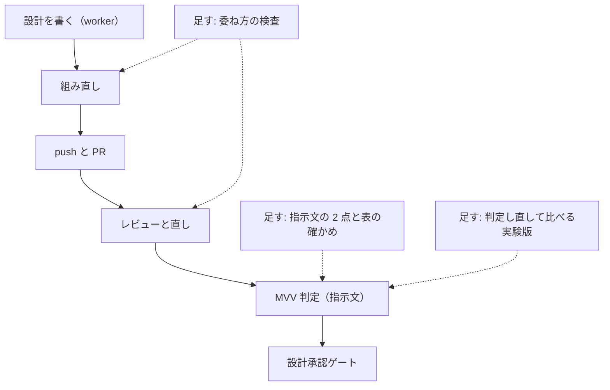
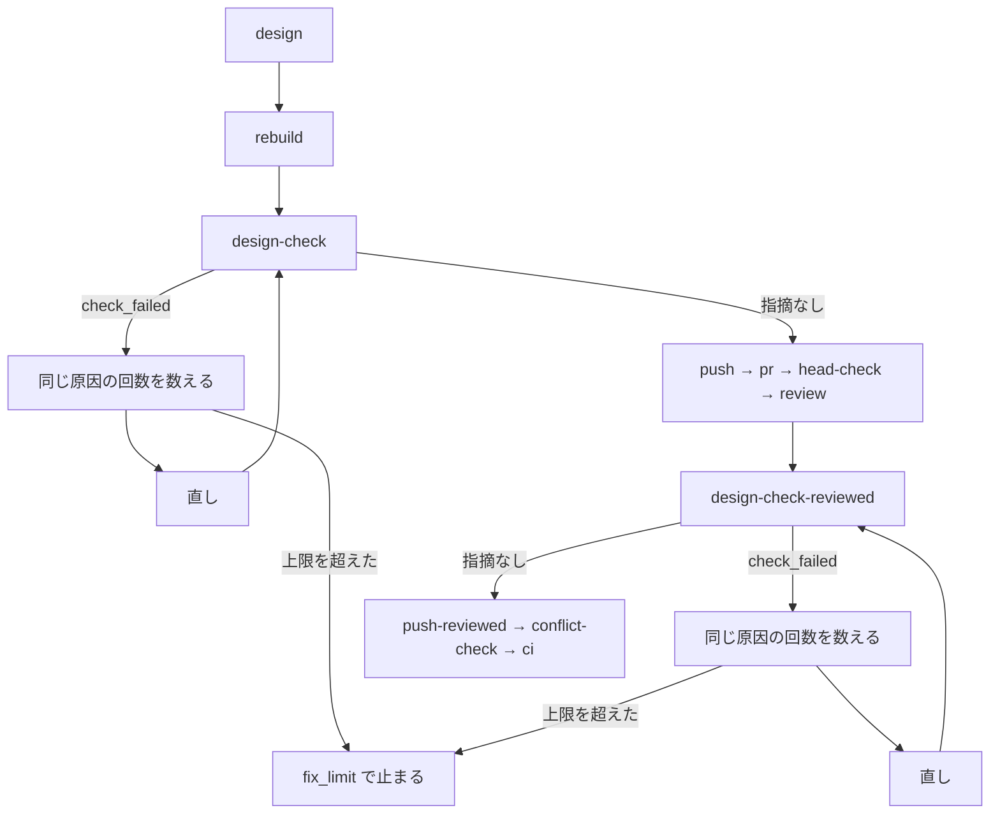
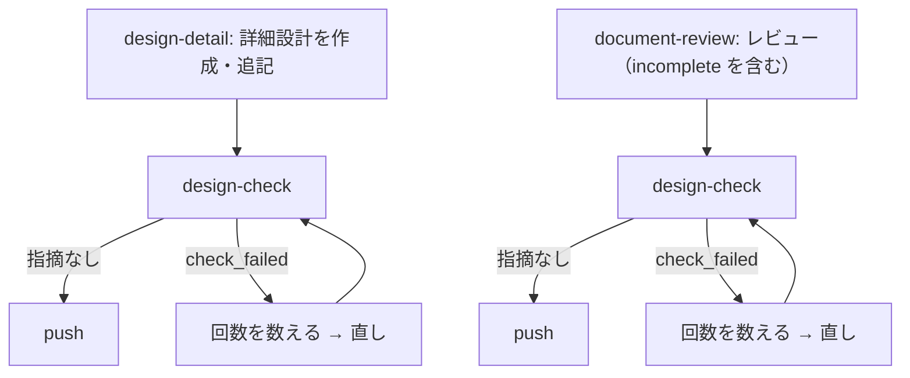

# 設計の判断と MVV 判定: 番号の無い「人へ残す判断」を検査で止め、承認を省ける割合を実物の LLM で比べる（#2912）

判断を人へ残した設計は、承認を省けるかの判定（MVV 判定）を通らず、人の回答を待って止まる。そこで、レッドライン（必ず人の承認が要る操作）の番号を示さずに判断を人に任せる行（以下、番号の無い委ね方）を設計 Pull Request の前に検査で止める。MVV 判定の指示文には起票者の推定の扱いを足し、設計文書の「人へ残す判断」の表にレッドラインの番号があれば、判定の回答にかかわらず人の承認へ戻す。過去の設計 PR を実物の LLM に判定し直させ、レッドラインを含む設計が人へ戻ること（守り）と、承認を省ける割合が上がること（効果）を確かめる。調べた標準と製品、採らなかった案は「決定の記録」と「外部の調査」にある。

## 今の姿

何が起きたか・目的・受け入れ条件は要求仕様（[issue-2912-requirements.md](./issue-2912-requirements.md)、正は #2912 の本文）にある。
この文書は「どう解くか」と「なぜその解き方か」だけを書く。

「起票者の推定」は、課題の題と本文のうち、利用者の指示の原文に無く起票者が推して足した条件である。要求仕様は推定を表の行にし、各行に「この要求での扱い」（受け入れ条件・前提・含まない・採らない など）を書く。



- 受け入れ条件 1〜3（判断の書き方）は、設計の手順書とテンプレートがすでに満たす。この設計では書き方を変えない
- 図の「組み直し」は、書き上げた文書の章立てと文を整えるステップである
- 番号の無い委ね方を確かめるのは、設計者が文書を読む手順だけである。10 系にあった検査のスクリプトは 11 系に無い
- MVV 判定の指示文には「AI が決めて記録した判断を、人が見ていないことだけを理由に判定できないにしない」と「レッドラインに当たる操作は必ず挙げる」がある。起票者の推定の扱いを定める文は無い
- 11 系の指示文でレッドラインが実際に挙がるかは、実物の LLM で確かめていない（[#3017: レッドラインに当たる設計を承認なしで通せる不具合](https://github.com/devbasex/ai-plugins/issues/3017)）
- MVV 判定は、1 ファイルの差分が 200 行を超える PR を、LLM を呼ばずに人へ戻す。題に「設計」を含む直近のマージ済み PR は、20 件中 17 件がこれに当たる（2026-11-27。出典は「手元で数えた事実」）

## 文脈と制約

- レッドラインの守りを弱めない。次の 2 つで承認を省かない仕組みは、そのまま残す
  - 機械の検査
  - 判定が挙げたレッドライン
- 承認ゲートの数、`ndf records mvv gate` の引数・結果の形・終了コード、MVV 判定の記録の行の形は変えない
- 次の 2 つは、この課題の範囲外である
  - [#3017](https://github.com/devbasex/ai-plugins/issues/3017) の直し
  - MVV 判定を打てないために人へ戻る場合（差分の大きさを含む）
- 既定で動くコード・Skill の本文から、実験版の保存先（`experimental/ndf/`）を参照しない
- 詳細設計の検査の移植は [#3664: 詳細設計のテンプレートと検査](https://github.com/devbasex/ai-plugins/issues/3664) が扱う

## 解き方の全体像


- 設計の検査（`ndf records design check`）が、番号の無い委ね方の行を指摘して終了コード 1 で止める。プランを使わずに設計するときは、設計者が同じコマンドを手で打つ
- 設計文書を push するプラン（設計・詳細設計・文書レビュー）は、プランが打つ push の前に、この検査を打つ。コードレビューのプランには置かない。レビュー（cross-review）がラウンドの途中で送る修正は、レビューの後の検査でまとめて確かめる
- MVV 判定の指示文は、扱い（受け入れ条件・前提・含まない・採らない）の書かれた起票者の推定を理由に止めない。人へ残す判断の表の番号は、必ずレッドラインとして挙げる
- MVV 判定が承認ゲートを省ける結果になったときは、PR の head の設計文書を読み、「人へ残す判断」の表にレッドラインの番号があれば省かない。判定者に差分が届いたかや、回答の中身には頼らない
- 効果は、固定した過去の設計 PR を判定し直す実験版で数える。先に、レッドラインを含む対照（当時の判定がレッドラインを挙げた設計）で、期待する番号が挙がることを確かめる

## 機能一覧

| # | 機能 | 誰が使うか |
| --- | --- | --- |
| F1 | 番号の無い委ね方を検査で見つける | 設計者（AI）と、設計文書を push するプラン |
| F2 | 起票者の推定だけでは人へ戻らず、残した判断がある設計は必ず人の承認へ戻る | `pace: fast` / `pace: auto` の利用者 |
| F3 | 指示文の変更の前と後で、挙がるレッドラインと承認を省ける件数を比べる | このリポジトリの開発者 |

## 構成要素

| 要素 | 責務 |
| --- | --- |
| 設計の検査の判定ロジック（新設） | 文書の本文を受け、番号の無い委ね方の行と、「人へ残す判断」の表の番号を返す。ファイルと git を読まない |
| Markdown のアダプター（変更） | 既存の `ndf.adapters.markdown`（markdown-it-py）に、表の行と欄を読む関数を足す |
| `records` のサブコマンド（変更） | 検査する文書を集め（引数のファイル、またはマージ先との差分の設計成果物）、結果を統一 JSON で返す |
| 設計・詳細設計のプランのテンプレート（変更） | `design`・`design-detail` の push の前に検査のステップを置き、指摘があれば直しのステップへ回し、繰り返しは上限で止める |
| 文書レビューのプランのテンプレート（新設）と工程の定義（変更） | `cross-review` のプランに検査のステップを足した `document-review` を置く。設計の工程の設計レビューと、ドキュメントレビューの工程がこれを使う。コードレビューは `cross-review` のまま |
| MVV 判定のステップ（変更） | 承認ゲートを省ける結果になったときだけ、PR の head の設計成果物を読み、「人へ残す判断」の表に番号があれば省かない |
| 起点の解決（移動） | ドキュメント再構成が持つ「ベースブランチとリモート名から起点の参照を決める」処理を共通の場所へ移し、設計の検査と両方が呼ぶ |
| worker の作業の定義（変更） | 検査の指摘を直す作業 1 件 |
| MVV 判定の指示文（変更） | 起票者の推定の扱いと、人へ残す判断の表の番号の扱いを定める |
| 設計の手順書と決定の書き方（変更） | 手順 5 の確認を、読んで確かめる形からコマンドを打つ形へ変える |
| MVV 判定の材料の組み立て（変更） | 差分を切る行数を引数にする。既定の 200 行は変えない |
| 判定の比較（新設・実験版） | 指定した PR か材料のファイルを、指定した指示文で判定して数える。記録と PR には書かない |

## 入出力のコントラクト

### 設計の検査

```text
ndf records design check [--result <ファイル>] <ファイル>...
ndf records design check [--result <ファイル>] --base <ブランチ> [--remote <リモート名>]
```

| 項目 | 決まり |
| --- | --- |
| 入力 | ファイルの指定と `--base` の、どちらか一方が必須。どちらも無い・両方ある呼び出しは、原因 `invalid`（終了コード 2） |
| `--base` の値 | ブランチ名（例: `main`）。起点は `--remote`（省けば `.ndf/worktree.json` の `remote`、無ければその既定）のリモート追跡ブランチ `refs/remotes/<remote>/<ブランチ>` にする。読めないときの扱いは、ドキュメント再構成の起点の解決と同じ関数に任せる。呼び手は `<remote>/<ブランチ>` の形を渡さない。取得（fetch）はしない |
| `--base` の対象のファイル | 起点と HEAD の分岐点（`git merge-base`）から作業ツリーまでに、足した・変えた・名前を変えた設計成果物。未コミットの変更と未追跡のファイルを含み、削除したファイルは除く。内容は作業ツリーから読む。マージ先だけが進めた変更は含まない |
| 設計成果物 | NDF が設計書と詳細設計書に使う名前（`issues/issue-<番号の並び>-design*.md`。`ndf.core.issue_docs` の `DESIGN_FILE`）に当たるファイル。運用文書などのほかの `.md` は見ない |
| `--base` の対象の行 | 分岐点からの差分で足した・変えた行だけを指摘する（新しいファイルは全行）。触れていない既存の行は指摘しない。セクションの判定には、ファイル全体の見出しを使う |
| ファイルを指定した場合 | 指定したファイルの名前を問わず、全行を見る。触れていない行まで確かめたいときと、設計成果物でない文書（受け入れ条件のファイル、実行の記録）を確かめるときに使う |
| 見る範囲 | 見出しが「決定の記録」「未確認のまま残ること」「人へ残す判断」で始まるセクションと、その下位 |
| 指摘する行（地の文・箇条・表） | 委ねる語を含み、下の「番号を名指しした行」でない行。コードブロックの中は数えない。委ねる語はインラインコードを除いた文から探し、番号はインラインコードの中も数える |
| 番号を名指しした行 | レッドラインの番号（`C<数>` / `P<数>` / `R<数>`）を含み、同じ文書の「人へ残す判断」の表に、その番号と実質空でない「なぜ当たるか」を持つ行がある。直後に「に当たらない」「には当たらない」「に該当しない」が続く番号は数えない |
| 指摘する行（「人へ残す判断」の表） | 番号の欄にレッドラインの番号が無い行（空、`要確認` などの文字だけ）。または「なぜ当たるか」の欄が実質空の行（空白と記号 `` ` `` `*` `_` `-` `—` を除くと何も残らない）。番号の欄の `` `C2` `` は番号があると数える |
| 終了コード | 指摘なしは 0（`--base` の対象が 0 件の場合を含む）。指摘ありは 1（原因 `check_failed`、`items` に `name`（パス:行）・`rule`（`unnamed_redline`）・`text`） |
| 失敗 | 指定したファイルや起点の参照を読めない、分岐点を求められないときは、原因 `precondition`（終了コード 3） |
| `--result` | 標準出力と同じ結果を、指定したファイルへも書く |

委ねる語は、判断の主語を人に置いて、まだ決まっていない判断を書く言い回しである。10 系の規則 `unnamed_redline` の正規表現 `DELEGATE` を元にし、済んだ記録と否定の記述に当たらず、普通の言い回し（「人が決める」「利用者が後で決める」）には当たるように直して、新しい検査の 1 か所に置く。引き継ぎ元はタグ `ndf--v10.27.53` の `plugins/ndf/scripts/design-survey.py`（規則を足したコミットは `9faab3d6d`）である。

```text
主語 = (?:利用者|(?<![一-龠々])人)          # 「本人」「個人」「他人」の「人」は主語にしない
否定 = (?:必要|こと|まで|の)(?:では|で|は|が|も)?(?:ない|無い|なく|なし|ありません|しない|せず)

主語 が(?:後で|あとで|後から|別途|改めて)?(?:決める|選ぶ|確かめる|判断する)(?!否定)
|主語 (?:へ|に)委ね(?:られ)?(?:る(?!否定)|ている|ておく|たまま)
```

過去形は済んだ記録とみなし、過去の形でも「まま」が続けば未決とみなす。

| 行の例 | 判定 |
| --- | --- |
| `利用者が決めた` `承認ゲートで利用者が選んだ` `利用者に委ねた結果、A を採った` | 当たらない（済んだ記録） |
| `利用者が決める必要はない` `利用者が決めるまでもない` `利用者に委ねるのではなく AI が決める` | 当たらない（否定） |
| `利用者が決める` `人が決める` `利用者が後で決める` `承認ゲートで人が選ぶ` | 当たる（未決） |
| `利用者に委ねる` `利用者に委ねている` `利用者に委ねたままにする` `利用者が決めるまで進めない` | 当たる（未決） |

委ねる語に当たる行が、番号を名指しした行になるかの例は次のとおりである。

| 行の例（同じ文書の表に `C2` の行がある） | 判定 |
| --- | --- |
| `C2 に当たるため、利用者が決める` | 指摘しない |
| `C2 には当たらないため、利用者が決める` | 指摘する（番号が打ち消されている） |
| `C6 に当たるため、利用者が決める` | 指摘する（表に `C6` の行が無い） |

未決の判断を過去形だけで書いた行と、上の一覧に無い言い回しは拾えない。10 系の正規表現は `委ねた` と `承認ゲートで利用者が決めた` にも当たるため、そのままは使わない。

### 人へ残す判断がある設計を省かない確かめ

`ndf records mvv gate` は、設計承認ゲートを省ける結果になったときだけ、次を確かめる。省けるのは、機械の検査と判定の回答が通り、記録を書けて、進め方が `pace: fast` / `pace: auto` の場合である。引数・結果の形・終了コードは変えない。

| 項目 | 決まり |
| --- | --- |
| 読むもの | PR の差分にある設計成果物（削除したファイルを除く）の、判定した head の本文の全体。作業ツリーは読まない |
| 省かない条件 | 「人へ残す判断」で始まるセクションの表に、番号の欄にレッドラインの番号がある行が 1 つでもある。判定の回答の `boundary` が空でも省かない |
| 出力 | `skip` を偽にし、`why` に「設計文書の『人へ残す判断』の表に判断がある」とパス・番号を足す。判定の回答（`verdict`）は書き換えない |
| 読めない場合 | 本文を読めないファイルがあれば省かず、`why` に読めなかったことを足す |
| 増える呼び出し | 省ける結果になったときだけ、差分の設計成果物 1 件につき GitHub の読み取り 1 回（今の `branch_file`） |

### MVV 判定の指示文

結果の形は変えない。結果は、`verdict`（`follow` / `not_follow` / `unknown`）と `boundary`（変更が当たるレッドラインの番号と中身）などを持つ。変えるのは、`mvv_material_decide.py` の `SYSTEM` の次の箇条だけである。

変更前（`c93e690ed`）:

```text
- 設計者（AI）が判断を決め、決定の記録に結論と理由を書いているなら、人が見ていないことだけを理由に unknown にしない
- ただし前の行は verdict の決め方であり、boundary には当てない。材料の「レッドライン」の各行を 1 つずつ照らし、変更が当たる
  操作を含めば boundary にその番号と中身を書く。設計者が決めた判断・推奨・既定値でも、当たる操作は boundary に書く
  （設計文書が名指していなくても書く。boundary が空でなければ承認ゲートは省かれない）
```

変更後:

```text
- 設計者（AI）が判断を決め、決定の記録に結論と理由を書いているなら、人が見ていないことだけを理由に unknown にしない
- 要求の「起票者の推定」の表の行に扱い（受け入れ条件・前提・含まない・採らない）が書かれていれば、設計者が決めた判断として読み、
  推定であることだけを理由に unknown にしない
- ただし、設計者の判断と起票者の推定に関する上の 2 項目は verdict にだけ適用し、boundary には適用しない。材料の「レッドライン」の
  各行を 1 つずつ照らし、変更が当たる操作を含めば boundary にその番号と中身を書く。設計者が決めた判断・推奨・既定値でも、
  当たる操作は boundary に書く。設計文書の「人へ残す判断」の表にレッドラインの番号があれば、その番号と中身を必ず boundary に書く
  （設計文書が名指していなくても書く。boundary が空でなければ承認ゲートは省かれない）
```

## 処理の流れ

検査のステップは、設計文書を push する 3 つのプラン（`design`・`design-detail`・`document-review`）に置く。MVV 判定のステップの位置は変えない。

### 設計のプラン（`design`）



レビューのステップの中では、cross-review が修正のコミットをラウンドごとに自分で送る（`crossreview/fixer.py` の `send_fix` から `push.push_fix`）。この push の前には検査を打たない。

| 項目 | 決まり |
| --- | --- |
| 実行する場所 | レビューのステップが終わった後の `design-check-reviewed`。レビュー中に送った修正を含む HEAD の文書を読む |
| 指摘があった場合 | 直しの作業でコミットし、検査に合格してから `push-reviewed` で送る |
| それまでの PR | 番号の無い委ね方が一時的に載りうる。MVV 判定と設計承認ゲートは `design-check-reviewed` より後なので、そこへは届かない |
| レビューが止まった場合 | `incomplete` は `design-check-reviewed` へ進む。ほかの原因で止まればプランが止まり、設計承認ゲートへ進まない |
| プランを使わずにレビューを回した場合 | 設計者が、レビューの修正の後に手順 5 のコマンドをもう一度打つ |

プランの中の push へ向かう今の分岐は、すべて手前の検査へ向け直す。

| 今の行き先が | 分岐 | 新しい行き先 |
| --- | --- | --- |
| `push` | `rebuild` の次、`fix-push` の次 | `design-check` |
| `push-reviewed` | `review` の次（完了しない `incomplete` を含む）、`ci-fix`、`base-sync`、`fix-base`、`fix-push-reviewed` の次 | `design-check-reviewed` |

### 詳細設計と文書レビューのプラン（`design-detail`・`document-review`）

設計のプランが終わった後も、設計文書は書き足され、直される。`standard` では、詳細設計、ドキュメント再構成、ドキュメントレビューの順に工程が続く。



| プラン | 検査するもの | 順序 |
| --- | --- | --- |
| `design-detail` | 詳細設計書と、詳細設計を追記した設計書（`standard` で別ファイルにしない場合） | worker の詳細設計の後、push の前。`fix-push` の後もこの検査へ戻る |
| `document-review` | 詳細設計、ドキュメント再構成、レビューの修正を含む HEAD の文書 | レビューのステップの後、push の前。`fix-push` の後もこの検査へ戻る。設計 PR のマージより前に終わる |

- 文書レビューのプランは、工程で選ぶ。工程の定義が対象を文書としているレビュー（設計の工程の設計レビュー `subject: design`、ドキュメントレビュー `subject: docs`）は `document-review` を使う。コードレビュー（`subject: code`）は `cross-review` のままで、検査を打たない
- 2 つのテンプレートは、検査に `--base {{base}} --remote {{remote}}` を渡すため、値 `base`（ブランチ名）を受ける
- ドキュメント再構成のプラン（`document-rebuild`）には置かない。直後のドキュメントレビューの検査が、組み直した後の同じ文書を読む
- プランを使わずに詳細設計を書く場合は、設計者が追記の後、push の前にコマンドを打つ

### マージ先（`base`）の決まり方

呼び手が渡す引数は増やさない。テンプレートの値 `base` は、省けば今の `ndf.core.route.derived_locally` が、プロジェクトの宣言（`.ndf/project.json` の `branch_strategy` の、スプリントの PR のマージ先）から決める。

| 起動の経路 | `base` の得かた |
| --- | --- |
| 工程から（`ndf progress`） | `template_values` が `derived_locally` を呼ぶ。工程の入力は足さない |
| 単発のプラン（`ndf route render` / `run`） | 同じ `derived_locally`。別のマージ先にするときだけ `--set base=<ブランチ>` を渡す |
| 手で打つ（プランを使わない） | 設計者が `ndf records design check` に `--base <PR のマージ先のブランチ名>` かファイルを渡す |

テンプレートを埋めるほかの生成元は無い。宣言から決められなければ、設計のプランと同じ `RouteError`（宣言の位置と打つコマンドを示す）で止まる。コードレビューのプランは変わらない。

### 検査を置くプランに共通の決まり

- CI の直しや衝突の解消で設計文書が変わりうるため、本文が同じかは調べず、毎回打ち直す。検査は言語モデルを呼ばない手元のコマンドなので、結果は再利用しない
- 繰り返しの打ち切りは、CI の落ちと同じ `ndf route repeat` を使う。同じ検査の `check_failed` が 3 回目（`supervise.step-rerun` の `same_cause` = 2 を超える。間に検査が通っても数え直さない）になると、`fix_limit` で止まって人へ戻る。最後の指摘は `--result` のファイルに、理由は止まった結果に残る。記録のファイルは検査のステップごとに分ける
- 不合格 1 回あたりに増える起動は、次の表のとおりである。push が拒まれたときの打ち直しとは別に数える

| 同じ検査の不合格 | `ndf route repeat` | 直しの worker（言語モデルのセッション） | 再検査 |
| --- | --- | --- | --- |
| 1 回目・2 回目 | 1 回ずつ | 1 回ずつ | 1 回ずつ |
| 3 回目 | 1 回（`fix_limit` で止まる） | 起動しない | 打たない |

- 上限は検査のステップ 1 つあたり、検査 3 回、`ndf route repeat` 3 回、直しの worker 2 回である。`design` のプランは検査のステップが 2 つあるので直しの worker は最大 4 回、`design-detail` と `document-review` は最大 2 回である
- `precondition` と `invalid` は文書の直しでは解けないため、直しへ回さず、その原因でプランを止める

## 非機能の実現方式

| 大項目 | 条件 | 実現方式 |
| --- | --- | --- |
| 運用・保守性 | MVV 判定の記録の行の形を変えない | 判定の側で変えるのは、指示文の文と、省かない理由が 1 つ増えることだけである。実験版は記録を書かない |
| セキュリティ | レッドラインの守りを弱めない | 今の機械の検査と `may_skip` は変えず、「人へ残す判断」の表の確かめを足す（決定 7）。足す緩和の行は verdict にだけ掛け、boundary には掛けない。実装の完了の前に、対照 20 件と設計 PR #4583 を変更後の指示文で判定し、期待する番号がすべて挙がることを確かめる。挙がらない件は `c93e690ed` の指示文でも判定して比べる（決定 6） |

## 決定の記録

### 決定 1: 設計者と利用先のどちらからも同じ検査を打てるよう、検査を `ndf records design check` に置く

- **質問**: 番号の無い委ね方の検査をどこに置くか（要求の未決 2）
- **選んだ案**: `ndf` の記録のサブコマンドに `design check` を足す。判断は純粋な関数に分け、10 系の規則 `unnamed_redline` の範囲と語を引き継ぎ、過去形の記録には当たらないようにする。単体テストは `test_design_check.py` に置く
  - 見出し・コードブロック・表の読み取りは、依存済みの markdown-it-py（LIB3）を `ndf.adapters.markdown` 経由で使う。Markdown の解析は自分で書かない
  - NDF が実装するのは、委ねる言い回しの判定、番号の有無と表との対応の判定、表の欄の判定だけである
  - 差分から見るのは、設計成果物の足した・変えた行だけである。運用文書の記述や、今回触れていない行で push を止めないためである
- 採らなかった案: `ndf check` の規則にする（NDF 自身のコードを検査する開発者向けのサブコマンドである。利用先の設計文書を対象にしない）
- 採らなかった案: textlint か Vale の独自ルールにする（Node か別の実行ファイルを利用先へ要求する。見出しの下だけを見る部分と、表の欄が空かを判定する部分は、どちらでも自分で書く）
- 採らなかった案: 手順書に沿って読んで確かめる形のままにする（受け入れ条件 4 を満たさず、同じ文書でも結果が揺れる）
- 採らなかった案: 差分の全 `.md` の全行を見る（コードの変更に含まれる運用文書や、今回触れていない行で止まり、直しの worker が関係の無い記述を書き換える）
- 採らなかった案: 番号がどこかにある行はすべて通す（「C2 には当たらないため、利用者が決める」が通る）
- **代償**: 委ねる語の正規表現を NDF が保守する。一覧に無い言い回しの委ね方と、過去形だけで書いた未決は拾えない。番号がその行の判断に本当に当たるかは確かめられない。NDF の名前を使わない設計文書は `--base` の対象にならず、ファイルを指定して確かめる
- 作り方: 自前で作る・ライブラリやサービスを使う
- 比べた候補: LIB1 / LIB2 / LIB3
- 根拠: Value 3「同じ手順は毎回同じ結果になる」 / Value 12「調べて分析した、実績のある最新のやり方で作られる」 / Value 15「人も AI も同じ入口から使える」（MVV バージョン 11）

### 決定 2: 打ち忘れと直しによる戻りを防ぐため、設計文書を push するプランは自分が打つ push の前に毎回検査を打つ

- **質問**: 検査を手順書の指示だけにするか、プランのステップにもするか
- **選んだ案**: 設計のプランの最初の push の前とレビューの後の push の前、詳細設計のプランの push の前、文書レビューのプランの push の前にステップを置く。指摘は worker の直しの作業へ回し、直した内容はコミットして終える。レビュー中の cross-review の push には置かず、レビューの後の検査で確かめる（「処理の流れ」）
  - 手順書の手順 5 と手順 6（詳細設計）は、起動の経路で分ける。プランから呼ばれた設計者はコマンドを打たず、プランの検査がその実行になる。プランを使わずに書く設計者だけがコマンドを打つ。同じ push の前に 2 回は打たない
- 採らなかった案: 手順書の指示だけ（打たなくても PR が出る）
- 採らなかった案: 設計のプランだけに置く（詳細設計の追記と、ドキュメントレビューの修正が検査を通らない）
- 採らなかった案: 共通の `cross-review` のプランに置く（設計文書を扱わないコードレビューでも、push のたびに検査の起動が増える）
- 採らなかった案: `cross-review` のプランに用途の値を足して切り替える（テンプレートはステップを値で外せないため、検査のコマンドを丸ごと値で渡すことになる）
- 採らなかった案: 承認ゲートの直前に 1 回だけ打つ（指摘を直す分岐を工程の定義に足すことになり、詳細設計のプランの push は検査されない）
- 採らなかった案: cross-review の修正の push の前にも打つ（cross-review に設計だけの検査と、落ちた修正を直させる分岐を足すことになる。承認ゲートの前の版はレビューの後の検査で確かめられる）
- 採らなかった案: 最初の push の前の 1 回だけ（レビューや CI の直しで委ね方が戻ると、承認ゲートまで気付かない）
- 採らなかった案: 設計文書が変わった push の前だけ打つ（変わったかを調べる仕組みが要り、手元のコマンド 1 回より高い）
- 採らなかった案: CI の検査にする（利用先のリポジトリごとに CI の設定を足させる）
- **代償**: 直しが無い場合、検査の起動は `design` のプランで 2 回、`design-detail` と `document-review` のプランで 1 回ずつ増える。テンプレートが 1 つ増える。push し直すたびに 1 回増える。不合格の場合の起動回数と上限は「処理の流れ」の表のとおりで、直しの worker は言語モデルの費用がかかる。レビュー中の設計 PR には、検査していない版が載りうる
- 根拠: Value 3「同じ手順は毎回同じ結果になる」 / Value 2「安く使える」（MVV バージョン 11）

### 決定 3: 推定だけで人へ戻らず守りも落とさないよう、緩和は verdict にだけ掛ける 1 行と、表の番号を挙げる 1 句を足す

- **質問**: 起票者の推定の扱いを指示文にどう書くか（要求の未決 3）
- **選んだ案**: 「扱いが書かれた推定は、設計者が決めた判断として読む」を足し、boundary には適用しないと対象を名指しして書く（文面は「入出力のコントラクト」）。承認ゲートを省いたときは、その判定の記録が推定を確かめた記録になる。この決まりは決定の書き方の文書と用語集がすでに定めるので、指示文にはコピーしない
- 採らなかった案: 10 系の指示文にあった「番号の無い委ね方は推奨を結論として読む」も戻す（番号の無い委ね方は決定 1 の検査が止める。緩和の行が増えるほど boundary の抜けの恐れが増える）
- 採らなかった案: 足さない（受け入れ条件 5 を満たさない）
- **代償**: #3017 は、緩和の行を足した変更の後に boundary が空になったと推定している。同じ種類の行を 1 つ増やすため、決定 6 の確かめが要る
- 根拠: Value 1「速さや費用のために、人の承認を省かない」（MVV バージョン 11）。PRD2

### 決定 4: 今回足す指示文の効果だけを数えるため、`c93e690ed` と変更後を、固定した PR の同じ材料で比べる

- **質問**: 受け入れ条件 7 の課題の集合と分母をどう決めるか（要求の未決 1）
- **選んだ案**: 10 系の判定の記録（`mvv-gate.jsonl`）から選び直した、下の表の番号を固定する
  - 受け入れ条件 7 の前は、今の main（`c93e690ed`）の指示文、後は変更後の指示文である
  - 材料と MVV は、どの指示文にも今の版の同じものを渡す
  - 割合は「`follow` で boundary が空」の件数 ÷ 12 とする。読めない回答と材料が欠けた件も分母に残す

| 集合 | 件数 | PR の番号 |
| --- | --- | --- |
| 対象（判断を人に任せていたために戻った設計） | 12 | 2214 2295 2304 2301 2499 2662 2679 2708 2740 2731 2760 2937 |
| 対照（当時の判定がレッドラインを挙げた設計） | 20 | 2211 2213 2233 2236 2277 2278 2331 2379 2385 2380 2524 2636 2645 2670 2696 2697 2704 2744 2818 2887 |

対象 12 件は、どれも同じ PR の要求仕様に「起票者の推定」の表を持つ。11 件は、扱いが受け入れ条件・前提・含まない・採らないの行を持つ。2499 の扱いは未決と目的だけで、今回の緩和に当たらない。ただし当時の戻った理由は、推定ではなく人に任せた判断である。そのため 12 件の割合だけでは推定の扱いの効果を分けられない。決定 6 の順 2 の対で、受け入れ条件 5 の振る舞いを確かめ、効果を記録する。受け入れ条件 7 の合否は、決定 6 の「判定の揺れの扱い」で決める。

- 採らなかった案: 変更の後に出た設計で比べる（前と後で設計が違い、差の原因を分けられない）
- 採らなかった案: 対象の設計を今の書き方に直して判定する（12 件の書き直しの費用がかかり、書き直した人の判断が結果に混ざる）
- 採らなかった案: 前の指示文を 10 系の `a40080ce` にする（11 系ですでに入った指示文の変更も差に含まれ、今回足す 2 点の効果を判断できない）
- 採らなかった案: `a40080ce` の判定を別の測定として足す（今回の合否に使わず、使う目的も決まっていない。測るたびに呼び出しが 12 回増える）
- **代償**: 数えるのは指示文の効果であって、運用で承認を省けた割合そのものではない。差分の上限で人へ戻る分は数えない。`c93e690ed` には AI の判断を理由に止めない行がすでにあるため、差は小さく出うる。上がらなければ受け入れ条件 7 は不合格である
- 根拠: Value 13「確かめたことだけが済んだとされる」（MVV バージョン 11）

### 決定 5: 呼んだときだけ働く測定なので、比較は実験版のスクリプトにする

- **質問**: 割合を比べる手段をどう持つか
- **選んだ案**: `experimental/ndf/mvv_replay.py` を新設する
  - モデルは引数で 1 つに固定する。判定の呼び出し（`llm.ask`）の差し替え口 `call` で `--model` を足し、比べるすべての判定に同じ値を渡す。effort などほかの実行の設定は、本番の判定の起動の引数のまま変えない
  - 結果には、モデル ID、Claude Code のバージョン、指示文のコミット、材料のハッシュを残す。比べる 2 つの判定でモデル ID か Claude Code のバージョンが違えば、比較に使わない
  - 材料の組み立てと判定の呼び出しは、MVV 判定の部品を使う。前の指示文は、指定したコミットから読む
  - 引数 `--plugin-root` を渡すと、変更後の指示文と判定の部品を、その置き場（導入した配布版）から読み込む（決定 6 の順 3）
  - PR のコメント・判定の記録は書かない。結果は指定したファイルへ書く
- 材料の全文は、次の順で用意する
  1. PR のベースと head の組を、MVV 判定と同じ `compare_files` で読む
  2. 内容を変更したファイルの差分が API の応答に含まれない場合は、PR の head を取得して、同じベースと head の差分をローカルで読み直す。内容を変えない改名は読み直さない
  3. `patch_material` に行数の上限なしを指定して組む。既定の 200 行のままだと、長い設計文書の後ろにある「人へ残す判断」の表が判定者に届かない
  4. それでも全文を取れない件は LLM を呼ばず、「材料が欠けた」と記録する。対照では不合格、対象では分母に残して省けない件に数える
- 採らなかった案: `ndf records mvv gate` に引数を足す（コントラクトを変えないという要求に反する。PR へコメントを書く経路でもある）
- 採らなかった案: promptfoo を使う（材料の組み方と判定の呼び出しをコピーすることになる。本番と違う呼び方を測る）
- 採らなかった案: 手で判定する（同じ手順を打ち直せない）
- **代償**: 実験版は単体テストを持たず、手元で打って確かめる。材料を切らないので、本番の判定より 1 回の入力が大きい
- 作り方: 自前で作る
- 比べた候補: LIB4 / LIB5
- 根拠: Value 16「外で使われて育てる」 / Value 11「重複と冗長が無い」（MVV バージョン 11）

### 決定 6: レッドラインを落としたまま指示文を出さないため、実装の完了の前に対照の番号を確かめる

- **質問**: [#3017](https://github.com/devbasex/ai-plugins/issues/3017) の直しと受け入れ条件 5〜7 の確かめを、どの順にするか（要求の未決 4）
- **選んだ案**: 次の順で確かめる

| 順 | いつ | すること | 合格 | 呼び出しの回数 |
| --- | --- | --- | --- | --- |
| 1 | 実装の完了の前 | 対照 20 件と、この課題の設計 PR #4583 を変更後の指示文で判定する。合格しない件は `c93e690ed` でも判定し、今回の変更で落ちたのか、前から落ちていたのかを記録する | 全件で、下の表の番号がすべて boundary に挙がる | 21〜42 |
| 2 | 実装の完了の前（順 1 の合格の後） | 受け入れ条件 5 の振る舞い（扱いを書いた推定だけを理由に止めない）を確かめる。推定の扱いの有無だけが違う材料の対を、`c93e690ed` と変更後で 3 回ずつ判定する | 変更後で扱いを書いた側が、3 回のうち 2 回以上「省ける」。ほかの 3 組は合否に使わず、効果の記録にする | 12 |
| 3 | リリースの後 | 配ったバージョンを通常の手順で導入し、導入先の指示文と判定の部品を読み込んだ実験版で、#3017 の 5 件と PR #4583 を判定し直す。指示文か材料の組み立てが順 1 から変わっていれば、21 件すべてを打ち直す。続けて、導入した版の通常のゲートを確認用の PR に打つ | 下の「順 3 の入口と合格の範囲」 | 7（変わっていれば 22） |
| 4 | 順 3 の合格の後 | 対象 12 件を `c93e690ed` と変更後で判定する。変更後だけで省けるようになった件は、レッドラインを落としていないかを確かめてから数える | 下の「省けるようになった件の確かめ」と「判定の揺れの扱い」 | 24（再測定で最大 48 を足す） |

この表と下の 2 つの表の「省ける」は、`verdict` が `follow` で boundary が空の判定である。

順 1 か順 2 に合格しなければ、足す 2 点を指示文へ入れずに止めて報告し、順 3 と順 4 は打たない。指示文を直した場合は順 1 から打ち直す。順 3 でレッドラインを落とすか省く結果が出れば、受け入れ条件 6 は不合格として #3017 へ記録し、順 4 は打たない。通常のゲートを打てず未確認になった場合も、順 4 は打たない。

**順 2 の結果の読み方**。各組は 3 回のうち 2 回以上出た側をその組の結果にする。合否が確かめるのは、受け入れ条件 5 の振る舞いである。指示文の変更の効果は合否の条件にしない。要求が指示文にこの扱いを定めるよう求めていて、変更前の指示文でも省けるかは指示文を入れるかの判断を変えないためである。効果を確認できなければ「効果は未確認」と記録し、この変更で良くなったとは書かない。

| 変更後・扱いあり | `c93e690ed`・扱いあり | 変更後・扱いなし | 結論 |
| --- | --- | --- | --- |
| 省けない | 問わない | 問わない | 不合格。指示文へ入れない |
| 省ける | 省けない | 省けない | 扱いを書いた推定に対する変更の効果を確認した |
| 省ける | 省ける | 問わない | 受け入れ条件 5 の振る舞いは満たすが、変更前から省けるので、変更の効果は確認できていないと記録する |
| 省ける | 省けない | 省ける | 受け入れ条件 5 の振る舞いは満たすが、扱いを書かなくても省けるので、扱いを書いたことの効果は確認できていないと記録する |

`c93e690ed`・扱いなしの結果は参考として記録する。

**順 3 の入口と合格の範囲**。順 3 は、配布物を使って確かめる。リポジトリのタグを取り出した作業ツリーの再判定は、合否に使わない。過去の PR の判定し直しは実験版で行う。対象はマージ済みの PR で、通常の `ndf records mvv gate` は開いた PR しか判定せず、200 行を超える差分では LLM を呼ばないためである。

- 実験版は配布対象に入らないので、リポジトリのものを打つ。指示文・材料の組み立て・判定の呼び出し・`may_skip` は、引数 `--plugin-root <導入した版の置き場>` の下から読み込む。結果には、読み込んだ置き場とバージョンを残す
- 通常のゲートは、確認用の開いた PR で確かめる。内容は作り物の 200 行以下の設計で、「人へ残す判断」の表を置かず、本文にレッドラインに当たる変更（`.ndf/` を書き換える＝C7）を書く。導入した版の `ndf records mvv gate --gate design` を `pace: fast` の入力で打ち、結果を記録したら PR を閉じてブランチを消す

| 確かめること | 入口 | 扱い |
| --- | --- | --- |
| 配った指示文が、期待する番号を挙げる | 実験版（配布物の部品を読み込む。材料を切らない） | 受け入れ条件 6 の合否。順 1 と同じ番号がすべて挙がる |
| 配った版の通常のゲートが、レッドラインを含む設計の承認を省かない | 確認用の PR に打つ `ndf records mvv gate` | 受け入れ条件 6 の合否。`verdict` の `boundary` に C7 があり、`skip` が偽。打てなければ「通常のゲートは未確認」と記録し、受け入れ条件 6 を満たしたと記録しない |
| 表の番号がある設計を省かない | `ndf records mvv gate` の単体テスト（判定の回答は代役） | 受け入れ条件 6 の合否 |

**省けるようになった件の確かめ**（順 4）。対象 12 件のうち、`c93e690ed` で省けず変更後で省けた件は、リリース後テストの担当が、その設計の材料の全文をレッドラインの各行に照らして読み、件ごとの結果と根拠を記録する。

| 読んだ結果 | 数え方 |
| --- | --- |
| 承認が必要な操作を含まない | 省ける件に数える |
| 含む | 省ける件に数えない。受け入れ条件 7 は不合格とし、番号と PR を #3017 へ記録する |
| 判断できない | 省ける件に数えない |

**判定の揺れの扱い**（順 4）。差は、変更後に省ける件数から `c93e690ed` で省ける件数を引いた値である。1 回の判定では 1〜2 件の差を揺れと区別できない。

| 1 回目の差 | 次にすること | 受け入れ条件 7 |
| --- | --- | --- |
| 3 件以上 | 打ち直さない | 合格 |
| 0 件以下 | 打ち直さない | 不合格 |
| 1〜2 件 | 12 件を両方の指示文で、あと 2 回ずつ判定する（これ以上は打ち直さない） | 3 回とも差が 1 件以上なら合格。それ以外は結論を保留し、満たしたと記録しない |

推定の対は、実験版の横（`experimental/ndf/mvv_replay_cases/`）に作り物の要求と設計の 2 組を置く。違いは「この要求での扱い」の欄を書いたかだけで、どちらもレッドラインに当たらない内容にする。

対照で挙がるべき番号は次のとおりである。10 系の判定の記録の boundary と #3017 の表から決めた。20 件の PR が変えたのは `issues/` と `docs/` だけなので、機械の検査（レッドラインのパスと `.ndf/mvv.*`）で止まる件は無い。このため、どの件も判定の boundary を守りにし、対照から除く件は置かない。

| PR | 挙がるべき番号 | 補足 |
| --- | --- | --- |
| 2211・2233・2277 | C2 | |
| 2213 | C2・C4 | #3017 の 5 件 |
| 2236 | C1・C2・C3・C4 | |
| 2278 | C1・C2 | |
| 2331 | P1 | #3017 の 5 件 |
| 2379 | C1・C3 | |
| 2380 | C2・C3 | |
| 2385・2744 | C6 | 2744 は #3017 の 5 件 |
| 2524 | 番号は問わず、boundary が空でない | #3017 の 5 件。記録の境界（受け入れ条件の範囲の変更と、CI の定義の変更）はどの番号も挙げていない。#3017 が閉じる条件にしているため残す |
| 2636 | C1・C2 | |
| 2645・2697・2887 | C7 | |
| 2670 | C4 | |
| 2696 | C1・C2・C7 | 記録の P1 は「当たるかの確認」で、版の規則を変えないため求めない |
| 2704 | C3・C4 | #3017 の 5 件 |
| 2818 | C1・C7 | |
| 4583（この課題の設計） | C2 | |

- **費用の見積もり**: 順 1 から順 4 まで一度で合格した場合は次の表のとおりである。順 1 で止まる場合は 21〜42 回で終わる。単価は、10 系で 44 回の判定が 10.23 USD だった実績から置く。材料を切らない分は高くなりうるため、実際の費用を記録する

| 場合 | 呼び出しの回数 | 目安の費用 |
| --- | --- | --- |
| 順 4 の再測定が無い | 64（実装の前に 33、リリースの後に 31） | 14.9 USD |
| 順 4 の再測定がある | 112 | 26.0 USD |
| さらに順 3 で 21 件すべてを打ち直す | 127 | 29.5 USD |

- 採らなかった案: 実装の前は #3017 の 5 件だけを見る（残り 15 件の見落としと、前から落としているレッドラインがリリースへ出る）
- 採らなかった案: 前の指示文との差だけを合否にする（前から落としているレッドラインを合格にしてしまう）
- 採らなかった案: 全件を毎回 2 つの指示文で判定する（合否は変更後の番号で決まるため、合格した件の前の判定は費用だけが増える）
- 採らなかった案: #3017 の直しをこの課題に含める（要求の対象範囲の外である）
- **代償**: 呼び出しは 10 系の 44 回より増える。#3017 の不具合が残っていると順 1 で止まり、指示文の変更は #3017 の直しを待つ
- 根拠: Value 1「速さや費用のために、人の承認を省かない」 / Value 13「確かめたことだけが済んだとされる」 / Value 2「安く使える」（MVV バージョン 11）。PRD2

### 決定 7: 人へ残すと書いた判断を判定者の回答しだいで通さないよう、判定のステップが表を読んで承認を省かない

- **質問**: 「人へ残す判断」の表にある承認必須の判断を、指示文だけで守るか、機械でも確かめるか
- **選んだ案**: `ndf records mvv gate` が、省ける結果になったときだけ head の設計成果物を読み、表にレッドラインの番号があれば人の承認へ戻す（文面は「入出力のコントラクト」）。承認は今の設計承認ゲートで取り、承認の工程は足さない。表の読み取りは設計の検査と同じ判定ロジックを使う
- 採らなかった案: 指示文の 1 句だけにする（判定者へ渡すのは差分で、変更行の周りに無い表は届かない。届いても回答に挙がるかは LLM しだいである）
- 採らなかった案: 表の全文を判定の材料に足す（守りが LLM の回答に依存したままになる）
- 採らなかった案: 毎回読む（省かない結果の判定では、読んでも結果が変わらない）
- **代償**: 省ける結果の判定で、GitHub の読み取りが差分の設計成果物の件数だけ増える。表のある設計を直しただけの PR も、人の承認へ戻る。表を書き忘れた設計には効かず、そこは判定者のレッドラインの照合と [#3017](https://github.com/devbasex/ai-plugins/issues/3017) の範囲に残る
- 根拠: Value 1「速さや費用のために、人の承認を省かない」 / Value 3「同じ手順は毎回同じ結果になる」（MVV バージョン 11）

## 影響と危険

- **働く範囲**: 設計の検査・プランのステップ・指示文・表の確かめは、NDF を使うすべてのリポジトリで働く。判定の比較はこのリポジトリだけ
- **プロジェクトごとに違うもの**: マージ先とリモート名はプランの値で受ける。レッドラインは番号の形だけを見るので、プロジェクトが足す番号も設定なしで通る
- **検査が働く条件**: `design`・`design-detail`・`document-review` のプランを流せば、モードを問わず自動で働く。流さなければ、手順書に沿ってコマンドを手で打つ

| モード | 設計の工程と設計 PR | 検査の打ち方 |
| --- | --- | --- |
| `standard`・`documentation` | 通る。設計 PR を出す | プランで自動。プランを使わなければ手で打つ |
| `legacy-refactor` | 通る。設計 PR は分けることがある | 同上 |
| `light`・`operation` | 該当するときだけ設計する。設計 PR は出さない | 手で打つ（受け入れ条件のファイル、実行の記録をファイルで指定する） |

- **壊れうる箇所**:
  - 説明のつもりで委ねる語を地の文に書くと指摘される（インラインコードで囲めば指摘されない）
  - プランの流れを固定するテストは、ステップ・値（`base`）・テンプレートが増える分を直す
  - `design-detail` のプランは、ブランチ戦略の宣言が無いリポジトリでは組めなくなる（`--set base=` を渡せば組める）
- **効果の限界**: 差分の上限で人へ戻る設計には、指示文の変更は効かない。直近の設計 PR の多くがこれに当たるため、運用で人を待つ件数を減らすには、別の変更が要る
- **同じ所を触る別の変更**: #3664 は詳細設計の検査を足す。同じサブコマンドの下に規則を足せる形にする

### 代表のリポジトリでの振る舞い

| 代表のリポジトリ | 設定の要点 | 直した後に起きること | この種類で扱えなくなること |
| --- | --- | --- | --- |
| Web サービス | MVV を置き、`pace: fast` / `auto` で回す | 設計の検査が番号の無い委ね方を止め、MVV 判定は推定だけでは人へ戻さない | 無し |
| モバイルアプリ | 同上 | 同上 | 無し |
| 業務文書だけ | 設計書は NDF の名前（`issues/issue-<番号>-design.md`）で書く | 同じ検査が働く。当たる行が無ければ 0 で通る。ほかの業務文書は見ない | 無し |

### このリポジトリだけの事情

| 値 | 置く所 | 持つ Issue |
| --- | --- | --- |
| 比べる PR の番号、前の指示文のコミット、対照で挙がるべき番号 | この文書の決定 4・6。実験版へは引数で渡す | #2912 |

## 用語

| 用語 | 意味 | 用語集への反映 |
| --- | --- | --- |
| 設計の検査 | 設計文書を書いた後に走らせる、言語モデルを呼ばない決まった検査（`ndf records design check`。設計・詳細設計・文書レビューのプランのステップ `design-check`） | 意味の変更 |

## テスト設計

| 受け入れ条件・不変条件 | どの振る舞いで縛るか | どう壊したら落ちるべきか |
| --- | --- | --- |
| 1〜3 | 手順書とテンプレートの今の記述を読んで確かめる（変えない。文言のテストは書かない） | — |
| 4 | 3 つのセクションのどれでも、番号の無い委ねる行がある文書は終了コード 1 と行番号を返す | 対象のセクションを 1 つ落とすと通ってしまう |
| 4 | 「入出力のコントラクト」の例の表のとおり、過去形の記録と否定の記述は 0、未決の形は指摘する | `委ねた` や「決める必要はない」を指摘する。「委ねたまま」「人が決める」「利用者が後で決める」を通す |
| 4 | 番号を含む委ねる行は、同じ文書の表に同じ番号と理由があるときだけ通る | 打ち消した番号、表に無い番号の行を通す |
| 4 | 番号を名指しした行、委ねる行の無い文書、対象の外のセクション・コードブロック・インラインコードの中の語は 0 | セクション・コードブロック・インラインコードを区別せず全文を見ると落ちる |
| 4 | 人へ残す判断の表で、番号の欄が空か `要確認` だけの行、理由の欄が空か `—` だけの行は指摘する。番号の欄の `` `C2` `` は通る | 欄が空かだけを見る。行全体の番号の有無だけを見る。インラインコードを除いてから番号を探す |
| 4 | `--base` はブランチ名を受け、リモート追跡ブランチとの分岐点から作業ツリーまでを読む。未コミットと未追跡を含み、削除したファイルとマージ先だけの変更は除く | 先端どうしを比べる。HEAD の内容を読む。ローカルブランチが無いと失敗する |
| 4 | `--base` は設計成果物の足した・変えた行だけを指摘する。ファイルの指定は全行を見る | ほかの `.md` や触れていない行を指摘する |
| 4 | 入力が無い・両方ある呼び出しは 2、読めないファイルや ref は 3 | 対象 0 件として 0 を返す |
| 決定 2 | `design`・`design-detail`・`document-review` のプランは、push のステップへ入るどの分岐でも先に検査を通る。指摘は直しの後に検査へ戻り、上限で止まる。`precondition` は直しへ回さない | 直し・衝突の解消の後に検査を通らず push する。直しを上限なく繰り返す |
| 決定 2 | コードレビューのプランは検査を持たず、文書のレビューの工程は `document-review` を使う。`base` を渡さずに組んだプランは宣言のマージ先を持つ | コードレビューで検査を打つ。`base` を渡さないと組めない |
| 5・決定 7 | 判定の回答が `follow` でレッドラインが空でも、head の設計成果物の表に番号があれば省かない。本文を読めなくても省かない。省かない結果のときは本文を読まない | 差分の `patch` だけを見る。読めないときに省く。毎回読む |
| 5・6 | 決定 6 の順で、実物の LLM に判定させる（単体テストで縛らない） | — |
| 6 | 判定がレッドラインを返せば省かない（今あるテストで確かめる） | `may_skip` が boundary を見なくなる |
| 7 | 決定 4・6 の件数・割合・費用・打ったコマンドをリリース後テストの記録に残す | — |
| 8 | 全体のテストを PR の CI で読む | — |

## 設計の結果

| 課題 | 扱い | 統合先 | 触るファイル |
| --- | --- | --- | --- |
| #2912 | 実装する | — | `plugins/ndf/src/ndf/domains/records/design_check_decide.py`（新設）、`plugins/ndf/src/ndf/domains/records/cli.py`、`plugins/ndf/src/ndf/domains/records/__init__.py`、`plugins/ndf/src/ndf/domains/records/mvv_material_decide.py`、`plugins/ndf/src/ndf/domains/records/mvv_gate.py`、`plugins/ndf/src/ndf/domains/docrebuild/drive.py`、`plugins/ndf/src/ndf/core/`（起点の解決の移し先）、`plugins/ndf/src/ndf/adapters/markdown.py`、`plugins/ndf/contracts/templates/design.json`、`plugins/ndf/contracts/templates/design-detail.json`、`plugins/ndf/contracts/templates/document-review.json`（新設）、`plugins/ndf/contracts/workflow/stages/design.json`、`plugins/ndf/contracts/workflow/stages/document-review.json`、`plugins/ndf/contracts/worker/kinds.json`、`plugins/ndf/skills/design/SKILL.md`、`plugins/ndf/skills/design/references/decisions.md`、`experimental/ndf/mvv_replay.py`（新設）、`experimental/ndf/mvv_replay_cases/`（新設）、`plugins/ndf/tests/domains/records/test_design_check.py`（新設）、`plugins/ndf/tests/domains/records/test_mvv_gate.py`、`plugins/ndf/tests/route/test_flows.py` |

## 人へ残す判断

| 判断 | 当たるレッドライン | なぜ当たるか |
| --- | --- | --- |
| 決定 3 の指示文の変更を入れる（設計者の結論は「入れる」） | C2（認証・認可を変える） | 人の承認の代わりに MVV 判定が設計承認ゲートを省ける条件が変わる。承認は実装の前の設計承認ゲート（この設計 PR #4583 のマージ）で取り、MVV 判定では省かない。新しい承認の工程は足さない |

## 未確認のまま残ること

| 項目 | 内容 |
| --- | --- |
| 指示文の効果 | 変更後の指示文で対照の番号が挙がるか、対象の割合が上がるかは、実物の LLM に判定させるまで分からない。決定 6 の順 1・2 と、リリース後テストで分かる |
| 判定の揺れ | 順 1 と順 3 は 1 件を 1 回ずつ判定するため、番号が挙がるかは回ごとに変わりうる。順 2 と順 4 の扱いは決定 6 のとおりで、順 4 は再測定しても結論を保留することがある |
| 古い PR の材料 | 差分を取る API と手元の git のどちらでも全文を取れない件があるかは、実験版を打つまで分からない。欠けた件の扱いは決定 5 のとおり |

## 外部の調査

| 種類 | 調べるか | 理由 |
| --- | --- | --- |
| 標準・仕様 | 調べる | 決定の記録の書き方と、未決の扱いの形を確かめる |
| 主要な製品 | 調べる | 未決を残したまま先へ進ませない方法と、自動承認の守り方を比べる |
| ライブラリとサービス | 調べる | 文章の規則の検査と、指示文の比較を自前で作る前に候補を比べる |

### 標準・仕様

| # | 標準・仕様 | 何を定めているか | 設計への反映 | 出典 |
| --- | --- | --- | --- | --- |
| STD1 | MADR 4.0.0 | 決定の記録は、検討した選択肢と、選んだ結果（Decision Outcome）を持つ。`decision-makers` の欄がある | 設計の判断は結論まで書く今の形を保つ | https://github.com/adr/madr/blob/4.0.0/template/adr-template.md （2026-11-27） |

### 主要な製品

| # | 製品 | どう解いているか | 設計への反映 | 出典 |
| --- | --- | --- | --- | --- |
| PRD1 | GitHub Spec Kit | 未決を `[NEEDS CLARIFICATION]` のマーカーで書かせ、残っていないことを計画の前に確かめる。確認の欄を埋めてもマーカーが本文に残る例が報告されている | 自己申告の確認欄ではなく、本文の行を検査する（決定 1・2） | https://github.com/github/spec-kit/blob/main/templates/spec-template.md 、https://github.com/github/spec-kit/issues/646 （2026-11-27） |
| PRD2 | Claude Code の auto mode | 承認をモデルの分類器へ委ね、取り返せない操作や破壊的な操作は止める。分類器の見落としがあることも公表されている | 緩和の行は守りに当てず、守りの側を実物で測る（決定 3・6） | https://www.anthropic.com/engineering/claude-code-auto-mode （2026-11-27） |

### ライブラリとサービス

| # | 候補 | バージョン | ライセンス | 最後のリリースの日付 | 終了のアナウンス | 要件を満たすか | 出典 |
| --- | --- | --- | --- | --- | --- | --- | --- |
| LIB1 | textlint | 16.1.3 | MIT | 2026-11-23 | 無し | 独自ルールを書けば可。Node が要る | `gh api repos/textlint/textlint`、`npm view textlint`（2026-11-27） |
| LIB2 | Vale | 3.29.0 | MIT | 2026-11-26 | 無し | 語の検出は可。表の欄の確認は別に要る。別の実行ファイルが要る | `gh api repos/vale-cli/vale/releases/latest`（2026-11-27） |
| LIB3 | markdown-it-py（NDF が依存済み） | 4.3.0 | MIT | 2026-11-10 | 無し | 見出しとコードブロックの読み取りに使える | https://pypi.org/pypi/markdown-it-py/json （2026-11-27） |
| LIB4 | promptfoo | 0.126.0（npm） | MIT | 2026-11-18（npm の最終更新） | 無し | 指示文の比較は可。MVV 判定の材料と呼び出しをコピーすることになる | `npm view promptfoo`（2026-11-27） |
| LIB5 | DeepEval | 4.2.4 | Apache-2.0 | 2026-09-22 | 無し | 評価の指標を中心とするライブラリ。比較は可だが、LIB4 と同じくコピーが要る | `gh api repos/confident-ai/deepeval`（2026-11-27） |

### 手元で数えた事実

- 差分の上限に当たる設計 PR: 200 行超が 20 件中 17 件（2026-11-27）
  - 対象の PR: `gh pr list --state merged --search "設計 in:title" --limit 20`
  - 数え方: 各 PR で `gh api repos/devbasex/ai-plugins/pulls/<番号>/files` を打ち、`patch` の行数の最大を数えた
- 対象 12 件と対照 20 件: 10 系の `mvv-gate-replay.py` の選び方を、手元の `mvv-gate.jsonl` に当てた（2026-11-27）
  - 選び方: 2026-11-10 より前の設計承認ゲートの行から、PR ごとに最後の 1 行を取る
  - 対照: boundary が空でない行
  - 対象: 判定が `unknown` か `not_follow` で、boundary が空で、理由が 10 系の正規表現 `DELEGATE` に当たる行
- 対象 12 件の「起票者の推定」: 各 PR の head の `issues/issue-<番号>-requirements.md` の表を読んだ（2026-11-26）
- 対照 20 件が変えたファイル: `gh api repos/devbasex/ai-plugins/pulls/<番号>/files` で、`issues/` と `docs/` の外は 0 件（2026-11-26）

### 確かめられなかったこと

| 対象 | 試した手段 | 結果と理由 |
| --- | --- | --- |
| Kiro の設計文書での未決の扱い | 検索「GitHub Spec Kit NEEDS CLARIFICATION … Kiro design document」 | 該当する公開の記述を得られなかった |

調べた量: 候補 8 件・取得の試み 15 回。
