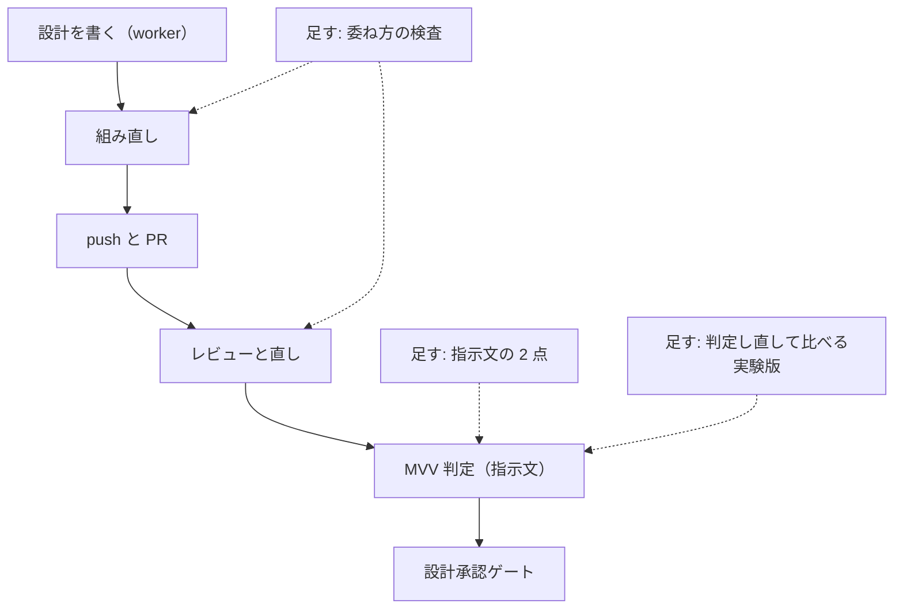
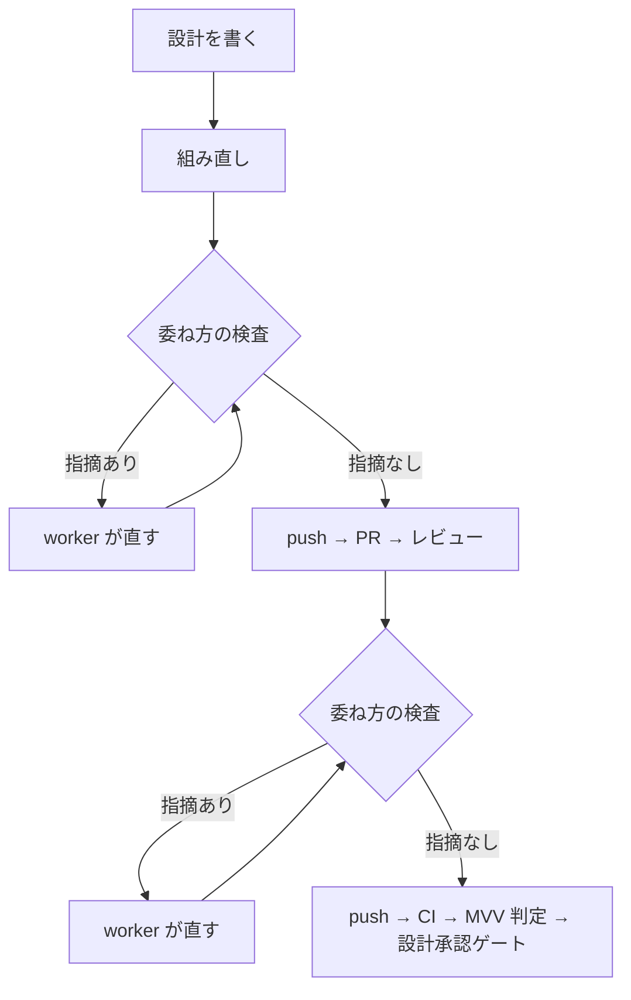
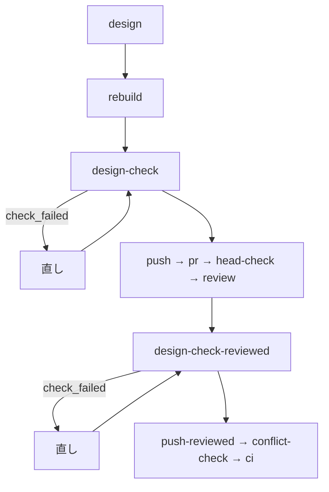

# 設計の判断と MVV 判定: 番号の無い「人へ残す判断」を検査で止め、承認を省ける割合を実物の LLM で比べる（#2912）

設計の判断を人へ残したままの設計は、承認の省略の判定（MVV 判定）を通らず、人の回答を待って止まる。そこで、当たるレッドライン（必ず人の承認が要る操作）の番号を示さずに判断を人に任せる行（以下、番号の無い委ね方）を設計 Pull Request の前に検査で止め、MVV 判定の指示文には起票者の推定の扱いを足す。あわせて、レッドラインを含む設計が人へ戻ることと承認を省ける割合が上がることを、過去の設計 PR を実物の LLM に判定し直させて確かめる。調べた標準と製品、採らなかった案は「決定の記録」と「外部の調査」にある。

## 今の姿

何が起きたか・目的・受け入れ条件は要求仕様（[issue-2912-requirements.md](./issue-2912-requirements.md)、正は #2912 の本文）にある。この文書は「どう解くか」と「なぜその解き方か」だけを書く。



- 受け入れ条件 1〜3（判断の書き方）は、設計の手順書とテンプレートがすでに満たす。この設計では書き方を変えない
- 番号の無い委ね方を確かめるのは、設計者が文書を読む手順だけである。10 系にあった検査のスクリプトは 11 系に無い
- MVV 判定の指示文には「AI が決めて記録した判断を、人が見ていないことだけを理由に判定できないにしない」と「レッドラインに当たる操作は必ず挙げる」がある。起票者の推定の扱いを定める文は無い
- 11 系の指示文でレッドラインが実際に挙がるかは、実物の LLM で確かめていない（[#3017: レッドラインに当たる設計を承認なしで通せる不具合](https://github.com/devbasex/ai-plugins/issues/3017)）
- MVV 判定は、差分が 1 ファイルで 200 行を超える PR を、LLM を呼ばずに人へ戻す。2026-11-27 に数えると、直近にマージした題に「設計」を含む PR 20 件のうち 17 件がこれに当たる（出典は「外部の調査」の後の「手元で数えた事実」）

## 文脈と制約

- レッドラインの守りを弱めない（機械の検査・判定が挙げたレッドラインで承認を省かない仕組みはそのまま残す）
- 承認ゲートの数、`ndf records mvv gate` の引数・結果の形・終了コード、MVV 判定の記録の行の形は変えない
- [#3017](https://github.com/devbasex/ai-plugins/issues/3017) の直しと、MVV 判定を打てないために人へ戻る場合（差分の大きさを含む）は、この課題の範囲外である
- 既定で動くコード・Skill の本文から、実験版の保存先（`experimental/ndf/`）を参照しない
- 詳細設計の検査の移植は [#3664: 詳細設計のテンプレートと検査](https://github.com/devbasex/ai-plugins/issues/3664) が扱う

## 解き方の全体像



- 設計の検査（`ndf records design check`）が、番号の無い委ね方の行を指摘して終了コード 1 で止める。設計者も同じコマンドを手で打てる
- 設計のプランは、レビュー担当に出す前の push と、レビューの直しの後の push の前に、この検査を打つ
- MVV 判定の指示文は、扱いの書かれた起票者の推定を理由に止めず、人へ残す判断の表の番号を必ずレッドラインとして挙げる
- 効果は、固定した過去の設計 PR を判定し直す実験版で数える。レッドラインを含む対照が人へ戻ることを先に確かめる

## 機能一覧

| # | 機能 | 誰が使うか |
| --- | --- | --- |
| F1 | 番号の無い委ね方を検査で見つける | 設計者（AI）と設計のプラン |
| F2 | 起票者の推定だけでは人へ戻らず、残した判断の番号は必ず挙がる | `pace: fast` / `pace: auto` の利用者 |
| F3 | 指示文の変更の前と後で、承認を省ける件数を比べる | このリポジトリの開発者 |

## 構成要素

| 要素 | 責務 |
| --- | --- |
| 設計の検査の判断（新設） | 文書の本文を受け、番号の無い委ね方の行を返す。ファイルと git を読まない |
| `records` のサブコマンド（変更） | 検査する文書を集め（引数のファイル、またはマージ先との差分の `issues/` の `.md`）、結果を統一 JSON で返す |
| 設計のプランのテンプレート（変更） | 2 回の push の前に検査のステップを置き、指摘があれば直しのステップへ回す |
| worker の作業の定義（変更） | 検査の指摘を直す作業 1 件 |
| MVV 判定の指示文（変更） | 起票者の推定の扱いと、人へ残す判断の表の番号の扱いを定める |
| 設計の手順書と決定の書き方（変更） | 手順 5 の確認を、読んで確かめる形からコマンドを打つ形へ変える |
| 判定の比較（新設・実験版） | 指定した PR の材料を、前と後の指示文で判定して数える。記録と PR には書かない |

## 入出力のコントラクト

### 設計の検査

```text
ndf records design check <ファイル>...
ndf records design check --base <ref>      # <ref> との差分で足した・変えた issues/ の .md
```

| 項目 | 決まり |
| --- | --- |
| 見る範囲 | 見出しが「決定の記録」「未確認のまま残ること」「人へ残す判断」で始まるセクションと、その下位。コードブロックとインラインコードの中は数えない |
| 指摘する行 | 委ねる語を含み、レッドラインの番号（`C<数>` / `P<数>` / `R<数>`）を含まない行。「人へ残す判断」の表で、番号の欄か「なぜ当たるか」の欄が空の行 |
| 委ねる語 | 判断の主語を人に置く言い回し。10 系の検査と同じ正規表現を、新しい検査の 1 か所に置く |
| 終了コード | 指摘なしは 0。指摘ありは 1（原因 `check_failed`、`items` に `name`（パス:行）・`rule`（`unnamed_redline`）・`text`） |
| 失敗 | 指定したファイルや `<ref>` を読めなければ、原因 `precondition` で止める。差分に対象の文書が無ければ 0 |

### MVV 判定の指示文

結果の形は変えない。判定の決まりの箇条に次の 2 点を足す。

| # | 定めること | 置く場所 |
| --- | --- | --- |
| 1 | 要求の「起票者の推定」の行に扱い（受け入れ条件・前提・含まない・採らない）が書かれていれば、設計者が決めた判断として読み、推定であることだけを理由に `unknown` にしない | 設計者の判断の行の次。続く「boundary には当てない」の打ち消しが、この行にも掛かるようにする |
| 2 | 設計文書の「人へ残す判断」の表に番号があれば、その番号と中身を必ず boundary に書く | boundary の行 |

## 処理の流れ

設計のプランの順は次のとおりである。MVV 判定のステップは変えない。



レビューが完了せずに終わる分岐（`incomplete`）も、2 つ目の検査を通ってから push する。CI の直しやマージ先の取り込みの後の push は、今のまま検査を挟まない（設計の本文を変える目的の直しではないため）。

## 非機能の実現方式

| 大項目 | 条件 | 実現方式 |
| --- | --- | --- |
| 運用・保守性 | MVV 判定の記録の行の形を変えない | 指示文の文だけを変える。実験版は記録を書かない |
| セキュリティ | レッドラインの守りを弱めない | 機械の検査と `may_skip` は変えない。足す緩和の行は verdict にだけ掛け、boundary には掛けない。対照が空になる件数を、前の指示文と比べて確かめる |

## 決定の記録

### 決定 1: 設計者と利用先のどちらからも同じ検査を打てるよう、検査を `ndf records design check` に置く

- **質問**: 番号の無い委ね方の検査をどこに置くか（要求の未決 2）
- **選んだ案**: `ndf` の記録のサブコマンドに `design check` を足す。判断は純粋な関数に分け、10 系の規則 `unnamed_redline` の範囲と語を引き継ぐ。単体テストは `test_design_check.py` に置く
- 採らなかった案: `ndf check` の規則にする（NDF 自身のコードを検査する開発者向けのサブコマンドで、利用先の設計文書を対象にしない）
- 採らなかった案: textlint か Vale の独自ルールにする（Node か別の実行ファイルを利用先へ要求する。見出しの下だけを見て、表の欄が空かを判定する部分は、どちらでも自分で書くことになる）
- 採らなかった案: 手順書の読み合わせのままにする（受け入れ条件 4 を満たさず、同じ文書でも結果が揺れる）
- **代償**: 委ねる語の正規表現を NDF が保守する。言い回しを変えた委ね方は拾えない
- 作り方: 自前で作る・ライブラリやサービスを使う
- 比べた候補: LIB1 / LIB2 / LIB3
- 根拠: Value 3 / Value 12 / Value 15（MVV バージョン 11）

### 決定 2: 打ち忘れと直しによる戻りを防ぐため、設計のプランの 2 か所で検査を打つ

- **質問**: 検査を手順書の指示だけにするか、プランのステップにもするか
- **選んだ案**: 手順 5 でコマンドを打つと書き、加えて設計のプランの最初の push の前と、レビューの直しの後の push の前にステップを置く。指摘は worker の直しの作業へ回す
- 採らなかった案: 手順書の指示だけ（打たなくても PR が出る）
- 採らなかった案: 最初の push の前の 1 回だけ（レビューの直しで委ね方が戻ると、承認ゲートまで気付かない）
- 採らなかった案: CI の検査にする（利用先のリポジトリごとに CI の設定を足させる）
- **代償**: 設計のプランのステップが増える。詳細設計のプランには置かないため、詳細設計の文書は設計者が手順で確かめる
- 根拠: Value 3（MVV バージョン 11）

### 決定 3: 推定だけで人へ戻らず守りも落とさないよう、緩和は verdict にだけ掛ける 1 行と、表の番号を挙げる 1 句を足す

- **質問**: 起票者の推定の扱いを指示文にどう書くか（要求の未決 3）
- **選んだ案**: 「扱いが書かれた推定は、設計者が決めた判断として読む」を足し、boundary の打ち消しをこの行にも掛ける。承認ゲートを省いたときの記録が推定を確かめた記録になる扱いは、決定の書き方の文書と用語集がすでに定めるので、指示文には写さない
- 採らなかった案: 10 系の指示文にあった「番号の無い委ね方は推奨を結論として読む」も戻す（番号の無い委ね方は決定 1 の検査が止める。緩和の行が増えるほど boundary の抜けの恐れが増える）
- 採らなかった案: 人へ残す判断の表を機械で読んで省かない検査を足す（レッドラインの守りの直しは #3017 の範囲で、表を挙げ忘れた設計には効かない）
- 採らなかった案: 足さない（受け入れ条件 5 を満たさない）
- **代償**: #3017 は、緩和の行を足した変更の後に boundary が空になったと推定している。同じ種類の行を 1 つ増やすため、決定 6 の確かめが要る
- 根拠: Value 1「速さや費用のために、人の承認を省かない」（MVV バージョン 11）。PRD2

### 決定 4: 前後の差を指示文の効果だけにするため、固定した PR の番号の集合を同じ材料で判定する

- **質問**: 受け入れ条件 7 の課題の集合と分母をどう決めるか（要求の未決 1）
- **選んだ案**: 10 系の判定の記録（`mvv-gate.jsonl`）から選び直した次の番号を固定する。前の指示文は、この課題の変更が入る前の 10 系のコミット `a40080ce` のもの、後は変更後の指示文である。MVV は両方とも今の版を使う。割合は「`follow` で boundary が空」の件数 ÷ 12 で、読めない回答も分母に残す

| 集合 | 件数 | PR の番号 |
| --- | --- | --- |
| 対象（判断を人に任せていたために戻った設計） | 12 | 2214 2295 2304 2301 2499 2662 2679 2708 2740 2731 2760 2937 |
| 対照（当時の判定がレッドラインを挙げた設計） | 20 | 2211 2213 2233 2236 2277 2278 2331 2379 2385 2380 2524 2636 2645 2670 2696 2697 2704 2744 2818 2887 |

- 採らなかった案: 変更の後に出た設計で比べる（前と後で設計が違い、差の原因を分けられない）
- 採らなかった案: 対象の設計を今の書き方に直して判定する（12 件の書き直しの費用がかかり、書き直した人の判断が結果に混ざる）
- 採らなかった案: 前の指示文を今の main（`c93e690ed`）にする（AI の判断を理由に止めない行がすでに入っていて、この課題の変更の効果を数えられない）
- **代償**: 差分の上限で人へ戻る分は数えない。数えるのは指示文の効果であって、運用で承認を省けた割合そのものではない。実験版は材料を切らずに渡す
- 根拠: Value 13（MVV バージョン 11）

### 決定 5: 呼んだときだけ働く測りなので、比較は実験版のスクリプトにする

- **質問**: 割合を比べる手段をどう持つか
- **選んだ案**: `experimental/ndf/mvv_replay.py` を新設する。指示文・材料の組み方・判定の呼び出しは MVV 判定の部品を使い、前の指示文は指定したコミットから読む。PR のコメント・判定の記録は書かず、結果は指定したファイルへ書く。費用の目安は、10 系で 44 回の判定が 10.23 USD だった
- 採らなかった案: `ndf records mvv gate` に引数を足す（コントラクトを変えないという要求に反する。PR へコメントを書く経路でもある）
- 採らなかった案: promptfoo を使う（材料の組み方と判定の呼び出しを写すことになり、本番と違う呼び方を測る）
- 採らなかった案: 手で判定する（同じ手順を打ち直せない）
- **代償**: 実験版は単体テストを持たず、手元で打って確かめる
- 作り方: 自前で作る
- 比べた候補: LIB4 / LIB5
- 根拠: Value 16 / Value 11（MVV バージョン 11）

### 決定 6: レッドラインを落としたまま割合を良く見せないため、対照を先に確かめる

- **質問**: [#3017](https://github.com/devbasex/ai-plugins/issues/3017) の直し、受け入れ条件 5〜7 の確かめをどの順にするか（要求の未決 4）
- **選んだ案**: 次の順で確かめる

| 順 | いつ | すること | 合格 |
| --- | --- | --- | --- |
| 1 | 実装の完了の前 | #3017 が挙げる 5 件（2213 2704 2331 2744 2524）を、`c93e690ed` の指示文と変更後の指示文で判定する | 前で boundary が空でなかった件が、後でも空でない。破れた件があれば、足す 2 点を指示文へ入れずに止めて報告する |
| 2 | リリースの後 | 対照 20 件と、この課題の設計 PR（人へ残す判断の表を持つ）を変更後の指示文で判定する | #3017 の 5 件と設計 PR のすべてで boundary が空でない。ほかの対照で空になった件は、理由とともに記録する |
| 3 | 順 2 に合格した後 | 対象 12 件を前と後で判定する | 後の割合が前より高い |

  順 2 に合格しなければ、受け入れ条件 6 は不合格として #3017 へ記録し、順 3 の数は受け入れ条件 7 の合格にしない。#3017 が直った後に順 2 から打ち直す
- 採らなかった案: #3017 の直しをこの課題に含める（要求の対象範囲の外である）
- 採らなかった案: #3017 が直るまで指示文を変えない（受け入れ条件 5 の変更と、その影響の確かめが後回しになる）
- **代償**: この課題が閉じる時期は #3017 に依存しうる
- 根拠: Value 13 / Value 1（MVV バージョン 11）。PRD2

## 影響と危険

- **働く範囲**: 設計の検査・プランのステップ・指示文は、NDF を使うすべてのリポジトリで働く。判定の比較はこのリポジトリだけ
- **プロジェクトごとに違うもの**: マージ先とリモート名はプランの値で受ける。レッドラインは番号の形だけを見るので、プロジェクトが足す番号も設定なしで通る
- **当たるモード**: 設計のプランを通るモード（`standard` ほか）。`light` は手順でコマンドを打つ場合だけ
- **壊れうる箇所**: 説明のつもりで委ねる語を地の文に書くと指摘される（インラインコードで囲めば指摘されない）。設計のプランの流れを固定するテストは、ステップが増える分を直す
- **効果の限り**: 差分の上限で人へ戻る設計には、指示文の変更は効かない。直近の設計 PR の多くがこれに当たるため、運用で人を待つ件数を減らすには、別の変更が要る
- **同じ所を触る別の変更**: #3664 は詳細設計の検査を足す。同じサブコマンドの下に規則を足せる形にする

### 代表のリポジトリでの振る舞い

| 代表のリポジトリ | 設定の要点 | 直した後に起きること | この種類で扱えなくなること |
| --- | --- | --- | --- |
| Web サービス | MVV を置き、`pace: fast` / `auto` で回す | 設計の検査が番号の無い委ね方を止め、MVV 判定は推定だけでは人へ戻さない | 無し |
| モバイルアプリ | 同上 | 同上 | 無し |
| 業務文書だけ | 設計文書を `issues/` に置く | 同じ検査が働く。当たる行が無ければ 0 で通る | 無し |

### このリポジトリだけの事情

| 値 | 置く所 | 持つ Issue |
| --- | --- | --- |
| 比べる PR の番号と前の指示文のコミット | この文書の決定 4・6。実験版へは引数で渡す | #2912 |

## 用語

| 用語 | 意味 | 用語集への反映 |
| --- | --- | --- |
| 設計の検査 | 設計文書を書いた後に走らせる、言語モデルを呼ばない決まった検査（`ndf records design check`。設計のプランのステップ `design-check`） | 意味の変更 |

## テスト設計

| 受け入れ条件・不変条件 | どの振る舞いで縛るか | どう壊したら落ちるべきか |
| --- | --- | --- |
| 1〜3 | 手順書とテンプレートの今の記述を読んで確かめる（変えない。文言のテストは書かない） | — |
| 4 | 3 つのセクションのどれでも、番号の無い委ねる行がある文書は終了コード 1 と行番号を返す | 対象のセクションを 1 つ落とすと通ってしまう |
| 4 | 番号を含む行、委ねる行の無い文書、対象の外のセクション・コードブロック・インラインコードの中の語は 0 | セクションや囲みを区別せず全文を見ると落ちる |
| 4 | 人へ残す判断の表で、番号の欄か理由の欄が空の行は指摘する | 行の中の番号の有無だけを見ると、理由の空を通す |
| 4 | `--base` は差分の `issues/` の `.md` だけを見る。読めない ref は 0 を返さない | 差分を読めないときに対象 0 件として通す |
| 決定 2 | 設計のプランは、2 回の push の前に検査を通り、指摘があれば直しへ回ってから検査へ戻る。レビューが完了しない分岐も通る | 直しの後に検査へ戻さず push する |
| 5・6 | 決定 6 の順で、実物の LLM に判定させる（単体テストで縛らない） | — |
| 6 | 判定がレッドラインを返せば省かない（今あるテストが縛る） | `may_skip` が boundary を見なくなる |
| 7 | 決定 4・6 の件数・割合・打ったコマンドをリリース後テストの記録に残す | — |
| 8 | 全体のテストを PR の CI で読む | — |

## 設計の結果

| 課題 | 扱い | 統合先 | 触るファイル |
| --- | --- | --- | --- |
| #2912 | 実装する | — | `plugins/ndf/src/ndf/domains/records/design_check_decide.py`（新設）、`plugins/ndf/src/ndf/domains/records/cli.py`、`plugins/ndf/src/ndf/domains/records/__init__.py`、`plugins/ndf/src/ndf/domains/records/mvv_material_decide.py`、`plugins/ndf/contracts/templates/design.json`、`plugins/ndf/contracts/worker/kinds.json`、`plugins/ndf/skills/design/SKILL.md`、`plugins/ndf/skills/design/references/decisions.md`、`experimental/ndf/mvv_replay.py`（新設）、`plugins/ndf/tests/domains/records/test_design_check.py`（新設）、`plugins/ndf/tests/route/test_flows.py` |

## 人へ残す判断

| 判断 | 当たるレッドライン | なぜ当たるか |
| --- | --- | --- |
| 決定 3 の指示文の変更を入れる（設計者の結論は「入れる」） | C2 | 人の承認の代わりに MVV 判定が設計承認ゲートを省ける条件が変わる。要求の「境界」も、指示文の変更は設計承認ゲートで人が見るとしている |

## 未確認のまま残ること

| 項目 | 内容 |
| --- | --- |
| 指示文の効果 | 変更後の指示文で対照のレッドラインが挙がるか、対象の割合が上がるかは、実物の LLM に判定させるまで分からない。決定 6 の順 1 と、リリース後テストで分かる |
| 判定の揺れ | 1 件を 1 回ずつ判定するため、1〜2 件の差は揺れと区別できない。記録にそう書く |
| 古い PR の材料 | 差分の API が大きいファイルの差分を返さない場合がある。実験版が欠けた件を結果に出し、リリース後テストで分かる |

## 外部の調査

| 種類 | 調べるか | 理由 |
| --- | --- | --- |
| 標準・仕様 | 調べる | 決定の記録の書き方と、未決の扱いの形を確かめる |
| 主要な製品 | 調べる | 未決を残したまま先へ進ませない方法と、自動承認の守り方を比べる |
| ライブラリとサービス | 調べる | 文章の規則の検査と、指示文の比較を自前で作る前に候補を比べる |

### 標準・仕様

| # | 標準・仕様 | 何を定めているか | 設計への反映 | 出典 |
| --- | --- | --- | --- | --- |
| STD1 | MADR 4.0.0 | 決定の記録は、検討した選択肢と、選んだ結果（Decision Outcome）を持つ。`decision-makers` の欄がある | 設計の判断は結論まで書く今の形を保つ | https://github.com/adr/madr/blob/4.0.0/template/adr-template.md （2026-11-27） |

### 主要な製品

| # | 製品 | どう解いているか | 設計への反映 | 出典 |
| --- | --- | --- | --- | --- |
| PRD1 | GitHub Spec Kit | 未決を `[NEEDS CLARIFICATION]` の目印で書かせ、残っていないことを計画の前に確かめる。確認の欄を埋めても目印が本文に残る例が報告されている | 自己申告の確認欄ではなく、本文の行を検査する（決定 1・2） | https://github.com/github/spec-kit/blob/main/templates/spec-template.md 、https://github.com/github/spec-kit/issues/646 （2026-11-27） |
| PRD2 | Claude Code の auto mode | 承認をモデルの分類器へ委ね、取り返せない操作や破壊的な操作は止める。分類器の見落としがあることも公表されている | 緩和の行は守りに当てず、守りの側を実物で測る（決定 3・6） | https://www.anthropic.com/engineering/claude-code-auto-mode （2026-11-27） |

### ライブラリとサービス

| # | 候補 | バージョン | ライセンス | 最後のリリースの日付 | 終了のアナウンス | 要件を満たすか | 出典 |
| --- | --- | --- | --- | --- | --- | --- | --- |
| LIB1 | textlint | 16.1.3 | MIT | 2026-11-23 | 無し | 独自ルールを書けば可。Node が要る | `gh api repos/textlint/textlint`、`npm view textlint`（2026-11-27） |
| LIB2 | Vale | 3.29.0 | MIT | 2026-11-26 | 無し | 語の検出は可。表の欄の確認は別に要る。別の実行ファイルが要る | `gh api repos/vale-cli/vale/releases/latest`（2026-11-27） |
| LIB3 | markdown-it-py（NDF が依存済み） | 4.3.0 | MIT | 2026-11-10 | 無し | 見出しとコードブロックの読み取りに使える | https://pypi.org/pypi/markdown-it-py/json （2026-11-27） |
| LIB4 | promptfoo | 0.126.0（npm） | MIT | 2026-11-18（npm の最終更新） | 無し | 指示文の比較は可。MVV 判定の材料と呼び出しを写すことになる | `npm view promptfoo`（2026-11-27） |
| LIB5 | DeepEval | 4.2.4 | Apache-2.0 | 2026-09-22 | 無し | 評価の指標を中心とするライブラリで、比較は可だが LIB4 と同じく写しが要る | `gh api repos/confident-ai/deepeval`（2026-11-27） |

### 手元で数えた事実

- 差分の上限に当たる設計 PR: `gh pr list --state merged --search "設計 in:title" --limit 20` の各 PR で `gh api repos/devbasex/ai-plugins/pulls/<番号>/files` の `patch` の行数の最大を数え、200 行超が 20 件中 17 件（2026-11-27）
- 対象 12 件と対照 20 件: 10 系の `mvv-gate-replay.py` の選び方（2026-11-10 より前の設計の行を PR ごとに最後の 1 行）を、手元の `mvv-gate.jsonl` に当てた（2026-11-27）

### 確かめられなかったこと

| 対象 | 試した手段 | 結果と理由 |
| --- | --- | --- |
| Kiro の設計文書での未決の扱い | 検索「GitHub Spec Kit NEEDS CLARIFICATION … Kiro design document」 | 該当する公開の記述を得られなかった |

調べた量: 候補 8 件・取得の試み 15 回。
