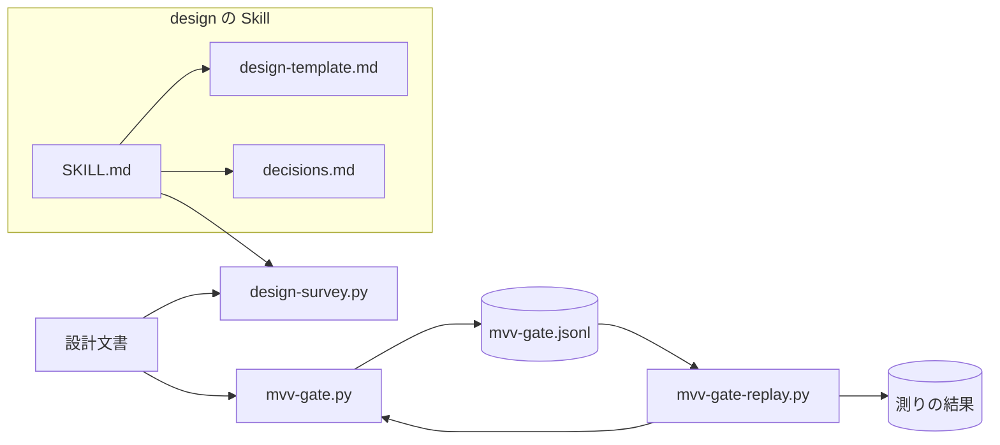
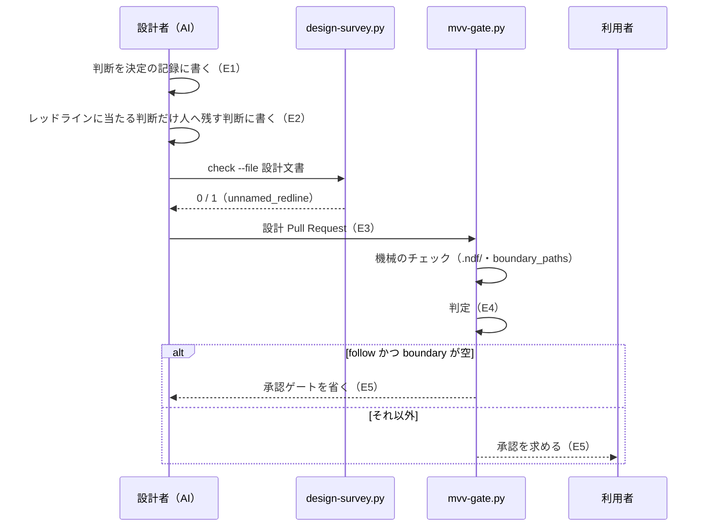
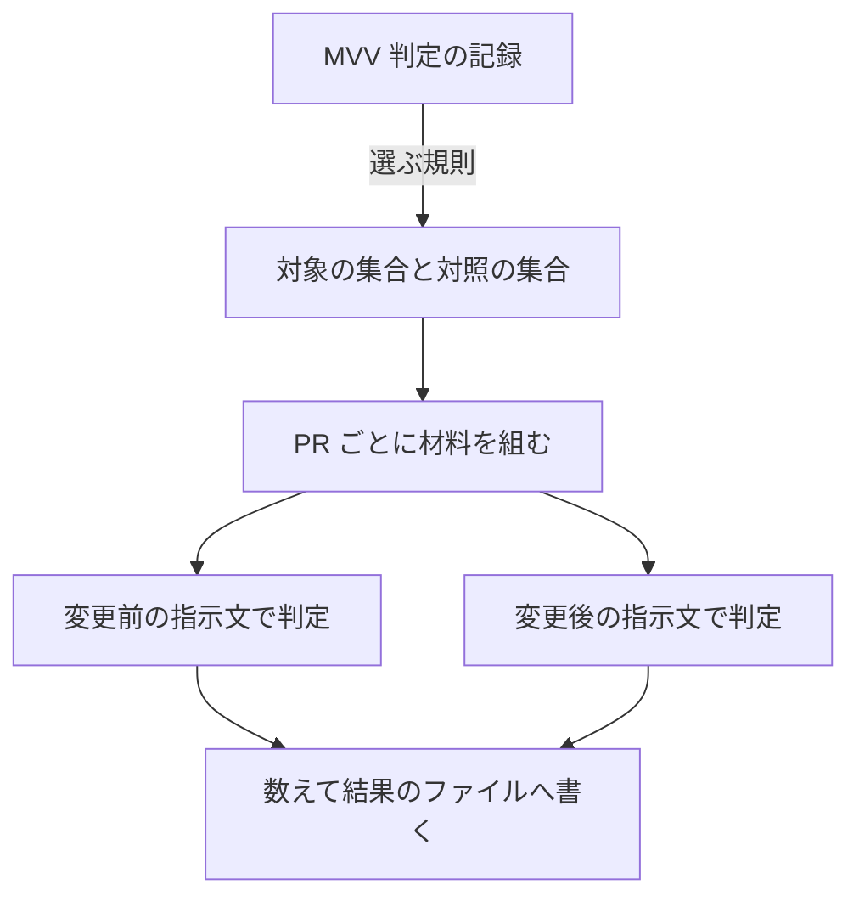

# design と MVV 判定: 設計の判断を AI が決めて記録し、人へ戻す判断をレッドラインに限る（#2912）

## 目的

- **今どうなっているか**: 設計文書が、作り方・範囲・既定値の選択を「設計承認ゲートで利用者が決める」と書いて残す。MVV 判定はそれを「人へ委ねた判断」と読んで「判定できない」を返し、`pace: auto` でも設計は人を待つ。MVV 判定の記録（2026-10-30〜11-08）では、この理由で戻った設計 Pull Request が 19 件ある（下の「比べる集合」）
- **誰に効くか**: `pace: fast` / `pace: auto` で開発ループを回す利用者。業務時間外に人へ戻った設計は翌営業日まで止まる
- **変えると何が成り立つか**: 設計者（AI）が判断を決めて理由と採らなかった案を残し、人へ残す判断はレッドラインに当たるものだけになる。MVV 判定はレッドラインの無い設計を「従う」と判定でき、人を待つ件数が減る

## 適用範囲

- **働く範囲**: NDF を使うすべてのリポジトリ。変えるのは `design` の Skill・設計文書の検査・MVV 判定の指示文で、どれもリリース対象である。比べる測りの実験版はこのリポジトリの MVV 判定の記録を読む
- **プロジェクトごとに違うもの**: レッドラインの番号の集合（共通原則の C・プロジェクト MVV の P・スプリント MVV の R）。検査は番号の形（`C<数>` / `P<数>` / `R<数>`）だけを見て、番号の一覧をコードに持たない
- **当たるモード**: `design` を通すすべてのモード（`light` / `operation` / `standard` / `legacy-refactor`）。MVV 判定の変更は `pace: fast` / `pace: auto` の判定と、`pace: normal` の助言の MVV 判定の両方に効く

## あるべき姿の根拠

| 根拠 | 種類 | 何を示すか |
| --- | --- | --- |
| 「棚卸しの判断待ちの印・課題を進めるかどうか・範囲の取り方は AI が決める」（2026-11-08） | 利用者の指示の原文 | 範囲・扱いの選択は AI が決めてよい |
| MVV 判定の記録で、人へ委ねた判断を理由に戻った設計 19 件・そのうちレッドラインを挙げたもの 0 件（下の「比べる集合」） | 実測 | 戻った理由はレッドラインではなく、文書の書き方である |
| STD1・STD2 | 外部の一次情報 | 決定の記録の標準は、決定を「結論・理由・採らなかった案」で書き、決めずに他者へ委ねる形を持たない |

要求と受け入れ条件は #2912 の本文にある（コピーは `issues/issue-2912-requirements.md`）。この文書は「どう作るか」だけを扱う。

## ドメインモデル

### コンテキスト

| コンテキスト | 何の語が 1 つの意味に決まるか |
| --- | --- |
| 開発の工程（`ndf-workflow`） | 設計の判断・人へ残す判断・レッドライン・MVV 判定・起票者の推定 |

1 つのコンテキストに収まるため、コンテキストマップの関係は宣言しない。

### 集約

| 集約 | 持ち主（書き換えてよいもの） | 根 | エンティティ | 値オブジェクト |
| --- | --- | --- | --- | --- |
| 設計文書 | `design` の工程の設計者（AI）。検査は読むだけ | 設計文書（`issues/issue-<番号>-design*.md`） | 決定・人へ残す判断の行 | レッドラインの番号・なぜ当たるかの 1 行 |
| MVV 判定 | `mvv-gate.py` | 判定 1 件（記録の 1 行） | — | 判定・理由・boundary・根拠の項目 |
| 比べる測り | 実験版 `mvv-gate-replay.py` | 測り 1 回の結果のファイル | 判定し直した 1 件 | 集合・指示文の版・数えた件数と割合 |

設計文書の行の形は `design` が決め、MVV 判定は設計文書を材料として読むだけで書き換えない。比べる測りは MVV 判定の部品を呼ぶが、MVV 判定の記録へ書かない。

### 不変条件

| # | 集約 | 条件 | 破れたときの扱い |
| --- | --- | --- | --- |
| I1 | 設計文書 | 「人へ残す判断」の表の行は、レッドラインの番号（`C<数>` / `P<数>` / `R<数>`）と、なぜ当たるかの 1 行を持つ | 検査が行を指摘し、終了コード 1 で止まる |
| I2 | 設計文書 | 「決定の記録」「未確認のまま残ること」「人へ残す判断」の節（下位の見出しを含む）に、レッドラインの番号を含まずに判断を人へ委ねる行を置かない | 検査が行を指摘し、終了コード 1 で止まる |
| I3 | 設計文書 | 判断を人へ委ねる行が無い文書と、委ねる行がすべて番号を含む文書は、この規則で指摘されない | 検査が 0 を返す。誤って 1 を返すと設計の工程が止まる |
| I4 | MVV 判定 | boundary が空でない判定、`.ndf/` の宣言を変える PR、`boundary_paths` に当たる PR は承認ゲートを省かない | 承認ゲートへ戻す（終了コード 10）。今の振る舞いのまま |
| I5 | MVV 判定 | 記録（`mvv-gate.jsonl`）の行の形・引数・結果の形・終了コードを変えない | 変えた差分をテストが落とす |
| I6 | 比べる測り | 測りは MVV 判定の記録とスプリントの状態へ書かない。結果は指定したファイルにだけ書く | 記録の行が増えたらテストが落とす |

### ドメインイベント

| # | イベント | 発生元 | 受け手 |
| --- | --- | --- | --- |
| E1 | 設計の判断を決定の記録に書いた | 設計者（AI） | 設計文書の検査・MVV 判定 |
| E2 | 人へ残す判断にレッドラインの番号と理由を書いた | 設計者（AI） | 設計文書の検査・MVV 判定（boundary） |
| E3 | 設計 Pull Request を出した | `design` の手順 6 | MVV 判定 |
| E4 | MVV 判定が設計文書を読み、判定を返した | `mvv-gate.py` | スプリントの承認ゲートの記録 |
| E5 | 承認ゲートを省いた、またはレッドラインを挙げて人へ戻した | `mvv-gate.py` | conductor・利用者 |
| E6 | 同じ集合で、変更の前と後の指示文の判定を数えた | `mvv-gate-replay.py`（リリース後テストで打つ） | リリース後テストの記録 |

### 用語

| 用語 | 意味 | 用語集への反映 |
| --- | --- | --- |
| 人へ残す判断 | 設計文書のうち、レッドラインに当たるため設計者（AI）が決めずに承認ゲートで人が決める判断。判断ごとに当たるレッドラインの番号となぜ当たるかを書く。番号を挙げられない判断は人へ残さず、設計者が決める | 追加 |
| 起票者の推定 | 課題の題・本文に、利用者の指示の原文に無く起票者（課題を書いた AI）が文書・コード・経緯から推して足した条件。設計承認ゲートで確かめるまで利用者の決定として扱わない。扱い（受け入れ条件・前提・含まない・採らない）を書いた推定は設計者が決めた判断として読み、MVV 判定が承認ゲートを省いたときはその判定が確かめた記録になる | 意味の変更 |

## 外部の調査

| 種類 | 調べるか | 理由 |
| --- | --- | --- |
| 標準・仕様 | 調べる | 決定の記録の書き方に、広く使われている形（ADR）がある |
| 主要な製品 | 調べない | 設計文書の検査と判定の指示文はこのプロジェクトの工程の中の取り決めで、同じ問題を解く製品の形は設計の判断を左右しない |
| ライブラリとサービス | 調べる | 指示文の前後を同じ入力で比べる評価のツールがある |

### 標準・仕様

| # | 標準・仕様 | 何を定めているか | 設計への反映 | 出典 |
| --- | --- | --- | --- | --- |
| STD1 | Architecture Decision Record（Michael Nygard） | 決定 1 件を Title・Context・Decision・Status・Consequences で書く。Status は proposed / accepted と、後の決定で覆したときの deprecated / superseded。決めずに他者へ委ねる形は定めていない | 決定の記録は結論を書く形だけを持ち、委ねる形をテンプレートから外す（決定 1）。承認ゲートが accepted に当たり、設計文書の中に「未決」の状態を置かない | https://cognitect.com/blog/2011/11/15/documenting-architecture-decisions （2026-11-09 取得） |
| STD2 | MADR 4.0.0（2024-09-17） | Considered Options・Decision Outcome（「Chosen option: …, because …」）・Consequences。採らなかった案は Considered Options に並べ、理由を良い点・悪い点で書く。決めた人は front matter の decision-makers に書く | 今の決定の記録（結論・理由・採らなかった案）と同じ骨格であることを確かめた。決めた人の欄は足さず、人が決める判断だけを「人へ残す判断」の節に分ける（決定 2） | https://adr.github.io/madr/ （2026-11-09 取得） |

### ライブラリとサービス

| # | 候補 | 版 | ライセンス | 最後のリリースの日付 | 終了のアナウンス | 要件を満たすか | 出典 |
| --- | --- | --- | --- | --- | --- | --- | --- |
| LIB1 | promptfoo | 未確認 | 未確認（ページは「open-source」とだけ書く） | 未確認 | 無し（ページに記載なし） | 一部。複数のプロンプトを同じテストケースで比べられ、`exec:` で任意のコマンドを呼べる。ただし Node の依存が増え、材料を組む MVV 判定の部品（PR の設計文書の読み出し・MVV の節）を使えない | https://www.promptfoo.dev/docs/intro/ 、https://www.promptfoo.dev/docs/providers/custom-script/ （2026-11-09 取得） |
| LIB2 | MVV 判定の部品（`mvv-gate.py` の `build_prompt`・`ask`・`pr_facts`・`design_material`） | このリポジトリの現行 | リポジトリと同じ | — | 無し | 満たす。今の判定と同じ材料・同じ起動で、指示文だけを差し替えて判定できる | `plugins/ndf/scripts/mvv-gate.py` （2026-11-09 読んだ） |

### 確かめられなかったこと

| 対象 | 試した手段 | 結果と理由 |
| --- | --- | --- |
| promptfoo の版・ライセンス名・最後のリリースの日付 | https://www.promptfoo.dev/docs/intro/ | ページに記載が無かった。パッケージの登録簿は試していない（採らない候補のため上限の前に止めた） |

調べた量: 候補 4 件・取得の試み 4 回。

## 機能一覧

| # | 機能 | 誰が使うか |
| --- | --- | --- |
| F1 | 設計文書のテンプレートと `design` の本文が、判断を決定の記録に書かせ、人へ残す判断をレッドラインの番号つきの節に限る | 設計者（AI） |
| F2 | 設計文書の検査が、番号の無い「人へ委ねる行」を指摘する | 設計者（AI）・設計の手順 5 |
| F3 | MVV 判定の指示文が、AI が決めて記録した判断と扱いを書いた起票者の推定を、それだけで「判定できない」にしない | MVV 判定 |
| F4 | 同じ集合で変更の前と後の指示文の判定を数える | リリース後テストを打つ conductor |

## 構成要素

| 要素 | 責務 |
| --- | --- |
| `design` の `SKILL.md` | 手順 4 に「判断は設計者が決める。人へ残すのはレッドラインに当たる判断だけで、`## 人へ残す判断` に番号と理由を書く」を置く。手順 5 の検査の説明に新しい規則を足す |
| `references/design-template.md` | テンプレートに `## 人へ残す判断` の節（判断・当たるレッドライン・なぜ当たるか）を置き、「未確認のまま残ること」の説明を「デプロイの前に確かめられない事実だけを置き、選ばせる判断を置かない」にする |
| `references/decisions.md` | 「人へ委ねない」の節を足す: 選択の分かれ目は結論・理由・採らなかった案で書く。材料が無く決められないものは事実として「未確認のまま残ること」へ書く。起票者の推定の扱いの読み方 |
| `references/deliverables.md` | 要否表に「人へ残す判断」の行（該当時）と、成果物ごとの中身の行を足す |
| `design-survey.py` | 新しい規則 `unnamed_redline` を足す（I1・I2）。外部の調査の規則と同じ文書の集め方・同じ終了コードで返す |
| `mvv-gate.py` の `SYSTEM` | 人へ戻す条件を書き換える（下の「判定の指示文」）。引数・結果の形・記録の形は変えない |
| 実験版 `experimental/mvv-gate-replay.py` | 集合を MVV 判定の記録から決め、変更の前と後の指示文で判定し直して数える |
| `docs/ndf-experiments.md` | 実験版の台帳に 1 行を足す |
| 用語集（`docs/glossary/glossary.json`・`docs/glossary.md`） | 「人へ残す判断」を足し、「起票者の推定」の意味を変える |
| 起票者の推定の定義のコピー（`requirements-design` の `spec-template.md`・`out-of-scope` の `SKILL.md`・確定仕様 `ndf-gate-rejections-and-filer-assumptions.md`） | 用語集の意味に合わせ、「設計承認ゲートで利用者が確かめる」の文を「設計承認ゲートで確かめる（MVV 判定が省いたときはその判定が確かめる）」へそろえる |



図に含めない要素: 用語集と起票者の推定の定義のコピー（読まれる文書で、呼び出しの関係を持たない）、`deliverables.md`（`SKILL.md` から読む参照の 1 つ）、実験版の台帳。

## 入出力の契約

### 設計文書の「人へ残す判断」の節

```markdown
## 人へ残す判断

| 判断 | 当たるレッドライン | なぜ当たるか |
| --- | --- | --- |
| `.ndf/pace.json` の `boundary_paths` へ 1 行足すか | C7 | 利用者の設定（`.ndf/`）を書き換える |
```

- 人へ残す判断が無いときは、節に `無し` の 1 行だけを置く（`standard` では節を省かない。承認する人が「人の判断が要るか」を 1 か所で読むため）
- 「当たるレッドライン」のセルは番号を 1 つ以上含む。複数なら `・` で並べる

### `design-survey.py check` の新しい規則

引数・終了コード・結果の形は今のまま（0 = 指摘なし / 1 = 指摘あり / 2 = 読めない / 3 = 文書が無い）。指摘の `items` に次の形の行が加わる。

```json
{"name": "issues/issue-1-design.md:42", "rule": "unnamed_redline", "text": "| 既定値を 3 にするか | 設計承認ゲートで利用者が決める |"}
```

| 規則 | 指摘する行 | 指摘しない行 |
| --- | --- | --- |
| `unnamed_redline` | 対象の節の中で、委ねる語に当たり、レッドラインの番号を含まない行。「人へ残す判断」の表で番号のセルに番号が無い行 | コードブロックの中の行。インラインコード（`` ` `` で囲んだ部分）の中だけで委ねる語が出る行。対象の節の外の行（要求の「起票者の推定」の節など） |

- **対象の節**: 見出しが「決定の記録」「未確認のまま残ること」「人へ残す判断」で始まる節と、その下位の見出しの節
- **委ねる語**: 判断の主語を人に置いて決めさせる言い回し。例は `利用者が決める`・`利用者が選ぶ`・`利用者が確かめる`・`承認ゲートで人が決める`・`人へ委ねる`。用語「人へ残す判断」と重なる言い回しは一覧に入れない。正規表現の一覧は `design-survey.py` の 1 か所に置き、テストの入力も同じ一覧から組む
- **レッドラインの番号**: `(?<![A-Za-z0-9])[CPR][0-9]+(?![0-9])`
- 規則は文書ごとに判定する（外部の調査の規則のような、番号でつながる文書のまとまりを要さない）

### `mvv-gate.py` の判定の指示文

引数・結果の形・記録の形・終了コードは変えない。`SYSTEM` の箇条のうち、人へ戻す条件を次の 4 つにする（既存の follow / not_follow・デプロイ後の実測・boundary・basis の箇条は残す）。

| # | 条件 | 判定 |
| --- | --- | --- |
| 1 | 設計者が判断（作り方・範囲の取り方・既定値・扱いの選択）を決め、決定の記録に結論と理由を書いている | その判断を人が見ていないことだけを理由に unknown にしない |
| 2 | 要求の「起票者の推定」の行に扱い（受け入れ条件・前提・含まない・採らない）が書かれている | 設計者が決めた判断として読む。推定であることだけを理由に unknown にしない |
| 3 | 設計文書が人へ残す判断にレッドラインの番号を挙げている、または材料から読み取れる変更がレッドラインに当たる | boundary にその中身を書く（設計文書の名指しに依らない） |
| 4 | 設計文書が番号を挙げずに判断を人へ残している | 設計の推奨が書かれていればそれを結論として読む。推奨も無く材料から決められないときだけ unknown |

## 処理の流れ



### 比べる測り（E6）



- **対象の集合**: MVV 判定の記録のうち、設計承認ゲートで、判定が unknown か not_follow、理由が人へ委ねた判断を挙げ（委ねる語の一覧と同じ正規表現）、boundary が空の行。PR ごとに最後の行を使う。期間は 2026-11-10T00:00Z より前で固定する
- **対照の集合**: 設計承認ゲートで boundary が空でない行の PR（受け入れ条件 6 の退行を見る）
- **材料**: `mvv-gate.py` の部品で PR の題名・本文・変更したファイル・設計文書（PR の先頭のコミットの中身）を組む。MVV の節は今の承認済みのプロジェクト MVV。スプリント MVV は渡さない
- **変更前の指示文**: `git show <版>:plugins/ndf/scripts/mvv-gate.py` から `SYSTEM` を読む。版は引数で受ける
- **判定の回数**: 対象は変更前と変更後の 2 回、対照は変更後の 1 回
- **割合**: 「従う」で boundary が空の件数 ÷ 集合の PR の数。判定を読めない件は分母に残し、件数を別に出す
- **出力**: 1 行の JSON（`lib/step_result.py` の形）。`items` に PR ごとの判定、`metrics` に件数と割合。`--out` のファイルにだけ書く

## 決定の記録

### 決定 1: 決めない判断を設計文書に残さないため、テンプレートから委ねる書き方を外し、判断は決定の記録へ書かせる

選択の分かれ目は設計者が決め、結論・理由・採らなかった案で残す。材料が無く決められないものは、選択肢を並べず「未確認のまま残ること」へ事実（何が分からず、いつ・何で分かるか）として書く。決定の記録の標準（STD1・STD2）は結論を書く形だけを持ち、決めないまま他者へ委ねる形を持たない。委ねる形をテンプレートに残したまま判定の側だけを変えると、文書が判断を人へ残し続け、MVV 判定は推奨を拾い読むしかなくなる。

- 作り方: 標準に倣う
- 比べた候補: STD1・STD2

根拠: Value 2 / Value 5（MVV 版 6）

### 決定 2: 人が決める判断を 1 か所で読めるよう、人へ残す判断をレッドラインの番号つきの節に分ける

承認する人が見るべき判断が設計文書の各所に散ると、承認資料で拾い漏れる。節を 1 つにして、行ごとに当たる番号となぜ当たるかを書かせる。決定の記録の各決定に「決めた人」の欄（STD2 の decision-makers）を足す形は採らない。人が決める判断はレッドラインに当たるものだけで、決定の大半では欄が同じ値になり、読む量だけが増えるためである。

根拠: Value 2 / Value 8（MVV 版 6）

### 決定 3: 手順 5 で 1 回打てば済むよう、番号の無い委ねる行の検査を design-survey.py の規則として足す

手順 5 はすでに設計文書と要求のファイルを並べて `design-survey.py check --file` を打つ。同じ入力・同じ終了コードの検査を別のスクリプトにすると、打つコマンドと文書の集め方が 2 つになる。規則の名前を分け、外部の調査の規則とは独立に文書ごとに判定する。題の「外部の調査」はスクリプトの名前に残るが、docstring と summary を「設計文書の検査」へ広げる。

- 作り方: 自前で作る
- 比べた候補: LIB2

根拠: Value 5 / Value 7（MVV 版 6）

### 決定 4: 要求の決まり文句で誤って止まらないよう、検査は対象の節の中の行だけを見る

要求の「起票者の推定」の節は決まり文句として「設計承認ゲートで確かめる」を持ち、手順 5 は要求のファイルも検査に渡す。文書全体を見ると、委ねていない要求でも止まる。人へ委ねる判断が書かれるのは「決定の記録」「未確認のまま残ること」「人へ残す判断」の 3 つの節であるため、そこに限る。インラインコードの中を外すのは、委ねる語そのものを説明する文書（この設計文書など）を止めないためである。文書の名前（`-design` を含むか）で対象を決める形は採らない。`light` の設計は要求のファイルの節に書かれ、名前では拾えないためである。

根拠: Value 6 / Value 7（MVV 版 6）

### 決定 5: レッドラインの検査を弱めないため、判定の指示文は boundary の条件を設計文書の名指しに依らせない

設計文書が番号を挙げ忘れても、変更がレッドラインに当たれば boundary に載る形を保つ（指示文の条件 3）。番号の無い委ねる行は推奨を結論として読む（条件 4）が、これは検査で止まらなかった古い文書のための読み方で、承認ゲートを省く条件を広げるものではない。boundary・`.ndf/` の宣言の機械のチェック・`boundary_paths` は変えない。

根拠: C7 / Value 2（MVV 版 6）

### 決定 6: 起票者の推定を確かめる手段を承認ゲートと同じにするため、MVV 判定が省いたときはその判定を確かめた記録とする

起票者の推定は「設計承認ゲートで確かめる」と定義されている。`pace: fast` / `pace: auto` では、利用者が MVV と進め方の宣言で設計承認ゲートの判断を MVV 判定へ委ねている。推定だけを別扱いにして人へ戻すと、承認ゲートの委任が推定の数だけ外れる。扱いを書いた推定は設計者が決めた判断として読み、MVV 判定が「従う」と判定すれば、その記録（`mvv-gate.jsonl` の行と承認ゲートの記録 `by: mvv`）が確かめた記録になる。用語集の意味を変え、定義をコピーしている 3 か所をそろえる。

根拠: Vision / Value 8（MVV 版 6）

### 決定 7: 指示文の効果だけを同じ入力で比べるため、記録した PR の材料を変更の前と後の指示文で判定し直す

記録に残った判定は、判定した時点の MVV の版・材料・指示文が混ざっている。今の MVV と同じ材料で、指示文だけを変えて 2 回判定すれば、差は指示文の効果になる。設計文書を新しいテンプレートで書き直して判定し直す形は採らない。19 件の設計を作り直す費用が判定の費用を大きく上回るためである。比べるツールに promptfoo（LIB1）は採らない。材料を組む MVV 判定の部品を使えず、Node の依存が増えるためである。呼んだときだけ働く測りなので実験版に置き、MVV 判定の引数は増やさない。費用は 1 回 0.236 USD（設計の判定 101 件の平均）で、対象 19 件 × 2 回と対照 21 件 × 1 回の 59 回で約 14 USD になる。

- 作り方: 自前で作る
- 比べた候補: LIB1 / LIB2

根拠: Value 4 / Value 9（MVV 版 6）

## テスト設計

| 受け入れ条件・不変条件 | どの振る舞いで縛るか | どう壊したら落ちるべきか |
| --- | --- | --- |
| 受け入れ条件 1・2・3 | テンプレートと本文の書き方。`.md` の文言のテストは書かない（`AGENTS.md`）。この設計文書を手順 5 の検査に通し、新しいテンプレートで書いた文書が 0 を返すことで確かめる | — |
| 受け入れ条件 4・I2 | 決定の記録の節に、番号の無い委ねる行がある文書で `check --file` が 1 を返し、items に行番号つきの `unnamed_redline` が出る | 委ねる語の一覧を空にすると落ちる |
| I1 | 人へ残す判断の表で、番号のセルが空の行が指摘される | 表の行を読まないようにすると落ちる |
| I3 | 番号を含む委ねる行だけの文書、委ねる行の無い文書、要求の「起票者の推定」の節にだけ委ねる語がある文書、インラインコードの中にだけ委ねる語がある文書、コードブロックの中にだけある文書が 0 を返す | 対象の節を文書全体に広げる・インラインコードを外さないと落ちる |
| 受け入れ条件 5 | 判定の指示文が条件 1〜4 を持つことはリリース後テスト（受け入れ条件 7 の測り）で確かめる。LLM を呼ぶため単体テストでは縛らない | — |
| 受け入れ条件 6・I4 | 偽の判定者（`NDF_MVV_CLAUDE`）が follow と空でない boundary を返すと終了コード 10 で承認ゲートへ戻る。`.ndf/mvv.md` を変える PR は LLM を呼ばずに戻る | boundary の確認を外すと落ちる。既存のテストにあればそれを使う |
| I5 | 偽の判定者で判定した記録の行のキーの集合が変わらない | 記録へ項目を足すと落ちる |
| 受け入れ条件 7 | 実験版の測りで、偽の判定者を使い、対象・対照の集合の選び方・割合の計算・変更前の指示文の読み出しが期待どおりになる | 分母から読めない件を外す・boundary の空でない行を対象に入れると落ちる |
| I6 | 測りの後に MVV 判定の記録とスプリントの状態のファイルが変わらない | 測りが `mvv-gate.py check` を呼ぶ形にすると落ちる |
| 受け入れ条件 8 | `uv run --frozen --project . --all-extras pytest . -q -n 4` が通る | — |

## 人へ残す判断

無し

## 設計の結果

| 課題 | 扱い | 取り込み先 | 触るファイル |
| --- | --- | --- | --- |
| #2912 | 実装する | — | `plugins/ndf/skills/design/SKILL.md`、`plugins/ndf/skills/design/references/design-template.md`、`plugins/ndf/skills/design/references/decisions.md`、`plugins/ndf/skills/design/references/deliverables.md`、`plugins/ndf/scripts/design-survey.py`、`plugins/ndf/scripts/tests/test_design_survey.py`、`plugins/ndf/scripts/mvv-gate.py`、`plugins/ndf/scripts/tests/test_mvv_gate.py`、`plugins/ndf/scripts/experimental/mvv-gate-replay.py`（新設）、`plugins/ndf/scripts/tests/test_mvv_gate_replay.py`（新設）、`docs/ndf-experiments.md`、`docs/glossary/glossary.json`、`docs/glossary.md`、`plugins/ndf/skills/requirements-design/references/spec-template.md`、`plugins/ndf/skills/out-of-scope/SKILL.md`、`docs/specifications/ndf-gate-rejections-and-filer-assumptions.md` |

## 未確認のまま残ること

| 項目 | 内容 |
| --- | --- |
| 受け入れ条件 7 の割合 | 変更後の指示文で対象 19 件のうち何件が「従う」になるかは、リリース後テストで測りを打つまで分からない。0 件なら受け入れ条件 7 を満たしたと記録しない |
| 判定の揺れ | 同じ材料でも判定は 1 回ごとに揺れうる。測りは 1 回ずつで、揺れの幅は測らない。差が 1〜2 件のときは揺れと区別できないことを記録に書く |
| スプリント MVV | 記録の判定にはスプリント MVV を渡したものがあるが、測りは渡さない。記録の判定と測りの変更前の判定が食い違う件数を測りの結果に残す |
| 集合の正規表現の取りこぼし | 対象の集合は理由の文の正規表現で選ぶ。手で分けた 12 件（要求の前提 4）との差は、測りの結果に両方の PR の一覧を並べて確かめる |
