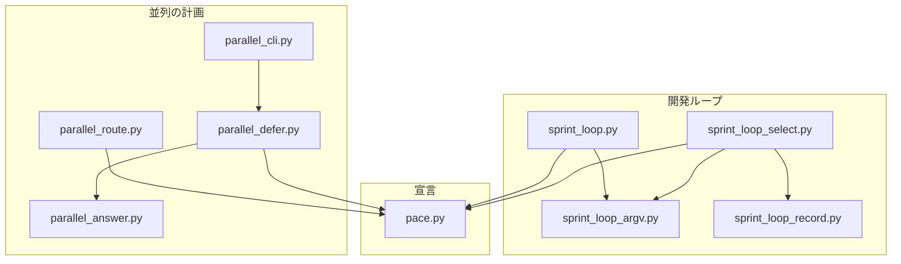
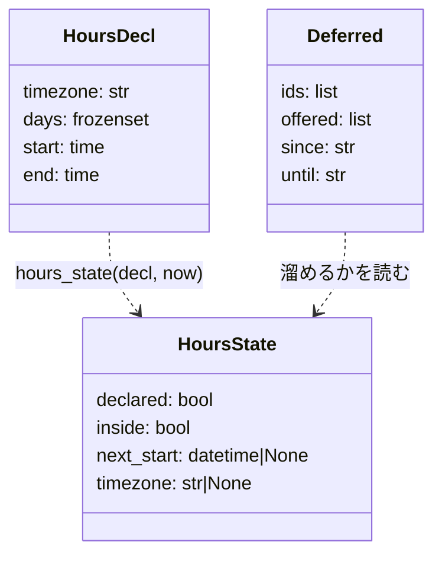
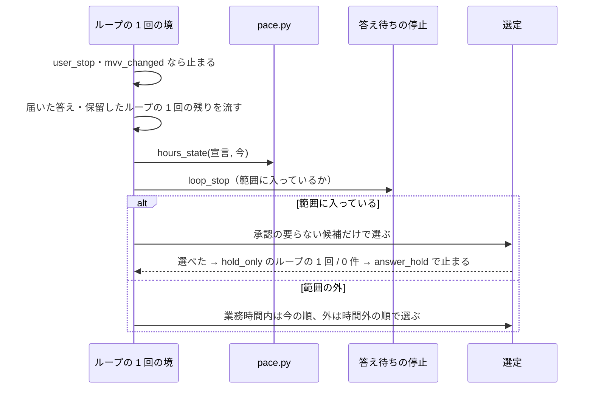
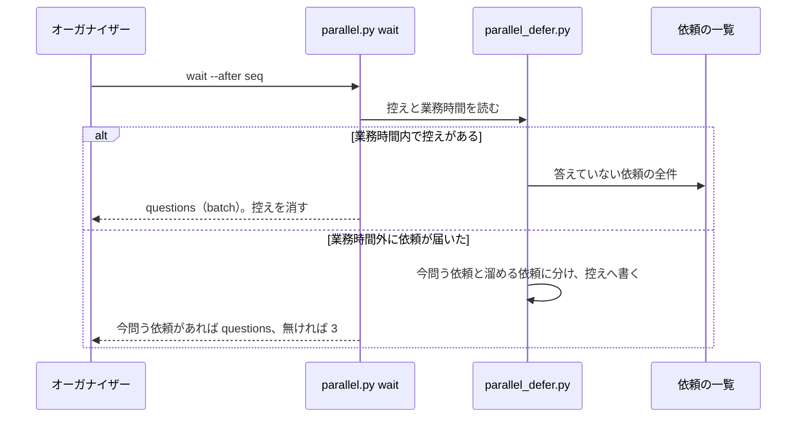
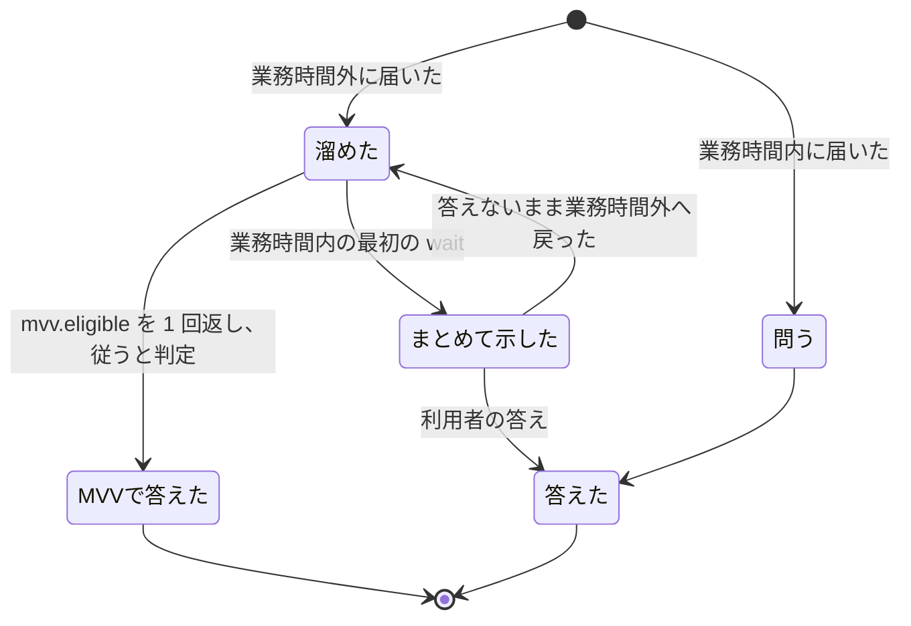

# 開発ループと並列の計画: 答え待ちの間も承認の要らない作業を進め、業務時間外の承認の依頼を朝にまとめて示す（#2913）

## 目的

- **今どうなっているか**: 並列の計画のレーンが答え待ちの停止の範囲に入ると、ループの 1 回の境で無条件に止まる。承認した設計の実装や、答えの届いた保留したループの 1 回の残りのように、人の答えを新しく生まない作業があっても進まない。業務時間外に届いた承認の依頼は、届くたびに 1 件ずつ利用者へ問われる
- **誰に効くか**: 開発ループ（`--loop`）を並列の計画で回す利用者
- **変えると何が成り立つか**: 答え待ちの間もレーンが承認の要らない作業を進め、業務時間外に溜まった承認の依頼は業務時間の始めに 1 回の提示でまとめて届く

## 適用範囲

- **働く範囲**: NDF を使うすべてのリポジトリ。業務時間の宣言を書いたリポジトリでだけ、時間外の選定の順と依頼の問い方が変わる
- **プロジェクトごとに違うもの**: 業務時間（時刻帯・曜日・始まり・終わり）を設定（`.ndf/pace.json` の `business_hours`）で受ける。値は利用者が書く
- **当たるモード**: 開発ループのループの 1 回（`pace: auto` で組むため `light`・`standard`・`legacy-refactor`）。1 スプリントだけの実行（`supervise.py run` の単発）は変えない

## あるべき姿の根拠

| 根拠 | 種類 | 何を示すか |
| --- | --- | --- |
| 「ある程度は仕組みでカバーしたい」 | 利用者の指示の原文（#2913 の依頼の引用） | 待ちを人の手で埋めず、仕組みで埋める |
| STD1・LIB1 | 外部の一次情報 | 業務時間の時刻帯は IANA の名前で書き、標準ライブラリで解決できる |
| STD3・PRD1 | 外部の一次情報 | 曜日・時刻・時刻帯の組で時間帯を宣言し、時間の内と外で通知の扱いを分ける形は、主要な製品が採っている |
| `plugins/ndf/scripts/lib/sprint_loop_argv.py:28` の `new_sprint_argv` | 実測（コードの読み取り） | ループの 1 回は、設計を承認していない課題すべてに設計のステップを置く。選定の時点で「新しい承認を生む作業」を決められる |

要求と受け入れ条件は #2913 の本文にある（コピーは [issue-2913-requirements.md](issue-2913-requirements.md) ）。この文書は「どう作るか」だけを扱う。

## ドメインモデル

### コンテキスト

| コンテキスト | 何の語が 1 つの意味に決まるか |
| --- | --- |
| NDF の開発の工程（`ndf-workflow`） | 業務時間・新しい承認を生む作業・承認の要らない作業・溜めた依頼・答え待ちの停止 |

開発ループと並列の計画は、どちらも `ndf-workflow` の中にある。コンテキストをまたがない。

### 集約

| 集約 | 持ち主（書き換えてよいもの） | 根 | エンティティ | 値オブジェクト |
| --- | --- | --- | --- | --- |
| ループの記録 | 開発ループの部品（`sprint_loop*.py`） | ループの記録（`.ndf/loop/<名>/loop.json`） | ループの 1 回・待ち（`waiting`） | 選定の行・業務時間の判定・停止の範囲での選定の印 |
| 業務時間の宣言 | 利用者（`.ndf/pace.json` を書く）。読むのは `pace.py` だけ | 業務時間の宣言 | — | 時刻帯・曜日の集合・始まり・終わり |
| 溜めた依頼 | 待ちの部品（`parallel_defer.py`。`parallel.py wait` から呼ぶ） | 溜めた依頼の控え（`.ndf/parallel/<計画名>/deferred.json`） | — | 依頼の id・溜め始めた時刻・業務時間の始まり |
| 依頼の一覧 | 耐久ワークフロー（`parallel_run.py`）。この変更では書き換えない | 依頼の一覧 | 依頼 | — |

溜めた依頼は、依頼の一覧を id で参照するだけで、依頼そのものを持たない。依頼の一覧の持ち主は変わらない。

### 不変条件

| # | 集約 | 条件 | 破れたときの扱い |
| --- | --- | --- | --- |
| I1 | ループの記録 | 答え待ちの停止の範囲で始めたループの 1 回は、設計のステップを持たない（選んだ課題はすべて承認した設計） | `loop sprint` が組まずに断る（終了コード 2・理由の 1 行） |
| I2 | ループの記録 | 選定で「承認の要らない作業」とした課題は、組んだスプリントで設計のステップ（`--design`）に入らない。分類はスプリントを組む規則と同じ 1 つの関数で決まる | 分類と組み方の関数を分けない（テストで両方の結果を突き合わせる） |
| I3 | 業務時間の宣言 | 宣言が無い・不正なときの判定は「業務時間内」で、時間外の振る舞いへ入らない | 警告を出し、宣言なしとして進む |
| I4 | 業務時間の宣言 | 業務時間の判定は、宣言の時刻帯と判定する時刻だけで決まる。実行するマシンの時刻帯に依らない | — （判定の関数は地方時を読まない） |
| I5 | 溜めた依頼 | 溜めた依頼は捨てない。業務時間内に入った後の最初の `wait` が、答えていない依頼の全件を 1 回で返す | 返せなかった（オーガナイザーが問わずに終わった）依頼は、次の `wait --after 0` が返す |
| I6 | 溜めた依頼 | 業務時間外でも、MVV 判定で答えられる設計の承認の依頼（`mvv.eligible`）は溜めずに 1 回だけ返す | 2 回目以降の時間外の `wait` は同じ依頼を返さない（控えの `offered`） |
| I7 | ループの記録 | 業務時間と答え待ちの停止の判定は、ループの 1 回の境（選定の前）でだけ行う。動いているプランと流れているリリースを止めない | 判定をプランの中で読まない |

### ドメインイベント

| # | イベント | 発生元 | 受け手 |
| --- | --- | --- | --- |
| E1 | 業務時間の宣言を読んだ | `pace.read_hours`（`loop start`・`parallel.py check`・`start`・ループの 1 回の境・`wait`） | 開発ループの選定・待ちの部品 |
| E2 | 今が業務時間内か外かを決めた | `pace.hours_state` | 開発ループの選定（順）・待ちの部品（溜めるか） |
| E3 | 答え待ちの停止の範囲に入った | 耐久ワークフロー（`answer-hold.json`。今のまま） | ループの 1 回の境 |
| E4 | 候補を「新しい承認を生む作業」と「承認の要らない作業」に分けた | 開発ループの選定（`design_issues`） | 選定の採否 |
| E5 | 承認の要らない候補を選んで進んだ / 候補が無く止まった | 開発ループの選定 | ループの記録・レーンのラッパー（止まるときは再開の印） |
| E6 | 業務時間外に届いた承認の依頼を、問わずに溜めた | 待ちの部品（`parallel.py wait`） | 溜めた依頼の控え |
| E7 | 業務時間が始まり、溜めた依頼をまとめて示した | 待ちの部品（`parallel.py wait` が `questions` を `batch: true` で返す） | オーガナイザー |
| E8 | 利用者が答え、止まったレーンが起きた | `parallel.py answer`（`owner_next`） | ループのレーン |

### 用語

| 用語 | 意味 | 用語集への反映 |
| --- | --- | --- |
| 業務時間 | 利用者が承認ゲートへ答えられる時間帯。進め方の宣言に、時刻帯・曜日・始まりと終わりの時刻で書く | 追加済み（要求のコピーと同じ変更） |
| 新しい承認を生む作業 | ループの 1 回のプランに設計承認ゲートを含む作業 | 追加済み |
| 承認の要らない作業 | 新しい承認を生む作業以外の作業 | 追加済み |
| 溜めた依頼 | 業務時間外にオーガナイザーが利用者へ問わずに持っておく、設計の承認と問いの依頼。業務時間の始めにまとめて示す | 追加 |

## 外部の調査

| 種類 | 調べるか | 理由 |
| --- | --- | --- |
| 標準・仕様 | 調べる | 時刻帯の名前と、営業時間の表し方に公開の標準がある |
| 主要な製品 | 調べる | 時間の内と外で通知を分ける製品と、時刻帯つきの予定の書き方を比べる |
| ライブラリとサービス | 調べる | 時刻帯の解決と祝日の判定を、自前で書かずに済むかを決める |

### 標準・仕様

| # | 標準・仕様 | 何を定めているか | 設計への反映 | 出典 |
| --- | --- | --- | --- | --- |
| STD1 | IANA の時刻帯データベース（RFC 6557、BCP 175） | 時刻帯データベースの保守の手順。名前（`Asia/Tokyo` など）は IANA が配る | 宣言の時刻帯は IANA の名前で書く。オフセット（`+09:00`）は受けない（夏時間で変わるため） | https://www.rfc-editor.org/rfc/rfc6557 （2026-11-10） |
| STD2 | ISO 8601 の時刻の表記 | 時刻を `hh:mm` で書く | 始まりと終わりは `HH:MM`（24 時間制）で書く | 確かめられなかったこと を参照 |
| STD3 | schema.org の `OpeningHoursSpecification` | 営業時間を `dayOfWeek`・`opens`・`closes` で書く。`closes` が `opens` より前なら翌日へまたぐ。時刻帯の項目は持たない | 曜日・始まり・終わりの 3 項目に倣う。時刻帯は持たないため STD1 で補う。日をまたぐ宣言は受けない（受け入れ条件 4） | https://schema.org/OpeningHoursSpecification （2026-11-10） |

### 主要な製品

| # | 製品 | どう解いているか | 設計への反映 | 出典 |
| --- | --- | --- | --- | --- |
| PRD1 | PagerDuty の Support Hours | サービスごとに曜日・時刻・時刻帯を選び、時間内と時間外で通知の緊急度を分ける | 曜日・時刻・時刻帯の 3 つで時間帯を宣言し、時間外は人へ問わない扱いへ分ける形に倣う。時間外に溜めた通知を時間の始めにまとめるかは、読んだ文書に書かれていない | https://docs.pagerduty.com/incident-management/incidents/dynamic-notifications （2026-11-10。https://support.pagerduty.com/main/docs/dynamic-notifications からの 301） |
| PRD2 | GitHub Actions の `on.schedule` | cron の式に任意の `timezone`（IANA の名前）を添える。省くと UTC で評価する | 時刻帯は宣言に必ず書かせる（省いた宣言は不正）。実行するマシンの時刻帯に依らせない（受け入れ条件 8） | https://docs.github.com/en/actions/writing-workflows/choosing-when-your-workflow-runs/events-that-trigger-workflows#schedule （2026-11-10） |

### ライブラリとサービス

| # | 候補 | 版 | ライセンス | 最後のリリースの日付 | 終了のアナウンス | 要件を満たすか | 出典 |
| --- | --- | --- | --- | --- | --- | --- | --- |
| LIB1 | Python 標準ライブラリの `zoneinfo` | Python 3.9 で追加。NDF のスクリプトは 3.10 以上で動く | PSF | 標準ライブラリ | 無し | 満たす。系の時刻帯データを読み、無ければ `tzdata` を読む。知らない名前は `ZoneInfoNotFoundError`（`KeyError` の子）。リポジトリは `lib/claude_usage.py` で既に使う | https://docs.python.org/3/library/zoneinfo.html （2026-11-10）、`python3 -c "import zoneinfo; zoneinfo.ZoneInfo('Nope/X')"`（2026-11-10。`ZoneInfoNotFoundError`） |
| LIB2 | `holidays`（PyPI） | 0.108（要約からの読み取り。原文で確かめたのは 0.107） | MIT（要約からの読み取り） | 2026-11-02（要約からの読み取り） | 無し | 祝日の判定には使える。この変更では祝日を扱わない（決定 3） | https://pypi.org/pypi/holidays/json （2026-11-10） |

### 確かめられなかったこと

| 対象 | 試した手段 | 結果と理由 |
| --- | --- | --- |
| ISO 8601 の原文（STD2） | 試していない | 規格の本文は有償で、公開の原文を取得していない。`HH:MM` の表記はこの設計の入力の形として決め、規格への適合は主張しない |
| PagerDuty が時間外の通知を時間の始めにまとめて出すか | https://docs.pagerduty.com/incident-management/incidents/dynamic-notifications | 取得できた（HTTP 200）が、時間外の扱いは緊急度の選択だけが書かれ、まとめて出すかは書かれていない。関連の設定の頁は取得していない |
| `holidays` の最新版・日付・ライセンス | https://pypi.org/pypi/holidays/json | 取得できた（HTTP 200）が、応答が大きく要約で読んだ。原文で確かめたのは 0.107（2026-10-19）まで。採らないため、確かめ直さない |

調べた量: 候補 7 件・取得の試み 10 回。

## 機能一覧

| # | 機能 | 誰が使うか |
| --- | --- | --- |
| F1 | 答え待ちの停止の範囲に入ったレーンが、承認の要らない候補だけを選んで進む | 並列の計画のループのレーン |
| F2 | 答えを受けたループのレーンを、停止の範囲の中でも起こす | オーガナイザー |
| F3 | 業務時間を宣言し、不正な宣言に警告を出す | 利用者・`loop start`・`parallel.py check`・`start` |
| F4 | 業務時間外のループの 1 回の選定で、承認した設計 → 設計を要る課題 → 設計の要らない課題の順に並べる | 開発ループ |
| F5 | 業務時間外に届いた設計の承認と問いの依頼を溜め、業務時間の始めにまとめて返す | オーガナイザー |

## 構成要素

| 要素 | 責務 |
| --- | --- |
| `pace.py`（変える） | 業務時間の宣言（`business_hours`）を読み、検査し、警告を返す（`read_hours`）。時刻を受けて業務時間内か外かと、次の業務時間の始まりを返す（`hours_state`）。地方時を読まない |
| `sprint_loop_argv.py`（変える） | 「設計を要る課題」を決める関数 `design_issues(rec, issues)` を持つ。`new_sprint_argv` の `--design` もこの関数から作る（I2） |
| `sprint_loop_select.py`（変える） | ループの 1 回の境で、答え待ちの停止の範囲なら承認の要らない候補だけを選ぶ。業務時間外は候補の順を変える。業務時間の判定と停止の範囲での選定の印をループの 1 回と結果の JSON へ残す |
| `sprint_loop_record.py`（変える） | 答え待ちの停止を、保留したループの 1 回より先に止まる条件（`IMMEDIATE_STOPS`）から外す |
| `sprint_loop.py`（変える） | `loop start` で業務時間の宣言の警告を返す。答え待ちの停止で止まったループの再開の判定を変える。`loop sprint` が I1 を守る |
| `parallel_answer.py`（変える） | 答えを受けたループのレーンは、停止の範囲の中でも起こす 1 行を返す（`owner_next`） |
| `parallel_defer.py`（新設） | 溜めた依頼の控えを読み書きし、`wait` が返す依頼を分ける（今問う・溜める・まとめて返す）。MVV 判定の印（`mvv_mark`）は `parallel_answer.py` から読む。まとめて返す依頼へ課題の題と設計 PR の URL を添える |
| `parallel_cli.py`（変える） | `wait` が `parallel_defer.py` を呼ぶ。業務時間外は待ちの上限を業務時間の始まりで切る |
| `parallel_route.py`（変える） | `parallel.py check`・`start` の警告へ、業務時間の宣言の警告を足す |
| `contracts/settings/pace.json.json`（変える） | 宣言の契約に `business_hours` の行を足す |
| `development-workflow` の `references/loop.md`・`parallel.md`・`pace.md`（変える） | 振る舞いの説明だけを持つ（答え待ちの停止の範囲で進む作業、`wait` の `batch`・`deferred`、業務時間の宣言の書き方） |



契約の文書（`pace.json.json`）と手順書は、上の要素の振る舞いを書き写す先であり、呼び出しの関係を持たないため図に含めない。

## 構造



| 型 | 置き場 | 役割 |
| --- | --- | --- |
| `HoursDecl` | `pace.py` | 検査を通った宣言。不正なら作らず、`read_hours` は `None` と警告を返す |
| `HoursState` | `pace.py` | 判定の結果。宣言が無い・不正なら `declared: false`・`inside: true`（I3） |
| `Deferred` | `parallel_defer.py` | 溜めた依頼の控えの中身 |

## データ構造

### 業務時間の宣言（`.ndf/pace.json`）

```json
{
  "version": 1,
  "business_hours": {
    "timezone": "Asia/Tokyo",
    "days": ["mon", "tue", "wed", "thu", "fri"],
    "start": "09:00",
    "end": "18:00"
  }
}
```

| 項目 | 型 | 必須 | 規則 |
| --- | --- | --- | --- |
| `business_hours` | オブジェクト | 任意 | 無ければ宣言なし（今の振る舞い）。オブジェクトでなければ不正 |
| `timezone` | 文字列 | 必須 | IANA の名前。`zoneinfo.ZoneInfo` で読めなければ不正 |
| `days` | 文字列の配列 | 必須 | `mon`〜`sun` の 1 個以上。知らない語・重複は不正 |
| `start` / `end` | 文字列 | 必須 | `HH:MM`（00:00〜23:59）。`start` が `end` 以降なら不正（日をまたぐ宣言は受けない） |

**不正な宣言は宣言全体を無いものとして扱う。** 一部の項目だけを既定へ戻すと、利用者が書いていない時間帯で判定が動く。
`parallel.answer_limit` の誤りとは扱いを分ける（閾値には安全な既定があり、業務時間には無い）。

### ループの記録（`loop.json`）に足す項目

| 置き場 | 項目 | 型 | 中身 |
| --- | --- | --- | --- |
| ループの 1 回 | `hours` | オブジェクト | `{declared, inside, timezone, at}`。選定のときの判定 |
| ループの 1 回 | `hold_only` | 真偽 | 答え待ちの停止の範囲で始めたループの 1 回なら `true`。`loop sprint` が I1 を確かめる |
| 選定の行（`decision: dropped`） | `reason` | 文字列 | 停止の範囲で外した課題は `答え待ちの停止の範囲（新しい承認を生む作業）` |

`loop select` の結果の JSON の `metrics` に、同じ `hours` と、停止の範囲なら `answer_hold`（`lane_hold` の値）を載せる。
スキーマの移行は無い（項目が無い古い記録は `hours` 無し・`hold_only: false` と読む）。

### 溜めた依頼の控え（`.ndf/parallel/<計画名>/deferred.json`。コミットしない）

```json
{"version": 1, "ids": ["l1-g2950-ab12cd34ef56"], "offered": [], "since": "2026-11-10T13:05:00Z", "until": "2026-11-11T00:00:00Z"}
```

| 項目 | 中身 |
| --- | --- |
| `ids` | 溜めた依頼の id。答えた依頼は書くときに外す |
| `offered` | 業務時間外に 1 回だけ返した MVV 判定の依頼の id（I6） |
| `since` / `until` | 溜め始めた時刻と、次の業務時間の始まり（UTC） |

業務時間内の `wait` がまとめて返したときに消す。読めなければ「控えなし」と読み、依頼の一覧から作り直す（依頼そのものは一覧にあるため失わない）。

### CRUD

| 機能 | 業務時間の宣言 | ループの記録 | 溜めた依頼の控え | 依頼の一覧 |
| --- | --- | --- | --- | --- |
| F1 | R | C・U（ループの 1 回・選定の行） | — | — |
| F2 | — | — | — | R |
| F3 | R | — | — | — |
| F4 | R | U（選定の行） | — | — |
| F5 | R | — | C・R・U・D | R |

## 入出力の契約

### `loop select` の結果

| 場合 | 終了コード | `status` | 追加の `metrics` |
| --- | --- | --- | --- |
| 停止の範囲で承認の要らない候補を選んだ | 0 | `selected` | `answer_hold`・`hours`。`excluded` に停止の範囲で外した課題 |
| 停止の範囲で承認の要らない候補が無い | 3 | `stopped`（`answer_hold`） | 今と同じ。`selection` に外した理由 |
| 停止の範囲の外 | 今と同じ | 今と同じ | `hours` |

### `loop sprint`

`hold_only: true` のループの 1 回で `design_issues` が空でなければ、組まずに終了コード 2 で断る（理由: 「答え待ちの停止の範囲で始めたループの 1 回に設計のステップを置かない」）。
`loop exclude` で選び直したループの 1 回も `hold_only` を引き継ぐ。

### `parallel.py wait`

| 場合 | 終了コード | `action` | 中身 |
| --- | --- | --- | --- |
| 業務時間内で、溜めた依頼の控えがある | 0 | `questions` | `items` は答えていない依頼の全件。`metrics.batch: true`。設計の承認には `title`（課題の題）・`url`（設計 PR）・`verdict`・`mvv` が付く |
| 業務時間外に依頼が届き、今問う依頼がある | 0 | `questions` | `items` は今問う依頼だけ。`metrics.deferred: {count, until}` |
| 業務時間外に依頼が届き、今問う依頼が無い | 3 | — | `summary` に溜めた件数と業務時間の始まり。`next` は同じ `wait --after <seq>` |
| 業務時間外の待ちが業務時間の始まりに達した | 0 | `questions` | 1 行目と同じ |
| 宣言が無い・不正 | 今と同じ | 今と同じ | 今と同じ |

「今問う依頼」は、`kind` が `gate1`・`ask` 以外の依頼（リリース承認ゲート・耐久ワークフローが立てた問い・当たらなかった答え）と、
まだ返していない `mvv.eligible` の設計の承認である。`title`・`url` を `gh` で引けなければ `null` にし、`metrics.annotate_errors` に件数を載せる。

### `parallel.py answer`

答えた依頼の持ち主がループのレーンなら、停止の範囲にあっても `metrics.next` に `relay.py restart <レーン>` の 1 行を返す。
1 スプリントのレーンは今と同じく起こさず `metrics.held_owners` に載せる。

### `loop start`・`parallel.py check`・`parallel.py start` の警告

業務時間の宣言が不正なら、`items` に `{"level": "warning", "rule": "business-hours", "at": "business_hours", "message": <理由>}` を 1 行足す。
`loop start` は警告を出しても始める。

## 処理の流れ

### ループの 1 回の境



図の「ループの 1 回の境」と「選定」は `sprint_loop_select.py` の中の 2 つの段で、「答え待ちの停止」は今の `parallel_hold.loop_stop` である（この変更で変えない）。分類の `sprint_loop_argv.py`、止まる条件の表の `sprint_loop_record.py`、`loop start`・`loop sprint` の `sprint_loop.py` はこの図に描かない。

答え待ちの停止は、保留したループの 1 回の残りを流した後に判定する。答えの届いた残りは承認の要らない作業であり、先に止まると流れない。

### オーガナイザーの待ち



図の `parallel.py wait` は `parallel_cli.py` の `wait_plan` である。答えの後の `parallel_answer.py`（`owner_next`）と検査の `parallel_route.py` はこの図に描かない。

業務時間外の `wait` は、待ちの上限を次の業務時間の始まりで切る。オーガナイザーは終了コード 3 で同じ `wait` を打ち直す（今の手順のまま）ので、
業務時間の始まりの後の最初の `wait` がまとめて返す。

### 溜めた依頼の状態



## 非機能の実現方式

| 大項目 | 条件 | 実現方式 |
| --- | --- | --- |
| 運用・保守性 | 業務時間の判定と選定で外した理由が、ループの記録と選定の結果の JSON に残る | ループの 1 回の `hours`・`hold_only` と選定の行の `reason`、結果の `metrics.hours`・`answer_hold` |
| 移行性 | 宣言の無いリポジトリは手を入れずに今の振る舞いで動く | `business_hours` を任意の項目にし、無い・不正なら `inside: true`（I3）。ループの記録の新しい項目は無ければ既定で読む |

## 決定の記録

### 決定 1: 選定の時点で分類を決められるよう、「設計を要る課題」をスプリントを組む規則と同じ関数で決める

ループの 1 回は、設計を承認していない課題すべてに設計のステップを置く（`new_sprint_argv` が `--design` へ入れる）。モードは選定の後に決まるが、
設計のステップの有無はモードに依らないため、選定の時点で決まる。同じ規則を関数 `design_issues` にまとめ、選定と組み立ての両方が呼ぶ（I2）。
選定の前にモードの判定を寄せる形は採らない。モードはこの規則に効かず、判定の手間だけが増える。

このため、開発ループの中で承認の要らない作業になる課題は「承認した設計」と「答えの届いた保留したループの 1 回の残り」だけである。
要求の前提 2 が挙げる `light`・`operation`・`documentation` の課題は、ループの中では承認の要らない作業にならない（`light` にも設計のステップが置かれ、
ほかの 2 つは `pace: auto` で組めない）。業務時間外の順の「設計の要らない課題」の組は、ループの 1 回の組み方が変わるまで空になる。

根拠: Value 7 / Value 5（MVV 版 6）

### 決定 2: 業務時間を実行するマシンに依らずに決めるため、宣言を IANA の時刻帯・曜日・始まり・終わりの 4 項目で書く

時刻帯を必須にし、判定は宣言の時刻帯だけで行う（I4）。営業時間の表し方（STD3）と通知の時間帯（PRD1）が曜日・時刻・時刻帯の組を採っており、
利用者が別の製品で書いた形と揃う。日をまたぐ宣言と UTC のオフセットは受けない。夜勤の時間帯の需要は確かめておらず、オフセットは夏時間で変わる。

- 作り方: 標準に倣う・ライブラリやサービスを使う
- 比べた候補: STD1 / STD2 / STD3 / PRD1 / PRD2 / LIB1

根拠: Value 6 / Value 2（MVV 版 6）

### 決定 3: 宣言を小さく保つため、祝日と休暇をこの変更の宣言に入れない

祝日の判定は既存のライブラリ（LIB2）で得られるが、国と地域の選び方・休暇の書き方が加わり、宣言と検査が大きくなる。祝日に止めたいときは、
利用者が `days` を書き換えて済む。入れるかは設計承認ゲートで利用者が決める（要求の「未決」）。決まれば別の課題で足す。

- 作り方: ライブラリやサービスを使う
- 比べた候補: LIB2

根拠: Value 1 / Value 3（MVV 版 6）

### 決定 4: 耐久ワークフローを変えずに済むよう、依頼を溜める判定を `parallel.py wait` に置く

依頼の一覧とイベントは耐久ワークフローが持ち、作り直しの手順もそこにある。溜める判定をそこへ入れると、台帳の再生の順にまで手が入る。
`wait` はオーガナイザーへ返す内容を決める最後の場所で、返さない依頼を控えに書けば済む。業務時間の始まりの契機は、待ちの上限をその時刻で切ることで作る。
オーガナイザーの待ちの知らせに新しい区分を足す形は採らない。耐久ワークフローに時計の役を持たせることになる。

根拠: Value 5 / Value 7（MVV 版 6）

### 決定 5: 答えの届いた作業を止めないよう、答え待ちの停止を保留したループの 1 回の処理の後に判定する

今は答え待ちの停止が保留したループの 1 回より先に止まる条件で、答えの届いた残りも止まる。要求の前提 2 はこの残りを承認の要らない作業に含める。
停止の判定を後へ移しても、新しい承認を生む作業は選定で外れるため、止める範囲は広がらない。

根拠: Value 2（MVV 版 6）

### 決定 6: 承認した設計の実装を待たせないよう、答えを受けたループのレーンは停止の範囲の中でも起こす

設計の承認の答えは、そのレーンに承認の要らない作業（承認した設計の実装）を生む。今は停止の範囲のレーンを起こさず、範囲が解けるまで実装が始まらない。
起こしたレーンは境で選び直し、承認の要らない候補が無ければ同じ条件で止まる。1 スプリントのレーンは今のまま起こさない。プランの開始で止まる形で、
承認の要らない作業の選び方を持たないためである。

根拠: Value 2（MVV 版 6）

### 決定 7: 朝に読む依頼の種類を絞るため、溜める依頼を設計の承認と問い（`gate1`・`ask`）に限る

要求のイベント E6 が対象にするのは、レーンが送ったこの 2 種類である。答え待ちの停止のレーンの閾値が数えるものとも一致する。リリース承認ゲートと
耐久ワークフローが立てた問いは今と同じく届いた時点で問う。後者は起動の失敗のような運用の問いで、溜めると復旧が業務時間まで遅れる。

根拠: Value 2 / Value 3（MVV 版 6）

## テスト設計

| 受け入れ条件・不変条件 | どの振る舞いで縛るか | どう壊したら落ちるべきか |
| --- | --- | --- |
| 受け入れ条件 1 | 判断待ち・保留したループの 1 回の課題があり、別の候補があるレーンで `loop select` がその候補を選び、ループの 1 回が始まる | 判断待ち・保留の課題で枠を埋めるように壊すと落ちる |
| 受け入れ条件 2 | 停止の範囲にあるレーンで、承認した設計があれば `selected` を返し、承認していない課題は停止の範囲の理由で外れ、結果に `answer_hold` が載る | 範囲の判定で無条件に止めるように戻すと落ちる。外した理由を書かないと落ちる |
| 受け入れ条件 2 | 停止の範囲で、答えの届いた保留したループの 1 回の残りが流れる | 答え待ちの停止を保留したループの 1 回より先に判定すると落ちる |
| 受け入れ条件 3 | 停止の範囲で承認した設計が無ければ `answer_hold` で止まり、再開の印が置かれる | 承認していない課題を選ぶように壊すと落ちる |
| 受け入れ条件 4 | 時刻帯が無い・読めない名前・`25:00`・始まり ≥ 終わり・知らない曜日の宣言で、`check`・`start`・`loop start` が `business-hours` の警告を出し、判定は宣言なしと同じになる | 一部の項目だけを既定へ戻すと落ちる。警告を落とすと落ちる |
| 受け入れ条件 5 | 宣言の無いリポジトリで、既存の選定・`wait`・答え待ちの停止のテストが通る | 宣言が無いときに時間外の分岐へ入ると落ちる |
| 受け入れ条件 6 | 時刻を固定した業務時間外の選定で、承認した設計が直しの先頭より前に並ぶ。業務時間内は今の順 | 業務時間内にも時間外の順を使うと落ちる |
| 受け入れ条件 7 | 業務時間外に届いた `gate1` が `wait` から返らず控えに入り、業務時間に入った後の最初の `wait` が全件を `batch: true` で返し、各行に `title`・`url`・`verdict`・`mvv` が付く | 時間外にも返すと落ちる。まとめて返す前に控えを消すと落ちる |
| 受け入れ条件 7 | 業務時間外の `wait` の待ちが、業務時間の始まりで切れる | 上限を切らないと、始まりの後も返らずに落ちる |
| 受け入れ条件 8 | 同じ UTC の時刻に対し、`TZ` 環境変数を変えても `hours_state` の結果が同じ | 判定で地方時（`datetime.now()`）を読むと落ちる |
| 受け入れ条件 9 | 動いているループの 1 回（進行中の `lap`）があるとき、停止の範囲と業務時間の境をまたいでも `loop select` 以外の手は止まらない | プランの中で業務時間を読むように壊すと落ちる |
| I1 | `hold_only` のループの 1 回で、承認していない課題を含めて `loop sprint` を打つと断る | 確かめを外すと落ちる |
| I2 | 選定が承認の要らない作業とした課題が、`new_sprint_argv` の `--design` に入らない | 分類と組み立てで別の規則を使うと落ちる |
| I3 | 不正な宣言で `hours_state` が `declared: false`・`inside: true` を返す | 不正な宣言を時間外と読むと落ちる |
| I4 | 受け入れ条件 8 の行と同じ | 同上 |
| I5 | 控えを書いた後、オーガナイザーが問わずに終わっても、`wait --after 0` が依頼を返す | 控えを消したときに依頼の一覧からも外すと落ちる |
| I6 | 業務時間外に `mvv.eligible` の依頼が 1 回だけ返り、次の時間外の `wait` では返らない | `offered` を見ないと同じ依頼が繰り返し返って落ちる |
| I7 | 受け入れ条件 9 の行と同じ | 同上 |
| 決定 6 | 停止の範囲にあるループのレーンへ答えると `metrics.next` に起こす 1 行が返り、1 スプリントのレーンでは返らない | 種類を見ずに起こすと落ちる |

## 設計の結果

| 課題 | 扱い | 取り込み先 | 触るファイル |
| --- | --- | --- | --- |
| #2913 | 実装する | — | `plugins/ndf/scripts/lib/pace.py`、`plugins/ndf/scripts/lib/sprint_loop_argv.py`、`plugins/ndf/scripts/lib/sprint_loop_select.py`、`plugins/ndf/scripts/lib/sprint_loop_record.py`、`plugins/ndf/scripts/lib/sprint_loop.py`、`plugins/ndf/scripts/lib/parallel_answer.py`、`plugins/ndf/scripts/lib/parallel_defer.py`（新設）、`plugins/ndf/scripts/lib/parallel_cli.py`、`plugins/ndf/scripts/lib/parallel_route.py`、`plugins/ndf/contracts/settings/pace.json.json`、`plugins/ndf/skills/development-workflow/references/loop.md`、`plugins/ndf/skills/development-workflow/references/parallel.md`、`plugins/ndf/skills/development-workflow/references/pace.md`、`plugins/ndf/scripts/tests/` |

## 未確認のまま残ること

| 項目 | 内容 |
| --- | --- |
| 要求の前提 2 と受け入れ条件 5 の読み方 | 前提 2 が承認の要らない作業に挙げる `light` などの課題は、ループの中では設計のステップを持つ（決定 1）。受け入れ条件 5 の「答え待ちの停止は前と同じ」は、受け入れ条件 2 が変える部分を除いて読んでいる。どちらも設計承認ゲートで利用者が確かめる |
| 受け入れ条件 1 が今の選定で既に成り立つか | 判断待ち・保留の課題を枠から外す規則（`candidates_of`）は今もある。成り立つかは実装の最初のテストで確かめる |
| 祝日・休暇（要求の未決） | 決定 3 のとおり入れない。利用者が設計承認ゲートで決める |
| 承認前の設計での試作（起票者の推定 S3） | 範囲に入れない。利用者が設計承認ゲートで決める |
| 夏時間の切り替わりで存在しない時刻を始まりにした宣言 | `zoneinfo` は存在しない地方時を切り替え前のオフセットで読む。始まりが 1 時間ずれる。日本の時刻帯では起きない。実装のテストで振る舞いを固定する |
| 別のリポジトリのレーン | ループのレーンは自分のリポジトリの宣言を、オーガナイザーは計画の置き場の宣言を読む。両者の業務時間が違う構成の振る舞いは確かめていない |
| 手動確認 | 業務時間を宣言した並列の計画で、時間外に設計の承認の依頼が 2 件以上溜まり、業務時間の始めに 1 回でまとめて示されることを、リリース後テストで確かめる |
