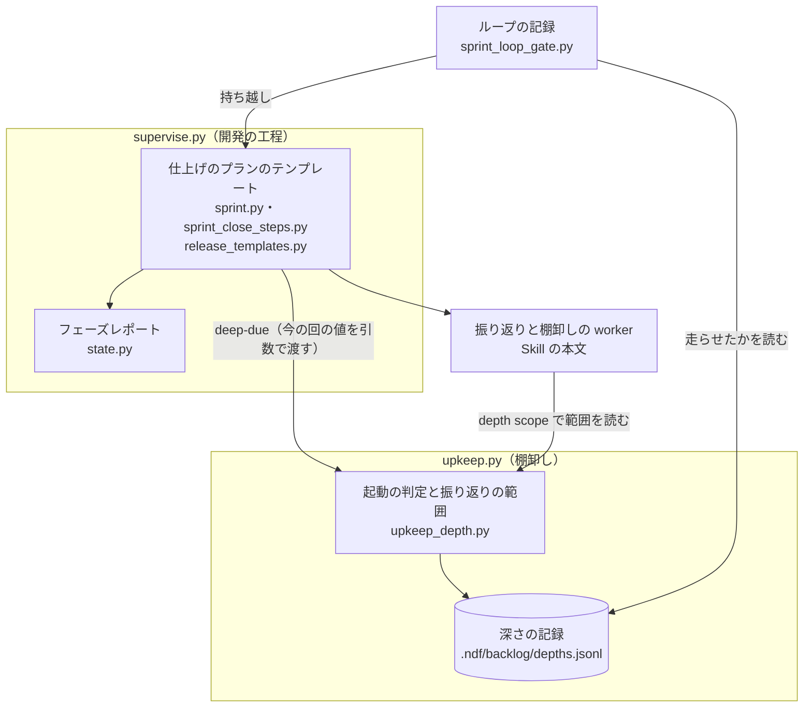
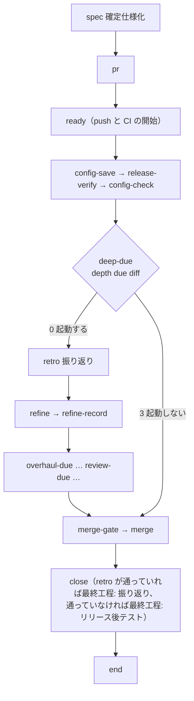

# 仕上げのプラン: 振り返りと差分の棚卸しを 3 回に 1 回にまとめ、CI の待ちを後ろの作業と重ねる（#2914）

## 目的

- **今どうなっているか**: 開発ループの仕上げのプラン（`close`）1 本は、中央値で費用 $8.21・所要時間 38.0 分かかる。利用者から「時間かかりすぎ」と指摘を受けた。ループの 1 回ごとに、振り返りと差分の棚卸しを新しい `claude -p` で起動している。確定仕様化の Pull Request の CI を 15.0 分待ってから、後ろの作業を始めている
- **誰に効くか**: 開発ループを回す利用者（待つ時間と API の費用）
- **変えると何が成り立つか**: 振り返りと差分の棚卸しを走らせないループの 1 回では、仕上げのプランは確定仕様化とリリース後テストだけになる。1 本の費用と所要時間の中央値が、直す前の半分（$4.10・19.0 分）以下になる

## 適用範囲

- **働く範囲**: NDF の `supervise.py new close` が組む仕上げのプラン。利用先のリポジトリの開発ループでも同じに働く
- **プロジェクトごとに違うもの**: 振り返りと差分の棚卸しを走らせる間隔（ループの 1 回の数）。`.ndf/backlog.json` の `depths.diff.every` で受け、無ければ既定の 3 を使う。設定ファイルは書き換えない
- **当たるモード**: 仕上げのプランを流すすべてのモード。間隔が効くのは開発ループ（`--loop` を渡すまとめ）だけで、ループの外のスプリントは毎回走らせる

## あるべき姿の根拠

| 根拠 | 種類 | 何を示すか |
| --- | --- | --- |
| 「時間かかりすぎ」（利用者、2026-11-10） | 利用者の指示の原文 | 所要時間を下げる必要 |
| 「調べた結果」の表 1・表 2 | 実測 | 費用の 51%（振り返り・棚卸し・見直し・大整理）が毎回の起動から、所要時間の 34%（CI の待ち）が直列の待ちから来る |
| 「原因と下げる手の試算」の試算 | 実測からの試算 | 走らせない回は費用 $2.81・所要時間 18.5 分（9 本の中央値） |
| STD2（スクラムガイド） | 外部の一次情報 | 振り返りはスプリントを締めくくる。短いスプリントでは短くなる |
| STD3（スクラムガイド） | 外部の一次情報 | バックログの整理は必要に応じて行う継続的な活動で、決まった頻度を持たない |

要求と受け入れ条件は #2914 の本文にある（コピーは `issues/issue-2914-requirements.md`）。この文書は調べた結果と「どう作るか」を扱う。

## ドメインモデル

### コンテキスト

| コンテキスト | 何の語が 1 つの意味に決まるか |
| --- | --- |
| 開発の工程（`ndf-workflow`） | 仕上げのプラン・ステップ・最終工程・ループの 1 回・振り返り・走らなかったステップ |
| 棚卸し（`ndf-issue-upkeep`） | 棚卸しの深さ・深さの記録・起動の判定・振り返りの範囲 |

### コンテキストの関係

棚卸しが上流、開発の工程が下流である。棚卸しは `upkeep.py depth` の副命令を公開ホストサービスとして出し、その引数・終了コード・統一 JSON の結果・深さの記録の行の形を公表された言語とする。開発の工程はその言語に従い（順応者）、深さの記録の行を直接書かない。

| 向き | 使う口 | 渡すもの | 組む側 |
| --- | --- | --- | --- |
| 開発の工程 → 棚卸し | `upkeep.py depth due diff --loop <名前> --lap <回数> --sprint <名前> --issues <番号の列>`（ループの外は `--loop` と `--lap` を渡さない） | 今の回の値（ループの名前と回数・スプリントの名前・課題の番号） | 仕上げのプランの `deep-due` のステップ。値は `supervise.py new close` の引数から組む |
| 棚卸し → 開発の工程 | 同じ呼び出しの終了コード（0 = 起動する / 3 = 起動しない）と統一 JSON の結果 | 起動するか・要約（「次は N 回後」） | `upkeep.py depth due`。判定の行の `values.scope` に振り返りの範囲を組んで書くのは棚卸しだけである |
| 棚卸し → 振り返りと棚卸しの worker | `upkeep.py depth scope --sprint <名前>` の統一 JSON の結果 | 振り返りの範囲（ループの 1 回の並び・課題の番号・範囲の始まりの時刻） | `upkeep.py depth scope`。worker は深さの記録のファイルを直接読まない |
| 棚卸し → ループの記録 | 深さの記録の行（今どおり `lap_depths` が読む `depth`・`event`・`trigger`・`cost`・`seconds`） | そのループの 1 回で差分の棚卸しを走らせたか（`diff` の `due` か `not_due` か） | `sprint_loop_gate`。読むだけで書かない |

### 集約

| 集約 | コンテキスト | 持ち主（書き換えてよいもの） | 根 | エンティティ | 値オブジェクト |
| --- | --- | --- | --- | --- | --- |
| 仕上げのプラン | 開発の工程 | プランのテンプレート（`sprint.close_plan` と `sprint_close_steps`） | プラン | ステップ | ステップの遷移・最終工程 |
| 深さの記録 | 棚卸し | `upkeep_depth`（`upkeep.py depth`） | 記録の行の列 | 判定の行・実行の行 | 振り返りの範囲・起動した条件 |
| ループの記録 | 開発の工程 | `sprint_loop_gate` | ループの記録 | ループの 1 回 | 持ち越し |
| フェーズレポート | 開発の工程 | `RunState.write_report` | 報告 | — | 走らなかったステップの行 |

### 不変条件

| # | 集約 | 条件 | 破れたときの扱い |
| --- | --- | --- | --- |
| I1 | 深さの記録 | 開発ループのどのループの 1 回の課題も、いずれ 1 回の振り返りと差分の棚卸しの範囲に入る。見送った回（`not_due` の行）は、開発ループで次に走らせる回の範囲に入るまで消費されない。ループの外のスプリントで走らせても消費されない | 範囲に漏れが出る。テストで落とす |
| I2 | 仕上げのプラン | リリース記録があれば、間隔によらずリリース後テストを毎回走らせる | 前提 5 に反する。テストで落とす |
| I3 | 仕上げのプラン | 確定仕様化の Pull Request のマージ（`merge`）の後に置くステップは、課題を閉じる `close` だけである。LLM を使うステップと CI を待つステップは `merge` の前に置く | CI の待ちが後ろの作業と重ならない。テストで落とす |
| I4 | 深さの記録 | 開発ループの外（`--loop` が無い）では、振り返りと差分の棚卸しを毎回起動する | ループの外で振り返りが消える。テストで落とす |
| I5 | 仕上げのプラン | `close` は、同じプランで振り返り（`retro`）が通っていれば最終工程を振り返り、通っていなければリリース後テストとして課題を閉じる | 課題が閉じない、または振り返りの記録が無いまま閉じる。テストで落とす |
| I6 | ループの記録 | 持ち越しは、最後に差分の棚卸しを走らせたループの 1 回の値を次の回へ渡す。走らせない回の古い値を写さない | 持ち越しが消えるか、古い値が記録に残る。テストで落とす |
| I7 | フェーズレポート | 起動の判定で走らせなかった回は、報告に「いつ次に走るか」が載る | 受け入れ条件 6 に反する。テストで落とす |
| I8 | 仕上げのプラン | 課題を閉じる `close` は `merge` の後にだけ走る。確定仕様化の Pull Request がマージされなかった回（CI の失敗・リリース承認ゲートで止まった回）は課題を開いたまま残す。`merge` の前に走る棚卸し（差分の棚卸しの `refine`・見直しの `review`・大整理の `overhaul`）は、今の回の課題（`--issues` で渡す番号）を、課題を閉じる区分のすべて（閉じてよい・重複の正本でない側・やらない）から外す | 確定仕様化が本流に入らないまま課題が閉じる。テストで落とす |

### ドメインイベント

| # | イベント | 発生元 | 受け手 |
| --- | --- | --- | --- |
| E1 | 仕上げのプランごとに、ステップの費用・所要時間・トークンの内訳を集めた | 設計の工程（この文書の「調べた結果」と「原因と下げる手の試算」） | E2 |
| E2 | 費用と所要時間を占めるステップと原因を、事実と推定に分けて書いた | 設計の工程 | 決定 1〜6 |
| E3 | 下げる手を実装し、テストが通った | 実装のプラン | リリース承認ゲート |
| E4 | 下げる手を含む版をリリースした | リリースのプラン | E5 |
| E5 | 直した後の仕上げのプランが 3 本以上走った | 開発ループ | リリース後テスト |
| E6 | 直す前と直した後の中央値を比べた | リリース後テスト | 課題を閉じる判定 |
| E7 | 振り返りと差分の棚卸しを見送った | `upkeep.py depth due diff`（終了コード 3） | 仕上げのプラン（後片付けへ飛ぶ）・フェーズレポート |
| E8 | 見送ったループの 1 回をまとめて振り返り、棚卸しした | 仕上げのプランの `retro`・`refine` | 深さの記録（実行の行）・ループの記録（持ち越し） |

### 用語

| 用語 | 意味 | 用語集への反映 |
| --- | --- | --- |
| 振り返りの範囲 | 1 回の振り返りと差分の棚卸しが扱うループの 1 回の並び。まだどの範囲にも入っていない見送ったループの 1 回と、今のループの 1 回からなる。ループの外では今のスプリントだけで、見送ったループの 1 回は開発ループで次に走らせる回まで残る。棚卸しのコンテキストが組み、深さの記録に置く | 追加 |
| 差分の棚卸し | 開発ループでは数回のループの 1 回に 1 回（既定 3 回）、ループの外では毎スプリントのまとめで行う棚卸しの深さ | 意味の変更 |
| 仕上げのプラン | `supervise.py new close` が組むプラン（記録の `フェーズ` の値は「まとめ」） | 追加 |
| 起動の判定 | 棚卸しの深さごとに、その回で走らせるかを決める判定（`upkeep.py depth due`。終了コード 0 = 起動する / 3 = 起動しない） | 追加 |
| 走らなかったステップ | 起動の判定などの終了コードで飛ばされ、プランの実行で通らなかったステップ。フェーズレポートに 1 行で載る | 追加 |

## 外部の調査

| 種類 | 調べるか | 理由 |
| --- | --- | --- |
| 標準・仕様 | 調べる | 費用の内訳の単価（プロンプトキャッシュの料金と寿命）と、振り返り・整理の頻度の標準を確かめる |
| 主要な製品 | 調べない | 費用の構造は使っている API の公式の単価で決まり、他の製品の解き方は単価に影響しない |
| ライブラリとサービス | 調べる | 起動の判定を新しく作らず、既存の `upkeep.py depth due` を使えるかを確かめる |

### 標準・仕様

| # | 標準・仕様 | 何を定めているか | 設計への反映 | 出典 |
| --- | --- | --- | --- | --- |
| STD1 | Claude の料金とプロンプトキャッシュ | Opus 5.5 は入力 $4・5 分のキャッシュ作成 $5・1 時間のキャッシュ作成 $8・キャッシュ読み込み $0.20・出力 $20（100 万トークンあたり）。キャッシュの接頭辞は tools → system → messages の順で作られる | 表 2 の費用の内訳の単価。起動ごとに接頭辞を作り直す費用の試算 | https://platform.claude.com/docs/en/about-claude/pricing と https://platform.claude.com/docs/en/build-with-claude/prompt-caching （2026-11-10） |
| STD2 | スクラムガイド 2020 の振り返り | 「The Sprint Retrospective concludes the Sprint.」短いスプリントでは時間も短い | ループの 1 回は数時間で終わるため、数回をまとめて 1 回の振り返りの単位にする。ループの外のスプリントは毎回振り返る | https://scrumguides.org/scrum-guide.html （2026-11-10） |
| STD3 | スクラムガイド 2020 のバックログの整理 | 「This is an ongoing activity」「refined as needed」。頻度を定めない | 差分の棚卸しを毎回に固定しない | https://scrumguides.org/scrum-guide.html （2026-11-10） |

### ライブラリとサービス

| # | 候補 | 版 | ライセンス | 最後のリリースの日付 | 終了のアナウンス | 要件を満たすか | 出典 |
| --- | --- | --- | --- | --- | --- | --- | --- |
| LIB1 | `upkeep.py depth due`（このリポジトリの棚卸しの起動の判定） | NDF 10.27.50 | リポジトリのライセンス | 2026-11-09（`develop` の最新） | 無し | 回数の数え方・判定と記録・`skip_code` 3 の約束を持つ。対象が `review` と `overhaul` だけで、`diff` を足す必要がある | `plugins/ndf/skills/backlog-refinement/scripts/upkeep_depth.py`（2026-11-10） |
| LIB2 | プランのステージの並列（`supervise.py queue` のステージに複数のプランを置く） | NDF 10.27.50 | リポジトリのライセンス | 2026-11-09 | 無し | プラン同士は並列に走るが、プランの中のステップは順に走る。CI の待ちと後ろの作業を重ねるには仕上げのプランを 2 本へ分ける必要があり、記録の単位（1 本の仕上げのプラン）が変わる | `plugins/ndf/scripts/supervise_lib/flow.py`・`sprint.py` の `close_waves`（2026-11-10） |

### 確かめられなかったこと

| 対象 | 試した手段 | 結果と理由 |
| --- | --- | --- |
| プロンプトキャッシュの文書の後半（約 25,000 文字） | https://platform.claude.com/docs/en/build-with-claude/prompt-caching の取得 | 前半だけを読んだ。単価と寿命と接頭辞の順は前半と料金の文書で確かめた |

調べた量: 候補 5 件・取得の試み 3 回。

## 調べた結果

前提 1 の 9 本（`.ndf/loop/*/lap-*/close*/1-close-state/progress.jsonl`）を集計した。集計の手段は表の下にある。

### 表 1: プランごとの費用と所要時間

| プラン | 費用 | 所要時間（分） | うちマージの待ち（分） | 走った LLM のステップ |
| --- | ---: | ---: | ---: | --- |
| lcore 12 回目 | $1.41 | 18.5 | 15.0 | 確定仕様化だけ（マージの後に止まった） |
| lcore 2 回目 | $16.98 | 63.0 | 17.7 | 確定仕様化・リリース後テスト・振り返り・棚卸し・見直し |
| lcore 3 回目 | $8.83 | 31.2 | 1.9 | 同上 |
| lcore 8 回目 | $9.44 | 38.0 | 16.6 | 確定仕様化・リリース後テスト・振り返り・棚卸し |
| lproc 11 回目 | $5.31 | 40.1 | 16.2 | 同上 |
| lproc 13 回目 | $7.07 | 57.5 | 15.0 | 同上 |
| lproc 2 回目 | $8.21 | 34.1 | 15.3 | 同上 |
| lproc 5 回目 | $7.31 | 48.8 | 13.6 | 確定仕様化・リリース後テスト・振り返り・棚卸し・見直し |
| lproc 9 回目 | $8.42 | 31.9 | 13.2 | 確定仕様化・リリース後テスト・振り返り・棚卸し・大整理 |
| **中央値** | **$8.21** | **38.0** | **15.0** | |

### 表 2: ステップごとの費用と所要時間（9 本）

| ステップ | 走った本数 | 所要時間の中央値（分） | 最大（分） | 費用の合計 | 費用の中央値 |
| --- | ---: | ---: | ---: | ---: | ---: |
| 確定仕様化（`spec`） | 9 | 3.5 | 4.9 | $17.95 | $1.71 |
| リリース後テスト（`release-verify`） | 8 | 8.4 | 24.6 | $17.28 | $1.88 |
| 振り返り（`retro`） | 8 | 4.6 | 18.3 | $16.44 | $1.97 |
| 差分の棚卸し（`refine`） | 8 | 3.7 | 9.7 | $13.88 | $1.68 |
| 見直し（`review`） | 3 | 7.7 | 8.7 | $5.46 | $1.85 |
| 大整理（`overhaul`） | 1 | 3.2 | 3.2 | $1.16 | $1.16 |
| Pull Request の本文（`pr`） | 9 | 0.0 | 0.0 | $0.81 | $0.08 |
| マージの待ち（`merge`） | 9 | 15.0 | 17.7 | $0 | $0 |
| 課題を閉じる（`close`） | 8 | 0.2 | 0.4 | $0 | $0 |
| ほかの 13 の run のステップ | — | 各 0.1 以下 | 0.1 | $0 | $0 |
| **合計** | | 9 本で 363.1 分 | | **$72.98** | |

### 表 3: LLM を使うステップのトークンと費用の内訳（9 本）

トークンは 1 回の中央値、費用は 9 本の合計である。キャッシュ作成の費用は、記録の費用から入力・読み込み・出力の費用を引いた値である。寿命が 1 時間と 5 分で単価が違い、行ごとの寿命が記録に無いためである。

| ステップ | 入力 | キャッシュ読み込み | キャッシュ作成 | 出力 | 入力の費用 | 読み込みの費用 | 作成の費用 | 出力の費用 |
| --- | ---: | ---: | ---: | ---: | ---: | ---: | ---: | ---: |
| 確定仕様化 | 44 | 2.18M | 122K | 18.2K | $0.00 | $5.53 | $8.46 | $3.95 |
| リリース後テスト | 59 | 2.59M | 133K | 21.2K | $0.00 | $5.88 | $7.36 | $4.04 |
| 振り返り | 64 | 3.49M | 116K | 19.7K | $0.00 | $6.20 | $6.98 | $3.25 |
| 差分の棚卸し | 55 | 2.88M | 104K | 16.0K | $0.00 | $4.88 | $6.38 | $2.63 |
| 見直し | 52 | 3.05M | 119K | 14.5K | $0.00 | $1.83 | $2.69 | $0.94 |
| 大整理 | 44 | 2.01M | 90K | 15.1K | $0.00 | $0.40 | $0.45 | $0.30 |
| Pull Request の本文 | 2 | 0 | 14K | 0.5K | $0.00 | $0.01 | $0.71 | $0.10 |
| **合計** | | | | | **$0.01** | **$24.72（34%）** | **$33.04（45%）** | **$15.21（21%）** |

集計の手段: 要求の「調べた事実」のスクリプトに、`kind: step` の行の `models` の 4 つのトークン数を足して集めた。単価は STD1。

帳簿との照合（前提 3）には次のコマンドを使った。

```bash
python3 plugins/ndf/scripts/usage-report.py --ledger claude --by plan --since 2026-11-01 --format json
```

9 本のうち 7 本は記録と一致した（差 0.0%）。2 本はずれた（lcore 2 回目 −27.2%、lproc 11 回目 −21.0%）。中央値はどちらも $8.21 である。ずれの原因は確かめていない（「未確認のまま残ること」）。

## 原因と下げる手の試算

### 原因

上位のステップ（費用: 確定仕様化・リリース後テスト・振り返り・差分の棚卸し。所要時間: マージの待ち・リリース後テスト・見直し・振り返り）ごとに分ける。

| # | 区分 | 原因 | 確かめた手段 |
| --- | --- | --- | --- |
| F1 | 事実 | LLM を使うステップは、それぞれ新しい `claude -p` の会話 1 つで走る（記録の `models` の `calls` がすべて 1。transcript もステップごとに 1 つ） | `progress.jsonl` の `models`、`~/.claude/ndf/accounts/gmail/projects/*worktrees-spec-l*/*.jsonl` |
| F2 | 事実 | 各会話の 1 ターン目は 6 万トークン前後を読み込む（キャッシュ読み込み約 1.3 万 + キャッシュ作成 2.0〜6.2 万、中央値 4.8 万）。何も足さない `claude -p` の起動だけで約 4.3 万トークン（読み込み 11,266 + 作成 31,806）、残りは NDF が足す system と Skill の本文である | 仕上げの作業場所の transcript のうち Skill を回した 84 本の 1 ターン目の `usage`、`claude -p "ok とだけ返す" --output-format json` の `usage`（2026-11-10） |
| F3 | 事実 | 会話は 9〜52 ターン（2 ターンで終わった 1 本を除く）で、文脈は終わりに 8〜27 万トークンまで伸びる。ターンの大半は Bash である（振り返り 17〜45 回、棚卸し 15〜48 回） | 同じ transcript のターンごとの `usage` と Tool の数 |
| F4 | 事実 | 振り返りは 44 ターンのうち約 20 ターンを材料集め（各ステップのレポートの読み出し・検査の集計・重複の検索）に使っていた | lproc 5 回目の振り返りの transcript（`2f8fd98c-…jsonl`）の Bash の一覧 |
| F5 | 事実 | 差分の棚卸しは、実行の途中で自分の Skill の参照とスクリプト（`ranking.md`・`upkeep.py`）を読み直していた | lcore 8 回目の棚卸しの transcript（`608d4f6c-…jsonl`） |
| F6 | 事実 | 振り返りと差分の棚卸しは、記録の残る 8 本すべてで毎回走っていた。見直しは 3 本、大整理は 1 本 | 表 1 の「走った LLM のステップ」 |
| F7 | 事実 | マージの待ちは確定仕様化の Pull Request の CI を待つ時間（中央値 15.0 分・費用 $0）で、リリース後テスト以降のすべてのステップがその後に順に走る | `sprint_close_steps.py`・`sprint.py` の `close_plan` の並び、`05-merge.out` |
| F8 | 事実 | キャッシュ作成の寿命は 2026-11-09 15:53 ごろの起動から 1 時間（$8）が 5 分（$5）に変わっていた | transcript の `cache_creation` の `ephemeral_1h_input_tokens`・`ephemeral_5m_input_tokens` |
| G1 | 推定 | 1 ステップの費用のうち 30〜40% は、起動ごとの接頭辞（約 6 万トークン）の作成と、各ターンでの読み直しである。作成 4.8 万 × $5〜8 ＝ $0.24〜0.38、読み直し 6 万 × 25 ターン × $0.20 ＝ $0.30 を、1 ステップの中央値 $1.7〜2.0 と比べた | F2・F3 からの試算。確かめるには接頭辞を変えた `claude -p` を同じ作業で比べる |
| G2 | 推定 | 起票者の推定 S1（手順書の読み込みと起動ごとのキャッシュ作成の重なり）は、起動ごとの接頭辞の部分（F2・G1）は当たり、手順書の読み直し（F5）は棚卸しの数ターンに限られる | F2・F5 |
| G3 | 推定 | リリース後テストの最大 24.6 分（lcore 2 回目）の原因は確かめていない。その transcript は仕上げの作業場所の外にあり、見つけていない | 起動した会話の ID を `progress.jsonl` に残していないため。確かめるには起動の時刻で transcript を探す |

### 下げる手の試算

表 1 の 9 本に、決定 1 と決定 2 を当てはめた値である。

| 手 | 費用の中央値 | 所要時間の中央値 |
| --- | ---: | ---: |
| 直す前 | $8.21 | 38.0 分 |
| マージの待ちを最後へ回す（決定 1） | $8.21 | 23.9 分 |
| 上に加え、振り返りと差分の棚卸し・見直し・大整理を走らせない回 | $2.81 | 18.5 分 |

試算の手段: 回の所要時間を「全ステップの和 − マージの待ち + max(0, マージの待ち − リリース後テスト以降のステップの和)」とした。CI は Pull Request を ready にした時点から GitHub の上で進み、手元の作業と重なるためである。間隔を 3 にすると、リリース後の最初の 3 本のうち 2 本が走らせない回になり、中央値はその回の値になる。

## 機能一覧

| # | 機能 | 誰が使うか |
| --- | --- | --- |
| F1 | 確定仕様化の Pull Request の CI を待つ間に、リリース後テスト・振り返り・棚卸しを進める | 開発ループ |
| F2 | 振り返りと差分の棚卸しを、開発ループでは 3 回のループの 1 回に 1 回にまとめて走らせる | 開発ループ |
| F3 | まとめて走らせる回は、見送ったループの 1 回の課題も範囲に入れる | 振り返りと棚卸しの worker |
| F4 | 走らせなかった回の報告に、いつ次に走るかを載せる | 利用者・conductor |
| F5 | 走らせなかった回も、リリース後テストを最終工程として課題を閉じる | 開発ループ |

## 構成要素

| 要素 | 責務 |
| --- | --- |
| `supervise_lib/sprint.py` の `close_plan` | 仕上げのプランの並びを組む。マージと課題を閉じるステップを最後へ回し、起動の判定を振り返りの前に置く |
| `supervise_lib/sprint_close_steps.py` | 起動の判定のステップ（`deep-due`。今の回の値を引数で渡す）、`merge` の後の `close`、振り返りと棚卸しのプロンプト（`upkeep.py depth scope` で振り返りの範囲を読む）を持つ。`refine`・`review`・`overhaul` のプロンプトに、今の回の課題の番号を「閉じない課題」として渡す |
| `sprint-close.py`（`sprint_close_lib/final_stage.py`） | `--final-stage-from <進捗記録>` を受け、同じプランで `retro` が通っていれば振り返り、通っていなければリリース後テストを最終工程にする |
| `supervise_lib/release_templates.py` の `release_verify_steps` | リリース後テストの後の行き先を引数で受ける（今は `retro` に固定） |
| `upkeep_depth.py`（`upkeep.py depth due`・`depth scope`） | `diff` の起動の判定を持つ。回数・ループの外・手動で判定し、振り返りの範囲を組んで判定の行に残す。`depth scope` はスプリントの名前から、その回の範囲を返す |
| `supervise_lib/state.py` の `write_report` | 起動の判定で飛ばしたステップと、その要約を報告に 1 行で載せる |
| `lib/sprint_loop_gate.py` | 持ち越しと棚卸しの要約を、差分の棚卸しを走らせた回からだけ取る |
| Skill の本文（`backlog-refinement`・`retrospective`・`development-workflow` の `pace.md`） | 差分の棚卸しと振り返りの頻度・範囲の記述を、間隔と振り返りの範囲に合わせる。`backlog-refinement` の課題を閉じる区分のすべて（閉じてよい・重複の正本でない側・やらない）から、仕上げのプランから渡された閉じない課題を除く決まりを足す。重複の組に閉じない課題が入るときは、閉じない課題を正本にする（I8） |
| 用語集（`docs/glossary/glossary.json`） | 「振り返りの範囲」を足し、「差分の棚卸し」の意味を変える（この設計の変更で直す） |



用語集は設計の変更で直す文書で、実行時の関係を持たないため図に含めない。

## 処理の流れ



リリース記録が無いとき（`release-verify` を持たない並び）は、`ready` の次が `deep-due` になる。

`close` は `merge` の後にだけ走る（I8）。`merge` が CI の失敗で止まった回と、`merge-gate` がリリース承認ゲートに当たってプランを終えた回は、課題を開いたまま残す。続きから流し直すか承認の後に `merge-approved` から入ると、マージの後に `close` が走る。`merge` の前に走る `refine`・`review`・`overhaul` は、今の回の課題を閉じない（I8）。

`deep-due` の判定:

| 条件 | 終了コード | 判定の行 |
| --- | --- | --- |
| `--loop` が無い（ループの外） | 0 | `due`（条件 `no_loop`） |
| まだどの範囲にも入っていない `not_due` の行の数 + 1 が `every` 以上 | 0 | `due`（条件 `count`） |
| `--manual` | 0 | `due`（条件 `manual`） |
| どれにも当たらない | 3 | `not_due`。要約に「次は N 回後」を載せる |
| 記録を読めない | 3 | `not_due`（理由 `unreadable`） |

`due` の行の `values.scope` に振り返りの範囲を置く。`not_due` の行には今の回の値（ループの名前と回数・スプリントの名前・課題の番号）を置く。範囲の組み方と消費の条件は次のとおりである（I1）。

| 判定 | 範囲に入るもの | 消費する `not_due` の行 |
| --- | --- | --- |
| 開発ループの `due`（条件 `count`・`manual`） | まだどの範囲にも入っていない `not_due` の行の値と、今の回の値 | 範囲に入れた行のすべて |
| ループの外の `due`（条件 `no_loop`） | 今のスプリントの値だけ | 無し。見送ったループの 1 回は、開発ループで次に走らせる回の範囲に入るまで残る |

`not_due` の行が範囲に入ったかは、後の `due` の行の `values.scope` にそのループの名前と回数が載っているかで決める。範囲の始まりの時刻は、範囲に入る最も古い行より前にある最後の `diff` の `due` の行の時刻とし、差分の棚卸しはその時刻より後に作られた課題に見積の段階を付ける。ループの外のスプリントで走らせても、見送ったループの 1 回の始まりの時刻は後ろへずれない。

## 決定の記録

### 決定 1: CI の待ちを後ろの作業と重ねるため、確定仕様化の Pull Request のマージを仕上げのプランの最後へ回す

マージの待ち（中央値 15.0 分）は CI を待つだけで、リリース後テスト・振り返り・棚卸しはその結果を使わない。ready で CI を始めてから後ろの作業を進め、最後にマージすれば、待ちはその間に進む。試算で所要時間の中央値は 38.0 分から 23.9 分になる。

仕上げのプランを 2 本へ分けてステージで並列に流す形（LIB2）は採らない。記録と報告の単位（1 本の仕上げのプラン）と、ループの記録が読むまとめの報告の形が変わるためである。リリース後テストが失敗して止まった回は、確定仕様化の Pull Request が開いたまま残る。続きから流し直せばマージまで進む。

- 作り方: 自前で作る
- 比べた候補: LIB2

根拠: Value 4 / Vision（MVV 版 6）

### 決定 2: 費用の 51% を占める毎回の起動を減らすため、開発ループでは振り返りと差分の棚卸しを 3 回のループの 1 回に 1 回にまとめる

振り返り・差分の棚卸し・見直し・大整理は 9 本の費用の 51%（$36.94 / $72.98）を占める。どれもループの 1 回ごとに新しい会話で走る（F1・F6）。ループの 1 回は数時間で終わる短い単位で、STD2 は短いスプリントの振り返りを短くし、STD3 は整理の頻度を定めない。3 回ごとにまとめても学びと整理は失われず、見送った回は次の回の範囲に入る（I1）。ループの外のスプリントは毎回走らせる（I4）。

間隔の既定は 3 とする。リリース後の最初の 3 本の中央値が走らせない回の値（試算 $2.81・18.5 分）になり、受け入れ条件 3・4 の閾値を下回るためである。プロジェクトは `.ndf/backlog.json` の `depths.diff.every` で変えられる。見直しと大整理の起動の判定は、走らせた回の後にだけ打つ。見直しと大整理の回数は今と同じく差分の棚卸しを走らせた回で数えるため、ループの 1 回で数えた間隔は 3 倍になる。

1 回の会話の費用を下げる次の 3 つの手は、この変更に入れない。

- 材料を前もってスクリプトで集める
- 接頭辞を小さくする
- 振り返りと棚卸しを 1 つの会話にまとめる

どれも効果を実測していない推定（G1）で、1 つの会話にまとめると文脈が積み重なり読み込みが増える。機械的なターンをスクリプトへ移す手は #2909 が扱う。

- 作り方: 自前で作る・標準に倣う
- 比べた候補: STD2 / STD3 / LIB1

根拠: Value 3 / Value 2 / Value 1（MVV 版 6）

### 決定 3: 起動の判定を 1 か所に保つため、`diff` の判定を既存の `upkeep.py depth due` に足す

見直しと大整理の起動の判定（LIB1）は、回数の数え方・判定の行・終了コード 3 で飛ばす約束をすでに持つ。`diff` をその対象に足し、振り返りも同じ判定で起動する。振り返りは差分の棚卸しが拾う起票の元であり、同じ回に走らせると順序（振り返り → 棚卸し）が保たれる。新しい判定のスクリプトを作る形は、同じ役割の判定を 2 つに分けるため採らない。

`not_due` の行を足しても、見直しと大整理の回数（`diffs_since`）は `ran` の行だけを数えるため変わらない。

- 作り方: 自前で作る
- 比べた候補: LIB1

根拠: Value 7（MVV 版 6）

### 決定 4: 振り返りを走らせない回も課題を閉じるため、その回は最終工程をリリース後テストとして閉じる

課題を閉じる判定（`sprint-close.py`）は、`--final-stage リリース後テスト` をすでに受ける。課題を閉じるステップは `merge` の後の `close` 1 つにまとめ（I8）、最終工程は同じプランの進捗記録から選ぶ（I5）。`close` は `--final-stage-from {state_dir}/progress.jsonl --with-verification` を渡す。

| 回 | 進捗記録 | 選ぶ最終工程 |
| --- | --- | --- |
| 振り返りを走らせる回 | `retro` が通った | 振り返り |
| 振り返りを走らせない回 | `retro` が通っていない | リリース後テスト |

閉じるステップを `merge` の後へ置くのは、確定仕様化の Pull Request がマージされないまま課題が閉じるのを防ぐためである。判定の分かれ道ごとに閉じるステップを置くと、`merge` を 2 本の経路に重ねて持つ必要が出るため、1 つの `close` が進捗記録を読む形にする。差分の棚卸しは課題を閉じる前に走る。対象の課題は範囲として番号で渡すため、閉じたかどうかに依らない。

差分の棚卸しは「直ったのに開いたままの課題を閉じる」を責務に持ち、コミットの件名が指す課題を拾うため、`merge` の前に走ると今の回の課題を「閉じてよい」と判定しうる。そこで閉じると、`sprint-close.py` の判定を通らず、確定仕様化の Pull Request のマージ前に課題が閉じる。見直し（`review`）と大整理（`overhaul`）も `merge` の前に走り、今の回を含む open の課題を手順 2A で調べるため、同じ経路を持つ。また `backlog-refinement` は「閉じてよい」のほかに、重複の正本でない側（手順 2B）と「やらない」（`wontfix`）でも課題を閉じる。古い課題が正本に選ばれると、今の回の課題が重複として閉じる。これを防ぐため、`refine`・`review`・`overhaul` は今の回の課題（`deep-due` に `--issues` で渡す番号）を、課題を閉じる区分のすべて（閉じてよい・重複の正本でない側・やらない）から外す（I8）。3 つのステップのプロンプトがその番号を「閉じない課題」として渡し、`backlog-refinement` は渡された番号をそれらの区分の判定から除く。重複の組に閉じない課題が入るときは、閉じない課題を正本にし、もう一方を閉じる。本文の訂正や見積の段階の付与は今どおり行う。見送ったループの 1 回の課題は、その回の仕上げのプランの `close` ですでに閉じているため、外す対象に含めない。

見送った回の課題の振り返りの記録は、次に走る回の振り返りが閉じた課題へ書き足す。

根拠: Value 1 / Value 8（MVV 版 6）

### 決定 5: 走らなかったことを後から読めるため、起動の判定で飛ばしたステップを報告に 1 行で載せる

報告（`report.md`）の「通ったステップ」の後に「走らなかったステップ」の行を置く。その行には、`skip_to` で飛んだ run のステップの id と、その結果の要約を並べる。`deep-due` の要約は「振り返りと差分の棚卸しは起動しない（前に走らせてから N 回目。次は M 回後）」の形にする（I7）。見直しと大整理の判定（`review-due`・`overhaul-due`）も同じ行に載る。

根拠: Value 8（MVV 版 6）

### 決定 6: 持ち越しを失わないため、ループの記録は差分の棚卸しを走らせた回からだけ棚卸しの要約を取る

今は、締めるループの 1 回の棚卸しの要約を、棚卸しの状態の置き場の最新の結果からコピーし、次の回は直前の回の持ち越しを受ける。走らせない回でこれを続けると、前に走らせた回の古い結果が写る。走らせない回は棚卸しの要約を空にして `skipped` の印を付け、次の回の持ち越しは最後に走らせた回の値を渡す（I6）。

根拠: Value 7（MVV 版 6）

## テスト設計

| 受け入れ条件・不変条件 | どの振る舞いで縛るか | どう壊したら落ちるべきか |
| --- | --- | --- |
| 受け入れ条件 1・2 | この文書の「調べた結果」（表 1〜3）と「原因と下げる手の試算」。テストでは縛らない | — |
| 受け入れ条件 3・4 | リリース後テストで、直した後の仕上げのプラン 3 本以上の中央値を表 1 と同じ集計で出す | — |
| 受け入れ条件 5 | 起動する回の仕上げのプランが、`spec`・`release-verify`・`retro`・`refine` のステップを持ち、各ステップが結果ファイルを受ける | `retro` を起動する回の並びから外すと落ちる |
| 受け入れ条件 6・I7 | `skip_to` で飛んだ run のステップがある実行の報告に、そのステップの id と要約が載る | 報告の行を消すと落ちる |
| I1 | `not_due` の行が 2 つ続いた後の `due` の判定で、範囲に 3 回分のループの 1 回と課題が並ぶ。`not_due` の行が 2 つ → ループの外の `due` → 開発ループの `due` の順でも、最後の範囲に見送った 2 回が並び、範囲の始まりの時刻がループの外の `due` より前になる | 範囲を今の回だけにすると落ちる。ループの外の `due` で `not_due` の行を消費すると落ちる |
| I2 | リリース記録がある仕上げのプランは、起動しない回の経路でも `release-verify` を通る | `release-verify` を `deep-due` の後ろへ移すと落ちる |
| I3 | 仕上げのプランの `merge` の次が `close`、`close` の次が `end` で、`merge` から辿れるステップは `close` だけである | `merge` を `release-verify` の前へ戻すと落ちる |
| I4 | `--loop` を渡さない `depth due diff` が 0 を返す | ループの外でも回数で判定すると落ちる |
| I5 | `--final-stage-from` に渡した進捗記録に `retro` の通った行があれば振り返り、無ければリリース後テストを最終工程にする | 2 つの値を入れ替えると落ちる |
| I6 | 差分の棚卸しを走らせなかった回の次の回の持ち越しが、最後に走らせた回の値になる | 直前の回の値を写すと落ちる |
| I8 | 仕上げのプランで `close` へ入る遷移は `merge`（と `merge-approved`）の次だけで、`merge-gate` がプランを終える経路と `merge` が失敗した経路では `close` を通らない | `close` を `merge-gate` の前へ置くと落ちる |
| I8（`merge` の前の棚卸しが範囲の課題を閉じない） | 仕上げのプランの `refine`・`review`・`overhaul` のステップのプロンプトが、今の回の課題の番号を閉じない課題として持つ | 3 つのどれかのプロンプトから閉じない課題の番号を外すと落ちる |
| 間隔の判定 | `every` が 3 のとき、前に走らせた後の `not_due` が 0・1 回なら 3、2 回なら 0 を返す。`.ndf/backlog.json` の `depths.diff.every` が値を変える | 数え方を 1 つずらすと落ちる |

## 設計の結果

| 課題 | 扱い | 取り込み先 | 触るファイル |
| --- | --- | --- | --- |
| #2914 | 実装する | — | `plugins/ndf/scripts/supervise_lib/sprint.py`、`plugins/ndf/scripts/supervise_lib/sprint_close_steps.py`、`plugins/ndf/scripts/supervise_lib/release_templates.py`、`plugins/ndf/scripts/supervise_lib/state.py`、`plugins/ndf/scripts/sprint-close.py`、`plugins/ndf/scripts/sprint_close_lib/final_stage.py`、`plugins/ndf/scripts/lib/sprint_loop_gate.py`、`plugins/ndf/skills/backlog-refinement/scripts/upkeep_depth.py`、`plugins/ndf/skills/backlog-refinement/scripts/upkeep.py`、`plugins/ndf/skills/backlog-refinement/SKILL.md`、`plugins/ndf/skills/backlog-refinement/references/depths.md`、`plugins/ndf/skills/retrospective/SKILL.md`、`plugins/ndf/skills/development-workflow/references/pace.md`、`plugins/ndf/scripts/tests/test_supervise.py`、`plugins/ndf/scripts/tests/test_supervise_pace.py`、`plugins/ndf/scripts/tests/test_sprint_loop.py`、`plugins/ndf/scripts/tests/test_sprint_close_final_stage.py`、`plugins/ndf/skills/backlog-refinement/tests/test_upkeep_depths.py` |

## 未確認のまま残ること

| 項目 | 内容 |
| --- | --- |
| 受け入れ条件 4 の余裕 | 試算の所要時間の中央値 18.5 分は閾値 19.0 分に近い。マージの待ちが CI の長さで決まるため、#2907・#2925 のリリースの後の値で判定する（前提 4） |
| まとめて走らせる回の費用 | 3 回分の範囲を扱う振り返りと棚卸しは、1 回分より材料が増える。何割増えるかは実測していない。リリース後テストで、走らせた回の費用も表 1 と同じ集計で残す |
| 帳簿とのずれ | lcore 2 回目（−27.2%）と lproc 11 回目（−21.0%）が帳簿とずれる原因（起こし直しの記録の扱いか）を確かめていない |
| リリース後テストの最大値 | lcore 2 回目の 24.6 分の原因（G3） |
| 開いたままの時間の伸び | 確定仕様化の Pull Request が開いている時間が、起動する回は振り返りと棚卸しの分だけ伸びる。ほかの Pull Request との衝突が増えるかは測っていない |
| 課題が開いている時間の伸び | 課題を閉じるのが `merge` の後になり、起動する回は振り返りと棚卸しの分だけ遅れる。差分の棚卸しは対象の課題を番号で受けるため結果は変わらないと見ているが、開いた課題を数える検査が影響を受けるかは確かめていない |
| 見直しの間隔 | ループの 1 回で数えた見直しの間隔が 3 倍（既定で 9 回）になる。持ち越しと open の増加による起動の条件は今どおり働く。棚卸しが遅れるかは、決定 2 の後の見直しの記録で確かめる |
