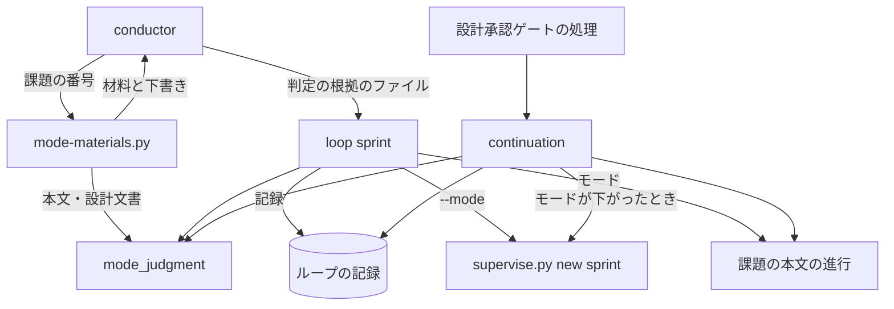
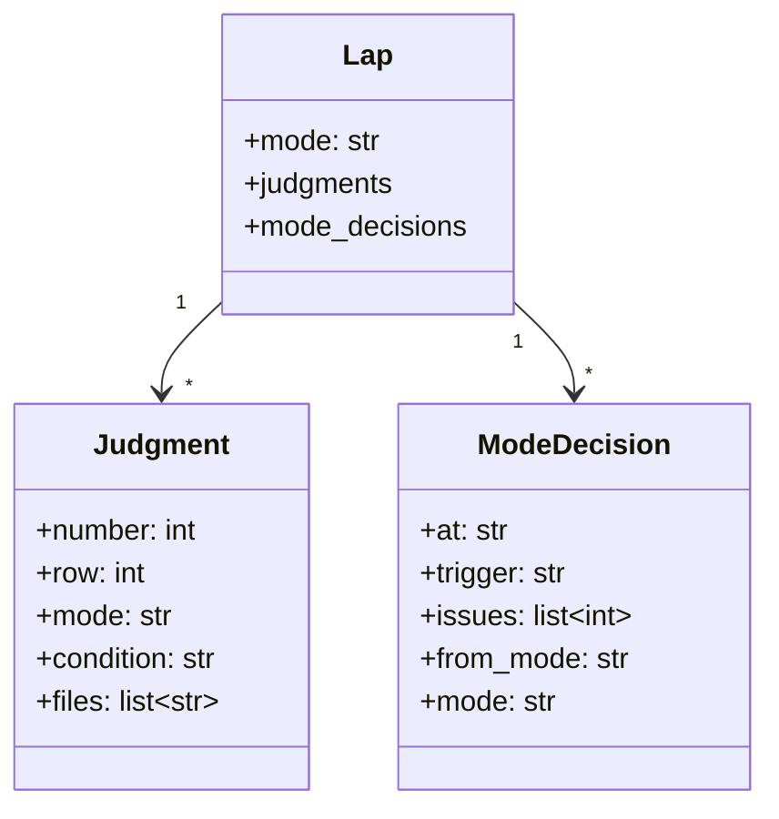
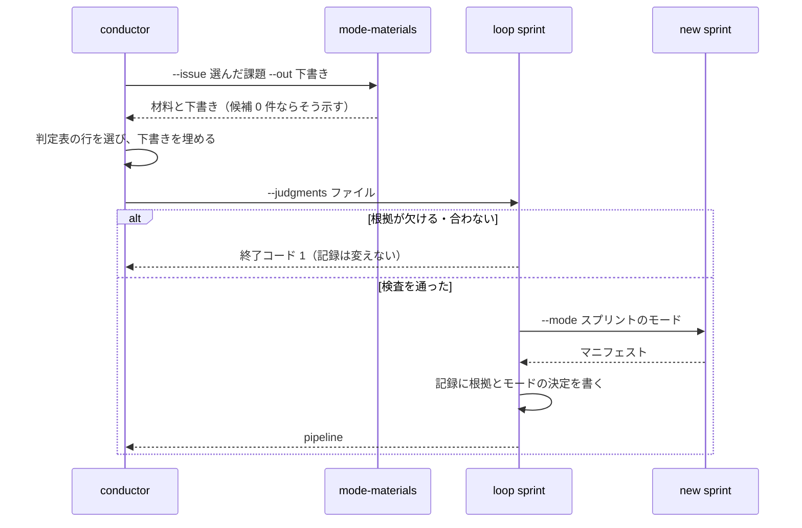
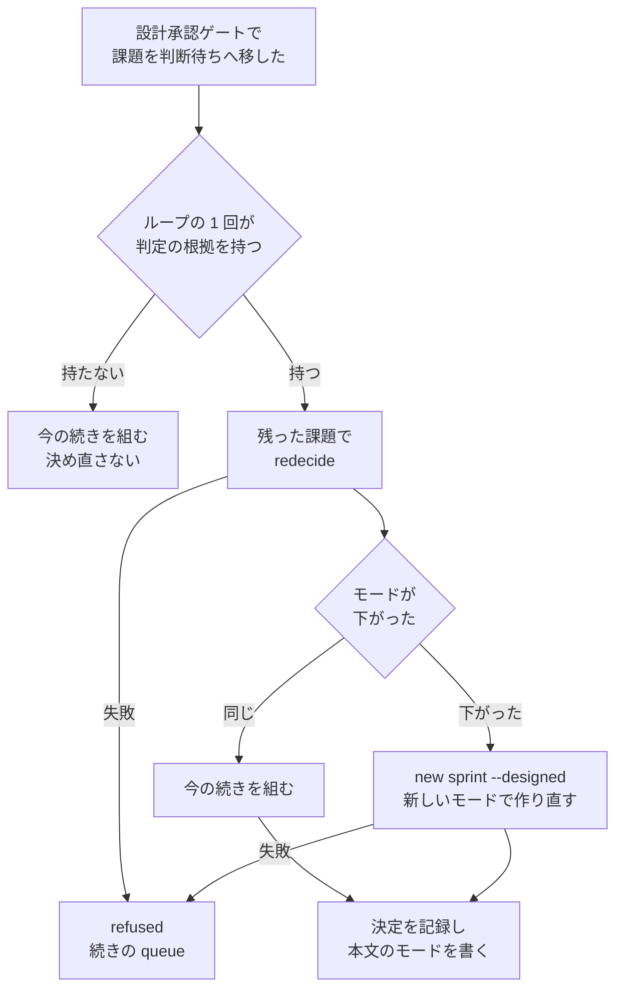

# 開発ループ: 課題ごとの判定の根拠からスプリントのモードを決め、課題を外したら決め直す（#2923）

## 目的

- **今どうなっているか**: 開発ループのスプリントのモードは、conductor が `loop sprint --mode` に渡す値だけで決まり、判定の根拠が記録に残らない。ループ lproc の 13 周はすべて `standard` で、課題を外した後も最初のモードのまま続いた
- **誰に効くか**: 開発ループを回す利用者（費用と設計承認の待ち）と、後からモードの妥当さを確かめる人
- **変えると何が成り立つか**: 課題ごとの判定の根拠がない限りスプリントは組まれず、モードは根拠から機械で決まる。課題を外すと残りの課題でモードを決め直し、下がれば残りの工程を軽いモードで組み直す

## 適用範囲

- **働く範囲**: NDF を導入したすべてのリポジトリの開発ループ（`--loop`）。ループの外のスプリント（`supervise.py new sprint --mode`）の組み立ては変えない
- **プロジェクトごとに違うもの**: 無し（判定表と記録の形は NDF の側で 1 つ。触るファイルの候補はそのリポジトリの `git ls-files` で確かめる）
- **当たるモード**: `standard`（公開インタフェースのコマンドを変える）

## あるべき姿の根拠

| 根拠 | 種類 | 何を示すか |
| --- | --- | --- |
| ループ lproc の記録の `"mode"` 13 件がすべて `standard`（#2923 の再現手順） | 実測 | 値だけを受ける今の形では、根拠のないモードが記録に残る |
| `development-workflow` の `workflow-modes.md` の「判定を記録する場所」が、モードとその根拠を書くことを求める | 既存の規約 | 根拠はモードと組で残すものである |
| `workflow-modes.md` の「モードを下げたい場合は、変更そのものを分割する」 | 既存の規約 | 課題を外すことは分割に当たり、残りで判定し直してよい |
| CommonMark の code span の定義（STD1） | 外部の一次情報 | 課題の本文からパスを取る単位を、Markdown の構文で決められる |

要求と受け入れ条件は #2923 の本文にある（コピーは [issue-2923-requirements.md](issue-2923-requirements.md)）。この文書は「どう作るか」だけを扱う。
決定の記録は [issue-2923-design-decisions.md](issue-2923-design-decisions.md) にある。

## ドメインモデル

### コンテキスト

| コンテキスト | 何の語が 1 つの意味に決まるか |
| --- | --- |
| 開発の工程（`ndf-workflow`） | 判定表・判定の根拠・判定の材料・スプリントのモード・モードの決め直し |

開発ループの記録と判定表はどちらも `ndf-workflow` に属する。判定表は `development-workflow` の Skill の本文にある。
判定表とループのスクリプトの間は、判定の根拠のファイル（下の「入出力の契約」）を**公開された言語**としてやり取りする。
conductor が書き、`loop sprint` が読む形を 1 つに固定し、互いに独立して変えられるようにする。

### 集約

| 集約 | 持ち主（書き換えてよいもの） | 根 | エンティティ | 値オブジェクト |
| --- | --- | --- | --- | --- |
| ループの記録 | `sprint-state.py loop` の副命令（`lib/sprint_loop*.py`） | ループ | ループの 1 回 | 判定の根拠・モードの決定 |

判定の材料は記録に持たない。`mode-materials.py` が呼ばれるたびに課題の本文と設計文書から作り直す値であり、
集約の外に置く。

### 不変条件

| # | 集約 | 条件 | 破れたときの扱い |
| --- | --- | --- | --- |
| I1 | ループの記録 | `loop sprint` で組んだループの 1 回は、選んだ課題のすべてに判定の根拠を 1 件ずつ持ち、選んでいない課題の根拠を持たない | `loop sprint` が終了コード 1 で断り、記録を書き換えない |
| I2 | ループの記録 | 判定の根拠の順は判定表の 1〜5 のどれかで、モードはその順の行のモードと一致し、当たった条件の文と触るファイルが空でない | 同上 |
| I3 | ループの記録 | ループの 1 回のモードは、判定の根拠のうち順が最も小さい行のモードに等しい。`--mode` を渡したときはその値とも等しい | 同上 |
| I4 | ループの記録 | モードの決め直しは、残った課題の判定の根拠だけから I3 と同じ規則で決める。決め直したモードの順は、決め直す前の順より小さくならない（上がらない） | 決め直しの関数が `LoopError` を出し、続きを組まずに `refused` で止まる |
| I5 | ループの記録 | 決め直しの後に流す続きのプランとまとめのプランの `モード` は、ループの 1 回の `mode` と等しい | 続きを組み直せなければ記録を書き換えず、`refused`（続きの queue）で止まる |
| I6 | ループの記録 | 判定の根拠を持たないループの 1 回（この版より前に組んだもの）は、読み込み・再開・続きの組み立てで失敗しない。決め直しはせず、モードの決定も足さない | — （読み込みで断らない） |
| I7 | — | 判定の材料は、課題の本文と設計文書から取れた候補だけを出し、取れなかったときは候補 0 件と出す | テストが落ちる |
| I8 | ループの記録 | ループの 1 回の判定の根拠に、`documentation`（順 2）の根拠と他のモードの根拠が混ざらない（`workflow-modes.md` の「`documentation` と他のモードが混ざるとき」は分けることを求める）。課題を外しても混ざらない集合の部分集合は混ざらないため、決め直しでは起きない | `loop sprint` が終了コード 1 で断り、記録を書き換えない。理由に混ざった課題の番号をモードごとに並べ、conductor は `loop exclude` で一方のモードの課題を外して別のループの 1 回へ回す |

### ドメインイベント

| # | イベント | 発生元 | 受け手 |
| --- | --- | --- | --- |
| E1 | ループの 1 回の課題を選んだ | `loop select` | conductor（次の案内に材料を集めるコマンドを示す） |
| E2 | 課題ごとの判定の材料を集めた | `mode-materials.py` | conductor（判定の根拠のファイルの下書きを受ける） |
| E3 | 課題ごとに判定表の行を選んだ | conductor | `loop sprint`（判定の根拠のファイル） |
| E4 | スプリントのモードを決め、根拠とともに記録した | `loop sprint` | `supervise.py new sprint`・課題の本文の「進行」 |
| E5 | 課題をループの 1 回から外した | 設計承認ゲートの処理（`loop gate` / `loop lap`） | 続きの組み立て |
| E6 | 残りの課題でモードを決め直した | 続きの組み立て（`continuation`） | ループの記録・課題の本文の「進行」 |
| E7 | 決め直したモードで続きの工程を組んだ | 続きの組み立て | `supervise.py queue` |

`loop exclude`（`loop sprint` の前に課題を外す）は E5 に当たらない。その時点ではモードが決まっておらず、
外した後の課題の集合で E2〜E4 を通るためである。

### 用語

| 用語 | 意味 | 用語集への反映 |
| --- | --- | --- |
| 判定表 | `development-workflow` の「上から順に条件を判定する」の表 | 追加済み（要求の変更） |
| 判定の根拠 | 1 つの課題の、判定表の当たった行（順とモード）・当たった条件の文・触るファイルの一覧の組 | 追加済み（要求の変更） |
| 判定の材料 | 判定の根拠を選ぶためにスクリプトが集める事実 | 追加済み（要求の変更） |
| スプリントのモード | 課題ごとの判定のうち、判定表で最も上の行のモード | 追加済み（要求の変更） |
| 判定の根拠のファイル | conductor が課題ごとの判定の根拠を書き、`loop sprint --judgments` に渡す JSON のファイル | 追加 |
| モードの決め直し | ループの 1 回から課題を外したとき、残った課題の判定の根拠からスプリントのモードを決め直すこと | 追加 |

## 外部の調査

| 種類 | 調べるか | 理由 |
| --- | --- | --- |
| 標準・仕様 | 調べる | 課題の本文からパスを取り出す単位を、Markdown の仕様の構文で決めるため |
| 主要な製品 | 調べない | 判定表はこのプロジェクトの工程の取り決めで、他の製品の解き方から形が決まらない |
| ライブラリとサービス | 調べる | Markdown の構文の読み取りを自前の正規表現で書かずに済むかを確かめるため |

### 標準・仕様

| # | 標準・仕様 | 何を定めているか | 設計への反映 | 出典 |
| --- | --- | --- | --- | --- |
| STD1 | CommonMark 0.31.2 の 6.1 Code spans | 同じ長さのバッククォートの列で囲んだ範囲が code span で、中身の改行は空白になる | 触るファイルの候補は code span の中身とリンクの宛先から取る。コードブロック（フェンス）の中は code span でないため、再現手順のコマンドは候補に入らない | https://spec.commonmark.org/0.31.2/#code-spans （2026-11-10） |
| STD2 | GitHub Flavored Markdown Spec | CommonMark に表の拡張を足した仕様 | 課題の本文の「影響」の表の読み取りは GFM の表として読む（既存の `lib/md.py` の `tables`） | https://github.github.com/gfm/ （2026-11-10） |

### ライブラリとサービス

| # | 候補 | 版 | ライセンス | 最後のリリースの日付 | 終了のアナウンス | 要件を満たすか | 出典 |
| --- | --- | --- | --- | --- | --- | --- | --- |
| LIB1 | markdown-it-py | 4.2.0 | MIT | 2026-05-07 | 無し | 満たす。`code_inline` と `link_open` のトークンで code span とリンクの宛先を取れる。リポジトリは `md` のグループで同じ版を固定済みで、`lib/md.py` が包んでいる | https://pypi.org/pypi/markdown-it-py/json 、`pyproject.toml` の `md`（2026-11-10） |
| LIB2 | mistune | 3.4.0 | BSD-3-Clause | 2026-10-19 | 無し | 満たすが、依存が 1 つ増える。同じ用途の LIB1 を既に持つ | https://pypi.org/pypi/mistune/json （2026-11-10） |

### 確かめられなかったこと

| 対象 | 試した手段 | 結果と理由 |
| --- | --- | --- |
| 無し | — | — |

調べた量: 候補 4 件・取得の試み 5 回。

## 機能一覧

| # | 機能 | 誰が使うか |
| --- | --- | --- |
| F1 | 課題の番号を渡すと、課題ごとの判定の材料と、判定の根拠のファイルの下書きを出す | conductor |
| F2 | 判定の根拠のファイルを渡してループの 1 回を組む。根拠が欠ければ断る | conductor |
| F3 | ループの記録に、課題ごとの判定の根拠とモードの決定を残す | 後から確かめる人 |
| F4 | 設計承認ゲートで課題を外したら、残りの課題でモードを決め直し、下がれば続きを新しいモードで組み直す | 開発ループ |
| F5 | 課題の本文の「進行」の `モード:` の行にスプリントのモードを書く | 課題を読む人 |

## 構成要素

| 要素 | 責務 |
| --- | --- |
| `lib/mode_judgment.py`（新設） | 判定表の順とモードの対応・判定の根拠のファイルの検査・スプリントのモードの算出・決め直しの算出。ファイルとプロセスに触れない純粋な関数と、検査の誤りを表す例外だけを持つ |
| `mode-materials.py`（新設） | 課題の本文（`gh issue view`）と設計文書から判定の材料を集め、結果 JSON を出す。`--out` で判定の根拠のファイルの下書きを書く |
| `lib/md.py`（変更） | code span の中身を返す `code_spans` を足す（markdown-it-py を呼ぶのはこのモジュールだけ） |
| `lib/sprint_loop.py` の `cmd_sprint`（変更） | `--judgments` を読み、`mode_judgment` で検査してから組む。根拠とモードの決定を記録し、課題の本文へモードを書く |
| `lib/sprint_loop_cli.py`（変更） | `loop sprint` に `--judgments`（必須）を足し、`--mode` を省けるようにする |
| `lib/sprint_loop_gate.py` の `continuation`（変更） | 残った課題でモードを決め直し、下がったときは続きのステージを新しいモードで作り直す |
| `lib/sprint_loop_argv.py`（変更） | 続きのステージを作り直す `supervise.py new sprint` のコマンドを組む |
| `lib/sprint_loop.py` の `_resume_refused`・`lib/sprint_loop_select.py` の `run_selection`（変更） | 案内の文を `--judgments` の形にする |
| `skills/development-workflow/references/loop.md`（変更） | 具体例と打つ順の表を、材料を集めて根拠を渡す手順にする。`loop sprint` が I8 で断ったときの手順（「処理の流れ」の「I8 で断られたとき」）を足す |
| `skills/development-workflow/references/workflow-modes.md`（変更） | 「途中でモードが変わったとき」に、開発ループで課題を外したときに下げる行を足す |



図に含めない要素は次のとおり。

| 要素 | 図に含めない理由 |
| --- | --- |
| `lib/md.py` | `mode-materials.py` の中で使う部品 |
| `sprint_loop_cli.py` | `loop sprint` の引数の読み取りで、図の「loop sprint」に含める |
| `sprint_loop_argv.py` | `new sprint` のコマンドを組む部品で、`new sprint` への辺に含める |
| `_resume_refused` と `run_selection` | 案内の文だけを変える |
| `loop.md` と `workflow-modes.md` | 手順書 |

## 構造



`Judgment` と `ModeDecision` は記録の中の辞書の形で、クラスを作らない（記録の他の項目と同じく `dict` で持つ）。
`mode_judgment.py` は次の関数を持つ。

| 関数 | 入力 | 出力 | 失敗 |
| --- | --- | --- | --- |
| `ROWS` | — | 順 → モードの対応（1 `operation`・2 `documentation`・3 `standard`・4 `legacy-refactor`・5 `light`） | — |
| `check_judgments(data, selected)` | 判定の根拠のファイルの中身・選んだ課題 | 検査を通った `Judgment` の一覧（課題の番号の順） | `JudgmentError`（理由を 1 件ずつ並べる） |
| `sprint_mode(judgments)` | `Judgment` の一覧（1 件以上） | 順が最も小さい行のモード | 空のとき・`documentation` と他のモードが混ざるとき（I8）は `JudgmentError` |
| `redecide(judgments, kept, current)` | 記録の根拠・残った課題・今のモード | 決め直したモード | 残った課題の根拠が無い・上がる結果なら `JudgmentError` |

## データ構造

ループの記録（`.ndf/loop/<ループ名>/loop.json`）の `laps[]` の要素に 3 つの項目を足す。記録の `version` は 1 のまま
上げない。足すのは省ける項目で、無い記録は I6 のとおり読む。

| 項目 | 型 | 空の扱い | 書く時点 |
| --- | --- | --- | --- |
| `judgments` | `Judgment` の配列 | 無い = この版より前に組んだループの 1 回 | `loop sprint` |
| `mode_decisions` | `ModeDecision` の配列。`trigger` は `loop sprint` か `設計承認ゲート`。`from_mode` は `loop sprint` の行で `null` | 無い = 同上 | `loop sprint`（1 件目）、`continuation`（決め直しのたび） |
| `sprint_extra` | 文字列の配列 | 無い = 足した引数が無い | `loop sprint`（`--` の後の引数。続きを作り直すときに渡し直す） |

既存の `mode` は意味を変えず、決め直しの後は新しいモードへ書き換える。過去の値は `mode_decisions` が持つ。

| 機能 | `judgments` | `mode_decisions` | `mode` |
| --- | --- | --- | --- |
| F2・F3（`loop sprint`） | 作る | 作る | 更新 |
| F4（`continuation`） | 読む | 足す | 更新（下がったとき） |
| `loop status` / `loop list` | 読まない | 読まない | 読む（今と同じ） |

## 入出力の契約

### `mode-materials.py`

```text
python3 mode-materials.py --issue <番号>... [--root <リポジトリ>] [--out <判定の根拠のファイル>]
```

結果は 1 行の結果 JSON（`lib/README.md` の「手順のスクリプトの結果」）。課題の本文を取得できない課題があれば
`stopped`（終了コード 1）で、`gaps` に課題の番号と理由を載せる。ほかは `ok`（0）。

`items` は課題ごとに 1 件で、次の形を持つ。

```json
{
  "number": 2748,
  "kind": "不具合",
  "public_interface": {"value": "変わる", "cell": "変わる。`sprint-state.py loop sprint` が…"},
  "files": [
    {"path": "plugins/ndf/scripts/lib/sprint_loop.py", "exists": true, "source": "本文", "section": "事象", "tests": ["plugins/ndf/scripts/tests/test_sprint_loop.py"]}
  ],
  "files_found": 1
}
```

| 項目 | 規則 |
| --- | --- |
| `kind` | 本文の `## 種類` の節の最初の空でない行。節が無ければ `null` |
| `public_interface.value` | 本文の `## 影響` の表で 1 列目が `公開インタフェース` の行の 2 列目が `変わる` で始まれば `変わる`、`変わらない` で始まれば `変わらない`、ほかは `記載なし`。`cell` はそのセルの字面 |
| `files[].path` | 下の「触るファイルの候補を取る規則」で取ったパス |
| `files[].exists` | `git ls-files` に同じパスがあるか、そのパスで始まるファイルがあれば `true` |
| `files[].source` | `本文` か `設計`（設計文書の「設計の結果」の表の「触るファイル」） |
| `files[].section` | 本文で候補を見つけた節の見出し（`設計` のときは設計文書のパス） |
| `files[].tests` | 存在するファイルについて、テストのファイルの一覧（下の規則）。テストのファイル自身なら自分だけ。無ければ空 |
| `files_found` | `files` の件数。0 のとき `files` は空で、推して埋めない（I7） |

**触るファイルの候補を取る規則**（要求の未決 3）:

1. 本文を `lib/md.py` で読み、code span の中身とリンクの宛先を集める。コードブロック（フェンス）の中は読まない（STD1）
2. 前後の空白を除き、先頭の `./` と、末尾の `:<行番号>`（`a.py:120` の形）を外す
3. 空白を含む・`-` か `$` で始まる・`://` を含む・`#` で始まるものは捨てる（コマンド・引数・URL・アンカー）
4. 残りのうち、`git ls-files` のパスか、そのパスで始まるディレクトリに当たるものを `exists: true` で採る
5. 当たらないもののうち、`/` を含み、最後の区切りの後が拡張子を持つか `/` で終わるものを `exists: false` で採る
   （新しく作るファイル）。ほかは捨てる（識別子・語）
6. 設計文書（`issues/issue-<番号>-design*.md`）を `lib/design_docs.py` の `find_designs` で探す。あれば、その
   「設計の結果」の表の「触るファイル」を `lib/design_results.py` の `parse_results` で読み、`source: 設計` で足す
7. 同じパスは 1 件にまとめ、最初に見つけた `source` と `section` を残す

**テストのファイルを探す規則**: 対象のファイルの名前から拡張子を除いた部分を `<stem>` とする。探すのは、
`git ls-files` のうち `test_<stem>.*`・`<stem>_test.*`・`<stem>.test.*`・`<stem>.spec.*` の名前のファイルである。
テストのファイルとは、この 4 つの形の名前のファイルか、`tests/` の下のファイルを指す。

`--out` を渡すと、判定の根拠のファイルの下書きを書く。`row`・`mode`・`condition` は `null` と空の文字列で、`files` は
`exists: true` の候補（無ければ空）を入れる。conductor が埋めてから `loop sprint` に渡す。

### 判定の根拠のファイル

```json
{
  "issues": [
    {
      "number": 2748,
      "row": 3,
      "mode": "standard",
      "condition": "公開インタフェース（API・イベント・コマンド）の追加・変更・削除",
      "files": ["plugins/ndf/scripts/lib/sprint_loop.py", "plugins/ndf/scripts/lib/sprint_loop_cli.py"]
    }
  ]
}
```

`mode-materials.py` が下書きに足す `materials` などの項目は、`loop sprint` が読まずに捨てる。

### `sprint-state.py loop sprint`

```text
python3 sprint-state.py loop sprint <ループ名> --judgments <判定の根拠のファイル> [--mode <モード>] [--dev <版> [--prod <版>]] [-- <new sprint に足す引数>]
```

| 場合 | 終了コード | 記録 |
| --- | --- | --- |
| 根拠のファイルが無い・JSON でない・I1〜I3・I8 に反する | 1（`status: refused`。`items` に理由を 1 件ずつ） | 書き換えない |
| `--judgments` を渡さない | 2（引数の誤り。argparse） | 書き換えない |
| 検査を通った | 今と同じ（0 で `pipeline`） | `judgments`・`mode_decisions`・`mode`・`sprint_extra` を書く |

結果の `metrics` に `mode`（スプリントのモード）と `judgments`（課題の番号 → 順）を足す。

**互換なし**: `--judgments` の無い呼び出しは断られる。対象は開発ループの中だけで、`supervise.py new sprint --mode` は
変わらない（受け入れ条件 9）。

## 処理の流れ

### ループの 1 回を組む



`loop sprint` の中の順は次のとおり。検査はどの書き込みよりも前に置く（I1〜I3・I8 で記録を変えないため）。

1. 進行中のループの 1 回があることを確かめる（今と同じ）
2. 判定の根拠のファイルを読み、`check_judgments` と `sprint_mode` を通す。`--mode` があれば一致を確かめる
3. 今と同じ順で `sprint-state.py init` → `supervise.py new sprint` → `new close` を打つ
4. `judgments`・`mode_decisions`（`trigger: loop sprint`）・`mode`・`sprint_extra` を記録に書く
5. 選んだ課題ごとに `projects-sync.sh <課題> mode <モード>` を打つ。失敗しても止めず、`items` に `note` で載せる

### I8 で断られたとき

`loop sprint` が I8 で断ったときに conductor が打つ手順は次のとおり。手順書（`loop.md`）に書く。

1. 理由に並んだ番号のうち、一方のモードの課題を `loop exclude` で外す。外した課題は別のループの 1 回へ回す
2. `loop exclude` は空いた枠へ順位の後ろの課題を補充して選び直す。そのため、出力の `metrics.selected` で選んだ課題の集合を取り直す
3. 外した課題の根拠を判定の根拠のファイルから除き、新しく加わった課題を判定して根拠を足す
4. 根拠の集合でモードが混ざらないことを確かめてから `loop sprint` を打ち直す。混ざるなら 1 からやり直す

### 設計承認ゲートの後に決め直す



決め直しの時点（要求の未決 1）: `loop sprint` の後に課題がループの 1 回から外れるのは、設計承認ゲートの処理だけである。
処理は `handle_gate` の `move_to_waiting` と、設計が完了していない課題の除外の 2 つを指す。このとき queue は
設計承認ゲートで止まっている。ゲートの後のステージ（設計の結果・スプリントブランチ・実装・検査・開発版・本番）は
どれも流れていない。そのため、決め直したモードはゲートの後のすべてのステージに当てる。
「下げられない工程まで進んでいた」場合は生じない。

モードが下がったときの組み直し:

1. 次のコマンドを打つ。`--design` を渡さないため、作られるのは設計の結果から本番までのステージである。
   これはゲートの後のステージと同じ並びになる

   ```text
   supervise.py new sprint --pace auto --state <状態> --name <スプリント> --worktree <根> \
     --issue <残った課題> --mode <新しいモード> --designed <残った課題> \
     --out <ループの 1 回のディレクトリ>/sprint-<k> [--version <開発版>] <sprint_extra>
   ```

2. 新しいマニフェストのステージを続きのステージにし、`build_close` を新しいモードで打つ
3. ループの 1 回の `manifest`・`dev_plan`・`prod_plan` を新しいマニフェストへ向け、`mode` を新しいモードにする
4. ここまでが通ってから `mode_decisions` に 1 件足す（I5。途中で失敗すれば記録は変わらない）

モードが同じときは、今の `continuation` と同じに、ゲートの後のステージから外した課題を除いて組む。
`mode_decisions` には同じモードの 1 件を足す（受け入れ条件 6）。どちらの場合も、残った課題ごとに `projects-sync.sh <課題> mode <モード>` を打つ。

`_resume_refused` が続きを組み直すときも同じ `continuation` を通る。そのため、決め直しの記録は組み直しが通ったときに
だけ 1 件足される。

## 非機能の実現方式

| 大項目 | 条件 | 実現方式 |
| --- | --- | --- |
| 運用・保守性 | 判定の根拠と決め直しの記録がループの記録に残り、ループの 1 回ごとに読める | `laps[]` の要素に `judgments` と `mode_decisions` を置く。別のファイルに分けないため、記録の 1 か所を読めば足りる |
| 移行性 | 判定の根拠を持たない既存の記録を読み込んでも、読み込みと再開が失敗しない | 足す項目はすべて省ける項目にし、読む側は `get` で無い場合を扱う。`continuation` は根拠が無ければ決め直さない（I6）。記録の `version` は上げず、記録の移行もしない |

## 決定の記録

決定の記録は [issue-2923-design-decisions.md](issue-2923-design-decisions.md) にある。

## テスト設計

| 受け入れ条件・不変条件 | どの振る舞いで縛るか | どう壊したら落ちるべきか |
| --- | --- | --- |
| 受け入れ条件 1・I1 | 選んだ課題の 1 件の根拠を欠いたファイルで `loop sprint` を打つと、終了コード 1 で、ループの記録のバイト列が変わらず、`new sprint` が呼ばれない | 検査を `new sprint` の後へ動かす・欠けを見逃すと落ちる |
| I1 | 選んでいない課題の根拠を含むファイルで断られる | 余分な課題を読み捨てると落ちる |
| I2 | 順が 0 や 6、順とモードが合わない、条件の文が空、触るファイルが空のそれぞれで断られる | どれか 1 つの検査を外すと落ちる |
| 受け入れ条件 4・I3 | `standard`（順 3）と `light`（順 5）の根拠で組むと、記録の `mode` が `standard` で、`judgments` が 2 件、`mode_decisions` が 1 件（`trigger: loop sprint`）。`new sprint` に `--mode standard` が渡る | 最も大きい順を採る・最後の課題のモードを採ると落ちる |
| I3 | `--mode light` を渡し、根拠から `standard` になるとき断られる | 照合を外すと落ちる |
| I8 | `documentation`（順 2）と `standard`（順 3）の根拠で `loop sprint` を打つと、終了コード 1 で、記録のバイト列が変わらず、`new sprint` が呼ばれず、理由に両方の課題の番号が出る。`documentation` だけの 2 件では通る | 混在の検査を外す・順の最も小さい行をそのまま採ると落ちる |
| 受け入れ条件 2 | 本文に code span のパスと影響の表を持つ課題で、候補・`exists`・`tests`・`public_interface` が出る。設計文書の「設計の結果」の触るファイルが `source: 設計` で足される | 設計文書を読まない・影響の表を読まないと落ちる |
| 受け入れ条件 3・I7 | 候補の無い本文で `files_found` が 0、`files` が空。コードブロックの中のパス・`--mode` のような語・URL は候補に入らない | コードブロックの中を読む・語を候補にすると落ちる |
| 受け入れ条件 5・I4・I5 | `standard` と `light` の 2 件で組み、設計承認ゲートで `standard` の課題を外すと、`mode` が `light`、`mode_decisions` の 2 件目が時刻・残った課題・`light` を持ち、作り直しの `new sprint` に `--mode light --designed <残り>` が渡り、まとめのプランの `モード` が `light` | 決め直しを外す・作り直しをせずに `mode` だけ変えると落ちる |
| 受け入れ条件 6 | `standard` の 2 件で組み、1 件を外すと、`mode` は `standard` のまま、`mode_decisions` に同じモードの 1 件が足され、`new sprint` は呼び直されない | 同じモードで記録を足さない・作り直すと落ちる |
| I4 | `redecide` に、残った課題の根拠が無い記録・上がる結果になる入力を渡すと `JudgmentError` | 検査を外すと落ちる |
| I5 | 作り直しの `new sprint` が失敗すると、`mode`・`manifest`・`mode_decisions` が変わらず `refused`（続きの queue）で止まる | 記録を先に書き換えると落ちる |
| 受け入れ条件 7 | `loop sprint` と決め直しで、課題ごとに `projects-sync.sh <課題> mode <モード>` が打たれる。打てなくても終了コードは 0 で、`items` に `note` が出る | 打たない・失敗で止めると落ちる |
| I6・移行性 | `judgments` の無いループの 1 回の記録で `loop start` の再開と設計承認ゲートの続きが今と同じに通り、`mode_decisions` が足されない | 根拠の無い記録で断ると落ちる |
| 受け入れ条件 8 | 手順書の文言はテストしない（`.md` の文言を照合するテストを書かない規約）。設計 PR と実装 PR のレビューで見る | — |
| 受け入れ条件 9 | 既存の `test_supervise_new.py`・`test_supervise_pace_auto.py` の `new sprint --mode` の組み立てのテストが実装の前後で通る。確かめたテストの名前を課題の本文に書く | `new sprint` に根拠を求めると落ちる |

## 設計の結果

| 課題 | 扱い | 取り込み先 | 触るファイル |
| --- | --- | --- | --- |
| #2923 | 実装する | — | `plugins/ndf/scripts/lib/mode_judgment.py`、`plugins/ndf/scripts/mode-materials.py`、`plugins/ndf/scripts/lib/md.py`、`plugins/ndf/scripts/lib/sprint_loop.py`、`plugins/ndf/scripts/lib/sprint_loop_cli.py`、`plugins/ndf/scripts/lib/sprint_loop_gate.py`、`plugins/ndf/scripts/lib/sprint_loop_argv.py`、`plugins/ndf/scripts/lib/sprint_loop_select.py`、`plugins/ndf/scripts/tests/`、`plugins/ndf/skills/development-workflow/references/loop.md`、`plugins/ndf/skills/development-workflow/references/workflow-modes.md`、`docs/glossary/glossary.json`、`docs/glossary.md` |

## 未確認のまま残ること

| 項目 | 内容 |
| --- | --- |
| `new sprint --designed` だけでの組み立て | 設計承認ゲートの続きで `--design` を渡さずに `--designed` だけで組んだとき、`criteria_refusal`（仕様のコピーの照合）と `pace_refusal` が通るかは走らせていない。実装の最初のテストで確かめ、断られるときは止めて人へ戻す |
| 作り直したステージと今のステージの並び | `--designed` で組んだステージの並びが、ゲートの後のステージと同じになることはコードを読んで確かめた（`auto_sprint_plans` の `first` の分岐）。マニフェストを並べて比べる確認は実装のテストで行う |
| 開発版の版の扱い | 版を `loop sprint` で明示したループの 1 回で作り直すとき、同じ `--version` を渡し直して問題が無いかは未確認。版は通常は流す直前に決まる（`--dev` を省く）ため、明示した場合だけの確認になる |
| テストのファイルを探す規則の当たり方 | 名前の 4 つの形で、このリポジトリの Python のテスト（`tests/test_<stem>.py`）は当たる。名前の形の違うリポジトリでは `tests: []` になり、conductor が材料を読んで判断する |
