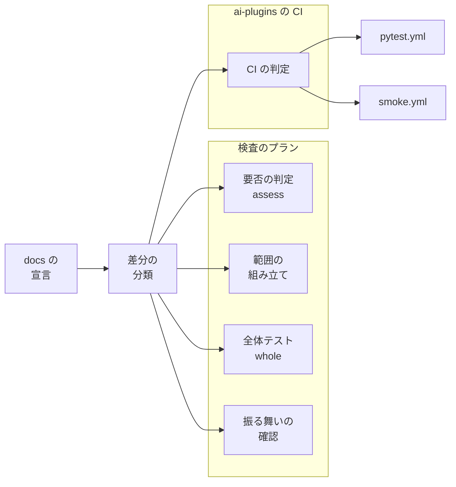
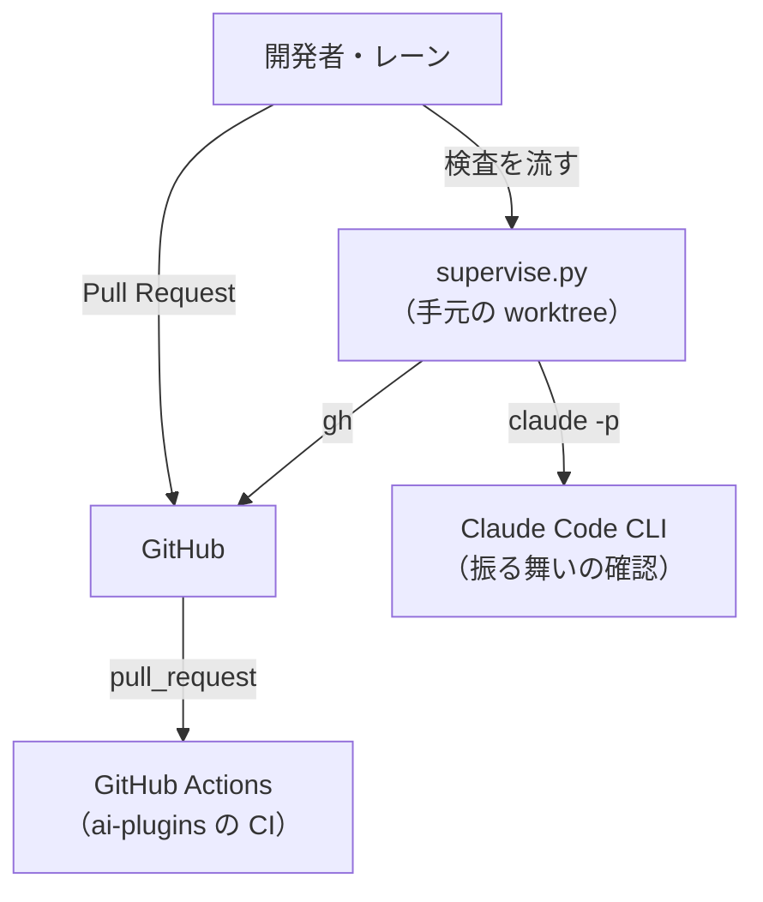
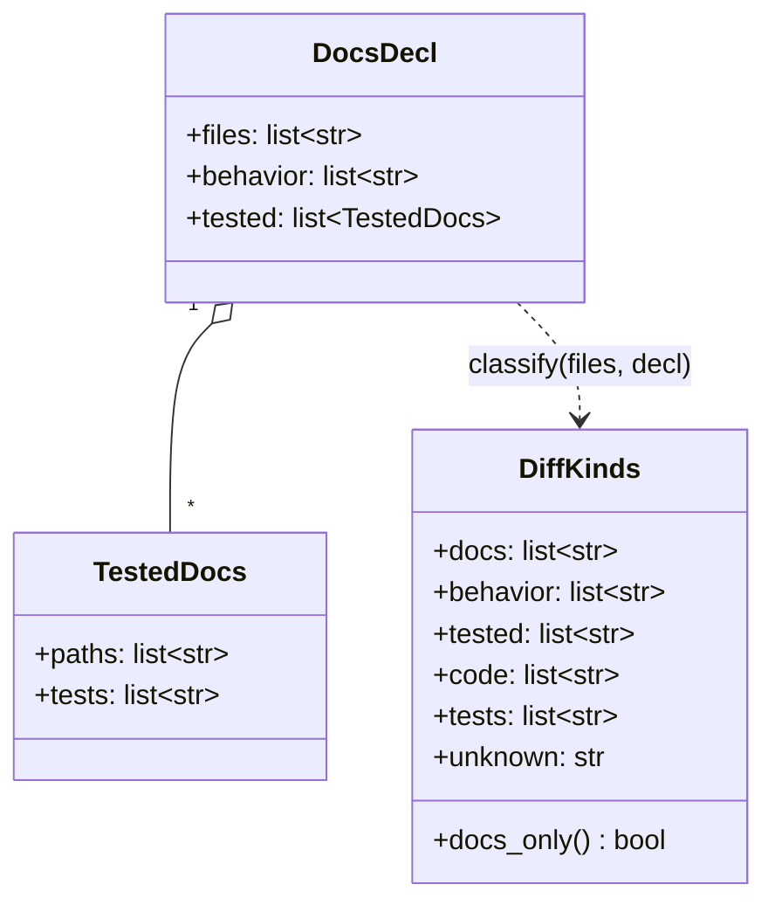
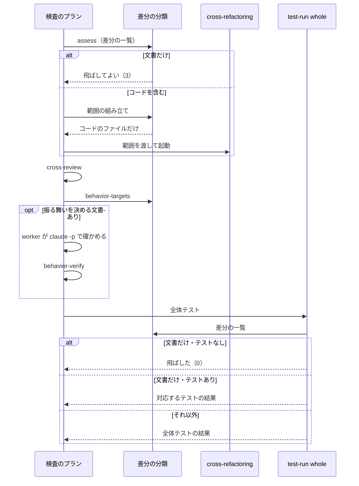
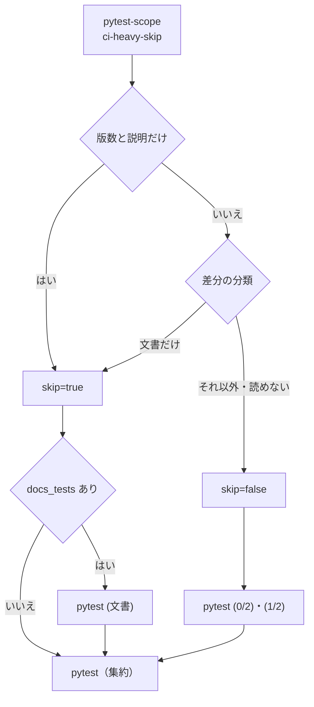

# 検査のプランと CI: 差分の中身で工程を選び、文書だけの変更にリファクタリングと全体テストを掛けない（#2925）

## 目的

- **今どうなっているか**: Skill の本文などの文書だけを変える Pull Request でも、全体テストが走る（CI で 1 ジョブ 11〜15 分を 2 本、Pull Request あたり 3〜4 回）。コードと文書が混ざった Pull Request では、cross-refactoring の範囲に文書のファイルが入る
- **誰に効くか**: 開発者と並行開発のレーン（マージまでの待ち）、CI のランナー、AI の費用
- **変えると何が成り立つか**: 差分を文書のファイルとコードのファイルに分け、cross-refactoring と全体テストをコードのファイルにだけ掛ける。テストが読む文書を変えたときは、その文書を読むテストだけを走らせる。Skill の本文などを変えたときは、全体テストの代わりに振る舞いの確認を通す

## 適用範囲

- **働く範囲**: NDF を使うすべてのリポジトリの検査のプラン（cross-refactoring の判定と範囲・全体テスト・振る舞いの確認）。CI の変更（`.github/workflows/pytest.yml` と `runtime-plugin-smoke.yml`）は ai-plugins の中だけで働く
- **プロジェクトごとに違うもの**: 文書のファイルの範囲・振る舞いを決める文書の範囲・テストが読む文書とそれを読むテストの対応を、プロジェクトの設定（`.ndf/project.json` の `docs`）で受ける。設定が無ければ NDF の既定で動く
- **当たるモード**: リファクタリングを通す `standard` と `legacy-refactor`。全体テストの選び方は、全体テストを走らせるすべてのモードに効く。ビジネス文書の `documentation` の工程は変えない

## あるべき姿の根拠

| 根拠 | 種類 | 何を示すか |
| --- | --- | --- |
| 文書だけの Pull Request 3 件（#2852・#2926・#2929）の pytest が 1 ジョブ 11 分 37 秒〜14 分 53 秒（要求の「調べた事実」2） | 実測 | 用語集を変えた文書だけの差分でも全体テストが走り、待ちの大半を占める |
| 「light / documentation モードの定義を見直し、不要な工程を通らなくて済むようにしてください」「C. 工程を差分の中身で選ぶ　は良いですね。入れましょう」（2026-11-10） | 利用者の指示の原文 | モードを増やさず、差分の中身で工程を選ぶ |
| STD1（GitHub の必須のチェックの扱い） | 外部の一次情報 | 必須のチェックはジョブを省いても名前の結果を返さなければマージが塞がる。集約のジョブで結果を返す形を保つ |
| PRD1（Nx の affected）・LIB2（pytest-testmon） | 外部の一次情報 | 変更されたファイルから走らせるテストを選ぶのは確立した形。ただし Python のコードの依存を追うツールは、データとして読むファイルを追わない |

要求と受け入れ条件は #2925 の本文にある（コピーは [issues/issue-2925-requirements.md](issue-2925-requirements.md) ）。#2907 の受け入れ内容は受け入れ条件 6〜8 に取り込んだ。この文書は「どう作るか」だけを扱う。

## ドメインモデル

### コンテキスト

| コンテキスト | 何の語が 1 つの意味に決まるか |
| --- | --- |
| NDF の開発の工程（`ndf-workflow`） | 差分の分類・文書のファイル・振る舞いを決める文書・テストが読む文書・振る舞いの確認 |
| このリポジトリの開発の検査（`repo-dev-checks`。ai-plugins の CI の判定とワークフロー） | 変えない。差分の分類の語は `ndf-workflow` のものを使う |
| プロジェクトの用語集（`project-glossary`。用語集の設定 `.ndf/glossary.json`） | 変えない。用語集のファイルの場所（`source`・`document`）は今の意味のまま読む |

変更は 3 つのコンテキストにまたがる。関係は次のとおり宣言する。

| 上流 | 下流 | 関係 | 下流が読むもの | 上流の形が変わって下流が読めないときの扱い |
| --- | --- | --- | --- | --- |
| NDF の開発の工程 | このリポジトリの開発の検査 | 公開された言語 | 分類の結果の形（下の「入出力の契約」の分類の結果）。CI の判定（`scripts/ci-heavy-skip.py`）は差分の分類の部品を import して同じ形を読み、検査のプランと同じ結果を使う | CI の判定は `skip=false` を出し、全体テストを走らせる（I2 と同じく、読めないときは文書だけと判定しない）。分類の結果の形を変える Pull Request は、同じ Pull Request で CI の判定とそのテスト（`scripts/tests/test_ci_heavy_skip.py`）を直す |
| プロジェクトの用語集 | NDF の開発の工程 | 順応者 | 用語集の設定の `source` と `document`（決定 3）。差分の分類の部品は、この 2 つを文書のファイルの既定へそのまま足し、翻訳しない | 用語集の設定が無い・読めない・2 つのキーが無いときは、文書のファイルの既定を `**/*.md` だけにする。用語集のファイルはコードのファイルとして扱われ、全体テストを走らせる側へ倒れる |

### 集約

| 集約 | 持ち主（書き換えてよいもの） | 根 | エンティティ | 値オブジェクト |
| --- | --- | --- | --- | --- |
| 差分の分類 | 差分の分類の部品（`lib/diff_kinds.py`）。ほかの構成要素は結果を読むだけ | 差分の分類 | — | 文書のファイルの一覧・振る舞いを決める文書の一覧・テストが読む文書の一覧・コードのファイルの一覧・走らせるテストの一覧・分類できなかった理由 |
| 文書の分け方の宣言 | 利用者（`.ndf/project.json` の `docs` を手で書く）。NDF は読むだけ | 文書の分け方 | テストが読む文書の対応（1 行） | パターンの並び |
| 振る舞いの確認の記録 | 振る舞いの確認の記録のスクリプト（`behavior-check.py`） | Pull Request の 1 件のコメント | 確かめた Skill ごとの行 | 起動したコマンド・観察した結果・判定 |

### 不変条件

| # | 集約 | 条件 | 破れたときの扱い |
| --- | --- | --- | --- |
| I1 | 差分の分類 | 差分の各ファイルは、文書のファイルかコードのファイルのどちらか 1 つにだけ入る | 分類の部品が両方に入れることはない（コードのファイルは「文書のファイルでないもの」として求める） |
| I2 | 差分の分類 | 差分の一覧が取れない・宣言が読めないときは「文書だけ」と判定しない（全体がコードの差分として扱われる） | 今と同じ工程を通す |
| I3 | 差分の分類 | 振る舞いを決める文書とテストが読む文書は、文書のファイルの部分集合である | 文書のファイルに当たらないファイルは、振る舞いのパターンに当たってもコードのファイルとして扱う |
| I4 | 差分の分類 | 走らせるテストの一覧は、差分にあるテストが読む文書に対応するテストの和で、差分に無い文書の対応からは入らない | — |
| I5 | 文書の分け方の宣言 | 宣言が無い・項目が欠けたときは NDF の既定で補い、ai-plugins のパスを既定に持たない | — |
| I6 | 振る舞いの確認の記録 | 振る舞いを決める文書を差分に持つ Pull Request は、その head のコミットで確かめた記録が無い限り検査の先へ進まない | 検査のプランが止まる |

### ドメインイベント

| # | イベント | 発生元 | 受け手 |
| --- | --- | --- | --- |
| E1 | Pull Request の差分のファイルの一覧を取った | 各呼び出し元（リファクタリングの要否の判定・範囲の組み立て・全体テスト・CI の判定） | 差分の分類の部品 |
| E2 | 差分のファイルを分類した | 差分の分類の部品 | リファクタリングの要否の判定・範囲の組み立て・全体テスト・CI の判定・振る舞いの確認の対象の抽出 |
| E3 | cross-refactoring を飛ばした、またはコードのファイルだけを範囲にして起動した | リファクタリングの要否の判定（`assess`）と範囲の組み立て | 検査のプランの記録（ステップの出力） |
| E4 | 全体テストを飛ばした、または走らせた | `test-run.py whole` | 検査のプランの記録 |
| E5 | テストが読む文書を読むテストだけを走らせた | `test-run.py whole` と CI の文書のテストのジョブ | 検査のプランの記録・CI の必須のチェック |
| E6 | CI の必須のチェック `pytest` が結果を返した | CI の集約のジョブ | ブランチの保護（ruleset） |
| E7 | 振る舞いを確かめ、結果を記録した | 振る舞いの確認の worker と `behavior-check.py post` | `behavior-check.py verify`（検査のプランの次のステップ） |
| E8 | 利用者が採る工程の表を承認した | 設計承認ゲート | 実装 |

### 用語

| 用語 | 意味 | 用語集への反映 |
| --- | --- | --- |
| 文書のファイル | 差分のうち、文章として読まれるファイル。既定は Markdown と、用語集の設定が指す用語集のファイル | 追加（`ndf-workflow`） |
| コードのファイル | 差分のうち文書のファイルでないもの | 追加（`ndf-workflow`） |
| テストが読む文書 | 文書のファイルのうち、宣言でテストとの対応を持つもの | 追加（`ndf-workflow`） |
| 振る舞いを決める文書 | 文書のファイルのうち、AI の振る舞いを決めるもの（Skill の本文・手順書・エージェント定義）。既定は `skills/` の下の Markdown と `agents/` の直下の Markdown | 追加（`ndf-workflow`） |
| 振る舞いの確認 | 振る舞いを決める文書を変えたとき、AI がその手順どおりに動くかを実際に起動して確かめること | 追加（`ndf-workflow`） |

## 採る工程の表

**この表を設計承認ゲートで決める（受け入れ条件 12）。** 差分の形は、差分の分類（F1）の結果で決まる。

| 差分の形 | cross-refactoring | 全体テスト（検査のプラン） | CI の pytest | 振る舞いの確認 | cross-review・完了判定・文書の検査 |
| --- | --- | --- | --- | --- | --- |
| 文書のファイルだけ（テストが読む文書・振る舞いを決める文書を含まない） | 飛ばす | 飛ばす | 全体のジョブを省く | 通らない | 今と同じ |
| 文書のファイルだけで、テストが読む文書を含む | 飛ばす | 対応するテストだけ | 対応するテストだけのジョブ | 振る舞いを決める文書を含めば通る | 今と同じ |
| 文書のファイルだけで、振る舞いを決める文書を含む | 飛ばす | 上の 2 行のどちらか | 上の 2 行のどちらか | 通る | 今と同じ |
| コードと文書が混ざる | 通す（範囲はコードのファイルとテストの置き場所だけ） | 全体 | 全体 | 振る舞いを決める文書を含めば通る | 今と同じ |
| コードのファイルだけ | 今と同じ | 全体 | 全体 | 通らない | 今と同じ |
| 差分の一覧が取れない・宣言が読めない | 今と同じ | 全体 | 全体 | 通らない | 今と同じ |

版数と説明だけの差分を省く今の CI の判定（版上げと本番の Pull Request。#1055）は、この表の前に効き、変えない。

## 機能一覧

| # | 機能 | 誰が使うか |
| --- | --- | --- |
| F1 | 差分のファイルを、文書・振る舞いを決める文書・テストが読む文書・コードに分ける | 検査のプラン・CI（部品として） |
| F2 | 文書だけの差分で cross-refactoring を飛ばし、理由を記録に残す | 検査のプラン |
| F3 | 混ざった差分で、cross-refactoring の範囲から文書のファイルを外す | 検査のプラン |
| F4 | 文書だけの差分で全体テストを飛ばす。テストが読む文書があれば、対応するテストだけを走らせる | 検査のプラン・実装のプラン |
| F5 | CI で、文書だけの差分の全体の pytest を省き、テストが読む文書のテストだけを走らせる。必須のチェック `pytest` は結果を返す | ai-plugins の CI |
| F6 | 振る舞いを決める文書を変えた Pull Request で、振る舞いの確認を通して記録を残す | 検査のプラン（worker） |
| F7 | 文書の分け方をプロジェクトの設定で変える | NDF を使うプロジェクトの利用者 |
| F8 | 工程表に、差分の中身で工程を選ぶ決まりを書く | AI と人（`development-workflow` を読む者） |

## 決定の記録

決定の記録は [issues/issue-2925-design-decisions.md](issue-2925-design-decisions.md) にある。

## 外部の調査

| 種類 | 調べるか | 理由 |
| --- | --- | --- |
| 標準・仕様 | 調べる | 必須のチェックとジョブを省く扱いは GitHub の仕様が決める |
| 主要な製品 | 調べる | 変更されたファイルから走らせる対象を選ぶ仕組みは、ビルドツールに前例がある |
| ライブラリとサービス | 調べる | 変更されたファイルを求める既存のアクションと、影響するテストを選ぶ pytest の拡張を使えるかを決める |

### 標準・仕様

| # | 標準・仕様 | 何を定めているか | 設計への反映 | 出典 |
| --- | --- | --- | --- | --- |
| STD1 | GitHub「Troubleshooting required status checks」 | パスの絞り込みで起動しなかったワークフローの必須のチェックは「Pending」のまま残り、マージを塞ぐ。ジョブの `if` で飛ばしたジョブは成功として扱われる | ワークフローは Pull Request で常に起動し、判定のジョブと集約のジョブ `pytest` を残す（今の形）。文書のテストのジョブを足しても、必須のチェックの名前は `pytest` の 1 つのまま | https://docs.github.com/en/enterprise-cloud@latest/pull-requests/how-tos/merge-and-close-pull-requests/troubleshooting-required-status-checks （2026-11-09） |
| STD2 | GitHub community discussion #44490 | パスの絞り込みで必須のチェックを成功にする機能は要望の段階 | 機能を待たず、集約のジョブで結果を返す | https://github.com/orgs/community/discussions/44490 （2026-11-09） |

### 主要な製品

| # | 製品 | どう解いているか | 設計への反映 | 出典 |
| --- | --- | --- | --- | --- |
| PRD1 | Nx の `affected` | 変更されたファイルからプロジェクトの依存のグラフを辿り、影響するものだけのテストを走らせる。変更されたファイルは `--base`/`--head` か `--files` で受ける | 差分のファイルの一覧を呼び出し元が取り、分類の部品は一覧を受ける純粋な関数にする。依存のグラフは持たず、文書とテストの対応を宣言で受ける | https://nx.dev/docs/reference/nx-commands （2026-11-09） |
| PRD2 | Pants のブログ「Skipping GitHub Actions jobs without breaking branch protection」 | ジョブは毎回起動し、変更されたファイルの判定をジョブの `if` に置く。`if` で飛ばしたジョブは成功になる | 今の pytest.yml の形（判定のジョブ → `if` で飛ばす）を保つ | https://www.pantsbuild.org/blog/2022/10/10/skipping-github-actions-jobs-without-breaking-branch-protection （2026-11-09） |

### ライブラリとサービス

| # | 候補 | 版 | ライセンス | 最後のリリースの日付 | 終了のアナウンス | 要件を満たすか | 出典 |
| --- | --- | --- | --- | --- | --- | --- | --- |
| LIB1 | dorny/paths-filter（GitHub のアクション） | v4.0.2（第三者のページによる） | 未確認 | 2026-07-02（第三者のページによる） | 無し（確かめた範囲） | 一部。CI のパスの判定はできるが、検査のプラン（手元の Python）からは呼べず、分け方が 2 か所になる | https://dev.co/devops/open-source/paths-filter （2026-11-09） |
| LIB2 | pytest-testmon | 2.1.3 | 未確認 | 未確認 | 無し（確かめた範囲） | 満たさない。実行した Python のコードの変更を追い、テストがデータとして読むファイル（Markdown・JSON）を追わない | https://pypi.org/project/pytest-testmon/ （2026-11-09） |
| LIB3 | tj-actions/changed-files（GitHub のアクション） | 未確認 | 未確認 | 未確認 | 無し | 採らない。2025-03 に版のタグが書き換えられ、CI の秘密がログへ出た（CVE-2025-30066） | https://www.cisa.gov/news-events/alerts/2025/03/18/supply-chain-compromise-third-party-github-action-cve-2025-30066 （2026-11-09） |
| LIB4 | pathspec（git の wildmatch の照合） | 1.1.1（`uv.lock` で固定済み） | MPL-2.0（未確認） | 未確認 | 無し（確かめた範囲） | 満たす。NDF は `lib/pathmatch.py` で既に使っている | `uv.lock`・`plugins/ndf/scripts/lib/pathmatch.py` （2026-11-09） |

### 確かめられなかったこと

| 対象 | 試した手段 | 結果と理由 |
| --- | --- | --- |
| LIB1 の公式の版・ライセンス | 検索の語「dorny/paths-filter github action latest release」 | 検索の結果は第三者のページとミラーで、公式のリリースのページを取得していない |
| LIB2・LIB4 のライセンスと最後のリリースの日付 | 試していない | 採らない候補（LIB2）と既存の依存（LIB4）で、判断に使わない |
| Bazel の対象の絞り込み | 検索の語「Nx affected / Bazel test impact analysis ...」 | 結果に Bazel の一次情報が無かった |

調べた量: 候補 8 件・取得の試み 5 回。

## 構成要素

| 要素 | 責務 |
| --- | --- |
| 差分の分類の部品（`plugins/ndf/scripts/lib/diff_kinds.py`。新設） | 宣言を読んで既定で補い（`load`）、差分のファイルの一覧を分類する（`classify`）。分類は純粋な関数で、ファイルも git も読まない。照合は `lib/pathmatch.py`（LIB4）を使う |
| 宣言の型（`project_lib/model.py`・`development-workflow/schemas/project.schema.json`） | `.ndf/project.json` の `docs` の形を定める（省略可能） |
| リファクタリングの要否の判定（cross-refactoring の `assess`） | 差分が文書のファイルだけなら終了コード 3（飛ばしてよい）と理由「差分が文書のファイルだけ」を出す |
| 範囲の組み立て（`refactor-scope.py`・`check-trigger.py` の `scope`） | 範囲から文書のファイルを外し、テストの置き場所の探索もコードのファイルからだけ行う |
| 全体テスト（`test-run.py whole`） | 差分を分類し、文書だけなら test の suite を飛ばすか、対応するテストだけを `scope_command` で走らせる。lint の suite は今と同じに走らせる |
| 振る舞いの確認のスクリプト（`plugins/ndf/scripts/behavior-check.py`。新設） | 対象の抽出（`targets`）・記録の投稿（`post`）・記録の確認（`verify`） |
| 検査のプランの雛形（`supervise_lib/templates.py` の `_inspect_steps`） | コードレビューの後に、振る舞いの確認の 3 ステップを置く |
| CI の判定（`scripts/ci-heavy-skip.py`） | 版数と説明だけの判定は残し、文書の判定を差分の分類の部品へ置き換える。出力に `docs_tests` を足す |
| CI のワークフロー（`.github/workflows/pytest.yml`・`runtime-plugin-smoke.yml`） | pytest は文書のテストのジョブを足し、集約のジョブの条件を広げる。runtime smoke は振る舞いを決める文書をコードとして扱う |
| ai-plugins の宣言（`.ndf/project.json` の `docs`） | ai-plugins のテストが読む文書と、それを読むテストの対応を持つ |
| 宣言の漏れの検査（`scripts/tests/test_docs_decl.py`。新設） | テストのソースが文書のファイルのパスを書いているのに、宣言の対応に入っていないテストのファイルを落とす |
| 工程表（`development-workflow` の `SKILL.md` と `references/stage-notes.md`） | 差分の中身で工程を選ぶ決まりと条件を書く |



図に含めない要素:

| 要素 | 含めない理由 |
| --- | --- |
| 宣言の型 | 宣言の形だけを定める |
| 検査のプランの雛形 | ステップの並びは「処理の流れ」の図にある |
| 工程表 | 文書 |
| 宣言の漏れの検査 | ai-plugins の宣言とテストのソースを読むだけ |

「docs の宣言」は ai-plugins の宣言を含む。

### 文脈と配置



検査のプランは手元の worktree で動き、CI は GitHub Actions のランナーで動く。どちらも同じリポジトリのコミットにある `lib/diff_kinds.py` を読む。

### パッケージ・モジュール構成

```text
plugins/ndf/
├── scripts/
│   ├── lib/diff_kinds.py              # 新設: 宣言の読み取りと分類
│   ├── behavior-check.py              # 新設: 振る舞いの確認の対象・記録
│   ├── refactor-scope.py              # 変更: 文書のファイルを外す
│   ├── check-trigger.py               # 変更: scope から文書のファイルを外す
│   ├── test-run.py                    # 変更: whole で差分を分類する
│   ├── project_lib/model.py           # 変更: docs の型
│   └── supervise_lib/templates.py     # 変更: 振る舞いの確認のステップ
└── skills/
    ├── cross-refactoring/scripts/refactor_lib/commands/assess.py  # 変更
    └── development-workflow/
        ├── SKILL.md                   # 変更: 工程表の決まり
        ├── references/stage-notes.md  # 変更: 条件と理由
        └── schemas/project.schema.json  # 変更: docs
scripts/ci-heavy-skip.py               # 変更（ai-plugins の CI）
.github/workflows/{pytest,runtime-plugin-smoke}.yml  # 変更
```

## 構造



`unknown` は分類できなかった理由（空なら分類できた）。`docs_only()` は `unknown` が空で、`code` が空で、`docs` が 1 件以上のときだけ真になる（I2）。

## 入出力の契約

### 宣言（`.ndf/project.json` の `docs`。省略可能）

```json
{
  "docs": {
    "files": ["**/*.md", "docs/metrics/ndf-token-usage/*.json"],
    "behavior": ["plugins/*/skills/**/*.md", "plugins/*/agents/*.md"],
    "tested": [
      {"paths": ["docs/glossary.md", "docs/glossary/**"], "tests": ["plugins/ndf/scripts/tests/test_glossary.py"]}
    ]
  }
}
```

| 項目 | 形 | 省いたときの既定 |
| --- | --- | --- |
| `files` | wildmatch のパターンの並び（`lib/pathmatch.py` の書き方） | `**/*.md` と、用語集の設定（`.ndf/glossary.json`）の `source` と `document`。用語集の設定が無ければ `**/*.md` だけ |
| `behavior` | 同上 | `**/skills/**/*.md`・`**/agents/*.md` |
| `tested` | `paths`（パターン）と `tests`（テストのファイルかディレクトリのパス）の組の並び | 空（テストが読む文書は無い） |

宣言を書くと、その項目は既定を置き換える（足すのではない）。既定に戻すには項目を消す。形が壊れた宣言（型の違い・`tested` の行の `tests` が空）は「読めない」として扱う（I2）。

### 分類の結果（`diff_kinds.classify` の戻り値と、`as_json()` の 1 行）

```json
{"docs": ["docs/a.md"], "behavior": [], "tested": ["docs/glossary.md"], "code": [],
 "tests": ["plugins/ndf/scripts/tests/test_glossary.py"], "unknown": ""}
```

### リファクタリングの要否の判定（`refactor.py assess`）

終了コードの意味は変えない（0 = 通す / 3 = 飛ばしてよい / 2 = 判定できない）。文書だけのときは次を出して 3 で終える。

```text
判定: 飛ばしてよい
理由: 差分が文書のファイルだけ（文書 3 ファイル）
```

宣言が読めないときは今の判定（プロダクションコードの行数）へ進む。

### 全体テスト（`test-run.py whole`）

引数は変えない。差分は `git diff --name-only --no-renames <起点との merge-base>..HEAD` で取る（消したファイルも入る）。出力は今と同じ `step_result` の 1 行で、`summary` と `items` に分類を載せる。

| 分類 | test の suite | lint の suite | 終了コード | `summary` |
| --- | --- | --- | --- | --- |
| 文書だけ・走らせるテストなし | 走らせない | 今と同じ | lint の結果（無ければ 0） | `全体テストを飛ばした（差分が文書のファイルだけ: N ファイル）` |
| 文書だけ・走らせるテストあり | `scope_command` に走らせるテストを入れて手元で走らせる（CI に任せる戦略でも手元） | 今と同じ | 今の範囲テストと同じ | `文書を読むテスト M 本を走らせた（全体テストの代わり）` |
| それ以外 | 今と同じ | 今と同じ | 今と同じ | 今と同じ |

`items` に `{"diff_kinds": <分類の結果>}` を 1 行足す。

### 振る舞いの確認（`behavior-check.py`）

| サブコマンド | 入力 | 出力 | 終了コード |
| --- | --- | --- | --- |
| `targets --pr N [--root DIR]` | Pull Request の差分 | 振る舞いを決める文書を Skill かエージェントの単位にまとめた一覧（`step_result` の 1 行） | 0 = 対象あり / 3 = 対象なし（飛ばす） / 2 = 判定できない |
| `post --pr N --file <結果の JSON>` | worker が書いた結果 | Pull Request のコメント 1 件（印 `<!-- ndf:behavior-check head=<sha> -->` 付き） | 0 / 2 |
| `verify --pr N` | Pull Request のコメントと今の対象 | 足りない対象・落ちた対象の一覧 | 0 = head の記録が全対象を「通った」で覆う / 1 = 足りない・落ちた / 2 = 読めない |

結果の JSON（worker が書く）:

```json
{"head": "<sha>", "checks": [{"target": "plugins/ndf/skills/design", "prompt": "...",
  "command": "claude -p --plugin-dir plugins/ndf --output-format stream-json --max-budget-usd 1 ...",
  "observed": "手順 5 の design-survey.py check を打った", "verdict": "通った"}]}
```

### 検査のプランのステップ（`_inspect_steps` に足す 3 つ）

| id | 種類 | 内容 | 遷移 |
| --- | --- | --- | --- |
| `behavior-targets` | run（stage 完了判定） | `behavior-check.py targets --pr {pr}` | 3 → `base-sync`（`skip_to`）、0 → `behavior`、失敗 → `abort` |
| `behavior` | work（kind 振る舞いの確認） | 下の手順で確かめ、`post` で記録する | → `behavior-verify` |
| `behavior-verify` | run | `behavior-check.py verify --pr {pr}` | 0 → `base-sync`、1 → `abort` |

worker の手順（プロンプトに載せる）:

1. 対象ごとに、差分で変わった指示を 1 つ選び、その指示が効く依頼文を作る
2. 次のコマンドを、Pull Request の worktree の一時コピーで 1 回起動する

   ```text
   claude -p --plugin-dir <対象のプラグインの根> --output-format stream-json --verbose --no-session-persistence --max-budget-usd 1
   ```
3. 出力のツールの呼び出しと応答から、変わった指示どおりに動いたかを判定する。動かなければ「落ちた」とし、理由を `observed` に書く
4. 対象は 6 件まで。超えた分は「確かめていない」として `post` に載せ、`verify` が落とす（人が判断する）

### CI の判定（`scripts/ci-heavy-skip.py`）

出力に 1 行を足す。`skip=true` のとき、`docs_tests` が空でなければ文書のテストのジョブが走る。

```text
skip=true
reason=差分が文書のファイルだけ（テストが読む文書 2 ファイル）
docs_tests=plugins/ndf/scripts/tests/test_glossary.py plugins/ndf/scripts/tests/test_doc_lint.py
```

`--workflow runtime-plugin-smoke.yml` のときは、振る舞いを決める文書をコードのファイルとして扱い、`docs_tests` を出さない。

### CI のワークフロー（`pytest.yml`）

| ジョブ | 名前 | 条件 |
| --- | --- | --- |
| `ci-scope` | `pytest-scope` | 今と同じ。判定の前に依存（pathspec）を入れる |
| `pytest-shard` | `pytest (0/2)`・`pytest (1/2)` | 今と同じ（`skip != 'true'`） |
| `pytest-docs`（新設） | `pytest (文書)` | `skip == 'true'` かつ `docs_tests != ''` |
| `pytest` | `pytest`（必須のチェック） | 分けたジョブが成功、または `skip == 'true'` で分けたジョブが skipped かつ（`docs_tests` が空、または `pytest-docs` が成功） |

## 処理の流れ

### 検査のプラン



### CI



処理の流れの図に含めない要素:

| 要素 | 含めない理由 |
| --- | --- |
| 宣言の型・宣言の漏れの検査・工程表 | 検査の実行の時点では動かない |
| `runtime-plugin-smoke.yml` | 判定の流れは pytest と同じで、`docs_tests` を使わない |
| 検査のプランの雛形 | 上の図のステップの並びそのもの |

## 非機能の実現方式

| 大項目 | 条件 | 実現方式 |
| --- | --- | --- |
| 性能・拡張性 | 用語集を変えた文書だけの Pull Request で、CI の pytest の所要を用語集を読むテストだけの所要へ縮める | `pytest (文書)` のジョブで、宣言の対応のテストだけを `-n auto` で走らせる。実装の Pull Request に、#2929 と同じ形の差分での所要を実測して載せる |
| 運用・保守性 | 分け方を 1 か所に置き、検査のプランと CI が同じものを読む | 分類は `lib/diff_kinds.py` の 1 か所。CI の判定はこの部品を import する。`ci-heavy-skip.py` の `DOCS_MD_RE`・`TESTED_DOCS_RE`・`DOC_FILES`・`DOC_RE` は消し、`docs/metrics/ndf-token-usage/*.json` は ai-plugins の宣言の `files` へ移す |
| システム環境 | 設定を置かないプロジェクトでも既定で動く | 既定は `**/*.md` と用語集の設定・`skills/` と `agents/` の慣習だけから作り、ai-plugins のパスを持たない（I5） |

## テスト設計

| 受け入れ条件・不変条件 | どの振る舞いで縛るか | どう壊したら落ちるべきか |
| --- | --- | --- |
| 1 | 文書だけの差分の worktree で `assess` が 3 と理由「差分が文書のファイルだけ」を出す | 文書の判定を外す・Markdown をコードとして数えるように壊すと落ちる |
| 2 | 文書だけの差分で `test-run.py whole` が test の suite を起動せず 0 と飛ばした理由を出す | 分類を読まずに suite を起動するように壊すと落ちる |
| 3 | 混ざった差分で `refactor-scope.py` と `check-trigger.py scope` の出力に文書のファイルとそのディレクトリが入らない。`whole` は全体を走らせる | 文書のフィルタを外すと落ちる |
| 4 | テストが読む文書だけの差分で `whole` が宣言の対応のテストだけを `scope_command` で走らせ、落ちたら 1 を返す | 全体を走らせる・落ちても 0 を返すように壊すと落ちる |
| 5・I2 | 差分の一覧が取れない・宣言の形が壊れたとき、`assess`・`whole`・`ci-heavy-skip.py` が今と同じ（通す・全体・`skip=false`）になる | 読めないときに文書だけと判定するように壊すと落ちる |
| 6 | `ci-heavy-skip.py` が #2929 と同じ形の差分で `skip=true` と `docs_tests` を出す | 用語集をコードとして扱うように壊すと落ちる |
| 7 | 集約のジョブの条件式を、ジョブの結果の組（成功・skipped・失敗）ごとに評価して期待どおりになる | `pytest-docs` の失敗で成功を返すように壊すと落ちる |
| 8 | コードかテストを含む差分で `ci-heavy-skip.py` が `skip=false` を出す | テストのファイルを文書として扱うように壊すと落ちる |
| 9・I6 | `targets` が振る舞いを決める文書だけを対象にし、`verify` は head の印の無い記録・落ちた対象・足りない対象で 1 を返す | 古い head の記録を受け入れるように壊すと落ちる |
| 10 | 工程表の決まりは文言を照合しない。プランの雛形が振る舞いの確認の 3 ステップを持ち、`skip_to` が `base-sync` を指す | 雛形からステップを外すと落ちる |
| 11・I5 | 宣言の無いプロジェクトで既定が `**/*.md` と用語集の設定のファイルになり、`docs/glossary/` を含まない（用語集の設定が無いとき） | 既定に ai-plugins のパスを書くと落ちる |
| 12 | 設計承認ゲートで人が決める（テストを書かない） | — |
| 13 | 文書だけの差分の検査のプランが `review`・`doc-lint`・`ready` を持ち、`whole` が lint の suite を走らせる | 文書だけで lint を飛ばすように壊すと落ちる |
| 14 | `documentation` のプランの雛形が変わらない（既存のテストが通る） | — |
| I1 | 分類の結果で、どのファイルも `docs` と `code` の両方に入らない | 両方に入れるように壊すと落ちる |
| I3 | 文書のパターンに当たらず振る舞いのパターンに当たるファイルが `code` に入る | 振る舞いのパターンだけで文書に入れると落ちる |
| I4 | 差分に無い文書の対応のテストが `tests` に入らない | 宣言のテストをすべて入れるように壊すと落ちる |
| 宣言の漏れの検査 | 文書のパスを書いたテストのファイルが宣言に無いと落ちる | 宣言からテストを 1 つ消すと落ちる |

## 設計の結果

| 課題 | 扱い | 取り込み先 | 触るファイル |
| --- | --- | --- | --- |
| #2925 | 実装する | — | `plugins/ndf/scripts/lib/diff_kinds.py`（新設）、`plugins/ndf/scripts/behavior-check.py`（新設）、`plugins/ndf/scripts/refactor-scope.py`、`plugins/ndf/scripts/check-trigger.py`、`plugins/ndf/scripts/test-run.py`、`plugins/ndf/scripts/project_lib/model.py`、`plugins/ndf/scripts/supervise_lib/templates.py`、`plugins/ndf/scripts/supervise_lib/paths.py`、`plugins/ndf/scripts/tests/`、`plugins/ndf/skills/cross-refactoring/scripts/refactor_lib/commands/assess.py`、`plugins/ndf/skills/cross-refactoring/scripts/tests/`、`plugins/ndf/skills/development-workflow/SKILL.md`、`plugins/ndf/skills/development-workflow/references/stage-notes.md`、`plugins/ndf/skills/development-workflow/schemas/project.schema.json`、`scripts/ci-heavy-skip.py`、`scripts/tests/test_ci_heavy_skip.py`、`scripts/tests/test_docs_decl.py`（新設）、`.github/workflows/pytest.yml`、`.github/workflows/runtime-plugin-smoke.yml`、`.ndf/project.json` |
| #2907 | 取り込む | #2925 | — |

## 未確認のまま残ること

| 項目 | 内容 |
| --- | --- |
| 宣言の漏れ | テストがパスを組み立てて文書を読む（ソースに文書のパスが現れない）と、宣言の漏れの検査で見つからない。文書だけの Pull Request はマージされ、develop への push の全体の pytest で見つかる。実装で全体テストを開いたファイルの記録つきで回し、最初の宣言の漏れを 0 にする |
| 振る舞いの確認の判定のぶれ | `claude -p` の 1 回の起動は確率的で、通ったことは指示が効く可能性を示すだけである。落ちたときは worker が理由を書き、人が判断する |
| 振る舞いの確認の費用 | 1 回の起動の実際の費用と所要は未測定。実装の Pull Request で 1 回測って載せる |
| CI の判定の所要 | `pytest-scope` に依存（pathspec）を入れる秒が増える。実装の Pull Request で測る |
| `.ndf/project.json` の書き換え | 共通原則の C7（利用者の設定の書き換え）に当たる。リリース承認ゲートで人が見る |
| 実装のプランの範囲テスト | 実装のプランの `test-limited` は宣言のテストの置き場所を走らせ、文書だけの差分でも範囲テストが走る。この課題では変えない |
