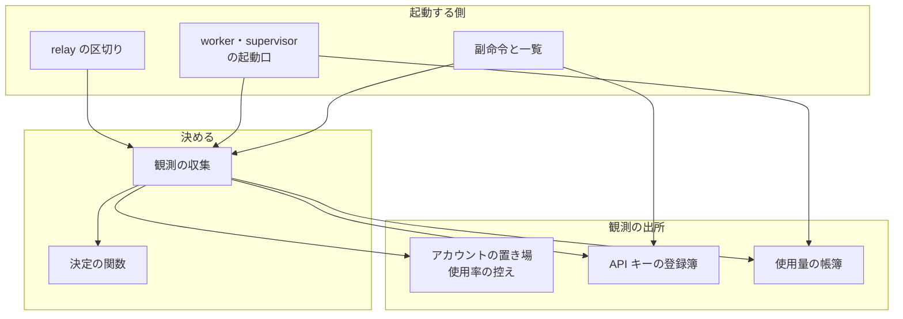
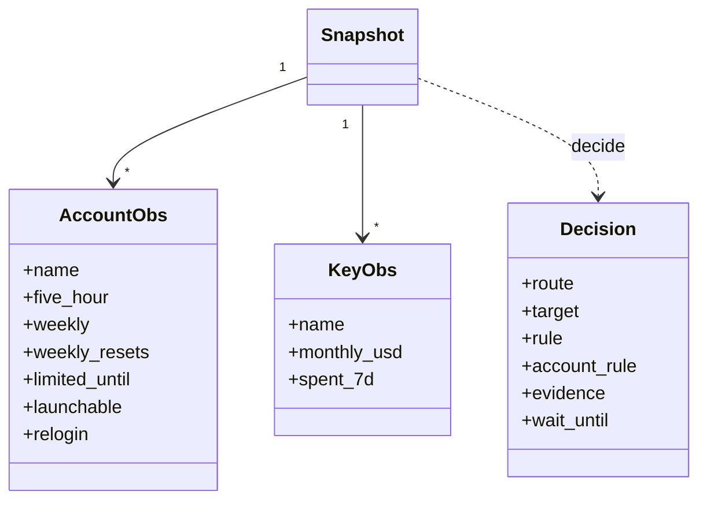
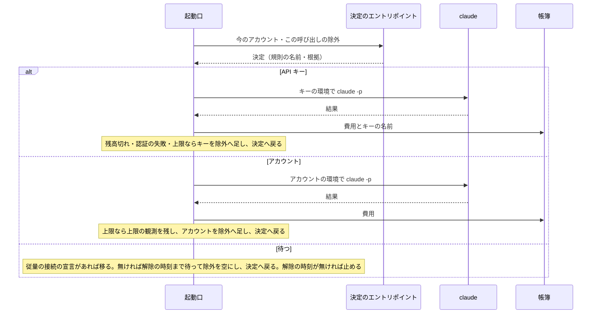
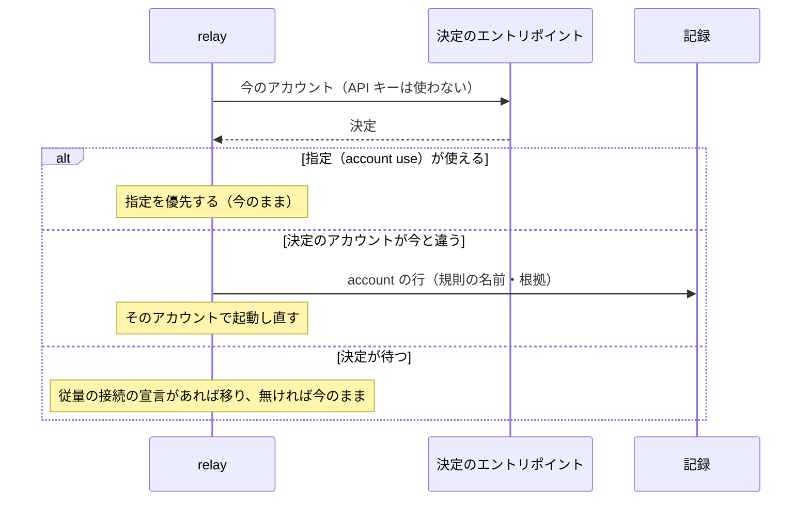

# claude -p の起動先: 5 時間の枠のあるアカウントを先に使い、全アカウントの週の上限が近いときだけ API キーへ逃がす（#2930）

## 目的

- **今どうなっているか**: 起動先の判定が 2 か所（アカウントの選び方と API キーの使い方）に分かれ、どちらも 5 時間の枠と週の枠を区別しない。5 時間の枠の無いアカウントが先に選ばれ、5 時間の上限だけで API キーへ移る。API キーは名前の順の先頭を使い続け、一度立つと戻らない印と残高切れの 24 時間の保留を持つ
- **誰に効くか**: 登録済みのアカウントを 2 つ以上持ち、API キーの月のクレジットで worker の `claude -p` を補う利用者
- **変えると何が成り立つか**: 起動先が、その時点の観測と使用量の帳簿だけから 1 つの規則の表で決まる。5 時間の枠は使い切ってから週だけの枠へ回り、API キーは全アカウントの週の枠が尽きかけたときだけ、週の利用枠の中で均等に使われる。プロセスや端末を起動し直しても、同じ観測から同じ起動先が出る

## 適用範囲

- **働く範囲**: NDF を使うすべてのリポジトリ。判定は利用者のアカウントの置き場（`~/.claude/ndf/accounts/`）と使用量の帳簿を読む
- **プロジェクトごとに違うもの**: 無し（アカウントと API キーは利用者ごとの設定で、リポジトリの設定を持たない）。閾値 T と月の額は利用者が `relay.py account` の副命令で宣言する
- **当たるモード**: `standard`

## あるべき姿の根拠

| 根拠 | 種類 | 何を示すか |
| --- | --- | --- |
| 「アカウントの状態・キーの状態など判断に必要な情報は内部に保持せず、常に API から取得した最新のものだけを利用する」 | 利用者の指示の原文 | 判定のための状態のファイルと印を持たない |
| 「ロジックがかなり複雑なので、きちんと構造化された設計・コードを書くように。if 文の連鎖にならないように」 | 利用者の指示の原文 | 決定を純粋な関数と規則の表にする |
| 「切替の際にはその時に選ばれるべきアカウントをルール通りに選べばほぼ同じことになるはず」 | 利用者の指示の原文 | 復帰先を記録せず、区切りごとに同じ規則で選び直す |
| STD1（月のクレジットは請求の周期ごとに付与され、繰り越さない） | 外部の一次情報 | 週の利用枠を直近 7 日の帳簿で数えれば、付与日を持たずに済む |
| 直近 7 日の `claude -p` の費用 $2,443 に対し、API キーの週の利用枠は約 $150 | 実測（決定の記録の「閾値 T の既定値」） | API キーは週の 6% ほどしか補えない。逃がす条件を絞る必要がある |

要求と受け入れ条件は #2930 の本文にある（コピーは [issue-2930-requirements.md](issue-2930-requirements.md) ）。#2931 の受け入れ内容は #2930 の要求へ取り込み済みである。この文書は「どう作るか」だけを扱う。

## ドメインモデル

### コンテキスト

| コンテキスト | 何の語が 1 つの意味に決まるか |
| --- | --- |
| 中継（`ndf-relay`） | アカウント・API キー・使用率・起動先の決定・区切り |

コンテキストは 1 つである。使用量の帳簿は中継の外（使用量の計測）の持ち物だが、この変更は帳簿の記録へ任意の列を 1 つ足して読むだけで、帳簿の語を変えない。

### 集約

| 集約 | 持ち主（書き換えてよいもの） | 根 | エンティティ | 値オブジェクト |
| --- | --- | --- | --- | --- |
| 起動先の決定 | 決定の関数（新設。書き換えない。毎回作る） | 起動先の決定 | — | 規則の名前・根拠の値・観測のスナップショット |
| API キーの登録簿 | API キーの登録の副命令（今の持ち主のまま） | 登録簿 | API キー | 月の額・閾値 T・API キーの使い方の宣言 |
| アカウントの使用率の控え | 使用率の取得（今の持ち主のまま） | アカウントごとの控え | — | 5 時間の枠・週の枠・モデル別の週の枠・取得の時刻 |

起動先の決定は保存しない値である。記録（中継の記録・進捗記録）へ写すが、次の決定の入力にしない。

### 不変条件

| # | 集約 | 条件 | 破れたときの扱い |
| --- | --- | --- | --- |
| I1 | 起動先の決定 | 同じ観測のスナップショットからは、同じ決定（起動先・規則の名前・根拠の値）が出る | 決定の関数が時刻・ファイル・API を読んだことになる。表のテストが落とす |
| I2 | 起動先の決定 | 1 つでも週の使用率が T 未満か不明の登録済みアカウント（再登録が要るものを除く）があれば、`near-limit` で API キーを選ばない | 規則の表の順序の誤り。表のテストが落とす |
| I3 | 起動先の決定 | 直近 7 日の使用額が週の利用枠以上の API キーと、月の額を宣言していない API キーは、`near-limit` で選ばない | 同上 |
| I4 | 起動先の決定 | 選ばれるアカウントは、上限にない、起動できるアカウントだけである | 同上 |
| I5 | 起動先の決定 | 今のアカウントが最良の候補と同じ組にあれば、今のアカウントを保つ。組が違うか今のアカウントが候補でなければ、最良の候補へ替える | 同上 |
| I6 | API キーの登録簿 | API キーの値は、帳簿・記録・表示・引数の誤りの表示のどこにも出ない | 値を見つけたテストが落とす |
| I7 | アカウントの使用率の控え | 控えの寿命を過ぎたもの、控えの中のどれかのリセット時刻を過ぎたものは使わずに取り直す | 取り直さない経路が残っている。単体テストが落とす |
| I8 | 起動先の決定 | 判定のための状態のファイルを読まず、書かない（API キーの状態のファイルが残っていても決定は変わらない） | 状態のファイルを置いたテストで決定が変わる |

### ドメインイベント

| # | イベント | 発生元 | 受け手 |
| --- | --- | --- | --- |
| E1 | 起動先の決定を求められた | worker・supervisor の起動口、relay の区切り | 観測の収集 |
| E2 | 各アカウントの使用率とリセット時刻を観測した | 観測の収集 | 決定の関数 |
| E3 | 帳簿から API キーごとの直近 7 日の使用額を読んだ | 観測の収集 | 決定の関数 |
| E4 | 起動先を決めた | 決定の関数 | 起動口・relay（起動）、記録 |
| E5 | 選んだアカウントか API キーで起動した | 起動口・relay | 帳簿（E8） |
| E6 | API キーの起動が残高切れを返した | 起動口 | 起動口（当の API キーをその呼び出しの除外へ足し、E4 を出し直す） |
| E7 | 5 時間の上限に当たった | 起動口・relay | 使用率の控え（上限の観測）、起動口（当のアカウントをその呼び出しの除外へ足し、E4 を出し直す） |
| E8 | API キーで起動した `claude -p` の費用を帳簿へ記録した | 起動口 | 次の E3 |
| E9 | 区切りで選び直した結果が今のアカウントと違い、切り替えた | relay | 中継の記録 |
| E10 | アカウントの週の枠・5 時間の枠がリセットされた | NDF の外 | 次の E2（控えのリセット時刻で取り直す） |

### 用語

| 用語 | 意味 | 用語集への反映 |
| --- | --- | --- |
| 選ぶ順の組 | アカウントを 4 つに分けた選ぶ順の単位。5 時間の枠を先に使う組・週だけの枠の組・閾値を超えた組・残量不明の組の順に選ぶ | 追加 |
| 観測のスナップショット | 1 回の起動先の決定の入力。時刻・宣言・各アカウントの観測・各 API キーの使用額・除外する名前を、決定の時点の値で固めたもの | 追加 |
| 切り替えの余裕 | 今のアカウントが最良の候補と同じ選ぶ順の組にあれば替えない、という切り替えを抑える条件 | 追加 |
| 閾値 T | API キーへ逃がすかと、5 時間の枠のあるアカウントを先に選ぶかを決める週の使用率の閾値。既定値は 85% | 追加 |
| 残高切れ | API キーの要求が "credit balance is too low" で失敗した状態。そのキーはその 1 回の起動の中でだけ候補から外れる | 意味の変更 |

## 外部の調査

| 種類 | 調べるか | 理由 |
| --- | --- | --- |
| 標準・仕様 | 調べる | 月のクレジットの付与と期限、使用率の上限の仕組みは提供元の公式の記述だけが決める |
| 主要な製品 | 調べる | 複数のアカウントを使用率で切り替える既存の CLI が、どの規則で選ぶかを比べる |
| ライブラリとサービス | 調べる | 切り替えの CLI をそのまま使えるか、決定の規則を外部の部品に任せられるかを決める |

### 標準・仕様

| # | 標準・仕様 | 何を定めているか | 設計への反映 | 出典 |
| --- | --- | --- | --- | --- |
| STD1 | Anthropic「API credits for Max and Team plans」 | 月のクレジットは請求の周期ごとに支払いの処理の後に付与され、周期の終わりに失効して繰り越さない。対象は Claude API・Agent SDK・Console の Playground で、Claude Code は対象外。尽きると "Your credit balance is too low..." を返して要求が止まり、プランへは課金しない | 週の利用枠を「直近 7 日の帳簿の使用額」で数え、付与日と残高を持たない（決定 4）。残高切れはその起動でだけ外す（決定 2） | https://platform.claude.com/docs/en/about-claude/api-credits-for-subscribers （2026-11-10） |
| STD2 | Anthropic「Monthly API credits for Max and Team plans」（ヘルプセンター） | 同じ内容のヘルプ記事。API キーで自分が起動した `claude -p` と Agent SDK はクレジットの対象、プランでサインインした `claude -p` はプランの上限から引かれる | 対象の起動を `claude -p` に限る（前提 1 のまま） | https://support.claude.com/en/articles/17154008-monthly-api-credits-for-max-and-team-plans （2026-11-10。検索の結果の要約で読んだ） |
| STD3 | 使用率の応答（`GET /api/oauth/usage`） | 5 時間の枠・週の枠・モデル別の週の枠の使用率とリセット時刻を返す。公開の仕様は無い | 観測の唯一の出所にする。5 時間の枠が応答に無いアカウントを「5 時間の枠の無いアカウント」とする | `plugins/ndf/scripts/lib/claude_usage.py` の `parse_usage` と `~/.claude/ndf/accounts/*/usage.json` の実物（2026-11-10） |

### 主要な製品

| # | 製品 | どう解いているか | 設計への反映 | 出典 |
| --- | --- | --- | --- | --- |
| PRD1 | ccpool | `claude` の起動ごとに、5 時間と週の使用率を合わせた値の最も小さいアカウントを選ぶ。全アカウントが 95% 以上なら起動を拒む。使用率は `/api/oauth/usage` から取り、提供元の側で 5 分の控えがある | 起動ごとに選ぶ形と、5 分の控えの寿命を採る。5 時間の枠を後に回す選び方は方針と逆なので採らない | https://github.com/torkay/ccpool （2026-11-10） |
| PRD2 | claude-swap | 今のアカウントの 5 時間か週の使用率が閾値（既定 90%）に達したら、残りの最も多いアカウントへ替える。週の枠のリセットの早い順の戦略もある。5 時間の枠の無いアカウントは週の枠だけで見る。行ったり来たりを防ぐ待ち時間と余裕を持つ | 5 時間の枠の無いアカウントを週の枠で見ることと、切り替えを抑える余裕を置くことを採る。待ち時間（状態）は持たない | https://github.com/realiti4/claude-swap （2026-11-10） |

### ライブラリとサービス

| # | 候補 | 版 | ライセンス | 最後のリリースの日付 | 終了のアナウンス | 要件を満たすか | 出典 |
| --- | --- | --- | --- | --- | --- | --- | --- |
| LIB1 | ccpool（CLI として使う） | 1.0 前、リリース無し | MIT | 確かめられなかった（リリースの一覧が空） | 無し | 満たさない。API キーの利用枠・帳簿の使用額・区切りの選び直しを持たず、別の CLI（`caam`）に依存する | https://github.com/torkay/ccpool （2026-11-10） |
| LIB2 | claude-swap（CLI として使う） | リリース無し（コミット 749 件） | MIT | 確かめられなかった（リリースの一覧が空） | 無し | 満たさない。端末全体のログインを替える方式で、起動ごとの環境（`CLAUDE_CONFIG_DIR`）を組む今の仕組みと合わない。状態（待ち時間）を持つ | https://github.com/realiti4/claude-swap （2026-11-10） |
| LIB3 | Python の標準ライブラリ（`dataclasses`・`math`） | Python 3.10 以上 | PSF | — | 無し | 満たす。決定の表を値と関数の並びで書ける | `python3 --version` と既存の `lib/` の import（2026-11-10） |

### 確かめられなかったこと

| 対象 | 試した手段 | 結果と理由 |
| --- | --- | --- |
| 月のクレジットの額のプラン別の値 | STD1 の取得と、検索「Claude Max plan monthly API credits Console usage Claude Code -p」 | STD1 は Max $100・Ultra $200・Team は席ごとに $20 / $100 で上限 $500 と書く。検索の結果の要約は Max 5x $100・Max 20x $200 と書く。食い違いの解消は確かめられなかった。設計は額を宣言で受けるため、決定は変わらない |
| 週の枠のリセットが固定の時刻か、転がる 7 日か | 検索「Claude Code weekly usage limits 5-hour session limit Max plan help center」 | 公式のヘルプの原文を取得していない（検索の結果は第三者の解説だけ）。設計はリセット時刻を応答から読むため、決定は変わらない |
| claude-swap の切り替えの細部（`docs/auto-switch.md`） | 試していない | 上限の 30 回の内だが、要件を満たさない判定は README で決まったため取得しなかった |

調べた量: 候補 8 件・取得の試み 6 回。

## 機能一覧

| # | 機能 | 誰が使うか |
| --- | --- | --- |
| F1 | 起動のたびに、選ぶ順の組に従ってアカウントを選ぶ | worker・supervisor の起動口 |
| F2 | 区切りのたびに起動先を選び直し、組が変わったときだけ切り替える | relay |
| F3 | 全アカウントの週の使用率が T 以上のときだけ、週の利用枠の残る API キーで `claude -p` を起動する | worker・supervisor の起動口 |
| F4 | API キーの月の額と閾値 T を宣言する | 利用者 |
| F5 | アカウントごとの組と 5 時間の枠の有無、API キーごとの月の額・直近 7 日の使用額・週の利用枠を一覧で見る | 利用者 |
| F6 | 起動先が変わったときに、規則の名前と根拠の値を記録に残す | 利用者（後から辿る） |

## 構成要素

| 要素 | 責務 |
| --- | --- |
| 決定の関数（新設 `lib/launch_rules.py`） | 観測のスナップショットから起動先の決定を返す。I/O を持たない。規則の表・選ぶ順の組の表・組の中の並べ方を持つ |
| 観測の収集（新設 `lib/launch_observe.py`） | アカウントの使用率（控えを通す）・上限の観測・起動できるか・API キーの宣言・帳簿の直近 7 日の使用額・時刻を集め、スナップショットを組む。決定の関数を呼ぶ口（`decide_now`）を持つ |
| アカウントの置き場（`lib/claude_accounts.py`） | 今の `choose` の並べ方（`_try_order`・`_order_side`）と切り替えの閾値（`switch_at`）を外す。`choose` は決定のエントリポイントを呼ぶ薄い互換の口になる。使用率の控えをリセット時刻で取り直す |
| API キーの登録簿（`lib/claude_api_keys.py`） | 月の額と閾値 T を読み書きする。状態のファイル・`near_limit`・`pick_key`・`KeyTry.limit_hit` を外す。`KeyTry` は決定のエントリポイントの結果で起動し、残高切れと認証の失敗はその呼び出しの除外へ足すだけにする |
| 使用量の帳簿（`lib/usage_ledger.py`・`lib/usage_capture.py`・`supervise_lib/claude.py` の `call_claude`） | 記録に API キーの名前（任意の列）を足す。API キーごとの直近 7 日の使用額を返す |
| 起動口（`supervise_lib/claude.py` の `ClaudeRunner`） | 起動のたびに決定のエントリポイントを呼ぶ。決定が「待つ」なら今の扱い（従量の接続の宣言があれば移り、無ければ解除を待つ）へ進む |
| relay の区切り（`relay_lib/switch.py`・`relay_lib/run.py`・`relay_lib/handover.py`） | 区切りの起動先を決定のエントリポイントで決める。使用率の定期の確認（`UsageWatch`）を外す |
| 副命令と一覧（`relay_lib/accounts.py`・`relay_lib/api_keys.py`） | `add-api-key --monthly`・`api-key-monthly`・`api-key-use near-limit --weekly-at` を受ける。一覧に組・5 時間の枠の有無・API キーの使用額と利用枠を出す |



### 置き場所

```text
plugins/ndf/scripts/
├── lib/
│   ├── launch_rules.py        （新設。決定の関数と規則の表）
│   ├── launch_observe.py      （新設。観測の収集と決定のエントリポイント）
│   ├── claude_accounts.py     （変更）
│   ├── claude_api_keys.py     （変更）
│   ├── usage_ledger.py        （変更）
│   └── usage_capture.py       （変更）
├── relay_lib/
│   ├── switch.py              （変更）
│   ├── run.py                 （変更）
│   ├── handover.py            （変更）
│   ├── accounts.py            （変更）
│   └── api_keys.py            （変更）
├── supervise_lib/
│   └── claude.py              （変更）
└── tests/
    ├── test_launch_rules.py   （新設。表のテスト）
    └── test_launch_observe.py （新設）
```

### 値の集合へ足す値と、既存の規則の判定

API キーの使い方の宣言（`off`・`always`・`near-limit`）の値は増やさない。足すのは、組の値（4 つ）と規則の名前の値である。どちらも新しい集合で、既存の規則は持たない。

アカウントの状態の一覧の語（「使える」「上限（時刻）」「残量不明」など。`Account.state`）は変えない。組は別の列として出す。

切り替えの閾値（`NDF_ACCOUNT_SWITCH_AT`、既定 90%）を前提にした既存の規則を、名前で検索して集めた。

| 規則 | 置き場 | この変更での扱い |
| --- | --- | --- |
| 閾値未満の候補を先に並べる | `claude_accounts._try_order` | 選ぶ順の組へ置き換える |
| 従量の接続から戻せるか（使用率が閾値未満） | `Choice.recoverable`（`switch.py`・`supervise_lib/claude.py`） | 決定の起動先がアカウント（候補のアカウントがある。組 1〜4 のどれでも）なら戻す、に置き換える |
| 今のアカウントが閾値以上なら次の区切りで替える | `UsageWatch.check`・`_pick_for_section`・`no_better` | 区切りの決定と切り替えの余裕へ置き換える |
| near-limit の条件 2（選んだ候補の使用率が閾値以上） | `claude_api_keys.near_limit` | 規則の表（閾値 T）へ置き換える |

置き換えた後、`switch_at` と `NDF_ACCOUNT_SWITCH_AT` を読む箇所は残らない。

## 構造



| 型 | 責務と値 |
| --- | --- |
| 観測のスナップショット（`Snapshot`） | `now`（時刻）・`use`（`off` / `always` / `near-limit`）・`weekly_at`（閾値 T）・`current`（今のアカウント。無ければ None）・`accounts`・`keys`・`ledger_ok`（帳簿を読めたか）・`exclude_keys`（この呼び出しで外した API キーの名前）。不変 |
| アカウントの観測（`AccountObs`） | `five_hour`（`(使用率, リセット時刻)`。応答に無ければ None）・`weekly`（週の使用率。読めなければ None）・`weekly_resets`（週の枠のリセット時刻）・`limited_until`（上限にあるならその時刻）・`launchable`（起動できるか）・`relogin`（再登録が要るか） |
| API キーの観測（`KeyObs`） | `monthly_usd`（月の額。宣言が無ければ None）・`spent_7d`（直近 7 日の使用額） |
| 起動先の決定（`Decision`） | `route`（`account` / `api_key` / `wait`）・`target`（名前）・`rule`（規則の名前）・`account_rule`（アカウントを選んだときの組の名前か `keep_current`）・`evidence`（根拠の値の辞書）・`wait_until`（待つときの最も早い解除の時刻） |

`five_hour` が None であることが「5 時間の枠の無いアカウント」を表す。上限の観測（`account.json` の `limit`）は `limited_until` へ畳み込み、スナップショットには時刻だけを渡す。

## 入出力の契約

### 決定のエントリポイント

| 項目 | 内容 |
| --- | --- |
| 名前 | `launch_rules.decide(snap: Snapshot) -> Decision`（純粋）、`launch_observe.decide_now(current=None, exclude_accounts=(), exclude_keys=(), keep=(), use=None) -> Decision`（観測を集めて `decide` を呼ぶ。`use` が None なら登録簿の宣言を読み、relay と `choose` は `off` を渡す） |
| 入力 | `current` は今のアカウントの名前。`exclude_accounts` はこの呼び出しで上限・認証の失敗に当たったアカウント。`exclude_keys` はこの呼び出しで残高切れ・認証の失敗・上限を返した API キー。`keep` はトークンを更新しないアカウント（今の `choose` の `keep` と同じ） |
| 出力 | `Decision`。例外を投げない。登録簿が壊れていれば `use` を `off` として組む（今の扱い） |
| 失敗の形 | 使用率を取れないアカウントは `weekly` が None の観測になる。帳簿を読めなければ `ledger_ok` が偽になる。どちらも決定の規則が扱い、口は失敗を返さない |
| 互換性 | `claude_accounts.choose(exclude, keep)` は残し、`decide_now(use="off")` のアカウントの決定を `Choice` に写して返す。`Choice.recoverable(thr)` は `bool(Choice.name)`（決定の `route` が `account`）を返す形に変え、引数を受けて読み捨てる。組 3・組 4 のアカウントへも戻す（決定 7） |

### 規則の名前

| 規則の名前 | 起動先 | 当たる条件 |
| --- | --- | --- |
| `always_key` | API キー（名前の順の先頭） | `use` が `always` で、外していない API キーがある |
| `near_limit_key` | API キー（使用の割合（直近 7 日の使用額 ÷ 週の利用枠）の最も小さいもの） | `use` が `near-limit`、全アカウントの週の使用率が T 以上、帳簿を読め、月の額を宣言し利用枠の残る API キーがある |
| `near_limit_ledger_unreadable` | アカウントか待つ | 上の条件のうち帳簿を読めない |
| `near_limit_no_declared_key` | アカウントか待つ | 帳簿を読めたが、外していない API キーのどれも月の額を宣言していない |
| `near_limit_budget_used_up` | アカウントか待つ | 宣言のある API キーがすべて週の利用枠を使い切った |
| `account` | アカウント | 上のどれにも当たらず、候補のアカウントがある |
| `wait_reset` | 待つ（`wait_until` が None なら止める） | 候補のアカウントが無い |

アカウントへ決まったときの `account_rule` は、組の名前か `keep_current` である。組の名前は `five_hour_first` / `weekly_only` / `over_threshold` / `usage_unknown` である。

### 副命令

| 副命令 | 入力 | 出力・失敗の形 | 互換性 |
| --- | --- | --- | --- |
| `relay.py account add-api-key <名前> --account <アカウント> [--key-file <パス>] [--monthly <ドル>]` | `--monthly` は正の数。省けば月の額は未宣言 | 正の数でなければ終了コード 2 と 1 行（値は表示しない。今の `ARG_ERROR` の扱い） | 今の引数はそのまま受ける |
| `relay.py account api-key-monthly <名前> <ドル>` | 登録済みの名前と正の数。`0` を渡すと宣言を外す | 登録が無ければ終了コード 1。登録簿へ `monthly_usd` を書き、世代を変えない（値を入れ直さない） | 新設 |
| `relay.py account api-key-use [off\|always\|near-limit] [--weekly-at <百分率>]` | `--weekly-at` は 1 以上 100 以下 | 範囲の外は終了コード 2。登録簿へ `weekly_at` を書く。省けば今の値を保つ | 今の引数はそのまま受ける |
| `relay.py account list` | — | アカウントの行に「5時間」（有 / 無）・「組」（組の名前、上限なら「-」）の列を足す。API キーの行は「月の額」「直近7日」「週の利用枠」「割合」を出し、未宣言なら「月の額」を「未宣言」にする。状態の列から残高切れ・認証の失敗の保留を外す | 列が増える。行の順は変えない |

### 登録簿の形

| 置き場 | 足すキー | 型 | 無いときの意味 |
| --- | --- | --- | --- |
| `api-keys.json` の最上位 | `weekly_at` | 数（%） | 既定の 85 |
| `api-keys.json` の `keys.<名前>` | `monthly_usd` | 正の数（ドル） | 月の額の宣言が無い（`near-limit` で選ばない） |

`api-key-state.json` は読まず、書かない。残っていても消さない（利用者のファイルを黙って消さない）。

### 帳簿の記録

| 列 | 型 | 空を許すか | 意味 |
| --- | --- | --- | --- |
| `api_key` | 文字列 | 許す（列ごと無い） | API キーで起動した `claude -p` の行だけに、そのキーの名前を書く。値は書かない。アカウントで起動した行と古い行には列が無い |

帳簿は起きたことを追記するだけの記録で（時系列の手法の「事象の記録」）、直近 7 日の使用額はそこから毎回導く。帳簿の版（`schema`）は上げない。任意の列の追加で、古い読み手は列を無視する。

## 処理の流れ

### 決定の関数の中

規則の表は「規則の名前と、スナップショットを受けて決定か None を返す小さな関数」の並びである。上から順に当て、最初に決定を返した規則を採る。最後の規則（`account` / `wait_reset`）は必ず決定を返す。

| 順 | 規則の関数 | 返すとき |
| --- | --- | --- |
| 1 | `always_key` | `use` が `always` で、外していないキーがある |
| 2 | `near_limit_key` | 前提の条件（下の表）がそろい、利用枠の残るキーがある |
| 3 | `near_limit_ledger_unreadable` | 前提の条件がそろい、帳簿を読めない |
| 4 | `near_limit_no_declared_key` | 前提の条件がそろい、宣言のあるキーが無い |
| 5 | `near_limit_budget_used_up` | 前提の条件がそろい、宣言のあるキーがすべて使い切った |
| 6 | `account` | 候補のアカウントがある |
| 7 | `wait_reset` | 常に（`wait_until` は上限にあるアカウントの解除の時刻の最小。上限にあるアカウントが無ければ None で、起動口は待たずに止める） |

前提の条件（near-limit の発動）は 1 つの述語 `near_limit_due(snap)` にまとめる。`use` が `near-limit` で、再登録が要るものを除いた登録済みアカウントが 1 つ以上あり、そのすべての `weekly` が読めて T 以上であること。規則 3〜5 はアカウントの選び方（規則 6・7 と同じ関数）で起動先を決め、規則の名前だけを差し替える。

#### 選ぶ順の組

組の表は「組の名前と述語」の並びで、アカウントは最初に当たった組に入る。どの組にも当たらないアカウント（上限にある・起動できない）は候補に入らない。

| 組 | 名前 | 述語（すべて、上限にない・起動できる・外していない、を前提にする） |
| --- | --- | --- |
| 1 | `five_hour_first` | 使用率を読め、5 時間の枠があり、週の使用率が T 未満 |
| 2 | `weekly_only` | 使用率を読め、5 時間の枠が無く、週の使用率が T 未満 |
| 3 | `over_threshold` | 使用率を読める（週の使用率が T 以上） |
| 4 | `usage_unknown` | 使用率を読めない |

組の中の並べ方は組ごとの並べ方の関数で持つ。

| 組 | 並べ方 |
| --- | --- |
| 1・2 | 使い切るまでの時間がリセットまで持つものを先に、その中でリセットの早い順。持たないものは後に、使い切るまでの時間の長い順。同じなら名前の順 |
| 3 | 週の使用率の小さい順、同じなら名前の順 |
| 4 | 名前の順 |

使い切るまでの時間は次の式で見積もる（前提 6）。組 1 は 5 時間の枠、組 2 は週の枠を使う。

- 枠の開始 = リセット時刻 − 枠の長さ（5 時間か 7 日）
- 経過 = max(今 − 枠の開始, 60 秒)
- 使用率が 0 なら、リセットまで持つ
- 速さ = 使用率 ÷ 経過、使い切るまでの時間 = (100 − 使用率) ÷ 速さ
- リセットまで持つ ⇔ 使い切るまでの時間 ≥ リセット時刻 − 今

受け入れ条件 15 の例は次のとおり決まる（5 時間の枠、今を 0 とする）。

| 例 | アカウント | 使用率（残り） | リセット | 経過 | 使い切るまで | 持つか | 選ばれる |
| --- | --- | --- | --- | --- | --- | --- | --- |
| 1 | A | 70%（30%） | 1 時間後 | 4 時間 | 1.71 時間 | 持つ | A |
| 1 | B | 70%（30%） | 4 時間後 | 1 時間 | 0.43 時間 | 持たない | |
| 2 | A | 95%（5%） | 1 時間後 | 4 時間 | 0.21 時間 | 持たない | |
| 2 | B | 70%（30%） | 1 時間後 | 4 時間 | 1.71 時間 | 持つ | B |

表のテストの行はこの値を使う。

最良の候補は、組の番号の小さい順に組の中の並べ方で並べた先頭である。今のアカウント（`current`）が候補にあり、最良の候補と同じ組にあれば今のアカウントを採り、`account_rule` を `keep_current` にする（切り替えの余裕）。

#### API キーの選び方

| `use` | 候補 | 並べ方 |
| --- | --- | --- |
| `always` | 外していないキー | 名前の順（今の振る舞いのまま） |
| `near-limit` | 外していない、月の額を宣言し、直近 7 日の使用額が週の利用枠（月の額 × 7 ÷ 30）未満のキー | 使用の割合の小さい順、同じなら名前の順 |

### claude -p の起動（worker・supervisor）



- 決定が待つで `wait_until` が None のとき（候補のアカウントが無く、上限にあるアカウントも無い。全アカウントが再登録待ち・認証の失敗で除外・起動できない）、従量の接続の宣言が無ければ、起動口は待たずに止める。今の `AuthUnavailable`（起動しないで止める）を投げる。待つ時刻が無いまま決定へ戻ると、同じ認証の失敗を繰り返すためである
- 除外（`exclude_accounts`・`exclude_keys`）は 1 回の呼び出しの中だけの集合で、呼び出しが終われば捨てる。次の呼び出しは空から決める
- 「決定へ戻る」は、E6・E7 の E4 の出し直しである。除外を足して `decide_now` を呼び直し、使用率は控えを通して読む。控えの寿命の中では使用率の API を呼び直さず、帳簿と上限の観測は手元のファイルを読み直すだけである。E7 で残した上限の観測は、この読み直しで決定の入力に入る
- 起動口は起動のたびに決定のエントリポイントを呼ぶ。今のアカウント（`self.account`）を `current` に渡すので、組が同じなら呼び出しの間でアカウントを替えない
- 進捗記録の `account` の行に `rule`・`account_rule`・`evidence` を足して書くのは、決定が変わったときだけである。API キーへ移った・アカウントへ戻った・規則 3〜5 に当たった・アカウントを替えた、がこれに当たる
- 受け継いだ API キー（入れ子の起動）の扱いは今のまま。受け継いだキーは決定の外にあり、`always` の入れ子の振る舞い（受け入れ条件 26）を変えない

### relay の区切り



- relay の対話のセッションは API キーで起動しない（前提 1）。relay は `use` を `off` としてスナップショットを組む
- 区切りの間に使用率を取りに行く処理（`UsageWatch` の定期の確認）を外す。区切りの時点の決定が、閾値を超えたときの切り替えと従量の接続からの戻りの両方を引き受ける
- 上限・認証の失敗の後の選び直し（`_pick_after_limit`・`replace_unusable`）は、今のアカウントを `exclude_accounts` に入れて同じ口を呼ぶ

### 使用率の控え

`claude_accounts.usage` の控えの寿命は、今の `NDF_ACCOUNT_CHECK_INTERVAL`（既定 300 秒）のまま使う。控えの中のどれかの枠のリセット時刻が今以前なら、寿命の中でも取り直す（I7）。控えのファイルが無くても同じ決定が出る（取り直すだけ）。

## 非機能の実現方式

| 大項目 | 要求の条件 | 実現方式 | 確かめ方 |
| --- | --- | --- | --- |
| 性能・拡張性 | 1 回の起動先の決定で使用率の API を呼ぶのは、登録済みアカウントごとに多くて 1 回。控えを置く場合は控えの寿命の中で呼ばない | 観測の収集はアカウントごとに `usage()` を 1 回だけ呼ぶ。控えの寿命は 300 秒（PRD1 の提供元の側の控えと同じ長さ）。帳簿は行の文字列に `"api_key"` を含む行だけを JSON として読む（全帳簿 5,634 行で 0.12 秒。2026-11-10 に手元で計測） | 偽の取得先で呼び出しの回数を数える単体テスト |
| 運用・保守性 | 決定ごとに規則の名前と根拠の値が記録と表示に出て、利用者が後から「なぜそこで起動したか」を辿れる | `Decision.evidence` に、選んだ先の組・週の使用率・5 時間の使用率・リセット時刻・API キーの使用額と利用枠・全アカウントの週の使用率の最小を入れる。進捗記録と relay の記録はこの辞書をそのまま書く | 記録の行を読むテスト |
| 移行性 | 既存の API キーの登録は、登録し直さずに月の額を足せる。足すまでは `near-limit` で選ばれない。状態のファイルは読まなくなり、残っていても決定に影響しない。`NDF_ACCOUNT_SWITCH_AT` を設定している利用者の値は読まず（閾値 T へ読み替えない）、閾値は `api-key-use --weekly-at` の宣言（無ければ既定の 85%）で決まる | `api-key-monthly` で `monthly_usd` だけを書く。`api-key-state.json` を読む関数を消す。`NDF_ACCOUNT_SWITCH_AT` を読む関数を消し、手順書（`relay-accounts.md`）に「読まない。閾値は `--weekly-at` で宣言する」と書く | 状態のファイルを置いたまま決定を出すテスト。`NDF_ACCOUNT_SWITCH_AT` を設定したままでも同じ決定が出るテスト |
| セキュリティ | API キーの値は帳簿・記録・表示・引数の誤りの表示に出さない | スナップショットと決定はキーの名前だけを持ち、値を持たない（`ApiKey.key` はスナップショットへ写さない）。帳簿へは名前だけを書く | 帳簿・記録・一覧の出力に値の文字列が無いことを見るテスト |

## 決定の記録

決定の記録は [issue-2930-design-decisions.md](issue-2930-design-decisions.md) にある（決定 1〜10。閾値 T の既定値の数値は決定 10 の下）。

## テスト設計

| 受け入れ条件・不変条件 | どの振る舞いで縛るか | どう壊したら落ちるべきか |
| --- | --- | --- |
| 1 | `near-limit`、5 時間の上限のアカウントと週 T 未満のアカウントの観測で、決定が API キーにならない | 発動の述語に 5 時間の枠の使用率を混ぜると落ちる |
| 2・I2 | 全アカウントが週 T 以上なら `near_limit_key`、1 つでも T 未満か不明なら API キーにならない | 「すべて」を「どれか」にすると落ちる。不明を T 以上と数えると落ちる |
| 3 | `weekly_at` を 70 と 90 で変えた同じ観測で、決定が変わる | 閾値を定数で読むと落ちる |
| 4・I3 | 使用額が利用枠と等しいキーは選ばれない | `<` を `<=` にすると落ちる |
| 5 | すべてのキーが使い切ったとき、規則の名前が `near_limit_budget_used_up` で起動先がアカウントか待つ | 規則 5 を飛ばすと名前が `account` になって落ちる |
| 6 | 月の額 $200 の利用枠が $46.67（小数 2 桁で比べる） | 7 ÷ 30 を 1 ÷ 4 にすると落ちる |
| 7 | キー A（$30 / $46.67）と B（$5 / $23.33）で B。A（$10 / $46.67）と B（$6 / $23.33）で A | 使用額の小さい順に並べると 2 つ目の行で B が選ばれて落ちる |
| 8・I6 | API キーで起動した帳簿の行に名前があり、値の文字列が無い。アカウントの行に列が無い | 環境の値を書くと落ちる |
| 9 | 前回 API キーだった直後、1 つのアカウントの週の使用率が 0 の観測で API キーにならない。控えのリセット時刻を過ぎた控えが取り直される | 控えをリセット時刻で取り直さないと落ちる（観測の収集のテスト） |
| 10 | 残高切れの結果を返す偽の起動で、同じ呼び出しは別の起動先、次の呼び出しは同じキー | 除外を呼び出しの外へ持ち越すと落ちる |
| 11 | 宣言の無いキーだけのとき `near_limit_no_declared_key`。一覧に「未宣言」 | 宣言の無いキーを利用枠 0 以外で数えると落ちる |
| 12 | 8 日前の行と 6 日前の行のある帳簿で、6 日前の分だけが使用額になる | 期間の境を 8 日にすると落ちる |
| 13 | 組 1・組 2 の両方に候補があると組 1。組 1 の候補の週が T 以上だと組 2 が先 | 組の表の順を入れ替えると落ちる |
| 14 | 今のアカウントが上限の観測で、別のアカウントが選ばれ、ファイルに復帰先が書かれない | 上限のアカウントを候補に残すと落ちる |
| 15 | 上の「選ぶ順の組」の例の 2 行 | 並べ方をリセットの早い順だけにすると 2 つ目の例で落ちる |
| 16 | 読めるアカウントが上限で、読めないアカウントだけが候補のとき、組 4 が選ばれる。読めるアカウントに候補があれば組 4 は選ばれない | 残量不明を組 1 と同じに扱うと落ちる |
| 17 | 帳簿を読めないとき `near_limit_ledger_unreadable` | 読めない帳簿を 0 とすると `near_limit_key` になって落ちる |
| 18・I5 | 今が組 2、組 1 の候補があると組 1 へ替える。今が組 1 で同じ組の別の候補が先頭でも `keep_current` | 余裕を外すと 2 つ目で落ちる |
| 19 | relay を区切りなしで動かしている間、使用率の取得が呼ばれない | `UsageWatch` を残すと落ちる |
| 20・I1 | 決定の関数を同じスナップショットで 2 回呼び、等しい決定。決定の関数のモジュールが I/O の関数を import しない | 決定の関数の中で時刻を読むと落ちる |
| 21・I8 | 残高切れの状態のファイルを置いたまま決定を出し、置かないときと同じ | 状態のファイルを読むと落ちる |
| 22 | 一覧の行に 5 時間の枠の有無・組・月の額・直近 7 日・週の利用枠が出る | 列を落とすと落ちる |
| 23 | API キーへ移った・戻った・使い切った・切り替えたときに記録の行が増え、`rule` と `evidence` を持つ。同じ決定が続くときは増えない | 変わらないときも書くと落ちる |
| 24 | 決定の記録の「閾値 T の既定値」と、`weekly_at` の既定値 85 が一致する（既定値の単体テスト） | 既定値を変えると落ちる |
| 25・26 | 今のテスト（`test_off_keeps_the_launch_unchanged`・`test_always_puts_one_key_and_drops_other_auth`・`test_nested_always_drops_the_inherited_key_and_returns_to_an_account`）がそのまま通る | `always` の経路を規則の表の外で変えると落ちる |
| 27 | 帳簿・進捗記録・relay の記録・一覧・引数の誤りの出力に、登録したキーの値が現れない | どこか 1 か所でも値を写すと落ちる |
| I4 | 上限にあるアカウント・再登録が要るアカウントだけの観測で、決定が `wait_reset` | 起動できないアカウントを候補に入れると落ちる |
| I7 | 寿命の中でもリセット時刻を過ぎた控えで、取得先が呼ばれる | リセット時刻の条件を外すと落ちる |
| 従量の接続からの戻り | 従量の接続の間、組 3 だけ・組 4 だけが候補の観測で、そのアカウントへ戻す | 戻す条件を組 1・組 2 に絞ると落ちる |
| 解除の時刻の無い待つ | 全アカウントが再登録待ちで従量の接続の宣言が無いとき、起動口が `AuthUnavailable` を投げ、決定を呼び直さない | `wait_until` が None のまま決定へ戻ると、呼び出しの回数が増えて落ちる |

受け入れ条件 7 の行は 2 つを置く。1 つ目の例（A $30 / $46.67、B $5 / $23.33）は割合でも額でも B になり、額の小さい順の誤りを落とせないためである。

## 設計の結果

| 課題 | 扱い | 取り込み先 | 触るファイル |
| --- | --- | --- | --- |
| #2930 | 実装する | — | `plugins/ndf/scripts/lib/launch_rules.py`、`plugins/ndf/scripts/lib/launch_observe.py`、`plugins/ndf/scripts/lib/claude_accounts.py`、`plugins/ndf/scripts/lib/claude_api_keys.py`、`plugins/ndf/scripts/lib/usage_ledger.py`、`plugins/ndf/scripts/lib/usage_capture.py`、`plugins/ndf/scripts/supervise_lib/claude.py`、`plugins/ndf/scripts/relay_lib/switch.py`、`plugins/ndf/scripts/relay_lib/run.py`、`plugins/ndf/scripts/relay_lib/handover.py`、`plugins/ndf/scripts/relay_lib/accounts.py`、`plugins/ndf/scripts/relay_lib/api_keys.py`、`plugins/ndf/scripts/supervise_lib/plan.py`（説明文）、`plugins/ndf/scripts/tests/`、`plugins/ndf/skills/development-workflow/references/relay-accounts.md`、`docs/specifications/ndf-relay-api-keys.md`、`docs/glossary/glossary.json`、`docs/glossary.md` |
| #2931 | 取り込む | #2930 | — |

利用者向けの手順書（`relay-accounts.md`）と `plan.py` の説明文は、切り替えの閾値（`NDF_ACCOUNT_SWITCH_AT`）・near-limit の今の条件・残高切れの 24 時間の保留と状態のファイルを説明している。どちらも新しい規則へ書き換える。閾値 T と `--weekly-at`、`--monthly` と `api-key-monthly`、選ぶ順の組、従量の接続から戻る条件（候補のアカウントがあること）、除外は 1 回の呼び出しの中だけであること、を書く。

## 未確認のまま残ること

| 項目 | 内容 |
| --- | --- |
| 過去の週ごとの使用率の推移 | 使用率の控えは各アカウントの最新の 1 件だけで、relay の記録は 2026-11-08 以降の 3 日分しかない。「80%・85%・90% に達した時刻からリセットまでの消費量」は出せなかった。この変更で決定の根拠の値（週の使用率）が記録に残るため、次の T の見直しはその記録から測る |
| 対話のセッションの消費の速さ | 対話のセッションは帳簿に載らず、アカウントの消費から `claude -p` の分を引けない（帳簿の行にアカウントの名前が無い）。T の表の「持つ時間」は対話の消費を 0 とした上限である |
| API キーの月の額 | 2 本とも未宣言で、STD1 と検索の結果でプラン別の額が食い違う。利用枠 $150 は起票時の本文の値で、宣言した額で変わる |
| 帳簿のディレクトリが利用者の中で 1 つか | 直近 7 日の使用額は `ledger_dir()` の 1 か所だけを数える。`CLAUDE_PLUGIN_DATA` や `NDF_USAGE_DIR` を起動ごとに変えて動かすと、別のディレクトリの使用額が数えられない |
| 起動口が呼び出しごとに選び直すことのプロンプトキャッシュへの影響 | 組が同じなら替えないため替わる回数は少ない見込みだが、未計測 |
| 週の枠のリセットの仕組み | 公式の原文を取得していない（外部の調査の「確かめられなかったこと」）。設計は応答のリセット時刻だけを使う |
