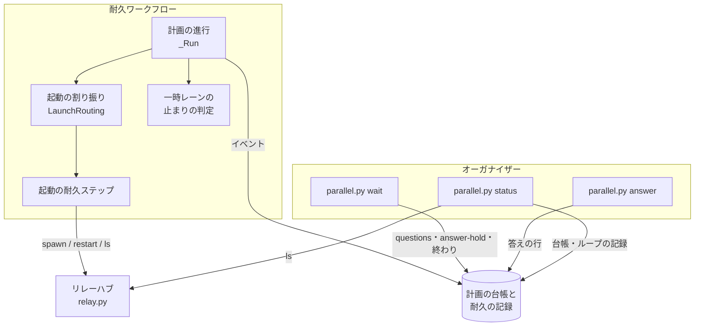
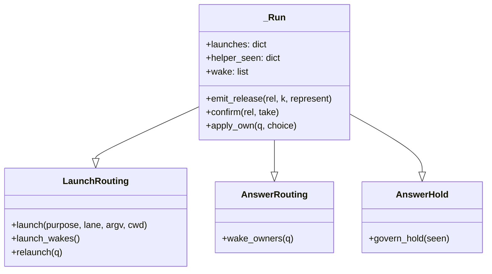
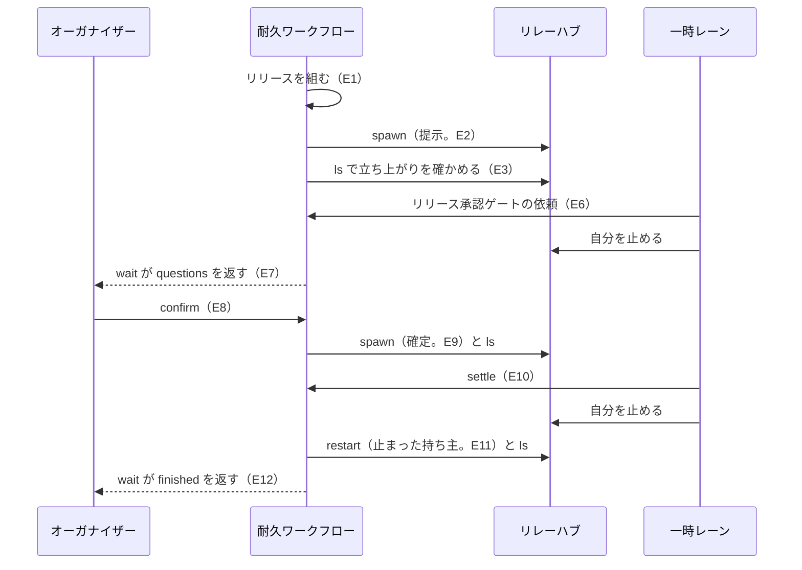
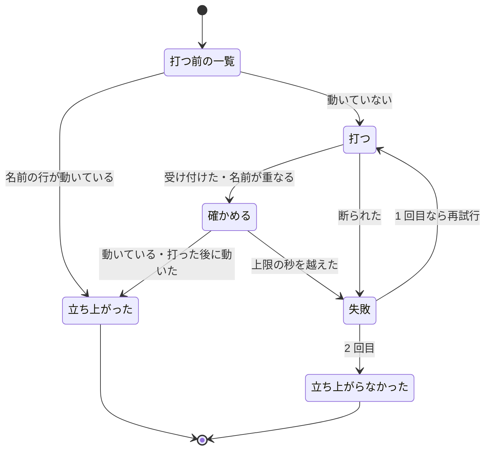

# 並列の計画: 一時レーンの起動とレーンの再起動を耐久ワークフローが打ち、オーガナイザーは問いと終わりだけで起きる（#2936）

## 目的

- **今どうなっているか**: 一時レーンの起動と、止まったレーンの再起動は、耐久ワークフローが `wait` の結果に載せた 1 行をオーガナイザーが打って行う。打った後の立ち上がりの確認と、手順どおりに止まった一時レーンへの「途中で止まった」の問い（#2629）もオーガナイザーへ戻る。2026-11-10 の計画 p4 の後半では、オーガナイザーの入力 token 102M のうち 42.9M（42%）がレーンの扱いで、承認ゲートの問いは 1.1M（1%）だった
- **誰に効くか**: 並列の計画を回すオーガナイザーのセッション（と、その費用を払う利用者）
- **変えると何が成り立つか**: リリース 1 回で `wait` がオーガナイザーへ返すのは、リリース承認ゲートの問いと計画の終わりの 2 回になる。オーガナイザーが起きる回数は承認ゲートの数で決まり、レーンの数とリリースの回数で増えない

## 適用範囲

- **働く範囲**: NDF の並列の計画（`parallel.py`）を使うすべてのリポジトリ。別のリポジトリのレーンを含む。外のオーガナイザー（`NDF_ORGANIZER_DIR`）の経路は一時レーンを持たないため、変わるのは `parallel.py status` を使えることだけである
- **プロジェクトごとに違うもの**: 無し。立ち上がりを待つ上限は環境変数 `NDF_PARALLEL_LAUNCH_SECONDS` で変えられる（試験で縮めるため。既定 120 秒）
- **当たるモード**: `standard`

## あるべき姿の根拠

| 根拠 | 種類 | 何を示すか |
| --- | --- | --- |
| #2936 の「目的」の表（計画 p4 の後半、セッション `5d1410c2`） | 実測 | 費用は「起きる回数 × 文脈の大きさ」で決まり、起きる回数の多くが起動・再起動・誤報の処理である |
| PRD1（Kubernetes の起動の確認） | 外部の一次情報 | 起動を打った側が、決まった間隔と上限の回数で立ち上がりを確かめ、確かめ終えるまで別の監視を止める形が広く使われている |
| PRD2（Temporal の再試行の方針） | 外部の一次情報 | 外部へ作用する処理の再試行を、処理を流す側（ワークフローの実行系）が回数の上限つきで持つ |
| 依頼（原文）「レーンの処理(レーン起動、停止)等が多すぎてオーガナイザー(のトークン消費)に負担が掛かっていた」 | 利用者の指示の原文 | 減らす対象がオーガナイザーの起動・停止の扱いである |

要求と受け入れ条件は #2936 の本文にある（コピーは [issue-2936-requirements.md](issue-2936-requirements.md)）。この文書は「どう作るか」だけを扱う。

## ドメインモデル

### コンテキスト

| コンテキスト | 何の語が 1 つの意味に決まるか |
| --- | --- |
| 開発の工程（`ndf-workflow`） | 耐久ワークフロー・オーガナイザー・一時レーン・レーンの再起動・立ち上がりの確認・手順どおりの停止・起動の再試行 |

1 つのコンテキストの中で閉じる。リレーハブ（`relay.py`）の振る舞いは変えず、今の CLI を子プロセスで呼ぶ。

### 集約

| 集約 | 持ち主（書き換えてよいもの） | 根 | エンティティ | 値オブジェクト |
| --- | --- | --- | --- | --- |
| 計画の進行 | 耐久ワークフロー（`parallel_run._Run`）。保存先のチェックポイントも耐久ワークフローだけが書く | 計画の進行の状態 | リリース・問い・起動の記録・チェックポイント | 起動の目的（リリースの提示・確定、保留したループの 1 回、再起動、問いの答えによる起こし直し）・立ち上がりの結果 |
| 計画の台帳 | 送り手（依頼・答え・`confirm`・`settle` の行を書いた者）。行は追記するだけで、書いた行を書き換えない。耐久ワークフローは読むだけ | 台帳 | 台帳の行 | 行の種類 |
| レーンの様子 | 持ち主なし（`parallel.py status` が毎回読み合わせて作る。保存しない） | — | — | レーンの様子の 1 行 |

### 不変条件

| # | 集約 | 条件 | 破れたときの扱い |
| --- | --- | --- | --- |
| I1 | 計画の進行 | 一時レーンの起動とレーンの再起動を打つのは耐久ワークフローだけである。`wait` と `answer` の結果に `relay.py spawn`・`relay.py restart` の 1 行を載せない | 試験で落とす |
| I2 | 計画の進行 | 1 つの起動の目的について、打つのは最大 2 回（1 回目と再試行 1 回）である。2 回とも立ち上がらなければ区分 `spawn` の問いを 1 つ立てる。人が問い（区分 `spawn`・`stall`・`helper`）の答えで「起こし直す」「続きから起こし直す」を選んだときは、新しい目的として流し、その目的の回数を 0 から数える。新しい目的のキーは、区分 `spawn`・`helper`（元の起動の目的を持つ）では元の目的のキーに答えた問いのキーを添えたもの、区分 `stall`（計画の宣言のレーンで、起動の目的を持たない）ではレーンと答えた問いのキーから作るもの（`ans-<レーン>-<問いのキー>`）である | 試験で落とす |
| I3 | 計画の進行 | 起動の記録のある目的は、耐久ワークフローが作り直されても打ち直さない（記録の `result` が `failed` でも打ち直さない。打ち直すのは I2 の新しい目的だけである）。打つ前の一覧でそのレーンが動いていれば打たずに立ち上がったと数える。ただし区分 `stall` の答えで選んだ起こし直しは、動いて観えるまま止まったレーンが対象のため一覧を見ずに打ち、一覧の行の `at` が打った時刻より後になったときだけ立ち上がったと数える | 二重の起動は名前の重複でリレーハブが断る。断りは立ち上がったと数える（今の決まり） |
| I4 | 計画の進行 | 区分 `helper` の問いは、今の起動の立ち上がりを確かめた後に、その一時レーンが 2 回続けて止まって観え、リリース承認ゲートの依頼も `settle` も届いておらず、その一時レーンの答えていない問いも無いときだけ立つ | 試験で落とす |
| I5 | 計画の進行 | `wait` が返す `action` は `questions`・`answer_hold`・`finished`・`stopped`・`error` の 5 つだけである。`questions` は、オーガナイザーがまだ答えを送っていない依頼を 1 つ以上含むときだけ返す | 試験で落とす |
| I6 | レーンの様子 | `parallel.py status` は値の取れない欄を `null` にし、一覧・ループの記録・台帳のどれが読めなくても終了コード 0 で全レーンの行を返す | 試験で落とす |

### ドメインイベント

| # | イベント | 発生元 | 受け手 |
| --- | --- | --- | --- |
| E1 | リリースを組んだ | 耐久ワークフロー | 耐久ワークフロー |
| E2 | 提示の一時レーンを起動した | 耐久ワークフロー（起動の耐久ステップ） | リレーハブ |
| E3 | 一時レーンの立ち上がりを確かめた | 耐久ワークフロー（起動の耐久ステップ） | 耐久ワークフロー |
| E4 | 起動を 1 回再試行した | 耐久ワークフロー（起動の耐久ステップ） | リレーハブ |
| E5 | 区分 `spawn` の問いを立てた | 耐久ワークフロー | オーガナイザー（`wait` の `questions`） |
| E6 | 一時レーンがリリース承認ゲートの依頼を送り、自分を止めた | 一時レーン | 耐久ワークフロー（台帳） |
| E7 | `wait` がリリース承認ゲートの問いを返した | `parallel.py wait` | オーガナイザー |
| E8 | オーガナイザーが答えを送った | オーガナイザー | 耐久ワークフロー（台帳） |
| E9 | 確定の一時レーンを起動した | 耐久ワークフロー（起動の耐久ステップ） | リレーハブ |
| E10 | 一時レーンが `settle` を送り、自分を止めた | 一時レーン | 耐久ワークフロー（台帳） |
| E11 | 答えを受けて止まっていたレーンを再起動した | 耐久ワークフロー（起動の耐久ステップ） | リレーハブ |
| E12 | `wait` が計画の終わりを返した | `parallel.py wait` | オーガナイザー |

### 用語

| 用語 | 意味 | 用語集への反映 |
| --- | --- | --- |
| 立ち上がりの確認 | 耐久ワークフローが起動か再起動を打った後に、レーンの状態の一覧でそのレーンが動いている（または打った時刻より後に動いた）と読めるまで、決まった間隔で一覧を読むこと。上限は既定 120 秒 | 追加 |
| 起動の再試行 | 立ち上がりの確認で立ち上がらなかった起動か再起動を、耐久ワークフローがもう 1 回だけ打つこと。2 回目も立ち上がらなければ区分 `spawn` の問いを立てる | 追加 |
| 手順どおりの停止 | 一時レーンが、リリース承認ゲートの依頼か `settle` を送った後に自分のラッパーを止めること。区分 `helper` の問いの対象にしない | 追加 |
| 一時レーン | 持ち主のいない共有の作業（まとめたリリースプランの実行・その失敗の対応・止まったレーンの保留したループの 1 回の残り）のために耐久ワークフローが起動するラッパー（`<計画名>-rel<連番>`、役割 `helper`）。同時に 1 本までで、作業を終えると自分で止まる | 意味の変更 |
| オーガナイザー | `--parallel <計画名>` で起動した conductor の役割。レーンの承認待ちを依頼として受けて問うか自分で決め、答えを送る（設計の承認ではレーンのリポジトリで設計 Pull Request をマージする）。レーンの起動・再起動・監視とリリースのまとめは耐久ワークフローが行う。人との窓口は計画ごとにオーガナイザー 1 つ | 意味の変更 |
| 今の起動 | 一時レーンでは、耐久ワークフローが最後に打った起動。通常のレーンでは、ラッパーが最後に起動した回 | 意味の変更 |

要求の文書の「起こし直し」は、この文書では用語集の「レーンの再起動」（`relay.py restart` で起動し直すこと）と書く。用語集の「起こし直し」は supervise の作業ステップを同じ会話へ続けることを指すためである。

## 外部の調査

| 種類 | 調べるか | 理由 |
| --- | --- | --- |
| 標準・仕様 | 調べない | プロセスの起動の確認と再試行の回数に、RFC・ISO などの公開の仕様は無い。業界で多く使われる形は主要な製品の行で比べる |
| 主要な製品 | 調べる | 起動の確認（コンテナの実行系）と、外部へ作用する処理の再試行（ワークフローの実行系）を、広く使われる製品がどう持つかを比べる |
| ライブラリとサービス | 調べる | 耐久ワークフローは DBOS の上にある。起動の再試行を DBOS の耐久ステップの再試行の機能で得られるかを確かめる |

### 主要な製品

| # | 製品 | どう解いているか | 設計への反映 | 出典 |
| --- | --- | --- | --- | --- |
| PRD1 | Kubernetes の起動の確認（startup probe） | 起動したかを決まった間隔（既定 10 秒）で確かめ、続けて失敗が上限（既定 3 回）に達したら失敗と判定する。起動の確認が通るまで、動いているかの監視（liveness・readiness）を始めない | 立ち上がりの確認を間隔と上限で行い、確認を終えるまで区分 `helper` の止まりの判定を始めない（I4） | https://kubernetes.io/docs/concepts/configuration/liveness-readiness-startup-probes/（2026-11-10） |
| PRD2 | Temporal の再試行の方針（Retry Policy） | 外部へ作用する処理（Activity）の再試行を、実行系が回数の上限（Maximum Attempts。1 なら再試行なし）と間隔で持つ。処理は再実行される前提で、冪等にする指針を出している | 起動の再試行を耐久ワークフローの側に置き、回数を 2 回（再試行 1 回）に固定する。打つ前に一覧を読んで二重の起動を避ける（I3） | https://docs.temporal.io/encyclopedia/retry-policies（2026-11-10） |

### ライブラリとサービス

| # | 候補 | 版 | ライセンス | 最後のリリースの日付 | 終了のアナウンス | 要件を満たすか | 出典 |
| --- | --- | --- | --- | --- | --- | --- | --- |
| LIB1 | DBOS Transact（Python）の耐久ステップの再試行（`retries_allowed`・`max_attempts`・`interval_seconds`） | 3.1.0（`uv.lock`） | 未確認 | 未確認 | 未確認 | 一部。再試行は例外を引き金にし、既定で無効（`retries_allowed=False`、`max_attempts=3`、`interval_seconds=1.0`）。「立ち上がらなかった」は例外ではなく一覧を読んで決める結果であり、使い切ると例外がワークフローへ上がる。2 回目の失敗を問いに変える分岐は自前で書くことになる | https://docs.dbos.dev/python/tutorials/step-tutorial（2026-11-10）・`uv.lock` |

### 確かめられなかったこと

| 対象 | 試した手段 | 結果と理由 |
| --- | --- | --- |
| LIB1 のライセンス・最後のリリースの日付・終了のアナウンス | 試していない | 採らない候補のため取得を省いた。依存は既にプロジェクトにある |

調べた量: 候補 3 件・取得の試み 3 回。

## 機能一覧

| # | 機能 | 誰が使うか |
| --- | --- | --- |
| F1 | リリースの提示・確定と、保留したループの 1 回の一時レーンが、オーガナイザーの操作なしで起動する | オーガナイザー（打たなくなる） |
| F2 | 答えを受けた止まったレーンが、オーガナイザーの操作なしで再起動する。耐久ワークフローが立てた問いの「起こし直す」「続きから起こし直す」「止める」も耐久ワークフローが打つ | オーガナイザー |
| F3 | 起動と再起動が立ち上がらなければ 1 回だけ再試行し、それでも立ち上がらないときだけ区分 `spawn` の問いが届く | オーガナイザーと人 |
| F4 | 手順どおりに止まった一時レーンへ「途中で止まった」の問いが立たない | オーガナイザーと人 |
| F5 | `wait` が人へ問うもの・終わり・異常だけで返る | オーガナイザー |
| F6 | `parallel.py status <計画名>` でレーンの様子を 1 行ずつ読める | オーガナイザーと人 |

## 構成要素

| 要素 | 責務 | 変更 |
| --- | --- | --- |
| 起動の耐久ステップ（`lib/parallel_launch.py`） | 起動か再起動を 1 回打ち、立ち上がりを確かめる。立ち上がらなければ 1 回だけ再試行する。打つ前の一覧で動いていれば打たない。結果（`up` / `failed`、試した回数、理由）を返す | 新設 |
| 起動の割り振り（`lib/parallel_launch.py` の `LaunchRouting`） | `_Run` が継ぐ。起動の目的ごとに起動の耐久ステップを呼び、結果を起動の記録へ残し、失敗なら区分 `spawn` の問いを立てる。問いの「起こし直す」には、答えた問いのキーを添えた新しい目的を流す（I2） | 新設 |
| 計画の進行（`lib/parallel_run.py` の `_Run` と `parallel_workflow`） | リリースの提示・確定と保留したループの 1 回で、`pause` のイベントを立てた後に起動の割り振りを呼ぶ。周ごとに、再起動の対象（`wake`）を起動の割り振りへ渡す。耐久ワークフローが立てた問いの答え（`stall`・`helper`・`spawn`）を自分で当てる | 変更 |
| 一時レーンの止まりの判定（`lib/parallel_observe.py` の `_ask_helper`） | 不変条件 I4 の条件だけで区分 `helper` の問いを立てる | 変更 |
| 答えの届け先（`lib/parallel_reply.py` の `wake_owners`）と答え待ちの停止（`lib/parallel_hold.py` の `govern_hold`） | 再起動の対象を `wake` へ入れるだけにし、起こす 1 行を知らせるための `pause("notice")` を立てない | 変更 |
| 一時レーンを起こす入力（`lib/parallel_helper.py` の `helper_spawn`） | シェルの 1 行ではなく、起動の耐久ステップが渡す引数の列（作業ディレクトリ・名前・最初の入力）を返す | 変更 |
| 待ち（`lib/parallel_cli.py` の `wait_plan`） | イベント `questions`・`answer-hold` と終わりだけを読む。`questions` はオーガナイザーが答えを送っていない依頼を含むときだけ返し、含まなければ同じ待ちを続ける | 変更 |
| 答え（`lib/parallel_answer.py` の `owner_next`） | `relay.py restart` の 1 行を作らない。返すのは区分 `observe` の選んだ答えの 1 行（`relay.py status`）だけ | 変更 |
| チェックポイント（`lib/parallel_ledger.py` の `RunState`） | 起動の記録（`launches`）と止まりの観測（`helper_seen`）を状態に含め、作り直しで戻す | 変更 |
| レーンの様子（`lib/parallel_status.py` と `parallel.py status`） | 計画の宣言・一覧・ループの記録・台帳を読み合わせ、レーンごとに 1 行を返す | 新設 |
| 手順書（`references/parallel.md`・`asking.md`・`loop.md`） | オーガナイザーが `spawn`・`restart` を打つ手順を消し、手順の表の `action` を 5 つと終了コードの行にする | 変更 |

図は呼び出しと読み書きの関係だけを描く。答えの届け先・答え待ちの停止・一時レーンを起こす入力・チェックポイントは計画の進行（`_Run`）の中の部品として R に含め、手順書は図に含めない。

## 構造

`step_launch`（耐久ステップ `parallel.launch`）は `LaunchRouting.launch` だけが呼ぶ関数で、型を持たない。

## データ構造

計画の台帳の行の形は変えない。耐久ワークフローの状態（チェックポイント `checkpoint.json` の中身）にキーを 2 つ足す。

| キー | 型 | 中身 | 空の扱い |
| --- | --- | --- | --- |
| `launches` | 起動の目的 → 起動の記録 | 起動の目的のキーは `rel-<連番>-<提示>-<present\|confirmed>`・`held-<ループ名>`・`wake-<レーン>-<周の連番>`。問いの答えによる起こし直しは、区分 `spawn`・`helper` では元の目的のキーに `-a<答えた問いのキー>` を足したキー、区分 `stall` では `ans-<レーン>-<答えた問いのキー>`（計画の宣言のレーンは起動の目的を持たないため、元の目的のキーを使わない。I2）。記録は `lane`・`result`（`up` / `failed`）・`attempts`（1 か 2）・`at`（最後に打った時刻、UTC の ISO 8601）・`reason`（失敗の理由） | 無いキーは「まだ打っていない」 |
| `helper_seen` | 一時レーンの名前 → 続けて止まって観えた回数 | 区分 `helper` の問いの猶予（I4 の「2 回続けて」） | 無いキーは 0 |

チェックポイントを持たない古い計画の作り直しでは、両方を空として始める。起動の記録が無い目的でも、打つ前の一覧で動いていれば打たない（I3）ため、二重の起動にならない。

## 入出力の契約

### `parallel.py wait <計画名> [--after <seq>] [--changes-after <n>] [--timeout 秒]`

| 終了コード | `metrics.action` | 返す条件 |
| --- | --- | --- |
| 0 | `questions` | イベント `questions` の `items` に、`answers-sent.json`（オーガナイザーが答えを送った依頼の控え）に無い id が 1 つ以上ある |
| 0 | `answer_hold` | イベント `answer-hold` が `--after` より新しい |
| 0 | `finished` / `stopped` | 耐久ワークフローが終わった |
| 1 | `error` | 耐久ワークフローが失われた・ERROR で終わった（今のまま） |
| 3 | 無し | 上限の秒に達した。`seq` と `next` の `--after` は、読み飛ばした最後のイベントの `seq` |

- 返さなくなる `action`: `notice`・`release`・`confirmed`・`held`・`running`
- 返さなくなる `metrics` のキー: `spawn`・`wake`・`release`・`attach`・`lanes`（承認待ちのレーン）
- 承認待ちのレーンへ人が入る 1 行は `parallel.py status` の行の `attach` から引く
- `versions`・`unknown`・`broken`・`orphans` は今のまま、どの返り値にも載る

### `parallel.py answer`

`metrics.next` には、区分 `observe` の問いで選んだ答えの 1 行（`relay.py status`）だけが載る。ほかの答えでは `null` である。`metrics.held_owners` は今のまま。

### `parallel.py status <計画名>`

終了コードはいつも 0（計画が無いときだけ 2）。`items` に計画のレーンごとに 1 行、続けて一覧にある一時レーン（名前が `<計画名>-rel` で始まり、役割が `helper`）を 1 行ずつ並べる。

| 欄 | 型 | 出所 | 取れないとき |
| --- | --- | --- | --- |
| `lane` | 文字列 | 計画の宣言（一時レーンは一覧） | — |
| `state` | 文字列 | `relay.py ls --json` の `state`（`running` / `awaiting_approval` / `stopped`） | `null` |
| `lap` | 整数 | ループの記録 `loop.json` の `laps` の最後の `n` | `null`（1 スプリントのレーン・一時レーンも） |
| `issues` | 整数の列 | 最後のループの 1 回の `selection` のうち `decision` が「選んだ」の課題の番号 | `null` |
| `last_at` | 文字列 | 計画の台帳でそのレーンが送った行（`by` がレーン名）の最後の `at` | `null` |
| `cost_usd` | 数 | ループの記録の各回の `cost` の和 | `null` |
| `attach` | 文字列 | 承認待ち（`state` が `awaiting_approval`、または答えていない依頼をそのレーンが送った）なら `python3 <relay.py> attach <レーン>` | `null` |

`summary` は「レーン N 本（動いている a・承認待ち b・止まった c）」の 1 行にする。

## 処理の流れ

### リリース 1 回の流れ

受け入れ条件 5 の合成した計画が通る道である。オーガナイザーが起きるのは問いと終わりの 2 回である。

### 起動の耐久ステップの中の流れ

起動の耐久ステップは、目的ごとに 1 回呼ばれ、結果を返す。

- 立ち上がったと読む条件: 一覧の名前の行の `state` が `running` か `awaiting_approval` である。`state` が `stopped` でも、`at` が打った時刻より後なら立ち上がったと読む（短い作業を終えて止まったもの）
- 確かめる間隔は 5 秒、上限は `NDF_PARALLEL_LAUNCH_SECONDS`（既定 120 秒）。一覧が失敗した回は数えずに次の間隔へ進む
- 「立ち上がらなかった」を受けた起動の割り振りは、区分 `spawn` の問い（「起こし直す」「止める」）を立てる。「起こし直す」は、元の目的のキーに答えた問いのキーを添えた新しい目的として流し、再試行の 1 回も持つ（I2）。`failed` の記録を持つ元の目的は打ち直さない（I3）
- 区分 `stall` の答えで流す起こし直しは、図の「打つ前の一覧」を通らずに「打つ」から始め、「確かめる」では一覧の行の `at` が打った時刻より後になったときだけ立ち上がったと読む（I3）
- 耐久ワークフローの記録の打ち直しで同じ道を通すため、起動の割り振りを通る分岐は `durable.patched("parallel-launch")` の後ろに置く。印の無い古い記録の打ち直しは今の道（`pause` のイベントだけを立てる）を通る

### 耐久ワークフローの 1 周の順序

耐久ワークフローの 1 周の順序は次のとおりである（今の `parallel_workflow` の順に、5 を足す）。台帳を観測より先に読むため、一時レーンが依頼を送ってから止まったときは、止まった観測より先に依頼が問いの一覧へ入る。

1. 起動の条件がそろったループのレーンを起動する（今の `step_spawn`。3 回の断りで問う決まりは変えない）
2. 受けている依頼があり流れているリリースが無ければ、リリースを組んで提示の一時レーンを起動する
3. 台帳を読む（依頼・答え・`confirm`・`settle`）。`confirm` で確定すれば確定の一時レーンを起動する
4. 観測する。区分 `helper`・`stall` の問いを判定し、答え待ちの停止を突き合わせる
5. 再起動の対象（`wake`）のうち止まっているレーンを再起動する
6. チェックポイントを書く

## 非機能の実現方式

| 大項目 | 条件 | 実現方式 |
| --- | --- | --- |
| 可用性 | 起動と再起動の失敗は打ち直しの後に問いとして届き、黙って失われない。作り直されても二重に打たない | 起動の耐久ステップは失敗を例外でなく結果で返し、起動の割り振りが必ず起動の記録へ残して問いを立てる。結果は耐久の記録とチェックポイントの `launches` の 2 か所にある。打つ前に一覧を読み、動いていれば打たない |
| 性能・拡張性 | オーガナイザーへ返る回数が承認ゲートの数と計画の終わりで決まる | `wait` が読むイベントから `pause` を外し、答えを送った依頼だけの `questions` を読み飛ばす。起動の確認で耐久ワークフローの 1 周が最長 2 × 120 秒延びるが、その間の依頼は台帳に残り、次の周で読む |
| 運用・保守性 | レーンの様子を 1 回のコマンドで読める | `parallel.py status` が一覧・ループの記録・台帳を読み合わせる。読めない欄は `null` にして失敗しない |

## 決定の記録

### 決定 1: オーガナイザーが起きる回数を承認ゲートの数に揃えるため、起動と再起動を耐久ワークフローの耐久ステップで打つ

起動の 1 行をオーガナイザーに残すと、起動の回数がそのままオーガナイザーの起きる回数になり、その後始末（立ち上がりの確認・誤報の問い）も戻ってくる。耐久ワークフローはすでに答え待ちの停止の再開（`resume_marks`）で `relay.py restart` を自分で打っており、同じ場所へ寄せる。

個別の不具合（#2629・#2888）を 1 つずつ直す形は、中継をオーガナイザーに残すため、次の種類の例外が同じ形で現れる。採らない。

- 作り方: 自前で作る
- 比べた候補: PRD2 / LIB1

根拠: Value 5 / Value 7（MVV 版 6）

### 決定 2: 起動の再試行を自前の分岐で書き、DBOS の耐久ステップの再試行の機能を使わない

「立ち上がらなかった」は例外ではなく、一覧を読んで決める結果である。DBOS の再試行は例外を引き金にし、使い切ると例外をワークフローへ上げるため、2 回目の失敗を区分 `spawn` の問いへ変える分岐を結局自前で書くことになる。1 つの耐久ステップの中で 1 回目・確認・2 回目を流し、結果を値で返す。

- 作り方: 自前で作る
- 比べた候補: LIB1 / PRD2

根拠: Value 5（MVV 版 6）

### 決定 3: 立ち上がりの確認を 5 秒間隔・上限 120 秒にする

リレーハブは依頼を受付箱から読んでラッパーを起動するため、打った直後は一覧に現れない。PRD1 の既定（10 秒間隔で 3 回、計 30 秒）は 1 プロセスの起動を想定した値で、ハブの読み取りと claude の起動を含む起動には短い。上限を 120 秒にし、間隔を 5 秒にして早く立ち上がったものを早く返す。試験は `NDF_PARALLEL_LAUNCH_SECONDS` で縮める。

根拠: Value 4（MVV 版 6）

### 決定 4: 一時レーンの止まり方を、台帳に新しい行を書かせずに、今の起動の確認と既存の依頼・`settle` から判定する

一時レーンに「承認待ちで止めた」「終えた」を書かせると、書き忘れた一時レーン（古い版・手順の途中で落ちたもの）が誤報に戻る。耐久ワークフローは自分で起動を打つようになり、今の起動の時刻と立ち上がりを知っている。今の起動の立ち上がりを確かめる前の止まりは前の起動のものとして数えず、止まりを 2 回続けて観てから問う。周の中で台帳を観測より先に読むため、依頼を送ってから止まった一時レーンは依頼の方が先に入る。

根拠: Value 5 / Value 3（MVV 版 6）

### 決定 5: `wait` の返り値を絞るため、`pause` のイベントを読まず、答えを送った依頼だけの `questions` を読み飛ばす

`pause` のイベントは一時レーンが流すものを決める（`parallel.py helper` が読む）ため、立てるのはやめない。`wait` が読むキーから外す。答えの後に耐久ワークフローが問いの一覧を立て直すと、残りが空でも `questions` のイベントが立つ。オーガナイザーが答えを送った依頼の控え（`answers-sent.json`）と突き合わせ、新しい依頼を含まないイベントは返さずに待ちを続ける。

イベントに「オーガナイザー向け」の印を足して `wait` が印で選ぶ形は、印の付け忘れで同じ誤報が戻るため採らない。

根拠: Value 2 / Value 5（MVV 版 6）

### 決定 6: 耐久ワークフローが立てた問いの答え（「起こし直す」「続きから起こし直す」「止める」）を、`commands` の 1 行にせず耐久ワークフローが当てる

区分 `stall`・`helper`・`spawn` の答えの 1 行を残すと、`relay.py restart` と `relay.py spawn` が残る。残る先は `answer` の `metrics.next` である。「起こし直す」は答えた問いのキーを添えた新しい目的として起動の割り振りへ流し（I2）、「止める」は今の `step_stop_lanes` で止める。区分 `observe` の「ラッパーの環境を作り直す」（`relay.py status`）はレーンの起動ではないため、今の `commands` の 1 行を残す。

根拠: Value 5 / Value 7（MVV 版 6）

### 決定 7: レーンの様子の費用をループの記録から読み、transcript を集計しない

ループの記録の各回は `cost`（プランの使用量の帳簿から集計した値）を持ち、読むだけで出せる。transcript の集計はレーンとセッションの対応を別に引く必要があり、1 回のコマンドで読む目的に対して重い。1 スプリントのレーンと一時レーンの費用は `null` にする。

根拠: Value 4 / Value 6（MVV 版 6）

### 決定 8: 答え待ちの停止の再開（`resume_marks`）は、この変更で起動の割り振りへ移さない

再開の断りは起動の断りと同じく 3 回で問う決まりがあり（前提 4 の範囲）、受け入れ条件は一時レーンの起動と答えの後の再起動を対象にする。移すと断りの数え方が変わるため、この変更では今の道を残す。

根拠: Value 3（MVV 版 6）

## テスト設計

| 受け入れ条件・不変条件 | どの振る舞いで縛るか | どう壊したら落ちるべきか |
| --- | --- | --- |
| 受け入れ条件 1・I1 | 合成した計画でリリースを流し、偽の `relay.py` が受けた `spawn` の記録に一時レーンの起動が 2 回（提示・確定）あり、`wait` の結果の `metrics` に `relay.py spawn` を含む文字列が無い | `wait` が `pause` を読むように戻す、起動の割り振りを呼ばないと落ちる |
| 受け入れ条件 2・I1 | 答えを受けた止まった 1 スプリントのレーンが偽の `relay.py` の `restart` で起き、`answer` の `metrics.next` と `wait` の `metrics` に `relay.py restart` が無い。区分 `stall` の「起こし直す」でも同じ | `owner_next` が restart の 1 行を返す・`wake` を知らせに載せると落ちる |
| 受け入れ条件 3・I2 | 起動に失敗する回数を指定できる偽の `relay.py` で、失敗 0 回・1 回は問いが立たず、2 回は区分 `spawn` の問いが `questions` で 1 つだけ届く | 再試行をやめる・2 回を越えて打つ・失敗を問いにしないと落ちる |
| I3 | 起動の記録を持つチェックポイントから作り直すと同じ目的を打たない。打つ前の一覧で動いているレーンには `spawn` を打たない。区分 `spawn` の「起こし直す」は `failed` の記録を残したまま新しい目的で最大 2 回打ち、区分 `stall` の「起こし直す」は `running` のままのレーンにも `restart` を打つ | 作り直しで `launches` を戻さない・打つ前の一覧を読まないと落ちる |
| 受け入れ条件 4・I4 | 一時レーンが依頼を送って止まる・`settle` の後に止まる・確定の起動の直後に前の起動の止まった行が一覧に残る、の 3 通りで区分 `helper` と `stall` の問いが立たない。依頼も `settle` も無いまま 2 回続けて止まって観えたときは区分 `helper` の問いが立つ | 立ち上がりの確認を待たずに判定する・2 回の猶予を外す・台帳を観測より後に読むと落ちる |
| 受け入れ条件 5 | 提示 → リリース承認ゲート → 承認 → 確定 → 結果を流す合成した計画で、`wait` を `--after` でつないで打ち続けた `action` の列が `questions` 1 回と `finished` 1 回である（終了コード 3 は数えない） | 答えの後の空の `questions` を返す・`pause` を読むと落ちる |
| 受け入れ条件 6・I5 | `wait` の `action` がどの道でも 5 つのどれかである | `notice`・`release`・`confirmed`・`held` を返すと落ちる |
| 受け入れ条件 7・I6 | 合成した計画で `status` がレーンごとに 1 行を返し、承認待ちのレーンに `attach` がある。一覧・ループの記録・台帳を読めなくしても終了コード 0 で欄が `null` になる | 欄の読み取りの例外を外へ出すと落ちる |
| 受け入れ条件 8 | 手順書の変更はレビューで見る（`.md` の文言を照合する試験は書かない） | — |
| 受け入れ条件 9 | リリース承認ゲート・区分 `build`・`stall`（ループのレーン）・`unmatched` の問いの既存の試験が通り、`uv run --frozen --project . --all-extras pytest . -q -n 4` が通る | 問いの条件を変えると既存の試験が落ちる |

## 設計の結果

| 課題 | 扱い | 取り込み先 | 触るファイル |
| --- | --- | --- | --- |
| #2936 | 実装する | — | `plugins/ndf/scripts/lib/parallel_launch.py`（新設）、`plugins/ndf/scripts/lib/parallel_status.py`（新設）、`plugins/ndf/scripts/lib/parallel_run.py`、`plugins/ndf/scripts/lib/parallel_observe.py`、`plugins/ndf/scripts/lib/parallel_reply.py`、`plugins/ndf/scripts/lib/parallel_hold.py`、`plugins/ndf/scripts/lib/parallel_helper.py`、`plugins/ndf/scripts/lib/parallel_cli.py`、`plugins/ndf/scripts/lib/parallel_answer.py`、`plugins/ndf/scripts/lib/parallel_ledger.py`、`plugins/ndf/scripts/parallel.py`、`plugins/ndf/scripts/tests/`、`plugins/ndf/skills/development-workflow/references/parallel.md`、`plugins/ndf/skills/development-workflow/references/asking.md`、`plugins/ndf/skills/development-workflow/references/loop.md` |
| #2629 | 取り込む | #2936 | — |

## 未確認のまま残ること

| 項目 | 内容 |
| --- | --- |
| 動いている耐久ワークフローの版 | プラグインを更新した後も、動いている `parallel.py run` は古い版のまま `pause` で起動の 1 行を知らせ続ける。新しい版の `wait` はそれを読まないため、更新の後に始めた計画で働く。古い run を新しい版へ移す手順は要求の範囲外（前提 2）で、実装の PR で起票の要否を決める |
| 答えの後に起こす持ち主の判定 | 今の `answer` は持ち主のレーンの待ちの記録（`lane_waits`）で起こす要否を決め、耐久ワークフローは 1 スプリントのレーンと `waiting_only` で止まったループのレーンを起こす。両者が食い違う場面があるかは未確認。実装で既存の試験を通して確かめる |
| 動き続ける古い一時レーン | 提示の一時レーンが手順どおりに止まらず動き続けると、確定の起動は名前の重なりで断られ、立ち上がったと数える（今の決まり）。この場合の検出は扱わない |
| #2888 を閉じるか | 起動をオーガナイザーが打たなくなることで起きなくなる見込み。実装の後に確かめて決める（要求の対象範囲のとおり） |
