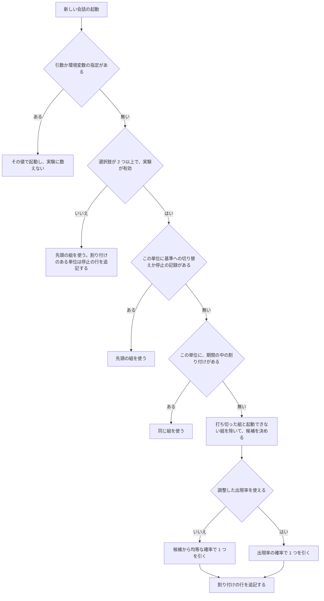

# モデルと effort の実験: 出現率の記録と計算（#2944）

この文書は、設計書（[issue-2944-design.md](./issue-2944-design.md)）のうち、実験の記録、費用と ROI、割り付けと出現率の計算を持つ。語の意味・不変条件・決定の理由・テスト設計・受け入れる限界は設計書にある。「条件 n」は要求仕様（[issue-2944-requirements.md](./issue-2944-requirements.md)）の受け入れ条件である。

## 実験の記録と出現率

利用者の NDF の状態の保存先（使用量ログと同じ場所）に 2 つ置く。実験の記録 `launch-experiments.jsonl` は追記だけにする。出現率のファイル `launch-weights.json` は、記録と使用量ログから作り直せるコピーである。

割り付けの行（単位の最初の起動で 1 行）:

| 欄 | 中身 |
| --- | --- |
| `kind`・`at` | `assign`・日時 |
| `assign_id` | この割り付けの ID。割り付けの行を書くたびに新しい一意な値を発行する |
| `unit` | 単位の ID。プランの工程は `<run_id>:<工程>`、修正と作業場所の用意は `<run_id>:<ステップ>`、判定は `request_id`、相手役は `<cross-review の実行の ID>:<シート>` |
| `stage`・`runtime`・`repo`・`mode` | 工程・ランタイム・リポジトリのキー・モード |
| `arms`・`probs`・`chosen` | そのときの選択肢、それぞれの確率、選んだ組。候補の確率は 0 より大きく、ほかは 0 |
| `key` | 互換性のキー（下の「出現率の再利用」） |
| `phase` | `burn_in`（均等に抽選する。件数を集める間か、使える出現率が無い）・`adaptive`（調整の後）・`uniform`（費用を計算できず、均等に抽選する） |

確率を残すのは、出現率が途中で変わるためである。後から偏りを重み付けで直して比べられる。

効果指標の行（単位の評価で 1 行）:

| 欄 | 中身 |
| --- | --- |
| `kind`・`at`・`assign_id` | `outcome`・日時・評価した起動の割り付け ID |
| `metric` | 指標の名前とバージョン。定義を変えたらバージョンを上げ、古い行は数えない |
| `quality` | 0〜1。取れなければ null |
| `detail` | 元の数（採用された重大な指摘の数など） |

ほかの行は次の 3 つである。

| `kind` | 書く時点 | 欄 |
| --- | --- | --- |
| `launch_error` | 単位を持つ起動が「モデルを理由にした拒否」で終えた | 日時・割り付け ID・工程・ランタイム・組・理由・基準へ切り替えたか |
| `halted` | 割り付けのある単位を、実験の停止や固定のために先頭の組で起動した | 日時・割り付け ID |
| `unpriced` | 起動の費用を計算できないモデルに当たった | 日時・割り付け ID・モデル |

**記録は割り付け ID で結ぶ。** 期間（`window_days`）を過ぎた単位をもう一度起動すると、同じ単位の ID に 2 つ目の割り付けができる。前の起動の効果や費用は後から届くこともあるので、単位の ID や日時では区別できない。そこで割り付け ID を次のとおり引き継ぎ、計算と `report` は割り付け ID ごとに単位の値を作る。

| 引き継ぐ先 | 引き継ぎ方 |
| --- | --- |
| 起動 | 選ぶ処理が値と一緒に割り付け ID を返し、呼び出し元が使用量ログの行の `assign_id` に書く |
| 会話の再開 | 会話の最初の起動の割り付け ID を、モデルと effort と一緒に残して復元する。割り付けが期間を過ぎていても、選び直さない |
| 効果指標 | 評価する工程は、評価する起動の結果から割り付け ID を受け取って書く。単位の中に 2 つの ID があれば、最後の起動の ID を使う |
| 手戻りの費用 | `charge_to` には、費用を負う割り付け ID を書く |
| 停止・拒否・`unpriced` の行 | その起動の割り付け ID を書く |

**読み書き。** 割り付けは、実験の記録のロックの中で、記録を読み、割り付けの有無と候補を調べ、行を追記する。期間の中の同じ単位が 2 回割り付けられないためである。ロックの中では出現率を計算しない。追記する側は、記録が改行で終わっていなければ改行を先に足し、読む側は壊れた行を飛ばす。

記録は削除しないので、割り付けにかかる時間は使い続けるほど延びる。2026-11-26 に作り物の記録で測った値は次のとおりである（8 コアの Linux、Python 3.14.4。1 プロセスが続けて 11 回割り付け、ロックの待ちを含む 1 回の時間の中央値）。要約を別のファイルに持って速くする仕組みは作らない。

| 記録の行数 | 並列度 1（ms） | 並列度 8（ms） |
| ---: | ---: | ---: |
| 1,000 | 2.4 | 8.9 |
| 10,000 | 25.4 | 250.6 |
| 100,000 | 257.0 | 2,520.4 |

**出現率の再利用。** 互換性のキーは、工程の選択肢の並び（先頭が基準）と、指標の名前とバージョンから作るハッシュである。出現率の計算と件数に使うのは、同じリポジトリの、今の設定と同じキーの行だけである。候補・基準・指標のどれかが変われば別のキーになり、件数を集め直す。別のリポジトリの記録は、キーが同じでも混ぜない。作業の難しさがリポジトリごとに違い、組の差とリポジトリの差を分けられないためである。

**実際のモデルが変わった単位は混ぜない（Claude）。** CLI の既定のモデルや別名（`sonnet` など）が指すモデルは後から変わる。単位の実際のモデルは、その単位の最初の起動（引き上げと基準への切り替えでない起動）の使用量ログの行から取る。計算と `report` は、次の単位だけを使う。

| 組 | 使う単位 |
| --- | --- |
| モデルを指定しない組 | モデルを指定しない組すべての単位のうち最も新しく評価した単位と、実際のモデルが同じもの |
| モデルを指定する組 | 実際のモデルが、その組の最も新しく評価した単位と同じもの |

既定のモデルが変わると、モデルを指定しない組は件数がまとめて減り、`burn_in` に戻って集め直す。実際のモデルを特定できない単位は使わない。Codex は実際のモデルを取得しないので、この絞り込みを当てない（設計書の「受け入れる限界」）。

出現率のファイルの項目は、リポジトリ × 工程 × ランタイム × 互換性のキーで引く。項目が持つのは次の値である。段階（`burn_in` か `adaptive`）、計算したときの候補、割り付けの値（設定の `allocation` の値。`floor`・`margin`・`min_units`・`window_days`）、確率（`adaptive` のときだけ）、組ごとの計算に使った件数、打ち切った組とその期限、日時。書き換えるのは出現率の計算だけである。項目の割り付けの値が今の設定と違えば、項目が無いものとして扱う。

## 費用と ROI

単位の費用は、使用量ログのうち `assign_id` か `charge_to` がその単位の割り付け ID である行の、起動の費用の合計である。起動 1 回の費用の求め方は #1959 の設計の「起動の費用の求め方」に従う。

| 手戻りの起動 | `charge_to` に割り付け ID を書く単位 |
| --- | --- |
| 実装の後のテストと CI の失敗を直す起動 | その実行の `impl` の単位 |
| 設計レビューと実装の PR のレビューの指摘を直す起動（cross-review の修正担当） | 評価している `design` か `impl` の単位 |
| 判定の起動し直し | 割り付けた単位そのもの |

手戻りの費用まで含めるのは、安い組が指摘を多く生むと、直す費用でかえって高くつくためである。テストと CI の失敗を直す起動の行は、`assign_id`（`fix` の単位）と `charge_to`（`impl` の単位）の両方を持ち、両方の単位の費用に入れる。`fix` の組の比較には修正そのものの費用が要り、`impl` の組の比較には手戻りの費用が要るためである。ROI は工程の中で組を比べる値なので、工程をまたいで単位の費用を足さない。実際に払った合計は、行を `launch_id` ごとに 1 回だけ数えて出す。

費用が不明の起動を持つ単位は、費用の平均に入れず、件数を `report` に出す。単位の費用の合計が 0 の単位（回答を返せずに誤りで終えた起動だけの単位など）も、不明と扱う。0 は対数にも割る数にも使えないためである。

組ごとの ROI は、**効果指標の平均 ÷ 単位の費用の平均（USD）** である。`report` は基準の組の ROI を 1 とした比も出す。ROI だけで比べると、安い組は効果が低くても勝つので、下の「効果の下限」と組み合わせる。

## 割り付けの流れ

この流れは、新しい会話を始める起動に当てる。同じ会話を再開する起動は値を選び直さず、会話の最初の起動の値を使う。停止（`enabled: false`）と固定（選択肢が 1 つ）は、その単位の既にある割り付けより先に見る。

「調整した出現率を使える」のは、次のすべてが成り立つときである。

- 出現率の項目があり、段階が `adaptive` である
- 項目の候補と割り付けの値が、今の候補と設定と同じである
- 直近 `window_days` 日に割り付けた、同じリポジトリと互換性のキーの単位に、`unpriced` の行が無い。ただし、行を書いた後にそのモデルが単価表に載った場合、その行は数えない

そのほかの扱いは次のとおりである。

- 停止の行がある単位は、実験に数えない。2 つの組が混ざるためである。実験を再び有効にしても、その単位は先頭の組のまま続ける
- **候補は、どの段階でも最初に決める。** 打ち切った組と起動できない組は選ばず、`probs` を 0 にする
- 件数を集める間は、候補から均等な確率で無作為に 1 つ選ぶ。件数の少ない組を順に選ぶ形だと、その時期にほかの組が選ばれる確率が 0 になり、作業の難しさと組の差を分けられないためである。並列に流して結果の前に次の割り付けが来ても、確率は変わらない
- 候補が変わった後（拒否で組を外した、期限で組が戻った）は、次の計算まで均等に抽選する
- 費用を計算できないモデルの単位がある間は、割り付けの行の `phase` を `uniform` と記録する。その単位が期間外に出るか、モデルが単価表に載れば、保存済みの確率を使う
- 記録を書けないときは指定なしで起動し、その単位は実験に数えない

## 出現率の計算

出現率の項目は、リポジトリ × 工程 × ランタイム × 互換性のキーごとに計算する。計算し直すのは、**効果指標を書いた後**に、次のどれかが成り立つときである。

- 項目が無い
- 項目の候補か割り付けの値が、今と違う
- 前の計算から 1 時間以上たっている

毎回は計算しないのは、使用量ログ 10 万行の読み取りに約 0.5 秒かかるためである（#1959 を実装する前の合成の行での測定）。反映は最大で 1 時間と次の効果指標まで遅れる。計算はロックの外で行い、書くときだけ出現率のファイルのロックの中で読み直して、自分の項目を置き換える。同じ項目の計算が重なった場合は、後で書いた側が残り、次の計算でそろう。`report` は呼ばれた時点で計算し直し、このファイルを書き換えない。

使うのは、直近 `window_days` 日に割り付けて、効果指標と費用がそろった、同じリポジトリと互換性のキーの単位のうち、実際のモデルが「出現率の再利用」の条件に合うものである。基準への切り替えと停止の単位は使わない。

乱数の種は、工程・ランタイム・互換性のキー・割り付けの値と、計算に使う単位（割り付け ID の順に並べる）の割り付け ID・効果・費用の SHA-256 から作る。同じ単位の集まりからは、何度計算しても同じ出現率と「最良である確率」になる。割り付けの抽選には、この種を使わない。

**比べる単位と重み。** 組によって割り付けた時期や確率が違うと、難しい作業が多かった時期の組が劣って見える。そのため、効果と費用の平均は次のとおりに出す。

- 割り付けた時に、比べる組のすべての確率が 0 より大きかった単位だけを使う
- 単位ごとの重みは、割り付けた時の確率の逆数（`1 / probs[chosen]`）にする。どの段階でも同じである
- 平均は重み付きの平均にする。分布の件数には、有効な件数 `n_eff = (重みの和)² ÷ 重みの 2 乗の和` を使う
- `min_units` と打ち切りの 30 件は、重みを付けない単位の数で数える
- 比べる組は、計算する時点の候補である。外れていた組が候補に戻ると、その組がいなかった間の単位は使えなくなるので、件数が減って `burn_in` に戻ることがある

順番は、打ち切りの判定（下の「打ち切り」）、候補の確定（打ち切った組と起動できない組を除く）、段階の判定、確率の計算である。次の番号の 1 は段階の判定、2〜5 は確率の計算である。

1. 候補のどれかの件数が `min_units` に満たなければ、出現率は計算しない（段階は `burn_in`）。`report` の出現率の欄は「件数を集めている」と組ごとの件数を出す
2. 組ごとに 2,000 回の標本を引く
   - 効果 q: ベータ分布 `Beta(1 + n_eff × 効果の平均, 1 + n_eff × (1 − 効果の平均))`
   - 費用 c: 費用の対数の平均の事後分布（正規分布。平均と標本の標準偏差は重み付きで出し、標準偏差は `標本の標準偏差 ÷ √n_eff`）から引き、指数に戻す
3. **効果の下限**: 基準の組より効果が `margin` を超えて低い確率が 0.9 を超える組は、この回に「最良」を数える対象から外す（出現率は下限だけになる）
4. 候補の中で、標本ごとに `q / c` が最大の組を数え、その割合を「最良である確率」にする
5. 候補の組の出現率は `floor + (1 − floor × 候補の数) × 最良である確率` にする。候補でない組は 0 にする

2,000 回の標本を引く計算は、3 組で約 15 ms である（2026-11-26 に Python 3.14.4、8 コアの Linux、11 回の中央値）。

**打ち切り**: 基準でない組を 1 つずつ基準の組と比べ、基準より効果が `margin` を超えて低い確率が 0.99 を超える組は、出現率を 0 にする。使う単位は次のとおりである。

| 条件 | 打ち切りの判定での扱い |
| --- | --- |
| リポジトリ・互換性のキー・期間・実際のモデル | 出現率の計算と同じ |
| 比べられる時期 | 割り付けた時に、基準と判定する組の両方の確率が 0 より大きかった単位 |
| 効果と費用 | 効果指標がある単位。費用が分からない単位も使う |
| 件数 | 基準と判定する組が、どちらも 30 件以上。平均は「比べる単位と重み」の重みを付ける |

品質の判定に費用は要らないので、段階が `burn_in` や `uniform` でも打ち切った組は選ばない。項目には打ち切った組ごとに期限を書く。期限を決めるには、基準の組と打ち切る組のそれぞれで、新しいほうから 30 件目の割り付けの日時を取る。期限は、その 2 つの古いほうに `window_days` を足した日時である。期限を過ぎると、選ぶ処理はその組を候補へ戻す。モデルや作業の中身が変わった後にやり直すためである。基準の組は打ち切らない。

| 値 | 既定 | 意味 |
| --- | --- | --- |
| `min_units` | 10 | 組ごとに、調整を始める前に集める単位の数 |
| `floor` | 0.05 | 候補の組の下限の出現率 |
| `margin` | 0.1 | 効果指標の、許す低下の幅 |
| `window_days` | 60 | 数える期間 |

## 起動できない組

使えないモデルに当たっても、基準の組で作業を続け、利用者の操作は求めない。そのうえで、起動できない組を割り付けから外す。効果 0 とは数えない（設計書の I3）。

| 項目 | 内容 |
| --- | --- |
| 切り替える起動 | 抽選で選んだ基準でない組の、会話の最初の起動が、下の「モデルを理由にした拒否」で終えた |
| 切り替え方 | 呼び出し元が同じステップの中で、基準の組と新しい会話で 1 回だけ起動し直す。モデルが何も実行していないので、二重に実行されるものは無い |
| その単位の残りの起動 | 再実行と再開を含め、基準の組を使う（出所は `base`）。選ぶ処理は、元の割り付けより先に切り替えの記録を読む |
| 依頼の記録 | 拒否された起動と同じ `request_id` で、`request_try` を 1 増やす |
| 引き上げ | 切り替えた後も、設計書の「引き上げる起動」を当てる。上げる元は基準の組である |
| 実験の扱い | `launch_error` の行に切り替えたことを書き、その単位は効果と費用の計算に数えない |
| 利用者へ | 止めない。警告に、起動できなかった組と、基準の組で続けたことを出す |

**モデルを理由にした拒否**は、CLI がモデルか effort の指定を理由に、実行を始める前に断ったと出力から確かめられる場合だけである。使用量が取れないことは、消費が 0 であることにしない。

| ランタイム | 判定に要るもの（すべて） |
| --- | --- |
| Claude | 結果の JSON があり、`is_error` が真、`api_error_status` が 404、4 つのトークン数がどれも欄として在って 0、`modelUsage` が空 |
| Codex | API がモデルか effort を理由に断った誤りが出力にあり、モデルの回答と使用量の行が無い。誤りの欄の名前は未確認で、実装で確かめるまではこの判定に当てない |

Claude の値は、2026-11-26 に Claude Code 2.1.332 を無いモデル名で起動して確かめた（終了コード 1）。

次の失敗は拒否と扱わない。基準の組で起動し直さず、割り付けから外す件数にも数えない。

- 結果の JSON が無い、使用量の欄が欠けるなど、判定に要るものがそろわない
- 通信の障害、サーバの誤り、利用上限、期限切れ、同時起動のスロットの待ち、CLI を起動できないなど、モデルの指定が理由でない

起動し直しで増える起動と、使うスロットは次のとおりである。

| 項目 | 内容 |
| --- | --- |
| 起動の回数 | 1 つのステップで高々 1 回増える |
| 回数の上限 | 増える 1 回は、worker の再開と判定の打ち直しの上限を消費しない。消費すると、基準の組に残る回数が減る |
| 同時起動のスロット | 拒否された起動が返した後に、通常の起動と同じく 1 本を取る |
| 期限 | 拒否された起動の期限の残りの時間で打ち、残りが無ければ起動し直さずに止める |

起動し直しは、失敗した作業の打ち直しの回数には数えない。要求の受け入れ条件 15 の「その単位の起動はすべて同じ組を使う」は、この切り替えを除くと読む（設計承認ゲートで確かめる）。

割り付けから外す規則は次のとおりである。2 件と 7 日は実測で決めた値ではない。

| 項目 | 内容 |
| --- | --- |
| 外す条件 | 同じ工程 × ランタイム × 組の `launch_error` の行が、直近 7 日に 2 件以上ある。該当の行が 2 件未満になれば戻る |
| 外した組の扱い | 出現率 0。残りの組で抽選する。`report` に理由と期限を出す |
| 基準の組 | 外さない。基準の組の起動ができなければ（最初から基準の組の起動も、切り替えた先の起動も）、理由と直す場所（`.ndf/launch.json`）を示して止まる |
| 費用 | その単位は効果指標が無いので、費用の平均にも入らない |

## 必要な件数と、判断できる件数

出現率の調整は件数が少なくても進むが、「この組のほうが良い」と言えるには件数が要る。`report` はリポジトリごとに、「比べる単位と重み」の単位だけを使って次の 4 つを書き分け、優劣は「判断できる」の場合にだけ出す。

| 状況 | `report` の表示 |
| --- | --- |
| 比べる組がそろって候補だった単位が無い | 比較できない |
| 30 件未満の組がある | 件数が足りない |
| 各組が 30 件以上で、最良である確率が 0.95 以上の組がある | 判断できる |
| 各組が 30 件以上で、0.95 以上の組が無い | 優劣を判定できない |

2 つの組の成功の割合を、両側 5% の水準と 80% の検出力で見分けるのに要る件数は、1 組あたり次のとおりである。値は 2026-11-27 に正規近似の式で計算した。

| 割合の差 | 1 組あたりの件数 |
| --- | ---: |
| 0.9 と 0.7 | 62 |
| 0.8 と 0.6 | 82 |
| 0.9 と 0.75 | 100 |
| 0.9 と 0.8 | 199 |

実装の単位が 1 週間に約 40 件（設計書の「実測: 作業の件数」）で組が 3 つなら、`min_units` の 10 件は約 1 週間、100 件は約 8 週間で集まる。件数の少ないリポジトリでは、件数を集める段階のまま続くことがある。その場合も、起動は選択肢のどれかで正しく動く。
