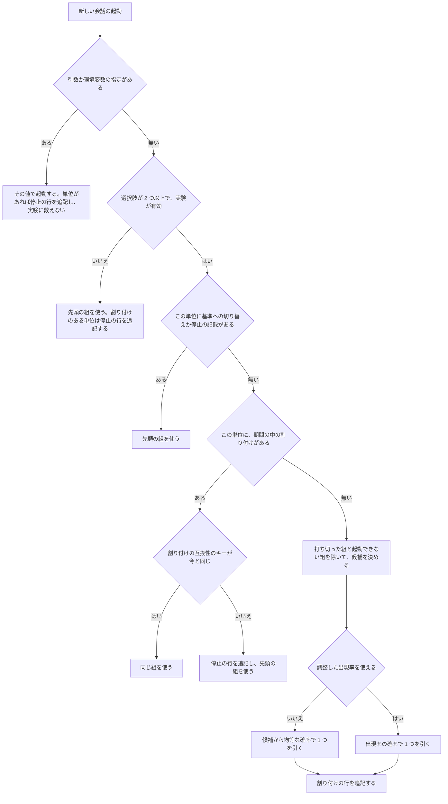

# モデルと effort の実験: 出現率の記録と計算（#2944）

この文書は、設計書（[issue-2944-design.md](./issue-2944-design.md)）のうち、実験の記録、費用と ROI、割り付けと出現率の計算を持つ。語の意味・不変条件・決定の理由・テスト設計・受け入れる限界は設計書にある。「条件 n」は要求仕様（[issue-2944-requirements.md](./issue-2944-requirements.md)）の受け入れ条件である。

## 実験の記録と出現率

実験の記録と出現率のファイルは、リポジトリごとのディレクトリ `launch-experiments/<リポジトリの ID>/` に置く。置き場は利用者の NDF の状態の保存先で、使用量ログと同じ場所である。リポジトリの ID は、リポジトリのキー（下の割り付けの行の `repo`）の SHA-256 の先頭 16 文字とする。リポジトリで分けるのは、割り付け・出現率・`report` のどれも同じリポジトリの記録しか使わず、記録を残す期間もリポジトリの設定で決まるためである（下の「保持する期間」）。

| ファイル | 中身 |
| --- | --- |
| `launch-experiments-<YYYY-MM>.jsonl` | 実験の記録。追記だけで、行の日時（UTC）の月ごとに分ける。どの行も、その起動か評価を行ったリポジトリのディレクトリに書く |
| `launch-weights.json` | 出現率。記録と使用量ログから作り直せるコピーである |
| `launch-experiments.lock`・`launch-weights.json.lock`・`launch-pruned`・`launch-pruned.lock` | 追記と書き換えのロック、月の掃除を終えた月とそのロック |

保存先の `launch-experiments/` の直下には、リポジトリごとのディレクトリのほかに、保存先全体の片付けを終えた月（`launch-swept`）とその錠（`launch-swept.lock`）、役目を終えたディレクトリの回収と起動を重ねないための共有ロック（`launch-store.lock`）を置く（下の「保持する期間」）。

割り付けの行（単位の最初の起動で 1 行）:

| 欄 | 中身 |
| --- | --- |
| `kind`・`at` | `assign`・日時 |
| `assign_id` | この割り付けの ID。割り付けの行を書くたびに新しい一意な値を発行する |
| `unit` | 単位の ID。プランの工程は `<run_id>:<工程>`、修正と作業場所の用意は `<run_id>:<ステップ>`、判定は `request_id`、相手役は `<cross-review の実行の ID>:<シート>` |
| `stage`・`runtime`・`repo`・`mode` | 工程・ランタイム・リポジトリのキー（git の共通ディレクトリの実体の絶対パス。git は起動せずに `.git` のファイルから求める）・モード |
| `window_days` | 割り付けたときの選択の計算に使う期間。月の掃除が、同じリポジトリの別の作業ディレクトリが長い期間で割り付けた記録を残すために読む |
| `arms`・`probs`・`chosen` | そのときの選択肢、それぞれの確率、選んだ組。候補の確率は 0 より大きく、ほかは 0 |
| `key` | 互換性のキー（下の「出現率の再利用」） |
| `phase` | `burn_in`（均等に抽選する。件数を集める間か、使える出現率が無い）・`adaptive`（調整の後）・`uniform`（費用を計算できず、均等に抽選する） |

確率を残すのは、出現率が途中で変わるためである。後から偏りを重み付けで直して比べられる。

効果指標の行（単位の評価で 1 行）:

| 欄 | 中身 |
| --- | --- |
| `kind`・`at`・`assign_id` | `outcome`・日時・評価した起動の割り付け ID |
| `metric` | 指標の名前とバージョン。定義を変えたらバージョンを上げ、古い行は数えない |
| `quality` | 0〜1。取れなければ null |
| `detail` | 元の数（採用された重大な指摘の数など） |

ほかの行は次の 4 つである。

| `kind` | 書く時点 | 欄 |
| --- | --- | --- |
| `launch_error` | 単位を持つ起動が「モデルを理由にした拒否」で終えた | 日時・割り付け ID・工程・ランタイム・組・理由・基準へ切り替えたか |
| `halted` | 単位を実験の対象外にした。理由は 4 つで、割り付けのある単位を停止（`disabled`）・固定（`fixed`）・選択肢か指標の変更（`changed`）のために先頭の組で起動した場合と、引数か環境変数の指定（`manual`）で起動した場合（割り付けが無くても書く） | 日時・単位の ID・リポジトリのキー・工程・ランタイム・割り付け ID（無ければ null）・理由 |
| `observed` | 割り付けのある Claude の単位で、引き上げでも基準への切り替えでもない起動が、実際のモデルを最初に返した | 日時・割り付け ID・組・実際のモデル |
| `unpriced` | 起動の費用を計算できないモデルに当たった | 日時・割り付け ID・モデル |

**記録は割り付け ID で結ぶ。** 期間（`window_days`）を過ぎた単位をもう一度起動すると、同じ単位の ID に 2 つ目の割り付けができる。前の起動の効果や費用は後から届くこともあるので、単位の ID や日時では区別できない。そこで割り付け ID を次のとおり引き継ぎ、計算と `report` は割り付け ID ごとに単位の値を作る。

| 引き継ぐ先 | 引き継ぎ方 |
| --- | --- |
| 起動 | 選ぶ処理が値と一緒に割り付け ID を返し、呼び出し元が使用量ログの行の `assign_id` に書く |
| 会話の再開 | 会話の最初の起動の割り付け ID を、モデルと effort と一緒に残して復元する。割り付けが期間を過ぎていても、選び直さない |
| 効果指標 | 評価する工程は、評価する起動の結果から割り付け ID を受け取って書く。単位の中に 2 つの ID があれば、最後の起動の ID を使う |
| 手戻りの費用 | `charge_to` には、費用を負う割り付け ID を書く |
| 停止・拒否・実際のモデル・`unpriced` の行 | その起動の割り付け ID を書く。手動指定の停止の行は、単位にある割り付け ID を書く |

**読み書き。** 読む側は、同じリポジトリのディレクトリにある、期間（`window_days`）と、起動できない組を数える 7 日の、長いほうの始まりの月から今月までのファイルだけを読む。それより前の行は、割り付け・停止・出現率のどれにも使わない。割り付けは次の順で行う。

1. ロックの外で記録を読み、今月のファイルをどこまで読んだかを覚える
2. そのリポジトリの実験の記録のロック（`launch-experiments.lock`）を取り、1 の後に追記された行（月が替わっていれば新しいファイル）だけを読む
3. 割り付けの有無と候補を調べ、行を追記して、ロックを返す

期間の中の同じ単位が 2 回割り付けられないためである。ロックの中では出現率を計算しない。追記する側は、記録が改行で終わっていなければ、書きかけの行を閉じるバイト列（改行を含み、UTF-8 として読めない 1 バイトを前に置く。起動の承認の記録と同じ `launch_records.TORN_END`）を先に足し、読む側は壊れた行を飛ばす。改行だけで閉じると、JSON を書き終えたところで中断した行が有効な行として読まれるためである。効果指標の「同じ割り付け ID の行があれば足さない」の確認と追記も、同じロックの中で行う。

同じ単位かどうかは、単位の ID と、リポジトリのキー・工程・ランタイムの 4 つで決める。単位の ID は呼び出し元が付ける（`ndf models pick --unit` では利用者が渡す）ので、別のリポジトリやランタイムで同じ名前が使われることがあるためである。割り付けの行と停止の行の両方をこの 4 つで照らし、ほかの場所で付いた割り付け ID や停止を引き継がない。

まだ無い月のファイルは空として読む。ファイルがあるのに読めない月（権限が違う・所有者だけの形でない・読み取りの誤り）は空とみなさず、警告を出して割り付けずに起動する。空とみなすと、その月にある割り付けを見失い、同じ単位に別の組と割り付け ID を発行するためである。

**保持する期間。** 実験の記録は、選択の計算に使う期間（`window_days`。既定 60 日、最長 365 日）に約 30 日を足した期間を残し、それより古い月のファイルを確認なしに消す（利用者の訂正、2026-11-27。前は 13 か月の固定だった）。掃除する日時から `window_days` に 30 日を足した日数を引き、その日時より前に終わった月のファイルだけを消す。境にかかる月は残す。足す 30 日は同梱の表（`launch-experiments.json` の records の行の `kept_extra_days`）が持つ。

掃除は、各リポジトリが自分のディレクトリだけを、自分の今の設定で行う。記録をリポジトリごとに分けたので、別のリポジトリの設定や起動の順は、どの月が残るかに関わらない。境界は、そのリポジトリの今の設定の `window_days` と、そのディレクトリに残る割り付けの行の `window_days` のうち、最も大きい値で決める。行の値も見るのは、同じリポジトリの別の作業ディレクトリが、長い期間を設定して割り付けていることがあるためである。

期間を延ばしたリポジトリは、延ばした後の最初の起動で、延ばした設定を読んでから掃除する。そのため、延ばす前の短い期間で、まだ残っている月を消すことはない。既に消えた月は、延ばしても戻らない。

使われなくなったリポジトリの記録は、保存先全体の片付けで消す。片付けは自分の月の掃除とは別に、保存先全体で月に 1 回だけ成功させる。起動は、自分の月の掃除を終えた後（今月の掃除が既に済んでいた場合も含む）に保存先の `launch-swept` を読み、今月でなければ片付ける。自分の掃除は片付けより前に `launch-pruned` を書くので、片付けが失敗しても、ほかの起動が片付けている最中でも、自分の掃除はやり直さない。

片付けが失敗したときに、次の起動でやり直すのは、保存先全体の処理が中断した場合だけである。

| 失敗 | 扱い |
| --- | --- |
| 保存先全体の処理が中断し、`launch-swept` を書けなかった（保存先の一覧を読めないなど） | 次の起動が片付けをやり直す |
| 個別のリポジトリの片付けや回収に失敗した | 警告を出して残りのリポジトリを続け、`launch-swept` に今月を書く。そのリポジトリは翌月にやり直す。今月を書かずに起動のたびにやり直すと、失敗が続く間、起動のたびに保存先全体を読むためである |
| ほかのリポジトリの `launch-pruned` を UTF-8 として読めない | 警告を出し、そのリポジトリは掃除の記録が無いものとして扱う（回収しない）。残りのリポジトリの片付けは続ける |
| 回収の途中でファイルを消せなかった | 警告を出して次の候補へ進む。`launch-pruned` は最後に消すので、ほかのファイルの削除で失敗した場合は残り、翌月に再試行する |
| `launch-pruned` を消した後に、ディレクトリを消せなかった | 警告を出して次の候補へ進む。`launch-pruned` が無いので、翌月の回収候補にはならない |
| 保存先の共有ロック（下の段落）を使えない（データベースが壊れている・読み書きの誤り・filelock がロックに使えないと拒むデータベース） | 起動は記録を読み書きできない場合と同じに扱い、警告を出して割り付けずに起動する。回収はその月を見送る |

| 片付けの扱い | 内容 |
| --- | --- |
| 対象 | `repo_store` が作る名前（16 文字の 16 進数）のディレクトリのうち、自分と、今月に自分の月の掃除を終えたもの（`launch-pruned` が今月）を除いたもの。シンボリックリンクはたどらない。今月に掃除を終えたリポジトリを除くのは、その掃除が片付けより新しい境で月を消し、出現率の項目も消しているので、片付けで消すものが無いためである。先月に掃除を終えたリポジトリは除かない。先月の掃除の後に期限を過ぎた出現率の項目があるためである |
| 消すもの | どの設定でも使わない古さの月のファイル（終わってから `window_days` の上限 365 日に 30 日を足した日数を過ぎた月）と、期限を過ぎた出現率の項目。境界は設定によらないので、どのリポジトリが片付けても同じ月が残る |
| 消し方 | 月ごとの実験記録は、ファイル名の月で削除を判断する。そうした古い月にはもう追記されないので、ロックを取らずに消す。出現率ファイルは、まずロックを取らずに読む。期限を過ぎた項目があるときだけ、出現率のロックを待たずに取ってから読み直し、期限を過ぎた項目を削除する。ロックが使用中なら消さずに飛ばす。使っているリポジトリは、自分の月の掃除で項目を消すからである |
| 回収（役目を終えたディレクトリを消す） | 下の「回収の条件と手順」のとおり |
| 回収と起動の排他 | 下の段落のとおり、保存先の共有ロック（`launch-store.lock`）で回収と起動を重ねない |
| 1 回にまとめる方法 | 片付けを終えた月を保存先の `launch-experiments/launch-swept` に書く。片付けの錠（`launch-swept.lock`）を待たずに取れた起動だけが片付ける。リポジトリごとの掃除のたびに片付けると、月に N 個のリポジトリを起動したとき、ディレクトリの一覧を N 回読むためである |

回収の条件と手順は次のとおりである。回収は、NDF が作ったと確かめられるディレクトリの、NDF が作ったファイルだけを消す。

| 回収の条件 | 内容 |
| --- | --- |
| NDF の掃除の記録がある | NDF の月の掃除が書く `launch-pruned` が、この利用者の持つ通常のファイル（シンボリックリンクでない）として、月を持っている。NDF が作ったディレクトリであることの記録として使う |
| しばらく掃除されていない | `launch-pruned` に記録された最後の掃除の月が先月より前である。回収の判定にはこの月を使い、起動の履歴は見ない。起動しても掃除に失敗した月は、`launch-pruned` が更新されないので、この判定では掃除されていない月として数える |
| 記録が残っていない | 月のファイルも、期限の前の出現率の項目も残っていない |
| 中身が NDF のファイルだけ | ディレクトリの中は、NDF が作ったと確かめられるファイルだけである。名前が同じというだけでは、NDF が作ったとはみなさない。確かめる内容は下の表のとおりである。確かめられないファイルが 1 つでもあれば、利用者が置いたものとみなし、何も消さない。これは失敗ではないので、翌月も同じ判定をする |

「中身が NDF のファイルだけ」の条件では、ファイルごとに次のことを確かめる。どのファイルも、NDF の作る名前で、この利用者の持つ通常のファイル（シンボリックリンクでない）であることを前提とする。

| ファイル | NDF が作ったと確かめる方法 |
| --- | --- |
| `launch-pruned` | 中身が UTF-8 の月である（「NDF の掃除の記録がある」の条件と同じ） |
| 出現率ファイル | 出現率の計算が書き出す形式に合い、期限の前の項目が無い。形式は、出現率の計算が書き出すときと同じスキーマで検証する（この節の後半の「出現率ファイルの形式」の段落） |
| 3 つのロックファイル | 空である。filelock はロックファイルに何も書かない |
| 書き込みの途中で残った一時ファイル | 名前が `.<元の名前>.<32 桁の 16 進>.tmp` の形で、権限が所有者だけの読み書き（0600）である。NDF は一時ファイルをこの権限で作る |

回収の手順は次のとおりである。

1. 片付けの中で、それまでに読んだ結果（最後の掃除の月・消した後に残った月・期限の前の出現率の項目の数）で候補を選ぶ。候補を選ぶためだけに読み直しはしない
2. 保存先の共有ロック（下の段落）を書き手として待たずに取る。取れなければ、その月の回収を見送る
3. 候補ごとに、ディレクトリをシンボリックリンクをたどらずに開き、上の条件を最新の状態で確かめ直す。満たせば、開いたディレクトリの中の NDF のファイルを消してからディレクトリを消す。確かめる処理と消す処理を開いた同じディレクトリで行うのは、候補を選んだ後にそのパスが別のディレクトリへのリンクに置き換わっても、リンク先のファイルを消さないためである。ディレクトリの一覧と各ファイルの状態は 1 回だけ読み、確かめた結果を消す処理に渡す。`launch-pruned` は最後に消す。ほかのファイルの削除で失敗した場合は `launch-pruned` を残し、翌月に再試行する。`launch-pruned` を削除した後にディレクトリを削除できなかった場合は、警告を出す。この場合は翌月の回収候補にはならない。ディレクトリを消す権限が無いと分かっているときは、何も消さない
4. 1 つの候補で失敗しても、警告を出して次の候補へ進む

回収と起動は、回収の対象の外にある、保存先の共有ロック（`launch-experiments/launch-store.lock`）で重ならないようにする。リポジトリのディレクトリのロックファイルを削除すると、起動は同じパスに新しいロックファイルを作って取得できる。そのため、回収側がリポジトリのロックを持っていても、回収と起動の排他にはならない。起動と回収は、共有ロックを次のように使う。

| 処理 | 共有ロックの取り方 |
| --- | --- |
| 起動（割り付け・記録の追記・月の掃除・出現率の書き換え） | リポジトリのディレクトリを作る前から、そのディレクトリのロックを返すまで、読み手として持つ。読み手は、ほかの起動と同時に持てる。回収の最中なら、ロックの待ちの上限（5 秒）まで待つ |
| 回収 | 書き手として待たずに取る。読み手が 1 つでもいると取れず、回収を翌月に回す。書き手を持つ間は、どの起動もリポジトリのロックを持たず、待ってもいないので、ロックファイルも消せる。書き手ロックの取得後に、「回収の条件」の表にあるすべての条件を確かめ直す。候補の処理の途中で例外が出ても、書き手を返す。返すのに失敗しても、データベースの接続を閉じて書き手を外す |

ロックを取らずに読むだけの処理（割り付けの前の読み取りなど）は、回収の後にファイルが無ければ空として読む。回収するのは月のファイルも出現率の項目も無いディレクトリなので、読み落とすものは無い。

共有ロックは filelock の読み手と書き手のロック（`ReadWriteLock`）で作り、起動は読み手、回収は書き手で取る。起動に足す時間は、リポジトリのロックを 1 回取るたびに約 0.46 ms（2026-11-27 に下と同じ環境で測った、2,000 回の平均）で、割り付けのある起動では 1 回、月の掃除をする起動では加えて 3 回である。次の 3 つの作り方を比べた。

| 作り方 | 1 回の時間 | 採否 |
| --- | --- | --- |
| filelock の `ReadWriteLock`（SQLite のデータベースを使う） | 約 0.46 ms | 採る |
| `fcntl.flock` の共有モードと排他モードを直接使う | 約 0.03 ms | 採らない。このリポジトリは `fcntl.flock` の直接の呼び出しを filelock に置き換える規則（`plugins/ndf/contracts/replaceable/fcntl-flock.json`）を持つ |
| filelock の `FileLock`（排他だけ）を保存先で 1 つ取る | ロックの待ちが増える | 採らない。すべてのリポジトリの割り付けと月の掃除が、この 1 つのロックで順番待ちになる |

片付けが起動に足す時間を、2026-11-27 に作り物の保存先で測った（8 コアの Linux、Python 3.14.4。片付け 1 回の時間の、7 回の中央値。出現率ファイルの項目の数は 1 リポジトリあたり 10 件と 100 件で測り、その幅を書く）。

| リポジトリの状態 | 10 個（ms） | 100 個（ms） | 1,000 個（ms） |
| --- | ---: | ---: | ---: |
| 今月に自分の月の掃除を終えた（`launch-pruned` を読んで飛ばす） | 2.3〜2.4 | 10.0〜11.6 | 61.4〜72.5 |
| 先月に掃除を終え、期限を過ぎた項目が無い（出現率ファイルを読むだけ） | 3.6〜7.8 | 33.1〜51.0 | 271〜601 |
| 期限を過ぎた項目がある（ロックを取って書き換える） | 14.0〜21.4 | 111〜190 | 1,251〜2,173 |
| 役目を終えた（回収する） | 5.4〜6.3 | 72.6〜81.4 | 597〜803 |

この表の時間を払うのは、保存先全体で月に 1 回、片付けの錠を取った起動だけである。保存先全体の片付けが済んだ月には、その後の起動は `launch-swept` を 1 回読む（約 10 µs）。割り付けや記録の追記をする起動には、これとは別に、上に示した共有ロックの取得の時間（1 回約 0.46 ms）がかかり、回収中は、回収が終わるか、共有ロックの待ち時間が上限の 5 秒に達するまで待つ。回収したディレクトリは次の月から一覧に出ないので、回収の費用はリポジトリごとに 1 回で終わる。

片付けがほかのリポジトリのロックに当たったときの扱いを、次の 4 つの案で比べた。

| 案 | 起動に足す費用 | 使用中のロックに当たったとき | 採否 |
| --- | --- | --- | --- |
| ロックを待つ | 上の表の時間に加え、使用中のリポジトリごとに最大 5 秒（ロックの待ちの上限）待つ | 上限を超えると片付け全体が失敗し、次の起動がやり直す | 採らない。片付けを担当する起動が遅れる |
| ロックが空くまで片付けを延期する（`launch-swept` を書かずに次の起動でやり直す） | 使用中のロックがある間、起動のたびに上の表の時間を払う | 次の起動でやり直す | 採らない。よく使うリポジトリがあると、ロックが空いた瞬間に当たるまで、起動のたびに保存先全体を読む |
| 待たずに飛ばし、今月に掃除したリポジトリは読まない | 月に 1 回、上の表の時間。ほかの起動は `launch-swept` を 1 回読むだけ | そのリポジトリを飛ばす。使っているリポジトリは自分の月の掃除で片付く | 採る |
| 片付けをしない | なし | — | 採らない。使われなくなったリポジトリの記録が残り続ける（Value 6） |

保存先の置き方を、次の 3 つの案で比べた。

| 案 | 起動 1 回で増える読み書き | 境界が起動の順で変わるか | 採否 |
| --- | --- | --- | --- |
| 全リポジトリで 1 つの月ファイルを共有し、掃除するリポジトリの設定と割り付けの行の値の最大で消す | なし | 変わる。長い設定のリポジトリが、まだ割り付けていない間に消される | 採らない |
| 共有の月ファイルに加えて、各リポジトリの `window_days` を写した届け出のファイルを置く | 読み取り 1 回。日付が替わった後と設定を変えた後は、ロックと書き換えも 1 回 | 変わる。設定を変えたリポジトリがまだ起動していない間に、別のリポジトリが掃除すると消される。設定の値を正本の外に写すことにもなる | 採らない |
| リポジトリごとのディレクトリに分け、各リポジトリが自分の分を掃除する | 単位の無い起動でも、リポジトリのキーを求めるために `.git` の小さなファイルを 1〜2 回読む（git は起動しない）。割り付けで読むのは自分のリポジトリの月ファイルだけになり、ほかのリポジトリの行を読み飛ばさなくなる。使われなくなったリポジトリの片付けで、保存先全体で月に 1 回、ディレクトリの一覧を読む | 変わらない | 採る |

| 使い道 | 要る期間 |
| --- | --- |
| 割り付け・出現率・打ち切り | `window_days`（1〜365 日） |
| 起動できない組 | 7 日 |
| 集計（`ndf models report`）と、割り付けの理由を後から確かめること | `window_days` に約 30 日を足した期間 |

- 記録の使い道の中心は割り付けと出現率で、どちらも `window_days` より前の行を使わない。それより長く残しても読み手がいないので、散らからないよう短くした。足す 30 日は、効果指標と費用が割り付けより後に届く分と、`report` が期間の少し前まで比べられる余裕として置く（実測で決めた値ではない）
- 足した 30 日は、起動できない組を数える 7 日より長いので、7 日の判定に要る行は消えない
- 前の年の同じ時期との比較はできなくなる。`report --since` が保持の期間より前を指す場合は、残っている分だけを出し、その旨を添える
- 掃除は月に 1 回なので、実際に残る長さは `window_days` ＋ 30 日から、さらに最大でおよそ 1 か月長くなる（境にかかる月を残し、次の掃除は翌月の最初の起動）
- 最も大きい `window_days` を求めるために、掃除は自分のディレクトリに残っている月のファイルをすべて読む。読み取りから削除までは、そのリポジトリの記録のロック（`launch-experiments.lock`）の中で行う。同じリポジトリの別の作業ディレクトリが、読んだ後に長い `window_days` の割り付けを書いても、その行を読み落としたまま月を消さないためである。ロックを持つのは月に 1 回の掃除の間だけで、その間の割り付けは待つ。掃除は月に 1 回なので、読む回数はリポジトリごとに月に 1 回である。読めないファイルが 1 つでもあれば、その起動では何も消さず、`launch-pruned` も書かずに起動を続ける。読めない月の行が長い `window_days` を持つかもしれず、境界を決められないためである。次の起動がやり直す。保存先全体の片付けでは、月ごとの実験記録はファイル名の月で削除を判断する。出現率ファイルは、ロックを取ってから読み、期限を過ぎた項目を削除する
- 古いファイルと項目を消す処理（月の掃除）は、月に 1 回だけ成功すればよい。終えた月は、リポジトリのディレクトリにある、記録とは別の `launch-pruned` に書く。月のファイルがあるかどうかでは判断しない。月をまたいで動いていた処理の追記が、掃除より先に今月のファイルを作ることがあるためである
- `launch_choice` は起動のたびに自分のリポジトリの `launch-pruned` の月を読み、今月でなければ掃除する。実験を止めた後（`enabled: false`）の起動でも同じである。`ndf models report` が止めた後も記録を使うので、止めたリポジトリも自分の設定の期間で掃除する。続けて保存先の `launch-swept` の月を読み、今月でなければ保存先全体を片付ける。起動のたびに読むのはこの 2 つのファイルだけで、ファイルの一覧は調べない
- 今月を `launch-pruned` に書くのは、掃除が全部成功した後である。失敗や中断の後は、次の起動がもう一度掃除する
- 月替わりに起動が重なっても、掃除するのは 1 つの起動だけである。そのリポジトリの掃除の錠（ディレクトリの `launch-pruned.lock`）を待たずに取れた起動が、錠の中で `launch-pruned` を読み直し、まだ今月でなければ掃除する。錠を取れなかった起動は、待たずに掃除を飛ばして起動を続ける。月のファイルをすべて読む処理を、重なった起動の数だけ繰り返さないためである。錠を持つ起動が失敗すれば、次の起動がやり直す
- 出現率のファイルの、計算した日時から項目の `window_days` を過ぎた項目は、出現率の計算がファイルを書き換えるときに消す。月の掃除でも消すので、実験を止めた後にも残らない。打ち切りの期限はそれより後にならないので、効いている打ち切りは消えない。月の掃除の後に期限を過ぎた項目も、割り付けは使わない（次の掃除まで残っていても、割り付けのときに期限を確かめる）
- 出現率のファイルと `launch-pruned` は、一時ファイルに書いてから置き換える。一時ファイルは作るときから所有者だけが読み書きできる形（0600）にする。出現率のファイルはリポジトリの絶対パスを持つので、umask で広がった権限のファイルに置き換えないためである
- 使用量ログはほかの用途と共有する記録なので、この規則の対象ではない

2026-11-26 に作り物の記録で、1 つのファイルの全部をロックの中で読む形を測った値は次のとおりである（8 コアの Linux、Python 3.14.4。1 プロセスが続けて 11 回割り付け、ロックの待ちを含む 1 回の時間の中央値）。

| 記録の行数 | 並列度 1（ms） | 並列度 8（ms） |
| ---: | ---: | ---: |
| 1,000 | 2.4 | 8.9 |
| 10,000 | 25.4 | 250.6 |
| 100,000 | 257.0 | 2,520.4 |

この値を受けて、読む量とロックの範囲を次のように比べた。

| 方法 | 毎回読む量 | ロックの中の処理 | 採否 |
| --- | --- | --- | --- |
| 1 つのファイルの全部を、ロックの中で読む | 使い始めてからの全部 | 全部の読み取りと追記 | 採らない。時間が使い続けるほど延び、並列の起動が読み取りの順番を待つ |
| 月ごとのファイルに分け、ロックの外で読み、中では追記分だけを読む | 期間に当たる月のファイル（60 日なら多くて 3 つ） | 追記分の読み取りと追記 | 採る。正本は追記のまま変わらず、コピーを持たない |
| 索引か要約を別のファイルに持つ | 一定 | 索引の読み取りと更新 | 採らない。正本とのずれを直す仕組みが要る |

読む量は期間の中の行数に比例するので、期間の中の行が 10 万行なら、読み取りの約 0.26 秒は残る。採る形で並列に起動したときの時間は未測定で、実装で上の表と同じ条件で測る。

**出現率の再利用。** 互換性のキーは、工程の選択肢の並び（先頭が基準）と、指標の名前とバージョンから作るハッシュである。出現率の計算と件数に使うのは、同じリポジトリの、今の設定と同じキーの行だけである。候補・基準・指標のどれかが変われば別のキーになり、件数を集め直す。別のリポジトリの記録は、キーが同じでも混ぜない。作業の難しさがリポジトリごとに違い、組の差とリポジトリの差を分けられないためである。

**実際のモデルが変わった単位は混ぜない（Claude）。** CLI の既定のモデルや別名（`sonnet` など）が指すモデルは後から変わる。単位の実際のモデルは、その単位の最初の起動（引き上げと基準への切り替えでない起動）の使用量ログの行から取る。計算と `report` は、次の単位だけを使う。

| 組 | 使う単位 |
| --- | --- |
| モデルを指定しない組 | モデルを指定しない組すべての単位のうち最も新しく評価した単位と、実際のモデルが同じもの |
| モデルを指定する組 | 実際のモデルが、その組の最も新しく評価した単位と同じもの |

モデルを指定しない組をまとめて基準を決めるのは、これらの組がどれも CLI の既定のモデルで動くためである。組ごとに基準を決めると、しばらく選ばれていない組は、古い既定のモデルの単位を使い続ける。

出現率の項目は、計算に使った実際のモデル（モデルを指定しない組は共通の 1 つ、指定する組は組ごと）を持つ。割り付けは、期間の中の `observed` の行のうち同じキーの最も新しいものを、まとまりごとに項目の値と比べる。違えば、モデルが更新されたとみなし、その項目の出現率と打ち切りを使わない。実際のモデルを持たないまとまりは比べない。

既定のモデルが変わると、モデルを指定しない組は件数がまとめて減り、`burn_in` に戻って集め直す。実際のモデルを特定できない単位は使わない（期限切れで回答が無い単位の扱いは「出現率の計算」）。Codex は実際のモデルを取得しないので、この絞り込みを当てない（設計書の「受け入れる限界」）。

**出現率ファイルの形式。** 出現率ファイルの形式は、出現率の計算が書き出す形式と同じ規則で検証する。必須項目が欠けているか、書き出し形式にないキーを持つファイルは、月の掃除でも、保存先全体の片付けでも、回収でも変更しない。利用者が同じ名前で置いた JSON の項目を、NDF が期限切れとして消さないためである。

規則は、内部データの種類 `launch-weights` のスキーマ（`plugins/ndf/contracts/schemas/internal/launch-weights.schema.json`）の 1 か所に置く。出現率の計算は書き出す前に、月の掃除・保存先全体の片付け・回収は読んだ後に、同じスキーマで確かめる。ファイルは `version`（1）と `entries`（項目の配列）だけを持つ。項目の必須のキーは `repo`・`stage`・`runtime`・`key`・`at`・`phase`・`candidates`・`allocation` で、`probs`・`models`・`counts`・`cutoffs` は省ける。項目に欄を足すときは、このスキーマに足す。

出現率のファイルの項目は、リポジトリ × 工程 × ランタイム × 互換性のキーで引く。項目が持つのは次の値である。段階（`burn_in` か `adaptive`）、計算したときの候補、計算に使った実際のモデル、割り付けの値（設定の `allocation` の値。`floor`・`margin`・`min_units`・`window_days`）、確率（`adaptive` のときだけ）、組ごとの計算に使った件数、打ち切った組とその期限、日時。書き換えるのは、出現率の計算（項目の置き換えと、期限を過ぎた項目の削除）と、月の掃除（期限を過ぎた項目の削除）の 2 つである。項目の割り付けの値が今の設定と違えば、項目が無いものとして扱う。

## 費用と ROI

単位の費用は、使用量ログのうち `assign_id` か `charge_to` がその単位の割り付け ID である行の、起動の費用の合計である。起動 1 回の費用の求め方は #1959 の設計の「起動の費用の求め方」に従う。

| 手戻りの起動 | `charge_to` に割り付け ID を書く単位 |
| --- | --- |
| 実装の後のテストと CI の失敗を直す起動 | その実行の `impl` の単位 |
| 設計レビューと実装の PR のレビューの指摘を直す起動（cross-review の修正担当） | 評価している `design` か `impl` の単位 |
| 判定の起動し直し | 割り付けた単位そのもの |

手戻りの費用まで含めるのは、安い組が指摘を多く生むと、直す費用でかえって高くつくためである。テストと CI の失敗を直す起動の行は、`assign_id`（`fix` の単位）と `charge_to`（`impl` の単位）の両方を持ち、両方の単位の費用に入れる。`fix` の組の比較には修正そのものの費用が要り、`impl` の組の比較には手戻りの費用が要るためである。ROI は工程の中で組を比べる値なので、工程をまたいで単位の費用を足さない。実際に払った合計は、行を `launch_id` ごとに 1 回だけ数えて出す。

費用が不明の起動を持つ単位は、費用の平均に入れず、件数を `report` に出す。単位の費用の合計が 0 の単位（回答を返せずに誤りで終えた起動だけの単位など）も、不明と扱う。0 は対数にも割る数にも使えないためである。

組ごとの ROI は、**効果指標の平均 ÷ 単位の費用の平均（USD）** である。`report` は基準の組の ROI を 1 とした比も出す。ROI だけで比べると、安い組は効果が低くても勝つので、下の「効果の下限」と組み合わせる。

## 割り付けの流れ

この流れは、新しい会話を始める起動に当てる。同じ会話を再開する起動は値を選び直さず、会話の最初の起動の値を使う。停止（`enabled: false`）、固定（選択肢が 1 つ）、引数か環境変数の指定は、その単位の既にある割り付けより先に見る。停止・固定・手動指定の起動では、割り付けの行を書かない。書くのは停止（`halted`）の行だけである。

「調整した出現率を使える」のは、次のすべてが成り立つときである。

- 出現率の項目があり、段階が `adaptive` である
- 項目の候補と割り付けの値が、今の候補と設定と同じである
- 項目の実際のモデルが、最も新しい `observed` の行と食い違わない（上の「実際のモデルが変わった単位は混ぜない」）
- 直近 `window_days` 日に割り付けた、同じリポジトリと互換性のキーの単位に、`unpriced` の行が無い。ただし、行を書いた後にそのモデルが単価表に載った場合、その行は数えない

使えないときの割り付けの行の `phase` は、次の順で決める。件数の不足と `unpriced` の両方に当たる場合は `uniform` である。

1. `unpriced` の条件に当たれば `uniform`
2. それ以外は `burn_in`

`report` も同じ順で段階を表示し、`uniform` のときは費用を計算できないモデル名を出したうえで、組ごとの件数も出す。

そのほかの扱いは次のとおりである。

- 停止の行がある単位は、実験に数えない。2 つの組か、実験の外の値が混ざるためである。実験を再び有効にしても、手動指定をやめても、その単位の新しい会話は先頭の組で続ける
- 手動指定の起動が手戻りの起動（`charge_to` を持つ）の場合は、費用を負う先の単位にも停止の行を書く
- 選択肢か指標を変えると互換性のキーが変わる。変える前に割り付けた単位の新しい会話は、削除した組を使い続けず、先頭の組で起動する。同じ会話の再開は、最初の起動の値のままである
- **候補は、どの段階でも最初に決める。** 打ち切った組と起動できない組は選ばず、`probs` を 0 にする
- 件数を集める間は、候補から均等な確率で無作為に 1 つ選ぶ。件数の少ない組を順に選ぶ形だと、その時期にほかの組が選ばれる確率が 0 になり、作業の難しさと組の差を分けられないためである。並列に流して結果の前に次の割り付けが来ても、確率は変わらない
- 候補が変わった後（拒否で組を外した、期限で組が戻った）は、次の計算まで均等に抽選する
- 費用を計算できないモデルの単位が期間外に出るか、モデルが単価表に載れば、保存済みの確率を使う
- 記録を書けないときは指定なしで起動し、その単位は実験に数えない

## 出現率の計算

出現率の項目は、リポジトリ × 工程 × ランタイム × 互換性のキーごとに計算する。計算し直すのは、**効果指標を書いた後**に、次のどれかが成り立つときである。

- 項目が無い
- 項目の候補か割り付けの値が、今と違う
- 項目の実際のモデルが、今の基準の実際のモデルと違う
- 前の計算から 1 時間以上たっている

毎回は計算しないのは、使用量ログ 10 万行の読み取りに約 0.5 秒かかるためである（#1959 を実装する前の合成の行での測定）。反映は最大で 1 時間と次の効果指標まで遅れる。計算はロックの外で行う。出現率のファイルを書き換えるときは、出現率の計算も月の掃除も同じロックを取り、ロックの中で最新の内容を読み直してから変える。計算は自分の項目を置き換え、掃除は読み直した内容で期限を過ぎた項目だけを消す。同じ項目の計算が重なった場合は、後で書いた側が残り、次の計算でそろう。`report` は呼ばれた時点で計算し直し、このファイルを書き換えない。

使うのは、直近 `window_days` 日に割り付けて、効果指標がある、同じリポジトリと互換性のキーの単位のうち、実際のモデルが「出現率の再利用」の条件に合うものである。効果の平均はこのすべてから、費用の平均はこのうち費用の分かる単位から出す。期限切れの起動は費用が分からないが、効果 0 は比較に入れる必要があるためである。期限切れで実際にかかった費用は測れないので、費用の平均には入らない。期限切れで回答が無い単位の数え方は、下の「期限切れの単位とモデルの変化」による。基準への切り替えと停止の単位は使わない（停止の行の割り付け ID で除く）。

**期限切れの単位とモデルの変化。** 期限切れで回答が無い単位は、実際のモデルが分からない。モデルが変わる前の期限切れを今のモデルの成績に混ぜないように、割り付けの日時で境界を決める。境界は、同じまとまり（モデルを指定しない組すべて、または指定する組ごと）で実際のモデルが分かる単位から、次の 2 つを順に求める。打ち切りも同じ境界を使う。

1. 今のモデル（最も新しく評価した単位の実際のモデル）と異なるモデルを観測した単位のうち、割り付けが最後のものを特定する
2. それより後に割り付けた単位のうち、今のモデルを観測した最初のものを境界にする

| 期間の中の観測 | 数える期限切れの単位 |
| --- | --- |
| 異なるモデルの単位が無い（変化を観測していない） | すべて |
| 境界がある | 境界の単位以降に割り付けたもの |
| 異なるモデルの単位はあるが、その後に今のモデルの単位が無い | 数えない |

境界は割り付けの日時の最大と最小で決まるので、単位を並べ替えず、走査だけで求める。

乱数の種は、工程・ランタイム・互換性のキー・割り付けの値と、計算に使う単位（割り付け ID の順に並べる）の割り付け ID・効果・費用の SHA-256 から作る。同じ単位の集まりからは、何度計算しても同じ出現率と「最良である確率」になる。割り付けの抽選には、この種を使わない。

**比べる単位と重み。** 組によって割り付けた時期や確率が違うと、難しい作業が多かった時期の組が劣って見える。そのため、効果と費用の平均は次のとおりに出す。

- 割り付けた時に、比べる組のすべての確率が 0 より大きかった単位だけを使う
- 単位ごとの重みは、割り付けた時の確率の逆数（`1 / probs[chosen]`）にする。どの段階でも同じである
- 平均は重み付きの平均にする。分布の件数には、有効な件数 `n_eff = (重みの和)² ÷ 重みの 2 乗の和` を使う。`n_eff` は効果と費用で別に出す
- `min_units` と打ち切りの 30 件は、重みを付けない単位の数で数える
- 比べる組は、計算する時点の候補である。外れていた組が候補に戻ると、その組がいなかった間の単位は使えなくなるので、件数が減って `burn_in` に戻ることがある

順番は、打ち切りの判定（下の「打ち切り」）、候補の確定（打ち切った組と起動できない組を除く）、段階の判定、確率の計算である。次の番号の 1 は段階の判定、2〜5 は確率の計算である。段階の判定では、上の「割り付けの流れ」の `unpriced` の条件を件数より先に見る。当たれば出現率を使わない。

計算では、組の集まりを 2 つに分ける。**候補**は抽選の対象で、打ち切った組と起動できない組を除いたすべてである。**「最良」を数える組**は、候補のうち効果の下限を外れていない組である。基準の組は外れないので、どちらも空にならない。

1. 候補のどれかで、効果指標のある単位が `min_units` に満たないか、費用の分かる単位が 2 件に満たなければ、出現率は計算しない（段階は `burn_in`）。`report` の出現率の欄は「件数を集めている」と組ごとの件数を出す
2. 組ごとに 2,000 回の標本を引く
   - 効果 q: ベータ分布 `Beta(1 + n_eff × 効果の平均, 1 + n_eff × (1 − 効果の平均))`（`n_eff` は効果の単位）
   - 費用 c: 費用の対数の平均の事後分布（正規分布。平均と標本の標準偏差は重み付きで出し、標準偏差は `標本の標準偏差 ÷ √n_eff`。`n_eff` は費用の分かる単位）から引き、指数に戻す
3. **効果の下限**: 基準の組より効果が `margin` を超えて低い確率が 0.9 を超える組は、この回に「最良」を数える対象から外す（出現率は下限だけになる）
4. 「最良」を数える組の中で、標本ごとに `q / c` が最大の組を数え、その割合を「最良である確率」にする。効果の下限を外れた組の「最良である確率」は 0 で、出現率は 5 の式で下限（`floor`）になる
5. 候補の組の出現率は `floor + (1 − floor × 候補の数) × 最良である確率` にする。候補でない組は 0 にする

2,000 回の標本を引く計算は、3 組で約 15 ms である（2026-11-26 に Python 3.14.4、8 コアの Linux、11 回の中央値）。

**打ち切り**: 基準でない組を 1 つずつ基準の組と比べ、基準より効果が `margin` を超えて低い確率が 0.99 を超える組は、出現率を 0 にする。使う単位は次のとおりである。

| 条件 | 打ち切りの判定での扱い |
| --- | --- |
| リポジトリ・互換性のキー・期間・実際のモデル | 出現率の計算と同じ |
| 比べられる時期 | 割り付けた時に、基準と判定する組の両方の確率が 0 より大きかった単位 |
| 効果と費用 | 効果指標がある単位。費用が分からない単位も使う |
| 件数 | 基準と判定する組が、どちらも 30 件以上。平均は「比べる単位と重み」の重みを付ける |

品質の判定に費用は要らないので、段階が `burn_in` や `uniform` でも打ち切った組は選ばない。打ち切りは、今の互換性のキーを持つ項目から読む。項目の割り付けの値が今の設定と違うか、実際のモデルが食い違う項目の打ち切りは読まない。項目を計算した時と候補が違うだけなら、打ち切りは読む。項目には打ち切った組ごとに期限を書く。期限を決めるには、基準の組と打ち切る組のそれぞれで、新しいほうから 30 件目の割り付けの日時を取る。期限は、その 2 つの古いほうに `window_days` を足した日時である。期限を過ぎると、選ぶ処理はその組を候補へ戻す。モデルや作業の中身が変わった後にやり直すためである。基準の組は打ち切らない。

| 値 | 既定 | 意味 |
| --- | --- | --- |
| `min_units` | 10 | 組ごとに、調整を始める前に集める単位の数 |
| `floor` | 0.05 | 候補の組の下限の出現率 |
| `margin` | 0.1 | 効果指標の、許す低下の幅 |
| `window_days` | 60 | 数える期間 |

## 起動できない組

使えないモデルに当たっても、基準の組で作業を続け、利用者の操作は求めない。そのうえで、起動できない組を割り付けから外す。効果 0 とは数えない（設計書の I3）。

| 項目 | 内容 |
| --- | --- |
| 切り替える起動 | 抽選で選んだ基準でない組の、会話の最初の起動が、下の「モデルを理由にした拒否」で終えた |
| 切り替え方 | 呼び出し元が同じステップの中で、基準の組と新しい会話で 1 回だけ起動し直す。モデルが何も実行していないので、二重に実行されるものは無い |
| その単位の残りの起動 | 再実行と再開を含め、基準の組を使う（出所は `base`）。選ぶ処理は、元の割り付けより先に切り替えの記録を読む |
| 依頼の記録 | 拒否された起動と同じ `request_id` で、`request_try` を 1 増やす |
| 引き上げ | 切り替えた後も、設計書の「引き上げる起動」を当てる。上げる元は基準の組である |
| 実験の扱い | `launch_error` の行に切り替えたことを書き、その単位は効果と費用の計算に数えない |
| 利用者へ | 止めない。警告に、起動できなかった組と、基準の組で続けたことを出す |

**モデルを理由にした拒否**は、CLI がモデルか effort の指定を理由に、実行を始める前に断ったと出力から確かめられる場合だけである。使用量が取れないことは、消費が 0 であることにしない。

| ランタイム | 判定に要るもの（すべて） |
| --- | --- |
| Claude | 結果の JSON があり、`is_error` が真、`api_error_status` が 404、4 つのトークン数がどれも欄として在って 0、`modelUsage` が空 |
| Codex | API がモデルか effort を理由に断った誤りが出力にあり、モデルの回答と使用量の行が無い。誤りの欄の名前は未確認で、実装で確かめるまではこの判定に当てない |

Claude の値は、2026-11-26 に Claude Code 2.1.332 を無いモデル名で起動して確かめた（終了コード 1）。

次の失敗は拒否と扱わない。基準の組で起動し直さず、割り付けから外す件数にも数えない。

- 結果の JSON が無い、使用量の欄が欠けるなど、判定に要るものがそろわない
- 通信の障害、サーバの誤り、利用上限、期限切れ、同時起動のスロットの待ち、CLI を起動できないなど、モデルの指定が理由でない

起動し直しで増える起動と、使うスロットは次のとおりである。

| 項目 | 内容 |
| --- | --- |
| 起動の回数 | 1 つのステップで高々 1 回増える |
| 回数の上限 | 増える 1 回は、worker の再開と判定の打ち直しの上限を消費しない。消費すると、基準の組に残る回数が減る |
| 同時起動のスロット | 拒否された起動が返した後に、通常の起動と同じく 1 本を取る |
| 期限 | 拒否された起動の期限の残りの時間で打ち、残りが無ければ起動し直さずに止める |

起動し直しは、失敗した作業の打ち直しの回数には数えない。要求の受け入れ条件 15 の「その単位の起動はすべて同じ組を使う」は、この切り替えを除くと読む（設計承認ゲートで確かめる）。

割り付けから外す規則は次のとおりである。2 件と 7 日は実測で決めた値ではない。

| 項目 | 内容 |
| --- | --- |
| 外す条件 | 直近 7 日の `launch_error` の行のうち、割り付け ID から割り付けの行を引いて、リポジトリ・工程・ランタイム・互換性のキーが今の起動と同じで、組が同じものが 2 件以上ある。該当の行が 2 件未満になれば戻る。出現率と同じ範囲にするのは、モデルを使えるかがプロジェクトの認証や提供元の設定で違うためである |
| 割り付けの行が無い拒否 | 数えない（割り付け ID が引けない） |
| 外した組の扱い | 出現率 0。残りの組で抽選する。`report` に理由と期限を出す |
| 基準の組 | 外さない。基準の組の起動ができなければ（最初から基準の組の起動も、切り替えた先の起動も）、理由と直す場所（`.ndf/launch.json`）を示して止まる |
| 費用 | その単位は効果指標が無いので、費用の平均にも入らない |

## 必要な件数と、判断できる件数

出現率の調整は件数が少なくても進むが、「この組のほうが良い」と言えるには件数が要る。`report` はリポジトリごとに、「比べる単位と重み」の単位だけを使って次の 4 つを書き分け、優劣は「判断できる」の場合にだけ出す。

| 状況 | `report` の表示 |
| --- | --- |
| 比べる組がそろって候補だった単位が無い | 比較できない |
| 30 件未満の組がある | 件数が足りない |
| 各組が 30 件以上で、最良である確率が 0.95 以上の組がある | 判断できる |
| 各組が 30 件以上で、0.95 以上の組が無い | 優劣を判定できない |

2 つの組の成功の割合を、両側 5% の水準と 80% の検出力で見分けるのに要る件数は、1 組あたり次のとおりである。値は 2026-11-27 に正規近似の式で計算した。

| 割合の差 | 1 組あたりの件数 |
| --- | ---: |
| 0.9 と 0.7 | 62 |
| 0.8 と 0.6 | 82 |
| 0.9 と 0.75 | 100 |
| 0.9 と 0.8 | 199 |

実装の単位が 1 週間に約 40 件（設計書の「実測: 作業の件数」）で組が 3 つなら、`min_units` の 10 件は約 1 週間、100 件は約 8 週間で集まる。件数の少ないリポジトリでは、件数を集める段階のまま続くことがある。その場合も、起動は選択肢のどれかで正しく動く。
