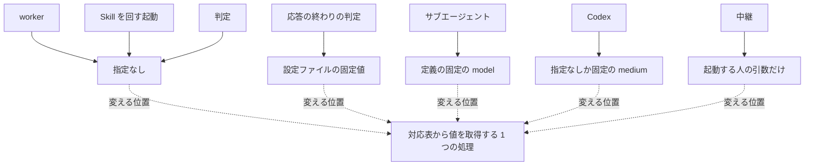
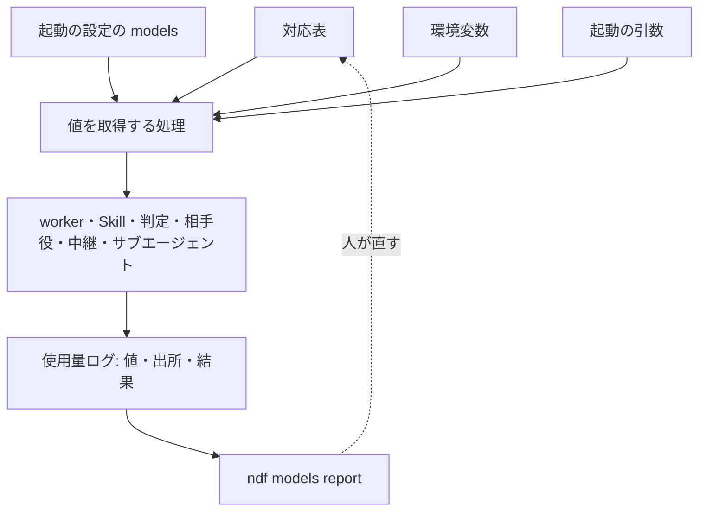
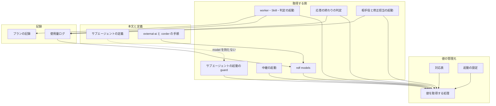
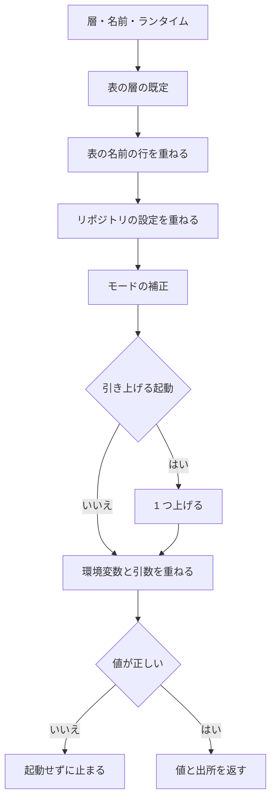

# モデルと effort の対応表: 層・工程・作業の重さに合わせて AI を起動できる（#2944）

作業の重さによらず、ほぼすべての起動が同じモデルと effort で動き、軽い作業にも重い作業の単価を払っている。値を 1 つの対応表に置き、起動するすべての所が同じ処理で取得する。使った値と結果は使用量ログに残し、表を直せるようにする。初期値、実測、採らなかった案は「対応表の初期値」「今の姿」「決定の記録」にある。

## 今の姿

何が起きたか・目的・受け入れ条件は要求仕様（[issue-2944-requirements.md](./issue-2944-requirements.md)、正は #2944 の本文）にある。この文書は「どう解くか」と「なぜその解き方か」だけを書く。



起動する場所ごとの今の決め方とコードの位置は、要求仕様の「今の姿」の表にある。

### 実測

2026-11-26 に、Claude Code 2.1.332 と codex-cli 0.172.0 で確認した。

| 確認したこと | 結果 |
| --- | --- |
| `claude -p --effort bogus` | 終了コード 0。標準エラーに警告を 1 行出し、既定の effort で動く |
| `claude -p --model <無い名前>` | 終了コード 1。理由を返す |
| `claude -p --model claude-haiku-5-5 --effort xhigh` | 受け付ける |
| `codex exec -c model_reasoning_effort=bogus` | API が 400 を返し、終了コード 1 |
| Codex の既定のモデルと effort | `gpt-6.2-sol`。`~/.codex/models_cache.json` の既定の effort は `low` |
| 同じ会話を `--resume` して effort を low から high へ変える | cache の作成は 17、読み込みは 5,845。書き直されない |
| 同じ会話を `--resume` してモデルを変える | cache の作成は 3,120、読み込みは 3,060。書き直される |
| 同じ会話を続けて起動したときの `total_cost_usd` | 会話の累計を返す |
| PreToolUse の hook が `updatedInput` でサブエージェントの `model` を足す | 足したモデル（Haiku 5.5）で動く |

## 文脈と制約

- 切り替えるのは、新しいプロセスか新しい会話を始めるときだけである（要求の前提 1）
- 値の優先は、引数 → 環境変数 → リポジトリの設定 → 対応表（要求の前提 3）
- #1959 が先に入る。起動の設定（`.ndf/launch.json`）と、`claude -p` の行を使用量ログへ書くインターフェースは、#1959 が作る（ [issue-1959-design.md](./issue-1959-design.md) ）
- Claude Code の環境変数 `CLAUDE_CODE_EFFORT_LEVEL` は `--effort` より優先する
- hook の PreToolUse の時間の上限は 3 秒である
- Kiro と agy は対象にしない

## 解き方の全体像



- 起動するすべての所が、層・名前・ランタイム・モードを渡して、モデル・effort・出所を受け取る
- 値が無ければ引数を足さず、CLI の既定で動く
- 失敗の後の修正の作業は、1 つ上の値で起動する
- 使用量ログから、作業 × モデル × effort の費用と成功率を出す

## ドメインモデル

### コンテキスト

| コンテキスト | 何の語が 1 つの意味に決まるか |
| --- | --- |
| 担当の起動（`ndf-agent-cli`） | 対応表・起動の値・出所・引き上げ |
| 文脈（`ndf-context`） | 使用量ログの行と集計 |

起動が供給者、使用量ログが顧客の関係（顧客 / 供給者）である。

### 集約

| 集約 | オーナー（書き換えてよいもの） | 根 | エンティティ | 値オブジェクト |
| --- | --- | --- | --- | --- |
| 対応表 | NDF の開発者（実行時は読むだけ） | 対応表のファイル | 層の行 | モデル・effort・順位・モードの補正 |
| 起動の値 | 値を取得する処理 | 1 回の起動の値 | — | モデル・effort・出所・引き上げの有無 |
| 使用量ログ | 使用量ログの書き込み処理 | 行 | — | 起動の値・使用量・結果 |

### 不変条件

| # | 集約 | 条件 | 破れたときの扱い |
| --- | --- | --- | --- |
| I1 | 起動の値 | モデルと effort は、それぞれ引数・環境変数・リポジトリの設定・対応表の名前の行・層の既定の順で最初の値を取る | — |
| I2 | 起動の値 | 対応表・設定・環境変数が読めない、形が違う、ランタイムに無い effort を持つときは起動しない | 理由と直す場所を示して止まる |
| I3 | 起動の値 | 同じ会話を続ける起動は、始めたときの値を使う | — |
| I4 | 起動の値 | 引き上げは 1 つまで。引数と環境変数の値は引き上げない。やり直しの回数は増やさない | — |
| I5 | 使用量ログ | `claude -p` の起動 1 回につき 1 行。行は値と出所を持つ | 書けなければ警告を出し、工程は止めない |
| I6 | 対応表 | モデルと effort の値は対応表の 1 か所が持つ | — |

### ドメインイベント

| # | イベント | 発生元 | 受け手 |
| --- | --- | --- | --- |
| E1 | モデルと effort を決めた | 値を取得する処理 | 起動の呼び出し元 |
| E2 | 決めた値で起動した | 起動の呼び出し元 | プランのステップの結果 |
| E3 | 起動の使用量と値の出所を記録した | 起動の呼び出し元 | 使用量ログ |
| E4 | 値を上げてやり直した | 失敗の後の修正の作業 | 使用量ログ |
| E5 | 費用と成功率を集計した | `ndf models report` | 利用者かエージェント |
| E6 | 対応表を直した | NDF の開発者 | 値を取得する処理 |

## 機能一覧

| # | 機能 | 誰が使うか |
| --- | --- | --- |
| F1 | 作業に合ったモデルと effort で起動する | 工程を流すすべての利用者 |
| F2 | リポジトリの設定と環境変数で値を変える | 利用先の開発者 |
| F3 | 費用と成功率を集計する | 利用者とエージェント |

## 構成要素

| 要素 | 責務 |
| --- | --- |
| 対応表（新設） | 層・名前・ランタイムごとの値、順位、モードの補正、引き上げる作業の名前 |
| 値を取得する処理（新設） | 表・設定・環境変数・引数を重ね、値と出所を返す。引き上げと補正をする |
| `ndf models`（新設） | `pick` は値を返し、`report` は使用量ログを集計する |
| 起動の設定（変更） | `models` のキーを足す |
| worker・Skill・判定の起動（変更） | 値を取得して引数に足し、結果と一緒に使用量ログへ書く |
| 応答の終わりの判定（変更） | 固定の `haiku` をやめて表から値を取得する |
| 相手役と修正担当の起動（変更） | シートの役割で値を取得する。Codex は `-c model_reasoning_effort=` を足す |
| 中継の起動（変更） | 役割（`conductor`・`organizer`）で値を取得し、引数が無ければ足す |
| サブエージェントの起動の guard（新設） | `ndf:` のサブエージェントの起動に、表の `model` と `effort` を足す |
| サブエージェントの定義（変更） | `model` の行を消す |
| `external-ai` と `corder` の手順（変更） | 固定の `medium` をやめ、`ndf models pick` の返す引数を使う |
| プランの記録（変更） | ステップごとの、指定した値と実際に動いたモデルを残す |



## データ構造

### 対応表（`contracts/domains/launch-models.json`、新設）

```json
{
  "ranks": {
    "claude": {"model": ["haiku", "sonnet", "opus"], "effort": ["low", "medium", "high", "xhigh", "max"]},
    "codex": {"effort": ["low", "medium", "high", "xhigh", "max", "ultra"]}
  },
  "layers": {
    "worker": {"default": {}, "names": {"impl": {"claude": {"model": "sonnet", "effort": "high"}}}}
  },
  "modes": {"light": {"effort_steps": -1}, "legacy-refactor": {"raise": ["impl"]}},
  "retry_names": ["fix", "ci-fix", "fix-push", "fix-base"]
}
```

名前は、worker の作業の名前、Skill の名前、サブエージェントの種類、シート（`seat`）の役割である。

### 対応表の初期値

空欄は「指定しない」（引数を足さず、CLI の既定で動く）を表す。

| 層 | 名前 | Claude（モデル / effort） | Codex（effort） |
| --- | --- | --- | --- |
| conductor | レーン（既定） | 指定しない | — |
| organizer | 既定 | sonnet / medium | — |
| worker | requirements・requirements-design・design・design-detail | opus / high | — |
| worker | impl・fix・ci-fix・fix-push・fix-base | sonnet / high | — |
| worker | worktree | haiku / low | — |
| worker | qa-security-scan | opus / high | — |
| worker | 上に無い名前（既定） | 指定しない | — |
| judge | 既定 | sonnet / medium | — |
| judge | stop-wait（応答の終わりの判定） | haiku | — |
| subagent | researcher | haiku / medium | — |
| subagent | debugger・qa | opus / high | — |
| subagent | director | opus | — |
| subagent | code-reviewer・corder・data-analyst・devops-engineer | sonnet | — |
| subagent | worker・supervisor・supervisor-waits | 指定しない | — |
| seat | review | opus / high | high |
| seat | propose | sonnet / medium | medium |
| seat | implement・verify・fix | sonnet / high | medium |
| seat | delegate（external-ai・corder） | 指定しない | medium |
| seat | security | opus / high | xhigh |

`seat` の `security` は、委譲の呼び出し元がセキュリティの確認を頼むときに指定する役割である。

モードの補正: `light` は effort を 1 つ下げる（`low` はそのまま）。`legacy-refactor` は `impl` を引き上げる。

### 起動の設定に足すキー

```json
{"version": 1, "models": {"worker": {"impl": {"claude": {"model": "opus"}}, "*": {"claude": {"effort": "medium"}}}}}
```

層の下の `*` は層の既定を置き換える。知らない層・ランタイム・キーは形の違いとして扱う。

### 使用量ログの行に足す欄

| 欄 | 中身 |
| --- | --- |
| `layer`・`name`・`runtime`・`mode` | 値を取得したときのキー |
| `requested_model`・`effort` | 引数に渡した値。指定しなければ無し |
| `model_source`・`effort_source` | `argument`・`environment`・`repository`・`table`・`default`（指定なし） |
| `raised` | 引き上げたか |
| `outcome` | worker と Skill は結果の `status`、判定は回答が形に合ったか、シートは監視の終わり方 |

実際に動いたモデルは今の `model`・`model_usage` に入る。Codex のシートは `usage` を `unknown` にして 1 行を書く。サブエージェントの行は、終了の hook が同じ処理で値と出所を取得し直して書く。

## 入出力のコントラクト

| 名前 | 入力 | 出力 | 失敗の形 |
| --- | --- | --- | --- |
| `ndf models pick` | `--layer`・`--name`・`--runtime`（省けば claude）・`--mode`・`--retry`・`--format json\|args` | `json` は値と出所。`args` は CLI に渡す引数の 1 行（指定が無ければ空） | 表か設定が壊れていれば `precondition` |
| `ndf models report` | `--since`・`--until` | 層 × 名前 × モデル × effort ごとの、起動の数・トークン・費用・成功率・やり直しの率、指定と実際のモデルの食い違い | 行が無い組は「記録なし」 |
| 環境変数 | `NDF_LAUNCH_MODEL`・`NDF_LAUNCH_EFFORT`（claude）、`NDF_LAUNCH_CODEX_MODEL`・`NDF_LAUNCH_CODEX_EFFORT` | すべての層に効く一時的な上書き | 無い effort は起動しない |
| `ndf worker run` | `--mode` を足す | 結果の `metrics` に起動の値と実際のモデル | — |
| `ndf relay run`・`spawn` | `--role`（`run` にも足す） | 役割の値を子の引数に足す | — |

互換性: 今の入力で読めなくなるものは無い。NDF を更新すると、指定の無いリポジトリでも工程の一部が別のモデルと effort で動く（要求の前提 2）。Claude Code の下限は、Agent Tool の `effort` が使える 2.1.292 へ上げる。

## 処理の流れ

### 値を取得する



- 重ねるのはモデルと effort で別々である
- 引き上げは次の順で決める
  - effort が `high` より低ければ、effort を 1 つ上げる
  - `high` 以上なら、モデルを 1 つ上げる
  - モデルが最上なら、effort を `xhigh` まで上げる。それより上は同じ値で起動する
  - モデルを指定していない行は、effort だけを上げる

### 引き上げる起動

| 起動 | いつ |
| --- | --- |
| worker の `retry_names` の作業 | 常に（テスト・CI・push・衝突の失敗の後に実行する作業である） |
| 判定の起動 | 回答が形に合わず起動し直す 2 回目 |
| cross-refactoring の検証の失敗の修正 | 常に |

結果ファイルを書かなかった worker の再開は、同じ会話なので値を変えない（I3）。

### 同じ会話を続ける起動

| 起動 | 値の持ち方 |
| --- | --- |
| worker の再開 | 初回の引数をそのまま使う |
| cross-review の修正担当の会話の再開 | 会話の ID と一緒に状態ファイルへ値を残して使う |
| 中継のセグメント | ラッパーの引数に持ち続ける。作り直すときは残した値を使う |
| 利用者の `--resume` | 何も足さない |

## 決定の記録

### 決定 1: 値を 1 か所で直せるよう、層・名前・ランタイムから値を取得する対応表と、取得する処理を 1 つ置く

- **質問**: 起動する場所ごとの値を、どこにまとめるか
- **選んだ案**: `contracts/domains/launch-models.json` と、コードの下の層（adapters）に置く、値を取得する処理。すべての起動と `ndf models pick` が使う
- 採らなかった案: テンプレートのステップごとに値を書く（同じ作業の値がテンプレートの数だけ散る。Skill・判定・中継には届かない）
- 採らなかった案: モデルを振り分ける外部の仕組み（API プロキシ）を挟む（CLI の定額の認証を使えなくなり、effort の指定も引き渡せるか分からない）
- 採らなかった案: 依頼の中身を AI が読んで値を選ぶ（選ぶ起動に費用がかかり、同じ作業の結果が実行ごとに変わる）
- **代償**: 表を直すには NDF のリリースが要る。すぐ変える手段はリポジトリの設定と環境変数である
- 作り方: 自前で作る・標準に倣う
- 比べた候補: STD1 / PRD1 / PRD2 / LIB1
- 根拠: Value 11 / Value 3 / Value 12（MVV バージョン 11）

### 決定 2: 利用者が設定を足さずに費用が下がるよう、初期値は設定の無いリポジトリにも効かせる

- **質問**: 要求の未決。要求の前提 2 でよいか
- **選んだ案**: 効かせる。表に行がある起動は、利用者の CLI の設定のモデルより表を優先する
- 採らなかった案: 指定したリポジトリだけが表を使う（受け入れ条件 2・6 を満たさず、安くなる利用者がほとんどいなくなる）
- **代償**: 更新すると一部の起動のモデルが変わる。Codex のレビューは `low` から `high` になり、費用と時間が増える
- 根拠: Value 2 / Value 4（MVV バージョン 11）

### 決定 3: 利用者の対話を変えないため、レーンの conductor の行は値を持たない

- **質問**: conductor の行に `opus / medium` を書くか
- **選んだ案**: 値を書かず、利用者の Claude Code の既定のまま起動する。オーガナイザーは `--role organizer` で起動したときだけ `sonnet / medium` にする
- 採らなかった案: `opus / medium` を書く（利用者が選んだモデルを、対話の起動のたびに上書きする）
- **代償**: レーンの費用は下がらない。オーガナイザーは起動の手順に `--role organizer` を足す
- 根拠: Value 1 / Value 4（MVV バージョン 11）

### 決定 4: 値の保存先を 1 か所にするため、サブエージェントの定義の `model` を消し、起動の hook で足す

- **質問**: 要求の未決。定義の固定の `model` を残すか、起動時に上書きするか
- **選んだ案**: 定義の `model` を消し、PreToolUse の guard が `ndf:` の起動へ `model` と `effort` を足す。呼び出し元が `model` を指定したら何も足さない。`CLAUDE_CODE_SUBAGENT_MODEL` があるときも足さない
- 採らなかった案: 定義の `model` を残す（同じ値が表と定義の 2 か所になる）
- 採らなかった案: 起動のたびに `ndf models pick` を実行するよう手順書に書く（実行し忘れれば黙って別のモデルで動く）
- **代償**: hook が動かない環境では、サブエージェントが呼び出し元のモデルを継ぐ。ほかのプラグインや組み込みのサブエージェントには効かない
- 作り方: ライブラリやサービスを使う
- 比べた候補: STD2 / STD3
- 根拠: Value 3 / Value 11（MVV バージョン 11）

### 決定 5: 黙って別の値で動かさないため、effort の値は NDF が起動の前に検証する

- **質問**: effort の誤りを CLI に任せるか
- **選んだ案**: 表の `ranks` に無い effort は起動しない。モデルの名前は検証せず、CLI の起動の失敗を理由として残す
- 採らなかった案: CLI に任せる（Claude Code は無い effort を警告だけで無視する）
- **代償**: CLI が effort の値を増やしたら、表を直すまで指定できない
- 根拠: Value 13（MVV バージョン 11）。STD1

### 決定 6: 手戻りを減らすため、失敗の後の修正の作業を 1 つ上の値で起動する

- **質問**: 何を「失敗の後のやり直し」とし、どう上げるか
- **選んだ案**: 「引き上げる起動」の 3 つ。上げ方は effort が `high` まで、その上はモデル
- 採らなかった案: 同じステップを 2 回目に実行するときだけ上げる（失敗の直後の最初の修正が、実装と同じ値で動く）
- 採らなかった案: 常にモデルから上げる（`low` の作業がいきなり高いモデルになる）
- **代償**: 軽い失敗（書式の指摘など）の修正にも上の値を払う。やり直しの回数は変えない
- 根拠: Value 2 / Value 5（MVV バージョン 11）

### 決定 7: 費用と成功率を追えるよう、呼び出し元が結果を添えて使用量ログへ 1 行書く

- **質問**: 成功率の元になる結果を、どこに記録するか
- **選んだ案**: 起動の呼び出し元が、結果が分かってから値・出所・結果を 1 行に書く。#1959 で作る、`claude -p` の行を使用量ログへ書くインターフェースを、判定とシートの起動まで広げる。プランの記録には、ステップの結果の `metrics` から指定した値と実際のモデルを集める
- 採らなかった案: 結果を別のファイルに残して集計で突き合わせる（突き合わせの鍵と片付けが増える）
- 採らなかった案: プランの記録だけから成功率を出す（プランの記録は作業の終わりに片付く。プランを通らない起動は記録に残らない）
- **代償**: 呼び出し元が結果を受ける前に落ちた起動は行が残らない
- 根拠: Value 8 / Value 13（MVV バージョン 11）

## 影響と危険

- **働く範囲**: NDF を入れたすべてのリポジトリ。worker・Skill・判定・相手役・中継の子・`ndf:` のサブエージェント・外部の AI への委譲に効く
- **プロジェクトごとに違うもの**: モデルと effort。`.ndf/launch.json` の `models` と環境変数で受ける
- **当たるモード**: すべて。`light` と `legacy-refactor` は補正が掛かる
- **壊れうる箇所**:
  - 使えるモデルが限られる利用者（API キーや従量の接続）は、表のモデルで起動に失敗しうる。失敗の文に、直す所（`.ndf/launch.json`）を載せる
  - Haiku 5.5 は入力が 10 万トークンを超えると単価が上がる。割り当ては `worktree`（直近の実測で最初の文脈の中央値が約 46,000）と調査のサブエージェントだけにする
  - 使用量ログの欄が増える。古い NDF は新しい行を読めない行として数える
  - サブエージェントの終了の hook が書く出所は取得し直した値で、起動の後に表か設定を変えると食い違う
  - #1959 と同じファイルを触る。#1959 の後に実装する

### 代表のリポジトリでの振る舞い

| 代表のリポジトリ | 設定の要点 | 直した後に起きること | この種類で扱えなくなること |
| --- | --- | --- | --- |
| Web サービス | 指定なし | 工程と相手役が表の値で動く | 無し |
| モバイルアプリ | ビルドの失敗の修正が多い | 修正の作業が 1 つ上の値で動く。下げたければ設定で指定する | 無し |
| 業務文書だけ | `light`・`documentation` が多い | `light` は effort が 1 つ下がる | 無し |

### このリポジトリだけの事情

- 無し（このリポジトリ専用の値は置かず、初期の表のままで費用と成功率を測る）

## 用語

| 用語 | 意味 | 用語集への反映 |
| --- | --- | --- |
| モデルと effort の対応表 | 層・名前・ランタイムから、起動のモデルと effort を取得する NDF の表 | 追加 |
| 値の出所 | 起動のモデルか effort を決めた元（引数・環境変数・リポジトリの設定・対応表・指定なし） | 追加 |
| 値の引き上げ | 失敗の後の修正の起動で、モデルか effort を 1 つ上にすること | 追加 |

## テスト設計

| 受け入れ条件・不変条件 | どの振る舞いで縛るか | どう壊したら落ちるべきか |
| --- | --- | --- |
| 条件 1・I1 | 名前の行が無い組は層の既定へ落ち、モデルと effort が別々に上位の出所を取る | 優先の順を入れ替えると落ちる |
| 条件 2 | worker の起動の引数に表の `--model`・`--effort` があり、環境変数で置き換わる | 引数に足さないと落ちる |
| 条件 3 | Codex のシートの起動の引数に役割の effort がある | `{effort}` を落とすと落ちる |
| 条件 4・I5 | worker・Skill・判定・シートの起動で、値・出所・結果を持つ行が 1 つ増え、`report` が成功率を出す | どれかの呼び出し元が書かないと落ちる |
| 条件 5 | 手動: stream-json で、会話の途中の切り替えの cache の作成と読み込みを測り、確定仕様に書く | — |
| 条件 6 | 手動（リリース後）: 1 スプリントの `report` を、今の値の記録と並べる | — |
| 条件 7 | 設定の行が表より優先し、どちらにも無い名前は引数を足さない | 指定なしに既定の名前を足すと落ちる |
| 条件 8 | プランの結果の記録に、ステップごとの指定した値と実際のモデルがある | ステップの結果の値を捨てると落ちる |
| 条件 9 | 同じステップの 2 行以上と、形に合わない判定が、率に数えられる | 行をステップでまとめないと落ちる |
| 条件 10・I4 | 修正の作業が 1 つ上の値で起動し、行に `raised` が立つ。引数の値と最上の値は変わらない | 2 つ上げる・引数を上げる実装で落ちる |
| 条件 11 | `light` で effort が 1 つ下がり、モードが無ければ変わらない | モードを渡し忘れると落ちる |
| 条件 12 | 中継は引数があれば足さない。`ndf:` の起動の入力に `model` が足され、指定済みなら変わらない | 引数を上書きすると落ちる |
| 条件 13・I3 | 再開の起動の引数が初回と同じ | 再開のたびに取得し直すと落ちる |
| 条件 14・I2 | 壊れた表・設定・effort で起動の呼び出しが 0 回になり、直す場所が文にある | 空の値として続けると落ちる |
| I6 | サブエージェントの定義・`external-ai`・`corder`・判定の設定に値が無いことを、規則の検査で見る | 手動（`.md` の文言のテストは置かない） |

## 設計の結果

| 課題 | 扱い | 統合先 | 触るファイル |
| --- | --- | --- | --- |
| #2944 | 実装する | — | `plugins/ndf/contracts/domains/launch-models.json`（新設）、`plugins/ndf/src/ndf/adapters/model_choice.py`（新設）、`plugins/ndf/src/ndf/domains/records/models_cli.py`（新設）、`plugins/ndf/src/ndf/cli.py`、`plugins/ndf/src/ndf/adapters/launch_settings.py`、`plugins/ndf/contracts/schemas/ndf-settings/launch.schema.json`、`plugins/ndf/src/ndf/adapters/claude.py`、`plugins/ndf/src/ndf/adapters/llm.py`、`plugins/ndf/src/ndf/adapters/agents.py`、`plugins/ndf/src/ndf/core/worker.py`、`plugins/ndf/src/ndf/core/converge/participants.py`、`plugins/ndf/src/ndf/core/plan/records.py`、`plugins/ndf/src/ndf/core/plan/runner.py`、`plugins/ndf/src/ndf/core/plan/steps.py`、`plugins/ndf/src/ndf/progress/invoke.py`、`plugins/ndf/src/ndf/progress/gate/entry.py`、`plugins/ndf/src/ndf/progress/lane/launch.py`、`plugins/ndf/src/ndf/domains/records/usage.py`、`plugins/ndf/src/ndf/domains/hooks/judge_child.py`、`plugins/ndf/src/ndf/domains/hooks/verdict.py`、`plugins/ndf/src/ndf/domains/hooks/dispatch.py`、`plugins/ndf/src/ndf/domains/hooks/guards/launch_model.py`（新設）、`plugins/ndf/contracts/hooks/guards.json`、`plugins/ndf/src/ndf/domains/crossreview/seats.py`、`plugins/ndf/src/ndf/domains/crossreview/fixer.py`、`plugins/ndf/src/ndf/domains/crossrefactor/launch.py`、`plugins/ndf/src/ndf/domains/relay/cli.py`、`plugins/ndf/src/ndf/domains/relay/wrapper.py`、`plugins/ndf/src/ndf/domains/relay/hub.py`、`plugins/ndf/contracts/domains/runtimes.json`、`plugins/ndf/contracts/domains/cli-floors.json`、`plugins/ndf/contracts/domains/env.json`、`plugins/ndf/contracts/limits/hook.stop-wait.judge.json`、`plugins/ndf/contracts/schemas/internal/usage.schema.json`、`plugins/ndf/contracts/schemas/io/models.args.schema.json`（生成）、`plugins/ndf/contracts/schemas/io/models.result.schema.json`（生成）、`plugins/ndf/agents/code-reviewer.md`、`plugins/ndf/agents/corder.md`、`plugins/ndf/agents/data-analyst.md`、`plugins/ndf/agents/debugger.md`、`plugins/ndf/agents/devops-engineer.md`、`plugins/ndf/agents/director.md`、`plugins/ndf/agents/qa.md`、`plugins/ndf/agents/researcher.md`、`plugins/ndf/skills/external-ai/SKILL.md`、`plugins/ndf/skills/external-ai/references/cli-codex.md`、`plugins/ndf/skills/qa-security-scan/03-report-template.md`、`plugins/ndf/skills/development-workflow/references/parallel.md`、`plugins/ndf/skills/development-workflow/references/relay.md`、`plugins/ndf/tests/adapters/test_model_choice.py`（新設）、`plugins/ndf/tests/domains/records/test_models_report.py`（新設）、`plugins/ndf/tests/domains/hooks/test_launch_model_guard.py`（新設）、`plugins/ndf/tests/domains/records/test_usage.py`、`plugins/ndf/tests/adapters/test_llm.py`、`plugins/ndf/tests/progress/test_invoke.py`、`plugins/ndf/tests/core/test_worker_launch.py`、`plugins/ndf/tests/domains/relay/test_relay_cli.py` |

## 未確認のまま残ること

| 項目 | 内容 |
| --- | --- |
| 会話の途中の切り替えの cache | 小さい文脈で 1 回測っただけである。実装で、大きい文脈を stream-json で測る（受け入れ条件 5） |
| hook の `updatedInput` の `effort` | `model` が効くことは確かめた。`effort` が効くかは、実装で起動の記録を見て確認する |
| 初期値の費用と成功率 | リリース後の 1 スプリントの `report` で分かる。下がった行は上の値へ戻す |
| 中継の子の `--resume` で effort が保たれるか | 文書に記述が無い。NDF は引数で渡し続けるため、値は保たれる |

## 外部の調査

| 種類 | 調べるか | 理由 |
| --- | --- | --- |
| 標準・仕様 | 調べる | モデルと effort の指定の形と優先の順は CLI が定める |
| 主要な製品 | 調べる | 役割ごとにモデルを分ける既存の形を比べる |
| ライブラリとサービス | 調べる | 振り分けを自前で作る前に、既存の仕組みを確認する |

価格と effort の段階の公式の説明は、要求仕様の「参考: 外部の調査（2026-11-10）」にある。

### 標準・仕様

| # | 標準・仕様 | 何を定めているか | 設計への反映 | 出典 |
| --- | --- | --- | --- | --- |
| STD1 | Claude Code のモデルの設定 | effort の優先は `CLAUDE_CODE_EFFORT_LEVEL` → `/effort` → `--effort` → 保存した設定 → 既定。受けない段階は下の段階に落ちる | 出所の記録と決定 5 | https://code.claude.com/docs/en/model-config （2026-11-26） |
| STD2 | Claude Code のサブエージェント | `model` の解決は起動の引数 → 定義 → 環境変数 → 呼び出し元。起動の引数で `effort` も渡せる（2.1.292 以降） | 決定 4 と下限の引き上げ | https://code.claude.com/docs/en/sub-agents （2026-11-26） |
| STD3 | Claude Code の PreToolUse の hook | `updatedInput` で Tool の入力を書き換える | 決定 4 | 実測（この文書の「実測」の表。2026-11-26） |

### 主要な製品

| # | 製品 | どう解いているか | 設計への反映 | 出典 |
| --- | --- | --- | --- | --- |
| PRD1 | Aider | 設計役と編集役、軽い雑務の役の 3 つに、別々のモデルを指定する | 役割で値を分ける表の形 | https://aider.chat/docs/usage/modes.html （2026-11-26。検索の要約） |
| PRD2 | Codex CLI | profile と、カスタムエージェントの定義ごとに `model` と `model_reasoning_effort` を持つ。省けば親を継ぐ | 指定なしを空欄にする形。Codex へは引数で渡す | https://developers.openai.com/codex/subagents.md ・ https://developers.openai.com/codex/config-advanced （2026-11-26。検索の要約） |

### ライブラリとサービス

| # | 候補 | バージョン | ライセンス | 最後のリリースの日付 | 終了のアナウンス | 要件を満たすか | 出典 |
| --- | --- | --- | --- | --- | --- | --- | --- |
| LIB1 | LiteLLM（API の代理とモデルの振り分け。PyPI の `litellm`） | 1.111.0 | MIT | 2026-11-25 | 無し | NDF は Claude Code と Codex の CLI を起動し、API を直接呼ばない。代理を挟む形は定額の認証の利用者に当てはまらないため使わない | https://pypi.org/pypi/litellm/json （2026-11-26） |

### 確かめられなかったこと

| 対象 | 試した手段 | 結果と理由 |
| --- | --- | --- |
| LIB1 が定額の認証の CLI の起動を振り分けられるか | 試していない | 起動の形が合わないと判断し、文書を取得しなかった |
| PRD1・PRD2 の原文 | 検索の要約だけを読んだ | 原文は取得していない |

調べた量: 候補 6 件・取得の試み 9 回。
