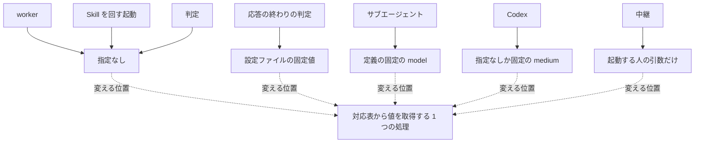
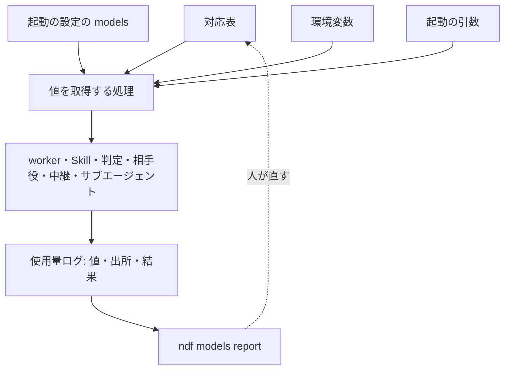
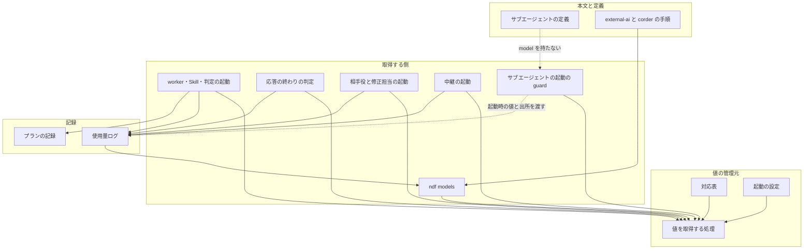
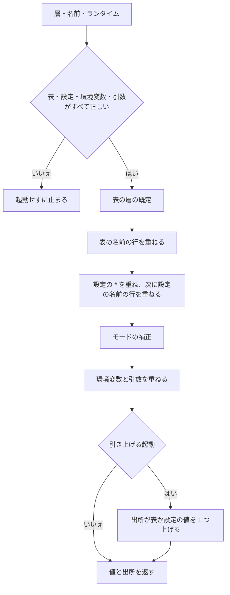

# モデルと effort の対応表: 層・工程・作業の重さに合わせて AI を起動できる（#2944）

作業の重さによらず、ほぼすべての起動が同じモデルと effort で動き、軽い作業にも重い作業の単価を払っている。値を 1 つの対応表に置き、起動するすべての所が同じ処理で取得する。使った値と結果は使用量ログに残し、表を直せるようにする。初期値、実測、採らなかった案は「対応表の初期値」「今の姿」「決定の記録」にある。

## 今の姿

何が起きたか・目的・受け入れ条件は要求仕様（[issue-2944-requirements.md](./issue-2944-requirements.md)、正は #2944 の本文）にある。この文書は「どう解くか」と「なぜその解き方か」だけを書く。



起動する場所ごとの今の決め方とコードの位置は、要求仕様の「今の姿」の表にある。

### 実測

2026-11-26 に、Claude Code 2.1.332 と codex-cli 0.172.0 で確認した。

| 確認したこと | 結果 |
| --- | --- |
| `claude -p --effort bogus` | 終了コード 0。標準エラーに警告を 1 行出し、既定の effort で動く |
| `claude -p --model <無い名前>` | 終了コード 1。理由を返す |
| `claude -p --model claude-haiku-5-5 --effort xhigh` | 受け付ける |
| `codex exec -c model_reasoning_effort=bogus` | API が 400 を返し、終了コード 1 |
| Codex の既定のモデルと effort | `gpt-6.2-sol`。`~/.codex/models_cache.json` の既定の effort は `low` |
| 同じ会話を `--resume` して effort を low から high へ変える | cache の作成は 17、読み込みは 5,845。書き直されない |
| 同じ会話を `--resume` してモデルを変える | cache の作成は 3,120、読み込みは 3,060。書き直される |
| 同じ会話を続けて起動したときの `total_cost_usd` | 会話の累計を返す |
| PreToolUse の hook が `updatedInput` でサブエージェントの `model` を足す | 足したモデル（Haiku 5.5）で動く |

## 文脈と制約

- 切り替えるのは、新しいプロセスか新しい会話を始めるときだけである（要求の前提 1）
- 値の優先は、引数 → 環境変数 → リポジトリの設定 → 対応表（要求の前提 3）
- #1959 が先に入る。起動の設定（`.ndf/launch.json`）と、`claude -p` の行を使用量ログへ書くインターフェースは、#1959 が作る（ [issue-1959-design.md](./issue-1959-design.md) ）
- Claude Code の環境変数 `CLAUDE_CODE_EFFORT_LEVEL` は `--effort` より優先する
- hook の PreToolUse の時間の上限は 3 秒である
- Kiro と agy は対象にしない

## 解き方の全体像



- 起動するすべての所が、層・名前・ランタイム・モードを渡して、モデル・effort・出所を受け取る
- 値が無ければ引数を足さず、CLI の既定で動く
- 失敗の後の修正の作業は、1 つ上の値で起動する
- 使用量ログから、作業 × モデル × effort の費用と成功率を出す

この文書で使う起動の呼び名は次のとおり。

| 呼び名 | 指すもの |
| --- | --- |
| conductor・レーン | 開発の全体を指揮する会話が conductor。並列に流す開発の 1 本分がレーンで、レーンごとに conductor がいる |
| オーガナイザー | 複数のレーンをまとめる会話 |
| 中継・ラッパー・中継の子 | `ndf relay` が会話を切り替えながら開発を続ける仕組みが中継。ラッパーは claude を起動して見守るプロセス（`ndf relay run`）。中継の子は、ラッパーが起動する claude の 1 つ |
| シート（`seat`） | ほかの AI の CLI へ作業を頼むときの役割（レビュー・提案・実装など） |

## ドメインモデル

### コンテキスト

| コンテキスト | 何の語が 1 つの意味に決まるか |
| --- | --- |
| 担当の起動（`ndf-agent-cli`） | 対応表・起動の値・出所・引き上げ |
| 文脈（`ndf-context`） | 使用量ログの行と集計 |

起動が供給者、使用量ログが顧客の関係（顧客 / 供給者）である。

### 集約

| 集約 | オーナー（書き換えてよいもの） | 根 | エンティティ | 値オブジェクト |
| --- | --- | --- | --- | --- |
| 対応表 | NDF の開発者（実行時は読むだけ） | 対応表のファイル | 層の行 | モデル・effort・順位・モードの補正 |
| 起動の値 | 値を取得する処理 | 1 回の起動の値 | — | モデル・effort・出所・引き上げの有無 |
| 使用量ログ | 使用量ログの書き込み処理 | 行 | — | 起動の値・使用量・結果 |

### 不変条件

| # | 集約 | 条件 | 破れたときの扱い |
| --- | --- | --- | --- |
| I1 | 起動の値 | モデルと effort は、それぞれ引数・環境変数・リポジトリの設定の名前の行・同じく設定の `*`・対応表の名前の行・対応表の層の既定の順で、最初の値を取る | — |
| I2 | 起動の値 | 対応表・設定・NDF の環境変数・引数が読めない、形が違う、ランタイムに無い effort を持つときは起動しない。上位の指定に隠れて使わない値も同じ | 理由と直す場所を示して止まる |
| I3 | 起動の値 | 同じ会話を続ける起動は、始めたときの値を使う | — |
| I4 | 起動の値 | 引き上げは 1 回の起動につき 1 つまで（モードの引き上げと重なっても 1 つ）。引数と環境変数の値は引き上げない。やり直しの回数は増やさない | — |
| I5 | 使用量ログ | NDF のコードが起動する `claude -p` と Codex の子プロセス 1 つ、サブエージェント 1 回、中継の子 1 つにつき 1 行。行は起動時に決めた値と出所を持つ | 書けなければ警告を出し、工程は止めない |
| I6 | 対応表 | モデルと effort の値は対応表の 1 か所が持つ | — |

### ドメインイベント

| # | イベント | 発生元 | 受け手 |
| --- | --- | --- | --- |
| E1 | モデルと effort を決めた | 値を取得する処理 | 起動の呼び出し元 |
| E2 | 決めた値で起動した | 起動の呼び出し元 | プランのステップの結果 |
| E3 | 起動の使用量と値の出所を記録した | 起動の呼び出し元 | 使用量ログ |
| E4 | 値を上げてやり直した | 失敗の後の修正の作業 | 使用量ログ |
| E5 | 費用と成功率を集計した | `ndf models report` | 利用者かエージェント |
| E6 | 対応表を直した | NDF の開発者 | 値を取得する処理 |

## 機能一覧

| # | 機能 | 誰が使うか |
| --- | --- | --- |
| F1 | 作業に合ったモデルと effort で起動する | 工程を流すすべての利用者 |
| F2 | リポジトリの設定と環境変数で値を変える | 利用先の開発者 |
| F3 | 費用と成功率を集計する | 利用者とエージェント |

## 構成要素

| 要素 | 責務 |
| --- | --- |
| 対応表（新設） | 層・名前・ランタイムごとの値、順位、モードの補正、引き上げる作業の名前 |
| 値を取得する処理（新設） | 表・設定・環境変数・引数を重ね、値と出所を返す。引き上げと補正をする |
| `ndf models`（新設） | `pick` は値を返し、`report` は使用量ログを集計する |
| 起動の設定（変更） | `models` のキーを足す |
| worker・Skill・判定の起動（変更） | 値を取得して引数に足し、結果と一緒に使用量ログへ書く |
| 応答の終わりの判定（変更） | 固定の `haiku` をやめて表から値を取得する |
| 相手役と修正担当の起動（変更） | シートの役割で値を取得する。Codex は `-c model_reasoning_effort=` を足す |
| 中継の起動（変更） | 役割（`conductor`・`organizer`）で値を取得し、引数が無ければ足す |
| サブエージェントの起動の guard（新設） | `ndf:` のサブエージェントの起動に、取得した `model` と `effort` を足し、決めた値と出所を残す |
| サブエージェントの定義（変更） | `model` の行を消す |
| `external-ai` と `corder` の手順（変更） | 固定の `medium` をやめ、`ndf models pick` の返す引数を使う |
| プランの記録（変更） | ステップごとの、指定した値と実際に動いたモデルを残す |



## データ構造

### 対応表（`contracts/domains/launch-models.json`、新設）

```json
{
  "ranks": {
    "claude": {"model": ["haiku", "sonnet", "opus"], "effort": ["low", "medium", "high", "xhigh", "max"]},
    "codex": {"effort": ["low", "medium", "high", "xhigh", "max", "ultra"]}
  },
  "layers": {
    "worker": {"default": {}, "names": {"impl": {"claude": {"model": "sonnet", "effort": "high"}}}}
  },
  "modes": {"light": {"effort_steps": -1}, "legacy-refactor": {"raise": ["impl"]}},
  "retry_names": ["fix", "ci-fix", "fix-push", "fix-base"]
}
```

名前は、worker の作業の名前、Skill の名前、サブエージェントの種類、シート（`seat`）の役割である。

`retry_names` に並べるのは worker の作業の名前（テンプレートの `["{{worker}}", "<名前>"]` の末尾）で、ステップの ID ではない。たとえばマージと確定仕様化のテンプレートの `check-fix` というステップは、作業の名前が `ci-fix` なので引き上げの対象になる。

### 対応表の初期値

空欄は「指定しない」（引数を足さず、CLI の既定で動く）を表す。

worker の起動と Skill を回す起動は、どちらも `worker` の層を引く。行は、worker なら作業の名前で、Skill を回す起動なら Skill の名前で探す。Skill 専用の層は置かない。

| 層 | 名前 | Claude（モデル / effort） | Codex（effort） |
| --- | --- | --- | --- |
| conductor | レーンの conductor（既定） | 指定しない | — |
| organizer | 既定 | sonnet / medium | — |
| worker | requirements・requirements-design・design・design-detail | opus / high | — |
| worker | impl・fix・ci-fix・fix-push・fix-base | sonnet / high | — |
| worker | worktree | haiku / low | — |
| worker | qa-security-scan | opus / high | — |
| worker | 上に無い名前（既定） | 指定しない | — |
| judge | 既定 | sonnet / medium | — |
| judge | stop-wait（応答の終わりの判定） | haiku | — |
| subagent | researcher | haiku / medium | — |
| subagent | debugger・qa | opus / high | — |
| subagent | director | opus | — |
| subagent | code-reviewer・corder・data-analyst・devops-engineer | sonnet | — |
| subagent | worker・supervisor・supervisor-waits | 指定しない | — |
| seat | review | opus / high | high |
| seat | propose | sonnet / medium | medium |
| seat | implement・verify・fix | sonnet / high | medium |
| seat | delegate（external-ai・corder） | 指定しない | medium |
| seat | security | opus / high | xhigh |

`seat` の `security` は、委譲の呼び出し元がセキュリティの確認を頼むときに指定する役割である。`worker` の層の `qa-security-scan` の行は Skill の名前の行で（同じ名前の worker の作業は無い）、この Skill を回す起動に `opus / high` が効く。

この表が採用する初期値である。要求仕様の「参考: 軸ごとのマトリクス（案）」から変えた行と理由は次のとおり。

| 要求の案 | この表 | 変えた理由 |
| --- | --- | --- |
| レーンの conductor は Opus 5.5 / medium（今のまま） | 指定しない | 決定 3 |
| 実装は Sonnet 5.5 / high | `fix`・`ci-fix`・`fix-push`・`fix-base` も同じ行にする | 実装と同じ種類の作業で、引き上げの出発点が要る |
| 機械的な作業（題の付け直し・整形・PR の本文・用語集の衝突・記録）は Haiku 5.5 / low（Codex は low） | worker は `worktree` だけ | worker の作業の名前（`contracts/worker/kinds.json`）に、ほかの機械的な作業は無い。名前の無い作業は指定しない |
| 調査・検索・集計は Haiku 5.5 / medium | サブエージェントの `researcher` だけ | hook が値を足せるのは `ndf:` のサブエージェントで、調査の役は `researcher` である |
| 案に行が無い | `stop-wait` は Haiku | 今の固定値を表へ移す |
| 不具合の原因の特定（debugger）は Opus 5.5 / high（Codex は high） | `qa` も同じ値にする。Codex の列は無し | QA の見落としは原因の取り違えと同じく手戻りが大きい。サブエージェントは Claude Code だけで起動する |
| 案に行が無い | ほかのサブエージェントは今の定義の `model` を引き継ぐ | 定義の `model` を消しても動くモデルを変えない |
| 案に行が無い | seat の `fix` は実装と同じ値、`delegate` は Claude を指定せず Codex を `medium` | `delegate` は今の固定の `medium` を表へ移す |
| セキュリティの確認は、どの層でも（レッドラインに当たる変更を含む） | worker の `qa-security-scan` と seat の `security` | 変更がレッドラインに当たるかを、起動の時点で機械的に判定する手段が無い |
| `light` は 1 段下げる | effort だけを 1 つ下げる | モデルまで下げると、成功率の変化の原因を分けて測れない |

モードの補正: `light` は effort を 1 つ下げる（`low` はそのまま）。`legacy-refactor` は `impl` を引き上げる。

### 起動の設定に足すキー

```json
{"version": 1, "models": {"worker": {"impl": {"claude": {"model": "opus"}}, "*": {"claude": {"effort": "medium"}}}}}
```

設定の `*` は、その層のすべての作業に効く指定で、対応表の名前の行より後に重ねる。対応表に名前の行を持つ作業にも効く。名前を指定した設定の行は `*` より優先する。重ねる順は、対応表の層の既定 → 対応表の名前の行 → 設定の `*` → 設定の名前の行で、後のものが勝つ（モデルと effort は別々）。知らない層・ランタイム・キーは形の違いとして扱う。

上の例と初期値で、解決の結果は次のとおりになる。

| 作業 | モデル（出所） | effort（出所） |
| --- | --- | --- |
| `worker.impl` | opus（設定の名前の行） | medium（設定の `*`） |
| `worker.design` | opus（対応表の名前の行） | medium（設定の `*`） |
| `worker.release` | 指定なし | medium（設定の `*`） |

### 使用量ログの行に足す欄

| 欄 | 中身 |
| --- | --- |
| `layer`・`name`・`runtime`・`mode` | 値を取得したときのキー（`name` は #1959 が足す欄と同じ） |
| `request_id` | 依頼 1 件ごとに呼び出し元が作る一意な値。同じ依頼の再開と起動し直しは同じ値を持つ |
| `request_try` | その依頼の中で何番目の起動か（最初が 1） |
| `requested_model`・`effort` | 引数に渡した値。指定しなければ無し。`effort` は指定値で、実際に効いた値ではない |
| `model_source`・`effort_source` | `argument`・`environment`・`repository`・`table`・`default`（指定なし） |
| `raised` | 引き上げたか |
| `outcome` | 下の表の値 |

所要時間は、#1959 の設計の `seconds` の欄を使う。呼び手ごとの測り方は次のとおりで、測れない行は欄を置かない。

| 呼び手 | `seconds` の測り方 |
| --- | --- |
| `claude -p`（worker・Skill・判定・Claude の seat） | 呼び出し元が、子プロセスの起動から終了までを測る |
| Codex の seat | 監視する側が、子プロセスの起動から終了までを測る |
| サブエージェント | 会話の記録の最初と最後の時刻の差 |
| 中継の子 | ラッパーが、子の起動から終了までを測る |

手順書に従って AI がシェルから直接打つ委譲（`external-ai`・`corder`）は、NDF のコードが起動も終了も見ないので、使用量ログに行を書かない。この文書で「1 起動 1 行」と言うのは、NDF のコードが起動して見守るものである。

`outcome` の値と、成功率での扱いは次のとおり。

| 呼び手 | 値 | 成功 | 失敗 | 分母に入れない |
| --- | --- | --- | --- | --- |
| worker | `ok`・`gate`・`stopped`（結果ファイルの `status`）、`no_result`（回答はあるが結果ファイルが無い）、`unknown`（回答の JSON が無い） | `ok` | `stopped`・`no_result`・`unknown` | `gate`（人の判断待ち） |
| Skill | `ok`・`gate`・`stopped`、`bad_report`（回答が結果の形でない）、`unknown` | `ok` | `stopped`・`bad_report`・`unknown` | `gate` |
| 判定 | `valid`・`invalid`（回答が形に合わない）、`unknown` | `valid` | `invalid`・`unknown` | — |
| 相手役（seat） | 監視の終わり方（`done`・`failed`・`usage_limit`・`stalled`・`timeout`） | `done` | ほかの 4 つ | — |
| サブエージェント・中継 | `unknown`（成否を取得する経路が無い） | — | — | すべて |

CLI の子プロセスを起動できなかった場合（監視の `refused`・`no_slot` を含む）は、行を書かず、成功率にも入れない。

取得できる値は呼び手によって違う。取れない欄は 0 にせず、不明として扱う。

| 呼び手 | 実際のモデル | 使用量 | 費用 | 取得する経路 |
| --- | --- | --- | --- | --- |
| `claude -p`（worker・Skill・判定・Claude の seat） | あり | あり | あり | 結果の JSON。得られなければ不明 |
| Codex の seat | 不明 | 不明 | 不明 | 今の起動は出力を本文として読むため、取得しない |
| サブエージェント | あり | あり | 不明 | 終了の hook が会話の記録を読む |
| 中継の子 | あり | あり | 不明 | 中継のラッパーが、子の終了時に会話の記録を読む |

実効の effort は、どの呼び手でも取得できる経路を確認できていないので記録しない。利用者の設定やモデルの上限で effort が下の段階に丸められても、使用量ログからは分からない。集計の見出しは「指定した effort」と書く。

サブエージェントの行は、起動時に決めた値と出所を使う。起動の guard が Tool の呼び出しの id（`tool_use_id`）ごとに値と出所を残し、終了の hook はサブエージェントの `.meta.json` の `toolUseId` で対応する記録を読む。設定を読み直して作り直すことはしない。対応が取れなければ、値と出所を不明として書く。`.meta.json` は公開された仕様ではないため、形が変わった場合も不明になる。

成功率と判定のやり直し率は依頼を単位に、ステップのやり直し率はステップを実行した回を単位に数える。依頼の区切りは呼び手ごとに次のとおりで、呼び出し元が `request_id` と `request_try` を行に書く。

| 呼び手 | 依頼 1 件 | `request_try` が増えるとき |
| --- | --- | --- |
| worker | 作業の委譲 1 回 | 同じ会話の再開 |
| Skill | Skill を回す起動 1 回 | — |
| 判定 | 質問 1 つ | 回答が形に合わず起動し直すとき（2） |
| 相手役（seat） | シート 1 つの起動 | 同じ会話の再開 |
| サブエージェント・中継 | 起動 1 回 | — |

1 つのステップの中で判定が何回起動されても、会話が別になっても、`request_id` で依頼を見分ける。

`run_id`・`step` はプランの実行の中のステップを指す。`attempt` は、そのステップを実行した何回目かである（最初が 1）。打ち直しでも、遷移でステップに戻った実行でも 1 増える。今のプランの実行が持つ打ち直しの回数は、遷移で戻ると 0 から数え直すので使わず、ステップごとの実行の回数を別に数える。1 回の実行の中で worker や Skill を何回呼んでも、`attempt` は同じである。`run_id`・`step`・`attempt` と引き上げの合図は、プランの実行が子へ環境変数で渡す。

| 指標 | 数える単位 | 分子 | 分母 |
| --- | --- | --- | --- |
| 成功率 | 依頼 1 件（`request_id`）。`request_try` が最も大きい行の `outcome` を使う | 成功の依頼 | 成功と失敗の依頼 |
| やり直し率 | ステップ（`run_id`・`step` の組） | worker か Skill の行の `attempt` が 2 種類以上あるステップ | `run_id` があり、worker か Skill の行があるステップ |
| 判定のやり直し率 | 判定の依頼 1 件（`request_id`） | 1 回目が `invalid` で、`request_try` が 2 の行がある依頼。2 回とも形に合わず人へ戻した件数（judge の stop）も別に並べる | すべての判定の依頼 |

同じ依頼に再開の行が何行あっても、やり直しには数えない。

`ndf models report` は、次の順で集計する。

1. 期間で絞らずに行を読み、同じ `launch_id` の行を 1 行にする。どの行を採るかは、#1959 の設計の「使用量ログの行」の規則に従う。起動の数・所要時間・トークン・費用・成否は、すべてこの後の行から数える
2. 期間・モデル・effort で分ける前に、行を依頼（`request_id`）とステップ（`run_id`・`step`）にまとめる
3. 次の表の期間と区分に入れて数える

| 指標 | どの期間に入れるか | どのモデル・effort の区分に入れるか |
| --- | --- | --- |
| 起動の数・所要時間・トークン・費用 | 行の `at`（費用の区間の扱いは #1959 の設計） | その行の指定値 |
| 成功率・判定のやり直し率 | 依頼の最後の行の `at` | 依頼の最初の行（`request_try` が 1）の指定値 |
| ステップのやり直し率 | ステップの最後の行の `at` | `attempt` が 1 の最初の行の指定値 |

区分のモデルは指定した値（`requested_model`。指定が無ければ「指定なし」）である。判定が `medium` で `invalid` を返し、`high` で成功した依頼は、`medium` の区分の成功 1 件と、判定のやり直し 1 件になる。表の行を直すときに知りたいのは、その値で始めた依頼がどうなったかだからである。成功率には上げた後の成功も入るので、やり直し率と並べて読む。

## 入出力のコントラクト

| 名前 | 入力 | 出力 | 失敗の形 |
| --- | --- | --- | --- |
| `ndf models pick` | `--layer`・`--name`・`--runtime`（省けば claude）・`--mode`・`--retry`・`--format json\|args` | `json` は値と出所を結果の JSON で返す。`args` は CLI に渡す引数を 1 行に 1 つずつ出す（指定が無ければ何も出さない。下の「`args` の受け取り方」） | 表か設定が壊れていれば `precondition` |
| `ndf models report` | `--since`・`--until` | 層 × 名前 × ランタイム × モデル × effort ごとの、起動の数・所要時間（`seconds` の合計と中央値、測れた行の数）・トークン・費用・成功率・やり直しの率、指定と実際のモデルの食い違い | 行が無い組は「記録なし」 |
| 環境変数 | `NDF_LAUNCH_MODEL`・`NDF_LAUNCH_EFFORT`（claude）、`NDF_LAUNCH_CODEX_MODEL`・`NDF_LAUNCH_CODEX_EFFORT` | すべての層に効く一時的な上書き。`CLAUDE_CODE_EFFORT_LEVEL` との順は「値を取得する」 | 無い effort は起動しない |
| `ndf worker run` | `--mode` を足す | 結果の `metrics` に起動の値と実際のモデル | — |
| `ndf relay run`・`spawn` | `--role`（`run` にも足す） | 役割の値を子の引数に足す | — |

### `args` の受け取り方

`--format args` の標準出力は引数の配列で、1 行が引数 1 つである。引用符もエスケープも付けない。Codex で effort とモデルの指定があれば `-c`・`model_reasoning_effort=high`・`-m`・`<モデル>` の 4 行になる。改行を含むモデル名は、形の違いとして `precondition` にする。失敗したときは標準出力に何も出さず、理由を標準エラーに出して 0 以外で終える。

`external-ai` と `corder` の手順は、次の形を 1 回の Bash の呼び出しにまとめて書く。出力を変数に受けてから配列にするのは、`pick` の失敗を見落として CLI の既定で起動しないためである。この形の引数の区切り・指定なし・失敗の 3 通りは、2026-11-26 に `pick` の代わりの関数を使って bash で確かめた。

```bash
out=$(ndf models pick --layer seat --name delegate --runtime codex --format args) || exit 1
ARGS=()
while IFS= read -r a; do [ -n "$a" ] && ARGS+=("$a"); done <<<"$out"
timeout 1320 codex exec --dangerously-bypass-approvals-and-sandbox "${ARGS[@]}" -C "$PWD" < "$TMP/prompt.md"
```

この形では、委譲 1 回ごとに `ndf` の起動が 1 回増える。指定の無いリポジトリでも対応表の `delegate` の行（Codex は `medium`）を読むので、毎回 `pick` が終わってから Codex が起動する。2026-11-26 に、同じ入口の軽いサブコマンドの所要時間を測った（8 コアの Linux、11 回の中央値）。`ndf launch-args` が 372 ms、`ndf settings migrate --help` が 306 ms である。`pick` は未実装なので、同じ程度と見込む。差分を読ませた Codex のレビュー 1 回（決定 2 の測定で 16〜69 秒）に対して 3% 以下である。

| 案 | 増えるもの | 判断 |
| --- | --- | --- |
| 手順の中で `ndf models pick` を呼ぶ | `ndf` の起動 1 回（約 0.3〜0.4 秒）。Bash の呼び出しは増えない | 選んだ案 |
| NDF のコマンドが値を解決して Codex を起動する | この委譲には NDF の起動側が今は無いので、新しいコマンドが要る。`ndf` の起動は 1 回増えたままで、標準入力・上限の秒・サンドボックスの引数・背景での起動もそのコマンドへ移す | 採らない。待ち時間が減らず、作るものが増える |
| 手順書に固定値を書き続ける | 何も増えない | 採らない。値が対応表と手順書の 2 か所になり、受け入れ条件 3 を満たさない |

互換性: 今の入力で読めなくなるものは無い。NDF を更新すると、指定の無いリポジトリでも工程の一部が別のモデルと effort で動く（要求の前提 2）。Claude Code の下限は、Agent Tool の `effort` が使える 2.1.292 へ上げる。

## 処理の流れ

### 値を取得する



- 重ねるのはモデルと effort で別々である
- 図の「モードの補正」は `light` の補正を指す。`legacy-refactor` の引き上げは、失敗の後の引き上げと同じ場所で、1 回にまとめて行う
- 検証は、値を重ねる前に入力ごとに行う。対応表はすべての行、リポジトリの設定はすべての行の構造と effort を確かめ、NDF の環境変数と引数の effort も確かめる。上位の指定に隠れて使わない値が壊れていても止まる。`light` の補正と引き上げは、順位にある effort だけを受け取る。モデルの名前は検証しない（決定 5）
- 環境変数の順は、引数 → `NDF_LAUNCH_*` → `CLAUDE_CODE_EFFORT_LEVEL`（Claude の effort だけ）である。`CLAUDE_CODE_EFFORT_LEVEL` は子の中で `--effort` より優先するため、NDF が起動する子で引数か `NDF_LAUNCH_EFFORT` の値を使うときは、子の環境からこの変数を外す。引数も `NDF_LAUNCH_EFFORT` も無く `CLAUDE_CODE_EFFORT_LEVEL` がある場合は、表と設定の値を使わず、この変数の値を指定値、出所を環境変数として記録する。この変数は Claude Code のものなので、NDF は値を検証しない。中継での当て方は、この下の表のとおりである。サブエージェントは同じプロセスの中で動くので、順が違う（決定 4）

中継では、利用者が起動するラッパーと、ラッパーが起動する claude（中継の子）を分けて扱う。

| 対象 | 引数 | 環境の `CLAUDE_CODE_EFFORT_LEVEL` |
| --- | --- | --- |
| ラッパー（`ndf relay run` のプロセス） | 書き換えない | 変えない。ラッパー自身の環境からは外さない |
| 新しい会話を始める中継の子 | 利用者が渡した引数はそのまま引き渡す。`--model`・`--effort` の無い項目にだけ、役割の値を足す | 利用者の `--effort` か `NDF_LAUNCH_EFFORT` を使うときは、子の環境から外す。ほかはそのまま引き継ぐ |
| NDF が同じ会話を再開する中継の子 | 始めたときの値を渡す（「同じ会話を続ける起動」） | effort を保存していれば外し、保存していなければそのまま引き継ぐ |

引き上げは、解決した値に対して次の表の 1 行だけを当てる。順位にあるモデルは `haiku` < `sonnet` < `opus` で、完全な ID など順位に無い名前は「順位に無い」に当たる。Codex はモデルの順位を持たない。

| ランタイム | モデル | effort | 引き上げた後 |
| --- | --- | --- | --- |
| どちらも | 何でも | `low`・`medium` | effort を 1 つ上げる |
| Claude | `haiku`・`sonnet` | `high` 以上 | モデルを 1 つ上げる。effort はそのまま |
| Claude | `haiku`・`sonnet` | 指定なし | モデルを 1 つ上げる |
| Claude | `opus`・順位に無い・指定なし | `high` | effort を `xhigh` にする |
| Claude | `opus`・順位に無い・指定なし | `xhigh`・`max` | 変えない |
| Claude | `opus`・順位に無い・指定なし | 指定なし | 変えない |
| Codex | 何でも（指定なしを含む） | `high` | effort を `xhigh` にする |
| Codex | 何でも | `xhigh` 以上・指定なし | 変えない |

- 変える欄の出所が引数か環境変数の場合は、何も変えない
- `raised` は、引き上げかモードの引き上げで値が実際に変わったときだけ真にする。上限で変わらなければ偽である
- `legacy-refactor` の引き上げと、失敗の後の引き上げが重なっても、上げるのは 1 つである
- 例: 失敗の後の `fix` を `sonnet / medium` で動かしたい場合は、設定の `fix` の effort を `low` にする（引き上げで `medium` になる）。`medium` と指定すると `high` になる

### 引き上げる起動

| 起動 | いつ |
| --- | --- |
| worker の `retry_names` の作業 | プランの実行が、失敗の判定がはっきりした遷移でこの作業へ入ったとき。テストの失敗（`test_failed`）、CI のテスト以外の検査の失敗（`check_failed`）、push の失敗（`on_fail`）、ベースとの衝突（`base_conflict`）である。`test-repeat`・`repeat-check`・`check-repeat`（同じ原因の続きを数える共有のステップ）や `base-sync` を挟んで修正の作業へ入る場合も含む。プランの実行は、挟んだステップが成功しても元の失敗の理由を持ち続け、修正の作業へ引き上げの合図を渡す。`ndf worker run` を直接起動した場合と、ほかの遷移で入った場合は引き上げない |
| 判定の起動 | 回答が形に合わず起動し直す 2 回目 |
| cross-refactoring の検証の失敗の修正 | 常に |

結果ファイルを書かなかった worker の再開は、同じ会話なので値を変えない（I3）。

### 同じ会話を続ける起動

| 起動 | 値の持ち方 |
| --- | --- |
| worker の再開 | 初回の引数をそのまま使う |
| cross-review の修正担当の会話の再開 | 会話の ID と一緒に状態ファイルへ値を残して使う。使用量ログの `session_seq`・`session_started_at` と、費用を求める前の行の値（#1959 の設計の「使用量ログの行」）も同じ状態ファイルに残す |
| 中継の子の会話 | ラッパーの引数に持ち続ける。子を作り直すときは残した値を使う |
| 利用者の `--resume` | 何も足さない。モデルと effort はランタイムの決め方に任せる |

保存して復元するのは、NDF が指定した値である。復元する子では、環境の `CLAUDE_CODE_EFFORT_LEVEL` が後から変わっていても、保存した effort を使うためにこの変数を外す。指定せずに始めた項目は復元できないので、ランタイムの決め方に任せ、初回と同じになることは保証しない（受け入れ条件 13）。

## 決定の記録

各決定の根拠に書く「Value n」は、プロジェクトの判断基準（[.ndf/mvv.md](../.ndf/mvv.md)、バージョン 11）の項目である。

### 決定 1: 値を 1 か所で直せるよう、層・名前・ランタイムから値を取得する対応表と、取得する処理を 1 つ置く

- **質問**: 起動する場所ごとの値を、どこにまとめるか
- **選んだ案**: `contracts/domains/launch-models.json` と、コードの下の層（adapters）に置く、値を取得する処理。すべての起動と `ndf models pick` が使う
- 採らなかった案: テンプレートのステップごとに値を書く（同じ作業の値がテンプレートの数だけ散る。Skill・判定・中継には届かない）
- 採らなかった案: モデルを振り分ける外部の仕組み（API プロキシ）を挟む（CLI の定額の認証を使えなくなり、effort の指定も引き渡せるか分からない）
- 採らなかった案: 依頼の中身を AI が読んで値を選ぶ（選ぶ起動に費用がかかり、同じ作業の結果が実行ごとに変わる）
- **代償**: 表を直すには NDF のリリースが要る。すぐ変える手段はリポジトリの設定と環境変数である
- 作り方: 自前で作る・標準に倣う
- 比べた候補: STD1 / PRD1 / PRD2 / LIB1
- 根拠: Value 11 / Value 3 / Value 12（MVV バージョン 11）。値の置き場を 1 か所にする（Value 11「重複と冗長が無い」）。同じ作業はいつも同じ値で動く（Value 3「同じ手順は毎回同じ結果になる」）。CLI が持つ指定の手段を使う（Value 12「調べて分析した、実績のある最新のやり方で作られる」）

### 決定 2: 利用者が設定を足さずに費用が下がるよう、初期値は設定の無いリポジトリにも効かせる

- **質問**: 要求の未決。要求の前提 2 でよいか
- **選んだ案**: 効かせる。表に行がある起動は、利用者の CLI の設定のモデルより表を優先する
- 採らなかった案: 指定したリポジトリだけが表を使う（受け入れ条件 2・6 を満たさず、安くなる利用者がほとんどいなくなる）
- **代償**: 更新すると一部の起動のモデルが変わる。Codex のレビューは `low` から `high` になり、費用と時間が増える

Codex のレビューの費用が増える量と、代わりの案は次のとおり。

2026-11-26 に、同じ差分（56,860 バイト。コミット 44ae8c9bf の `plugins/ndf/src`）を codex-cli 0.172.0 の既定のモデルに 1 回ずつレビューさせた。コマンドを実行させない条件の 1 回ずつの値で、worktree を読む実際のレビューの量ではない。

| effort | 所要時間 | 入力トークン | 出力トークン（うち推論） |
| --- | ---: | ---: | ---: |
| `low` | 16 秒 | 37,791 | 593（78） |
| `high` | 69 秒 | 37,791 | 3,200（2,358） |

| 案 | 得るもの | 失うもの |
| --- | --- | --- |
| 通常のレビューを `high` にする（選んだ案） | 要求の案と同じ値。見落としがそのまま本番へ出る工程で深く読む | レビューを起動するたびに、上の表のように時間と出力トークンが増える |
| `low` のままにする | 費用は変わらない | Codex の相手役は浅い推論のままで、指摘の漏れが残る |
| 難しいレビューだけ `high` にする | 増える対象が絞れる | レビューの難しさを起動の時点で機械的に判定する手段が無い。セキュリティの確認は seat の `security` が別に持つ |

`high` で起動するのは通常のレビューのすべてで、`light` のモードでは 1 つ下げて `medium` にする。元に戻すには、リポジトリの設定に `{"models": {"seat": {"review": {"codex": {"effort": "low"}}}}}` を足す。一時的には `NDF_LAUNCH_CODEX_EFFORT=low` を使う（Codex のすべての起動に効く）。この値は受け入れ条件 6 の測定で見直し、設計承認ゲートで利用者が確かめる。

- 根拠: Value 2 / Value 4（MVV バージョン 11）。設定を足さない利用者の費用も下げる（Value 2「安く使える」。費用が増える Codex のレビューは、上に理由と代わりの案を示した）。どの利用先も同じ表で動き、設定で変えられる（Value 4「どのプロジェクトでもそのまま使える」）

### 決定 3: 利用者の対話を変えないため、レーンの conductor の行は値を持たない

- **質問**: conductor の行に `opus / medium` を書くか
- **選んだ案**: 値を書かず、利用者の Claude Code の既定のまま起動する。オーガナイザーは `--role organizer` で起動したときだけ `sonnet / medium` にする
- 採らなかった案: `opus / medium` を書く（利用者が選んだモデルを、対話の起動のたびに上書きする）
- **代償**: レーンの費用は下がらない。オーガナイザーは起動の手順に `--role organizer` を足す
- 根拠: Value 4（MVV バージョン 11）。どの利用者の対話も、選んだモデルのまま使える（Value 4「どのプロジェクトでもそのまま使える」）

### 決定 4: 値の保存先を 1 か所にするため、サブエージェントの定義の `model` を消し、起動の hook で足す

- **質問**: 要求の未決。定義の固定の `model` を残すか、起動時に上書きするか
- **選んだ案**: 定義の `model` を消し、PreToolUse の guard が `ndf:` の起動へ `model` と `effort` を足す。足すかどうかは項目ごとに決める

| 項目 | 優先の順（上が勝つ） | guard の動き |
| --- | --- | --- |
| `model` | 呼び出し元の指定 → `CLAUDE_CODE_SUBAGENT_MODEL` → `NDF_LAUNCH_MODEL` → 設定 → 対応表 | 上の 2 つがあれば足さない |
| `effort` | `CLAUDE_CODE_EFFORT_LEVEL` → 呼び出し元の指定 → `NDF_LAUNCH_EFFORT` → 設定 → 対応表 | 上の 2 つがあれば足さない。`model` だけが指定された起動にも足す |

`effort` の順だけは、`claude -p` の起動と違って `CLAUDE_CODE_EFFORT_LEVEL` が最も上になる。サブエージェントは親のプロセスの中で動き、guard は Tool の入力しか書き換えられず、この環境変数は入力の `effort` より優先するためである。変数があるときは、呼び出し元が `effort` を指定していても、変数の値を指定値、出所を環境変数として記録する。個別の `effort` を効かせるには、親をこの変数の無い環境で起動する。NDF が起動した親で引数か `NDF_LAUNCH_EFFORT` を使うときは、「値を取得する」のとおり変数が外れているので、呼び出し元の指定が効く。
- 採らなかった案: 定義の `model` を残す（同じ値が表と定義の 2 か所になる）
- 採らなかった案: 起動のたびに `ndf models pick` を実行するよう手順書に書く（実行し忘れれば黙って別のモデルで動く）
- **代償**: hook が動かない環境では、サブエージェントが呼び出し元のモデルを継ぐ。ほかのプラグインや組み込みのサブエージェントには効かない
- 作り方: ライブラリやサービスを使う
- 比べた候補: STD2 / STD3
- 根拠: Value 3 / Value 11（MVV バージョン 11）。起動のたびに同じ値になる（Value 3「同じ手順は毎回同じ結果になる」）。値の置き場を対応表の 1 か所にする（Value 11「重複と冗長が無い」）

### 決定 5: 黙って別の値で動かさないため、effort の値は NDF が起動の前に検証する

- **質問**: effort の誤りを CLI に任せるか
- **選んだ案**: 表の `ranks` に無い effort は起動しない。モデルの名前は検証せず、CLI の起動の失敗を理由として残す
- 採らなかった案: CLI に任せる（Claude Code は無い effort を警告だけで無視する）
- **代償**: CLI が effort の値を増やしたら、表を直すまで指定できない
- 根拠: Value 13（MVV バージョン 11）。指定した effort で動いたと、確かめずに扱わない（Value 13「確かめたことだけが済んだとされる」）。CLI の動きは「外部の調査」の STD1

### 決定 6: 手戻りを減らすため、失敗の後の修正の作業を 1 つ上の値で起動する

- **質問**: 何を「失敗の後のやり直し」とし、どう上げるか
- **選んだ案**: 「引き上げる起動」の 3 つ。上げ方は「値を取得する」の表のとおりで、まず effort を `high` まで、その上はモデルを上げる
- 採らなかった案: 同じステップを 2 回目に実行するときだけ上げる（失敗の直後の最初の修正が、実装と同じ値で動く）
- 採らなかった案: 常にモデルから上げる（`low` の作業がいきなり高いモデルになる）
- **代償**: 軽い失敗（書式の指摘など）の修正にも上の値を払う。やり直しの回数は変えない
- 根拠: Value 2 / Value 5（MVV バージョン 11）。安い値で始めて失敗したときだけ上げる（Value 2「安く使える」）。同じ値のやり直しで時間を使わない（Value 5「速く届く」）

### 決定 7: 費用と成功率を追えるよう、呼び出し元が結果を添えて使用量ログへ 1 行書く

- **質問**: 成功率の元になる結果を、どこに記録するか
- **選んだ案**: 起動の呼び出し元が、結果が分かってから値・出所・結果を 1 行に書く。#1959 で作る、`claude -p` の行を使用量ログへ書くインターフェースを、判定・相手役（Codex を含む）・中継の起動まで広げる。中継は、ラッパーが子の終了時に 1 行書く。取れない値は「取得できる値は呼び手によって違う」の表のとおり不明にする。プランの記録には、ステップの結果の `metrics` から指定した値と実際のモデルを集める。行を書くようになる `claude -p` の起動は、#1959 の設計の「ステータスラインの費用との関係」と同じく、費用のジャーナルへ足す値も使用量ログの書き込み処理が決める
- 採らなかった案: 結果を別のファイルに残して集計で突き合わせる（突き合わせの鍵と片付けが増える）
- 採らなかった案: プランの記録だけから成功率を出す（プランの記録は作業の終わりに片付く。プランを通らない起動は記録に残らない）
- **代償**: 呼び出し元が結果を受ける前に落ちた起動は行が残らない
- 根拠: Value 8 / Value 13（MVV バージョン 11）。起動の事実を追記だけで持ち、集計はそこから作る（Value 8「正しいデータ構造で作られる」）。費用と成功率は実測で示す（Value 13「確かめたことだけが済んだとされる」）

## 影響と危険

- **働く範囲**: NDF を入れたすべてのリポジトリ。worker・Skill・判定・相手役・中継の子・`ndf:` のサブエージェント・外部の AI への委譲に効く
- **プロジェクトごとに違うもの**: モデルと effort。`.ndf/launch.json` の `models` と環境変数で受ける
- **当たるモード**: すべて。`light` と `legacy-refactor` は補正が掛かる
- **壊れうる箇所**:
  - 使えるモデルが限られる利用者（API キーや従量の接続）は、表のモデルで起動に失敗しうる。失敗の文に、直す所（`.ndf/launch.json`）を載せる
  - Haiku 5.5 は入力が 10 万トークンを超えると単価が上がる。割り当ては、`worktree`（直近の実測で最初の文脈の中央値が約 46,000）・調査のサブエージェント・応答の終わりの判定 `stop-wait`（渡すのは本文の末尾 1,600 字まで）だけにする
  - 使用量ログの欄が増える。古い NDF は新しい行を読めない行として数える
  - サブエージェントの起動時の値と出所は `.meta.json` の `toolUseId` で引き継ぐ。Claude Code がこの形を変えると、値と出所が不明になる
  - #1959 と同じファイルを触る。#1959 の後に実装する

### 代表のリポジトリでの振る舞い

| 代表のリポジトリ | 設定の要点 | 直した後に起きること | この種類で扱えなくなること |
| --- | --- | --- | --- |
| Web サービス | 指定なし | 工程と相手役が表の値で動く | 無し |
| モバイルアプリ | ビルドの失敗の修正が多い | 修正の作業が 1 つ上の値で動く。抑えたければ、設定の `fix`・`ci-fix` に 1 つ下の effort を書く（「値を取得する」の例） | 無し |
| 業務文書だけ | `light`・`documentation` が多い | `light` は effort が 1 つ下がる | 無し |

### このリポジトリだけの事情

- 無し（このリポジトリ専用の値は置かず、初期の表のままで費用と成功率を測る）

## 用語

| 用語 | 意味 | 用語集への反映 |
| --- | --- | --- |
| モデルと effort の対応表 | 層・名前・ランタイムから、起動のモデルと effort を取得する NDF の表 | 追加 |
| 値の出所 | 起動のモデルか effort を決めた元（引数・環境変数・リポジトリの設定・対応表・指定なし） | 追加 |
| 値の引き上げ | 失敗の後の修正の起動で、モデルか effort を 1 つ上にすること | 追加 |

## テスト設計

| 受け入れ条件・不変条件 | どの振る舞いで縛るか | どう壊したら落ちるべきか |
| --- | --- | --- |
| 条件 1・I1 | 名前の行が無い組は層の既定へ落ち、モデルと effort が別々に上位の出所を取る | 優先の順を入れ替えると落ちる |
| 条件 2 | worker の起動の引数に表の `--model`・`--effort` があり、環境変数で置き換わる | 引数に足さないと落ちる |
| 条件 3 | Codex のシートの起動の引数に役割の effort がある | `{effort}` を落とすと落ちる |
| 条件 4・9 | 同じ `launch_id` の行が 2 つあっても、`report` の起動の数・所要時間・トークン・費用・成否は 1 回分になる。期間の境をまたぎ、`medium` の `invalid` の後に `high` で成功した判定は、最後の行の期間の `medium` の区分で、成功 1 件とやり直し 1 件になる | 重なった行を足すか、期間かモデル・effort で行を分けてから依頼をまとめると落ちる |
| 条件 4・I5 | worker・Skill・判定・相手役・中継の起動で、値・出所・結果を持つ行が 1 つ増え、`report` が成功率を出す。Codex と中継の取れない欄は不明と表示し、0 として足さない | どれかの呼び出し元が書かないか、不明を 0 にすると落ちる |
| 条件 5 | 手動: stream-json で、会話の途中の切り替えの cache の作成と読み込みを測り、確定仕様に書く | — |
| 条件 6 | 手動（リリース後）: 対応表のスプリントと、次のスプリントの `report` を並べる。次のスプリントは `NDF_LAUNCH_MODEL=opus`・`NDF_LAUNCH_EFFORT=medium`・`NDF_LAUNCH_CODEX_EFFORT=low` で固定する。比べ方と表の直し方は下の「条件 6 の比べ方」 | — |
| 条件 7 | 設定の行が表より優先し、どちらにも無い名前は引数を足さない | 指定なしに既定の名前を足すと落ちる |
| 条件 8 | プランの結果の記録に、ステップごとの指定した値と実際のモデルがある | ステップの結果の値を捨てると落ちる |
| 条件 9 | `attempt` が 2 種類あるステップと、1 回目が `invalid` の判定がやり直し率に数えられる。遷移で戻った実行は `attempt` が増える。同じ `attempt` の中の 2 件の依頼と、同じ依頼の再開の 2 行はやり直しに数えない。1 つのステップの中の 2 つの判定は依頼 2 件になる | 行や依頼の数でステップのやり直しを数えるか、`run_id`・`step`・`attempt` や `session_id` で依頼をまとめると落ちる |
| 条件 10・I4 | 失敗の遷移で入った修正の作業が引き上げの表のとおりの値で起動し、行に `raised` が立つ。直接の起動・引数の値・上限の値は変わらず `raised` は偽 | 作業の名前だけで上げる・2 つ上げる・引数を上げる実装で落ちる |
| 条件 10 | CI の `check_failed` から `repeat-check` を通って入った `ci-fix` と、`check-repeat` を通って入った `check-fix`（作業の名前は `ci-fix`）が引き上げて起動する | 直前のステップの結果だけで判定する、`check_failed` を対象から外す、`retry_names` をステップの ID と照らす、のどれでも落ちる |
| 条件 11 | `light` で effort が 1 つ下がり、モードが無ければ変わらない | モードを渡し忘れると落ちる |
| 条件 12 | 中継は引数があれば足さない。`ndf:` の起動の入力に `model` と `effort` が項目ごとの優先で足され、指定済みの項目は変わらない。`CLAUDE_CODE_EFFORT_LEVEL` がある起動では guard が `effort` を足さず、記録は変数の値になる。引数の effort を使う子の環境に `CLAUDE_CODE_EFFORT_LEVEL` が無い | 引数を上書きするか、NDF が起動する子で環境変数が引数に勝つか、サブエージェントの記録に効かない指定値を残すと落ちる |
| 条件 12 | 手動: Claude Code の最低版（2.1.292）で、hook が `updatedInput` で足した `effort` がサブエージェントの起動の記録に現れる | — |
| 条件 13・I3 | NDF が指定して始めた会話の再開の引数が初回と同じで、後から変えた設定と環境変数に影響されない | 再開のたびに取得し直すと落ちる |
| 条件 14・I2 | 壊れた表・設定・effort で起動の呼び出しが 0 回になり、直す場所が文にある。引数や環境変数で隠れる設定の壊れた値でも止まる | 空の値として続けるか、使う値だけを検証すると落ちる |
| I6（自動の検査） | 構造を持つ値を検査する: サブエージェントの定義の冒頭（frontmatter）に `model` が無い。`hook.stop-wait.judge.json` に `model` のキーが無い | 固定の値を書き戻すと落ちる |
| I6（手動の確認） | `external-ai` の `SKILL.md`・`references/cli-codex.md`・`agents/corder.md` の本文から固定の `medium` が消え、`ndf models pick` の呼び出しになっていることを、レビューで読んで確かめる。CI では実行しない（`.md` の文言のテストは置かない） | — |

### 条件 6 の比べ方

比べる値は、呼び手によって次のように違う。

| 呼び手 | 比べる値 |
| --- | --- |
| `claude -p`（worker・Skill・判定・Claude の seat） | 費用・トークン・所要時間・成功率 |
| Codex の seat | 所要時間・起動の数・成功率。使用量と費用は取得しないので、Codex の費用の差は分からないと結果に書く |
| サブエージェント・中継 | トークンと所要時間。費用と成功率は無い |

表の直し方は次のとおりとする。比べる単位は、層 × 名前 × ランタイムである。対応表のスプリントの成功率が固定のスプリントより低い行は、「値を取得する」の引き上げの表で 1 つ上の値に直す。どちらかのスプリントで成功率の分母（成功と失敗の依頼の合計）が 0 件の行は変えない。全部が成功した行と全部が失敗した行は、ほかの行と同じように比べる。2 つのスプリントは作業の中身が違うので、各行の依頼の件数を結果に並べ、差がモデルと effort だけによるとは書かない。

## 設計の結果

| 課題 | 扱い | 統合先 | 触るファイル |
| --- | --- | --- | --- |
| #2944 | 実装する | — | `plugins/ndf/contracts/domains/launch-models.json`（新設）、`plugins/ndf/src/ndf/adapters/model_choice.py`（新設）、`plugins/ndf/src/ndf/domains/records/models_cli.py`（新設）、`plugins/ndf/src/ndf/cli.py`、`plugins/ndf/src/ndf/adapters/launch_settings.py`、`plugins/ndf/contracts/schemas/ndf-settings/launch.schema.json`、`plugins/ndf/src/ndf/adapters/claude.py`、`plugins/ndf/src/ndf/adapters/llm.py`、`plugins/ndf/src/ndf/adapters/run_log.py`、`plugins/ndf/src/ndf/adapters/agents.py`、`plugins/ndf/src/ndf/core/worker.py`、`plugins/ndf/src/ndf/core/converge/participants.py`、`plugins/ndf/src/ndf/core/plan/records.py`、`plugins/ndf/src/ndf/core/plan/runner.py`、`plugins/ndf/src/ndf/core/plan/steps.py`、`plugins/ndf/src/ndf/progress/invoke.py`、`plugins/ndf/src/ndf/progress/gate/entry.py`、`plugins/ndf/src/ndf/progress/lane/launch.py`、`plugins/ndf/src/ndf/domains/records/usage.py`、`plugins/ndf/src/ndf/domains/hooks/judge_child.py`、`plugins/ndf/src/ndf/domains/hooks/verdict.py`、`plugins/ndf/src/ndf/domains/hooks/dispatch.py`、`plugins/ndf/src/ndf/domains/hooks/guards/launch_model.py`（新設）、`plugins/ndf/contracts/hooks/guards.json`、`plugins/ndf/src/ndf/domains/crossreview/seats.py`、`plugins/ndf/src/ndf/domains/crossreview/fixer.py`、`plugins/ndf/src/ndf/domains/crossrefactor/launch.py`、`plugins/ndf/src/ndf/domains/relay/cli.py`、`plugins/ndf/src/ndf/domains/relay/wrapper.py`、`plugins/ndf/src/ndf/domains/relay/hub.py`、`plugins/ndf/contracts/domains/runtimes.json`、`plugins/ndf/contracts/domains/cli-floors.json`、`plugins/ndf/contracts/domains/env.json`、`plugins/ndf/contracts/limits/hook.stop-wait.judge.json`、`plugins/ndf/contracts/schemas/internal/usage.schema.json`、`plugins/ndf/contracts/schemas/io/models.args.schema.json`（生成）、`plugins/ndf/contracts/schemas/io/models.result.schema.json`（生成）、`plugins/ndf/agents/code-reviewer.md`、`plugins/ndf/agents/corder.md`、`plugins/ndf/agents/data-analyst.md`、`plugins/ndf/agents/debugger.md`、`plugins/ndf/agents/devops-engineer.md`、`plugins/ndf/agents/director.md`、`plugins/ndf/agents/qa.md`、`plugins/ndf/agents/researcher.md`、`plugins/ndf/skills/external-ai/SKILL.md`、`plugins/ndf/skills/external-ai/references/cli-codex.md`、`plugins/ndf/skills/qa-security-scan/03-report-template.md`、`plugins/ndf/skills/development-workflow/references/parallel.md`、`plugins/ndf/skills/development-workflow/references/relay.md`、`plugins/ndf/tests/adapters/test_model_choice.py`（新設）、`plugins/ndf/tests/domains/records/test_models_report.py`（新設）、`plugins/ndf/tests/domains/hooks/test_launch_model_guard.py`（新設）、`plugins/ndf/tests/domains/records/test_usage.py`、`plugins/ndf/tests/adapters/test_llm.py`、`plugins/ndf/tests/progress/test_invoke.py`、`plugins/ndf/tests/core/test_worker_launch.py`、`plugins/ndf/tests/domains/relay/test_relay_cli.py` |

## 未確認のまま残ること

| 項目 | 内容 |
| --- | --- |
| 会話の途中の切り替えの cache | 小さい文脈で 1 回測っただけである。実装で、大きい文脈を stream-json で測る（受け入れ条件 5） |
| hook の `updatedInput` の `effort` | `model` が効くことは確かめた。`effort` が効くかは、実装で起動の記録を見て確認する |
| 実際に効いた effort | 取得する経路を確認できていない。受け入れ条件 4 の「使った effort」は指定値で記録し、丸められた場合は分からない |
| Codex の使用量 | `codex exec --json` は使用量を出すが、回答の読み方が変わるため、この設計では取得しない |
| Codex のレビューを `high` にした場合の実際の増え方 | 決定 2 の値は差分だけを読ませた 1 回ずつの測定である。リリース後の `report` の所要時間で確かめる |
| 初期値の費用と成功率 | リリース後の 1 スプリントの `report` で分かる。下がった行は上の値へ戻す |
| 中継の子の `--resume` で effort が保たれるか | 文書に記述が無い。NDF は引数で渡し続けるため、値は保たれる |

## 外部の調査

| 種類 | 調べるか | 理由 |
| --- | --- | --- |
| 標準・仕様 | 調べる | モデルと effort の指定の形と優先の順は CLI が定める |
| 主要な製品 | 調べる | 役割ごとにモデルを分ける既存の形を比べる |
| ライブラリとサービス | 調べる | 振り分けを自前で作る前に、既存の仕組みを確認する |

価格と effort の段階の公式の説明は、要求仕様の「参考: 外部の調査（2026-11-10）」にある。

### 標準・仕様

| # | 標準・仕様 | 何を定めているか | 設計への反映 | 出典 |
| --- | --- | --- | --- | --- |
| STD1 | Claude Code のモデルの設定 | effort の優先は `CLAUDE_CODE_EFFORT_LEVEL` → `/effort` → `--effort` → 保存した設定 → 既定。受けない段階は下の段階に落ちる | 出所の記録と決定 5 | https://code.claude.com/docs/en/model-config （2026-11-26） |
| STD2 | Claude Code のサブエージェント | `model` の解決は起動の引数 → 定義 → 環境変数 → 呼び出し元。起動の引数で `effort` も渡せる（2.1.292 以降） | 決定 4 と下限の引き上げ | https://code.claude.com/docs/en/sub-agents （2026-11-26） |
| STD3 | Claude Code の PreToolUse の hook | `updatedInput` で Tool の入力を書き換える | 決定 4 | 実測（この文書の「実測」の表。2026-11-26） |

### 主要な製品

| # | 製品 | どう解いているか | 設計への反映 | 出典 |
| --- | --- | --- | --- | --- |
| PRD1 | Aider | 設計役と編集役、軽い雑務の役の 3 つに、別々のモデルを指定する | 役割で値を分ける表の形 | https://aider.chat/docs/usage/modes.html （2026-11-26。検索の要約） |
| PRD2 | Codex CLI | profile と、カスタムエージェントの定義ごとに `model` と `model_reasoning_effort` を持つ。省けば親を継ぐ | 指定なしを空欄にする形。Codex へは引数で渡す | https://developers.openai.com/codex/subagents.md ・ https://developers.openai.com/codex/config-advanced （2026-11-26。検索の要約） |

### ライブラリとサービス

| # | 候補 | バージョン | ライセンス | 最後のリリースの日付 | 終了のアナウンス | 要件を満たすか | 出典 |
| --- | --- | --- | --- | --- | --- | --- | --- |
| LIB1 | LiteLLM（API の代理とモデルの振り分け。PyPI の `litellm`） | 1.111.0 | MIT | 2026-11-25 | 無し | NDF は Claude Code と Codex の CLI を起動し、API を直接呼ばない。代理を挟む形は定額の認証の利用者に当てはまらないため使わない | https://pypi.org/pypi/litellm/json （2026-11-26） |

### 確かめられなかったこと

| 対象 | 試した手段 | 結果と理由 |
| --- | --- | --- |
| LIB1 が定額の認証の CLI の起動を振り分けられるか | 試していない | 起動の形が合わないと判断し、文書を取得しなかった |
| PRD1・PRD2 の原文 | 検索の要約だけを読んだ | 原文は取得していない |

調べた量: 候補 6 件・取得の試み 9 回。
