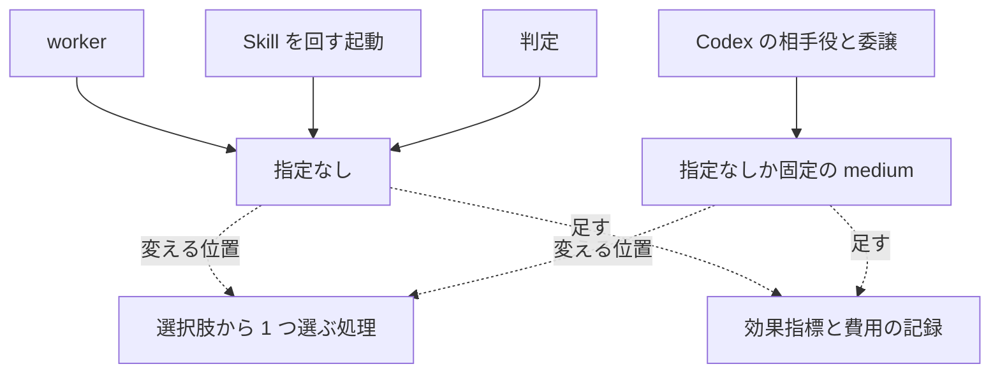
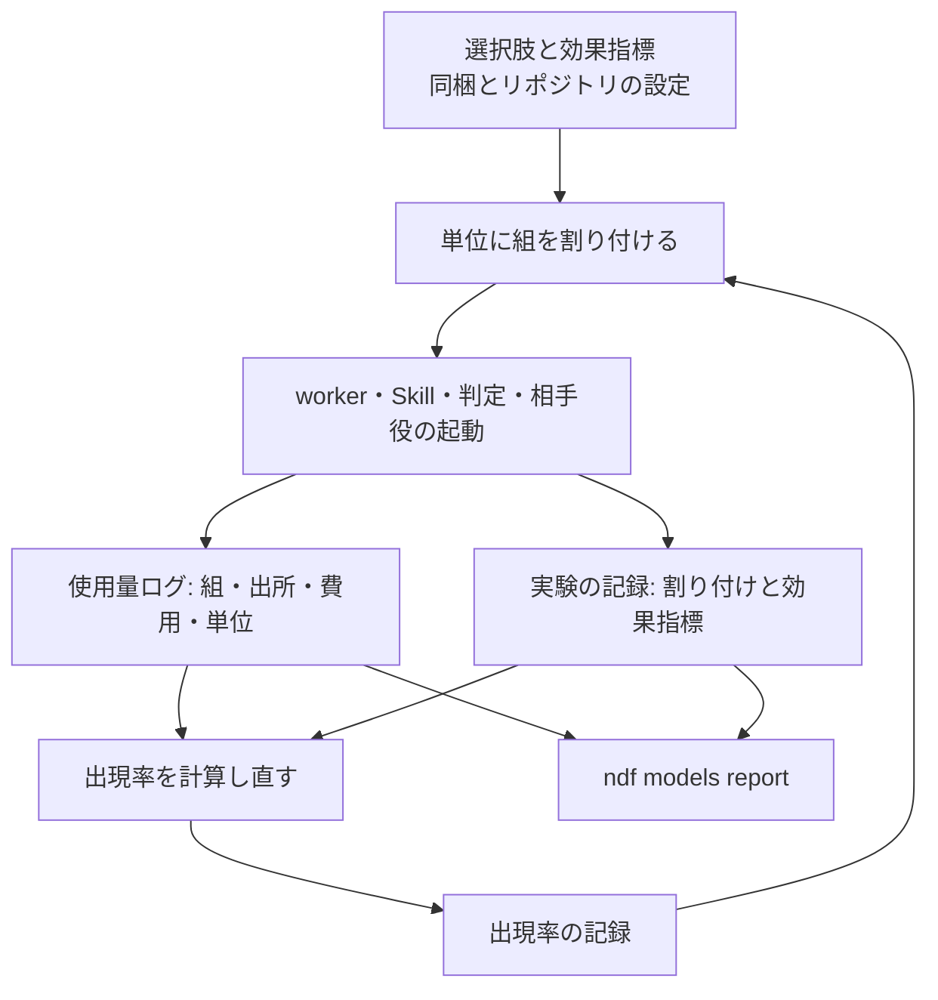
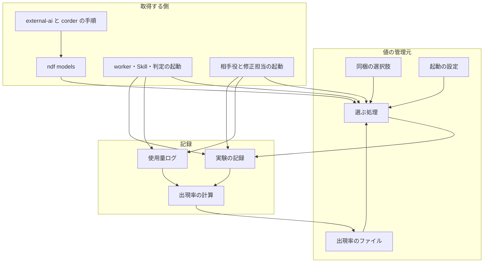
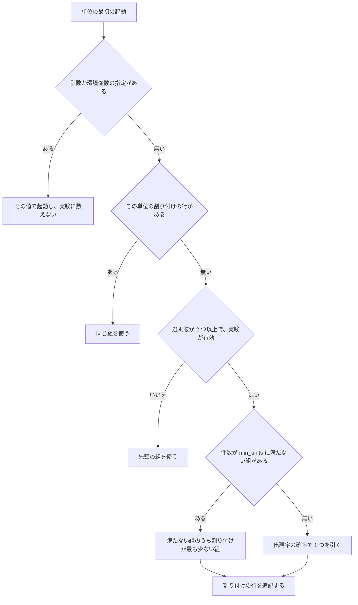
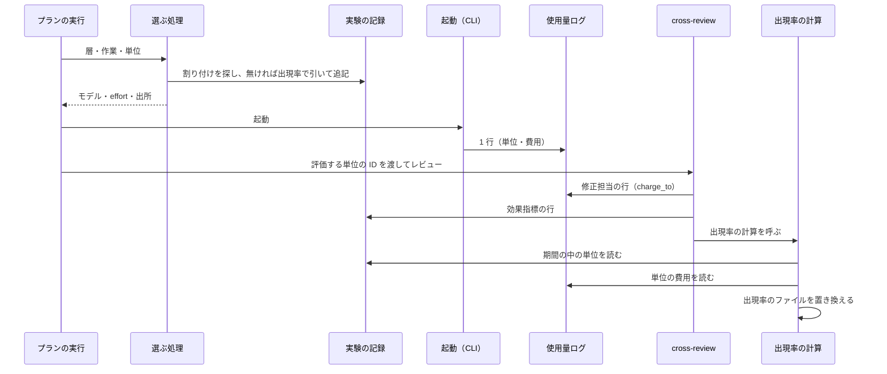

# モデルと effort の実験: 工程ごとの効果と費用から、起動の組を自動で選べる（#2944）

これまで、作業の重さによらず、ほぼすべての起動が同じモデルと effort で動き、値を変えた効果は測れなかった。この設計の改善の案では、工程ごとの選択肢（モデルと effort の組）を設定に書き、作業の単位ごとに 1 つを割り付けて起動する。工程ごとの効果指標と費用から組ごとの ROI を出し、統計に基づいて出現率を自動で調整する。固定の値の対応表は持たない。

## 今の姿

何が起きたか・目的・受け入れ条件は要求仕様（[issue-2944-requirements.md](./issue-2944-requirements.md)、正は #2944 の本文）にある。この文書は「どう解くか」と「なぜその解き方か」だけを書く。



| これまで | この設計の改善の案 |
| --- | --- |
| モデルと effort は起動する場所ごとに別々で、多くは CLI の既定 | 工程ごとの選択肢から、実験の割り付けで選ぶ |
| 値を変えた効果を比べる記録が無い | 作業の単位ごとに、割り付けた組・効果指標・費用を残す |
| 値を直すのは人がコードか手順書を書き換える | 出現率が統計に基づいて自動で変わる。固定したいときは選択肢を 1 つにする |

起動する場所ごとの今の決め方とコードの位置は、要求仕様の「今の姿」の表にある。「工程」「プラン」「テンプレート」「遷移」の意味は「用語」にある。

### 実測

2026-11-26 と 11-27 に、Claude Code 2.1.332 と codex-cli 0.172.0 で確認した。

| 確認したこと | 結果 |
| --- | --- |
| `claude -p --effort bogus` | 終了コード 0。標準エラーに警告を 1 行出し、既定の effort で動く |
| `claude -p --model <無い名前>` | 終了コード 1。理由を返す |
| `claude -p --model claude-haiku-5-5 --effort xhigh` | 受け付ける |
| `codex exec -c model_reasoning_effort=bogus` | API が 400 を返し、終了コード 1 |
| Codex の既定のモデルと effort | `gpt-6.2-sol`。`~/.codex/models_cache.json` の既定の effort は `low` |
| 同じ会話を `--resume` して effort を low から high へ変える | cache の作成は 17、読み込みは 5,845。書き直されない |
| 同じ会話を `--resume` してモデルを変える | cache の作成は 3,120、読み込みは 3,060。書き直される |
| 同じ会話を続けて起動したときの `total_cost_usd` | 会話の累計を返す |
| Codex の会話の記録（`$CODEX_HOME/sessions` の rollout） | `token_count` の行に累計のトークン数、`turn_context` の行にモデルと effort がある。`--ephemeral` の起動は記録を残さない |

### 実測: 作業の件数

対象は、NDF 11 系の worker の会話 222 件である（2026-11-24〜11-26 の 3 日。このマシンの記録）。内訳は [#1959 の設計](./issue-1959-design.md)の「実測: 工程が呼んだ MCP の Tool」にある。このうち設計の 3 つの作業が 77 件、実装が 19 件、ブランチと作業場所の用意が 21 件だった。1 週間に換算すると、実装の単位はおよそ 40 件である。

## 文脈と制約

- 利用者の方針（2026-11-27、原文は要求仕様の「リクエスト（原文）」）: 選択肢を設定で指定し、工程ごとの実験計画に基づいて起動のたびに選ぶ。工程ごとの効果指標に基づいて ROI を出し、統計に基づいて出現率を自動で調整する。通常のレビューの effort は low にも high にも固定しない
- 切り替えるのは、新しいプロセスか新しい会話を始めるときだけである（要求の前提 1）
- #1959（full の起動と起動の許可の変更）が先に入る。起動の設定（`.ndf/launch.json`）と、`claude -p` の行を使用量ログへ書くインターフェースは、#1959 が作る（[issue-1959-design.md](./issue-1959-design.md)）
- モデルと effort の指定は、#1959 の起動の承認の対象にしない。Tool と安全装置の可否ではなく、起動のたびの人の承認も要らない（要求の前提 5）
- 1 つのリポジトリで 1 週間に取れる単位は、多い工程でも数十件である。作業の中身は 1 件ずつ違う
- Claude Code の環境変数 `CLAUDE_CODE_EFFORT_LEVEL` は `--effort` より優先する

## この設計の範囲と、分ける案

方針の全部を 1 度に作ると、設計 1 本と実装 1 本に収まらない。効果指標と費用を機械で取れる起動を先に実験にし、取れないものは別の Issue に分ける案とする。**分けるかどうかは設計承認ゲートで決める**。分けない場合は、指標の定義が決まっていないものを設計に足す。

| 対象 | この設計 | 分ける案と理由 |
| --- | --- | --- |
| プランの worker のステップ（設計・実装・修正・作業場所の用意）、レビューの相手役、判定の起動 | 実験する | — |
| 外部の AI への委譲 | 選択肢を 1 つ持つ（実験しない） | 成果を NDF のコードが見ないので、指標を取れない |
| サブエージェント・レーン・オーガナイザー・応答の終わりの判定 | 変えない（今の定義と固定値のまま） | 「指標を取れない起動のモデルの割り付け」。成否を取る経路が無い。サブエージェントの定義を差し替える hook と、中継の役割の指定が要る |
| cross-refactoring の提案と実装の相手役 | 変えない | 「リファクタリングの相手役の実験」。提案の良さの指標を別に決める必要がある |
| 実験の記録を複数のマシンや利用者で共有する | 記録はマシンごと | 「実験の記録の共有」。保存先と書き込みの衝突の扱いが別の設計になる |
| 作業の難しさに応じた割り付け（文脈付きの割り付け） | 工程ごとに割り付ける。モードは記録だけする | 「難しさに応じた割り付け」。層を分けると件数が足りなくなる。件数が集まってから比べる |

## 解き方の全体像



- 起動する所は、層・作業の名前・ランタイム・単位を渡して、モデル・effort・出所を受け取る
- 単位の最初の起動で、出現率に従って組を 1 つ割り付ける。同じ単位の起動はすべて同じ組を使う
- 単位を評価する工程が終わったら、効果指標を記録し、出現率を計算し直す
- 指定が無い作業は引数を足さず、CLI の既定で動く

この文書で使う起動の呼び名は次のとおり。

| 呼び名 | 指すもの |
| --- | --- |
| conductor・レーン・オーガナイザー | 開発の全体を指揮する会話が conductor。並列に流す開発の 1 本分がレーン。複数のレーンをまとめる会話がオーガナイザー |
| シート（`seat`） | ほかの AI の CLI へ作業を頼むときの役割（レビュー・提案・実装など） |

## ドメインモデル

### コンテキスト

| コンテキスト | 何の語が 1 つの意味に決まるか |
| --- | --- |
| AI の CLI の起動（`ndf-agent-cli`） | 選択肢・単位・割り付け・出現率・値の出所 |
| 文脈と使用量（`ndf-context`） | 使用量ログの行と集計 |

起動が供給者、使用量ログが顧客の関係（顧客 / 供給者）である。

### 集約

| 集約 | オーナー（書き換えてよいもの） | 根 | エンティティ | 値オブジェクト |
| --- | --- | --- | --- | --- |
| 選択肢の設定 | NDF の開発者（同梱）、利用者（リポジトリの設定） | 工程の定義 | 組 | モデル・effort・指標の名前・割り付けの値 |
| 実験の単位 | 割り付けの処理と、指標を記録する処理 | 単位 | 割り付け・効果指標 | 組・確率・効果の値 |
| 出現率 | 出現率を計算し直す処理 | 工程 × ランタイムの行 | — | 組ごとの確率・計算に使った件数 |
| 使用量ログ | 使用量ログの書き込み処理 | 行 | — | 起動の値・使用量・費用・単位 |

### 不変条件

| # | 集約 | 条件 | 破れたときの扱い |
| --- | --- | --- | --- |
| I1 | 実験の単位 | 1 つの単位の割り付けは 1 つ。同じ単位の起動は、再実行と再開も同じ組を使う（引き上げは除く） | — |
| I2 | 実験の単位 | 引数と環境変数の値で起動した単位は、実験に数えない | — |
| I3 | 実験の単位 | 効果指標を取れなかった単位は、成功にも失敗にも数えない | — |
| I4 | 実験の単位 | 効果と費用は、割り付けた組に帰属する。引き上げと手戻りの起動の費用も、割り付けた組に含める | — |
| I5 | 出現率 | 打ち切っていない組の確率は下限以上で、合計は 1 である | — |
| I6 | 出現率 | 出現率は実験の記録と使用量ログからいつでも作り直せる。壊れた・古い出現率のファイルは作り直す | — |
| I7 | 選択肢の設定 | 読めない・形が違う・ランタイムに無い effort を持つときは起動しない。上位の指定で上書きされて使わない値でも同じ | 理由と直す場所を示して止まる |
| I8 | 使用量ログ | NDF のコードが起動する `claude -p` と Codex の子プロセス 1 つにつき 1 行 | 書けなければ警告を出し、工程は止めない |

### ドメインイベント

| # | イベント | 発生元 | 受け手 |
| --- | --- | --- | --- |
| E1 | モデルと effort を決めた | 選ぶ処理 | 起動の呼び出し元 |
| E2 | 決めた値で起動した | 起動の呼び出し元 | プランのステップの結果 |
| E3 | 起動の使用量と値の出所を記録した | 起動の呼び出し元 | 使用量ログ |
| E4 | 値を上げて打ち直した | 同じ失敗への 2 回目以降の起動 | 使用量ログ |
| E5 | 費用と成功率を集計した | `ndf models report` | 利用者かエージェント |
| E6 | 単位に組を割り付けた | 選ぶ処理 | 実験の記録 |
| E7 | 単位の効果指標を記録した | 単位を評価する工程 | 実験の記録 |
| E8 | 出現率を計算し直した | E7 の後の処理 | 出現率のファイル |

## 機能一覧

| # | 機能 | 誰が使うか |
| --- | --- | --- |
| F1 | 実験の割り付けで選んだモデルと effort で起動する | 工程を流すすべての利用者 |
| F2 | 選択肢の置き換え・固定・実験の停止を、リポジトリの設定と環境変数でする | 利用先の開発者 |
| F3 | 組ごとの効果・費用・ROI・出現率を読む | 利用者とエージェント |

## 構成要素

| 要素 | 責務 |
| --- | --- |
| 同梱の選択肢（新設） | 工程ごとの選択肢・効果指標の名前・割り付けの値の既定・effort の順位 |
| 選ぶ処理（新設） | 同梱・設定・環境変数・引数を重ね、必要なら単位に割り付けて、値と出所を返す。引き上げをする |
| 出現率の計算（新設） | 実験の記録と使用量ログから、組ごとの確率を計算して書く |
| 効果指標の記録（新設） | 単位の効果指標を実験の記録へ書き、出現率の計算を呼ぶ |
| `ndf models`（新設） | `pick` は値を返し、`report` は集計する |
| 起動の設定の読み取り（変更） | `experiments` のキーを足す |
| worker・Skill・判定の起動（変更） | 値を取得して引数に足し、結果と一緒に使用量ログへ書く |
| プランの実行（変更） | 単位の ID を子へ渡し、修正と作業場所の用意の単位の効果指標を記録する |
| cross-review（変更） | 相手役のシートを単位にし、相手役の効果指標と、評価した設計と実装の単位の効果指標を記録する |
| 相手役と修正担当の起動（変更） | シートの役割で値を取得する。Codex は `-c model_reasoning_effort=` を足し、使用量を取れる出力の形にする |
| `external-ai` と `corder` の手順（変更） | 固定の `medium` をやめ、`ndf models pick` の返す引数を使う |
| プランの記録（変更） | ステップごとの、指定した値と実際に動いたモデルを残す |

### 値の取得と記録の関係

次の図は、値の取得と記録の関係だけを描く。効果指標を記録する側（プランの実行と cross-review）とプランの記録は含めない。記録する順序は「処理の流れ」の図にある。



## データ構造

### 選択肢の設定

同梱の既定は `contracts/domains/launch-experiments.json`（新設）に置く。リポジトリは、#1959 の起動の設定（`.ndf/launch.json`）の `experiments` で置き換える。

```json
{
  "version": 1,
  "experiments": {
    "enabled": true,
    "stages": {
      "impl": {"arms": {"claude": [{}, {"model": "sonnet", "effort": "medium"}]}},
      "design": {"arms": {"claude": [{"model": "opus", "effort": "high"}]}}
    },
    "allocation": {"floor": 0.05, "min_units": 10, "margin": 0.1, "window_days": 60}
  }
}
```

| キー | 意味 |
| --- | --- |
| `stages.<工程>.arms.<ランタイム>` | その工程の選択肢。要素は `{"model", "effort"}`（どちらも省ける。`{}` は指定なし）。**先頭が基準の組**である。書いた工程とランタイムは、同梱の選択肢を置き換える |
| 要素が 1 つ | 実験せず、その値に固定する |
| `enabled` | 偽なら割り付けず、どの工程も基準の組で起動する |
| `allocation` | 割り付けの値。省けば同梱の値（「出現率の計算」） |

工程の名前・層・ランタイム・キーが同梱に無いもの、effort が順位に無いものは、形の違いとして起動を止める。モデルの名前は検証しない（決定 8）。

### 初期の選択肢と効果指標

| 工程 | 含む作業 | 単位 | 効果指標（0〜1） | 選択肢（先頭が基準） |
| --- | --- | --- | --- | --- |
| `design` | `requirements`・`design`・`design-detail`（Skill で回す同じ名前の起動を含む） | 1 回のプランの実行の、この工程 | `1 / (1 + 設計レビューの 1 ラウンド目で挙がって採用された重大な指摘の数)` | 指定なし、opus / high、sonnet / high |
| `impl` | `impl` | 同上 | `1 / (1 + 単位の PR のレビューの 1 ラウンド目で挙がって採用された重大な指摘の数)` | 指定なし、sonnet / medium、sonnet / high |
| `fix` | `fix`・`ci-fix`・`fix-push`・`fix-base` | 1 回のプランの実行の、このステップ 1 つ | 1 回目の修正の次の検査が通れば 1、通らなければ 0 | 指定なし、sonnet / medium、sonnet / high |
| `mechanical` | `worktree` | 同上 | ステップが完了すれば 1、止まれば 0 | 指定なし、haiku / low |
| `judge` | 判定の層の起動（`stop-wait` を除く） | 質問 1 つ | 1 回目の回答が形に合えば 1 | 指定なし、haiku / medium、sonnet / medium |
| `review` | レビューのシート | 1 回の cross-review の、シート 1 つ | そのレビューで採用された重大な指摘のうち、このシートが挙げた割合 | Codex: low、medium、high。Claude: 指定なし、sonnet / high |
| `delegate` | `external-ai`・`corder` の委譲 | なし | なし（取れない） | Codex: medium の 1 つ |

- 「重大な指摘」は重要度が critical か major の指摘、「採用された」は見送りで終わらなかった指摘である
- 設計と実装の効果指標は、**修正の前の 1 ラウンド目の指摘だけ**を数える。後のラウンドの指摘は修正の作業の結果が混ざり、どの起動の成果か分からないためである
- `review` の指標は、同じレビューに 2 つ以上のシートがある場合にだけ記録する。1 つだけなら割合が必ず 1 になるためである。割合は相手のシートにも左右される。ただし相手の組も無作為なので、長い期間では自分の組の差が残る
- 上に無い作業（確定仕様化・振り返り・棚卸し・リリースなど）は実験しない。成果の良し悪しを機械で取れないためで、引数を足さない
- Codex の通常のレビューの基準は `low`（今の Codex の既定）で、medium と high を比べる
- 要求仕様の「参考: 軸ごとのマトリクス（案）」にあって上の選択肢に無い値（security の xhigh など）は、固定の値として足さない。今の振る舞いを変えない

### 実験の記録と出現率

利用者の NDF の状態の保存先（使用量ログと同じ場所）に 2 つ置く。実験の記録 `launch-experiments.jsonl` は追記だけにする。

割り付けの行（単位の最初の起動で 1 行）:

| 欄 | 中身 |
| --- | --- |
| `kind`・`at` | `assign`・日時 |
| `unit` | 単位の ID。プランの工程は `<run_id>:<工程>`、修正と作業場所の用意は `<run_id>:<ステップ>`、判定は `request_id`、相手役は `<cross-review の実行の ID>:<シート>` |
| `stage`・`runtime`・`repo`・`mode` | 工程・ランタイム・リポジトリのキー・モード |
| `arms`・`probs`・`chosen` | そのときの選択肢、それぞれの確率、選んだ組 |
| `phase` | `burn_in`（件数を集める間）か `adaptive`（調整の後） |

確率を残すのは、出現率が途中で変わるためである。後から偏りを重み付けで直して比べられる。

効果指標の行（単位の評価で 1 行）:

| 欄 | 中身 |
| --- | --- |
| `kind`・`at`・`unit` | `outcome`・日時・単位の ID |
| `metric` | 指標の名前とバージョン。定義を変えたらバージョンを上げ、古い行は数えない |
| `quality` | 0〜1。取れなければ null |
| `detail` | 元の数（採用された重大な指摘の数など） |

出現率のファイル `launch-weights.json` は、工程 × ランタイムごとの確率と、計算に使った件数・日時を持つ。記録とログからいつでも作り直せるコピーで、起動のたびにログ全体を読まないために置く（#1959 の設計の実測で、使用量ログ 10 万行の読み取りは約 0.5 秒）。

### 使用量ログの行に足す欄

| 欄 | 中身 |
| --- | --- |
| `layer`・`name`・`runtime`・`mode` | 値を取得したときのキー（`name` は #1959 が足す欄と同じ） |
| `unit` | この起動が割り付けを受けた単位の ID。実験でなければ無し |
| `charge_to` | この起動の費用を手戻りとして負う単位の ID（下の「費用と ROI」） |
| `request_id`・`request_try` | 依頼 1 件ごとに呼び出し元が作る一意な値と、その依頼の中で何番目の起動か（最初が 1） |
| `requested_model`・`effort` | 引数に渡した値。指定しなければ無し。`effort` は指定値で、実際に効いた値ではない |
| `model_source`・`effort_source` | `argument`・`environment`・`experiment`・`default`（指定なし） |
| `raised` | 引き上げたか |
| `outcome` | 下の表の値 |

所要時間は、#1959 の設計の `seconds` の欄を使う。`claude -p` は呼び出し元が子プロセスの起動から終了まで、Codex のシートは監視する側が測る。手順書に従って AI がシェルから直接打つ委譲（`external-ai`・`corder`）は、NDF のコードが起動も終了も見ないので、行を書かない。

| 呼び出し元 | `outcome` の値 | 成功 | 失敗 | 分母に入れない |
| --- | --- | --- | --- | --- |
| worker | `ok`・`gate`・`stopped`（結果ファイルの `status`）、`no_result`、`unknown` | `ok` | `stopped`・`no_result`・`unknown` | `gate`（人の判断待ち） |
| Skill | `ok`・`gate`・`stopped`、`bad_report`、`unknown` | `ok` | `stopped`・`bad_report`・`unknown` | `gate` |
| 判定 | `valid`・`invalid`（回答が形に合わない）、`unknown` | `valid` | `invalid`・`unknown` | — |
| 相手役（seat） | 監視の終わり方（`done`・`failed`・`usage_limit`・`stalled`・`timeout`） | `done` | ほかの 4 つ | — |

CLI の子プロセスを起動できなかった場合は、行を書かず、成功率にも入れない。

| 呼び出し元 | 実際のモデル | 使用量 | 費用 | 取得する経路 |
| --- | --- | --- | --- | --- |
| `claude -p`（worker・Skill・判定・Claude のシート） | あり | あり | あり | 結果の JSON。得られなければ不明 |
| Codex のシート | 引数で指定した値だけ | あり | 単価表から計算 | `codex exec --json` の使用量の行。回答は `-o` のファイルから読む |

Codex の費用は、同梱の単価表（`contracts/data/codex-prices.json`、新設。公式の価格を書き取り、取得日を持つ）とトークン数から計算する。単価表に無いモデルは費用を不明とし、その工程の出現率は調整せずに均等にする。実際に効いた effort は、どの呼び出し元でも記録しない。集計の見出しは「指定した effort」と書く。

### 費用と ROI

単位の費用は、使用量ログのうち `unit` か `charge_to` がその単位の行の、起動の費用の合計である。起動 1 回の費用の求め方は #1959 の設計の「起動の費用の求め方」に従う。

| 手戻りの起動 | `charge_to` に書く単位 |
| --- | --- |
| 実装の後のテストと CI の失敗を直す起動 | その実行の `impl` の単位 |
| 設計レビューと単位のレビューの指摘を直す起動（cross-review の修正担当） | 評価している `design` か `impl` の単位 |
| 判定の起動し直し | 割り付けた単位そのもの |

手戻りの費用まで含めるのは、安い組が指摘を多く生むと、直す費用でかえって高くつくためである。区間の合計（どの起動がいくら使ったか分からない費用）を含む単位と、費用が不明の起動を持つ単位は、費用の平均に入れず、件数を `report` に出す。

組ごとの ROI は、**効果指標の平均 ÷ 単位の費用の平均（USD）** である。`report` は基準の組の ROI を 1 とした比も出す。ROI だけで比べると、安い組は効果が低くても勝つので、次の節の「効果の下限」と組み合わせる。

## 出現率の計算

### 割り付けの流れ



- 件数を集める間（`burn_in`）は、割り付けた数がそろうように選ぶ。割り付けの数には、7 日以内に割り付けて効果指標がまだ無い単位も数える。並列に流すと結果の前に次の割り付けが来るためである
- 割り付けの行の確認と追記は、実験の記録のロックの中で行う。同じ単位が 2 回割り付けられないためである
- 記録を書けないときは指定なしで起動し、その単位は実験に数えない

### 計算の方法

効果指標を 1 行書くたびに、その工程 × ランタイムの出現率を計算し直す。使うのは、直近 `window_days` 日に割り付けて、効果指標と費用がそろった単位である。

1. 打ち切っていないすべての組の件数が `min_units` 以上でなければ、均等にする
2. 組ごとに 2,000 回の標本を引く
   - 効果 q: ベータ分布 `Beta(1 + 効果の合計, 1 + 件数 − 効果の合計)`
   - 費用 c: 費用の対数の平均の事後分布（正規分布。標準偏差は `標本の標準偏差 ÷ √件数`）から引き、指数に戻す
3. **効果の下限**: 基準の組より効果が `margin` を超えて低い確率が 0.9 を超える組は、この回の「最良」の候補から外す（下限の出現率だけを持つ）
4. 候補の中で、標本ごとに `q / c` が最大の組を数え、その割合を「最良である確率」にする
5. 打ち切っていない組の出現率は `floor + (1 − floor × 打ち切っていない組の数) × 最良である確率` にする

**打ち切り**: 件数が 30 以上で、基準の組より効果が `margin` を超えて低い確率が 0.99 を超える組は、出現率を 0 にする。打ち切りの根拠になった単位が `window_days` を過ぎて数えられなくなると、件数が足りなくなって再び割り付ける。モデルや作業の中身が変わった後にやり直すためである。基準の組は打ち切らない。

| 値 | 既定 | 意味 |
| --- | --- | --- |
| `min_units` | 10 | 組ごとに、調整を始める前に集める単位の数 |
| `floor` | 0.05 | 打ち切っていない組の下限の出現率 |
| `margin` | 0.1 | 効果指標の、許す低下の幅 |
| `window_days` | 60 | 数える期間 |

### 必要な件数と、判断できる件数

出現率の調整は件数が少なくても進むが、「この組のほうが良い」と言えるには件数が要る。`report` は、各組が 30 件以上で、最良である確率が 0.95 以上の場合にだけ「判断できる」と書き、それ以外は「件数が足りない」と書く。

2 つの組の成功の割合を、両側 5% の水準と 80% の検出力で見分けるのに要る件数は、1 組あたり次のとおりである。値は 2026-11-27 に正規近似の式で計算した。

| 割合の差 | 1 組あたりの件数 |
| --- | ---: |
| 0.9 と 0.7 | 62 |
| 0.8 と 0.6 | 82 |
| 0.9 と 0.75 | 100 |
| 0.9 と 0.8 | 199 |

実装の単位が 1 週間に約 40 件（「実測: 作業の件数」）で組が 3 つなら、`min_units` の 10 件は約 1 週間、100 件は約 8 週間で集まる。件数の少ないリポジトリでは、調整が均等のまま続くことがある。その場合も、起動は選択肢のどれかで正しく動く。

## 入出力のコントラクト

| 名前 | 入力 | 出力 | 失敗の形 |
| --- | --- | --- | --- |
| `ndf models pick` | `--layer`・`--name`・`--runtime`（省けば claude）・`--unit`（省けば割り付けない）・`--retry`・`--format json\|args` | `json` は値と出所を結果の JSON で返す。`args` は CLI に渡す引数を 1 行に 1 つずつ出す | 設定が壊れていれば `precondition` |
| `ndf models report` | `--since`・`--until`・`--stage` | 工程 × ランタイム × 組ごとの、単位の数・効果の平均と区間・費用の平均・ROI・最良である確率・出現率・判断できるか。モードごとの内訳。起動の数・所要時間・トークン・成功率・やり直し率・指定と実際のモデルの食い違い | 行が無い組は「記録なし」 |
| 環境変数 | `NDF_LAUNCH_MODEL`・`NDF_LAUNCH_EFFORT`（claude）、`NDF_LAUNCH_CODEX_MODEL`・`NDF_LAUNCH_CODEX_EFFORT` | すべての層に効く一時的な上書き | 無い effort は起動しない |
| `ndf worker run` | `--unit`・`--mode` を足す | 結果の `metrics` に起動の値と実際のモデル | — |

### 値の優先

モデルと effort は別々に、次の表の上から最初に値があるものを使う。

| 順 | 出所 | 実験に数えるか |
| ---: | --- | --- |
| 1 | 起動の引数 `--model`・`--effort` | 数えない |
| 2 | `NDF_LAUNCH_*` | 数えない |
| 3 | `CLAUDE_CODE_EFFORT_LEVEL`（Claude の effort だけ） | 数えない |
| 4 | 実験の割り付け（リポジトリの選択肢があればそれ、無ければ同梱） | 数える |
| 5 | 指定なし（CLI の既定） | — |

`CLAUDE_CODE_EFFORT_LEVEL` は、子の中で `--effort` より優先する。NDF が起動する子での扱いは次のとおりである。

| NDF が使う effort の出所 | 子の環境の `CLAUDE_CODE_EFFORT_LEVEL` |
| --- | --- |
| 起動の引数か `NDF_LAUNCH_EFFORT` | 外す |
| この変数そのもの（順 3） | そのまま。表と割り付けの effort は渡さない。値は検証しない（Claude Code の変数のため） |
| 実験の割り付けか指定なし（順 4・5） | この変数は元から無いので、何もしない |

### `args` の受け取り方

`--format args` の標準出力は引数の配列で、1 行が引数 1 つである。引用符もエスケープも付けない。Codex で effort とモデルの指定があれば `-c`・`model_reasoning_effort=high`・`-m`・`<モデル>` の 4 行になる。改行を含むモデル名は、形の違いとして `precondition` にする。失敗したときは標準出力に何も出さず、理由を標準エラーに出して 0 以外で終える。

`external-ai` と `corder` の手順は、次の形を 1 回の Bash の呼び出しにまとめて書く。出力を変数に受けてから配列にするのは、`pick` の失敗を見落として CLI の既定で起動しないためである。安全装置の引数は #1959 の `safety-args` から取る。配列にする形の、引数の区切り・指定なし・失敗の 3 通りは、2026-11-26 に `pick` の代わりの関数を使って bash で確かめた。

```bash
out=$(ndf models pick --layer seat --name delegate --runtime codex --format args) || exit 1
safe=$(ndf launch-config safety-args --runtime codex --use delegate) || exit 1
ARGS=()
while IFS= read -r a; do [ -n "$a" ] && ARGS+=("$a"); done <<<"$out"
while IFS= read -r a; do [ -n "$a" ] && ARGS+=("$a"); done <<<"$safe"
timeout 1320 codex exec "${ARGS[@]}" -C "$PWD" < "$TMP/prompt.md"
```

この形では、委譲 1 回ごとに `ndf` の起動が 2 回増える。2026-11-26 に同じエントリポイントの軽いサブコマンドを測ると 306〜372 ms（8 コアの Linux、11 回の中央値）だった。委譲 1 回は数分かかるので、増える時間は 1% 未満である。

互換性: 今の入力で読めなくなるものは無い。NDF を更新すると、指定の無いリポジトリでも、実験の対象の工程の一部が基準と違う組で動く（要求の前提 2）。

## 処理の流れ

### 単位の割り付けから出現率の更新まで



修正と作業場所の用意の単位は、次の遷移を見てプランの実行が効果指標を書く。判定の単位は、判定の起動の処理が書く。相手役の単位は cross-review が終わるときに書く。レビューを通らない実行（`light` で単位のレビューを省くなど）の設計と実装の単位は、効果指標が無いまま残り、数えない。

### 引き上げる起動

同じ失敗への 2 回目以降の起動は、割り付けた組から 1 つ上げる。

| 起動 | 2 回目以降とは |
| --- | --- |
| 修正の作業（`fix`・`ci-fix`・`fix-push`・`fix-base`） | 同じ実行の同じステップに、失敗の判定がはっきりした遷移（テストの失敗 `test_failed`、CI のテスト以外の検査の失敗 `check_failed`、push の失敗、ベースとの衝突 `base_conflict`）でもう一度入ったとき。`test-repeat` などの回数を数える共有のステップを挟んでも、プランの実行は元の失敗の理由を持ち続ける |
| 判定の起動 | 回答が形に合わず起動し直す 2 回目 |

ランタイムごとの上げ方は次の 1 行だけを当てる。順位にあるモデルは `haiku` < `sonnet` < `opus` で、完全な ID など順位に無い名前は「順位に無い」に当たる。

| ランタイム | モデル | effort | 引き上げた後 |
| --- | --- | --- | --- |
| どちらも | 何でも | `low`・`medium` | effort を 1 つ上げる |
| Claude | `haiku`・`sonnet` | `high` 以上・指定なし | モデルを 1 つ上げる |
| Claude | `opus`・順位に無い・指定なし | `high` | effort を `xhigh` にする |
| Claude | `opus`・順位に無い・指定なし | `xhigh`・`max`・指定なし | 変えない |
| Codex | 何でも | `high` | effort を `xhigh` にする |
| Codex | 何でも | `xhigh` 以上・指定なし | 変えない |

引数と環境変数の値は上げない。`raised` は値が実際に変わったときだけ真にする。打ち直しの回数の上限は変えない。

### 同じ会話を続ける起動

| 起動 | 値の持ち方 |
| --- | --- |
| worker の再開 | 初回の引数をそのまま使う |
| cross-review の修正担当の会話の再開 | 会話の ID と一緒に状態ファイルへ値を残して使う。使用量ログの `session_seq`・`session_started_at` も同じ状態ファイルに残す。費用を求めるのに使う「前の行」の値（#1959 の設計の「起動の費用の求め方」）も残す |
| 利用者の `--resume` | 何も足さない |

## 集計

成功率は依頼を 1 件として数える。ステップのやり直し率は、プランの実行ごとのステップ（`run_id`・`step` の組）を 1 件として数える。同じステップを何回実行しても 1 件である。

| 呼び出し元 | 依頼 1 件 | `request_try` が増えるとき |
| --- | --- | --- |
| worker | 作業の委譲 1 回 | 同じ会話の再開 |
| Skill | Skill を回す起動 1 回 | — |
| 判定 | 質問 1 つ | 回答が形に合わず起動し直すとき（2） |
| 相手役（seat） | シート 1 つの起動 | 同じ会話の再開 |

`run_id`・`step` はプランの実行の中のステップを指す。`attempt` は、そのステップを実行した何回目かである（最初が 1）。打ち直しでも、遷移でステップに戻った実行でも 1 増える。プランの実行は、`run_id`・`step`・`attempt`・単位の ID・引き上げの合図を、子へ環境変数で渡す。

| 指標 | 数える単位 | 分子 | 分母 |
| --- | --- | --- | --- |
| 成功率 | 依頼 1 件。`request_try` が最も大きい行の `outcome` を使う | 成功の依頼 | 成功と失敗の依頼 |
| やり直し率 | ステップ | `attempt` が 2 以上の worker か Skill の行があるステップ | worker か Skill の行があるステップ |
| 判定のやり直し率 | 判定の依頼 1 件 | 1 回目が `invalid` で 2 回目の行がある依頼 | すべての判定の依頼 |
| 人へ戻した判定 | 判定の依頼 1 件 | 2 回とも形に合わず、人へ戻した依頼（要求の「judge の stop」） | すべての判定の依頼 |

`ndf models report` は次の順で集計する。

1. 期間で絞らずに行を読み、同じ `launch_id` の行を 1 行にする（#1959 の設計の「使用量ログの行」の規則）
2. 期間・モデル・effort で分ける前に、行を依頼・ステップ・単位にまとめる
3. 値を、次の表の期間と区分に入れる

| 値 | 入れる期間 | 入れる区分 |
| --- | --- | --- |
| 起動の数・所要時間・トークン・起動 1 回の費用 | 行の `at` の期間 | その行の指定値 |
| 成功率と判定のやり直し率 | 依頼の最後の行の期間 | 依頼の最初の行の指定値 |
| ステップのやり直し率 | ステップの最後の行の期間 | `attempt` が最も小さい行の指定値 |
| 実験の指標 | 単位の割り付けの日時の期間 | 割り付けた組 |

区間の合計はモデル・effort の区分には入れない。区間の両端が期間の中にあれば層 × 名前 × ランタイムの合計に足し、「区分に分けられない費用」の欄にも出す。費用が不明の起動は 0 として足さず、件数を出す。

## 決定の記録

各決定の根拠に書く「Value n」は、プロジェクトの判断基準（[.ndf/mvv.md](../.ndf/mvv.md)、バージョン 11）の項目である。「C5」は [NDF の共通原則](./ndf-common-principles.md)の「必ず人の承認が要る操作」の行である。

### 決定 1: 値を測って選ぶため、固定の値の対応表を持たず、工程ごとの選択肢と指標を 1 つの設定に置く

- **質問**: 層と作業から値を引く固定の対応表を残すか
- **選んだ案**: 残さない。工程ごとの選択肢（先頭が基準）と指標を 1 つの形の設定にし、固定したい工程は選択肢を 1 つにする
- 採らなかった案: 固定の対応表を基準の値として残し、その周りだけを実験する（利用者の方針に反する。基準が測らずに決めた値になり、基準と対応表の 2 か所に値が散る）
- 採らなかった案: 依頼の中身を AI が読んで値を選ぶ（選ぶ起動に費用がかかり、効果を組ごとに比べられない）
- 採らなかった案: モデルを振り分ける外部の仕組み（API プロキシ）を挟む（CLI の定額の認証を使えなくなる）
- **代償**: どの値で動くかは、起動のたびに変わる。同じ作業の結果を比べるときは、使用量ログの組を見る
- 作り方: 自前で作る
- 比べた候補: LIB4 / LIB6 / PRD3
- 根拠: Value 13 / Value 11（MVV バージョン 11）。値の良し悪しは測って示す（Value 13「確かめたことだけが済んだとされる」）。値の保存先を 1 か所にする（Value 11「重複と冗長が無い」）

### 決定 2: 利用者が設定を足さずに実験の効果を受けるため、同梱の選択肢は設定の無いリポジトリでも使う

- **質問**: 要求の未決。要求の前提 2 でよいか
- **選んだ案**: 使う。選択肢には基準（今の振る舞いに当たる組）を必ず含め、実験は `enabled: false` で止められる
- 採らなかった案: 選択肢を書いたリポジトリだけが実験する（ほとんどの利用者に効果が届かず、記録も集まらない）
- 採らなかった案: 同梱の選択肢を安い組だけにする（効果が下がったかを比べる相手が無くなる）
- **代償**: 件数を集める間、費用の高い組（設計の opus / high、レビューの high）にも割り付ける。調整の後も、どの組も 5% は動く
- 根拠: Value 2 / Value 4（MVV バージョン 11）。費用が増える組を試す理由と、止める手段を示す（Value 2「安く使える」）。どの利用先も同じ選択肢で動き、設定で変えられる（Value 4「どのプロジェクトでもそのまま使える」）

通常の Codex のレビューは、`low`・`medium`・`high` の 3 つを比べる。2026-11-26 に、同じ差分（56,860 バイト）を 1 回ずつ読ませた値は次のとおりで、`high` は時間と出力トークンが大きく増える。見落としの違いは、実験の効果指標（採用された指摘のうち挙げた割合）で測る。

| effort | 所要時間 | 入力トークン | 出力トークン（うち推論） |
| --- | ---: | ---: | ---: |
| `low` | 16 秒 | 37,791 | 593（78） |
| `high` | 69 秒 | 37,791 | 3,200（2,358） |

### 決定 3: 成果の帰属を一意にするため、割り付けは作業の単位ごとにし、手戻りも割り付けた組に含める

- **質問**: 割り付けを何の単位でするか
- **選んだ案**: 単位（実行の中の工程、修正のステップ、判定の質問、レビューのシート）ごとに 1 つ割り付け、単位の中では変えない。引き上げと手戻りの費用は割り付けた組に含める（実際に使った値ではなく、割り付けた組で比べる分析）
- 採らなかった案: 起動 1 回ごとに割り付ける（再開や打ち直しで組が混ざり、指摘がどの組の成果か分からない）
- 採らなかった案: スプリントごとに組をそろえる（1 週間に 1〜2 件しか標本が取れない）
- 採らなかった案: 引き上げた起動の成果を、上げた組に帰属させる（失敗しやすい組ほど、失敗が自分の成績に残らない）
- **代償**: 打ち直しで上の値を使った分も、基の組の費用になる
- 根拠: Value 13 / Value 8（MVV バージョン 11）。比べられる形で測る（Value 13）。割り付けと指標を追記だけで持つ（Value 8「正しいデータ構造で作られる」）

### 決定 4: 品質を落として安くしないため、ROI は手戻りを含む費用で割り、効果の下限を持つ

- **質問**: ROI をどう定義するか
- **選んだ案**: 効果指標の平均 ÷ 単位の費用（手戻りを含む）の平均。出現率を上げられるのは、効果が基準より `margin` を超えて低くない組だけにする
- 採らなかった案: 効果 ÷ 起動の費用（単価が 40 分の 1 の組は、効果が半分でも勝つ。直す費用が見えない）
- 採らなかった案: 指摘 1 件を何ドルと置いた差し引きの値にする（1 件の価値を決める根拠が無く、値で結論が変わる）
- 採らなかった案: 効果だけを最大にする（費用が下がらない）
- **代償**: `margin` の 0.1 は実測で決めた値ではない。`report` の件数を見て直す
- 根拠: Value 2 / Value 5（MVV バージョン 11）。安くて効果の変わらない組へ寄せる（Value 2）。手戻りで遅くなる組は選ばれにくくなる（Value 5「速く届く」）

指標の限界は次のとおりである。指摘の数は作業の大きさと難しさにも左右される。無作為に割り付けるので長い期間では均されるが、件数の少ないうちはばらつきが大きい。レビューの指標は挙げた指摘の割合で、どのシートも挙げなかった見落としは数えられない。指摘の同じ内容を別の文で挙げた場合は別の指摘になる。

### 決定 5: 少ない件数でも費用を抑えながら学ぶため、費用つきのトンプソンサンプリングを標準ライブラリの乱数で作る

- **質問**: 出現率をどう調整するか。ライブラリを使うか
- **選んだ案**: 効果と費用の事後分布から標本を引き、比が最大の組を数えるトンプソンサンプリング（予算つきの方式。ALG2）に、効果の下限と下限の出現率を足す。分布の乱数は Python の標準ライブラリ（`random.betavariate`・`random.gauss`）を使う
- 採らなかった案: 固定の割合の A/B テストを決めた件数まで行い、勝者に固定する（件数が集まるまで劣る組にも同じ数を払う。モデルが入れ替わると、やり直しを人が始める）
- 採らなかった案: ε-greedy（上位の組が僅差でも、片方に寄せる量を調整できない）
- 採らなかった案: MABWiser（LIB1。費用との比と効果の下限を持たず、pandas・scikit-learn・seaborn を利用者の環境へ足す）
- 採らなかった案: Vowpal Wabbit（LIB2。文脈つきの学習が主で、学習の状態をモデルのファイルに持つ。追記の記録から作り直せる形にならない）
- 採らなかった案: Ax（LIB3。ベイズ最適化の基盤で、torch を含む依存が大きい）
- 採らなかった案: GrowthBook・Statsig（PRD1・PRD2。サーバか外部のサービスが要り、利用者の作業の指標を外へ送ることになる。GrowthBook のバンディットは有料のプランである）
- **代償**: 割り付けと計算の約 100 行を NDF が保守する。依存は増えない
- 作り方: 標準に倣う・自前で作る
- 比べた候補: ALG1 / ALG2 / LIB1 / LIB2 / LIB3 / PRD1 / PRD2
- 根拠: Value 12 / Value 4 / C5（MVV バージョン 11）。実績のある方式（ALG1・ALG2）と、下限と件数集めを持つ製品の形（PRD1・PRD2）に倣う（Value 12）。利用者の環境へ重い依存を足さない（Value 4）。外部のサービスへ記録を送らない（C5「他のリポジトリへ公開する」に当たる送り先を作らない）

### 決定 6: 同じ失敗に費用と時間を使い続けないため、2 回目以降の打ち直しは 1 つ上げる

- **質問**: 実験の割り付けと、失敗の後の引き上げをどう両立させるか
- **選んだ案**: 1 回目の起動は割り付けた組のまま。同じ失敗への 2 回目以降は「引き上げる起動」の表のとおりに上げる。主な上げ方は次の 3 つである
  - effort が `medium` 以下なら、effort を上げる
  - effort が `high` 以上で `opus` より下のモデルなら、モデルを上げる
  - `opus` の `high` なら、effort を `xhigh` にする
- 採らなかった案: 引き上げない（弱い組を割り付けた単位が、同じ値で失敗を繰り返す）
- 採らなかった案: 1 回目の打ち直しから上げる（修正の工程の 1 回目の効果を、割り付けた組で測れない）
- **代償**: 引き上げた起動の費用が、基の組の費用になる
- 根拠: Value 2 / Value 5（MVV バージョン 11）。失敗したときだけ上げる（Value 2）。同じ値のやり直しで時間を使わない（Value 5）

### 決定 7: 費用と効果を後から確かめられるよう、使用量ログと実験の記録を追記し、出現率は記録から作り直せる形にする

- **質問**: 何をどこに記録するか
- **選んだ案**: 起動の事実は使用量ログ、割り付けと効果指標は実験の記録に追記する。出現率はその 2 つから作り直せるファイルにする
- 採らなかった案: 使用量ログに指標も書く（指標は起動の後、レビューの終わりに決まる。追記だけのログの行を書き換えることになる）
- 採らなかった案: 出現率を起動のたびに計算する（使用量ログは削除せずに増え続け、読み取りが起動ごとにかかる）
- 採らなかった案: プランの記録だけから集計する（プランの記録は作業の終わりに削除される。プランを通らない起動は残らない）
- **代償**: 呼び出し元が結果を受ける前に落ちた起動は行が残らない
- 根拠: Value 8 / Value 13（MVV バージョン 11）。事実を追記だけで持ち、コピーは、読み取りの時間を測ったうえで置く（Value 8）。費用と効果は実測で示す（Value 13）

### 決定 8: 黙って別の値で動かさないため、effort の値は NDF が起動の前に検証する

- **質問**: effort の誤りを CLI に任せるか
- **選んだ案**: 同梱の順位に無い effort は起動しない。モデルの名前は検証せず、CLI の起動の失敗を理由として残す
- 採らなかった案: CLI に任せる（Claude Code は無い effort を警告だけで無視する。実験の組が黙って同じ値になる）
- **代償**: CLI が effort の値を増やしたら、同梱の順位を直すまで指定できない
- 根拠: Value 13（MVV バージョン 11）。指定した effort で動いたと、確かめずに扱わない

## 影響と危険

- **働く範囲**: NDF を入れたすべてのリポジトリ。worker・Skill・判定・レビューの相手役と、外部の AI への委譲に効く
- **プロジェクトごとに違うもの**: 選択肢・固定・停止は `.ndf/launch.json` の `experiments` と環境変数で受ける。出現率はマシンごとの記録から決まる
- **当たるモード**: すべて
- **壊れうる箇所**:
  - 使えるモデルが限られる利用者（API キーや従量の接続）は、選択肢のモデルで起動に失敗しうる。失敗の文に直す場所（`.ndf/launch.json`）を載せる。失敗した単位は効果 0 になり、その組は打ち切られていく
  - 件数を集める間は、費用の高い組にも割り付けるので、費用が増えることがある
  - 弱い組を割り付けた実装は指摘が増え、完了まで長くかかることがある。引き上げと打ち切りで幅を抑える
  - Haiku 5.5 は入力が 10 万トークンを超えると単価が上がる。選択肢の haiku は `mechanical` と `judge` に限る
  - 使用量ログの欄が増える。古い NDF は新しい行を読めない行として数える
  - Codex の出力の形を `--json` にする。回答の読み方を同じ PR で直す
  - #1959 と同じファイルを触る。#1959 の後に実装する

### 代表のリポジトリでの振る舞い

| 代表のリポジトリ | 設定の要点 | 直した後に起きること | この種類で扱えなくなること |
| --- | --- | --- | --- |
| Web サービス | 指定なし | 件数が多く、数週間で出現率が動く | 無し |
| モバイルアプリ | ビルドの失敗の修正が多い | 修正の工程の件数が多く、成功する組へ寄る | 無し |
| 業務文書だけ | `light`・`documentation` が多く件数が少ない | 均等のまま続くことがある。固定したければ選択肢を 1 つにする | 無し |

### このリポジトリだけの事情

- 無し（このリポジトリ専用の値は置かず、同梱の選択肢のまま測る）

## 用語

| 用語 | 意味 | 用語集への反映 |
| --- | --- | --- |
| 起動の選択肢 | 工程とランタイムごとに設定する、起動で選べるモデルと effort の組の並び。先頭が基準の組 | 追加 |
| 実験の単位 | 起動の組を 1 つ割り付け、効果指標を 1 つ記録する作業のまとまり | 追加 |
| 効果指標 | 実験の単位の成果の良さを 0〜1 で表す値 | 追加 |
| 出現率 | 実験の割り付けで、組が選ばれる確率 | 追加 |
| 値の出所 | 起動のモデルか effort を決めた元（引数・環境変数・実験の割り付け・指定なし） | 追加 |
| 値の引き上げ | 同じ失敗への 2 回目以降の起動で、モデルか effort を 1 つ上にすること | 追加 |

次の語は、この文書で次の意味で使う。

- 「工程」: 要求・設計・実装のような開発の区切り
- 「プラン」: 工程の手順（ステップ）を順に並べた実行の定義
- 「テンプレート」: プランの元になる定型（`contracts/templates/`）
- 「遷移」: あるステップの結果に応じて次のステップへ進むこと

## テスト設計

| 受け入れ条件・不変条件 | どの振る舞いで縛るか | どう壊したら落ちるべきか |
| --- | --- | --- |
| 条件 1・7 | 同梱の選択肢がリポジトリの設定で工程とランタイムごとに置き換わる。選択肢が 1 つの工程は割り付けずにその値、どちらにも無い作業は引数を足さない | 同梱と設定を混ぜて並べると落ちる |
| 条件 2・3 | worker と Codex のシートの起動の引数に、割り付けた組の `--model`・`--effort`（Codex は `-c`）がある | 引数に足さないと落ちる |
| 条件 15・I1 | 同じ単位の 2 回目の起動と再開は、同じ組になる。並列の割り付けでも 1 単位に 1 行 | ロックを外すか毎回引き直すと落ちる |
| 条件 16・I3・I4 | レビューの 1 ラウンド目の採用された重大な指摘だけが設計と実装の指標になり、後のラウンドと見送りは数えない。レビューの無い実行の単位は指標が null | 全ラウンドの指摘を数えるか、指標の無い単位を 0 にすると落ちる |
| 条件 16・I4 | 手戻りの起動の費用が、`charge_to` の単位の費用になる | 手戻りを数えないと落ちる |
| 条件 17・I5 | 件数が `min_units` に満たない間は均等。満たした後は、効果が同じで費用の安い組の確率が上がり、どの組も `floor` 以上で合計 1 | 下限を足さないか、件数を待たずに寄せると落ちる |
| 条件 17 | 打ち切りの条件を満たす組の確率が 0 になり、期間を過ぎた記録を外すと再び割り付く。基準は打ち切らない | 打ち切りを永久にするか、基準を打ち切ると落ちる |
| 条件 18 | 単価の安い効果の低い組は、`q / c` が最大でも下限の出現率を超えない | 効果の下限を外すと落ちる |
| 条件 17・I6 | 乱数の種を固定すると、同じ記録から同じ出現率になる。出現率のファイルを消しても作り直せる | ファイルを状態の正として持つと落ちる |
| 条件 19 | `enabled: false` は先頭の組で起動し、割り付けの行を書かない | 停止で指定なしにすると、固定した選択肢が効かず落ちる |
| 条件 12・I2 | 引数か環境変数で起動した単位は割り付けず、集計の実験に数えない | 数えると落ちる |
| 条件 4・I8 | worker・Skill・判定・相手役の起動で、値・出所・結果・単位を持つ行が 1 つ増える。費用が不明の Codex のモデルは 0 として足さず、その工程は均等になる | 不明を 0 にすると、安い組として勝って落ちる |
| 条件 9 | `attempt` が 2 以上の行があるステップと、1 回目が `invalid` の判定がやり直し率に数えられる。2 回とも形に合わない判定は人へ戻した件数に出る | 行の数で数えると落ちる |
| 条件 11 | `--mode` を渡した起動の行にモードがあり、`report` がモードごとの内訳を出す。モードが違っても、割り付ける組と確率は同じ | モードを記録しないか、モードで値を補正すると落ちる |
| 条件 20 | 手動: 件数・下限の出現率・打ち切りの条件・割り付けの方法・記録の形と、比べた方法とライブラリの出典が、この文書にあることを設計レビューで確かめる | — |
| 条件 10 | 同じステップに失敗の遷移で 2 回目に入った修正が、表のとおりに上がり `raised` が立つ。1 回目・引数の値・上限の値は変わらない。`repeat-check` を通る遷移でも同じ | 作業の名前だけで 1 回目から上げると落ちる |
| 条件 8 | プランの結果の記録に、ステップごとの指定した値と実際のモデルがある | ステップの結果の値を捨てると落ちる |
| 条件 13 | 修正担当の会話の再開の引数が初回と同じで、後から変えた出現率と環境変数に影響されない | 再開のたびに選び直すと落ちる |
| 条件 14・I7 | 壊れた設定・effort で起動の呼び出しが 0 回になり、直す場所が文にある | 空の値として続けると落ちる |
| 条件 4・9 | `report` は、同じ `launch_id` の行を 1 回だけ数え、区間の合計を区分の費用に入れない。件数が足りない組は「判断できる」と出さない | 重なった行を足すと落ちる |
| 条件 3（手順書） | 手動: `external-ai`・`corder` の本文から固定の `medium` が消え、`pick` の呼び出しになっていることをレビューで読んで確かめる（`.md` の文言のテストは置かない） | — |
| 条件 5 | 手動: stream-json で、会話の途中の切り替えの cache の作成と読み込みを測り、確定仕様に書く | — |
| 条件 6 | 手動（リリース後）: 2 スプリント以上の後の `report` を確定仕様に書く。判断できる件数に達していない組は、そう書く | — |

## 設計の結果

| 課題 | 扱い | 統合先 | 触るファイル |
| --- | --- | --- | --- |
| #2944 | 実装する | — | `plugins/ndf/contracts/domains/launch-experiments.json`（新設）、`plugins/ndf/contracts/data/codex-prices.json`（新設）、`plugins/ndf/src/ndf/adapters/model_choice.py`（新設）、`plugins/ndf/src/ndf/domains/records/experiments.py`（新設）、`plugins/ndf/src/ndf/domains/records/allocation_decide.py`（新設）、`plugins/ndf/src/ndf/domains/records/models_cli.py`（新設）、`plugins/ndf/src/ndf/cli.py`、`plugins/ndf/src/ndf/adapters/launch_settings.py`、`plugins/ndf/contracts/schemas/ndf-settings/launch.schema.json`、`plugins/ndf/src/ndf/adapters/claude.py`、`plugins/ndf/src/ndf/adapters/llm.py`、`plugins/ndf/src/ndf/adapters/run_log.py`、`plugins/ndf/src/ndf/adapters/agents.py`、`plugins/ndf/src/ndf/core/worker.py`、`plugins/ndf/src/ndf/core/converge/participants.py`、`plugins/ndf/src/ndf/core/plan/records.py`、`plugins/ndf/src/ndf/core/plan/runner.py`、`plugins/ndf/src/ndf/core/plan/steps.py`、`plugins/ndf/src/ndf/progress/invoke.py`、`plugins/ndf/src/ndf/domains/records/usage.py`、`plugins/ndf/src/ndf/domains/crossreview/seats.py`、`plugins/ndf/src/ndf/domains/crossreview/fixer.py`、`plugins/ndf/src/ndf/domains/crossreview/journal.py`、`plugins/ndf/src/ndf/domains/crossreview/drive.py`、`plugins/ndf/contracts/domains/runtimes.json`、`plugins/ndf/contracts/domains/env.json`、`plugins/ndf/contracts/domains/ndf-files.json`、`plugins/ndf/contracts/schemas/internal/usage.schema.json`、`plugins/ndf/contracts/schemas/internal/experiment.schema.json`（新設）、`plugins/ndf/contracts/schemas/io/models.args.schema.json`（生成）、`plugins/ndf/contracts/schemas/io/models.result.schema.json`（生成）、`plugins/ndf/skills/external-ai/SKILL.md`、`plugins/ndf/skills/external-ai/references/cli-codex.md`、`plugins/ndf/skills/qa-security-scan/03-report-template.md`、`plugins/ndf/agents/corder.md`、`plugins/ndf/skills/launch-config/SKILL.md`、`plugins/ndf/tests/adapters/test_model_choice.py`（新設）、`plugins/ndf/tests/domains/records/test_allocation.py`（新設）、`plugins/ndf/tests/domains/records/test_experiments.py`（新設）、`plugins/ndf/tests/domains/records/test_models_report.py`（新設）、`plugins/ndf/tests/domains/records/test_usage.py`、`plugins/ndf/tests/adapters/test_llm.py`、`plugins/ndf/tests/progress/test_invoke.py`、`plugins/ndf/tests/core/test_worker_launch.py` |

## 未確認のまま残ること

| 項目 | 内容 |
| --- | --- |
| 会話の途中の切り替えの cache | 小さい文脈で 1 回測っただけである。実装で、大きい文脈を stream-json で測る（受け入れ条件 5） |
| `codex exec --json` の使用量の行の欄 | 引数があることは `--help` で確かめた。欄の名前と、`-o` との併用は実装で 1 回起動して確かめる |
| レビューの指摘の挙げた担当 | 今の指摘のジャーナルは、同じ文の指摘では最初に挙げた担当だけを持つ。挙げた担当を全員持つ形に直す。別の文で挙げた同じ内容は分けて数える |
| 効果指標と作業の大きさ | 指摘の数は差分の大きさに左右される。差分の行数は記録するが、割り付けと計算には使わない |
| 件数の少ないリポジトリ | 60 日で `min_units` に届かない工程は均等のまま続く |
| 実際に効いた effort | 取得する経路を確認できていない（Codex の会話の記録は `--ephemeral` で残らない） |
| 選択肢の効果と費用 | リリース後の記録で分かる。この設計では組の優劣を主張しない |

## 外部の調査

| 種類 | 調べるか | 理由 |
| --- | --- | --- |
| 標準・仕様 | 調べる | モデルと effort の指定の形と優先の順は CLI が定める。割り付けの方式は文献が定める |
| 主要な製品 | 調べる | 出現率を自動で調整する製品の形と、AI のモデルを比べた例を調べる |
| ライブラリとサービス | 調べる | 割り付けと計算を自前で作る前に、既存の実装を比べる |

価格と effort の段階の公式の説明は、要求仕様の「参考: 外部の調査（2026-11-10）」にある。

### 標準・仕様

| # | 標準・仕様 | 何を定めているか | 設計への反映 | 出典 |
| --- | --- | --- | --- | --- |
| STD1 | Claude Code のモデルの設定 | effort の優先は `CLAUDE_CODE_EFFORT_LEVEL` → `/effort` → `--effort` → 保存した設定 → 既定。受けない段階は下の段階に落ちる | 値の優先と決定 8 | https://code.claude.com/docs/en/model-config （2026-11-26） |
| ALG1 | トンプソンサンプリングの解説（Russo ほか） | 事後分布から標本を引いて組を選ぶ方式。使える場面と使えない場面 | 決定 5 | https://arxiv.org/abs/1707.02038 （2026-11-27。要約を読んだ） |
| ALG2 | 予算つきのトンプソンサンプリング（Xia ほか 2015） | 報酬と費用の事後分布から引き、比が最大の組を選ぶ | 「計算の方法」の `q / c` | https://arxiv.org/abs/1505.00146 （2026-11-27。要約を読んだ） |

### 主要な製品

| # | 製品 | どう解いているか | 設計への反映 | 出典 |
| --- | --- | --- | --- | --- |
| PRD1 | GrowthBook のバンディット | トンプソンサンプリング。どの組にも最低 1% を残し、一定の間隔で重みを更新する。指標が遅れて決まる場合は偏りが出る。Pro と Enterprise のプラン | 下限の出現率、指標が決まってからの更新 | https://docs.growthbook.io/bandits/overview （2026-11-27） |
| PRD2 | Statsig の Autotune | トンプソンサンプリング。始めは均等に配る期間を置き、最良である確率が閾値を超えると全部を寄せる | 件数を集める間の均等。全部を寄せる形は採らない（モデルの入れ替わりに追随できない） | https://docs.statsig.com/autotune/multi-armed-bandit （2026-11-27） |
| PRD3 | LangChain の Open SWE のモデルの振り分け | 973 件の作業を半分ずつに分けた A/B テスト。主な指標は 1 件あたりのマージされた PR、費用は中央値で 64% 減。品質の差は有意でない | 成果の指標と費用を同じ割り付けで比べる | https://www.langchain.com/blog/how-to-build-a-model-router-in-the-harness （2026-11-27） |

### ライブラリとサービス

| # | 候補 | バージョン | ライセンス | 最後のリリースの日付 | 終了のアナウンス | 要件を満たすか | 出典 |
| --- | --- | --- | --- | --- | --- | --- | --- |
| LIB1 | MABWiser（Fidelity。多腕バンディットのライブラリ） | 2.7.4 | Apache-2.0 | 2024-08-30 | 無し | トンプソンサンプリングはあるが、費用との比と効果の下限は無い。依存は pandas・scikit-learn・seaborn など | https://pypi.org/pypi/mabwiser/json ・ https://github.com/fidelity/mabwiser （2026-11-27） |
| LIB2 | Vowpal Wabbit（文脈つきバンディットを含むオンライン学習） | 9.11.9 | BSD-3-Clause | 2026-09-27 | 無し | 文脈つきの学習が主で、状態をモデルに持つ。使わない | https://pypi.org/pypi/vowpalwabbit/json （2026-11-27） |
| LIB3 | Ax（Meta。適応的な実験の基盤） | 1.3.1 | MIT | 2026-06-09 | 無し | ベイズ最適化向けで、botorch（torch）に依存する。使わない | https://pypi.org/pypi/ax-platform/json （2026-11-27） |
| LIB4 | RouteLLM（依頼ごとのモデルの振り分け） | 0.2.0 | Apache-2.0 | 2024-07-08 | 無し | 学習済みの振り分けで 2 つのモデルから選ぶ。effort と実測の指標を扱わない | https://pypi.org/pypi/routellm/json （2026-11-27） |
| LIB5 | TensorZero（LLM の中継と A/B テスト） | — | Apache-2.0 | — | 2026-06-12 にリポジトリが読み取り専用になった | 使わない | https://github.com/tensorzero/tensorzero （2026-11-27。`gh api` の `archived: true`） |
| LIB6 | LiteLLM（API の代理とモデルの振り分け） | 1.111.0 | MIT | 2026-11-25 | 無し | NDF は CLI を起動し、API を直接呼ばない。定額の認証の利用者に当てはまらないため使わない | https://pypi.org/pypi/litellm/json （2026-11-26） |

### 確かめられなかったこと

| 対象 | 試した手段 | 結果と理由 |
| --- | --- | --- |
| ALG1・ALG2 の本文の定理と条件 | 要約だけを読んだ | 本文は取得していない |
| 指標が遅れて決まる場合の適応的な割り付けの扱い | 検索した | まとまって扱う一次の文献は見つからなかった。この設計は、決まった指標だけを数える |
| コーディングの工程で effort を A/B テストした公開の例 | 検索した | モデルの振り分けの例（PRD3）は見つかったが、effort を比べた実測の例は見つからなかった |

調べた量: 候補 11 件・取得と検索の試み 16 回。種類ごとの候補は 6 件以下である。
