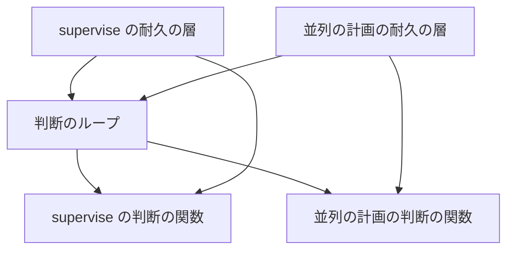
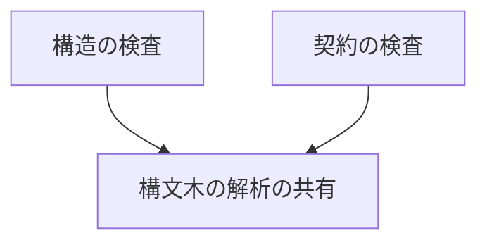
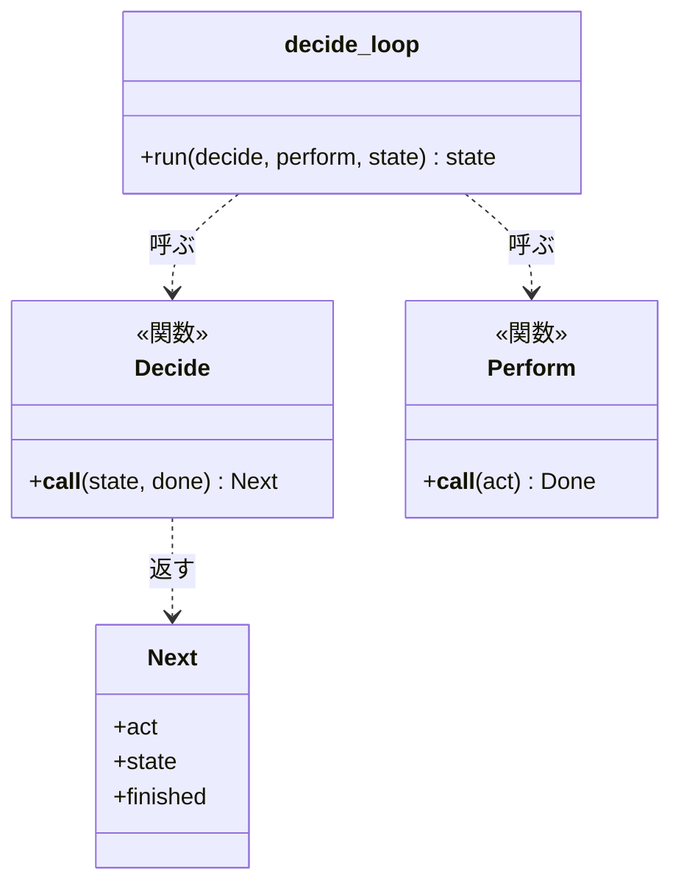
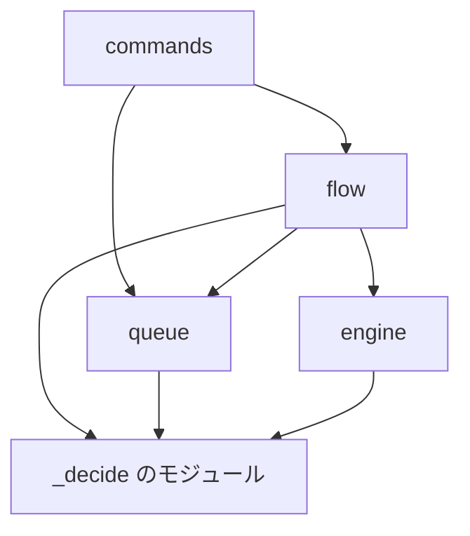
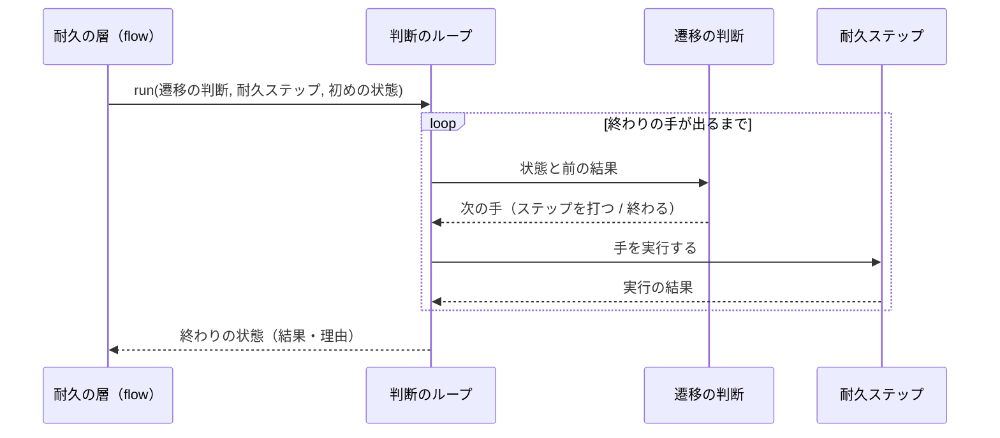

# NDF のスクリプトの作り直し: 判断を耐久の層から外して単体のテストで確かめ、リファクタリング計画の 8 件を子 Issue として流せる（#2963）

## 目的

- **今どうなっているか**: supervise・並列の計画・開発ループの判断が耐久ワークフローのループや 500 行前後のファイルに埋まり、判断だけを見るテストも DBOS を起動する。リファクタリング計画の 8 件（#2963・#2990〜#2996）には設計が無く、#1142 の流す順序から外れている
- **誰に効くか**: NDF のスクリプトを直す人と AI、全体テストと CI を待つすべての工程、supervise・並列の計画・開発ループ・リリースを使う利用者
- **変えると何が成り立つか**: 8 件が 11 本の子 Issue として触るファイル・先に要るもの・順番を持ち、#1142 の子 Issue と重ならずに流れる。判断は耐久を読まない関数に移り、単体のテストで DBOS を起こさずに確かめられる

## 適用範囲

- **働く範囲**: このリポジトリの NDF のスクリプト（`plugins/ndf/scripts/`・2 本の `drive.py`）と、リポジトリの検査（`scripts/check-script-structure.py`・`scripts/check-ndf-contracts.py`）。利用先のリポジトリでは、supervise・並列の計画・開発ループ・リリースの振る舞いとして働く
- **プロジェクトごとに違うもの**: 無し（スクリプトの内部の構造と、このリポジトリの検査だけを変える）
- **当たるモード**: `standard`

## あるべき姿の根拠

| 根拠 | 種類 | 何を示すか |
| --- | --- | --- |
| STD1・STD2 | 外部の一次情報 | 耐久ワークフローの関数は決定的でなければならない。判断を状態と入力だけで決まる関数にすれば、記録からの再実行と単体のテストの両方が成り立つ |
| PRD1 | 外部の一次情報 | DBOS の関数を pytest で確かめるには、テストごとに DBOS を作り直す必要がある。判断を DBOS の外へ出せば、その費用を払わずに済む |
| PRD2 | 外部の一次情報 | 判断を純粋な関数のコアに、副作用を薄い外側の層に分ける形が、テストを分離しモックを減らす作り方として知られている |
| CI の実測（実行 43403234419、develop 780f2f671、2026-11-13） | 実測 | `drive()` を使う 4 ファイル 84 件で 68.8 秒、`test_supervise*` 26 ファイル 459.1 秒、`test_parallel*` 23 ファイル 205.2 秒 |
| 手元の実測（2026-11-13） | 実測 | 構造の検査は 13.8 秒・596 ファイルに対して構文木の解析を 2,993 回行う。契約の検査は 8.1 秒で `limits_decl.references` を 2 回呼ぶ |
| 利用者の依頼（2026-11-11）と #1142 の前提（2026-11-13） | 利用者の指示の原文 | 「コストまたは実行時間短縮に効果が高いものほど優先、その土台はさらに優先」「後方互換を意識する必要はない」 |

要求と受け入れ条件は #2963 の本文にある（コピーは [issue-2963-requirements.md](issue-2963-requirements.md) ）。この文書は「どう作るか」だけを扱う。決定の記録は [issue-2963-design-decisions.md](issue-2963-design-decisions.md) にある。詳細設計（ファイル配置・関数の仕様・#1142 の頭の詳細設計への反映）は、後の段が `issues/issue-2963-design-detail.md` に書く。

## ドメインモデル

### コンテキスト

| コンテキスト | 何の語が 1 つの意味に決まるか |
| --- | --- |
| プランの実行と並列の計画（`ndf-workflow`） | 判断の関数・耐久の層・遷移の判断・子 Issue と流す順序 |
| リポジトリの検査（`repo-dev-checks`） | 構造の検査の規則・例外リスト・import の輪・構文木の解析 |

2 つは共有カーネルの関係である。共有するのは、判断のモジュールの名前の決まり（`_decide.py` で終わる。決定 2）と、耐久の層の置き場の一覧（構造の検査の `DURABLE_BOUNDARY`。決定 6）の 2 つだけで、検査はこの 2 つを通してスクリプトに形（`decide-pure`・`durable-boundary`）を求める。どちらかを変える子 Issue は、スクリプトの側と検査の側を同じ PR で変える。それ以外のモジュールと import の形は、検査がそのまま読み、形を求めない。

### 集約

| 集約 | 持ち主（書き換えてよいもの） | 根 | エンティティ | 値オブジェクト |
| --- | --- | --- | --- | --- |
| 判断のループ | `plugins/ndf/scripts/lib/decide_loop.py`（RF1） | ループの 1 回の実行 | — | 次の手・実行の結果 |
| プランの遷移 | `plugins/ndf/scripts/supervise_lib/step_decide.py`（RF4） | 遷移の状態 | — | 上限・数えた回数・遅れの再試行の回数・次のステップ |
| キューの前提 | `plugins/ndf/scripts/supervise_lib/queue_decide.py`（RF4 が置き、RF5a が広げる） | 前提の判定 | — | 流さなかった理由・前提のプランの結果 |
| 周の結果 | `plugins/ndf/scripts/lib/sprint_loop_decide.py`（RF7） | 周の結果の判定 | — | リリースの事実・周の終わり方 |
| 例外リストの項目 | 項目のファイルごとに 1 本の子 Issue。RF2 が置き、「設計の結果」の下の項目の表が名指す子 Issue だけが消す | 項目のファイル（1 項目 1 集約） | — | 種類・パス・名前・理由 |
| 子 Issue の計画 | #1142 の頭の詳細設計（`issues/issue-1142-design-detail.md`） | 子 Issue | — | 触るファイル・先に要るもの・順番 |
| 構文木の解析の共有 | `scripts/lib/parsed.py`（RF3） | 1 回の検査の実行 | — | パス・構文木 |
| リリースの段階 | `plugins/ndf/scripts/release-steps.py` と `release_lib/stage_*.py`（RF8） | 副命令の振り分け | — | 副命令・段階 |
| 耐久の記録の形 | `plugins/ndf/scripts/lib/durable.py` の `FORMAT`（変える子 Issue は無い。決定 16） | 形式の版 | — | 耐久ワークフローの名前・耐久ステップの名前と呼ぶ順 |

### 不変条件

| # | 集約 | 条件 | 破れたときの扱い |
| --- | --- | --- | --- |
| I1 | 判断のループ | 判断の関数のモジュール（名前が `_decide.py` で終わる）は、`durable`・`dbos`・プロセスとファイルを扱う部品を import しない | 構造の検査が `decide-pure` で落とす |
| I2 | 判断のループ | 判断の関数は、同じ状態と入力に同じ次の手を返す | 単体のテストが落ちる |
| I3 | 判断のループ | 耐久の層は、判断の関数が返した手を 1 つずつ実行するだけで、自分で次の手を選ばない | 構造の検査の `durable-boundary` が落とす（見る範囲は決定 6） |
| I4a | プランの遷移 | 数えた回数が上限を超えたら止まる | 単体のテストが落ちる |
| I4b | プランの遷移 | 遅れの見張りの再試行は数えない | 単体のテストが落ちる |
| I4c | プランの遷移 | 知らないステップで止まる | 単体のテストが落ちる |
| I5a | キューの前提 | 前提のプランが後ろにある・見つからない・完了でない（承認ゲートも完了でない）のどれかなら、その理由を添えて流さない | 単体のテストが落ちる |
| I5b | キューの前提 | 前提の結果は引数で受け、ファイルを読まない | 構造の検査が `decide-pure` で落とす |
| I6 | 子 Issue の計画 | 同じ順番の子 Issue は触るファイルが重ならず、先に要るものは前の順番にある | 流す順序の確かめのスクリプトが終了コード 1 を返す |
| I7a | 例外リストの項目 | 遅延の輪は例外リストに載った組だけが許され、載っていない組は落ちる | 構造の検査が `lazy-cycle` で落とす |
| I7b | 例外リストの項目 | ほどいた組の項目が残れば落ちる | 構造の検査が `unused-allow` で落とす |
| I8 | 例外リストの項目 | 1,000 行を超えるファイルは例外リストに載り、載せた行数を超えない | 構造の検査が `lines` で落とす |
| I9 | 構文木の解析の共有 | 1 回の検査の実行の中で、1 つのファイルの構文木の解析は 1 回である | 単体のテストが落ちる |
| I10 | 構文木の解析の共有 | 解析を共有した前後で、2 本の検査の違反の一覧は同じ入力に同じである | 結合のテストが落ちる |
| I11 | 周の結果 | 周の結果（完了・失敗・人へ戻した）は、実際のリリースの事実から導く | 単体のテストが落ちる |
| I12 | リリースの段階 | `release-steps.py` の最上位の関数は `main`・`build_parser`・副命令のハンドラー（`cmd_*`）だけで、ハンドラーは段階のモジュールの関数を 1 つ呼んで返す | RF8 の単体のテスト（`release-steps.py` の構文木を読んで関数と呼び出しを数える）が落ちる |
| I13 | 耐久の記録の形 | 8 件の子 Issue は、耐久ワークフローの名前・耐久ステップの名前・1 回の実行の中で耐久ステップを呼ぶ順を変えない | 耐久を通す代表のテスト（C8）が、記録した耐久ステップの名前の並びを着手前の並びと比べて落ちる |

### ドメインイベント

| # | イベント | 発生元 | 受け手 |
| --- | --- | --- | --- |
| E1 | 8 件の設計承認ゲートで設計が承認された | 設計 PR の承認 | 詳細設計の段（後の段） |
| E2 | 分けた子 Issue（RF1b・RF5b・RF6b）を起票し、#1142 の sub-issue に結んだ | 設計の結果のステージ | 流す順序（順番が来たら次の子 Issue を起動する監視） |
| E3 | 土台（#2990・#2991。RF1・RF2）の子 Issue がマージされた | 子 Issue の PR | 後の順番の子 Issue（RF4〜RF8・RF1b） |
| E4 | supervise（RF4・RF5a・RF5b）の子 Issue が SF1b の前にマージされた | 子 Issue の PR | SF1b |
| E5 | 検査（#2996。RF3）の子 Issue が DC2 の前にマージされた | 子 Issue の PR | DC2 |
| E6 | 並列の計画（RF6a・RF6b）の子 Issue がマージされた | 子 Issue の PR | SF1b・SF9・DC8 |
| E7 | 開発ループ（RF7）・リリース（RF8）の子 Issue がマージされた | 子 Issue の PR | SF1b・SF11・K3・DC8 |
| E8 | 割り当てた bug を、子 Issue の PR で再現の手順を 1 回通して閉じた | 子 Issue の PR | bug の Issue |
| E9 | 8 件の範囲の兆候の数とテストの所要を測り直した | すべての子 Issue のマージ | #1142 のコメント |

### 用語

| 用語 | 意味 | 用語集への反映 |
| --- | --- | --- |
| 判断の関数 | 状態と入力を受けて次の手を返す関数。耐久ワークフロー・DBOS・プロセス・ファイルを扱わない。置き場のモジュールの名前は `_decide.py` で終わる | 追加済み（この設計の PR。`docs/glossary.md`） |
| 耐久の層 | 判断の関数が返した手を耐久ステップで実行し、結果を判断の関数へ返す薄い層。次の手を自分で選ばない | 追加済み（この設計の PR。`docs/glossary.md`） |
| 判断のループ | 判断の関数と、手を実行する関数を受けて回す共通の部品（`lib/decide_loop.py`）。実行する関数に耐久ステップを渡すと耐久の層になり、ただの関数を渡すと DBOS を起こさない実行器になる | 追加済み（この設計の PR。`docs/glossary.md`） |
| 遷移の判断 | プランの次のステップと結果の確定を決める判断。判断の関数の 1 つ | 追加済み（要求の段） |
| DBOS を起こさない実行器 | 判断のループに、耐久ステップでない関数を渡して回す経路 | 追加済み（要求の段） |

## 外部の調査

| 種類 | 調べるか | 理由 |
| --- | --- | --- |
| 標準・仕様 | 調べる | 耐久ワークフローの関数に課される決定性の要件が、判断を切り出す形の前提になる |
| 主要な製品 | 調べる | 耐久ワークフローの製品がテストをどう勧めているか、行数と循環の検査を既存の静的解析がどう扱っているかを比べる |
| ライブラリとサービス | 調べる | import の輪の検査と耐久ワークフローの部品に、自前で作らずに使えるものがあるかを決める |

### 標準・仕様

| # | 標準・仕様 | 何を定めているか | 設計への反映 | 出典 |
| --- | --- | --- | --- | --- |
| STD1 | Temporal の Workflow Definition | ワークフローの定義は再実行のために決定的でなければならず、同じ入力で同じ API の呼び出しを同じ順で行う | 判断の関数は状態と入力だけで次の手を決める（I2）。判断のループは耐久の層の中で同じ順で手を実行する | https://docs.temporal.io/workflow-definition （2026-11-13） |
| STD2 | DBOS の Workflows の説明 | ワークフローの関数は決定的でなければならず、データベース・外部 API などの非決定的な操作はステップで行う | 判断の関数は外部を読まず、外部を読む処理は耐久ステップに置く（I1・I3） | https://docs.dbos.dev/python/tutorials/workflow-tutorial （2026-11-13） |

### 主要な製品

| # | 製品 | どう解いているか | 設計への反映 | 出典 |
| --- | --- | --- | --- | --- |
| PRD1 | DBOS のテストの手引き | DBOS の関数は pytest で確かめられるが、テストごとに `DBOS.destroy()` と `DBOS.launch()` で作り直す | 判断のテストは DBOS を起こさない実行器で回し、作り直しを払うのは耐久を通すことを確かめる代表のテストだけにする（C8） | https://docs.dbos.dev/python/tutorials/testing （2026-11-13） |
| PRD2 | Functional Core, Imperative Shell（Destroy All Software） | 純粋な関数のコアが判断を持ち、副作用を持つ薄い外側の層がコアを呼ぶ。コアはモックなしで確かめられる | 判断の関数と耐久の層の分け方（決定 1） | https://www.destroyallsoftware.com/screencasts/catalog/functional-core-imperative-shell （2026-11-13） |
| PRD3 | pylint の `too-many-lines`（C0302） | モジュールの行数が上限を超えると知らせる。上限 `max-module-lines` の既定は 1,000 | 構造の検査の行数の上限を 1,000 の安全網にする（決定 5） | https://pylint.readthedocs.io/en/stable/user_guide/messages/convention/too-many-lines.html （2026-11-13）。既定値は `issues/issue-1142-design-decisions.md` の決定 18 の表 |
| PRD4 | pylint の `cyclic-import`（R0401） | 2 つ以上のモジュールの import の輪を知らせる。関数の中の import も輪に数える | 遅延の輪を数える規則の範囲（関数の中の import を含める）に倣う（決定 6） | https://pylint.readthedocs.io/en/stable/user_guide/messages/refactor/cyclic-import.html （2026-11-13） |

### ライブラリとサービス

| # | 候補 | 版 | ライセンス | 最後のリリースの日付 | 終了のアナウンス | 要件を満たすか | 出典 |
| --- | --- | --- | --- | --- | --- | --- | --- |
| LIB1 | import-linter | 2.16 | BSD-2-Clause | 2026-11-06 | 無し | 一部。`Acyclic siblings` の契約で輪を落とせるが、対象はパッケージで、`lib/` の直下に並ぶモジュール（パッケージでない）を対象にできない | https://pypi.org/pypi/import-linter/json ・ https://import-linter.readthedocs.io/en/stable/contract_types.html （2026-11-13） |
| LIB2 | grimp | 3.19 | BSD-2-Clause | 2026-11-06 | 無し | 一部。import のグラフを作れるが、入力は最上位のパッケージの名前である | https://pypi.org/pypi/grimp/json ・ https://grimp.readthedocs.io/en/stable/usage.html （2026-11-13） |
| LIB3 | pylint | 4.1.3 | GPL-2.0-or-later | 2026-10-11 | 無し | 一部。`cyclic-import` は関数の中の import も数えるが、スクリプトが実行時に足す検索経路（`sys.path` の追加）をたどらない。依存を新しく足すことになる | https://pypi.org/pypi/pylint/json （2026-11-13） |
| LIB4 | pydeps | 3.0.9 | BSD-2-Clause | 2026-10-01 | 無し | 満たさない。依存の図を描くツールで、輪を例外リストつきで落とす検査を持たない | https://pypi.org/pypi/pydeps/json （2026-11-13） |
| LIB5 | dbos | 3.5.0（プロジェクトは 3.1.0 に固定） | MIT | 2026-11-10 | 無し | 満たす。耐久の層はこのまま `lib/durable.py` 経由で使い、判断の関数を回す部品は DBOS に無い（PRD1 のとおり DBOS の関数を回すには DBOS を起動する） | https://pypi.org/pypi/dbos/json （2026-11-13）、`pyproject.toml` の `durable` のグループ |
| LIB6 | Python の標準ライブラリ `functools.cache` | Python 3.14 に同梱 | PSF | — | 無し | 満たす。引数ごとに結果を覚える。1 回の実行の中で同じパスの解析を 1 回にできる | https://docs.python.org/3/library/functools.html （2026-11-13） |

### 確かめられなかったこと

| 対象 | 試した手段 | 結果と理由 |
| --- | --- | --- |
| pylint を NDF のスクリプトの全体に掛けたときの所要 | 試していない | 依存を足さない決定（決定 6）に影響しない。依存を足さない理由は検索経路の不一致で、所要ではない |

調べた量: 候補 12 件・取得の試み 16 回。

## 機能一覧

| # | 機能 | 誰が使うか |
| --- | --- | --- |
| F1 | 判断のループ（判断の関数を耐久の層でも DBOS を起こさずにでも回す） | supervise・並列の計画・開発ループの実装と、そのテスト |
| F2 | プランの遷移の判断とキューの前提の判断の単体のテスト | supervise を直す人と AI |
| F3 | 構造の検査の行数の安全網・遅延の輪の検査・判断のモジュールの純粋さの検査 | すべての PR の CI |
| F4 | 1 回の実行で 1 ファイル 1 回の構文木の解析 | すべての PR の CI と手元の検査 |
| F5 | supervise・並列の計画・開発ループ・リリースの判断の、責務で分けたモジュールと単体のテスト | それぞれを直す人と AI、使う利用者 |
| F6 | 8 件の子 Issue の行・流す順序・bug の割り当て | 流す順番を見張るレーンとオーガナイザー |

## 構成要素

| 要素 | 責務 |
| --- | --- |
| 判断のループ（`lib/decide_loop.py`。新設、RF1） | 判断の関数と手を実行する関数を受け、終わりの手が出るまで回す。`durable` を import しない |
| 遷移の判断（`supervise_lib/step_decide.py`。新設、RF4） | プランの次のステップ・上限・遅れの再試行・知らないステップを決める |
| キューの判断（`supervise_lib/queue_decide.py`。新設、RF4 が前提の判定を置き、RF5a が再開の開始点と重なりを足す） | 前提のプランの判定・再開の開始点・同時に流す組を決める |
| プランの組み立て（`supervise_lib/plan_decide.py`。新設、RF5a） | プランの正規化・差し込みの埋め方・実行の鍵を決める |
| スプリントの判断（`supervise_lib/sprint_decide.py`。新設、RF5b） | スプリントの順番の組み方と閉じのプランの引数を決める |
| 並列の計画の判断（`lib/parallel_decide.py` ほか `_decide.py`。新設、RF6a・RF6b） | 知らせ・問い・答え・リリース・起動、計画の上限・置き場・レーンの判断を決める |
| 周の結果の判断（`lib/sprint_loop_decide.py`。新設、RF7） | 周の結果・選定の除外を、リリースの事実から決める |
| リリースの段階（`release_lib/stage_*.py`。新設、RF8） | 提示・承認・本番・CD の結果・リリース後テストの副命令の処理と判断を段階ごとに持つ |
| 耐久の層（`supervise_lib/flow.py`・`lib/parallel_run.py`。変更） | 判断のループに耐久ステップを渡して回す。分岐を持たない |
| 構文木の解析の共有（`scripts/lib/parsed.py`。新設、RF3） | 1 回の実行の中で、1 つのファイルを 1 回だけ解析して返す |
| 構造の検査（`scripts/check-script-structure.py`。変更、RF2・RF3） | 行数の安全網・遅延の輪・判断のモジュールの純粋さを規則として持つ |
| 契約の検査（`scripts/check-ndf-contracts.py`・`scripts/contracts_lib/`。変更、RF3） | 上限の宣言の参照を 1 回だけ集め、描画と違反の両方へ渡す |



「supervise の判断の関数」は遷移の判断・キューの判断・プランの組み立て・スプリントの判断の 4 つを、「並列の計画の判断の関数」は `parallel_decide.py`・`parallel_plan_decide.py` をまとめて描いた。検査の 3 つの要素の関係:



**図に含めない要素**: 周の結果の判断（開発ループのサブコマンドから呼ばれる）とリリースの段階（`release-steps.py` から呼ばれる）。どちらも耐久の層を通らず、ほかの構成要素との辺を持たない。

## 構造

判断のループの型の関係（変更が触る型だけ）:



- `Next` は値オブジェクトで、`finished` が真のとき `act` を持たない
- 耐久の層は `Perform` に耐久ステップを渡す。テストはただの関数を渡す（DBOS を起こさない実行器）
- 遷移の判断の状態は、今の `_plan_steps` のローカルの変数（`sid`・`n`・`counted`・`retries`・`retried`・`limit`）を 1 つの値にまとめたものである

`supervise_lib` の import の向き（変更の後。矢印は import）:



`engine` は `flow` を読まず、`queue` は `flow` を読まない（L5 の輪をほどく。決定 3）。耐久ワークフローを起こすのは `commands` から呼ばれる `flow` だけである。

## 処理の流れ

プランの耐久ワークフローの 1 回（RF4 の後）:



テストでは、耐久ステップの代わりに偽の結果を返す関数を渡す。参加者は判断のループと遷移の判断だけになり、DBOS は起動しない。

判断のループ自身は耐久ステップではなく、耐久ワークフローの関数の中で回る。耐久の記録に残るのは、判断のループが実行する耐久ステップの呼び出しだけである。判断を関数へ移しても、耐久ステップの名前と呼ぶ順は着手前と同じにする（I13）。このため耐久の記録の形は変わらず、形式の版（`lib/durable.py` の `FORMAT`）は上げない（決定 16）。

この図はプランの 1 回だけを描く。**図に含めない要素**: キューの判断・プランの組み立て・スプリントの判断・並列の計画の判断（耐久の層が同じ形で判断のループへ渡す）、周の結果の判断とリリースの段階（耐久の層を通らない）、構文木の解析の共有と 2 本の検査（CI の中で別に走る）。

## 非機能の実現方式

| 大項目 | 条件 | 実現方式 |
| --- | --- | --- |
| 性能・拡張性 | 判断のテストは DBOS を起動しない。対象のテストの所要が着手前より縮む | 判断のテストは判断の関数を直に呼ぶか、DBOS を起こさない実行器で回す。測り方は「子 Issue の行」の測る手順 |
| 運用・保守性 | 8 件の範囲に遅延の輪が無い。兆候は A0 の基準を超えない | 構造の検査の `lazy-cycle` が新しい輪を落とし、ほどいた組の例外は `unused-allow` が落とす（決定 6）。A0 の検査は各 PR の CI で走る |
| 移行性 | 後方互換を置かない。形を変えた PR は移行の手順を本文に書く。記録の形を変えるときは、変えた形と理由を設計に書く（C9 を改めた条件） | 耐久の記録の形は変えない（I13・決定 16）。実行中のワークフローは、更新の後も同じ記録から再実行で続く。子 Issue の PR は、変えた形の読み手を同じ PR で書き換え、`rg` で古い形の参照が 0 件であることと、利用者の手元の状態ファイル・台帳を作り直すかを本文に書く（C34） |

## 子 Issue の行

8 件を 11 本の子 Issue にする（分け方は決定 9）。列は #1142 の頭の詳細設計の「実装計画」と同じである。触るファイルの全体は「設計の結果」の表にある。PR は子 Issue ごとに 1 本で、その revert 1 つで 1 つ前に戻る。

| 子 Issue | 主題 | 中身 1 文 | 触るファイル（数） | 先に要るもの | 並列の組 | PR の単位 | 見直す前の企画の設計文書の節 | 消す古いテスト | この子で解消する Issue |
| --- | --- | --- | --- | --- | --- | --- | --- | --- | --- |
| `RF1`（#2990） | 土台 | 判断のループと判断の関数の型を置き、耐久の層で回す代表のテストと DBOS を起こさないテストを足す | 3 本 | 無し | 組 R | 1 本 | 無し | 無し | — |
| `RF1b`（#2990 から分ける） | 土台 | 耐久の層の利用者のうち 8 件の組み直しが触らない 4 本（`durable.py`・`post_queue.py`・2 本の `drive.py`）の兆候を直す | 4 本と基準のディレクトリ・テスト 3 本 | `A1a`・`RF2` | 組 R | 1 本 | 無し | 握りつぶし・既定値への倒れを期待値に持つ場合 | — |
| `RF2`（#2991） | 土台 | 行数の上限を 1,000 の安全網にし、遅延の輪と判断のモジュールの純粋さを構造の検査の規則にし、耐久の層の境界の規則を 2 つの耐久の層へ広げる | 5 本と例外リスト | `A1a` | 組 R | 1 本 | 決定 18（行数の上限） | `test_import_cycles.py`（ファイルごと。規則へ移す） | — |
| `RF3`（#2996） | 土台 | 2 本の検査の構文木の解析を 1 回の実行で 1 回にし、`limits_decl.references` を 1 回にする | 8 本 | `RF2` | 組 R | 1 本 | 無し | 無し | — |
| `RF4`（#2963） | supervise | 遷移の判断とキューの前提の判断を判断の関数へ移し、遷移だけを見るテストを DBOS を起こさない形へ作り直す | 10 本と例外 1 本 | `RF1`・`RF2`・`A1b` | 組 R | 1 本 | 無し | `test_supervise_limits.py`・`test_design_review_settled.py`・`test_base_sync.py`・`test_supervise_stop_exit.py` のうち遷移だけを見るテスト | #3086 |
| `RF5a`（#2993） | supervise | `engine`・`flow`・`queue` の輪をほどき、プランの組み立てと再開・重なりの判断を判断の関数へ移す | 15 本と例外 1 本 | `RF4` | 組 R | 1 本 | dbos の文書の「`queue`: ステージ・重なり・資源の枠」 | `test_supervise_queue.py`・`test_supervise_resume.py` のうち判断だけを見るテスト | #3176・#3114・#3047・#2949 |
| `RF5b`（#2993 から分ける） | supervise | スプリントの順番の組み方と閉じのプランの判断を判断の関数へ移し、`sprint`・`sprint_waves` を責務で分ける | 7 本 | `A1a`・`RF2` | 組 R | 1 本 | 無し | `test_supervise_sprint_chain.py`・`test_supervise_close_auto.py` のうち判断だけを見るテスト | #2968・#2967 |
| `RF6a`（#2992） | 並列の計画 | `_Run` の知らせ・問い・答え・リリース・起動の判断を判断の関数へ移して耐久の層を薄くし、L3 の輪をほどく | 13 本と例外 2 本 | `RF1`・`RF2`・`A1b`・#2936（マージ済み） | 組 R | 1 本 | 無し | `test_parallel_run.py`・`test_parallel_answer.py` のうち判断だけを見るテスト | #3174・#3096・#2585 |
| `RF6b`（#2992 から分ける） | 並列の計画 | 計画の上限・置き場・レーンの判断を判断の関数へ移し、L7・L9 の輪をほどく | 11 本と例外 2 本 | `RF6a` | 組 R | 1 本 | 無し | `test_parallel_plan.py`・`test_parallel_lane.py`・`test_parallel_external.py` のうち判断だけを見るテスト | #3145・#3064・#3021 |
| `RF7`（#2994） | 開発ループ | 周の結果と選定の除外を判断の関数へ移し、周の結果をリリースの事実から導く。L10 の輪をほどく | 10 本と例外 1 本 | `A1b`・`RF2` | 組 R | 1 本 | 無し | `test_sprint_loop.py` のうち判断だけを見るテスト | #2722 |
| `RF8`（#2995） | リリース | `release-steps.py` の副命令を段階ごとのモジュールへ分け、エントリポイントを振り分けだけにする | 12 本と例外 1 本 | `RF2` | 組 R | 1 本 | 無し | `test_release_steps.py` のうち段階の判断だけを見るテスト | #3110・#2601・#1755 |

「のうち〜だけを見るテスト」の一覧は、子 Issue の PR が着手の時点で数え、PR 本文に載せる（C33）。分けた子 Issue（RF1b・RF5b・RF6b）は E2 で起票し、番号を詳細設計の段で表へ写す。

### 測る手順と縮める対象

着手前の値は、develop の最新の `pytest` のワークフローの JUnit の成果物（`pytest-junit-0`・`pytest-junit-1`）から、対象のファイルの `testcase` の `time` の和で取る。着手後の値は、子 Issue の PR の同じ成果物から同じ集計で取る。並列数と分割の数は CI の設定（`-n auto`・2 分割）で両方そろう。手元でテストを走らせないのは、`.ndf/project.json` の `test.ci.only` の宣言のためである。

```bash
gh run download <実行の ID> -D <置き場>
python3 - <置き場> '<対象のファイルの正規表現>' <<'EOF'
import glob, re, sys, xml.etree.ElementTree as E
cases = [c for f in glob.glob(f"{sys.argv[1]}/*/*.xml") for c in E.parse(f).getroot().iter("testcase")
         if re.fullmatch(sys.argv[2], next((m for m in c.get("classname", "").split(".") if m.startswith("test_")), ""))]
print(len(cases), "件", round(sum(float(c.get("time", 0)) for c in cases), 1), "秒")
EOF
```

2026-11-13 に develop の実行 43403234419（780f2f671）で打ち、下の表の着手前の値を得た。検査の所要は手元で `python3 <検査>` を打った経過の秒で測る。

| 子 Issue | 縮める対象 | 正規表現 | 着手前の値 |
| --- | --- | --- | --- |
| `RF1` | 無し（新しいテストだけを足す。所要は RF4 で縮める） | — | — |
| `RF1b` | `test_durable.py`・`test_post_queue.py` | `test_(durable\|post_queue)` | 96 件 33.0 秒 |
| `RF2` | 構造の検査 | — | 13.8 秒（手元、2026-11-13） |
| `RF3` | 構造の検査と契約の検査 | — | 13.8 秒と 8.1 秒（手元、2026-11-13） |
| `RF4` | `drive()` を使う 4 ファイル | `test_(supervise_limits\|design_review_settled\|base_sync\|supervise_stop_exit)` | 84 件 68.8 秒 |
| `RF5a`・`RF5b` | `test_supervise*` | `test_supervise.*` | 724 件 459.1 秒 |
| `RF6a`・`RF6b` | `test_parallel*` | `test_parallel.*` | 692 件 205.2 秒 |
| `RF7` | `test_sprint_loop*` | `test_sprint_loop.*` | 262 件 22.4 秒 |
| `RF8` | `test_release*` | `test_release.*` | 328 件 92.3 秒 |

縮める秒数の目標は置かない。条件は着手前の値より小さいことである（C4・C10・C17・C21・C30）。RF4 の着手の時点の値が上の値と違えば、着手の時点の値を正とする。

### 流す順序への入れ方

8 件の子 Issue を #1142 の流す順序（14 の順番）へ入れた形を次に示す。詳細設計の段がこの形を頭の詳細設計の「流す順序」と「実装計画」へ反映し、確かめのスクリプト（D3）を打つ。

| 順番 | 同時に流せる子 Issue | 8 件の子 Issue を置いた理由 |
| --- | --- | --- |
| 1 | `SF3`・`A0`・`SF1a`・`DC1`・`RF1` | `RF1` は新しいファイルだけを触る |
| 2 | `A1a`・`A2` | `DC2` を順番 5 へ移した（`RF3` の後） |
| 3 | `A1b`・`RF2` | `RF2` ← `A1a`（`scripts/check-script-structure.py`） |
| 4 | `RF3`・`RF4`・`RF5b`・`RF6a`・`RF7`・`RF8`・`RF1b` | `RF3` ← `RF2`（`scripts/check-script-structure.py`）、`RF4` ← `A1b`（`supervise_lib/queue.py`）、ほかは `RF2`（例外リストの項目と行数の扱い）と `A1a`・`A1b` の後。例外リストは項目のファイルの名前で触るため、同じ順番で重ならない |
| 5 | `RF5a`・`RF6b`・`DC2` | `RF5a` ← `RF4`（`supervise_lib/flow.py`）、`RF6b` ← `RF6a`、`DC2` ← `RF3`（`scripts/check-ndf-contracts.py`） |
| 6 | `SF1b` | `SF1b` ← `RF5a`・`RF6b`・`RF7`・`RF8`・`RF1b`（触るファイルが重なる） |
| 7〜16 | 今の順番 5〜14 の子 Issue | 先に要るものに 8 件を戻しても、今の順番 5 以降は `SF1b` の後にあり、互いの前後は変わらない |

先に要るものへ 8 件を戻す #1142 の子 Issue（D2）:

| #1142 の子 Issue | 戻す先に要るもの | 理由 |
| --- | --- | --- |
| `SF1b` | `RF4`・`RF5a`・`RF5b`・`RF6a`・`RF6b`・`RF7`・`RF8`・`RF1b` | 127 本のファイルが 8 件の範囲を含む（scripted-flow の詳細設計の「並行と排他」） |
| `SF2`・`SF6`・`SF7` | `RF4`・`RF5a` | `supervise_lib/engine.py`・`flow.py`・`queue.py`・`state.py` が重なる |
| `SF9` | `RF6a`・`RF6b` | `lib/parallel_answer.py`・`parallel.py` が重なる |
| `SF8` | `RF1`・`RF1b` | 耐久の待ち `durable.sleep`（`lib/durable.py`）を受け持ち、判断のループの上で行き先を足す（決定 15） |
| `SF11` | `RF7` | `lib/sprint_loop_cli.py` が重なる |
| `SF13` | `RF5a`・`RF5b` | `supervise_lib/commands.py`・`sprint.py` が重なる |
| `DC2` | `RF3` | data の決定 53（検査の土台は #2996 の後） |
| `DC8` | `RF1`・`RF5a`・`RF6a`・`RF6b`・`RF7`・`RF8` | data の詳細設計の DC8 の行（#2990・#2992〜#2995 の後） |
| `K1` | `RF1b` | `skills/cross-review/scripts/drive.py` が重なる |
| `K2` | `RF5a` | `supervise.py` の起動の経路が重なる |
| `K3` | `RF8` | `release-steps.py` が重なる |

## テスト設計

| 受け入れ条件・不変条件 | どの振る舞いで縛るか | どう壊したら落ちるべきか |
| --- | --- | --- |
| C1・C7・I4a・I4b・I4c | 遷移の判断に、上限の内の経路・上限を超える経路・遅れの再試行を挟む経路・知らないステップを渡すと、次の手と結果・理由が決まる。DBOS を起動しない | 遅れの再試行を数えるように壊す・知らないステップを飛ばすように壊すと落ちる |
| C2・C8・I13 | `drive()` を使う 4 ファイル（`test_supervise_limits.py`・`test_design_review_settled.py`・`test_base_sync.py`・`test_supervise_stop_exit.py`）のうち、耐久を通すことを確かめる代表のテストだけが DBOS を起動し、プランを最後まで流す。代表のテストは、記録した耐久ステップの名前の並びを着手前の並びと比べる | 判断のループが耐久ステップを呼ばないように壊す・耐久ステップを呼ぶ順を入れ替えると代表のテストが落ちる |
| C3・I5a・I5b | キューの前提の判断が、後ろにある・見つからない・完了でない・承認ゲートの 4 つの理由の文を返し、前提の結果を引数で受ける | 承認ゲートを完了と読むように壊す・ファイルを読みに行くように壊すと落ちる |
| C4・C10・C17・C21・C30 | 子 Issue の PR の JUnit の対象のファイルの和が、着手前の値より小さい | 測る手順で比べ、小さくなければ PR 本文に書いて止まる（テストではなく測定で縛る） |
| C6・I1 | `_decide.py` で終わるモジュールが `durable`・`dbos`・プロセスとファイルを扱う部品を import すると、構造の検査が `decide-pure` を返す | 判断のモジュールに `import durable` を足すと落ちる |
| I2 | 判断の関数を同じ状態と入力で 2 回呼ぶと同じ次の手を返す | 時刻や乱数を読むように壊すと落ちる |
| I3 | 2 つの耐久の層の、耐久ワークフローの関数とそれが同じモジュールで直に呼ぶ関数（耐久ステップを除く）が `for`・`while` を持つと、構造の検査が `durable-boundary` を返す（見る範囲は決定 6） | 耐久の層にループを書き戻すと落ちる |
| C11・C12・C13・I8 | 1,000 行を超えるファイルが例外リストに無ければ `lines` で落ち、1,000 行以下は 500 行を超えても落ちない。例外リストの行数を超えたら落ちる | 上限を 500 に戻すと 501〜1,000 行の入力で落ちる |
| C15・C18・C22・I7a・I7b | 関数の中の import だけで輪になる組が例外リストに無ければ `lazy-cycle` で落ち、例外リストにあってほどけていれば `unused-allow` で落ちる | 関数の中の import を数えないように壊すと、輪の入力で落ちない |
| C14・C19 | 並列の計画・プランの組み立て・キューの判断の関数が、状態と入力から次の手を返す（子 Issue ごとの単体のテスト） | 判断の関数がファイルを読むように壊すと `decide-pure` で落ちる |
| C23・I11 | 「失敗と記録された周が実際はリリースしていた」形の事実を周の結果の判断に渡すと、完了を返す | 終了コードだけで判定するように壊すと落ちる |
| C25・C26・I12 | `release-steps.py` の副命令が段階のモジュールの関数へ振り分けられ、段階ごとの判断の関数が単体で確かめられる。RF8 の単体のテストが `release-steps.py` の構文木を読み、最上位の関数が `main`・`build_parser`・`cmd_*` だけで、各 `cmd_*` が段階のモジュールの関数を 1 つ呼ぶことを確かめる | エントリポイントに判断の関数を書き戻す・ハンドラーに分岐を足すと落ちる |
| C28・C29・I9 | 1 回の検査の実行で、`limits_decl.references` の呼び出しが 1 回、1 つのファイルの解析が 1 回 | 解析の共有を外すと回数の確かめで落ちる |
| C31・I10 | 同じ木を入力に、着手前と後で 2 本の検査の違反の一覧が同じ | 共有した構文木を規則が書き換えるように壊すと、後の規則の結果が変わって落ちる |
| C32 | 子 Issue の PR で A0 の検査が兆候を基準より増やさない | A0 の検査の CI が落ちる |
| C33 | 子 Issue の PR が消した古いテストの一覧が「子 Issue の行」の「消す古いテスト」と一致する | PR 本文の一覧と表の食い違いをコードレビューで見る |
| C34 | 形を変えた子 Issue の PR に、古い形の参照の `rg` の結果が 0 件として載る | 結果が 0 件でなければ PR を出さない |
| D1 | 詳細設計の段で、流す順序の確かめのスクリプトが「設計の結果・流す順序・実装計画の子 Issue の食い違い」を 0 件と返す。列の並びは頭の詳細設計の「実装計画」の見出しの行と同じ | 子 Issue を 1 つの表から落とすと、スクリプトが食い違いを返す |
| D2・D3・I6 | 詳細設計の段で、流す順序の確かめのスクリプトが同じ順番の重なりと先に要るものの逆転を 0 件と返し、終了コード 0 で終わる。D2 が挙げる #1142 の子 Issue（SF1b・SF2・SF6・SF7・SF9・SF11・SF13・DC2・DC8・K1〜K3）の先に要るものに 8 件が載る | 同じ順番に重なる 2 本を置く・先に要るものを後の順番に置くと終了コード 1 |
| D4 | 「開いている bug の割り当て」の表に出る Issue の番号が 48 件で重複が無く、範囲外の行がどれも理由の 1 文を持つ。詳細設計の段で、表から番号を抜き出して数える | 行を 1 つ消すと 47 件になる・2 行に同じ番号を書くと重複が出る |
| D5 | A0 のマージの後に `check-ai-smells.py` が返す兆候のあるファイルのうち 8 件の範囲のものが、どれかの子 Issue の触るファイルに入るか、入れない理由を持つ。詳細設計の段で、2 つの一覧の差を取って 0 件を確かめる | 兆候のあるファイルを触るファイルから外すと、差に出る |
| D6 | 詳細設計の段で、決定 15 の受け持ちの表の左右の部分を、頭の詳細設計の SF2・SF6〜SF9・SF11・A0 の行と 8 件の子 Issue の行がそれぞれ移す関数の名前で突き合わせ、両方に載る関数が 0 件である | 同じ関数を 2 つの行の中身に書くと、突き合わせで出る |
| D7 | 「測る手順と縮める対象」の表に 11 本の子 Issue の行がそろい、各行が縮める対象（テストのファイルの正規表現か検査の名前）を持つ | 子 Issue の行を表から落とすと、11 本にそろわない |

## 設計の結果

| 課題 | 扱い | 取り込み先 | 触るファイル |
| --- | --- | --- | --- |
| #2990 | 実装する | — | （RF1）`plugins/ndf/scripts/lib/decide_loop.py`、`plugins/ndf/scripts/tests/test_decide_loop.py`、`plugins/ndf/scripts/tests/test_decide_loop_durable.py` |
| #2990 | 実装する | — | （RF1b。分けて起票する）`plugins/ndf/scripts/lib/durable.py`、`plugins/ndf/scripts/lib/post_queue.py`、`plugins/ndf/skills/cross-review/scripts/drive.py`、`plugins/ndf/skills/cross-refactoring/scripts/drive.py`、`scripts/ai-smells-baseline/`、`plugins/ndf/scripts/tests/test_durable.py`、`plugins/ndf/scripts/tests/test_post_queue.py`、`plugins/ndf/skills/cross-refactoring/scripts/tests/test_drive_deferred.py` |
| #2991 | 実装する | — | （RF2）`scripts/check-script-structure.py`、`scripts/tests/test_check_script_structure.py`、`scripts/script-structure-allow/`、`plugins/ndf/scripts/tests/test_import_cycles.py`、`docs/specifications/ndf-scripts-import-cycles.md`、`docs/specifications/ndf-script-structure-criteria.md` |
| #2996 | 実装する | — | （RF3）`scripts/lib/parsed.py`、`scripts/lib/py_imports.py`、`scripts/check-script-structure.py`、`scripts/check-ndf-contracts.py`、`scripts/contracts_lib/limits_decl.py`、`scripts/contracts_lib/core_checks.py`、`scripts/contracts_lib/extract_py.py`、`scripts/tests/test_parsed.py` |
| #2963 | 実装する | — | （RF4）`plugins/ndf/scripts/supervise_lib/step_decide.py`、`plugins/ndf/scripts/supervise_lib/queue_decide.py`、`plugins/ndf/scripts/supervise_lib/flow.py`、`plugins/ndf/scripts/supervise_lib/queue.py`、`plugins/ndf/scripts/tests/test_step_decide.py`、`plugins/ndf/scripts/tests/test_queue_decide.py`、`plugins/ndf/scripts/tests/test_supervise_limits.py`、`plugins/ndf/scripts/tests/test_design_review_settled.py`、`plugins/ndf/scripts/tests/test_base_sync.py`、`plugins/ndf/scripts/tests/test_supervise_stop_exit.py`、`scripts/script-structure-allow/plugins__ndf__scripts__supervise_lib__flow.py--_plan_steps--durable-boundary.json` |
| #2993 | 実装する | — | （RF5a）`plugins/ndf/scripts/supervise_lib/plan_decide.py`、`plugins/ndf/scripts/supervise_lib/queue_decide.py`、`plugins/ndf/scripts/supervise_lib/engine.py`、`plugins/ndf/scripts/supervise_lib/flow.py`、`plugins/ndf/scripts/supervise_lib/queue.py`、`plugins/ndf/scripts/supervise_lib/queue_fill.py`、`plugins/ndf/scripts/supervise_lib/queue_resume.py`、`plugins/ndf/scripts/supervise_lib/admission.py`、`plugins/ndf/scripts/supervise_lib/commands.py`、`plugins/ndf/scripts/supervise_lib/state.py`、`plugins/ndf/scripts/supervise.py`、`scripts/script-structure-allow/plugins__ndf__scripts__supervise_lib__engine.py--cycle--lazy-cycle.json`、`plugins/ndf/scripts/tests/test_plan_decide.py`、`plugins/ndf/scripts/tests/test_supervise_queue.py`、`plugins/ndf/scripts/tests/test_supervise_resume.py`、`plugins/ndf/scripts/tests/test_queue_decide.py` |
| #2993 | 実装する | — | （RF5b。分けて起票する）`plugins/ndf/scripts/supervise_lib/sprint_decide.py`、`plugins/ndf/scripts/supervise_lib/sprint.py`、`plugins/ndf/scripts/supervise_lib/sprint_waves.py`、`plugins/ndf/scripts/supervise_lib/sprint_routes.py`、`plugins/ndf/scripts/tests/test_sprint_decide.py`、`plugins/ndf/scripts/tests/test_supervise_sprint_chain.py`、`plugins/ndf/scripts/tests/test_supervise_close_auto.py` |
| #2992 | 実装する | — | （RF6a）`plugins/ndf/scripts/lib/parallel_decide.py`、`plugins/ndf/scripts/lib/parallel_run.py`、`plugins/ndf/scripts/lib/parallel_reply.py`、`plugins/ndf/scripts/lib/parallel_answer.py`、`plugins/ndf/scripts/lib/parallel_route.py`、`plugins/ndf/scripts/lib/parallel_launch.py`、`plugins/ndf/scripts/lib/parallel_observe.py`、`plugins/ndf/scripts/lib/parallel_machine.py`、`plugins/ndf/scripts/parallel.py`、`scripts/script-structure-allow/plugins__ndf__scripts__lib__parallel_answer.py--cycle--lazy-cycle.json`、`scripts/script-structure-allow/plugins__ndf__scripts__lib__parallel_run.py--parallel_workflow--durable-boundary.json`、`plugins/ndf/scripts/tests/test_parallel_decide.py`、`plugins/ndf/scripts/tests/test_parallel_run.py`、`plugins/ndf/scripts/tests/test_parallel_answer.py`、`plugins/ndf/scripts/tests/test_parallel_machine.py` |
| #2992 | 実装する | — | （RF6b。分けて起票する）`plugins/ndf/scripts/lib/parallel_plan_decide.py`、`plugins/ndf/scripts/lib/parallel_files.py`、`plugins/ndf/scripts/lib/parallel_homes.py`、`plugins/ndf/scripts/lib/parallel_lane.py`、`plugins/ndf/scripts/lib/parallel_external.py`、`plugins/ndf/scripts/lib/parallel_plan.py`、`plugins/ndf/scripts/lib/parallel_lane_cli.py`、`scripts/script-structure-allow/plugins__ndf__scripts__lib__parallel_files.py--cycle--lazy-cycle.json`、`scripts/script-structure-allow/plugins__ndf__scripts__lib__parallel_external.py--cycle--lazy-cycle.json`、`plugins/ndf/scripts/tests/test_parallel_plan_decide.py`、`plugins/ndf/scripts/tests/test_parallel_plan.py`、`plugins/ndf/scripts/tests/test_parallel_lane.py`、`plugins/ndf/scripts/tests/test_parallel_external.py` |
| #2994 | 実装する | — | （RF7）`plugins/ndf/scripts/lib/sprint_loop_decide.py`、`plugins/ndf/scripts/lib/sprint_loop.py`、`plugins/ndf/scripts/lib/sprint_loop_select.py`、`plugins/ndf/scripts/lib/sprint_loop_record.py`、`plugins/ndf/scripts/lib/sprint_loop_gate.py`、`plugins/ndf/scripts/lib/sprint_loop_gate2.py`、`plugins/ndf/scripts/lib/sprint_loop_exclusion.py`、`plugins/ndf/scripts/lib/sprint_loop_cli.py`、`scripts/script-structure-allow/plugins__ndf__scripts__lib__sprint_loop.py--cycle--lazy-cycle.json`、`plugins/ndf/scripts/tests/test_sprint_loop_decide.py`、`plugins/ndf/scripts/tests/test_sprint_loop.py` |
| #2995 | 実装する | — | （RF8）`plugins/ndf/scripts/release-steps.py`、`plugins/ndf/scripts/release_lib/stage_present.py`、`plugins/ndf/scripts/release_lib/stage_approve.py`、`plugins/ndf/scripts/release_lib/stage_production.py`、`plugins/ndf/scripts/release_lib/stage_cd.py`、`plugins/ndf/scripts/release_lib/stage_verify.py`、`plugins/ndf/scripts/release_lib/included.py`、`plugins/ndf/scripts/release_lib/instructions.py`、`plugins/ndf/scripts/release_lib/materials.py`、`scripts/script-structure-allow/plugins__ndf__scripts__release-steps.py--lines.json`、`plugins/ndf/scripts/tests/test_release_stages.py`、`plugins/ndf/scripts/tests/test_release_steps.py`、`plugins/ndf/scripts/tests/test_release_included.py` |

例外リスト（`scripts/script-structure-allow/`）は 1 項目 1 ファイルの置き場である。ディレクトリのまま触るのは RF2 だけで、RF2 と同じ順番 3 の `A1b` はこの置き場を触らない（#1142 の設計文書の「設計の結果」で、置き場を名指す行は K1・K3 だけ）。ほかの子 Issue は、自分が消す項目のファイルを名前で触る。ファイルの名前は今の検査の `allow_file_name()` の決まり（パスの `/` を `__` に替え、`<パス>--<名前>--<種類>.json`）で決まる。遅延の輪の項目は、パスを輪の中で辞書順に最初のモジュール、名前を `cycle` にする（決定 6）。

| 項目のファイル（置き場の中の名前） | 何の項目か | 置く子 Issue | 消す子 Issue |
| --- | --- | --- | --- |
| `plugins__ndf__scripts__supervise_lib__flow.py--_plan_steps--durable-boundary.json` | プランの遷移のループ | RF2 | RF4 |
| `plugins__ndf__scripts__supervise_lib__engine.py--cycle--lazy-cycle.json` | 輪 L5（`engine`・`flow`・`queue`） | RF2 | RF5a |
| `plugins__ndf__scripts__lib__parallel_answer.py--cycle--lazy-cycle.json` | 輪 L3（`parallel_answer`・`parallel_reply`・`parallel_run`） | RF2 | RF6a |
| `plugins__ndf__scripts__lib__parallel_run.py--parallel_workflow--durable-boundary.json` | 並列の計画の見回りのループ | RF2 | RF6a |
| `plugins__ndf__scripts__lib__parallel_files.py--cycle--lazy-cycle.json` | 輪 L7（`parallel_files`・`parallel_homes`） | RF2 | RF6b |
| `plugins__ndf__scripts__lib__parallel_external.py--cycle--lazy-cycle.json` | 輪 L9（`parallel_external`・`parallel_lane`） | RF2 | RF6b |
| `plugins__ndf__scripts__lib__sprint_loop.py--cycle--lazy-cycle.json` | 輪 L10（`sprint_loop`・`sprint_loop_select`） | RF2 | RF7 |
| `plugins__ndf__scripts__release-steps.py--lines.json` | 1,000 行を超える `release-steps.py` | 今ある | RF8 |

輪 L1・L2・L4・L6・L8 の項目も RF2 が置き、8 件の範囲の外なので消す子 Issue は無い。触るファイルの数は詳細設計の段で数え直し、「子 Issue の行」の数を合わせる。

## 開いている bug の割り当て

#1142 の頭の詳細設計の「開いている bug の割り当て」で範囲外とした 106 件のうち、本文が名指すファイルか振る舞いが 8 件の範囲（`supervise.py`・`supervise_lib/`・`parallel.py`・`lib/parallel_*`・`lib/sprint_loop*`・`release-steps.py`・`release_lib/`・`lib/durable.py`・`lib/post_queue.py`・2 本の `drive.py`）にあるものは 48 件である。**判断の関数へ移す関数の中にある判断の誤りだけを割り当てた**（決定 10）。割り当ては 17 件、範囲外のまま残すのは 31 件である。

| Issue | 割り当て | 理由 1 文 |
| --- | --- | --- |
| #3086 | RF4 | 再開の開始のステップ `end` を受けない決まりは遷移の判断の中にあり、判断の関数へ移すときに単体のテストで受ける |
| #3176 | RF5a | 実行の鍵（`prefix_of`）が head を持たない誤りはプランの組み立ての判断で、鍵を判断の関数で決めるときに head を含める |
| #3114 | RF5a | `--from` が base-sync を飛ばす再開の決まりはキューの再開の開始点の判断で、判断の関数へ移すときに直す |
| #3047 | RF5a | `--from retro` が deep-due を飛ばすのも同じ再開の開始点の判断である |
| #2949 | RF5a | `{state_dir}` を相対のまま埋める誤りはプランの組み立ての差し込みの判断である |
| #2968 | RF5b | `close_plan` が `--record-pr 0` を偽と読む誤りは閉じのプランの引数の判断（`supervise_lib/sprint.py`）である |
| #2967 | RF5b | `route_waves` が normal でも `fast.verify` を読む誤りはスプリントの順番の判断（`supervise_lib/sprint_routes.py`）である |
| #3174 | RF6a | `answer_arg_error` が `--choice` と `--note` の組を扱わない誤りは答えの判断である |
| #3096 | RF6a | `parallel_machine` の予約の数え方の誤りは起動の判断である |
| #2585 | RF6a | stall の時間の数え方の誤りは知らせの判断（動いていないの問い）である |
| #3145 | RF6b | `_check_limits` が `after` を見ない誤りは計画の上限の判断である |
| #3064 | RF6b | `present` が上限つきで計画を検査し直す誤りは計画の上限の判断である |
| #3021 | RF6b | レーンの追加の上限が終わったレーンを数える誤りは計画の上限の判断である |
| #2722 | RF7 | `exclusion_reason` の優先の順の誤りは選定の除外の判断である |
| #3110 | RF8 | 承認資料の「指示書の変更」が `.ndf/` を見ない集め方は提示の段階の判断である |
| #2601 | RF8 | `included.py` がリリース対象の変化を PR 本文だけで決める誤りは提示の段階の判断である |
| #1755 | RF8 | `notes` が版の節を差し替える誤りは CHANGELOG を書く段階の判断である |
| #3186 | 範囲外 | `Engine.report()` が消えた作業場所で `gh` を打つ実行の誤りで、判断の関数へ移す対象ではない |
| #3175 | 範囲外 | 原因が確かめられていない |
| #3173・#2637・#2584・#2617 | 範囲外 | ラッパーの止め方・印の付け方・版をまたぐ受け渡し・耐久の記録の作り直しの欠けで、判断の関数の誤りではない |
| #3172・#3118 | 範囲外 | 古い記録からの再開と台帳の重複の扱いで、判断の関数へ移す対象ではない |
| #3136・#3128・#2934・#3089・#2888 | 範囲外 | 記録の書き漏らし・受け渡しの欠け・コマンドの既定値・手順書の誤りで、判断の関数の誤りではない |
| #2655 | 範囲外 | 並列リリースの承認資料が検査の状態を読めない集め方の欠けで、RF6a が移す判断の外にある |
| #3039・#3023・#3022・#2969・#2983・#1653 | 範囲外 | プランのテンプレートの分岐・作業場所・全体テストの上限の見積もり・push の一時的な拒否で、遷移とキューの判断ではない |
| #2037・#1811 | 範囲外 | 重なりの判定の決まり（ファイル単位・ディレクトリの包含）そのものの変更で、組み直しで変える振る舞いではない |
| #1984・#1516 | 範囲外 | 進捗ログの語の分類とフェーズレポートの固定の文で、SF7・W1 の範囲である |
| #2932・#2923・#2638 | 範囲外 | 設計の出し直しの手順・モードの根拠の記録・保留の締め直しの経路の欠けで、周の結果と選定の判断ではない |
| #3169 | 範囲外 | 承認資料が skipping を数える集計の在りかを `release-steps.py`・`release_lib/` の検索で確かめられていない（`rg -n skipping plugins/ndf/scripts -g '!**/tests/**'` は `lib/project_mvv_signals.py` の 2 行だけを返す） |
| #3168・#1756・#2140 | 範囲外 | 新しい確かめの機能・プラグインの置き場の宣言・プランのテンプレートの手順で、段階の分け方では直らない |

## smells の決定 43 が外した範囲の割り当て

兆候のあるファイル（2026-11-13 の時点で 101 本。A0 の検査がマージされた後、着手の時点で数え直す）は、置き場ごとに次の子 Issue が直す。子 Issue は、触るファイルのうち兆候のあるファイルを、移すときに直す（smells の決定 43 の IA3）。

| 置き場 | 直す子 Issue |
| --- | --- |
| `supervise.py`・`supervise_lib/` のうち `engine`・`flow`・`queue`・`queue_*`・`admission`・`commands`・`plan` | RF4・RF5a |
| `supervise_lib/` のうち `sprint*` | RF5b |
| `supervise_lib/state.py` | RF5a（触るファイルに入れた） |
| `supervise_lib/` の残り（`steps`・`worker_steps`・`verify_steps`・`templates` ほか） | RF5a が触るファイルへ足す（詳細設計の段で、兆候のあるファイルを数えて足す） |
| `parallel.py` | RF6a（触るファイルに入れた） |
| `lib/parallel_*` | RF6a・RF6b（RF6a は耐久の層と答え・リリース・起動、RF6b は計画・置き場・レーン） |
| `lib/sprint_loop*` | RF7 |
| `release-steps.py`・`release_lib/` | RF8 |
| `lib/durable.py`・`lib/post_queue.py`・2 本の `drive.py` | RF1b |

`supervise.py` と `supervise_lib/state.py` は、`K2`・`SF2`・`SF6`・`SF7` が重なりで RF5a を待つ根拠のファイルなので、この設計で RF5a の触るファイルに入れた。`parallel.py` は同じ理由（`SF9`）で RF6a に入れた。

`supervise_lib/` の残りを RF5a へ寄せるのは、同じパッケージの中で 2 本の子 Issue が同じファイルを触ると流す順序が伸びるためである。残りは A0 のマージの後でなければ兆候のあるファイルが決まらず、この設計では数えられない。足しても順番は崩れない: RF5a と同じ順番 5 に置く `RF6b` は `lib/parallel_*` だけを、`DC2` は data の詳細設計の「ファイル配置」の 15 本を触り、`supervise_lib/` を触る子 Issue は順番 5 に無い（DC2 の 15 本に `supervise_lib/` が無いことは、詳細設計の段の D3 の確かめで確かめる）。RF5a の触るファイルが 30 本を超えたら、詳細設計の段で RF5a を分ける（決定 9）。

## 人へ残す判断

無し

## 未確認のまま残ること

| 項目 | 内容 |
| --- | --- |
| 開発ループの記録の食い違いの原因（U3） | 「失敗と記録された周が実際はリリースしていた」原因が判定の構造にあるかは確かめていない。詳細設計の段で、PR #2905 の分析の 23 周の `loop.json` とリリースのタグを突き合わせて分かる。判定の構造に無ければ、RF7 は判定をリリースの事実から導く形（I11）だけを入れ、原因の別の Issue を起票する |
| 縮む秒数 | 着手前の値は上の表にあるが、縮む量は子 Issue の PR の CI で初めて分かる |
| 兆候のあるファイルの数 | A0（#3196）のマージの後、`check-ai-smells.py` で数え直して分かる |
| 分けた子 Issue の番号 | E2 で起票して分かる |
| #3169 の集計の在りか | 詳細設計の段で `release_lib/materials.py`・`approval.py` を読んで分かる。RF8 の範囲にあれば割り当てに足す |
