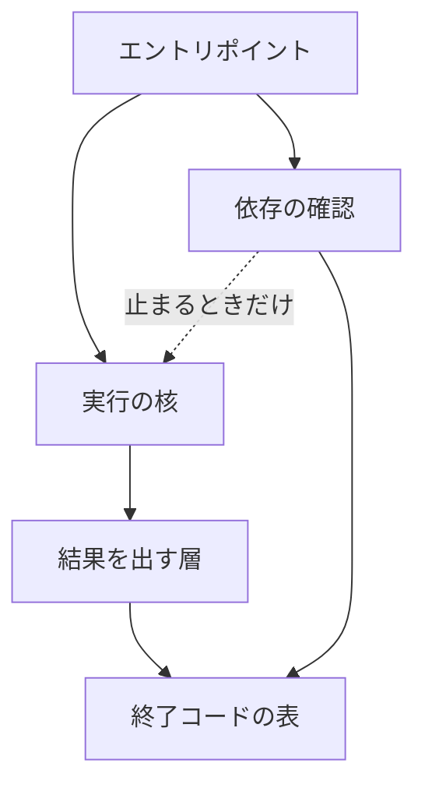
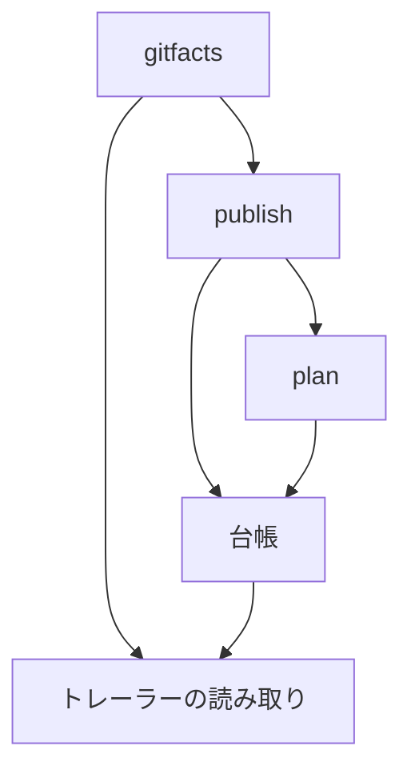
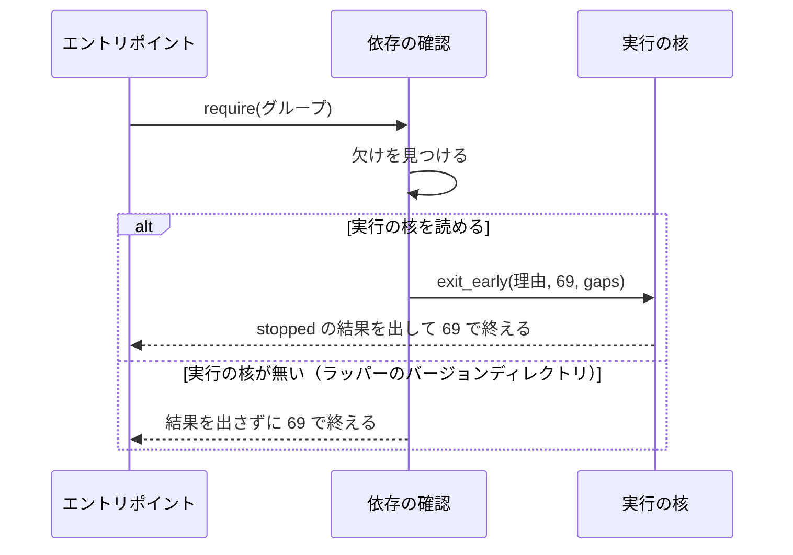

# スクリプトの層: 結果を出す層と cross-refactoring の台帳が上の層を読まずに読み込める（#2988）

## 目的

- **今どうなっているか**: 結果を出す層（`lib/step_result.py`）は、終了コード 69 の定数を自分の名前で公開するためだけに依存の確認（`lib/deps.py`）を読む。依存の確認は止まるときに関数の中で実行の核（`lib/run_core.py`）を読み、実行の核は結果を出す層を読む。cross-refactoring では、台帳（`refactor_lib/ledger.py`）がコミットのトレーラーを読むためだけに `gitfacts` を読む。そのため `gitfacts → publish → plan → ledger → gitfacts` が最上位の import だけで輪になる
- **誰に効くか**: NDF のスクリプトを直す人と AI。#1142 の分割と重複の整理を始める前の足場になる
- **変えると何が成り立つか**: 上の 2 組の輪が消え、読み込みの順序に頼る注意書きが要らなくなる。輪を足し直すとテストが落ちる

## 適用範囲

- **働く範囲**: このリポジトリの NDF のスクリプト（`plugins/ndf/scripts/lib/` と cross-refactoring の `refactor_lib/`）。利用先のリポジトリで変わる振る舞いは無い
- **プロジェクトごとに違うもの**: 無し（モジュールの置き場所だけを変える）
- **当たるモード**: `standard`

## あるべき姿の根拠

| 根拠 | 種類 | 何を示すか |
| --- | --- | --- |
| 下の「現状の輪の実測」 | 実測 | 輪の中身と、どの 1 本の辺を除けば輪が消えるか |
| STD1（Python の FAQ「互いに import し合うモジュール」） | 外部の一次情報 | 輪の中のモジュールは初期化の途中の状態で読まれうる。import を関数の中へ移す回避は、輪そのものは残す |
| `docs/specifications/ndf-deps-missing-exit-code.md` の「決定と理由」 | 既存の決定 | 69 の値を 2 か所に書くと値が割れうる。依存の確認へ `proc` を引き込まない |
| 依頼（原文）「循環の解消、重複の統合など、何からやるとよさそうですか？」 | 利用者の指示の原文 | 循環の解消を先に行う |

要求と受け入れ条件は #2988 の本文にある（コピーは [issue-2988-requirements.md](issue-2988-requirements.md)）。この文書は「どう作るか」だけを扱う。

### 現状の輪の実測

`ast` で各ファイルの import を集め、自分へ戻れるモジュールを数えた（2026-11-10、`design/issue-2988` の 6f374cfc7）。

| 組 | 数えた import | 輪に入るモジュール |
| --- | --- | --- |
| `plugins/ndf/scripts/lib/` | 最上位・関数の中・`importlib.import_module` の文字列 | `step_result`・`deps`・`run_core`・`json_pick`・`step_read` |
| `refactor_lib/` | 最上位だけ | `gitfacts`・`publish`・`plan`・`ledger` |

同じ集計で変更後の辺（下の「構成要素」）を模擬すると、`deps`・`run_core` と `refactor_lib` の 4 モジュールは輪から外れる。`step_result` は `json_pick`・`step_read` との輪に残る（決定 5）。

## ドメインモデル

### コンテキスト

| コンテキスト | 何の語が 1 つの意味に決まるか |
| --- | --- |
| このリポジトリの開発の検査（`repo-dev-checks`） | import の輪・一番下の層・終了コードの表 |

1 つのコンテキストの中で閉じる。

### 集約

| 集約 | 持ち主（書き換えてよいもの） | 根 | エンティティ | 値オブジェクト |
| --- | --- | --- | --- | --- |
| 終了コードの表 | 終了コードの表のモジュール（`lib/exit_codes.py`）だけ。結果を出す層と依存の確認は読むだけ | 表 | — | 終了コード・見出し |
| 依存の確認の止まり方 | 依存の確認（`lib/deps.py`）が `gaps` の `kind` と止まる経路（I4〜I6）を、実行の核の早い出口（`lib/run_core.py` の `exit_early`）が結果の `status`（I3）を持つ。I3 を守る変更は `exit_early` を変えてよい。終了コードの表は読むだけ | — | — | 終了コード・結果の `status`・`gaps` の `kind` |
| スクリプトの import の向き | 各モジュールの import の文を書く変更だけ。輪の検査のテストは読むだけ（毎回読み直し、保存しない） | — | — | import の辺 |

### 不変条件

| # | 集約 | 条件 | 破れたときの扱い |
| --- | --- | --- | --- |
| I1 | 終了コードの表 | `EXIT_` で始まる整数の定数を値で書くのは、終了コードの表のモジュールだけである | 契約の検査（`exit-meaning`）で落とす |
| I2 | 終了コードの表 | 依存の欠けの終了コードは 69 で、値は終了コードの表のモジュールが持つ | テストで落とす |
| I3 | 依存の確認の止まり方 | 実行の核を読めるとき、依存の欠けの結果の `status` は `stopped` である | テストで落とす |
| I4 | 依存の確認の止まり方 | 実行の核を読めるとき、依存の欠けの結果の `gaps` の `kind` は `deps` である | テストで落とす |
| I5 | 依存の確認の止まり方 | 実行の核を読めるとき、依存の確認が核より先に読み込まれても、I2〜I4 の値と結果になる | テストで落とす |
| I6 | 依存の確認の止まり方 | 実行の核を読めないとき（ラッパーのバージョンディレクトリ）、依存の確認は結果を出さずに 69 で終える | テストで落とす |
| I7 | スクリプトの import の向き | 結果を出す層は、依存の確認と実行の核を import しない（最上位・関数の中・`importlib.import_module` のどれでも） | テストで落とす |
| I8 | スクリプトの import の向き | 結果を出す層・依存の確認・実行の核のうち 2 つ以上を含む輪が、`lib/` の import の辺（遅延を含む）に無い | テストで落とす |
| I9 | スクリプトの import の向き | `refactor_lib` の `gitfacts`・`publish`・`plan`・`ledger` のどれも、最上位の import の輪に入らない | テストで落とす |

### ドメインイベント

| # | イベント | 発生元 | 受け手 |
| --- | --- | --- | --- |
| E1 | エントリポイントが結果を出す層を読み込んだ | エントリポイント | 結果を出す層（終了コードの表を読む） |
| E2 | 依存の確認が外部パッケージの欠けを見つけて止まった | 依存の確認 | 実行の核（読めなければ受け手なしで 69） |
| E3 | 実行の核が早い出口で結果を出した | 実行の核 | 呼び出し元（標準出力・結果ファイル） |
| E4 | 台帳がコミットのトレーラーを読んだ | 台帳 | トレーラーの読み取り（`refactor_lib/trailers.py`） |

### 用語

| 用語 | 意味 | 用語集への反映 |
| --- | --- | --- |
| 終了コードの表 | NDF のスクリプトが使う終了コードの値と見出しの一覧。`lib/exit_codes.py` が持ち、結果を出す層が同じ名前で公開する | 追加（`repo-dev-checks`） |

「import の輪」「一番下の層」は要求の段階で用語集へ足した意味のまま使う。

## 外部の調査

| 種類 | 調べるか | 理由 |
| --- | --- | --- |
| 標準・仕様 | 調べる | Python の言語の文書が、互いに import し合うモジュールの振る舞いと回避の形を定めている |
| 主要な製品 | 調べない | モジュールの置き場所はこのリポジトリの層の取り決めだけで決まる。検査の手段はライブラリの行で比べる |
| ライブラリとサービス | 調べる | 輪の検査を、既存の import の検査のライブラリで書けるかを決める |

### 標準・仕様

| # | 標準・仕様 | 何を定めているか | 設計への反映 | 出典 |
| --- | --- | --- | --- | --- |
| STD1 | Python の FAQ「How can I have modules that mutually import each other?」 | 互いに import し合うと、片方は初期化の途中で読まれ、最上位で属性を引くと失敗する。回避として、`from` を使わず関数の中で引く・import を後ろへ置く・import を関数の中へ移す、の 3 つを挙げる | 3 つの回避は輪を残したまま失敗だけを避ける。この設計は輪を作る辺そのものを除き、回避の注意書きを消す | https://docs.python.org/3/faq/programming.html （2026-11-10） |

### ライブラリとサービス

| # | 候補 | 版 | ライセンス | 最後のリリースの日付 | 終了のアナウンス | 要件を満たすか | 出典 |
| --- | --- | --- | --- | --- | --- | --- | --- |
| LIB1 | import-linter | 2.16 | BSD 2-Clause | 2026-11-06 | 無し | 満たさない。層の契約（Layers）は「パッケージの中のモジュール」を並べる形で、`lib/` は `sys.path` へ足して読む平らなディレクトリでパッケージでない。使うには `lib/` をパッケージにし、111 ファイルの import を書き換える | https://pypi.org/pypi/import-linter/json ・ https://import-linter.readthedocs.io/en/stable/contract_types/layers/ （2026-11-10） |
| LIB2 | grimp | 3.19 | BSD 2-Clause | 2026-11-06 | 無し | 満たさない。`build_graph` はトップレベルのパッケージ名を取る（LIB1 と同じ理由）。関数の中の import を `is_lazy` で区別できる点は要件に合う | https://pypi.org/pypi/grimp/json ・ https://grimp.readthedocs.io/en/stable/usage.html （2026-11-10） |
| LIB3 | pylint | 4.1.3 | GPL-2.0-or-later | 2026-10-11 | 無し | 確かめていない（「確かめられなかったこと」） | https://pypi.org/pypi/pylint/json （2026-11-10） |
| LIB4 | pydeps | 3.0.9 | BSD-2-Clause | 2026-10-01 | 無し | 確かめていない（「確かめられなかったこと」） | https://pypi.org/pypi/pydeps/json （2026-11-10） |
| LIB5 | 標準ライブラリの `ast` と `graphlib` | Python 3.10 以上（プラグインの `requires-python`） | PSF | — | 無し | `ast` で import を集められる。`graphlib.TopologicalSorter.prepare()` の `CycleError` は輪を 1 つしか返さないため、「対象の組を含む輪が無い」の判定には使わず、到達の判定を数行で書く（決定 6） | https://docs.python.org/3/library/graphlib.html （2026-11-10）・`python3 -c` で `CycleError` の `args[1]` が `['a', 'c', 'b', 'a']` を返すことを確かめた |

### 確かめられなかったこと

| 対象 | 試した手段 | 結果と理由 |
| --- | --- | --- |
| pylint の `cyclic-import` が関数の中の import と `importlib.import_module` の文字列を数えるか | 試していない | 上限の前に止めた。LIB1・LIB2 と同じく既存の依存に無く、足す費用（開発の依存と lock の更新）で LIB5 を上回らないため、決定 6 の結論は変わらない |
| pydeps が輪の有無で終了コードを変えるか | 試していない | 同上 |
| import-linter の「Acyclic siblings」の契約 | https://import-linter.readthedocs.io/en/stable/contract_types/acyclic-siblings/ | HTTP 404 |

調べた量: 候補 6 件・取得の試み 15 回。

## 機能一覧

| # | 機能 | 誰が使うか |
| --- | --- | --- |
| F1 | 結果を出す層を、依存の確認と実行の核を読まずに読み込む | NDF のすべてのエントリポイント |
| F2 | 依存の欠けで止まったとき、今と同じ終了コードと結果を返す | 外部パッケージを使うエントリポイントと、その呼び出し元 |
| F3 | 台帳が、`gitfacts` を読まずにコミットのトレーラーを読む | cross-refactoring の検証の判定 |
| F4 | 対象の 2 組に輪を足すと落ちる検査 | NDF のスクリプトを直す人と AI（全体テスト） |

## 構成要素

| 要素 | 責務 |
| --- | --- |
| 終了コードの表（`lib/exit_codes.py`、新設） | 終了コードの定数・承認ゲートと判断待ちの範囲・見出しの表と `label_of` を持つ。標準ライブラリも NDF のモジュールも読まない |
| 結果を出す層（`lib/step_result.py`） | 終了コードの表の名前を同じ名前で公開し続ける（`step_result.EXIT_*`・`EXIT_LABELS`・`label_of`・`GATE_CODES`・`PAUSE_CODES`）。依存の確認を読まない |
| 依存の確認（`lib/deps.py`） | `EXIT_DEPS_MISSING` を終了コードの表から読み、同じ名前で公開し続ける。自分のディレクトリを `sys.path` へ足してから読む（`conftest.py` がファイルの位置から単独で読み込むため）。止まるときの実行の核の読み込みは関数の中に残し、注意書きを決定 2 の理由へ替える |
| ラッパーのバージョンディレクトリ（`relay_lib/version_dir.py`） | コピーするファイルの一覧（`LIB_FILES`）に終了コードの表を足す |
| 契約の検査（`scripts/contracts_lib/core_checks.py`） | 終了コードの定数の持ち主（`EXIT_OWNERS`）を終了コードの表の 1 つにする |
| トレーラーの読み取り（`refactor_lib/trailers.py`、新設） | `commit_trailers` と `_parse_trailer_paragraph` を `gitfacts` から移して持つ。`paths` だけを読む |
| `refactor_lib/gitfacts.py` | トレーラーの読み取りの 2 つの名前を再エクスポートする（分けた先の 6 本と同じ形）。`publish` の関数の再エクスポートは残す（決定 4） |
| 台帳（`refactor_lib/ledger.py`） | `commit_trailers` をトレーラーの読み取りから最上位で読む。`gitfacts` を読まない |
| 輪の検査（`plugins/ndf/scripts/tests/test_import_cycles.py`、新設） | 2 組の import を `ast` で集め、I7〜I9 を確かめる |

## 構造

次の 2 つの図は import の向きだけを描く。ラッパーのバージョンディレクトリ・契約の検査・輪の検査は import の辺を持たないため描かない。

変更後の `lib/` の向き（矢印は import。点線は関数の中の import）:



変更後の `refactor_lib` の向き（最上位の import だけ）:



### 置き場所

```text
plugins/ndf/scripts/
├── lib/
│   ├── exit_codes.py          （新設。step_result.py から終了コードの表を移す）
│   ├── step_result.py
│   ├── deps.py
│   └── README.md
├── relay_lib/version_dir.py
└── tests/test_import_cycles.py（新設）
plugins/ndf/skills/cross-refactoring/scripts/refactor_lib/
├── trailers.py                （新設。gitfacts.py から 2 つの関数を移す）
├── gitfacts.py
└── ledger.py
```

## 処理の流れ

依存の確認が実行の核より先に読み込まれ、外部パッケージの欠けで止まる経路（E2 → E3）。読み込みの順序が逆（核が先）でも、同じ結果になる。



## 非機能の実現方式

| 大項目 | 実現方式 |
| --- | --- |
| 運用・保守性 | 「循環を避ける」注意書き 2 か所（`deps.py` の `_stop`・`ledger.py` の import）を消す。輪を足し直すと輪の検査のテストが落ちる |

## 決定の記録

### 決定 1: 69 の値を 1 か所に置いたまま結果を出す層が依存の確認を読まないよう、終了コードの表を新しいモジュールへ移す

終了コードの表を `lib/exit_codes.py` へ移し、結果を出す層と依存の確認はどちらもそこから読む。表の持ち主が 1 つになり、依存の確認だけが 69 を持つ例外が無くなる。結果を出す層は同じ名前で公開し続けるため、111 ファイルの呼び出しは変わらない。分けた部品を元のモジュールが同じ名前で公開する形は、`step_result` が `proc` に対して既に取っている（`StepError = proc.StepError`）。新しいモジュールは標準ライブラリも読まないため、ラッパーのバージョンディレクトリへコピーしても依存を増やさない。

依存の確認が結果を出す層を読む形は採らない。依存の確認はラッパーにも使われるため、結果を出す層をコピーすると `proc` もコピーすることになる。`docs/specifications/ndf-deps-missing-exit-code.md` の決定と同じ理由である。69 を 2 か所に書き、テストで一致を確かめる形も採らない。同じ役割の定数が 2 つになり、同じ確定仕様が退けた形に戻る。依存の欠けの 1 つの定数だけを移す形は、表を 2 つのモジュールに分けたまま残すため採らない。

根拠: Value 7（MVV 版 6）

### 決定 2: ラッパーのバージョンディレクトリで止まれるよう、依存の確認は実行の核を関数の中で読み続ける

輪が消えた後も、依存の確認は止まるときだけ実行の核を読む。ラッパーのバージョンディレクトリ（`relay_lib/version_dir.py`）は実行の核をコピーしないため、最上位で読むとラッパーが起動できない。注意書きは「循環を避ける」から、この理由（核が無ければ結果を出さずに 69 で終える）へ替える。読み込みの形（`importlib.import_module("run_core")` と `ImportError` の受け）は変えない。

実行の核をバージョンディレクトリへコピーして最上位で読む形は採らない。核は契約の一覧・上限の宣言・秘密の伏せ字の部品を読み、コピーするファイルが大きく増える。

根拠: Value 7（MVV 版 6）

### 決定 3: 台帳が gitfacts を読まずに済むよう、コミットのトレーラーの読み取りを新しいモジュールへ移す

`commit_trailers` と `_parse_trailer_paragraph` を `refactor_lib/trailers.py` へ移し、台帳はそこから最上位で読む。台帳から `gitfacts` への辺が消えると、`gitfacts → publish → plan → ledger` と `publish → ledger` はどちらも台帳で止まり、輪が無くなる。`gitfacts` は 2 つの名前を再エクスポートし、`fix_intake.py`・`commands/flaky.py`・テストの呼び出しは変えない。移した先の形は、#1142 の C4 で `gitfacts` から分けた 6 本（`pathkinds`・`process` など）と同じである。`test_module_owners.py` の表に 1 行を足して縛る。

トレーラーの読み取りを `paths.py` へ入れる形は採らない。`paths` は作業ディレクトリと git の呼び出しの部品で、コミットの中身の解釈を持たない。`publish` が台帳を読む辺を除く形は、`publish` と `plan` の両方が台帳を読むため 2 本を除くことになり、変更が大きい。

根拠: Value 7（MVV 版 6）

### 決定 4: 呼び出し元を変えずに済むよう、gitfacts が再エクスポートしている publish の関数を残す

決定 3 の後、`gitfacts → publish` の辺は輪に入らない。再エクスポートは #1142 の C4 が決めた形で、`test_module_owners.py` が縛っている。呼び出し元を `publish` へ向け直すと、輪の解消に要らない変更が `refactor_lib` の各所へ広がる。

再エクスポートを消す形は採らない。公開している名前を消す変更になり、この課題の受け入れ条件のどれにも要らない。

根拠: Value 3 / Value 7（MVV 版 6）

### 決定 5: 受け入れ条件の組に絞るため、結果を出す層を直接起動したときの pick の副命令が作る輪はこの課題で扱わない

`step_result.py` の `main` は、副命令 `pick` のときだけ関数の中で `json_pick` を読み、`json_pick` と `step_read` は結果を出す層を最上位で読む。この輪は、結果を出す層をライブラリとして読んだときには辿られない。`main` が動くのは `python3 step_result.py pick` で直接起動したときだけで、そのときのモジュールは `__main__` である。ほどくには、この起動の形を変えることになる。この形は Skill の手順（`development-workflow` の `references/relay.md`）と `lib/README.md` が案内している。変えると前提 1（エントリポイントの引数と出力を変えない）に当たる。

受け入れ条件 5 の検査は「3 つのうち 2 つ以上を含む輪が無い」の形で書き、この輪では落ちない。この輪は #1142 の残りの遅延の輪と同じ扱いにする。

根拠: Value 2 / Value 3（MVV 版 6）

### 決定 6: 依存を足さずに 2 組の輪を検査するため、標準ライブラリの ast で import を集めるテストを書く

テストは `ast` で各ファイルの import を集める。辺にするのは、`lib/` では最上位・関数の中・`importlib.import_module` の文字列の定数で、`refactor_lib/` では最上位の相対の import だけである。到達の判定は数行で書く。`graphlib` の `CycleError` は輪を 1 つしか返さず、対象の組と関係の無い輪でも落ちるため使わない。

import-linter と grimp は、対象をパッケージとして渡す形で、`lib/` をパッケージへ組み直さないと使えない。pylint と pydeps は検査の範囲を確かめていない（「確かめられなかったこと」）。どれも今の依存に無く、2 組の検査のために開発の依存と lock を増やす。

- 作り方: 自前で作る
- 比べた候補: LIB1 / LIB2 / LIB3 / LIB4 / LIB5

根拠: Value 5 / Value 6（MVV 版 6）

## テスト設計

| 受け入れ条件・不変条件 | どの振る舞いで縛るか | どう壊したら落ちるべきか |
| --- | --- | --- |
| 受け入れ条件 1・I7 | 結果を出す層のファイルの import（最上位・関数の中・`importlib.import_module` の文字列）に、依存の確認と実行の核が無い | 結果を出す層の関数の中に `import deps` を足すと落ちる |
| 受け入れ条件 5・I8 | `lib/` の import の辺（遅延を含む）で、3 つのうち 2 つ以上を含む輪が無い | 実行の核を最上位で読む行を依存の確認へ足すと落ちる（関数の中の行を最上位へ移す壊し方） |
| 受け入れ条件 3・5・I9 | `refactor_lib/` の最上位の相対の import で、4 モジュールのどれも自分へ戻れない | 台帳へ `from . import gitfacts` を戻すと落ちる |
| 受け入れ条件 5 の「輪を足すと落ちる」 | 輪の判定の関数が、輪を含む小さな辺の組で輪を報告し、輪の無い組で報告しない | 判定が常に「輪なし」を返すように壊すと落ちる |
| 受け入れ条件 2 | 依存の確認の止まる関数に、関数の中の実行の核の読み込みが 1 つだけ残り、注意書きが「循環」の語を含まない | 注意書きの文言はテストで照合しない（文言を固定しても振る舞いは保証されない）。注意書きは I8 のテスト（輪が無い）と、設計 PR と実装の PR のレビューで見る |
| 受け入れ条件 6・I2〜I5 | 依存の確認を、実行の核と結果を出す層より先に読み込んだエントリポイントが欠けで止まると、終了コード 69・`status` が `stopped`・`gaps` の `kind` が `deps` の結果を出す（核が先の順序は既存の `test_run_core.py` の `test_missing_extras_stop_with_69_without_a_traceback` が縛る） | 依存の確認が終了コードの表の 69 でなく別の値で止まるように壊すと落ちる |
| I6 | 実行の核の無い置き場で依存の確認が欠けで止まると、結果を出さずに 69 で終える | `ImportError` を受けずに外へ出すと落ちる |
| I1 | 契約の検査の `exit-meaning` が、終了コードの表のモジュールの外にある `EXIT_` の整数の定数を違反として返す | 結果を出す層に `EXIT_OK = 0` を値で書き戻すと落ちる |
| 受け入れ条件 4 | 既存のテスト一式・`check-ndf-contracts.py`・`check-script-structure.py` が 0 で終わる | — |

`test_step_result.py` の「値の持ち主は deps」を確かめるテストは、「結果を出す層と依存の確認の 69 が終了コードの表の定数そのもの」を確かめる形へ書き換える。`test_module_owners.py` の表は、`commit_trailers` と `_parse_trailer_paragraph` を `gitfacts` の持ち物から `trailers` の行へ移す。

## 設計の結果

| 課題 | 扱い | 取り込み先 | 触るファイル |
| --- | --- | --- | --- |
| #2988 | 実装する | — | `plugins/ndf/scripts/lib/exit_codes.py`（新設）、`plugins/ndf/scripts/lib/step_result.py`、`plugins/ndf/scripts/lib/deps.py`、`plugins/ndf/scripts/lib/README.md`、`plugins/ndf/scripts/relay_lib/version_dir.py`、`scripts/contracts_lib/core_checks.py`、`plugins/ndf/scripts/tests/test_import_cycles.py`（新設）、`plugins/ndf/scripts/tests/test_step_result.py`、`plugins/ndf/scripts/tests/test_deps.py`、`plugins/ndf/skills/cross-refactoring/scripts/refactor_lib/trailers.py`（新設）、`plugins/ndf/skills/cross-refactoring/scripts/refactor_lib/gitfacts.py`、`plugins/ndf/skills/cross-refactoring/scripts/refactor_lib/ledger.py`、`plugins/ndf/skills/cross-refactoring/tests/test_module_owners.py`、`docs/specifications/ndf-deps-missing-exit-code.md` |

## 人へ残す判断

無し

## 未確認のまま残ること

| 項目 | 内容 |
| --- | --- |
| ラッパーの更新の後の起動 | コピーするファイルが 1 つ増えると、ラッパーのバージョンディレクトリの名前（中身の digest）が変わる。導入先で新しいバージョンディレクトリが作られて起動できることは、`test_relay.py` のコピーの検査で確かめるが、利用者の環境での更新はリリース後テストで確かめる |
