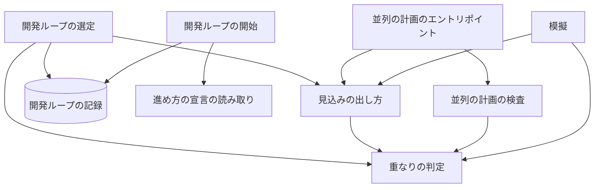
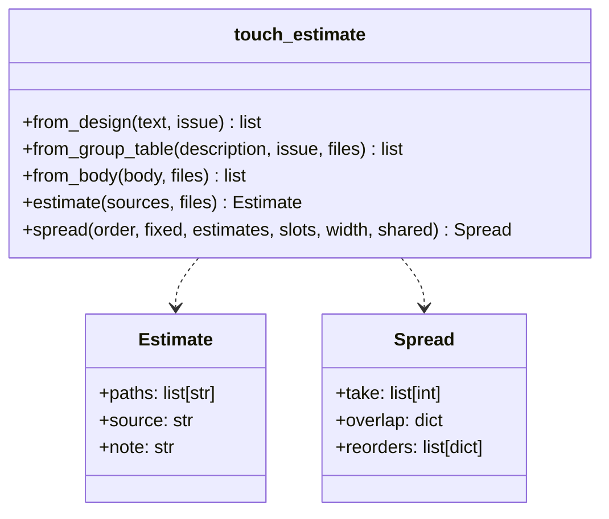
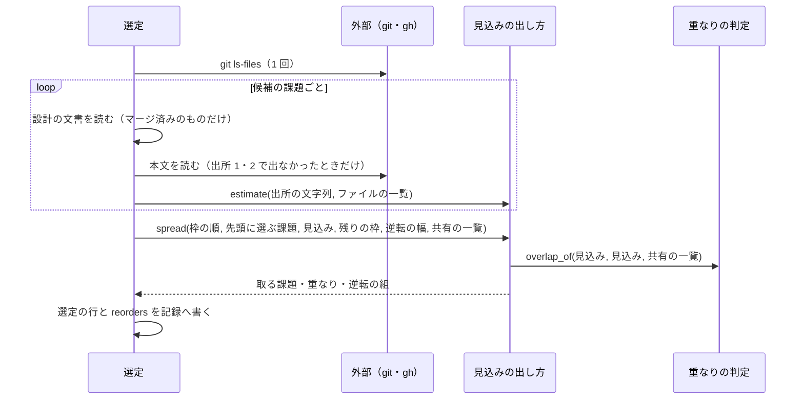

# 開発ループの選定と並列の計画の検査: 触る場所の見込みが重なる課題を同じスプリント・同じ時間帯に集めない（#2997）

## 目的

- **今どうなっているか**: 開発ループの選定は順位と課題数の上限だけで課題を選び、触る場所を見ない。並列の計画の検査は、レーンが宣言した触る場所の重なりを警告にするだけで、レーンに割り当てた課題の見込みを見ない。同じ主題の課題が 1 つのスプリントに集まり、実装のキューが重なりの判定で直列に流す
- **誰に効くか**: 開発ループと並列の計画を使う利用者（スプリントの経過）と、レーンを組む conductor
- **変えると何が成り立つか**: 選定は、順位が近い課題の間で見込みが重ならない課題を先に選び、その理由を記録に残す。並列の計画の検査は、同じ時間帯に動くレーンの課題の見込みが重なると、重なる組と直し方の案を出す

## 適用範囲

- **働く範囲**: 開発ループの選定（`loop select`）と並列の計画の検査（`parallel.py check`）。利用先のリポジトリでも同じに働く。見込みのパスは、そのリポジトリの追跡しているファイル（`git ls-files`）と照らして決め、ディレクトリの形を前提にしない
- **プロジェクトごとに違うもの**: 順位の逆転の幅は進め方の宣言（`.ndf/pace.json` の `loop.reorder_width`）で受ける。重なりの判定に足す共有の一覧は、実装のキューと同じ `.ndf/supervise.json` の `queue.shared` を読む
- **当たるモード**: `standard`

## あるべき姿の根拠

| 根拠 | 種類 | 何を示すか |
| --- | --- | --- |
| 依頼（原文）「できるだけ離れたファイルを触る課題の方が並列して動かせる本数が増えそうです」 | 利用者の指示の原文 | 選ぶ時点で触る場所の離れ具合を見る |
| PRD1（Mergify の並列のモード） | 外部の一次情報 | 触る範囲が重ならない変更は同時に流し、重なる変更だけ順序を保つ。多くの変更が同じファイルを触るなら直列のモードを勧める |
| 下の「模擬の見通し」 | 実測 | lcost-1 の 7 課題では、選ぶ時点に出せる見込みでは選ぶ組が変わらない。逆転の幅の既定は模擬の打ち直しで決める（決定 8） |

要求と受け入れ条件は #2997 の本文にある（コピーは [issue-2997-requirements.md](issue-2997-requirements.md)）。この文書は「どう作るか」だけを扱う。

### 模擬の見通し

**本文から出す見込みでは差が出ず、見込みが完全に当たる上限でも、同時に動く本数の平均は 1.12 本である。** このため受け入れ条件 8 は、#1811 のマージ後に模擬を打ち直して記録し、平均が増えなければ逆転の幅の既定を 0 にする（決定 8）。選定の記録（受け入れ条件 1・2）と検査の `I21`（受け入れ条件 6・7）は既定の幅に関わらず働き、見込みと実際を突き合わせて外れの率を測れるようにする。

設計の時点で、lcost-1 の記録から簡易の模擬を行った（2026-11-11、`design/issue-2997` の fed8b38dc）。

| 入力 | 値 |
| --- | --- |
| 課題 | lcost-1 で実装のプランが完了した 7 件（#2908・#2909・#2912・#2913・#2914・#2923・#2936）。順位は並列の計画 p4 のレーンの並び |
| 所要 | 各課題の `6-impl-<番号>-state/progress.jsonl` のステップの `seconds` の和（67〜139 分） |
| 実装のキューの触るファイル | 2 通り。記録の設計の結果（`design-results.json`）と、マージした実装の PR が実際に変えたファイル（#1811 の後の宣言の近似） |
| 実装のキューの枠 | 3 本。重なりの組は `supervise_lib/admission.py` の `groups`（共有の一覧 `lib/README.md` を含む） |
| 課題数の上限 | 3 |

| 実装のキューの触るファイル | 選ぶ側の見込み | 逆転の幅 | 今の選び方 | 新しい選び方 |
| --- | --- | --- | --- | --- |
| 記録の設計の結果 | 設計の結果と同じ | 0〜3 | 1.00 本 | 1.00 本 |
| 実際に変えたファイル | 実際に変えたファイル（見込みが完全に当たる上限） | 2 | 1.00 本 | 1.12 本 |
| 実際に変えたファイル | 課題の本文のパス（決定 1 の出所の 3 番目） | 0〜4 | 1.00 本 | 1.00 本 |
| 実際に変えたファイル | 課題の本文のパスと、過去の変更で一緒に変わったファイル（比率 0.3・0.5・0.7） | 1〜3 | 1.00 本 | 1.00 本 |

7 件の 21 組のうち、実際に変えたファイルで重なったのは 17 組である。組ごとに最初に見つかった重なりのファイルは次のとおりで、どれも 7 件の本文の見込みに出てこない。

| 重なりのファイル | 組の数 |
| --- | ---: |
| `docs/specifications/ndf-workflow-development-loop.md` | 9 |
| `plugins/ndf/contracts/index.md` | 3 |
| `docs/ndf-experiments.md` | 3 |
| `docs/specifications/ndf-parallel-organizer.md` | 1 |
| 共有の一覧の `plugins/ndf/scripts/lib/README.md` | 1 |

重ならないのは #2912 と #2913・#2914・#2923・#2936 の 4 組だけだった。選ぶ時点に出せる見込みはこれらの重なりを知らないため、見込みの上では重ならないと判定し、順位の順のまま選ぶ。

## ドメインモデル

### コンテキスト

| コンテキスト | 何の語が 1 つの意味に決まるか |
| --- | --- |
| NDF の開発の工程（`ndf-workflow`） | 触る場所の見込み・見込みの出所・順位の逆転・逆転の幅・同時に動く本数 |

1 つのコンテキストの中で閉じる。実装のキューの重なりの判定は同じコンテキストの部品で、読むだけにする。

### 集約

| 集約 | 持ち主（書き換えてよいもの） | 根 | エンティティ | 値オブジェクト |
| --- | --- | --- | --- | --- |
| 開発ループの記録（`loop.json`） | 開発ループの選定（`sprint_loop_select.py`）。見込みの出し方と並べ替えの関数は値を返すだけ | ループ | ループの 1 回・選定の行 | 触る場所の見込み（パスの一覧と出所）・重なり（あり / なし / 不明と相手）・逆転の組 |
| 並列の計画の検査の結果 | 並列の計画の検査（`parallel_plan.py`）。見込みは `parallel.py` が集めて渡す | 検査の結果 | 項目（`items`） | 見込みの重なりの組・直し方の案 |
| 重なりの判定 | 実装のキューの判定（`supervise_lib/admission.py`）。この課題では読むだけ | — | — | パスの包含・共有の一覧 |

### 不変条件

| # | 集約 | 条件 | 破れたときの扱い |
| --- | --- | --- | --- |
| I1 | 開発ループの記録 | 選定の行（選んだ・外した）は、触る場所の見込みのパスの一覧と出所を持つ。出所は 設計の結果・課題グループの表・課題の本文・見込みなし のどれか | テストで落とす |
| I2 | 開発ループの記録 | 選んだ行は、既に選んだ課題との重なり（あり / なし / 不明）と、重なる相手の番号を持つ。見込みなしの課題との組は「不明」 | テストで落とす |
| I3 | 開発ループの記録 | 先頭に選ぶ課題（承認した設計・直して出し直す課題・デプロイの直し）と品質の枠の課題は、重なりがあっても今と同じく選ばれる | テストで落とす |
| I4 | 開発ループの記録 | 順位の逆転は、並べ替えの窓（残りの枠の数＋逆転の幅の件数）の内でだけ起きる。窓の外の課題は重なりを理由に先へ出ない | テストで落とす |
| I5 | 開発ループの記録 | 重なりを理由に、選ぶ課題の数は減らない。候補がすべて互いに重なれば、今の選び方と同じ組になる | テストで落とす |
| I6 | 開発ループの記録 | 逆転の幅が 0 なら、選ぶ組は今の選び方と同じになる | テストで落とす |
| I7 | 開発ループの記録 | 見込みの欄が無い古い記録を読んでも選定は止まらない。既存のキーの形は変わらない（追加だけ） | テストで落とす |
| I8 | 並列の計画の検査の結果 | 同じ時間帯に動く（`after` を推移的にたどっても順序が付かない）2 つのレーンで、課題の見込みが重なれば、警告の項目に重なる課題の組と直し方の案が載る | テストで落とす |
| I9 | 並列の計画の検査の結果 | `after` で順序が付いたレーンの間では、見込みの重なりの項目を出さない | テストで落とす |
| I10 | 重なりの判定 | 見込みの重なりは、実装のキューと同じ関数（`admission.overlap_of`）と同じ共有の一覧で判定する | テストで落とす（判定を差し替えると落ちる） |
| I11 | 開発ループの記録 | 見込みのパスは、そのリポジトリの追跡しているファイルと照らして決める。ディレクトリの名前（`plugins/ndf/` など）を前提にしない | テストで落とす |

### ドメインイベント

| # | イベント | 発生元 | 受け手 |
| --- | --- | --- | --- |
| E1 | 棚卸しが課題グループの表に触る場所の見込みを書いた | 棚卸し | 選定と並列の計画の検査（マイルストーンの説明を読む） |
| E2 | 選定が候補の課題ごとに触る場所の見込みを出した | 開発ループの選定 | 並べ替え（E3） |
| E3 | 選定が窓の内で、見込みが既に取った課題と重なる課題を後ろへ回した | 開発ループの選定 | 記録（E4） |
| E4 | 選定が選んだ課題・見込み・出所・重なり・逆転の組を記録した | 開発ループの選定 | ループの記録（`loop.json`）・選定の結果の出力 |
| E5 | 並列の計画の検査が、同じ時間帯に動くレーンの課題の見込みの重なりを見つけた | `parallel.py check` | 検査の結果（E6） |
| E6 | 検査が直し方の案（`after` を足す・課題を移す）を出した | 並列の計画の検査 | 計画を組む conductor と人 |
| E7 | 模擬が課題の組で、同時に動く本数の平均を出した | 模擬のスクリプト | 受け入れ条件 8 の確認をする人と AI |

### 用語

| 用語 | 意味 | 用語集への反映 |
| --- | --- | --- |
| 逆転の幅 | 開発ループの選定で、残りの枠の数を超えて並べ替えの対象にする候補の件数。0 なら順位の逆転は起きない | 追加（`ndf-workflow`） |

「触る場所の見込み」「見込みの出所」「同時に動く本数」「順位の逆転」は、要求の段階で用語集へ足した意味のまま使う。

## 外部の調査

| 種類 | 調べるか | 理由 |
| --- | --- | --- |
| 標準・仕様 | 調べない | 課題の選び方と作業の並べ方に、公開の標準は当たらない。重なりの判定は既存の関数を使う |
| 主要な製品 | 調べる | マージのキューの製品が、触る範囲の重なりでどう流し方を変えるかを比べる |
| ライブラリとサービス | 調べる | 重なりの組から並べ方を決めるのに、グラフのライブラリを使うかを決める |

### 主要な製品

| # | 製品 | どう解いているか | 設計への反映 | 出典 |
| --- | --- | --- | --- | --- |
| PRD1 | Mergify のマージのキュー（並列のモード） | 変更ごとに触る範囲（スコープ）をファイルのパターンかビルドツールから決め、範囲を共有しない変更は同時に流す。共有すれば順序を保って待たせる。多くの変更が同じファイルを触るなら直列のモードを勧める | 重なりの判定は実装のキューの関数（範囲を共有すれば待たせる）を変えない。選ぶ側で、重ならない課題を同じスプリントに入れて、待ちを減らす。多くの課題が同じファイルを触る組では効かないことを模擬の見通しで確かめた | https://docs.mergify.com/merge-queue/queue-modes.md （2026-11-11） |
| PRD2 | GitHub のマージのキュー | 各変更を、先にある変更と合わせて試す。複数の変更をまとめず、触る範囲による並べ替えは持たない（Mergify の比較の表による） | 触る範囲で順序を入れ替えない製品の例。採らない | 検索「GitHub merge queue how pull requests are grouped and built in parallel documentation」（2026-11-11）。GitHub の公式の文書は取得していない（「確かめられなかったこと」） |

### ライブラリとサービス

| # | 候補 | 版 | ライセンス | 最後のリリースの日付 | 終了のアナウンス | 要件を満たすか | 出典 |
| --- | --- | --- | --- | --- | --- | --- | --- |
| LIB1 | networkx（`greedy_color` で重なりのグラフを塗り分ける） | 3.7 | BSD-3-Clause | 2026-09-21 | 無し | 満たすが要らない。選定は順位の順に 1 件ずつ取る貪欲法で、塗り分けは順位を保たない。今の依存に無い | https://pypi.org/pypi/networkx/json （2026-11-11）・`grep networkx pyproject.toml uv.lock` が 0 件 |
| LIB2 | 実装のキューの重なりの判定（`supervise_lib/admission.py` の `overlap_of`・`groups`） | リポジトリの中 | — | — | 無し | 満たす。非機能の条件（判定の関数をもう 1 つ作らない）に合う | `plugins/ndf/scripts/supervise_lib/admission.py`（2026-11-11） |

### 確かめられなかったこと

| 対象 | 試した手段 | 結果と理由 |
| --- | --- | --- |
| Mergify の並列のスコープの頁 | https://docs.mergify.com/merge-queue/parallel-scopes.md | HTTP 404。同じ内容をキューのモードの頁（PRD1）で確かめた |
| GitHub の公式の「Managing a merge queue」 | 試していない | 上限の前に止めた。PRD2 は採らない例で、決定の結論に関わらない |

調べた量: 候補 4 件・取得の試み 5 回。

## 機能一覧

| # | 機能 | 誰が使うか |
| --- | --- | --- |
| F1 | 候補の課題ごとに、触る場所の見込みと出所を出す | 開発ループの選定・並列の計画の検査・模擬 |
| F2 | 窓の内で、見込みが重ならない課題を先に選ぶ | 開発ループの選定 |
| F3 | 選定の行に見込み・出所・重なりを、ループの 1 回に逆転の組を記録する | 記録を読む人と AI |
| F4 | 同じ時間帯に動くレーンの課題の見込みの重なりと、直し方の案を出す | 並列の計画を組む conductor と人 |
| F5 | 記録から、今の選び方と新しい選び方の同時に動く本数の平均を出す | 受け入れ条件 8 を確かめる人と AI |

## 構成要素

| 要素 | 責務 |
| --- | --- |
| 見込みの出し方（`lib/touch_estimate.py`、新設） | 3 つの出所の文字列（設計の結果の表・課題グループの表・課題の本文）と追跡しているファイルの一覧から、見込みのパスと出所を返す。並べ替えの関数 `spread` を持つ。どちらもファイルも外部コマンドも読まず、値を返すだけ |
| 開発ループの選定（`lib/sprint_loop_select.py`） | 候補ごとに見込みを集め（設計の文書・マイルストーンの説明・`Env.issue_body`・`git ls-files`）、`_select_candidate_rows` の枠の割り当てで `spread` を呼ぶ。選定の行と、ループの 1 回の `reorders` を書く |
| 開発ループの開始（`lib/sprint_loop.py`） | 記録を作るときに、進め方の宣言の逆転の幅を `reorder_width` として記録へ写す |
| 進め方の宣言の読み取り（`lib/pace.py`）と契約（`contracts/settings/pace.json.json`） | `loop.reorder_width`（0 以上の整数。既定 2）を読み、形を検査する |
| 並列の計画の検査（`lib/parallel_plan.py`） | `check_data` が見込みの表（レーン → 課題 → パス）を任意で受け、同じ時間帯に動くレーンの組の重なりを規則 `I21` の警告として返す。案を付ける |
| 並列の計画のエントリポイント（`parallel.py`） | `check` のときに、レーンの課題の見込みを集めて `check_data` へ渡す。集められなければ `I21` の警告を 1 つ出して続ける |
| 模擬（`scripts/experimental/selection-replay.py`、新設。実験版） | スプリントの記録の置き場を読み、今の選び方と新しい選び方で同時に動く本数の平均を出す |
| 棚卸しの手順（`backlog-refinement/references/milestones.md`） | 課題グループの表の「触る場所の見込み」の列を、リポジトリの根からのパスで書くと定める |
| 開発ループと並列の計画の手順（`development-workflow/references/loop.md`・`parallel.md`） | 選定の並べ替えと記録の欄、検査の `I21` を書く |
| 実験版の台帳（`docs/ndf-experiments.md`） | 模擬の行を 1 行足す |



図は呼び出しの向きだけを描く。手順の文書・台帳・契約は呼び出しを持たないため描かない。

## 構造



`source` の値は `設計の結果` / `課題グループの表` / `課題の本文` / `見込みなし` の 4 つだけである。`note` は見込みなしの理由（`本文を読めない`・`切り出しの境界の外` など）で、無ければ空。

## データ構造

`loop.json` へ足すキー（既存のキーは変えない）。

| 置き場 | キー | 形 | 書く行 |
| --- | --- | --- | --- |
| 記録の根 | `reorder_width` | 0 以上の整数 | 記録を作るとき。無い古い記録は進め方の宣言の値（無ければ 2）で読む |
| 選定の行 | `touch` | `{"paths": [str], "source": str, "note": str}` | 選んだ行と外した行のすべて |
| 選定の行 | `overlap` | `"あり"` / `"なし"` / `"不明"` | 選んだ行だけ |
| 選定の行 | `overlap_with` | `[課題の番号]` | 選んだ行だけ（`あり` と `不明` の相手。`なし` なら空） |
| ループの 1 回 | `reorders` | `[{"later": 番号, "earlier": 番号, "with": [番号]}]` | 逆転が起きたループの 1 回。`later` は後ろへ回した課題、`earlier` は先に選んだ課題、`with` は `later` と重なった選んだ課題 |

例:

```json
{"number": 2912, "milestone": "38 ...", "rank": 3, "decision": "選んだ", "reason": "順位",
 "touch": {"paths": ["plugins/ndf/scripts/mvv-gate.py"], "source": "課題の本文", "note": ""},
 "overlap": "なし", "overlap_with": []}
```

「重なり」の値は、選んだ順で自分より前に選んだ課題だけと比べる。どれかと重なれば `あり`、重ならずに見込みなしの相手が 1 つでもあれば `不明`、それ以外は `なし` にする。自分の見込みが無ければ、相手がいる限り `不明` にする。

## 入出力の契約

### 進め方の宣言

`.ndf/pace.json` の `loop` に `reorder_width` を足す。0 以上の整数で、既定は 2（模擬の打ち直しで 0 に変わりうる。決定 8）。0 は今の選び方（並べ替えをしない）。真偽値・負の数・整数でない値は、ほかの `loop` のキーと同じく `PaceError` で断る。

### 開発ループの選定の出力

`loop select` の結果の JSON の `items`（選定の行）に、上の `touch`・`overlap`・`overlap_with` が載る。ループの 1 回に逆転があれば、結果の `metrics` に `reorders` を載せる。既存のキー・`status`・終了コードは変えない。

### 並列の計画の検査の出力

`parallel.py check` の `items` に、規則 `I21` の警告を足す。`level` は `warning` で、検査の成否（終了コード）を変えない。

```json
{"level": "warning", "rule": "I21", "at": "lanes",
 "message": "同じ時間帯に動くレーンの課題の見込みが重なる: lflow #2997・lcost #2913（plugins/ndf/scripts/lib/sprint_loop_select.py）",
 "lanes": ["lcost", "lflow"], "issues": [2913, 2997],
 "paths": ["plugins/ndf/scripts/lib/sprint_loop_select.py", "plugins/ndf/scripts/lib/sprint_loop_select.py"],
 "proposals": [{"kind": "after", "lane": "lflow", "after": "lcost"},
               {"kind": "move", "issue": 2997, "from": "lflow", "to": "lcost"}]}
```

| 項目 | 決まり |
| --- | --- |
| 同じ時間帯 | 2 つのレーンのどちらも、`after` を推移的にたどって相手に届かない |
| レーンの課題 | スプリントのレーンは `input.issues`。ループのレーンは `--milestones` のマイルストーンの課題グループの表の課題（`--milestones` が無ければ見ない） |
| 案 `after` | 計画の後ろのレーンの `after` に前のレーンを足す |
| 案 `move` | スプリントのレーンの課題だけに付ける。重なる課題を相手のレーンへ移す。ループのレーンの課題には付けない（選ぶのはループである） |
| 見込みを集められない | `gh` が失敗したときは、規則 `I21` の警告を 1 つ出し、`message` に集められなかった理由を書く。検査は続ける |

## 処理の流れ

選定の 1 回（E2〜E4）:



`spread` の手順:

1. 今の枠の順（`_take_order` が返す、先頭に選ぶ課題 → 品質の枠 → 残り。業務時間外は先頭に選ぶ課題 → 設計を要る課題 → 設計の要らない課題）の先頭から、先頭に選ぶ課題と品質の枠の課題を、重なりを見ずに取る（I3）
2. 残りの枠の数を `k` とし、残りの候補の先頭から `k + 逆転の幅` 件を窓にする
3. 窓の中を順に見て、見込みが既に取った課題のどれとも `あり` にならない課題を、枠が埋まるまで取る。見込みなしの課題は `不明` で、取る
4. 枠が残れば、取らなかった候補を枠の順に戻して埋める（I5）
5. 取った課題のうち、窓の中で自分より前にあって取らなかった課題を、`later` と `earlier` の組にする

## 非機能の実現方式

| 大項目 | 実現方式 |
| --- | --- |
| 性能・拡張性 | `gh` は候補 1 件あたり本文の 1 回だけで、出所 1（設計の文書）か出所 2（課題グループの表）で見込みが出た課題は呼ばない。マイルストーンの説明は選定が既に読んでいる値（`env.milestones`）を使う。`git ls-files` は選定 1 回につき 1 回。切り出しの境界の外の行は本文を読まず、出所 1・2 で出なければ見込みなし（`note` が `切り出しの境界の外`） |
| 運用・保守性 | 重なりの判定は `admission.overlap_of` と `queue.shared` を使い、判定の関数を増やさない（I10） |
| 移行性 | 見込みの欄と `reorder_width` が無い古い記録は、既定の値で読む。本文を読めない課題は見込みなしにし、選定を止めない |

## 決定の記録

### 決定 1: 選ぶ時点に確かな材料から使うため、見込みの出所は先に見つかった 1 つだけを使い、本文からはファイルだけを取る

出所は要求の前提 2 の順（設計の結果 → 課題グループの表 → 課題の本文）に見て、見込みが 1 件以上出た最初の出所だけを使う。

本文から取るのは、見出し「目的」「対象範囲」（「含まない」より前）「事象」「原因の見当」の中のバッククォートの語である。これらの見出しが無い本文は全体から取る。取った語のうち、次のどれかに当たるものを残す。

- 追跡しているファイルに完全に一致する
- glob が当たる
- 末尾のパスの要素が 1 つのファイルだけに一致する

ディレクトリは本文からは取らない。並列の計画 p4 のスプリントのレーンの 13 件の本文で全体からディレクトリも取ると、すべてが互いに重なった。`plugins/ndf/scripts/` などの親ディレクトリと共通の文書（`AGENTS.md`）が、ほぼすべての課題に入るためである。課題グループの表はパスの包含のまま読み、ディレクトリも取る（見込みとして書いた値のため）。

出所を合わせる形は採らない。設計の結果がある課題に本文の語を足すと、確定した触るファイルより広くなる。

- 作り方: 自前で作る
- 比べた候補: LIB2 / PRD1

根拠: Value 6 / Value 7（MVV 版 6）

### 決定 2: 窓を狭く保つため、逆転の幅は既定 2 で、件数で数え、進め方の宣言で変えられるようにする

幅は「残りの枠の数を超えて並べ替えの対象にする候補の件数」で数える。順位の値の差では数えない。順位の値はマイルストーンごとに尺度が違い、同じ幅が別の範囲を指すためである。既定の 2 は、模擬の見通しで見込みが当たる場合に、lcost-1 の 7 件で差の出た最小の値である（幅 0・1 は 1.00 本、幅 2 で 1.12 本）。値はプロジェクトごとに違ってよいため `.ndf/pace.json` の `loop.reorder_width` で受け、0 で今の選び方に戻せる。記録を作るときに値を記録へコピーし、ループの途中で宣言を変えても同じループの選び方は変えない。既定の 2 は模擬の打ち直しの結果で 0 に変わりうる（決定 8）。

上限を設けずにすべての候補を並べ替える形は採らない。順位の低い課題が重なりの少なさだけで先に出て、棚卸しの順位を上書きする（前提 4）。

根拠: Value 2 / Value 6（MVV 版 6）

### 決定 3: 重なりを理由に課題を減らさないため、取れなかった枠は順位の順に戻して埋める

並べ替えは、重なる課題を「後ろへ回す」だけにし、外さない。課題を減らすと同時に動く本数ではなくスプリントの量が減る。受け入れ条件 4 のとおり、すべてが重なるときは今と同じ組になる。

根拠: Value 2（MVV 版 6）

### 決定 4: 見込みは確定ではないため、並列の計画の検査は見込みの重なりを警告にとどめ、案を添える

規則 `I21` は `warning` で、計画の書き込みと起動を止めない。見込みの外れの率は未測定で（要求の S7）、外れた見込みで起動を止めると、レーンを組めない計画が出る。案は `after` を足す・課題を移すの 2 つで、決めて計画を直すのは計画を組む conductor である。レーンの宣言の重なり（検査の規則 `I4`）は変えない。

起動を止める誤りにする形は採らない。

根拠: Value 2 / Value 3（MVV 版 6）

### 決定 5: 測らずに足さないため、過去の変更から見込みを推す出所は足さない

模擬の見通しで、本文のパスに「過去の変更で一緒に変わったファイル」を足しても、lcost-1 の 7 件の平均は 1.00 本のままだった。比べた履歴は 2026-10-10〜11-10 の 2,501 コミットで、一緒に変わった比率は 0.3・0.5・0.7 の 3 通りである。足すと、選定 1 回ごとに履歴を読む費用が増える。

根拠: Value 4（MVV 版 6）

### 決定 6: 棚卸しの手順を増やさないため、課題グループの表を必ず書く検査は足さず、列の値の形だけを決める

棚卸しの手順は既に、課題をマイルストーンへ入れるときに表を書くと定めている。この課題で変えるのは「触る場所の見込み」の列の値を、リポジトリの根からのパス（ファイルかディレクトリ）で書くことだけである。Skill の名前で書かれた値は、追跡しているファイルに当たらなければ読まずに捨て、本文の出所へ進む。表を必ず書かせる検査は、表が無くても本文の出所で見込みが出るため足さない。

根拠: Value 3 / Value 5（MVV 版 6）

### 決定 7: 本体を待たずに測るため、模擬は実験版のスクリプトに置く

模擬は呼んだときだけ働き、既定の振る舞いを変えないため、実験版（`scripts/experimental/selection-replay.py`）に置き、台帳に 1 行足す。

| 項目 | 決まり |
| --- | --- |
| 入力 | スプリントの記録の置き場（設計の結果・`progress.jsonl`）と順位の並び |
| 実装のキューの触るファイル | `--queue-files design`（記録の設計の結果）か `--queue-files changed`（実装の PR が変えたファイルを `gh pr view --json files` で読む）を選ぶ |
| 平均 | 「所要の和 ÷ 経過」。経過は重なりの組（`admission.groups`）を組ごとに直列にし、`--max` 本の枠へ長い組から割り当てて求める |
| 新しい選び方 | `touch_estimate.spread` をそのまま呼ぶ |

選定の本体に模擬の副命令を足す形は採らない。

根拠: Value 4 / Value 9（MVV 版 6）

### 決定 8: 効果が測れない並べ替えを既定で効かせないため、逆転の幅の既定は模擬の打ち直しで 2 か 0 に決める

#1811 のマージ後に、模擬（`scripts/experimental/selection-replay.py`）を lcost-1 の記録で打ち直す。#1811 が共有の一覧の範囲を変えると、実装のキューの組と平均が変わるためである。

| 模擬の結果 | 逆転の幅の既定（`loop.reorder_width`） |
| --- | --- |
| 新しい選び方の平均が今の選び方より大きい | 2（決定 2） |
| 大きくない | 0（今の選び方） |

結果（2 つの平均・外した課題・決めた既定）は実験版の台帳の模擬の行に記録する。既定を 0 にしても、選定の記録の見込み・出所・重なりと検査の `I21` は働く。見込みと設計の結果の触るファイルを後から突き合わせ、外れの率を測れる。

模擬の結果を待たずに既定 2 で効かせる形は採らない。設計の時点の模擬で差が出ず、効果が測れない並べ替えで棚卸しの順位を変えることになる。

根拠: Value 2 / Value 4（MVV 版 6）

## テスト設計

| 受け入れ条件・不変条件 | どの振る舞いで縛るか | どう壊したら落ちるべきか |
| --- | --- | --- |
| 受け入れ条件 1・I1 | 選定の結果の選んだ行と外した行のすべてが `touch` の `paths` と `source` を持ち、本文にパスの無い課題の `source` が `見込みなし` | 外した行に `touch` を付けないように壊すと落ちる |
| 受け入れ条件 2・I2 | 選んだ行に `overlap` と `overlap_with` が載り、見込みなしの相手との組が `不明` | 見込みなしを `なし` と書くように壊すと落ちる |
| 受け入れ条件 3・I4 | 上位から重なる 2 件・重ならない 1 件・上限 2 で、重ならない組が選ばれ、`reorders` に組が載る。窓の外に重ならない課題があっても先に出ない | 窓を候補のすべてに広げると落ちる |
| 受け入れ条件 4・I5 | 候補がすべて重なると、選ぶ組が今の選び方（逆転の幅 0 で選んだ組）と同じ | 重なる課題を外して枠を空けるように壊すと落ちる |
| 受け入れ条件 5・I3 | 承認した設計・直して出し直す課題・デプロイの直し・品質の枠の課題が、重なりがあっても選ばれる | 先頭に選ぶ課題も並べ替えの対象にすると落ちる |
| I6 | 逆転の幅 0 の選定が、今の `_select_candidate_rows` と同じ組と行を返す | 幅 0 でも並べ替えるように壊すと落ちる |
| 受け入れ条件 6・I8 | `after` の無い 2 レーンに見込みの重なる課題があると、`I21` の警告に課題の組と `after`・`move` の案が載る | 案を付けないように壊すと落ちる |
| 受け入れ条件 7・I9 | `after` で順序を付けた 2 レーン（推移的に付けたものを含む）では `I21` が出ない | 推移をたどらず直接の `after` だけを見るように壊すと落ちる |
| 受け入れ条件 8 | 模擬が lcost-1 の記録で、2 つの選び方の平均と、外した課題（記録の欠け）を出す。値の比較と既定の幅の決定は #1811 のマージ後に模擬を打ち直して行う（決定 8） | 平均の式で経過の代わりに所要の和を使うと、2 つの値が常に 1.0 になり落ちる（小さな入力で値を固定する） |
| 受け入れ条件 9・I11 | 追跡しているファイルの一覧を `src/app/models/user.rb` などの別の形にしても、本文のパスから見込みが出る | 見込みを `plugins/` で始まるパスに絞るように壊すと落ちる |
| 受け入れ条件 10・I7 | 見込みの欄と `reorder_width` の無い記録で選定が通り、既存のキーの値が変わらない。実装のキューの判定のテストは変えずに通る | 古い記録で `reorder_width` を必須にすると落ちる |
| I10 | 見込みの重なりが共有の一覧に当たる 2 件を `あり` と判定する（`queue.shared` を渡す） | 共有の一覧を渡さないように壊すと落ちる |
| 進め方の宣言 | `loop.reorder_width` の既定が 2、負の数・真偽値を断る | 負の数を通すと落ちる |

## 設計の結果

| 課題 | 扱い | 取り込み先 | 触るファイル |
| --- | --- | --- | --- |
| #2997 | 実装する | — | `plugins/ndf/scripts/lib/touch_estimate.py`（新設）、`plugins/ndf/scripts/lib/sprint_loop_select.py`、`plugins/ndf/scripts/lib/sprint_loop.py`、`plugins/ndf/scripts/lib/pace.py`、`plugins/ndf/contracts/settings/pace.json.json`、`plugins/ndf/scripts/lib/parallel_plan.py`、`plugins/ndf/scripts/parallel.py`、`plugins/ndf/scripts/experimental/selection-replay.py`（新設）、`plugins/ndf/scripts/tests/test_touch_estimate.py`（新設）、`plugins/ndf/scripts/tests/test_sprint_loop_touch.py`（新設）、`plugins/ndf/scripts/tests/test_parallel_touch_estimate.py`（新設）、`plugins/ndf/scripts/tests/test_pace.py`、`plugins/ndf/skills/backlog-refinement/references/milestones.md`、`plugins/ndf/skills/development-workflow/references/loop.md`、`plugins/ndf/skills/development-workflow/references/parallel.md`、`docs/ndf-experiments.md` |

## 人へ残す判断

無し

## 未確認のまま残ること

| 項目 | 内容 |
| --- | --- |
| 逆転の幅の既定 | #1811 のマージ後に模擬を打ち直すまで決まらない。設計の時点の模擬では 1.00 本で増えないため、0 になる見込みが高い。重なりの大半が本文に出ないファイル（開発ループの確定仕様・契約の一覧・実験版の台帳）で起きるためである（決定 8） |
| 見込みの外れ | 見込みの外れの率はこの課題では測らない（要求の S7）。記録の `touch` と、設計の結果の触るファイルを後から突き合わせて数えられる |
