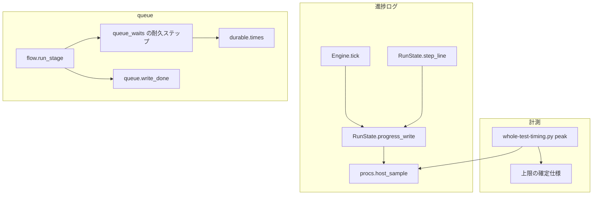
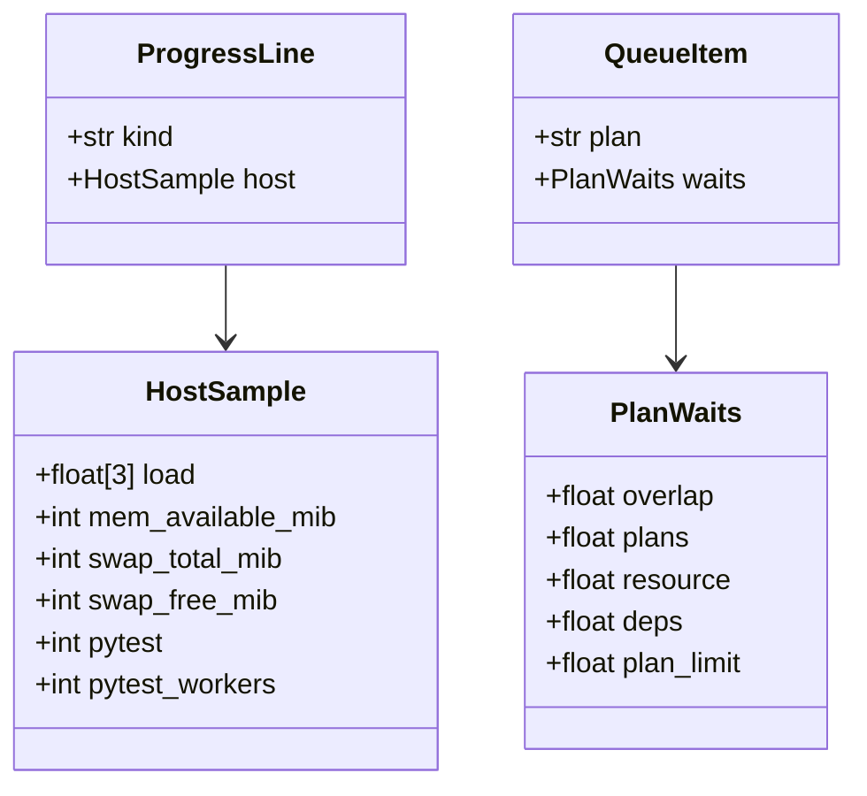
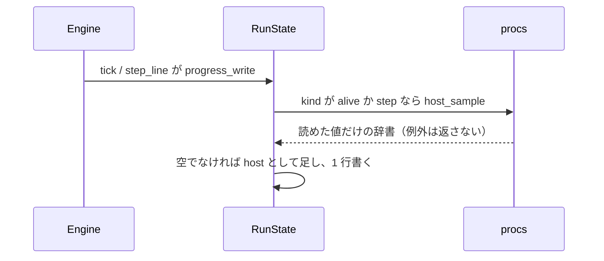
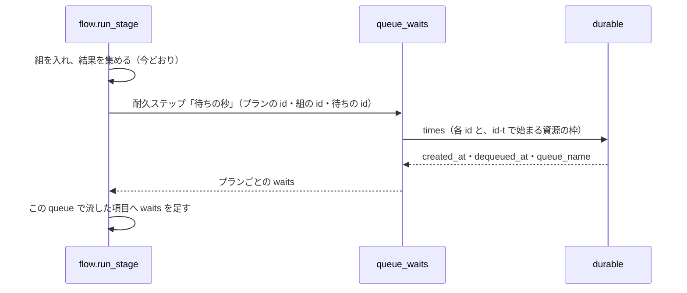
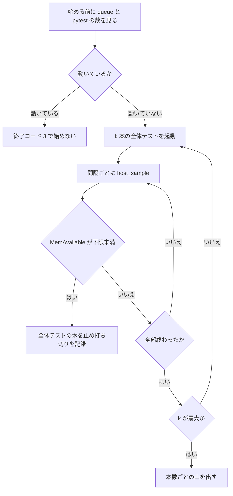

# 並列の計測: 進捗ログに負荷とメモリを残し、キューの待ちを理由ごとに数え、全体テストのメモリの山を測る（#2998）

## 目的

- **今どうなっているか**: 進捗ログ（`progress.jsonl`）に load average・メモリ・スワップが残らず、queue の結果にもプランがキューで待った秒とその理由が残らない。プランの本数の上限 6 の根拠は 2026-09-25 の実測（全体テスト 1 本 93 秒）で、今は全体テストが 850〜1,000 秒かかり、スワップ 8 GiB を使い切ることがある
- **誰に効くか**: 並列の上限と並べ方を決め直す担当（conductor と利用者）
- **変えると何が成り立つか**: スプリントの記録から、負荷とメモリの推移・待ちの理由ごとの秒・全体テストを同時に流したときのメモリの山を読み、上限を測った値で決め直せる

## 適用範囲

- **働く範囲**: NDF を使うすべてのリポジトリ。記録の値は supervise が書く進捗ログと queue の結果に載る。メモリの山の計測は ai-plugins で 1 回行い、確定仕様に載せる
- **プロジェクトごとに違うもの**: 全体テストのコマンド。計測は `.ndf/project.json` の `test.suites` の宣言を読み、引数では受けない
- **当たるモード**: `standard`

## あるべき姿の根拠

| 根拠 | 種類 | 何を示すか |
| --- | --- | --- |
| STD1（`proc_meminfo(5)`）: MemAvailable は「スワップせずに新しいアプリケーションを始めるのに使える量の見積もり」 | 外部の一次情報 | メモリの余裕を MemAvailable で記録すれば、OOM Killer の手前の状態を読める |
| PRD1（Slurm の待ちの理由のコード）: 待っているジョブに Resources・Dependency・Priority・上限の名前の理由を付ける | 外部の一次情報 | 待ちの秒を理由ごとに分ける形は、主要なジョブスケジューラと同じ |
| 2026-11-11 の実測: スワップの空き 313〜383 MiB（合計 8,192 MiB）、MemAvailable 17,971〜18,787 MiB | 実測 | スワップに余裕が無く、メモリの山の計測では下限を割る前に止める必要がある |
| 2026-11-11 の実測: `pytest -n 2` を流すと、xdist の作業プロセスの命令行に `pytest` が含まれない（`python -u -c import sys;exec(...)`）。`uv run` の親プロセスと Bash のシェルの命令行には含まれる | 実測 | 命令行に `pytest` を含むかで数えると、作業プロセスを落とし、親とシェルを重ねて数える |

要求と受け入れ条件は #2998 の本文にある（コピーは [issue-2998-requirements.md](issue-2998-requirements.md) ）。この文書は「どう作るか」だけを扱う。

## ドメインモデル

### コンテキスト

| コンテキスト | 何の語が 1 つの意味に決まるか |
| --- | --- |
| supervise の実行（`supervise`） | 進捗ログの行・ステップ・queue の結果・待ちの理由 |
| 並列の計画（`parallel`） | プランの本数の上限・メモリの山・上限の根拠 |

並列の計画が顧客、supervise の実行が供給者の関係（顧客 / 供給者）。並列の計画は、supervise が書く進捗ログと queue の結果の値を読み、上限を決め直す材料にする。supervise は並列の計画の要求（負荷・メモリ・待ちの理由）を受けて記録の項目を足す。

### 集約

| 集約 | 持ち主（書き換えてよいもの） | 根 | エンティティ | 値オブジェクト |
| --- | --- | --- | --- | --- |
| 進捗ログ | `supervise_lib/state.py` の `RunState.progress_write` | 進捗ログのファイル（状態ディレクトリごとに 1 つ） | 行（`kind` ごと） | 負荷とメモリの値（`host`） |
| queue の結果 | `supervise_lib/queue.py` の `write_done` | 結果の JSON（`--done` のファイル） | プランの項目（`items` の 1 件） | 待ちの秒（`waits`） |
| 上限の根拠 | 確定仕様 `docs/specifications/ndf-parallel-organizer.md` | 「決定と理由」の上限の行 | — | メモリの山の計測の記録 |

### 不変条件

| # | 集約 | 条件 | 破れたときの扱い |
| --- | --- | --- | --- |
| I1 | 進捗ログ | `alive` と `step` の行は、負荷とメモリの値を読めなくても書かれ、既存の項目（`step`・`type`・`elapsed`・`worker`・`last_output`、`step` の行は `exit`・`seconds` ほか）を保つ | 読み取りの例外を `host` の鍵の省略に変え、行の書き込みを止めない |
| I2 | 進捗ログ | `host` の値は、読めたものだけを持つ。読めなかった値を 0 や空で埋めない | 読めない値の鍵を省く。すべて読めなければ `host` ごと省く |
| I3 | queue の結果 | この queue で流したプランの項目は、`waits` に 5 つの理由（`overlap`・`plans`・`resource`・`deps`・`plan_limit`）の鍵をすべて持ち、値は 0 以上の秒である | 待たなかった理由は 0 を書く |
| I4 | queue の結果 | この queue で流さなかったプラン（前の実行で完了か承認ゲートの記録があるもの・前提のプランで止めたもの）の項目は `waits` を持たない | 測っていない値を 0 と読ませない |
| I5 | queue の結果 | 待ちの秒は、キューの耐久の記録の時刻から導き、同じ queue を打ち直しても同じ値を返す | 耐久ステップの記録を返す |
| I6 | 上限の根拠 | メモリの山の計測は、ほかの supervise の queue と pytest が動いていないときだけ始め、MemAvailable が下限を割ったら残りの本数を流さない | 始める前に断る。割ったら動いている全体テストを止め、打ち切った本数とその時点の値を記録する |
| I7 | 上限の根拠 | 上限の値（`DEFAULT_MAX_PLANS`・queue の `--max` の既定）は、この変更で変わらない | 値を変える差分を含めない |

### ドメインイベント

| # | イベント | 発生元 | 受け手 |
| --- | --- | --- | --- |
| E1 | ステップが動かないまま報告の間隔を過ぎ、まだ動いている行を書いた | `Engine.tick` → `RunState.progress_write` | conductor（`supervise.py wait`）・上限を決め直す担当 |
| E2 | ステップが終わり、終わりの行を書いた | `RunState.step_line` → `RunState.progress_write` | 同上 |
| E3 | プランがキューへ入った | `flow._submit_groups`（耐久キュー `plans` か `wait_workflow` へ入れた） | DBOS の耐久の記録（`created_at`） |
| E4 | プランが理由ごとの待ちを終えた | DBOS（耐久キューから出した `dequeued_at`）・`group_workflow`（員を始めた） | DBOS の耐久の記録 |
| E5 | プランが流れ始めた | `plan_workflow` | DBOS の耐久の記録 |
| E6 | queue が結果を書いた | `flow.run_stage` → 耐久ステップ「待ちの秒」→ `queue.write_done` | conductor・上限を決め直す担当 |
| E7 | 全体テストを 1・2・3 本同時に流し、メモリの山を測った | `whole-test-timing.py peak` | 実装の担当 |
| E8 | 測った値を上限の確定仕様へ載せた | 実装の担当 | 上限を決め直す担当（#2999 と、上限を変える後の課題） |

### 用語

| 用語 | 意味 | 用語集への反映 |
| --- | --- | --- |
| 負荷とメモリの値 | 進捗ログの行に載せるマシンの負荷の組。load average（1・5・15 分）、MemAvailable（MiB）、スワップの合計と空き（MiB）。進捗ログの行では `host` の項目に置く | 意味の変更（置き場の項目名を足す） |
| マシンの上の pytest の数 | 進捗ログの行を書いた時点で、supervise と同じ PID の名前空間から見える pytest の本体のプロセスの数。起動の経路（supervise・AI の Bash・人のシェル）を区別しない。xdist の作業プロセスは別に数える | 意味の変更（数える範囲と本体・作業プロセスの区別を足す） |
| 待ちの理由 | プランが queue で流れ始めるまでに待った原因。重なり（`overlap`）・`plans`・資源の枠（`resource`）・前提のプラン（`deps`）・計画の上限（`plan_limit`）の 5 つ | 意味の変更（記録の名前を足す） |
| 待ちの秒 | queue の結果のプランの項目に置く、待ちの理由ごとに待った秒（`waits`） | 追加 |
| メモリの山 | 全体テストを流している間に、マシンの使用中のメモリ（合計 − MemAvailable）とスワップの使用量が取った最大の値 | 変更なし |

## 外部の調査

| 種類 | 調べるか | 理由 |
| --- | --- | --- |
| 標準・仕様 | 調べる | 負荷とメモリの値の定義（Linux の `/proc`）と、システムの計測値の名前の標準（OpenTelemetry）に倣うかを決める |
| 主要な製品 | 調べる | キューで待った理由を分ける形を、ジョブスケジューラがどう持つかを比べる |
| ライブラリとサービス | 調べる | 負荷・メモリ・プロセスの読み取りと、キューの待ちの時刻を、すでに依存しているライブラリで取れるかを決める |

### 標準・仕様

| # | 標準・仕様 | 何を定めているか | 設計への反映 | 出典 |
| --- | --- | --- | --- | --- |
| STD1 | Linux `proc_meminfo(5)` | MemAvailable は「スワップせずに新しいアプリケーションを始めるのに使える量の見積もり」（Linux 3.14 以降）。SwapTotal・SwapFree を持つ | メモリの余裕は MemAvailable、スワップは SwapTotal と SwapFree を kB から MiB にして記録する | https://man7.org/linux/man-pages/man5/proc_meminfo.5.html （2026-11-11） |
| STD2 | Linux `proc_loadavg(5)` | 先頭の 3 つの値は、実行待ち（R）とディスク I/O 待ち（D）のジョブの数の 1・5・15 分の平均 | load average は `/proc/loadavg` の先頭の 3 つの値を浮動小数のまま記録する | https://man7.org/linux/man-pages/man5/proc_loadavg.5.html （2026-11-11） |
| STD3 | OpenTelemetry のシステムの計測値の意味規約 | メモリは `system.memory.usage`（状態の属性に `available` など）、スワップは `system.paging.usage`。load average は OS ごとに意味が揃わないため `system.{os}.` を頭に付けよと定める | 記録の値は Linux の項目名（MemAvailable・SwapFree）に寄せ、OpenTelemetry の名前へは寄せない。記録の読み手は Linux の値の意味で読む | https://opentelemetry.io/docs/specs/semconv/system/system-metrics/ （2026-11-11） |

### 主要な製品

| # | 製品 | どう解いているか | 設計への反映 | 出典 |
| --- | --- | --- | --- | --- |
| PRD1 | Slurm（ジョブスケジューラ） | 待っているジョブに理由のコードを 1 つ付ける。資源の不足（`Resources`）・前提のジョブ（`Dependency`）・優先度（`Priority`）・上限（`AssocGrpJobsLimit` など）を分ける | 待ちの理由を資源の枠・前提のプラン・`plans` の空き・計画の上限に分ける。Slurm は今の理由を 1 つ持つが、この変更は終わった後の秒を理由ごとに足し合わせて持つ（上限を決め直すのに要るのは合計の秒のため） | https://slurm.schedmd.com/job_reason_codes.html （2026-11-11） |

### ライブラリとサービス

| # | 候補 | 版 | ライセンス | 最後のリリースの日付 | 終了のアナウンス | 要件を満たすか | 出典 |
| --- | --- | --- | --- | --- | --- | --- | --- |
| LIB1 | psutil（`procs` グループで依存済み） | 7.2.2 | BSD-3-Clause | 2026-01-28 | 無し | プロセスの一覧と親子は満たす。`getloadavg()` は Linux で `os.getloadavg` を呼ぶため、読み取り元のファイルを差し替えたテストができない（`psutil.PROCFS_PATH` を空のディレクトリへ向けても値を返した） | https://pypi.org/pypi/psutil/json （2026-11-11）、`python -c "import psutil; psutil.PROCFS_PATH='/tmp/t2998/fakeproc'; print(psutil.getloadavg())"`（2026-11-11） |
| LIB2 | DBOS（`durable` グループで依存済み）の `WorkflowStatus` | 3.1.0（固定。最新は 3.5.0） | MIT | 2026-11-10（3.5.0） | 無し | 耐久ワークフローの `created_at`（始めた時刻・ミリ秒）・`dequeued_at`（最後に耐久キューから出した時刻）・`queue_name` を持ち、待ちの秒を導ける | https://pypi.org/pypi/dbos/json （2026-11-11）、`.venv/lib/python3.14/site-packages/dbos/_sys_db.py` の `WorkflowStatus`（3.1.0、2026-11-11） |

### 確かめられなかったこと

| 対象 | 試した手段 | 結果と理由 |
| --- | --- | --- |
| DBOS の文書での `dequeued_at` の説明 | https://docs.dbos.dev/python/reference/methods 、https://docs.dbos.dev/python/reference/workflow_handles | 前者は HTTP 404。後者は取得できたが `dequeued_at` の記述が無い。依存している版の原典（`_sys_db.py`）の型の注記を出典にした |
| psutil の文書での `getloadavg` の説明 | https://psutil.readthedocs.io/en/latest/ 、https://psutil.readthedocs.io/en/latest/api-overview.html | 前者に記述が無く、後者は HTTP 404。依存している版の docstring と実行の結果を出典にした |

調べた量: 候補 6 件・取得の試み 11 回。

## 機能一覧

| # | 機能 | 誰が使うか |
| --- | --- | --- |
| F1 | 進捗ログの `alive` と `step` の行で、負荷とメモリの値とマシンの上の pytest の数を読む | conductor・上限を決め直す担当 |
| F2 | queue の結果で、プランごとに待ちの理由ごとの秒を読む | conductor・上限を決め直す担当 |
| F3 | 計画の上限による待ちの秒を、同じ形で queue の結果へ書く | #2999 の実装 |
| F4 | 全体テストを 1・2・3 本同時に流し、本数ごとのメモリの山と所要の秒を測る。下限を割ったら打ち切る | 実装の担当（1 回の手動の計測） |
| F5 | 上限の確定仕様で、上限の行の根拠にメモリの山の実測を読む | 上限を決め直す担当 |

## 構成要素

| 要素 | 責務 |
| --- | --- |
| `lib/procs.py` の `host_sample`（新設） | `/proc/loadavg` と `/proc/meminfo` を読み、psutil でプロセスの一覧を読んで、負荷とメモリの値とマシンの上の pytest の数を 1 つの辞書で返す。読めない値の鍵を省く。読み取り元のパスを引数で受ける |
| `supervise_lib/state.py` の `RunState.progress_write`（変更） | `kind` が `alive` か `step` の行へ、`host_sample` の結果を `host` として足す |
| `lib/durable.py` の `times`（新設） | 耐久ワークフローの id から `created_at`・`dequeued_at`・`queue_name` を返す。DBOS を読むのはこのモジュールだけ（今の決まり） |
| `supervise_lib/queue_waits.py`（新設） | 待ちの理由の名前（`REASONS`）を持ち、プランごとの待ちの秒を耐久ステップ「待ちの秒」で導く |
| `supervise_lib/flow.py` の `run_stage`（変更） | 結果を集めた後に耐久ステップ「待ちの秒」を呼び、プランの項目へ `waits` を足す |
| `supervise_lib/plan.py`（変更） | 進捗ログの説明（`supervise.py` の使い方の文）に `host` を足す |
| `experimental/whole-test-timing.py` の `peak`（新設の副命令） | 用意した worktree で全体テストを 1・2・3 本同時に流し、1 秒ごとにメモリを測って山と所要の秒を出す。下限を割ったら止める |
| `docs/specifications/ndf-parallel-organizer.md`（変更） | 上限の行の根拠に、メモリの山の実測（日付・CPU 数・メモリ量・NDF の版）を足す |
| `development-workflow/references/waiting.md`（変更） | 進捗ログの行の表の `alive` と `step` に `host` を足す |
| `docs/ndf-experiments.md`（変更） | 実験版の台帳の `whole-test-timing.py` の行に `peak` と使った結果を足す |



図に含めない要素: `plan.py`・`waiting.md`・`ndf-experiments.md`（説明を書き足すだけで、呼び出しの関係を持たない）。

パッケージ・モジュール構成（足すファイルと変えるファイル）:

```text
plugins/ndf/scripts/
├── lib/
│   ├── procs.py          # host_sample を足す
│   └── durable.py        # times を足す
├── supervise_lib/
│   ├── state.py          # progress_write で host を足す
│   ├── flow.py           # run_stage から待ちの秒を呼ぶ
│   ├── plan.py           # 進捗ログの説明
│   └── queue_waits.py    # 新設
└── experimental/
    └── whole-test-timing.py  # peak を足す
```

## 構造

記録の値の形だけを示す。型は辞書で、クラスは作らない。



## データ構造

進捗ログと queue の結果は事象の記録（行を足すだけで書き換えない）で、この変更も項目を足すだけである。

### 進捗ログの `alive` と `step` の行に足す `host`

| 項目 | 型 | 単位 | 出所 | 読めないとき |
| --- | --- | --- | --- | --- |
| `load` | 3 つの数の配列 | — | `/proc/loadavg` の先頭の 3 つ（1・5・15 分） | 鍵を省く |
| `mem_available_mib` | 整数 | MiB | `/proc/meminfo` の MemAvailable（kB を 1,024 で割って切り捨て） | 鍵を省く |
| `swap_total_mib` | 整数 | MiB | 同 SwapTotal | 鍵を省く |
| `swap_free_mib` | 整数 | MiB | 同 SwapFree | 鍵を省く |
| `pytest` | 整数 | 本 | psutil のプロセスの一覧から数えた pytest の本体（決定 4） | 鍵を省く |
| `pytest_workers` | 整数 | 本 | pytest の本体の直下の子のうち、Python の作業プロセス | 鍵を省く |

例（`alive` の行）:

```json
{"kind": "alive", "at": "2026-11-11T12:00:00+09:00", "step": "test", "type": "run", "elapsed": 612.4, "worker": "無し", "host": {"load": [5.35, 5.61, 5.84], "mem_available_mib": 17971, "swap_total_mib": 8192, "swap_free_mib": 313, "pytest": 2, "pytest_workers": 8}}
```

### queue の結果のプランの項目に足す `waits`

| 項目 | 型 | 単位 | 何の秒か |
| --- | --- | --- | --- |
| `overlap` | 数（小数 1 桁） | 秒 | 重なりの組の中で、前の員が終わるのを待った秒 |
| `plans` | 同上 | 秒 | 耐久キュー `plans` の空き（`--max`）を待った秒 |
| `resource` | 同上 | 秒 | 資源の枠の耐久キュー `res-<タグ>` の空きを待った秒の、ステップすべての和 |
| `deps` | 同上 | 秒 | 同じステージの前提のプランの終わりを `wait_workflow` で待った秒 |
| `plan_limit` | 同上 | 秒 | 計画の上限を待った秒。#2999 が書くまでは 0 |

例:

```json
{"plan": ".ndf/sprint-1/2-impl.json", "result": "完了", "exit": 0, "seconds": 1210.3, "overlap": [{"with": ".ndf/sprint-1/1-impl.json", "paths": ["a.py", "a.py"]}], "waits": {"overlap": 905.2, "plans": 0.0, "resource": 3.1, "deps": 0.0, "plan_limit": 0.0}}
```

### 待ちの秒の導き方

時刻はすべて DBOS の耐久の記録（LIB2）から読む。`id` はプランの耐久ワークフローの id（`admit_step` が決めた `refs[プラン]["id"]`）である。

| 理由 | 入れ方が直のプラン | 重なりか前提の員を持つ組（`group_workflow`） | 前提のプランを待つ組（`wait_workflow`） |
| --- | --- | --- | --- |
| `plans` | `id` の `dequeued_at` − `created_at` | 組の `dequeued_at` − `created_at` | 同左 |
| `overlap` | 0 | 員の `created_at` − 組の `dequeued_at`（先頭の員はほぼ 0） | 同左 |
| `deps` | 0 | 0 | 組の `created_at` − `wait_workflow` の `created_at` |
| `resource` | id が `<id>-t` で始まり、`queue_name` が `res-` で始まる耐久ワークフローの `dequeued_at` − `created_at` の和 | 同左 | 同左 |
| `plan_limit` | 0（#2999 が書く） | 同左 | 同左 |

負の値になったとき（時計の誤差）は 0 にする。`dequeued_at` が無いとき（耐久キューを通らなかった）はその理由を 0 にする。

### CRUD

| 機能 | 進捗ログ | queue の結果 | DBOS の耐久の記録 | 上限の確定仕様 |
| --- | --- | --- | --- | --- |
| F1 | 作る（行を足す） | — | — | — |
| F2 | — | 作る | 読む | — |
| F3 | — | 作る | 読む | — |
| F4 | — | — | — | — |
| F5 | — | — | — | 更新する |

## 入出力の契約

### `whole-test-timing.py peak`

| 項目 | 書くこと |
| --- | --- |
| 名前 | `python3 plugins/ndf/scripts/experimental/whole-test-timing.py peak --root <dir> [--root <dir>]... [--floor-mib N] [--interval S]` |
| 入力 | `--root`: 全体テストを流す worktree（1〜3 個。並べた数が最大の本数）。`--floor-mib`: MemAvailable の下限（既定 2,048）。`--interval`: 測る間隔の秒（既定 1） |
| 処理 | 本数 1・2・…・`--root` の数の順に、`.ndf/project.json` の `test.suites` の `command` を先頭から k 個の worktree で同時に起動し、すべてが終わるまで `procs.host_sample` を間隔ごとに読む |
| 出力（成功） | `lib/step_result.py` の形の 1 行の JSON（`tool: "whole-test-timing"`）。`metrics` に計測の日・CPU 数・MemTotal（MiB）・NDF の版（`plugins/ndf/.claude-plugin/plugin.json`）・始める前の使用中のメモリとスワップの使用量。`items` に本数ごとの 1 件（`runs`・`seconds`・`peak_used_mib`・`peak_swap_used_mib`・`min_mem_available_mib`・各 worktree の終了コード） |
| 出力（打ち切り） | 下限を割った本数の `items` に `aborted: true` と、その時点の `mem_available_mib`・`swap_free_mib` を載せ、残りの本数の行を作らない。`status` は `stopped` |
| 失敗の形 | 0 測れた / 2 引数の誤り / 3 ほかの supervise の queue か pytest が動いている（始めない）/ 1 下限を割って打ち切った |
| 互換性 | 新しい副命令で、既存の `measure`・`diff`・`startup` を変えない |

進捗ログと queue の結果の項目は「データ構造」の表が持つ。既存の項目は消さず、鍵を足すだけにする。読む側が知らない鍵を読み捨てるかは、契約のテスト（`tests/test_supervise_contract.py`）を全体テストで通して確かめる。

## 処理の流れ

### 進捗ログの行に値を足す



### queue の結果に待ちの秒を足す



queue を打ち直したときは、耐久ステップ「待ちの秒」の記録を返す（I5）。

### メモリの山を測る



## 非機能の実現方式

| 大項目 | 要求の条件 | 実現方式 | 確かめ方 |
| --- | --- | --- | --- |
| 性能・拡張性 | 負荷とメモリの値と pytest の数を読む処理は、1 行あたり 1 秒以内に終わる。`tick` の間隔を延ばさない | 2 つの小さなファイルを読み、psutil のプロセスの一覧を 1 回だけ回す（命令行と親の pid だけを取る）。2026-11-11 の実測で 110 プロセスを 0.01 秒で回した | プロセスを 300 本以上見せた単体テストで、`host_sample` が 1 秒以内に返ることを見る |
| 運用・保守性 | 足す値は既存の `progress.jsonl` と queue の結果に載せ、新しい記録のファイルを作らない | `host` は既存の行に、`waits` は既存のプランの項目に足す | 記録のファイルの一覧が変わらないことをテストで見る |
| システム環境 | Linux で値が載る。Linux 以外では値を省いて動く | ファイルを読めない・数に直せない値の鍵を省く（I2） | 読み取り元を存在しないパスに差し替え、`host` が省かれ行が書かれることを見る |

## 決定の記録

### 決定 1: 書き手を 1 か所にするため、負荷とメモリの値を `RunState.progress_write` で `alive` と `step` の行に足す

`alive` の行は `Engine.tick`、`step` の行は `RunState.step_line` と `Engine` の「実行条件」の行の 3 か所で作られる。行を作る側ごとに足すと、`kind: step` の行のうち 1 つへ足し忘れる経路が残る。書き手の `progress_write` で `kind` を見れば、どの経路の行にも同じ値が載る。

作る側ごとに足す形は採らない。足す場所が 3 つに分かれ、後から `step` の行を書く経路が増えたときに漏れる。

根拠: Value 7（MVV 版 6）

### 決定 2: 既存の項目と名前がぶつからないよう、値を `host` の入れ子に置き、読めない値は鍵ごと省く

`alive` の行は `step`・`elapsed` などの平らな鍵を持つ。`load`・`pytest` を平らに足すと、後から足す項目と名前がぶつかる余地が増え、どれがマシンの値かも名前から読めない。入れ子にすれば、マシンの値は `host` の下にまとまる。

読めない値を 0 で埋める形は採らない。0 は「メモリが 0」と読まれ、集計を誤らせる。

根拠: Value 8（MVV 版 6）

### 決定 3: 読み取り元を差し替えて試せるよう、load average とメモリは `/proc` のファイルを `procs.py` で直に読む

要求の前提 1 は `/proc/loadavg` と `/proc/meminfo` を読み元とし、テスト戦略は読み取り元のファイルを差し替えた単体テストを求める。psutil の `getloadavg()` は Linux で `os.getloadavg` を呼び、`psutil.PROCFS_PATH` を差し替えても実際の値を返した（2026-11-11 の実行）。`procs.py` はすでに `/proc/pressure/memory` と `/proc/vmstat` をパスの引数つきで直に読んでおり、同じ形に揃える。

psutil の `getloadavg()`・`virtual_memory()`・`swap_memory()` を使う形は採らない。差し替えの手段が `PROCFS_PATH` の書き換え（プロセス全体の状態）になり、load average には効かない。

- 作り方: 自前で作る・標準に倣う
- 比べた候補: LIB1 / STD1 / STD2 / STD3

根拠: Value 6 / Value 7（MVV 版 6）

### 決定 4: 親のプロセスとシェルを重ねず、xdist の作業プロセスを落とさないよう、pytest の本体を命令行の形で見分け、作業プロセスは本体の子として数える

命令行に `pytest` を含むかで数えると、`uv run ... pytest` の親と、命令を文字列で持つ Bash のシェルも数え、xdist の作業プロセス（命令行に `pytest` を含まない）を落とす（2026-11-11 の実測）。本体は、実行ファイルの名前が `pytest` か `py.test` のもの、または Python のインタプリタで最初の引数の名前が `pytest` か `-m pytest` のものとする。作業プロセスは本体の直下の子のうち Python のインタプリタのものとし、`pytest_workers` に別に数える（要求の前提 2）。プロセスの一覧は依存済みの psutil で読む。

数えられる範囲は、supervise と同じ PID の名前空間から見えるプロセスに限る。同じ VM の別のコンテナの pytest は数えない。load average とメモリはコンテナの中からも VM 全体の値が見えるため、この違いは pytest の数だけにある。

- 作り方: ライブラリやサービスを使う
- 比べた候補: LIB1

根拠: Value 4 / Value 6（MVV 版 6）

### 決定 5: 待ちの時刻を新しく記録せずに済むよう、待ちの秒を DBOS の耐久の記録の `created_at`・`dequeued_at` から導く

耐久キューへ入れた時刻と出した時刻は、DBOS がすでに耐久ワークフローごとに記録している（LIB2）。この記録から引けば、待ちの始まりと終わりを書く処理をワークフローの中に足さずに済み、打ち直しても値が変わらない。導く処理は耐久ステップ「待ちの秒」1 つにまとめ、打ち直しでは記録を返す（I5）。理由の分け方は Slurm の待ちの理由（PRD1）と同じく、資源・前提・枠の空き・上限に分ける。

ワークフローの中で `time.time()` を読んで出力へ載せる形は採らない。耐久ワークフローの本体は打ち直しで流し直されるため、時刻が打ち直した時点の値に変わる。

- 作り方: ライブラリやサービスを使う・標準に倣う
- 比べた候補: LIB2 / PRD1

根拠: Value 5 / Value 7（MVV 版 6）

### 決定 6: 集計で鍵の有無を確かめずに済むよう、流したプランは 5 つの理由をすべて書き、待たなかった理由は 0 にする

手で集計するとき、鍵が無い項目を 0 として扱うかを毎回決める手間が要る。流したプランは鍵をすべて持つので、和と平均がそのまま取れる。測っていないプラン（この queue で流さなかったもの）は `waits` ごと持たない（I4）。0 と「測っていない」を区別するためである。

待たなかった理由を省く形は採らない。省くと、測っていない値と待たなかった値が同じ形になる。

根拠: Value 4 / Value 8（MVV 版 6）

### 決定 7: #2999 が別の形を作らずに済むよう、計画の上限の待ちの名前を `plan_limit` として `queue_waits.REASONS` に置き、今は 0 を書く

#2999 が計画の上限による待ちを作るとき、待った秒を `queue_waits` の導き方の表へ 1 行足し、`plan_limit` の値として返す。名前と置き場はこの変更で決まっているため、#2999 は記録の形を変えない。要求の前提 3 のとおり、#2999 が別の形を選んだときはこの形に合わせる。

根拠: Value 7（MVV 版 6）

### 決定 8: 試す計測を本体と分けるため、メモリの山の計測は実験版の `whole-test-timing.py` に副命令 `peak` として足す

計測は 1 回の手動の計測で、既定の工程から呼ばない（要求の前提 4）。`whole-test-timing.py` はすでに全体テストを `.ndf/project.json` の宣言どおりに同じ条件で流す実験版で、宣言の読み取りを共有できる。上限を決め直すたびに同じ計測を打てるよう、手順を手で打つ形ではなくスクリプトにする。メモリの読み取りは `procs.host_sample` を使い、`/proc` を読むのを `procs.py` だけに保つ。

本体の `parallel-measure.py` に足す形は採らない。既定の工程から呼ばれる起動の判定のスクリプトで、手動の計測を混ぜると本体の振る舞いの範囲が広がる。

- 作り方: 自前で作る
- 比べた候補: LIB1

根拠: Value 5 / Value 9（MVV 版 6）

### 決定 9: 同時に流す全体テストが同じファイルを奪い合わないよう、計測は別々の worktree を引数で受ける

全体テストは junit の出力（`.ndf/tmp/junit.xml`）と一時のファイルを作業場所の中に書く。同じ worktree で同時に流すと出力が衝突し、実際の並列（レーンごとに別の worktree）とも条件が違う。worktree の用意は `ndf:worktree` で行い、`peak` は受けたパスで流すだけにする。

`peak` が worktree を作る形は採らない。後片付けと依存の用意（`uv` の環境）までスクリプトが持つことになり、試す仕組みとして大きい。

根拠: Value 3 / Value 6（MVV 版 6）

### 決定 10: OOM Killer の手前で止めるため、打ち切る MemAvailable の下限を 2,048 MiB にする

2026-11-11 のスワップの空きは 313〜383 MiB で、スワップは山を吸収できない。下限は、`parallel-measure.py` の予備（同じ VM のほかのプロセスの揺れ、1,024 MiB）に、測る間隔 1 秒の間に増えうる分として同じ 1,024 MiB を足した値である。下限を割ったら、`procs.stop_tree` で動いている全体テストの木を止める。

予備の 1,024 MiB だけを下限にする形は採らない。1 秒の間の増え方を見込まず、測った直後に OOM Killer が動く余地が残る。

根拠: Value 1 / Value 3（MVV 版 6）

### 決定 11: 始める前の状態と比べられるよう、ほかの queue と pytest が動いていれば計測を始めない

ほかのレーンが動いていると、山にほかの作業の分が混ざり、本数ごとの差が読めない。始める前に `supervise.py queue` のプロセスと `host_sample` の `pytest` を見て、どちらかが 1 以上なら終了コード 3 で返す（要求の境界の「行わない」）。始める前の使用中のメモリとスワップの使用量も出力に載せ、山との差を読めるようにする。

根拠: Value 4（MVV 版 6）

## テスト設計

| 受け入れ条件・不変条件 | どの振る舞いで縛るか | どう壊したら落ちるべきか |
| --- | --- | --- |
| 受け入れ条件 1 | 読み取り元を偽のファイルにした `host_sample` の値が、`alive` の行の `host` に載る（load の 3 つ・MemAvailable・スワップの合計と空き） | `alive` の行で `host` を足さないように壊すと落ちる。kB から MiB への換算を外すと落ちる |
| 受け入れ条件 2・I1・I2 | 読み取り元を存在しないパスにすると、`alive` の行は `host` の無いまま書かれ、例外を上げない。片方のファイルだけ読めるときは読めた鍵だけが載る | 読み取りの例外を上へ通すように壊すと落ちる。読めない値を 0 で埋めると落ちる |
| 受け入れ条件 3 | `step_line` と「実行条件」の行（どちらも `kind: step`）に、`alive` と同じ `host` が載る | `kind` の判定から `step` を外すと落ちる |
| 受け入れ条件 4 | 実際に `pytest` を 1 本（xdist で 2 本の作業プロセス）を子として動かしている間の `host_sample` で `pytest` が 1 以上、`pytest_workers` が 2 以上。`uv run` の親とシェルは本体に数えない | 命令行に `pytest` を含むかで数えるように壊すと、本体の数が多すぎて落ちる。子を数えないと `pytest_workers` が 0 で落ちる |
| 受け入れ条件 5・I3 | 時計を差し替えた queue で 1 本を流すと、そのプランの `waits` が 5 つの鍵をすべて持ち、値は 0 以上 | 待たなかった理由の鍵を省くように壊すと落ちる |
| 受け入れ条件 6 | 同じファイルを触る 2 本を `--max 2` で流すと、後のプランの `overlap` が前のプランの流れていた秒（±5 秒）、`plans` が 0 | 員の待ちを組の `created_at` から数えるように壊すと、`plans` の分が混ざって落ちる |
| 受け入れ条件 7 | `queue_waits.REASONS` に `plan_limit` があり、流したプランの `waits.plan_limit` が 0 | `REASONS` から `plan_limit` を外すと落ちる |
| I4 | 前の実行で完了の記録があるプランと、前提のプランで流さなかったプランの項目に `waits` が無い | 流さなかったプランへも `waits` を書くと落ちる |
| I5 | 同じ queue を打ち直すと、`waits` が 1 回目と同じ値 | 待ちの秒を耐久ステップの外で導くように壊すと、打ち直しの値が変わって落ちる |
| 資源の枠の待ち | 資源の枠 1 本のタグを持つステップの 2 本を同時に流すと、後のプランの `resource` が前のステップの流れていた秒に近い | 資源の枠の id の頭を見ないように壊すと 0 で落ちる |
| 受け入れ条件 8・9・10・I6 | 手動の計測（自動のテストにしない。要求の前提 4）。`peak` の振る舞いのうち、ほかの queue か pytest が動いていれば終了コード 3 で始めないこと、偽の `host_sample` が下限を割ると残りの本数を流さず `aborted` を載せることは単体テストで縛る | 始める前の確かめを外すと落ちる。下限を割っても次の本数を流すように壊すと落ちる |
| 受け入れ条件 11・I7 | `parallel_plan.DEFAULT_MAX_PLANS` が 6、queue の `--max` の既定が今の値のまま | 値を変えると既存のテストが落ちる（今あるテストで縛る） |
| 受け入れ条件 12・I1 | `alive` の行に `step`・`type`・`elapsed`・`worker`、run のステップでは `last_output` が残る | 既存の鍵を `host` へ移すと落ちる |
| 性能 | プロセスを 300 本以上見せた `host_sample` が 1 秒以内に返る | 本体ごとにプロセスの一覧を回し直すと遅くなって落ちる |

## 設計の結果

| 課題 | 扱い | 取り込み先 | 触るファイル |
| --- | --- | --- | --- |
| #2998 | 実装する | — | `plugins/ndf/scripts/lib/procs.py`、`plugins/ndf/scripts/lib/durable.py`、`plugins/ndf/scripts/supervise_lib/state.py`、`plugins/ndf/scripts/supervise_lib/flow.py`、`plugins/ndf/scripts/supervise_lib/plan.py`、`plugins/ndf/scripts/supervise_lib/queue_waits.py`（新設）、`plugins/ndf/scripts/experimental/whole-test-timing.py`、`plugins/ndf/scripts/tests/`、`plugins/ndf/skills/development-workflow/references/waiting.md`、`docs/specifications/ndf-parallel-organizer.md`、`docs/ndf-experiments.md` |

## 人へ残す判断

無し

## 未確認のまま残ること

| 項目 | 内容 |
| --- | --- |
| 全体テスト 1 本が使うメモリの山 | 受け入れ条件 8 の計測で分かる。3 本の途中で下限を割れば、打ち切った本数とその時点の値が上限の根拠になる |
| 1 秒の間のメモリの増え方 | 下限 2,048 MiB の後半の 1,024 MiB は見込みである。`peak` の出力の最小の MemAvailable と、間隔ごとの差から計測の後に分かる |
| 落ちた後に続けた queue の待ちの秒 | DBOS の `dequeued_at` は最後に耐久キューから出した時刻で、落ちた後の起動で耐久ワークフローが耐久キューへ戻ると、待ちの秒に止まっていた時間が混ざるかが分かっていない。実際のスプリントで落ちた queue の結果を読んだときに分かる |
| `flow.py` と `state.py` の行数 | `flow.py` は 500 行、`state.py` は 499 行で、構成のテストの上限（500 行）に当たっている。足す行の分だけ既存の行を `queue_waits.py` へ移す必要があるかは、実装で分かる |
