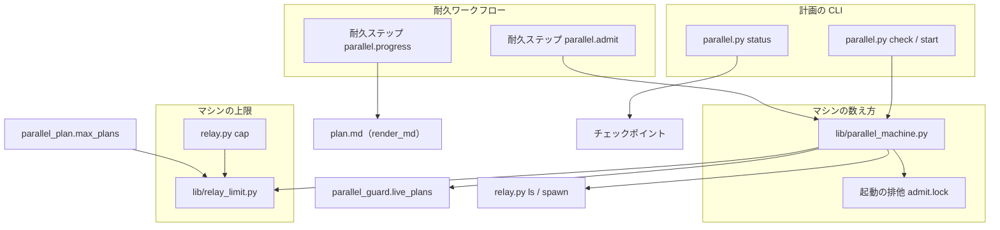
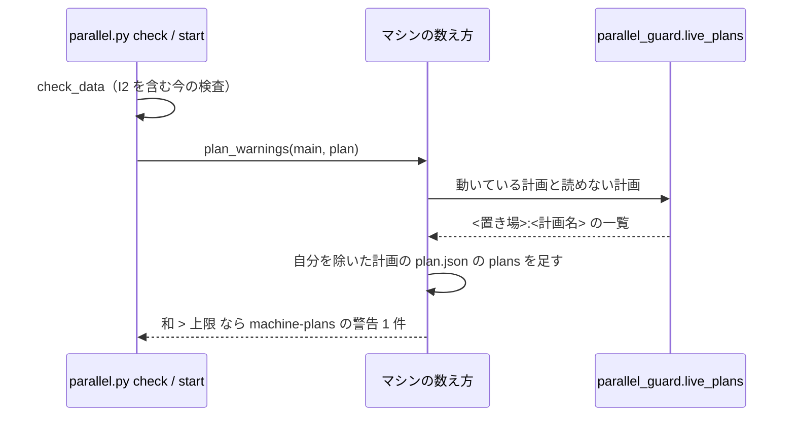
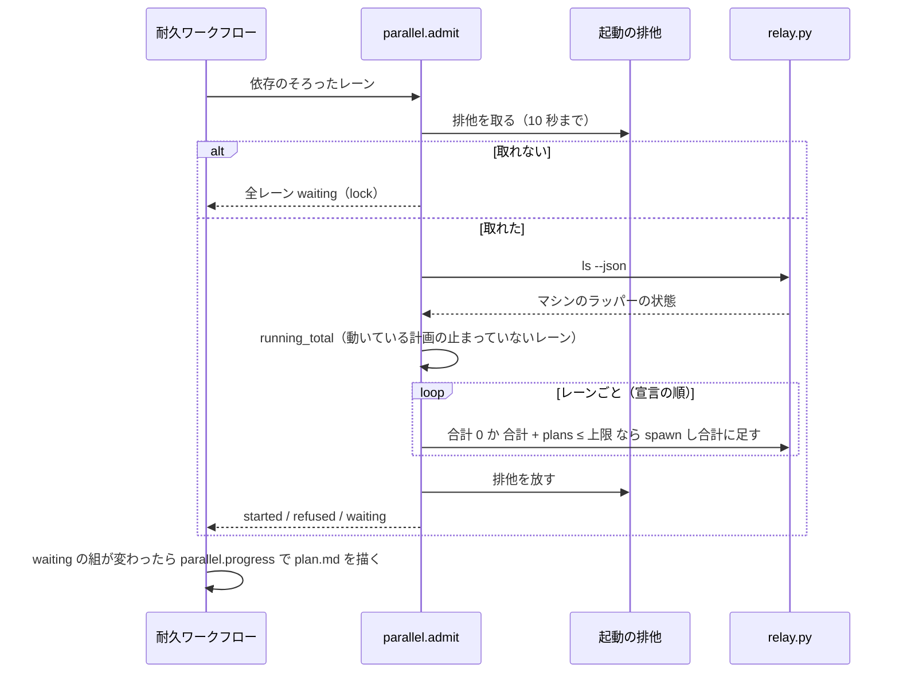
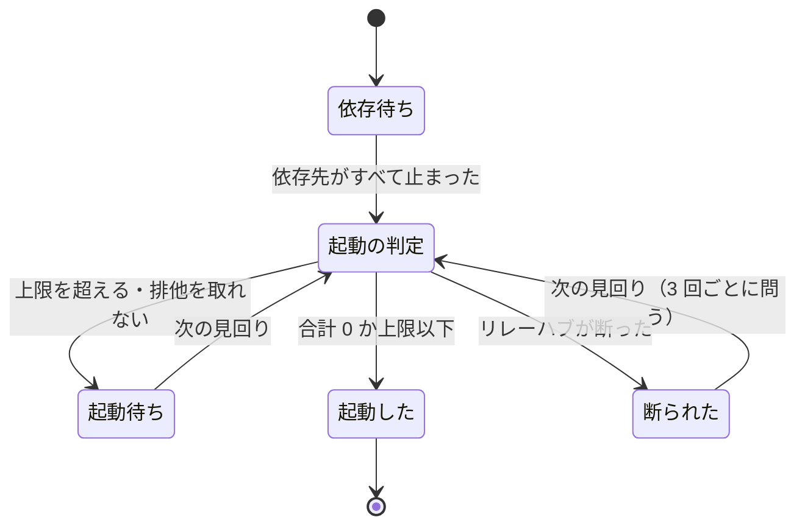

# 並列の計画: プランの本数の上限をマシン全体で数え、超えるレーンの起動を待たせる（#2999）

## 目的

- **今どうなっているか**: プランの本数の上限（既定 6）は、並列の計画 1 つの宣言の中だけで数える。同じマシンで ai-plugins と carul の計画がそれぞれ 6 本を宣言でき、合わせて 12 本まで並ぶ。2 つの計画が重なると 8 GB のスワップを使い切ることがある
- **誰に効くか**: 1 台のマシンで 2 つ以上のリポジトリの並列の計画を動かす開発者と、その計画のオーガナイザー
- **変えると何が成り立つか**: 計画の検査と開始がマシン全体の合計を警告し、耐久ワークフローは合計が上限を超えるレーンの起動を空きができるまで待たせる。同時に流れるプランの本数が、マシンの資源から決めた上限の範囲に収まる

## 適用範囲

- **働く範囲**: NDF の並列の計画（`parallel.py`）を使うすべてのリポジトリ。数える範囲は同じ状態の根（`<状態の根>`。マシンの状態の置き場）を共有するマシン 1 台である
- **プロジェクトごとに違うもの**: 無し。上限の値はマシンの設定（`<状態の根>/relay/hub/limits.json`）か環境変数で受け、リポジトリの設定には置かない
- **当たるモード**: `standard`

## あるべき姿の根拠

| 根拠 | 種類 | 何を示すか |
| --- | --- | --- |
| 要求の「調べた事実」（2026-11-11、`progress.jsonl` 577 件の集計） | 実測 | 同じマシンの 2 つのリポジトリの計画が重なって動いている。上限の根拠はマシンの資源（8 コア・30 GB）で、計画 1 つの宣言ではない |
| PRD1（Slurm のジョブの待ちの理由） | 外部の一次情報 | 資源の上限に当たった仕事は断らず、理由（`Resources`・`AssocGrpCpuLimit` など）を添えて待ちの状態に置き、空いたら流す |
| PRD3（GitHub Actions の同時実行のグループ） | 外部の一次情報 | 同時の数を超えた実行は `pending` で待たせる |
| STD1（flock(2)） | 外部の一次情報 | 排他は持ち主のファイル記述子がすべて閉じると放される。持ち主のプロセスが落ちても排他が残らない |
| 既存のレーン数の上限（`plugins/ndf/scripts/lib/relay_limit.py`） | 既存の決定 | マシンで 1 つの値は `<状態の根>/relay/hub/limits.json` → 環境変数 → 既定の順で読む。同じ形に揃える |

要求と受け入れ条件は #2999 の本文にある（コピーは [issue-2999-requirements.md](issue-2999-requirements.md)）。この文書は「どう作るか」だけを扱う。

## ドメインモデル

### コンテキスト

| コンテキスト | 何の語が 1 つの意味に決まるか |
| --- | --- |
| NDF の工程（`ndf-workflow`） | 並列の計画・レーン・マシンのプランの本数・プランの本数の上限・起動の待ち・起動の排他 |
| リレー（`ndf-relay`） | ラッパー・リレーハブ・レーンの状態の一覧（`relay.py ls`）・マシンの設定 |

リレーが上流、NDF の工程が下流で、関係は**公開された言語**とする。耐久ワークフローはリレーハブの CLI の統一 JSON レポート
（`relay.py ls --json`・`spawn --json`・`cap`）だけを読み、リレーハブの内部（登録簿・ラッパーの印）を読まない。今の
`parallel_run` と `parallel_status` の読み方と同じである。

### 集約

| 集約 | 持ち主（書き換えてよいもの） | 根 | エンティティ | 値オブジェクト |
| --- | --- | --- | --- | --- |
| マシンの上限 | `relay_limit`（書くのは `relay.py cap` だけ） | マシンの設定のファイル | — | レーン数の上限（`max_named`）・プランの本数の上限（`max_plans`）・出所 |
| 並列の計画の宣言 | `parallel.py init`・`lane add`・`lane set`。マシンの数え方は読むだけ | 計画（`plan.json`） | レーン | レーンのプランの本数（`plans`） |
| 計画の進行 | 耐久ワークフロー（`parallel_run` の `_Run`） | 計画の進行 | レーンの進行（`lanes[<名前>]`） | 起動の記録（`started`・`refused`）・**起動の待ち**（`waiting`） |
| 起動の排他 | マシンの数え方のモジュール（`lib/parallel_machine.py`、新設） | 錠のファイル `<状態の根>/parallel/admit.lock` | — | — |

マシンのプランの本数は保存しない。判定のたびに、計画の所在の一覧・各計画の宣言・レーンの状態の一覧から数え直す。

### 不変条件

| # | 集約 | 条件 | 破れたときの扱い |
| --- | --- | --- | --- |
| I1 | マシンの上限 | プランの本数の上限は、マシンの設定の `max_plans` → `NDF_PARALLEL_MAX_PLANS` → 既定 6 の順で決まる。同じマシンのどのリポジトリから読んでも同じ値になる | テストで落とす |
| I2 | マシンの上限 | マシンの設定へ一方の上限を書いても、もう一方のキーの値は残る | テストで落とす |
| I3 | マシンの上限 | 正の整数でない値は書かずに終了コード 1 で断る | テストで落とす |
| I4 | 並列の計画の宣言 | 1 つの計画の宣言のプランの合計が上限を超える下書きは、今と同じく `rule: I2` の誤りで断る | テストで落とす |
| I5 | 並列の計画の宣言 | 検査と開始は、他の動いている計画の宣言の合計とこの計画の宣言の合計の和が上限を超えるとき、`rule: machine-plans` の警告を 1 件出す。終了コードは変えない | テストで落とす |
| I6 | 並列の計画の宣言 | 和が上限以下のとき、または他に動いている計画が無いとき、I5 の警告は出ない | テストで落とす |
| I7 | 計画の進行 | マシンのプランの本数が 1 以上で、それにレーンの `plans` を足すと上限を超えるとき、耐久ワークフローはそのレーンを起動せず、起動の待ちに置く | テストで落とす |
| I8 | 計画の進行 | マシンのプランの本数が 0 のとき、レーンの `plans` が上限を超えていても起動する | テストで落とす |
| I9 | 計画の進行 | 起動の待ちのレーンは、マシンのプランの本数にそのレーンの `plans` を足して上限以下になった後の見回りで起動する | テストで落とす |
| I10 | 起動の排他 | 数えてから起動するまでを起動の排他の中で行う。同じマシンの 2 つの耐久ワークフローが同時に判定しても、起動の後のマシンのプランの本数は上限を超えない（I8 で起こした 1 本を除く） | テストで落とす |
| I11 | 起動の排他 | 起動の排他を待ちの上限までに取れなかった見回りでは、依存のそろったレーンを起動せず、起動の待ちに置く | テストで落とす |
| I12 | 計画の進行 | 起動の待ちは起動の断りに数えない（3 回続く断りの問いを出さない） | テストで落とす |
| I13 | 計画の進行 | 状態を読めない計画は動いている計画として数える。宣言を読めない計画は 0 本として数え、その置き場と計画名を警告と起動の待ちに載せる | テストで落とす |
| I14 | 計画の進行 | 起動の待ちのレーンは、`parallel.py status` の行と `plan.md` の進行の表に、マシンのプランの本数・レーンの本数・上限とともに出る | テストで落とす |
| I15 | 計画の進行 | この変更の前に始まった耐久ワークフローの記録は、打ち直しても今の起動の道（待たせない）を通る | テストで落とす |

### ドメインイベント

| # | イベント | 発生元 | 受け手 |
| --- | --- | --- | --- |
| E1 | 計画の下書きを検査した | `parallel.py check` | マシンの数え方（宣言の合計を数える） |
| E2 | マシンのプランの本数を数えた | マシンの数え方 | 検査と開始（警告）・耐久ワークフローの起動の判定 |
| E3 | 計画を開始した | `parallel.py start` | マシンの数え方（宣言の合計を数える）・耐久ワークフロー |
| E4 | レーンの起動の条件（依存）がそろった | 耐久ワークフローの見回り | 起動の判定（耐久ステップ `parallel.admit`） |
| E5 | レーンの起動を待たせた | 起動の判定 | 計画の進行（`lanes[<名前>].waiting`）・`plan.md`・チェックポイント |
| E6 | 別のレーンが止まった | リレーハブ（ラッパーの停止） | 次の見回りの起動の判定（レーンの状態の一覧で読む） |
| E7 | 待たせたレーンを起動した | 起動の判定 | 計画の進行（`waiting` を外し `started` を書く）・`plan.md` |
| E8 | 上限の値を変えた | `relay.py cap --plans <n>` | マシンの設定。次の検査と起動の判定が読む |

### 用語

| 用語 | 意味 | 用語集への反映 |
| --- | --- | --- |
| プランの本数の上限 | 同じマシンで同時に流すプランの本数の合計の上限。マシンの設定の `max_plans` → `NDF_PARALLEL_MAX_PLANS` → 既定 6 の順で決まり、計画の検査と耐久ワークフローの起動の判定が同じ関数で読む | 追加（`ndf-workflow`） |
| 起動の排他 | 同じマシンの耐久ワークフローが、マシンのプランの本数を数えてからレーンを起動するまでを 1 つずつ行うための排他（`<状態の根>/parallel/admit.lock`） | 追加（`ndf-workflow`） |
| マシンのプランの本数 | 要求の段階で足した意味のまま使う | — |
| 起動の待ち | 要求の段階で足した意味のまま使う | — |

## 外部の調査

| 種類 | 調べるか | 理由 |
| --- | --- | --- |
| 標準・仕様 | 調べる | 複数のプロセスの判定を直列にする排他の振る舞い（持ち主が落ちたときに放されるか）が OS の仕様で決まる |
| 主要な製品 | 調べる | 資源の上限を超える仕事を断るか待たせるか、待ちを利用者へどう見せるかを、ジョブの管理の製品が解いている |
| ライブラリとサービス | 調べる | プロセスをまたぐ排他を、既に依存している錠のライブラリで足りるか、セマフォなど別の仕組みが要るかを決める |

### 標準・仕様

| # | 標準・仕様 | 何を定めているか | 設計への反映 | 出典 |
| --- | --- | --- | --- | --- |
| STD1 | flock(2)（Linux の man-pages） | `flock` の排他はファイル記述子に結び付き、`LOCK_UN` か、記述子がすべて閉じたときに放される | 耐久ワークフローのプロセスが排他を持ったまま落ちても、錠は残らない。錠の古さを判定する仕組みを作らない | https://man7.org/linux/man-pages/man2/flock.2.html （2026-11-11） |
| STD2 | Python の `fcntl` モジュール | `flock()`・`lockf()` と `LOCK_EX`・`LOCK_NB` を定める。`LOCK_NB` で取れなければ `OSError` | 待ちの上限つきの取り方は、既存の `lib/locks.py`（filelock の包み）が持つ。`fcntl` を直に呼ばない（`lib/locks.py` の取り決め） | https://docs.python.org/3/library/fcntl.html （2026-11-11） |

### 主要な製品

| # | 製品 | どう解いているか | 設計への反映 | 出典 |
| --- | --- | --- | --- | --- |
| PRD1 | Slurm（ジョブの待ちの理由） | 上限に当たったジョブは `PENDING` に置き、理由のコードを付ける。`Resources` は「要求した資源が他のジョブに使われている」、`AssocGrpCpuLimit` は「集計の上限に達した」 | 起動の待ちは断りにせず、理由と数（マシンの合計・レーンの本数・上限）をレーンの行に出す（決定 5） | https://slurm.schedmd.com/job_reason_codes.html （2026-11-11） |
| PRD2 | Kubernetes の ResourceQuota | 名前空間の資源の合計の上限を作成の時点で判定し、超える作成を HTTP 403 で断る | 計画の検査と開始は断らず警告にする（要求の S3）。断る形は先に動く計画が終わるまで別の計画を宣言できなくなるため採らない（決定 3） | https://kubernetes.io/docs/concepts/policy/resource-quotas/ （2026-11-11） |
| PRD3 | GitHub Actions の同時実行のグループ | 同じグループで動く実行があると、新しい実行は `pending` で待つ。`queue: max` で最大 100 本まで待たせる | 待ちのレーンは数の上限を置かず、計画の宣言のレーンがそのまま待つ（レーンの数はレーン数の上限で既に限られる） | https://docs.github.com/en/actions/how-tos/write-workflows/choose-when-workflows-run/control-workflow-concurrency （2026-11-11） |

### ライブラリとサービス

| # | 候補 | 版 | ライセンス | 最後のリリースの日付 | 終了のアナウンス | 要件を満たすか | 出典 |
| --- | --- | --- | --- | --- | --- | --- | --- |
| LIB1 | filelock | 4.2.10（このリポジトリは 4.0.3 に固定） | MIT | 2026-11-09 | 無し | 満たす。プロセスをまたぐ排他と待ちの上限を持ち、既に `lib/locks.py` が包んで使っている | https://pypi.org/pypi/filelock/json （2026-11-11）・`pyproject.toml` の `locks` |
| LIB2 | portalocker | 4.4.2 | BSD-3-Clause | 2026-10-28 | 無し | 満たすが、LIB1 と同じ働きの依存が 1 つ増える | https://pypi.org/pypi/portalocker/json （2026-11-11） |
| LIB3 | posix_ipc（名前つきセマフォ） | 1.3.2 | BSD-3-Clause | 2025-10-23 | 無し | 満たさない。セマフォの値は「本数」を数えるが、各レーンの本数が異なり、持ち主のプロセスが落ちても値が戻らない（STD1 の錠と違う） | https://pypi.org/pypi/posix-ipc/json （2026-11-11） |

### 確かめられなかったこと

| 対象 | 試した手段 | 結果と理由 |
| --- | --- | --- |
| 状態の根がネットワークのファイルシステムにあるときの filelock の振る舞い | 試していない | flock(2) は NFS と SMB で振る舞いが変わる（STD1 の「NOTES」）。NDF の状態の根はローカルのディスクに置く前提で、ネットワーク上の構成は確かめない |

調べた量: 候補 8 件・取得の試み 8 回。

## 機能一覧

| # | 機能 | 誰が使うか |
| --- | --- | --- |
| F1 | 計画の検査と開始で、マシン全体のプランの本数が上限を超えることを警告する | オーガナイザー・計画を書く人 |
| F2 | 耐久ワークフローが、マシンのプランの本数が上限を超えるレーンの起動を待たせ、空きができたら起動する | 耐久ワークフロー（人は操作しない） |
| F3 | 起動の待ちを `parallel.py status` と `plan.md` で読む | オーガナイザー・開発者 |
| F4 | プランの本数の上限をマシンの設定へ書き、どのリポジトリからも同じ値で読む | 開発者（人の指示を受けたオーガナイザー） |

## 構成要素

| 要素 | 責務 |
| --- | --- |
| マシンの数え方（`lib/parallel_machine.py`、新設） | 動いている計画（`parallel_guard.live_plans`）の宣言を読み、宣言の合計（検査と開始用）と動いているレーンの合計（起動の判定用）を数える。起動の排他を取り、排他の中で数えてから起動する関数を持つ。警告の項目を作る |
| マシンの上限（`lib/relay_limit.py`） | `max_plans` の読み（`plans_cap`）を足す。書く関数をキーごとに分けず、他のキーを残して 1 つのキーを書く形にする |
| `relay.py cap`（`relay_lib/__init__.py` の `_cap_cmd`） | `--plans <n>` を受けて書く。引数を省くと、レーン数の上限とプランの本数の上限の両方の値と出所を出す |
| 計画の検査（`lib/parallel_plan.py`） | `max_plans()` を `relay_limit.plans_cap()` から読む。I2 の判定は変えない |
| 計画の CLI（`parallel.py` の `checked_plan`） | 検査の結果へマシンの警告を足す（`check`・`start`・`run` が通る） |
| 耐久ワークフロー（`lib/parallel_run.py`） | 耐久ステップ `parallel.admit`（起動の判定と起動）と `parallel.progress`（`plan.md` の描画）を足し、印 `parallel-admit` の付いた記録だけがこの 2 つを通る。起動の待ちを `lanes[<名前>].waiting` に持つ |
| 計画の描画（`lib/parallel_plan.py` の `render_md`） | 進行の表の「起動」の欄に起動の待ちを出す |
| レーンの様子（`lib/parallel_status.py`） | チェックポイントのレーンの進行から `waiting` を読み、行と要約に出す |
| 上限の宣言（`plugins/ndf/contracts/limits.json`） | 起動の排他を待つ秒の方針 `parallel-machine.admit-lock`（10 秒）を足す |
| 環境変数の宣言（`plugins/ndf/contracts/env/NDF_PARALLEL_MAX_PLANS.json`） | 出所の順序（マシンの設定が先）を書き直す |
| 手順書（`development-workflow` の `references/parallel.md`・`issue-plan-strategy` の `references/parallel-plan.md`）と `docs/ndf-parallel-model.md` | マシン全体の警告・起動の待ち・`relay.py cap --plans` を書く |

構成要素図（矢印は呼び出しか読み込み）。環境変数の宣言・上限の宣言・手順書は振る舞いを持たないため描かない。



## 構造

マシンの数え方のモジュールの関数（型は持たず、辞書を返す）:

| 関数 | 入力 | 返す値 | 読むもの |
| --- | --- | --- | --- |
| `cap()` | — | `(上限, 出所, 注記)` | `relay_limit.plans_cap()` |
| `declared(main, own)` | メインディレクトリ・自分の計画名 | `{"plans": [{"plan": "<置き場>:<計画名>", "plans": n}], "unreadable": [...]}`（自分の計画を除く） | `parallel_guard.live_plans`・各計画の `plan.json` |
| `running_total(main, rows)` | メインディレクトリ・レーンの状態の一覧の行 | `{"total": n, "lanes": [{"plan", "lane", "plans"}], "unreadable": [...]}`。数えるのは、動いている計画（自分を含む）のレーンのうち、一覧の `state` が `running` か `awaiting_approval` のもの | 同上と `rows` |
| `plan_warnings(main, plan)` | メインディレクトリ・検査を通った計画 | 警告の項目の一覧（0 か 1 件） | `declared`・`cap` |
| `admit(main, name, lanes, spawn)` | メインディレクトリ・計画名・依存のそろったレーン（名前と `plans`）・起動の関数 | レーンごとに `started` / `refused` / `waiting` | 起動の排他・`relay.py ls`・`running_total`・`cap` |

宣言は `plan.json` を JSON として読み、pydantic のモデルで検証しない（決定 8）。レーンの `plans` が正の整数でなければ 1 本として数える。

## データ構造

### マシンの設定のファイル（`<状態の根>/relay/hub/limits.json`）

| キー | 型 | 空の扱い | 書き手 |
| --- | --- | --- | --- |
| `max_named` | 正の整数 | 無ければ次の出所 | `relay.py cap --named` |
| `max_plans` | 正の整数（新設） | 無ければ次の出所 | `relay.py cap --plans` |
| `at` | ISO 8601 の時刻 | — | 最後に書いた `relay.py cap` |
| `by` | 文字列 | — | `relay.py cap` |

書くときは今のファイルを読み、書くキーと `at`・`by` だけを置き換えて一時ファイルから置き換える。読めないファイルは空として扱い、書くキーだけを持つファイルにする。
移行は要らない（`max_plans` が無ければ今の順序で読む）。

### レーンの進行の起動の待ち（`lanes[<名前>].waiting`。チェックポイントの `lanes` に入る）

| キー | 型 | 意味 |
| --- | --- | --- |
| `reason` | `"machine-plans"` / `"lock"` | 上限に当たった / 起動の排他を取れなかった |
| `machine_plans` | 整数 | 判定の時点のマシンのプランの本数（`lock` のときは null） |
| `plans` | 整数 | このレーンの `plans` |
| `max_plans` | 整数 | 判定に使った上限 |
| `since` | ISO 8601 の時刻 | 最初に待たせた時刻（同じ待ちが続く間は変えない） |
| `unreadable` | 文字列の配列 | 宣言を読めなかった計画（`<置き場>:<計画名>`） |

起動したときに `waiting` を消し、今の `started` を書く。

## 入出力の契約

### `parallel.py check` / `start`（`items` に 1 種類を足す。終了コードと既存の項目は変えない）

```json
{
  "level": "warning",
  "rule": "machine-plans",
  "at": "lanes",
  "message": "マシンのプランの本数 8 が上限 6 を超える（この計画 4・他の計画 4: /home/u/carul:c1）",
  "machine_plans": 8,
  "own_plans": 4,
  "max_plans": 6,
  "plans": [{"plan": "/home/u/carul:c1", "plans": 4}],
  "unreadable": []
}
```

`metrics.warnings` はこの 1 件を数える。`metrics.max_plans` は I1 の値である。

### `parallel.py status`（レーンの行に 1 欄、要約に 1 語を足す）

| 欄 | 型 | 意味 |
| --- | --- | --- |
| `waiting` | オブジェクトか null | 起動の待ちのとき、上の「レーンの進行の起動の待ち」と同じ形。待っていなければ null |

要約は `レーン 3 本（動いている 1・承認待ち 0・止まった 0・起動待ち 1）` の形にする。

### `plan.md` の進行の表

「起動」の欄は、起動の待ちのとき `起動待ち（マシン 5 + このレーン 2 > 上限 6）` と出す。排他を取れなかったときは `起動待ち（起動の排他を取れない）`。

### `relay.py cap`

| 打ち方 | 振る舞い |
| --- | --- |
| `relay.py cap` | 2 つの上限の値と出所を出す（`metrics.max_named`・`max_plans`・`source`・`plans_source`・`path`） |
| `relay.py cap --named <n>` | 今と同じ。`max_plans` を残す |
| `relay.py cap --plans <n>` | `max_plans` を書く。`max_named` を残す。正の整数でなければ 1 で断り、何も書かない |

## 処理の流れ

### 計画の検査と開始



### 耐久ワークフローの起動の判定



`spawn` はリレーハブが登録簿へ名前を書いてから答える（`relay_lib/hub.py` の `launch`）。そのため排他を放した後に別の判定が打つ `ls` は、起動したレーンを動いているとして返す。

### レーンの起動の状態



## 非機能の実現方式

| 大項目 | 実現方式 |
| --- | --- |
| 可用性 | 状態を読めない計画は動いている計画として数え、宣言を読めない計画は 0 本として置き場を出力に載せる（I13）。合計 0 のときは上限を見ずに起動する（I8）。排他は持ち主のプロセスが落ちると放される（STD1） |
| 性能・拡張性 | 起動の判定は依存のそろったレーンがある見回りでだけ打つ。数える手間は計画の所在の一覧の置き場の数に比例する。排他を待つのは最長 10 秒（上限の宣言の `parallel-machine.admit-lock`）で、見回りの間隔（`NDF_PARALLEL_POLL`、既定 60 秒）は変えない |
| 運用・保守性 | 待ちの理由と 3 つの数を `parallel.py status` の `waiting` と `plan.md` に出す（I14）。上限は `relay.py cap` で読み書きする |

## 決定の記録

### 決定 1: 検査と起動の判定が同じ数え方を読むよう、マシンの数え方を 1 つのモジュールに置く

計画の検査・開始・耐久ワークフローの起動の判定の 3 か所が、同じ「動いている計画の宣言を読んで足す」処理を使う。`lib/parallel_machine.py` を新しく置き、3 か所はここだけを呼ぶ。動いている計画の判定は今の `parallel_guard.live_plans` をそのまま使い、計画の外のセッションの判定と同じ計画を数える。

`parallel_plan` へ足す形は採らない。`parallel_plan` は 1 つの計画の宣言の検査で、耐久ステップ `parallel.init` も通るため、他の計画の状態を読む処理を混ぜると初期化の手順が他のリポジトリの状態に依存する。リレーハブの起動の判定（`relay_lib/hub.py` の `judge`）へ足す形は決定 4 で採らない。

- 作り方: 自前で作る
- 比べた候補: PRD1 / PRD2 / LIB3

根拠: Value 7（MVV 版 6）

### 決定 2: どのリポジトリからも同じ値を読むため、プランの本数の上限をレーン数の上限と同じマシンの設定のファイルに置く

キーは `max_plans`、置き場は `<状態の根>/relay/hub/limits.json` とし、読む順序は `max_named` と同じ（マシンの設定 → `NDF_PARALLEL_MAX_PLANS` → 既定 6）にする。書くのは `relay.py cap --plans <n>` とし、マシンの上限を書くコマンドを 1 つに保つ。書くときは他のキーを残す。今の `write_max_named` はファイル全体を置き換えるため、`max_plans` を書いた後に `--named` を打つと `max_plans` が消える。

`parallel.py` に別のコマンドを置く形は採らない。マシンで 1 つの値の書き手が 2 つに分かれ、出所の順序の正本も 2 つになる。

根拠: Value 7 / Value 6（MVV 版 6）

### 決定 3: 先に動く計画の終わりを待たずに宣言できるよう、検査と開始はマシンの超過を警告で通す

要求の起票者の推定 S3 の扱いのとおり、`check` と `start` は断らない。断ると、先に動いている計画が終わるまで別のリポジトリの計画を宣言すらできない。資源の使いすぎは起動の待ち（決定 4・5）が起動の時点で防ぐ。警告の `rule` は `machine-plans` とする。`I<番号>` は並列の計画の確定仕様の不変条件の番号で、この設計の番号と混ざるためである。

Kubernetes の ResourceQuota（PRD2）は作成の時点で断るが、そこでは作成と資源の割り当てが同じ操作である。並列の計画では宣言と起動が別の操作なので、割り当ての時点（起動）で守る。

根拠: Value 2 / Value 3（MVV 版 6）

### 決定 4: 同時の判定でも上限を超えないよう、数えてから起動するまでを filelock の排他で直列にする

錠は `<状態の根>/parallel/admit.lock` とし、`lib/locks.py` の `exclusive` で 10 秒まで待つ。取れなければその見回りでは起動せず、起動の待ち（理由 `lock`）に置く。排他の中で `relay.py ls` を読み、数え、起動を打つ。リレーハブは登録簿を書いてから起動の答えを返すため、排他を放した後の別の判定は起動したレーンを数える。

リレーハブの起動の判定（`judge`）へプランの本数を足す形は採らない。リレーハブは既に起動を直列にしているが、動いているリレーハブは起動したときの版で動き続けるため、古い版のリレーハブでは新しい引数が効かず、上限を超えて起動する。DBOS の記録の排他も採らない。耐久の記録はリポジトリごとに別で、マシンをまたげない。名前つきのセマフォ（LIB3）はレーンごとに本数が違う数え方に合わず、持ち主が落ちると値が戻らない。portalocker（LIB2）は filelock と同じ働きの依存を 1 つ増やす。

- 作り方: ライブラリやサービスを使う
- 比べた候補: LIB1 / LIB2 / LIB3 / STD1 / STD2

根拠: Value 7 / Value 5（MVV 版 6）

### 決定 5: 待たせていることを読めるよう、起動の待ちを断りと分けてレーンの進行に持つ

起動の待ちは `lanes[<名前>].waiting` に理由と 3 つの数を持たせ、起動の断り（`refused`。3 回ごとに人へ問う）に数えない。待ちは資源が空けば解ける正常な状態で、人の判断が要らないためである。Slurm（PRD1）が `PENDING` と理由のコードを分けて見せるのと同じ形にする。`parallel.py status` はチェックポイントのレーンの進行から読み、`plan.md` は待ちの組が変わったときに描き直す。

待ちを断りとして数える形は採らない。上限に当たり続けると 3 見回りごとに問いが出て、待つしかない問いへ人が答えることになる。

- 作り方: 自前で作る・標準に倣う
- 比べた候補: PRD1 / PRD3

根拠: Value 2（MVV 版 6）

### 決定 6: 動いている記録を壊さないため、新しい耐久ステップは印 `parallel-admit` の付いた記録だけが通る

耐久ワークフローの打ち直しは、記録した耐久ステップの順に結果を当てる。起動の判定を新しい耐久ステップ `parallel.admit` に分け、描き直しを `parallel.progress` に置くと、この変更の前に始まった記録とステップの並びが変わる。今の `parallel-launch`・`parallel-answers` と同じく `durable.patched("parallel-admit")` で分け、印の無い記録は今の `parallel.spawn` を打つ（I15）。

今の `parallel.spawn` の中身を書き換える形は採らない。ステップの名前と並びは変わらないが、描き直しのステップを足せず、`plan.md` に待ちが出ない。

根拠: Value 1（MVV 版 6）

### 決定 7: 答えを当てる再開を止めないため、再起動と一時レーンは起動の待ちに掛けない

起動の判定に掛けるのは、依存がそろって初めて起こすレーン（`_spawn_ready`）だけにする。答えを当てるための再起動（`wake`・`revive`）・止まったレーンの起こし直し・一時レーンの起動は今のまま打つ。再起動するレーンは計画の宣言のレーンで、待たせると承認ゲートの答えがレーンに届かず計画が進まない。一時レーンは要求の前提 5 のとおり数えない。

再起動もマシンの合計に掛ける形は採らない。合計が上限に張り付いた状態で答えを当てられず、待ちが解けるのが他の計画の終わりに依存する。

根拠: Value 2 / Value 3（MVV 版 6）

### 決定 8: 版の違う NDF の計画も数えられるよう、他の計画の宣言を JSON として読んで `plans` だけを取り出す

同じマシンの別のリポジトリは、別の版の NDF で計画を書いていることがある。今の pydantic のモデルで検証すると、項目が 1 つ増えただけで宣言を読めず 0 本になる。`lanes[].name` と `lanes[].plans` だけを読み、`plans` が正の整数でなければ 1 本と数える。ファイルそのものを読めない計画は 0 本とし、置き場と計画名を出力に出す（I13）。

根拠: Value 6（MVV 版 6）

## テスト設計

| 受け入れ条件・不変条件 | どの振る舞いで縛るか | どう壊したら落ちるべきか |
| --- | --- | --- |
| 受け入れ条件 1 / I5 | 2 つの置き場を計画の所在の一覧へ書き、片方の動いている計画（4 本）の後に 4 本の計画へ `check` を打つと、終了コードが今と同じで `machine-plans` の警告 1 件に 8・6・置き場と計画名が載る | 自分の計画だけを数える / 自分を二重に数える / 警告で終了コードを変える |
| 受け入れ条件 2 | 同じ状態で `start` を打つと開始し、結果に同じ警告が載る | `start` だけ警告を落とす / 警告で開始を止める |
| 受け入れ条件 3 / I6 | 和が 6 以下、または他に動いている計画が無いとき、`check`・`start` に警告が無い | 等しいときに警告する / 終わった計画を数える |
| 受け入れ条件 4 / I7 / I14 | 別の計画の動いているレーンの合計が 5 のとき、依存のそろった `plans: 2` のレーンを起動せず、`status` の行の `waiting` に 5・2・6 が、`plan.md` に起動待ちが出る | 待ちを `refused` にする / `status` が待ちを読まない |
| 受け入れ条件 5 / I9 | 別の計画のレーンが止まり合計が 4 になると、次の見回りで待ちのレーンを起動し、`waiting` を消す | 待ちを一度きりにして再判定しない / `waiting` を残す |
| 受け入れ条件 6 / I10 | 2 つのプロセスが同時に起動の判定を打っても、起動の後の合計が 6 を超えない | 排他の外で数える / 排他を `spawn` の前に放す |
| 受け入れ条件 7 / I8 | 動いているレーンが無いマシンで `plans` が上限を超える 1 本を起動する | 合計 0 でも上限と比べて待たせ続ける |
| 受け入れ条件 8 / I1 | マシンの設定に `max_plans` を書くと、2 つのリポジトリの `check` の `metrics.max_plans` が同じ値になる。設定が無いときは `NDF_PARALLEL_MAX_PLANS` → 6 | 環境変数を設定より先に読む / リポジトリの設定から読む |
| 受け入れ条件 9 / I4 | 1 つの計画の合計が上限を超える下書きは `rule: I2` の誤り。他の計画が無いマシンでは `check`・`start`・起動の判定が今と同じ | I2 を警告へ緩める / 他の計画が無いのに待たせる |
| I2 | `cap --plans` の後に `cap --named` を打っても `max_plans` が残る（逆も同じ） | ファイル全体を書き換える |
| I3 | `cap --plans 0`・`cap --plans x` は 1 で断り、ファイルを変えない | 書いてから検査する |
| I11 | 別のプロセスが起動の排他を持つ間の見回りは起動せず、理由 `lock` の待ちになる | 排他を取れないのに起動する / 断りに数える |
| I12 | 起動の待ちが 3 見回り続いても問い（`spawn`）が出ない | 待ちを `count_refusal` へ渡す |
| I13 | 状態を読めない計画を数え、宣言を読めない計画を 0 本として出力に載せる | 読めない計画を黙って飛ばす |
| I15 | 印 `parallel-admit` の無い記録の打ち直しは `parallel.spawn` を打ち、待たせない | 古い記録で `parallel.admit` を打つ |

テストのファイルは `test_parallel_machine.py`（新設。数え方・警告・排他・同時の判定）・`test_parallel_run.py`（起動の待ちと再開）・`test_parallel_plan.py`（上限の出所と I2）・`test_relay_hub.py`（`relay.py cap`）である。

## 設計の結果

| 課題 | 扱い | 取り込み先 | 触るファイル |
| --- | --- | --- | --- |
| #2999 | 実装する | — | `plugins/ndf/scripts/lib/parallel_machine.py`（新設）、`plugins/ndf/scripts/lib/relay_limit.py`、`plugins/ndf/scripts/relay_lib/__init__.py`、`plugins/ndf/scripts/lib/parallel_plan.py`、`plugins/ndf/scripts/parallel.py`、`plugins/ndf/scripts/lib/parallel_run.py`、`plugins/ndf/scripts/lib/parallel_status.py`、`plugins/ndf/contracts/limits.json`、`plugins/ndf/contracts/env/NDF_PARALLEL_MAX_PLANS.json`、`plugins/ndf/scripts/tests/test_parallel_machine.py`（新設）、`plugins/ndf/scripts/tests/test_parallel_run.py`、`plugins/ndf/scripts/tests/test_parallel_plan.py`、`plugins/ndf/scripts/tests/test_relay_hub.py`、`plugins/ndf/skills/development-workflow/references/parallel.md`、`plugins/ndf/skills/issue-plan-strategy/references/parallel-plan.md`、`docs/ndf-parallel-model.md`、`docs/glossary/glossary.json`、`docs/glossary.md` |

## 人へ残す判断

無し

## 未確認のまま残ること

| 項目 | 内容 |
| --- | --- |
| 起動の排他を待つ 10 秒の妥当さ | 排他の中で打つ `spawn` は、リレーハブが起動を確かめる待ち（`launch_check_seconds`）を含む。2 つの計画が同じ見回りで重なったときに 10 秒で足りるかは、リリース後テスト（ai-plugins と carul の 2 つの計画を同じマシンで動かす）で `status` の理由 `lock` の出方を見て分かる |
| 上限 6 の値 | 値は変えない。#2998 の計測の後に決まる |
