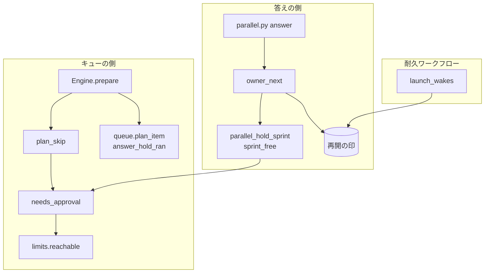
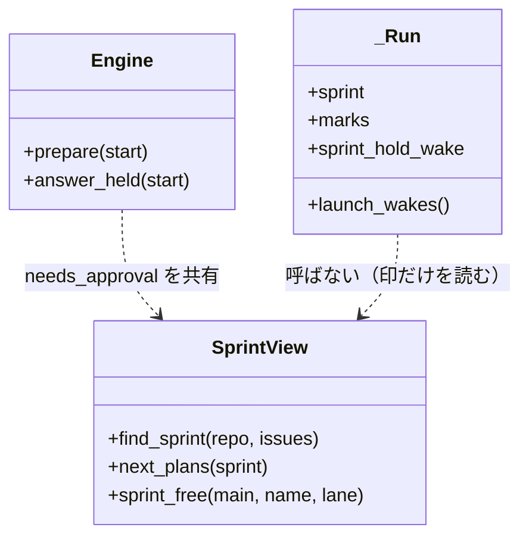
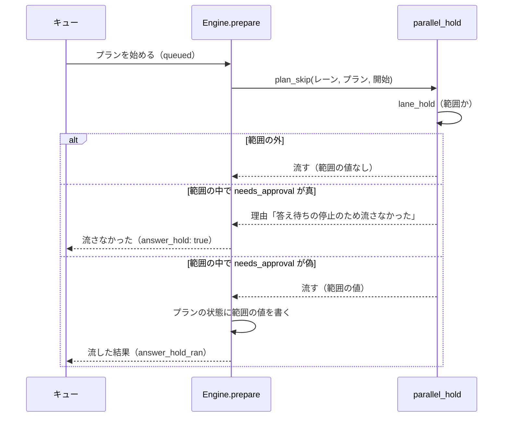
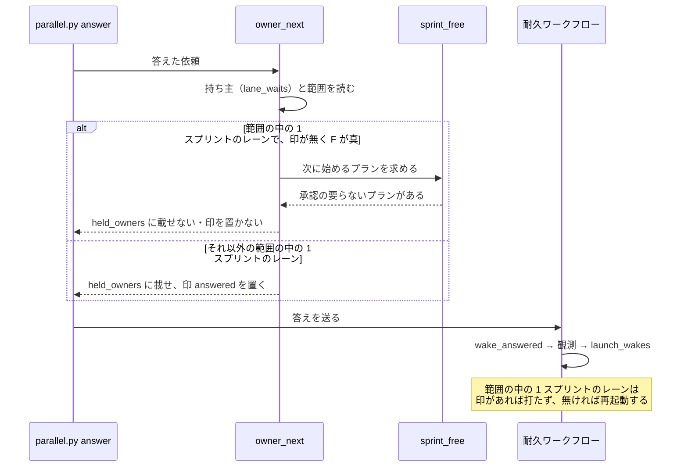
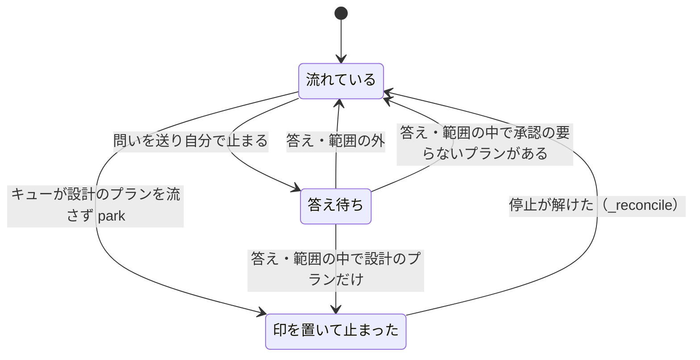

# 並列の計画: 1 スプリントのレーンも答え待ちの停止の間に承認の要らないプランを流す（#3000）

## 目的

- **今どうなっているか**: 答え待ちの停止の範囲に入った 1 スプリントのレーンは、キューがプランを始める所で中身に依らずすべてのプランを流さず、答えを受けても起こされない。承認の要らない作業（設計 PR のマージ・実装・検査・リリース）が残っていても、停止が解けるまで止まる。ループのレーンは #2913 でこの問題を解いた
- **誰に効くか**: 並列の計画で 1 スプリントのレーンを流す利用者
- **変えると何が成り立つか**: 1 スプリントのレーンも、承認を待つ間に設計のステップを含まないプランを流し、答えを受けたら次に始めるプランが承認の要らないものであれば起こされる。止めるのは新しい承認を生むプランだけになる

## 適用範囲

- **働く範囲**: NDF を導入したすべてのリポジトリの並列の計画（`parallel.py`）の 1 スプリントのレーン。並列の計画の外で流すスプリントとループのレーンの振る舞いは変えない
- **プロジェクトごとに違うもの**: 無し（答え待ちの停止の閾値 `parallel.answer_limit` は今の設定のまま読む）
- **当たるモード**: 1 スプリントのレーンが流すスプリントのすべての進め方（`pace: normal` / `auto` / `fast`）

## あるべき姿の根拠

| 根拠 | 種類 | 何を示すか |
| --- | --- | --- |
| ループのレーンは答え待ちの停止の範囲でも承認した設計の実装を進める（`docs/specifications/ndf-work-during-approval-wait-and-business-hours.md` の背景の表） | 既存の確定仕様 | 止めるのは新しい承認を生む作業だけ、という分け方がすでにあり、1 スプリントのレーンへ同じ分け方を当てれば 2 種類のレーンの振る舞いがそろう |
| 承認ゲートの待ちは 1 回 34〜40 分あった（課題の本文の目的。2026-11-01〜11-11 の進捗記録） | 実測 | 待ちの間に流せるプランがあれば、その分の時間を使える |
| 1 スプリントのレーンが流すスプリントは、設計 → 設計承認ゲート → 設計 PR のマージ → スプリントブランチ → 実装 → 検査 → リリースの順のステージで組まれ、設計承認ゲートの後のステージに設計のステップを持つプランは無い（`.ndf/sprint-lflow-1/` のプランを読んだ結果。下の「調べた事実」） | 実測 | 設計承認ゲートの答えの後に始めるプランは、すべて承認の要らない作業である |

要求と受け入れ条件は #3000 の本文にある（コピーは `issues/issue-3000-requirements.md`）。この文書は「どう作るか」だけを扱う。

## ドメインモデル

### コンテキスト

| コンテキスト | 何の語が 1 つの意味に決まるか |
| --- | --- |
| NDF の開発の工程（`ndf-workflow`） | 答え待ちの停止・再開の印・レーン・プラン・ステージ・承認の要らない作業・新しい承認を生む作業 |

変更は 1 つのコンテキストの中に収まる。並列の計画（オーガナイザーと耐久ワークフロー）と、プランを流すキュー（`supervise.py`）は同じコンテキストの別の構成要素である。

### 集約

| 集約 | 持ち主（書き換えてよいもの） | 根 | エンティティ | 値オブジェクト |
| --- | --- | --- | --- | --- |
| 答え待ちの停止 | 耐久ワークフロー（`AnswerHold._update_hold`）。この変更では書き換えない | 止める指示のファイル（`answer-hold.json`） | — | 停止の範囲（計画全体・レーンの並び）・閾値 |
| 再開の印 | 置く: 答えの受け付け（`owner_next`）・レーンの停止（`parallel.py park`・ループの境）。消す: 耐久ワークフロー（`_reconcile`） | レーンごとの印（`resume/<レーン>.mark.json`） | — | 置いた理由（`boundary` / `answered`）・時刻 |
| プランの実行 | キュー（`Engine.prepare`） | プランの状態（`<プラン>-state/state.json`） | ステップの記録 | 結果・範囲の中で流した事実（新設） |

### 不変条件

| # | 集約 | 条件 | 破れたときの扱い |
| --- | --- | --- | --- |
| I1 | プランの実行 | 答え待ちの停止の範囲にある 1 スプリントのレーンで、キューは、開始のステップから設計を書くステップへ行けるプランを流さない | 流さなかった理由「答え待ちの停止のため流さなかった」を返し、レーンは `parallel.py park` で再開の印を置いて止まる（今と同じ） |
| I2 | プランの実行 | 答え待ちの停止の範囲で流したプランは、キューの結果の行に範囲（計画とレーン）を持つ | 実装のテストで落とす |
| I3 | 再開の印 | 答えの後に `metrics.held_owners` に載せたレーンには `answered` の印があり、載せなかったレーンには答えの受け付けが印を置かない | 実装のテストで落とす |
| I4 | 再開の印 | 印を持つ範囲の中の 1 スプリントのレーンを、耐久ワークフローは停止が解けるまで再起動しない | 実装のテストで落とす |
| I5 | 再開の印 | 次に始めるプランを決められない（スプリントが見つからない・読めない）ときは、今と同じく起こさず印を置く | 実装のテストで落とす |
| I6 | プランの実行 | スプリントのステージの並び・承認ゲートの数と置き場所は変わらない。承認の証跡の無い設計 PR のマージは承認ゲートで止まる | 既存のスプリントの組み立てとマージのテストが落とす |

### ドメインイベント

要求の番号を引き継ぐ。

| # | イベント | 発生元 | 受け手 |
| --- | --- | --- | --- |
| E1 | 1 スプリントのレーンが設計承認ゲートの依頼を送った | 問いの hook（`parallel.py request-ask`） | 耐久ワークフロー（問いの一覧） |
| E2 | 答え待ちの停止の範囲がレーンを含んだ | 耐久ワークフロー（`_update_hold`） | キュー（`Engine.prepare`）・答えの受け付け（`owner_next`） |
| E3 | レーンのキューが次のプランを始めようとした | キュー | `Engine.prepare` |
| E4 | 設計のステップを含まないプランが流れた | `Engine.prepare` | キューの結果（`answer_hold_ran`） |
| E5 | 設計のステップを含むプランを流さず、再開の印を置いた | `Engine.prepare` と `parallel.py park` | 耐久ワークフロー（`_reconcile`） |
| E6 | 利用者がレーンの依頼に答えた | `parallel.py answer` | `owner_next`・耐久ワークフロー（`wake_answered`） |
| E7 | 耐久ワークフローがレーンを起こした | 耐久ワークフロー（`launch_wakes`） | レーン |
| E8 | 答え待ちの停止の範囲が解け、レーンを起こした | 耐久ワークフロー（`_reconcile`） | レーン |

### 用語

| 用語 | 意味 | 用語集への反映 |
| --- | --- | --- |
| 新しい承認を生む作業 | 設計のステップ（設計承認ゲートの依頼を生む）を含む作業。ループのレーンではループの 1 回のプランに設計承認ゲートを含む作業、1 スプリントのレーンでは開始のステップから設計を書くステップへ行けるプラン。答え待ちの停止の範囲に入ったレーンは始めない | 意味の変更（`ndf-workflow`） |
| 承認の要らない作業 | 新しい承認を生む作業以外の作業。開発ループの中では承認した設計の実装と答えの届いた保留したループの 1 回の残り（ループは設計を承認していない課題にモードに依らず設計のステップを置く）、1 スプリントのレーンでは設計 PR のマージ・実装・検査・リリースのプランがこれに当たる | 意味の変更（`ndf-workflow`） |
| 答え待ちの停止 | 答え待ちの依頼が閾値を超えたため、レーンに新しい承認を生む作業を始めさせない状態。件数が閾値以下へ戻ると解ける | 意味の変更（`ndf-workflow`） |
| 次に始めるプラン | 1 スプリントのレーンのスプリントで、ステージの並びの先頭から見て、結果が完了でも承認ゲートでもないプランを持つ最初のステージの、そのプランの集まり。答え待ちの停止の範囲で答えを受けたレーンを起こすかを決める | 追加（`ndf-workflow`） |

## 外部の調査

省く: 既存の形の延長である。ループのレーンへ当てた答え待ちの停止の分け方（#2913）を、同じリポジトリの中の 1 スプリントのレーンへ当てるだけである。形はプロジェクトの中の取り決め（プランのステップの種類・スプリントのステージ・再開の印）だけで決まる。

## 調べた事実

受け入れ条件 1 の集計。ndf v10.27.53 のタグのコミットは 2026-11-11T10:54:02+09:00（01:54 UTC）である。

```bash
git log -1 --format='%H %cI' ndf--v10.27.53
# 0d814a9a8f74443993e03e4e4717033323d3d526 2026-11-11T10:54:02+09:00
```

ループの記録から、`started_at` が 01:54 UTC 以後のループの 1 回を数えた。あわせて、そのうち `hold_only: true` のものを数えた（2026-11-11 05:06 UTC に実行）。

```python
import json, glob
REL = "2026-11-11T01:54:00Z"
for p in sorted(glob.glob(".ndf/loop/*/loop.json")):
    d = json.load(open(p)); laps = d.get("laps") or []
    after = [l for l in laps if str(l.get("started_at") or "") >= REL]
    held = [l for l in after if l.get("hold_only")]
    print(p, d.get("status"), len(laps), len(after), len(held), laps[-1].get("started_at") if laps else None)
```

| リポジトリ | ループの記録 | ループの 1 回の数 | リリース後 | うち `hold_only` | 最後の開始 |
| --- | --- | --- | --- | --- | --- |
| ai-plugins | `lcore` | 13 | 0 | 0 | 2026-11-09T17:13:24+00:00 |
| ai-plugins | `lproc` | 13 | 0 | 0 | 2026-11-09T16:07:39+00:00 |
| 同じマシンの別のリポジトリ | 6 件の合計 | 60 | 4 | 0 | 2026-11-11T04:46:30+00:00 |

- 答え待ちの停止の範囲で流れたループの 1 回は 0 回である。所要時間と承認待ちの時間は、対象が 0 回のため集計の値を持たない
- 1 スプリントのレーンが流すスプリントのステージとプランのステップを `.ndf/sprint-lflow-1/` で読んだ。設計を書くステップ（`type: work`・`kind: 設計`）を持つのは、設計のステージのプラン（`1-design-<課題>.json`）だけである。設計 PR のマージ・設計の結果・スプリントブランチ・実装・検査・開発版のデプロイ・リリースの依頼のプランは持たない。設計 PR のマージのプランは `フェーズ: 設計` で、承認の証跡を確かめるステップの `stage` も `設計` である
- 1 スプリントのレーンの設計承認ゲートは、`metadata.source: ndf-gate:1` の問いとして届く。届け先は問いの hook で、種類は `kind: ask` である（`plugins/ndf/skills/development-workflow/references/asking.md`）。答えは選んだ選択肢の文で、承認か差し戻しかを依頼の形からは読めない
- 単発の `supervise.py run` は答え待ちの停止を読まない（`Engine.prepare` は `self.queued` のときだけ `answer_held` を呼ぶ。`docs/specifications/ndf-parallel-organizer.md` の背景の表にも同じ決まりがある）

## 機能一覧

| # | 機能 | 誰が使うか |
| --- | --- | --- |
| F1 | 答え待ちの停止の範囲で、設計のステップを含まないプランを流し、含むプランを流さない | 1 スプリントのレーン（キュー） |
| F2 | 範囲の中で流したプランを、キューの結果で読めるようにする | オーガナイザー・振り返りで記録を読む人 |
| F3 | 範囲の中の 1 スプリントのレーンへ答えが届いたら、次に始めるプランが承認の要らないものであれば起こす | オーガナイザー（`parallel.py answer`）・耐久ワークフロー |

## 構成要素

| 要素 | 責務 |
| --- | --- |
| `parallel_hold.needs_approval(plan, start)`（新設） | プランが、開始のステップ（無ければ最初のステップ）から設計を書くステップ（`type: work`・`kind: 設計`）へ行けるかを返す |
| `supervise_lib.limits.reachable(plan, start)`（新設） | 開始のステップから遷移で行けるステップの集まりを返す（既存の `_graph` の遷移を使う） |
| `parallel_hold.plan_skip(lane, plan, start)`（変更） | 範囲の中で `needs_approval` のときだけ流さない理由を返し、範囲の中で流すときは範囲の値を返す |
| `Engine.prepare` / `Engine.answer_held`（変更） | プランと開始のステップを渡し、範囲の中で流したときはプランの状態に範囲の値を書く |
| `flow._plan_steps` / `queue.plan_item`（変更） | プランの状態の範囲の値を、キューの結果の行の `answer_hold_ran` に載せる |
| `parallel_hold_sprint`（新設。`plugins/ndf/scripts/lib/parallel_hold_sprint.py`） | レーンのリポジトリでレーンのスプリントを探し、次に始めるプランを求め、承認の要らないプランがあるか（`sprint_free`）を返す |
| `parallel_answer.owner_next`（変更） | 範囲の中の 1 スプリントのレーンのうち、印を持つか `sprint_free` が偽のものだけを停止の範囲にある持ち主として印を置く |
| `parallel_launch.launch_wakes`（変更） | 範囲の中の 1 スプリントのレーンを、再開の印を持つときだけ打たない（耐久ワークフローの版の印 `parallel-sprint-hold-wake` の後の記録だけ） |
| `parallel_run.parallel_workflow`（変更） | 版の印 `parallel-sprint-hold-wake` を読み、`launch_wakes` の新しい規則を使うかを決める |
| `plugins/ndf/skills/development-workflow/references/parallel.md`（変更） | 1 スプリントのレーンが範囲の中でどのプランを流し、答えの後にどう起こされるかの記述 |
| 用語集（`docs/glossary/glossary.json`・`docs/glossary.md`）（変更） | 上の「用語」の表の 4 語 |



図に含めないもの: 版の印を読む `parallel_run.parallel_workflow`（`launch_wakes` の規則を選ぶだけ）、手順書 `parallel.md`、用語集。

## 構造

変更が触る型だけを描く。`AnswerHold` と `_Run` の属性は今のままで、`_Run` に版の印を 1 つ足す。



`SprintView` は `parallel_hold_sprint` のモジュールの関数の組を指す名前で、クラスは作らない。

## 入出力の契約

### キューの結果（`supervise.py queue` の `items` の 1 行）

範囲の中で流したプランの行に `answer_hold_ran` を足す。範囲の外で流したプランと、流さなかったプランの行には載せない。流さなかった行の `answer_hold: true` は今のまま。

```json
{"plan": ".ndf/sprint-l1-1/6-impl-3000.json", "result": "完了", "exit": 0, "report": "...", "seconds": 812.4,
 "answer_hold_ran": {"plan": "p5", "lane": "l1", "scope": "plan", "count": 4, "limit": 3}}
```

`answer_hold_ran` の値は、`lane_hold` が返す範囲の値に `lane` を足したものである。範囲の値は `{plan, scope, count, limit}` で、別のリポジトリのレーンなら `home` も持つ。キューの結果の `status` と `metrics` は変えない。

### `parallel.py answer`

形は変えない。対象は、範囲の中の 1 スプリントのレーンのうち、次に始めるプランに承認の要らないプランがあり、再開の印を持たないレーンである。このレーンは `metrics.held_owners` に載らず、再開の印も置かれない。

| 記録 | `metrics.next` | 起こすもの |
| --- | --- | --- |
| 起動の印（`parallel-launch`）のある記録（#2936 の後） | `null`（区分 `observe` の選んだ答えを除く） | 耐久ワークフローの `launch_wakes` |
| 起動の印の無い古い記録 | `relay.py restart <レーン>` の 1 行 | オーガナイザー |

### 次に始めるプランの求め方（`parallel_hold_sprint`）

| 手順 | 決まり |
| --- | --- |
| スプリントを探す | レーンのリポジトリ（`lane_repo`）の `.ndf/sprint-*/state.json` のうち、`issues` が空でなくレーンの入力の課題の部分集合であるもの。複数あれば `sprint.json` の更新時刻が最も新しいもの |
| ステージを読む | `sprint.json` の `ステージ` を並びのまま読み、`plans` を持たないステージ（承認ゲート）を飛ばす |
| プランの結果 | `<プラン>-state/report.md` の `- 結果:` の値（`report_result`）。報告が無ければ未着手 |
| 次に始めるプラン | 結果が `完了` でも `関門` でもないプランを持つ最初のステージの、そのプランの集まり（`FINISHED` は `supervise_lib.queue_fill` の定数を読む） |
| 承認の要らないプランがあるか | 次に始めるプランのうち 1 本でも `needs_approval(plan, None)` が偽なら真 |
| 決められないとき | スプリントが見つからない・`sprint.json` が読めない・次に始めるプランが無い。偽を返す（I5） |

## 処理の流れ

### プランの開始（受け入れ条件 2・3）



流さなかったプランが 1 本でもあれば、キューは今と同じく `metrics.park` を返し、レーンは `parallel.py park` で印を置いて止まる。同じキューの中で流したプランは最後まで流れる。

### 答えの後（受け入れ条件 4・5）



答えの受け付けは、答えを送る前に印を置く（今の `owner_next` と同じ順）。そのため、耐久ワークフローが同じ周の `_observe_run` で読む印には、答えの受け付けの判断が入っている。`_TICK` の並びでは、答えを受ける手順の後に観測と `launch_wakes` が続く。

### 1 スプリントのレーンの状態



## 非機能の実現方式

| 大項目 | 実現方式 |
| --- | --- |
| 運用・保守性 | 流さなかったプランは今と同じく理由「答え待ちの停止のため流さなかった」と `answer_hold: true`・`metrics.park`・再開の印で残る。範囲の中で流したプランはキューの結果の行の `answer_hold_ran` で読め、done のファイルに残る |

## 決定の記録

### 決定 1: 2 種類のレーンの分け方をそろえるため、1 スプリントのレーンにはプランの開始で中身を見て流すかを決める形を当てる

1 スプリントのレーンはすでにキューがプランを始める所で停止の範囲を読んでいる（`Engine.prepare`）。読む所を変えずに、そこで「新しい承認を生むプランか」を足せば、#2913 と同じ分け方になる。入力の種類・引継ぎ文書・スプリントの組み立ては変わらない。

1 スプリントのレーンをループのレーンとして流す形は採らない。ループは境ごとに課題を選び直し、計画が入力に書いた課題の外を選びうる（要求の前提 1 に反する）。入力の種類を変えると、計画の宣言と利用者の引継ぎ文書も書き換わる。

根拠: Value 7（MVV 版 6）

### 決定 2: 承認を経た続きを止めないため、設計のステップの有無を開始のステップから行けるステップで決める

`needs_approval(plan, start)` は、開始のステップから遷移で行けるステップに、設計を書くステップがあるかで決める。設計を書くステップは `type: work`・`kind: 設計` のステップで、`design_steps.writing_steps` が置く。`pace: auto` の設計承認ゲートの後は、設計のプランを `--from design-<N>=approve` で続けて流す。プラン全体で見るとこの続きも止まるが、続きのステップからは設計を書くステップへ行けない。

プランの `フェーズ` やステップの `stage` の値では決めない。設計 PR のマージのプランも `フェーズ: 設計` を持ち、承認の証跡を確かめるステップの `stage` も `設計` である（調べた事実）。設計を書くステップの種類はスプリントの組み立てが置く値で、テストが組み立てたプランで突き合わせる（テスト設計の I1）。

根拠: Value 7（MVV 版 6）

### 決定 3: 起こしてすぐ止め直すことを避けるため、答えの後に起こすかを次に始めるプランで決める

スプリントのステージは、前のステージがすべて完了したときだけ次へ進む。そのため、レーンが起きて最初に流すのは次に始めるプランである。残るプラン全体で見ると、設計のステージの途中でも後ろのステージの実装が残る。すると受け入れ条件 5 が当たる場面が無くなり、起こしたレーンがすぐ `park` で止め直す。スプリントは課題の一覧で探す。計画の宣言はスプリントのディレクトリを持たず、引継ぎ文書は自由な文である。決められないときは起こさない（I5）。起こし損ねても停止が解ければ起きるが、誤って起こすと次の判断までの間に別の作業を始めうるためである。

根拠: Value 3 / Value 5（MVV 版 6）

### 決定 4: 判断を 1 か所に置くため、答えの受け付けが決め、再開の印で耐久ワークフローへ渡す

起こすかは `owner_next` だけが決める。耐久ワークフローは `launch_wakes` で、範囲の中の 1 スプリントのレーンを再開の印を持つときだけ打たない。印は「停止が解けたら起こすレーン」を表す既存のファイルで、意味を変えずに使える。耐久ワークフローの中で同じ判断をもう一度行うと、ファイルを読むために耐久ステップを足すことになり、2 か所の判断が食い違う余地も残る。

答えの受け付けは今と同じく答えを送る前に印を置くため、耐久ワークフローの観測は判断の後の印を読む。印を持つレーンを起こさない規則は今の振る舞い（範囲の中の 1 スプリントのレーンはすべて打たない）より狭いだけで、印を持つレーンの扱いは変わらない。新しい規則を使うのは、版の印 `parallel-sprint-hold-wake`（`durable.patched`）の後に始めた記録だけである。途中の記録の再生で、打つ手順が変わらないようにするためである。

根拠: Value 7（MVV 版 6）

### 決定 5: 2 種類のレーンの扱いをそろえるため、差し戻しの答えの後の設計の作り直しは止めない

1 スプリントのレーンの設計承認ゲートの答えは選んだ選択肢の文で届き、承認か差し戻しかを依頼の形から読めない（調べた事実）。差し戻しの後、レーンは単発の `supervise.py run <設計のプラン> --from reject` で作り直す。単発の `run` は答え待ちの停止を読まない。作り直しは答えた依頼の続きで、新しい依頼は答えた依頼と入れ替わるため、答え待ちの依頼の数を増やさない。ループのレーンでも、答えの届いた保留したループの 1 回の残りは承認の要らない作業として流す（#2913）。

根拠: Value 7 / Vision（MVV 版 6）

### 決定 6: #2936 の起動の形を変えないため、受け入れ条件 4 の「起こす 1 行」は記録の版で読み分ける

#2936 の後の記録では、答えた持ち主の再起動は耐久ワークフローが打ち、`metrics.next` は `null` である（ループのレーンも同じ。`test_an_answer_wakes_a_held_loop_lane_but_not_a_held_sprint_lane` が `nxt is None` を縛る）。受け入れ条件 4 は、この記録では「`held_owners` に載らず、印が置かれず、耐久ワークフローの `launch_wakes` が再起動する」で確かめる。起動の印の無い古い記録では `metrics.next` に `relay.py restart <レーン>` の 1 行が返る。`metrics.next` へ 1 行を返す形へ戻すと、オーガナイザーと耐久ワークフローの 2 者が同じレーンを起こす。確定仕様 `ndf-work-during-approval-wait-and-business-hours.md` には「ループのレーンなら `metrics.next` に 1 行を返す」とある。この記述は、この課題の確定仕様化で今の振る舞いへ合わせる。

根拠: Value 8（MVV 版 6）

### 決定 7: 承認ゲートの置き場所を変えないため、自分の設計承認ゲートを待つ間に同じスプリントの別の課題を流す形は作らない

1 スプリントのレーンが流すスプリントは、設計承認ゲートを全課題で 1 つ置き、設計 PR のマージから先を 1 本のキューの `--then` でつなぐ。待つ間に設計の無い課題の実装や、先に承認の届いた設計の実装を流すには、ステージの並びと承認ゲートの置き場所を課題ごとに分ける必要がある。これは受け入れ条件 6 に当たる。この変更は、他のレーンの依頼で停止の範囲に入ったときに、自分の承認の要らないプランを流すことに限る。

根拠: Value 2 / Value 3（MVV 版 6）

### 決定 8: 小さく出して使って確かめるため、受け入れ条件 1 の集計が 0 回でも設計へ進む

リリース後に答え待ちの停止の範囲で流れたループの 1 回は 0 回だった（調べた事実）。範囲に入る場面は、答え待ちの依頼が閾値を超えたときだけで、待っても起きる時期が決まらない。この変更の振る舞いは、受け入れ条件 2〜7 のテストで縛れる。効果（待ちのうち埋まった割合）は、リリース後にキューの結果の `answer_hold_ran` とループの記録の `hold_only` で測る（未確認のまま残ること）。

根拠: Value 1 / Value 4（MVV 版 6）

### 決定 9: 範囲の中で流した事実を後から読めるよう、プランの状態に書いてキューの結果へ写す

`Engine.prepare` は耐久ステップ `prepare_step` の中で流れ、戻り値は「流さないなら（結果, 理由）」の形で記録されている。戻り値の形を変えると、途中の記録の再生が食い違う。そのため範囲の値はプランの状態（`state.json`）へ書く。プランの耐久ワークフローの出力と `plan_item` がそれを読み、キューの結果の行へ載せる。

根拠: Value 8（MVV 版 6）

## テスト設計

| 受け入れ条件・不変条件 | どの振る舞いで縛るか | どう壊したら落ちるべきか |
| --- | --- | --- |
| 受け入れ条件 1 | 設計文書の「調べた事実」に集計のコマンドと結果がある（文書の中身でテストを書かない） | — |
| 受け入れ条件 2 / I2 | 範囲の中の 1 スプリントのレーンで、実装のプラン（設計を書くステップを持たない）をキューへ入れると流れ、結果の行に `answer_hold_ran` が載る | `plan_skip` がプランを見ずに理由を返すと落ちる。`answer_hold_ran` を載せないと落ちる |
| 受け入れ条件 3 / I1 | 範囲の中で設計のプランを入れると流さず、理由「答え待ちの停止のため流さなかった」と `metrics.park` が返り、`park` で印が置かれる（今のテストを残す） | `needs_approval` が常に偽を返すと落ちる |
| I1（判定の範囲） | `pace: normal` / `auto` / `fast` で組んだスプリントのプランを並べ、設計のステージのプランだけが `needs_approval(plan, None)` で真になる。設計のプランを `approve` から始めると偽になる | 判定を `フェーズ` で行うと設計 PR のマージのプランが真になり落ちる。開始のステップを無視すると `approve` からの続きが真になり落ちる |
| 受け入れ条件 4 / I3 | 範囲の中の 1 スプリントのレーンで、次に始めるプランが設計 PR のマージのとき、`owner_next` は `held_owners` に載せず印を置かない。古い記録では 1 行目に `relay.py restart` が返る | `sprint_free` を呼ばずに今の規則で印を置くと落ちる |
| 受け入れ条件 4 / I4 | 新しい版の印の記録で、範囲の中の 1 スプリントのレーンが `wake` にあり印を持たないと `launch_wakes` が再起動を打ち、印を持つと打たない | 印を見ずに範囲だけで打たないと落ちる。印を見ずに打つと落ちる |
| 受け入れ条件 5 / I3 | 次に始めるプランが設計のステージの未着手の設計のプランだけのとき、`held_owners` に載り印 `answered` が置かれる（今の `held_sprint_lane` のテストを残す） | `sprint_free` が後ろのステージまで見ると落ちる |
| I5 | スプリントが見つからない・`sprint.json` が壊れている・すべて完了のとき、`sprint_free` が偽で印が置かれる | 読めないときに真を返すと落ちる |
| 受け入れ条件 6 / I6 | スプリントの組み立てのステージの並びと承認ゲートのステージ、承認の証跡の無い設計 PR のマージが承認ゲートで止まる既存のテストが通る | ステージの並びや `merge-gate` を変えると既存のテストが落ちる |
| 受け入れ条件 7 | 範囲の外の 1 スプリントのレーンのキューと、ループのレーンの答え・境の既存のテスト（`test_parallel_hold_lanes.py`・`test_sprint_loop_hold_select.py`・`test_parallel_answer.py`）が通る。古い版の記録では `launch_wakes` が範囲の中の 1 スプリントのレーンをすべて打たない | 版の印を見ずに新しい規則を使うと古い記録のテストが落ちる |

全体テストは `uv run --frozen --project . --all-extras pytest plugins/ndf/scripts/tests -q -n 4` で流す。`.md` の文言は照合しない。

## 設計の結果

| 課題 | 扱い | 取り込み先 | 触るファイル |
| --- | --- | --- | --- |
| #3000 | 実装する | — | `plugins/ndf/scripts/lib/parallel_hold.py`、`plugins/ndf/scripts/lib/parallel_hold_sprint.py`（新設）、`plugins/ndf/scripts/lib/parallel_answer.py`、`plugins/ndf/scripts/lib/parallel_launch.py`、`plugins/ndf/scripts/lib/parallel_run.py`、`plugins/ndf/scripts/supervise_lib/engine.py`、`plugins/ndf/scripts/supervise_lib/flow.py`、`plugins/ndf/scripts/supervise_lib/queue.py`、`plugins/ndf/scripts/supervise_lib/limits.py`、`plugins/ndf/skills/development-workflow/references/parallel.md`、`plugins/ndf/scripts/tests/test_parallel_hold_lanes.py`、`plugins/ndf/scripts/tests/test_sprint_loop_hold_select.py`、`plugins/ndf/scripts/tests/test_parallel_answer.py`、`plugins/ndf/scripts/tests/test_parallel_hold_sprint.py`（新設） |

## 人へ残す判断

無し

## 未確認のまま残ること

| 項目 | 内容 |
| --- | --- |
| 待ちのうち埋まる割合 | 答え待ちの停止の範囲で流れたループの 1 回は 0 回で、1 スプリントのレーンでも未測定である。リリース後に、範囲に入った並列の計画のキューの結果の `answer_hold_ran` の行の `seconds` と、ループの記録の `hold_only` のループの 1 回の所要時間を集計して分かる |
| 範囲に入る頻度 | 答え待ちの依頼が閾値を超える場面がどれだけ起きるかは、リリース後の答え待ちの停止の履歴（`answer-hold-log.jsonl` の `change: on` の行）で分かる |
| スプリントの探し方が外れる場面 | 同じ課題を持つスプリントを 1 つのリポジトリで作り直した場合に、更新時刻の最も新しいスプリントがレーンのものであることは、リリース後テストで引継ぎ文書のスプリントと突き合わせて確かめる |
