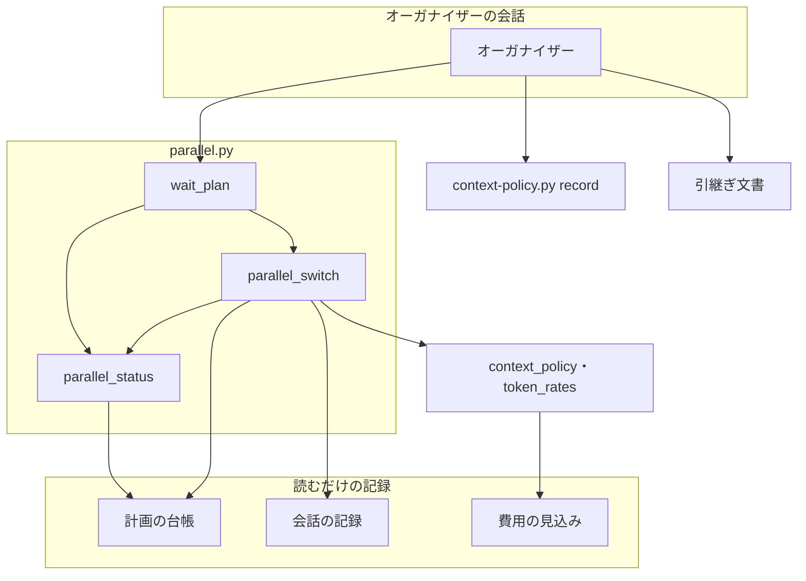
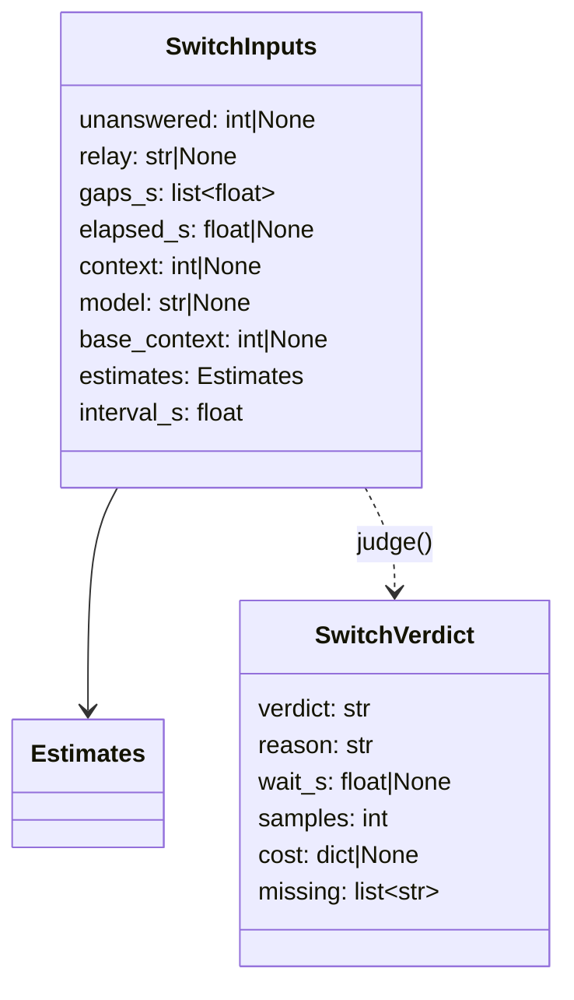
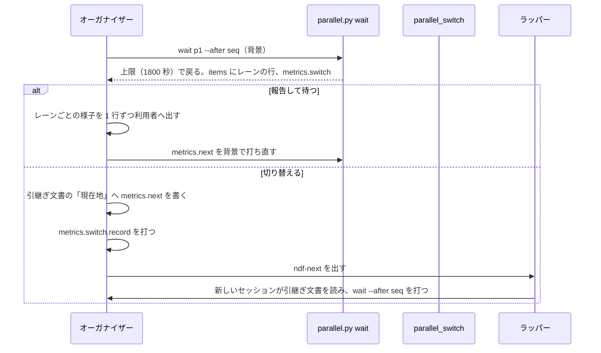

# 並列の計画のオーガナイザー: 長い待ちの間は 30 分ごとに様子を報告し、さらに長い待ちの前にはセッションを切り替える（#3006）

## 目的

- **今どうなっているか**: オーガナイザーの `parallel.py wait` は、上限の既定が 3600 秒で、プロンプトキャッシュの寿命と同じである。上限で戻った時点でキャッシュが切れており、戻るたびに会話の全文（計画 p5 で 19 万〜47 万 token）を 2 倍の費用で書き直す。待ちの長さで会話を切り替える決まりも無い
- **誰に効くか**: 並列の計画を回す利用者（待ちの間のレーンの様子が 30 分ごとに届く）と、オーガナイザーの入力の費用
- **変えると何が成り立つか**: `wait` が 30 分ごとに戻ってレーンごとの様子を返し、報告がキャッシュを延ばす。報告し続けるより切り替えた方が安い待ちでは、`wait` が「切り替える」と判定し、オーガナイザーは引継ぎ文書を更新して `ndf-next` を出す

## 適用範囲

- **働く範囲**: NDF を使うすべてのリポジトリの並列の計画（`--parallel <計画名>`）のオーガナイザー。切り替えは名前つきのラッパー（`relay.py`）の下だけで起きる
- **プロジェクトごとに違うもの**: 無し。判定の材料は計画の台帳・会話の記録・再起動の費用の見込み（リポジトリごとに較正済みなら、その値）から読む
- **当たるモード**: `standard`

## あるべき姿の根拠

| 根拠 | 種類 | 何を示すか |
| --- | --- | --- |
| STD1（プロンプトキャッシュの公式文書） | 外部の一次情報 | キャッシュは使うたびに寿命が延びる。1 時間の寿命の書き込みは入力の 2 倍、読み込みは Opus 5.5 で 0.05 倍 |
| 下の「オーガナイザーの実測」 | 実測 | 会話を始めた直後の文脈は 4.2 万〜4.6 万 token、続けた会話の最後は 11.9 万〜47.4 万 token。問いの間隔の中央値は 73 分で、5 時間を超える間隔が 10 個のうち 3 個ある |
| 依頼（原文）「永い待ちの間に30分に一回ぐらいは状況報告が欲しいです。キャッシュ延長対策としても、監視目的としても」 | 利用者の指示の原文 | 上限の既定を 1800 秒にし、上限で戻るたびに報告する |
| 依頼（原文）「長い待ちが予想されるときはオーガナイザーのセッションを再起動を実施してコンテキストを減らしておく」 | 利用者の指示の原文 | 待ちの見込みから切り替える |

要求と受け入れ条件は #3006 の本文にある（コピーは [issue-3006-requirements.md](issue-3006-requirements.md)）。この文書は「どう作るか」だけを扱う。

### オーガナイザーの実測

計画 p5 のオーガナイザーの会話の記録を、`hook_lib/token_guard.py` の `first_context_tokens`・`last_context` で読んだ（2026-11-11）。

| 会話（時刻は JST） | 始めた直後の文脈 | 最後の文脈 | モデル |
| --- | --- | --- | --- |
| 11-10 21:41〜11-11 08:07 | 45,991 | 474,303 | `claude-opus-5-5` |
| 11-11 08:08〜12:14 | 46,085 | 187,691 | `claude-opus-5-5` |
| 11-11 12:03〜12:05 | 42,444 | 119,021 | `claude-opus-5-5` |

計画 p5 の台帳（`.ndf/parallel/p5/ledger.jsonl`）の問いの行（`gate1`・`gate2`・`ask`・`unmatched`）は 11 件である。
間隔は 10 個で、短い順に並べると 17・23・35・43・66・79・132・327・364・475 分である（中央値 72.5 分）。

## ドメインモデル

### コンテキスト

| コンテキスト | 何の語が 1 つの意味に決まるか |
| --- | --- |
| NDF の開発ワークフロー（`ndf-workflow`） | オーガナイザー・長い待ち・状況報告・切り替えの判定・再起動の理由 |

1 つのコンテキストの中の変更である。再起動の判定の記録と費用の見込みは同じコンテキストの既存の集約で、この変更は読み手として加わり、理由の値を 1 つ足す。

### 集約

| 集約 | 持ち主（書き換えてよいもの） | 根 | エンティティ | 値オブジェクト |
| --- | --- | --- | --- | --- |
| 計画の台帳 | 耐久ワークフローと `parallel.py` の副命令（この変更は読むだけ） | 計画 | 問い・答えの行 | 行の時刻・種類 |
| 切り替えの判定 | `parallel.py wait`（保存しない。出力の `metrics.switch` だけ） | 判定 | — | 材料・待ちの見込み・費用の見込み・判定の値 |
| 再起動の判定の記録 | `context-policy.py`（オーガナイザーは `record` で 1 行を足す） | 記録の行 | — | 理由（「待ち」を足す） |
| 引継ぎ文書 | オーガナイザー（「現在地」だけを書き換える） | 文書 | 節 | `wait --after <seq>` の 1 行 |

### 不変条件

| # | 集約 | 条件 | 破れたときの扱い |
| --- | --- | --- | --- |
| I1 | 切り替えの判定 | 答えていない問いが 1 件以上あれば、判定は「切り替える」にならない | 判定を「報告して待つ」にし、理由に答えていない問いの数を書く |
| I2 | 切り替えの判定 | ラッパーの直接の子でない会話から打った `wait` では、判定は「切り替える」にならない | 判定を「報告して待つ」にし、理由にラッパーとの位置を書く |
| I3 | 切り替えの判定 | 待ちの見込みが出せなければ（標本が 3 件未満）、判定は「切り替える」にならない | 判定を「報告して待つ」にし、欠けた材料に待ちの見込みを書く |
| I4 | 切り替えの判定 | 判定には、使った材料と値・欠けた材料・判定の理由が必ず載る | — （出力の形で守る） |
| I5 | 切り替えの判定 | 材料の読み取りに失敗しても、`wait` の終了コード（上限は 3）と `metrics.next` は変わらない | 失敗した材料を欠けた材料に入れ、判定を「報告して待つ」にする |
| I6 | 切り替えの判定 | `--timeout` を省いた `wait` の上限は 1800 秒で、プロンプトキャッシュの寿命 3600 秒より短い | — （既定値で守る） |
| I7 | 再起動の判定の記録 | 「待ち」の理由の行は、オーガナイザーが判定「切り替える」に従って切り替えるときだけ書く | — （手順書で守る） |

### ドメインイベント

| # | イベント | 発生元 | 受け手 |
| --- | --- | --- | --- |
| E1 | `wait` が知らせか上限で戻った | `parallel.py wait` | オーガナイザー |
| E2 | `wait` が待ちの見込みと判定を出力に載せた（上限で戻ったときだけ） | `parallel.py wait` | オーガナイザー |
| E3 | オーガナイザーがレーンの様子を利用者へ報告した | オーガナイザー | 利用者 |
| E4 | オーガナイザーが引継ぎ文書の「現在地」に `wait --after <seq>` を書いた | オーガナイザー | 次のセッション |
| E5 | 切り替えを再起動の判定の記録へ残した | オーガナイザー（`context-policy.py record`） | 測定（受け入れ条件 7） |
| E6 | オーガナイザーが `ndf-next` を出し、ラッパーが新しいセッションを起動した | オーガナイザー・ラッパー | 次のセッション |
| E7 | 新しいセッションが `wait --after <seq>` を打ち、E4 の後に積まれた知らせを受け取った | 次のセッション | — |

### 用語

| 用語 | 意味 | 用語集への反映 |
| --- | --- | --- |
| 長い待ち | オーガナイザーが次の知らせまで待つ見込みの時間が長く、状況報告を続けるよりセッションを切り替えた方が入力の費用が小さいと `parallel.py wait` が判定する待ち | 意味の変更 |
| 状況報告 | `parallel.py wait` が上限で戻ったときに、オーガナイザーがレーンごとの様子を利用者へ 1 行ずつ出す報告 | 既にある |
| 切り替えの判定 | `parallel.py wait` が上限で戻るときに出す「切り替える」「報告して待つ」の判定と、その材料（`metrics.switch`） | 追加 |
| 再起動の理由 | 工程境界で会話を切った・止めたときの理由。容量・運用上限・費用・独立性・手動・現行方式のカットポイントと、オーガナイザーの長い待ちの 7 つ | 意味の変更 |

## 外部の調査

| 種類 | 調べるか | 理由 |
| --- | --- | --- |
| 標準・仕様 | 調べる | 判定の費用の式は、プロンプトキャッシュの寿命と倍率の公式の定めに従う |
| 主要な製品 | 調べない | 切り替えと待ちは NDF のオーガナイザーとラッパーの内部の手順で、費用の構造は STD1 だけで決まる |
| ライブラリとサービス | 調べる | 待ちの残り時間の推定（過去の間隔からの推定）に統計のライブラリを使うかを決める |

### 標準・仕様

| # | 標準・仕様 | 何を定めているか | 設計への反映 | 出典 |
| --- | --- | --- | --- | --- |
| STD1 | Anthropic のプロンプトキャッシュ | 寿命は 5 分か 1 時間で、キャッシュを使うたびに無料で延びる。1 時間の寿命の書き込みは入力の 2 倍、読み込みは Opus 5.5・Sonnet 5.5 が 0.05 倍、Fable 5.2・5.1 が 0.025 倍、ほかは 0.1 倍 | 上限の既定を寿命より短くする。費用の式の書き直しを 2 倍、読み込みをモデルの倍率で数える。読み込みの倍率の表へ Sonnet 5.5 と Fable 5.2 を足す | https://docs.claude.com/en/docs/build-with-claude/prompt-caching （2026-11-11） |

### ライブラリとサービス

| # | 候補 | 版 | ライセンス | 最後のリリースの日付 | 終了のアナウンス | 要件を満たすか | 出典 |
| --- | --- | --- | --- | --- | --- | --- | --- |
| LIB1 | lifelines（生存時間分析） | 0.30.3 | MIT | 2026-03-05 | 無し | 満たすが、numpy・scipy・pandas・matplotlib など 7 つの依存を足す。標本は 1 計画で数十件 | https://pypi.org/pypi/lifelines/json （2026-11-11） |
| LIB2 | Python 標準ライブラリの `statistics` | 3.13 | PSF | 標準ライブラリ | 無し | 満たす。中央値だけで足りる | `python3 -c "import statistics"`（2026-11-11） |

### 確かめられなかったこと

| 対象 | 試した手段 | 結果と理由 |
| --- | --- | --- |
| 無し | — | — |

調べた量: 候補 3 件・取得の試み 3 回。

## 機能一覧

| # | 機能 | 誰が使うか |
| --- | --- | --- |
| F1 | `wait` が 30 分ごとに戻り、レーンごとの様子を返す | オーガナイザー（利用者へ状況報告する） |
| F2 | `wait` が上限で戻るとき、切り替えの判定と材料を返す | オーガナイザー |
| F3 | 判定「切り替える」に従って、引継ぎ文書を更新し、記録を残し、`ndf-next` を出す | オーガナイザー |
| F4 | 切り替えの回数を再起動の理由「待ち」で数える | 測定する人（受け入れ条件 7） |

## 構成要素

| 要素 | 責務 |
| --- | --- |
| `parallel.py`（変える） | `wait` の `--timeout` の既定を 1800 にする |
| `lib/parallel_cli.py` の `wait_plan`（変える） | 上限で戻るとき、`items` にレーンごとの行を、`metrics.switch` に切り替えの判定を載せる。要約にレーンの数え上げを足す |
| `lib/parallel_switch.py`（新設） | 材料を読む関数と、材料から判定を出す純粋な関数。材料の読み取りの失敗を欠けた材料にして返し、例外を外へ出さない |
| `lib/parallel_status.py`（変える） | 答えていない問いの一覧を返す関数を切り出し、`status` と判定の両方が使う |
| `lib/context_policy.py`（変える） | 理由「待ち」を足す。再起動の固定の費用の式を関数に切り出し、`estimate_cost` と判定の両方が使う |
| `lib/token_rates.py`（変える） | 読み込みの倍率の表へ Sonnet 5.5（0.05）と Fable 5.2（0.025）を足す |
| `references/parallel.md`（変える） | 状況報告の手順、判定の条件と閾値、「切り替える」のときの手順 |
| `references/context-window.md`・`context-policy.py` の説明・確定仕様（変える） | 再起動の理由を 7 つと書く |

図は実行のときの呼び出しと読み書きだけを描く。手順書と説明の書き直し（`parallel.md`・`context-window.md`・`context-policy.py` の説明・確定仕様）は図に含めない。

## 構造

`judge(inputs) -> SwitchVerdict` は純粋な関数で、ファイル・子プロセス・言語モデルを使わない。`read_inputs(main, name, interval)` が材料を読み、読めない材料を `None` にして欠けた材料の名前を返す。

## 入出力の契約

### `wait` の引数

| 引数 | 変更 |
| --- | --- |
| `--timeout 秒` | 既定を 3600 から 1800 にする。明示した値の扱いと、業務時間外の切り詰め（`clip_timeout`）は変えない |

### 上限で戻ったときの出力（終了コード 3）

既存のキー（`seq`・`next`・台帳のキー）は変えない。次を足す。

| 場所 | キー | 値 |
| --- | --- | --- |
| `summary` | — | 既存の文の後ろに `parallel.py status` の要約（「レーン N 本（動いている…）」）を足す |
| `items` | — | `parallel.py status <計画名>` の `items` と同じレーンごとの行。計画を読めなければ空 |
| `metrics.switch.verdict` | `"切り替える"` / `"報告して待つ"` | 判定 |
| `metrics.switch.reason` | 文字列 | 判定の理由の 1 文（例: 「答えていない問いが 2 件ある」「報告を続ける費用 213,435 が切り替える費用 205,345 を超える」） |
| `metrics.switch.inputs` | オブジェクト | 使った材料の値: `unanswered`・`relay`・`samples`・`elapsed_s`・`wait_s`・`context`・`base_context`・`model`・`read_rate`・`interval_s` |
| `metrics.switch.cost` | `{"stay": 数, "switch": 数, "reports": 数}` か `null` | 入力の単価を 1 とした費用の見込みと、待ちの見込みの間の報告の回数。文脈を読めず見込みの時間だけで判定したときは `null` |
| `metrics.switch.defaults` | 名前の配列 | 較正した値が無く既定値を使った費用の項（`handoff_output` など） |
| `metrics.switch.missing` | 名前の配列 | 読めなかった材料 |
| `metrics.switch.record` | 文字列か `null` | 判定が「切り替える」のときだけ、再起動の判定の記録へ残す 1 行（`context-policy.py record --verdict 再起動 --reason 待ち --work "parallel <計画名>" --context <文脈>`） |

**`metrics.next` は今の形のまま**（`wait <計画名> --after <seq> [--changes-after <n>]`）である。判定が「切り替える」のとき、
オーガナイザーはこの 1 行を引継ぎ文書の「現在地」へ書く（受け入れ条件 2）。

知らせで戻ったとき（`questions`・`answer_hold`・終わり）と、業務時間外に依頼を溜めただけで戻ったときは `metrics.switch` を載せない。
どちらもオーガナイザーが利用者へ問うか、答えていない問いが残るときで、切り替えの判定の対象にならない（決定 2）。

### 再起動の判定の記録

`context-policy.py record --verdict 再起動 --reason <理由>` の理由に「待ち」を足す（7 つ）。行の形は変えない。作業の識別子 `parallel <計画名>` は課題番号を含まないため、記録では同じセッションの前の行の作業で補われる。切り替えの回数は理由「待ち」の行で数える。

## 処理の流れ

`parallel.py wait` の中で `parallel_switch` を呼ぶ順は、`read_inputs` → `judge` の 1 回だけである。判定は待ちの後に行い、待ちの長さを変えない。

### 判定の規則

`judge` は次の順に見て、最初に当たった行で決める。

| 順 | 条件 | 判定 | 理由に書くこと |
| --- | --- | --- | --- |
| 1 | 答えていない問いが 1 件以上（読めなければ 1 件以上として扱う） | 報告して待つ | 答えていない問いの数 |
| 2 | ラッパーとの位置が `relay`（直接の子）でない | 報告して待つ | 位置（`no-dir`・`not-running`・`not-child`） |
| 3 | 待ちの見込み W が出せない | 報告して待つ | 標本の数 |
| 4 | 文脈 C か、新しいセッションの文脈 Q が出せない | W ≥ 14,400 秒（4 時間）なら切り替える、ほかは報告して待つ | W と閾値 |
| 5 | 上のどれでもない | 報告を続ける費用 > 切り替える費用 なら切り替える、ほかは報告して待つ | 2 つの費用 |

### 待ちの見込み W

計画の台帳の問いの行（`gate1`・`gate2`・`ask`・`unmatched`）を時刻の順に並べた間隔を標本にする。
最後の問いの行から今までの経過を e として、e を超える間隔 g だけを選び、`g − e` の中央値を W とする（経過を条件にした残りの時間）。
選んだ標本が 3 件未満なら W は出せない（`context_policy.MIN_SAMPLES` と同じ値）。

### 費用の式

入力の単価を 1 とした量で、上限の秒数 T（既定 1800）ごとに 1 回報告すると数える。

| 量 | 式 |
| --- | --- |
| 報告の回数 n | ⌈W ÷ T⌉ |
| 報告を続ける費用 | n · r · C |
| 切り替える費用 | h · r · C + 5 · H + 2 · Q + q · r · Q + n · r · Q |

r はモデルの読み込みの倍率（`token_rates.read_rate`）、C は会話の記録の最後の文脈、Q は新しいセッションの最初の文脈である。
h（引継ぎの呼び出し回数）・H（引継ぎの出力 token）・q（復元の呼び出し回数）・Q は、リポジトリの費用の見込み（`calibrate` が書く）の
標本が 3 件以上あればその値を使う。無ければ h = 3・H = 2,000・q = 5 を使い、Q はこの会話の記録の最初の文脈で代える。
使った既定値は `metrics.switch.defaults` に出す。切り替える費用の最初の 4 項は `estimate_cost` の再起動の費用の固定の項と同じ式で、
同じ関数から得る。

実測の値（C = 474,303、Q = 46,000、r = 0.05、既定値）では、W が 4 時間を超える（n = 9）と切り替える。C = 187,691 では 9.5 時間を超える（n = 20）と切り替える。

### 材料の読み方

| 材料 | 読み方 |
| --- | --- |
| 答えていない問いの数 | `parallel_status` から切り出した関数（計画の台帳の答えていない問い。業務時間外に溜めた依頼も含む） |
| ラッパーとの位置 | `relay_lib.proc.relay_position()`（親のプロセスをたどってラッパーの子の claude に当たるか） |
| 会話の記録 | 環境変数 `CLAUDE_CODE_SESSION_ID` から `transcript_agents.session_paths` で探す。C とモデルは `token_guard.last_context`、Q の代わりは `token_guard.first_context_tokens` |
| 費用の見込み | `context_decisions.read_cost_estimates` を `context_policy.Estimates` にする |

## 非機能の実現方式

| 大項目 | 実現方式 |
| --- | --- |
| 性能・拡張性 | 判定は上限で戻るときに 1 回だけ行う。言語モデルを呼ばない。会話の記録は末尾 200 行（C）と先頭から最初の応答まで（Q）だけを読む。レーンごとの行は `status` と同じ関数で 1 回読み、判定の答えていない問いと共有する |
| 運用・保守性 | `metrics.switch` に材料の値・欠けた材料・既定値を使った項・理由を必ず載せる（I4）。切り替えは再起動の判定の記録に理由「待ち」で 1 行残る |

## 決定の記録

### 決定 1: 待ちの長さを機械で見積もるため、計画の台帳の問いの間隔から、経過を条件にした残りの時間の中央値を使う

材料は計画の台帳だけで足り、どの計画でも同じ形で読める。経過を条件にするのは、すでに長く待っている待ちほど残りも長いという
間隔の偏り（計画 p5 では 10 個の間隔のうち 3 個が 5 時間を超える）を反映するためである。流れているリリースや承認待ちのレーンの数は、
問いの間隔にすでに表れているため材料に足さない。

生存時間分析のライブラリ（LIB1）は採らない。標本は 1 計画で数十件で、中央値だけで足り、依存が 7 つ増える。

- 作り方: 自前で作る
- 比べた候補: LIB1 / LIB2

根拠: Value 5 / Value 6（MVV 版 6）

### 決定 2: 判定の対象を絞るため、`metrics.switch` は上限で戻ったときだけ載せる

知らせで戻ったときは、オーガナイザーがまず利用者へ問うか、答えていない問いが残る。I1 で判定は必ず「報告して待つ」になり、
載せても読み手の手順が増えるだけである。答えを送って次の `wait` を打った後の長い待ちは、30 分後に上限で戻ったときに判定する。
その時点ではキャッシュはまだ切れていない。

根拠: Value 5（MVV 版 6）

### 決定 3: 報告を続けるか切り替えるかを費用で比べるため、既存の再起動の費用の式の固定の項を共有する

待ちの見込みの時間と文脈の大きさの組み合わせを、1 つの比較にまとめる。再起動の費用は `context_policy.estimate_cost` が
同じ形（引継ぎ・書き直し・復元）で持つため、固定の項を関数に切り出して両方が使う。較正した値が無いリポジトリでも判定が働くように、
既定値で代え、使ったことを出力に残す。文脈が読めないときは要求の前提 4 のとおり待ちの見込みの時間だけで決め、閾値は実測で
文脈が最も大きかった会話で切り替えに変わる時点（4 時間を超えたとき）に合わせて 4 時間とする。

固定の閾値の組（待ちの時間 × 文脈の大きさ）は採らない。読み込みの倍率がモデルで 4 倍違い、閾値の組がモデルごとに要る。

- 作り方: 自前で作る・標準に倣う
- 比べた候補: STD1

根拠: Value 4 / Value 7（MVV 版 6）

### 決定 4: 切り替えの回数を他の再起動と分けて数えるため、再起動の理由に「待ち」を足す

既存の 6 つのうち「費用」は文脈の量の判定（hook）が数え、「手動」は conductor が自分で決めた切り替えを数える。どちらに入れても、
受け入れ条件 7 の回数を他の再起動と分けられない。理由の集合を前提にする規則は次のとおりで、値を足しても形は変わらない。

| 規則 | 当てはまるか |
| --- | --- |
| `context-policy.py record` の検査（理由が集合にあるか） | 当てはまる（集合を読む） |
| `sprint-state.py next --reason` の選択肢 | 当てはまる（集合を読む） |
| `record_restart` の既定の理由（直前の拒否か、方針ごとの既定） | 当てはまる（「待ち」は既定にならない） |
| `context-policy.py report` の理由ごとの数え上げ | 当てはまる（理由の値で数える） |
| 「理由は 6 つ」と書いた説明（`context-window.md`・`context-policy.py`・確定仕様・用語集） | 当てはまらない。7 つへ書き直す |

根拠: Value 4 / Value 8（MVV 版 6）

### 決定 5: 判定を誤らせないため、読み込みの倍率の表へ Sonnet 5.5 と Fable 5.2 を足す

報告を続ける費用は読み込みの倍率に比例する。表に無いモデルは 0.1 倍で数えられ、Sonnet 5.5 のオーガナイザーでは報告の費用を
2 倍に見積もって早く切り替える。STD1 の倍率（Sonnet 5.5 は 0.05、Fable 5.2 は 0.025）を足す。同じ表を読む文脈の量の判定（hook）の
見込みも同じく正しくなる。

根拠: Value 7（MVV 版 6）

### 決定 6: 答えていない問いの数は業務時間外に溜めた依頼も含めて数える

受け入れ条件 3 は答えていない問いがあれば切り替えないとする。溜めた依頼は計画の台帳に答えていない問いとして残っており、
`status` の判定と同じ一覧を使えば数え方が 1 つになる。業務時間外の待ちで溜めた依頼があれば切り替えず、30 分ごとの報告を続ける。

根拠: Value 7（MVV 版 6）

### 決定 7: 次のセッションが知らせを落とさないため、切り替えの経路は既存のカットポイントの経路をそのまま使う

`wait --after <seq>` は耐久ワークフローの記録の `seq` より後のイベントを返すため、切り替えの間に届いた知らせは新しいセッションの
`wait` が受け取る。引継ぎ文書の「次に実行するコマンド」は計画を始めたときの 1 行のままで、書き換えるのは「現在地」の `wait` の 1 行だけである。

根拠: Value 5（MVV 版 6）

## テスト設計

| 受け入れ条件・不変条件 | どの振る舞いで縛るか | どう壊したら落ちるべきか |
| --- | --- | --- |
| 1・I4 | 上限で戻った `wait` の `metrics.switch` に、判定・理由・材料の値・欠けた材料が載る | `metrics.switch` を載せない、材料の値を落とすと落ちる |
| 2 | 答えていない問いが 0 件・ラッパーの子・標本が 3 件以上・報告を続ける費用が大きい材料で `judge` が「切り替える」を返し、`wait` の出力の `metrics.next` が `--after <seq>` を持ち、`metrics.switch.record` が理由「待ち」の 1 行を持つ | 費用の比較の向きを逆にする、`record` を出さないと落ちる |
| 3・I1 | 答えていない問いが 1 件以上なら、他の材料が「切り替える」に当たる値でも「報告して待つ」 | 順 1 の検査を外すと落ちる |
| 8・I2 | ラッパーとの位置が `relay` 以外なら「報告して待つ」 | 順 2 の検査を外すと落ちる |
| I3 | 標本が 3 件未満なら「報告して待つ」。経過を超える間隔だけを標本にする | 経過で絞らない、下限を外すと落ちる |
| 要求の前提 4 | 文脈が読めないとき、W ≥ 4 時間で「切り替える」、未満で「報告して待つ」、`cost` は `null` | 文脈が無いときに費用で比べると落ちる |
| I5 | 材料の読み取りが例外を出しても、`wait` は終了コード 3 と `metrics.next` を返し、判定は「報告して待つ」 | 例外を外へ出すと落ちる |
| 5・I6 | `--timeout` を省いた `wait` が 1800 秒で待つ。上限で戻った `items` が `status` の `items` と同じ行 | 既定を戻す、行を載せないと落ちる |
| 決定 2 | 知らせで戻った `wait` には `metrics.switch` が無い | 知らせの経路で判定すると落ちる |
| 決定 4 | `context-policy.py record --reason 待ち` が 0 で 1 行を書き、`report` が理由「待ち」で数える | 集合に足さないと落ちる |
| 決定 5 | `read_rate("claude-sonnet-5-5")` が 0.05、`read_rate("claude-fable-5-2")` が 0.025 | 表に足さないと落ちる |
| 9 | 既存の `wait` のテスト（`test_parallel_defer.py`・`test_parallel_ledger.py`・`test_parallel_hold_flow.py`）が通る。既定の上限を確かめる行の期待値は 1800 にする | 問い・終わり・失われた計画・業務時間外の経路を変えると落ちる |
| 非機能（性能） | レーン 10 本の計画で、判定を加えた上限の経路の時間の増分が 1 秒以内 | 会話の記録の全体を読むと落ちる |
| 4 | 手動確認: ラッパーの下の計画で判定に従って 1 回切り替え、新しいセッションの `wait` の `seq` が切り替えの間の知らせを含む | — |
| 6 | 手順書の確認（文言のテストは書かない） | — |
| 7 | リリース後テスト: 最初の並列の計画で、理由「待ち」の行の数と、各切り替えの `metrics.switch.cost` の 2 つの費用の差を課題のコメントに残す | — |
| I7 | 手順書の確認（記録の 1 行は判定「切り替える」のときだけ `metrics.switch.record` に出る） | — |

## 設計の結果

| 課題 | 扱い | 取り込み先 | 触るファイル |
| --- | --- | --- | --- |
| #3006 | 実装する | — | `plugins/ndf/scripts/parallel.py`、`plugins/ndf/scripts/lib/parallel_cli.py`、`plugins/ndf/scripts/lib/parallel_switch.py`（新設）、`plugins/ndf/scripts/lib/parallel_status.py`、`plugins/ndf/scripts/lib/context_policy.py`、`plugins/ndf/scripts/lib/token_rates.py`、`plugins/ndf/scripts/context-policy.py`、`plugins/ndf/scripts/tests/test_parallel_switch.py`（新設）、`plugins/ndf/scripts/tests/test_parallel_defer.py`、`plugins/ndf/scripts/tests/test_context_policy.py`、`plugins/ndf/skills/development-workflow/references/parallel.md`、`plugins/ndf/skills/development-workflow/references/context-window.md`、`docs/specifications/ndf-context-restart-policy.md` |

## 人へ残す判断

無し

## 未確認のまま残ること

| 項目 | 内容 |
| --- | --- |
| 判定の閾値の当たり | 4 時間の閾値と既定値（h = 3・H = 2,000・q = 5）が実際の切り替えの得失に合うかは、リリース後の最初の並列の計画で受け入れ条件 7 の測定をして分かる |
| 背景の `wait` からのラッパーの判定 | 背景で打った `wait` の親をたどってラッパーの子の claude に当たるかは、受け入れ条件 4 の手動確認で分かる |
| Codex のオーガナイザー | 会話の記録を読めないため、待ちの見込みの時間だけで判定する。Codex のオーガナイザーがラッパーの下で動くかは、Codex で並列の計画を回したときに分かる |
