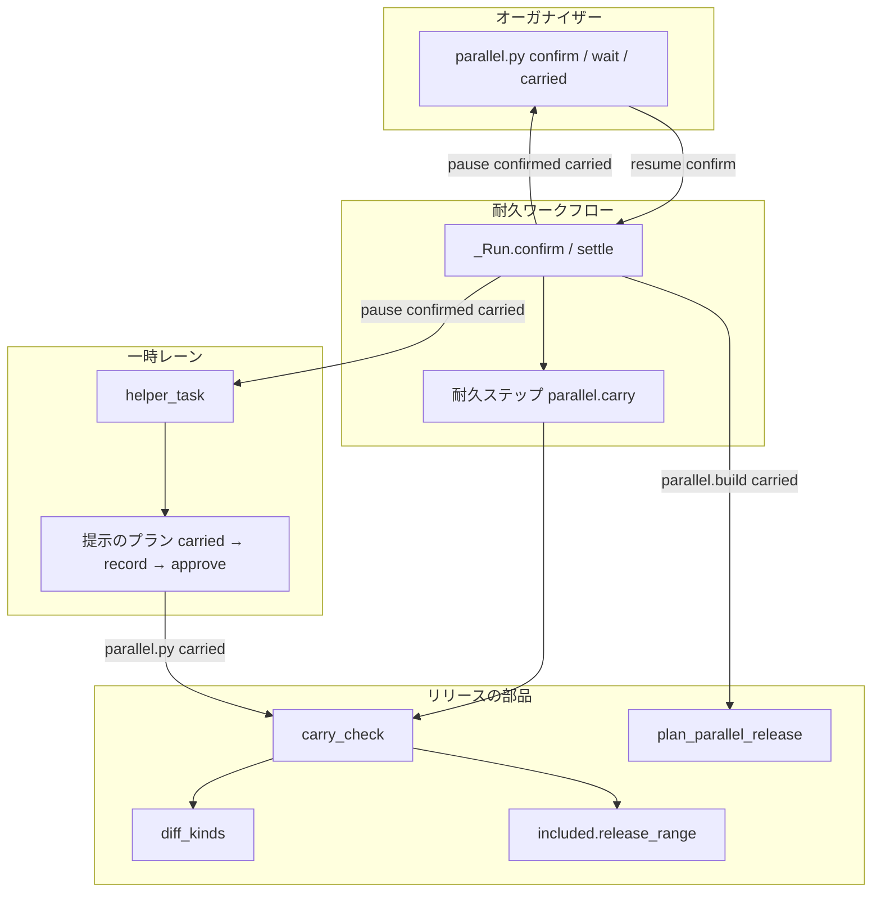
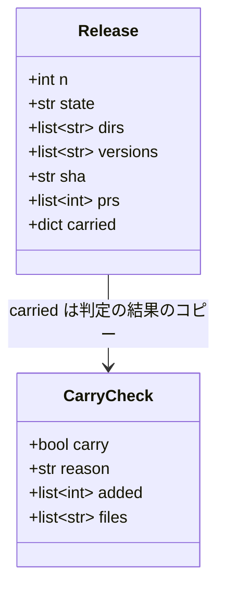
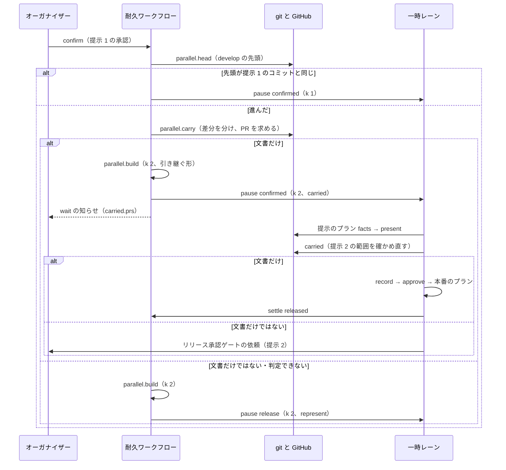
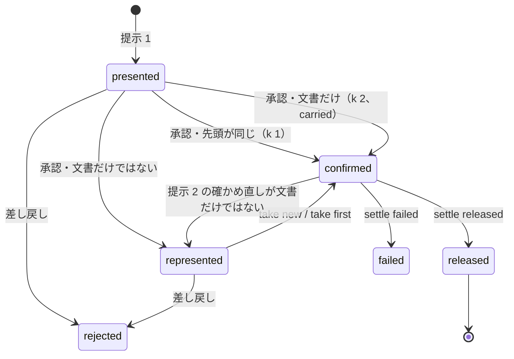

# 並列の計画のリリース: 承認の後に加わった範囲が文書だけなら、出し直さずに新しい範囲で出す（#3020）

## 目的

- **今どうなっているか**: 並列の計画のまとめたリリースで、承認の答えの時点で `develop` が承認したコミットより進んでいると、加わった範囲の中身を見ずに出し直しの提示を出す。文書だけが加わったときも、人の承認と一時レーンの往復が 1 回ずつ増える
- **誰に効くか**: 並列の計画でリリース承認ゲートに答える利用者と、その答えを中継するオーガナイザー
- **変えると何が成り立つか**: 加わった範囲が文書だけなら、提示 1 の承認を引き継いで新しい範囲でリリースへ進む。加わった Pull Request は待ちの知らせとリリースの結果に載り、オーガナイザーが利用者へ 1 行で伝える

## 適用範囲

- **働く範囲**: NDF を使うすべてのリポジトリの並列の計画（`--parallel <計画名>`）のまとめたリリース。1 スプリントのリリースと外のオーガナイザーのレーンは変えない
- **プロジェクトごとに違うもの**: 文書とコードの分け方は、各リポジトリの宣言（`.ndf/project.json` の `docs`）で受ける。新しい設定と引数は足さない
- **当たるモード**: `standard`（並列の計画のレーンが出すリリース）

## あるべき姿の根拠

| 根拠 | 種類 | 何を示すか |
| --- | --- | --- |
| 「承認後の出し直しの依頼は文書のみの場合スキップできるものとします。ndfのルールとして追加してください」 | 利用者の指示の原文 | 文書だけの範囲で出し直しを省くこと |
| 2026-11-11 12:02 JST の計画 p5 のリリース 4（ndf v10.27.54）で、加わった範囲が文書の移動だけ（26 ファイル、コードの変更なし）でも出し直しの提示になり、利用者はもう 1 回「新しい範囲で出す」と答えた | 実測 | 出し直しの提示が判断を増やさずに往復だけを増やした実例 |
| 差分を文書とコードに分ける判定は `lib/diff_kinds.py` に 1 か所ある（#2925） | 既存の形 | 同じ語を 2 か所で判定しない |

要求と受け入れ条件は #3020 の本文にある（コピーは [issue-3020-requirements.md](issue-3020-requirements.md) ）。この文書は「どう作るか」だけを扱う。

## ドメインモデル

### コンテキスト

| コンテキスト | 何の語が 1 つの意味に決まるか |
| --- | --- |
| `ndf-workflow` | 出し直しの提示・加わった範囲・確かめ直しの範囲・文書だけの範囲・出し直しを省く・引き継いだ承認 |

1 つのコンテキストに収まる。差分の分け方（`diff_kinds`）と範囲の Pull Request の求め方（`release_lib/included.py`）は、
同じコンテキストの既存の部品を呼ぶだけで、語の意味を変えない。

### 集約

| 集約 | 持ち主（書き換えてよいもの） | 根 | エンティティ | 値オブジェクト |
| --- | --- | --- | --- | --- |
| まとめたリリース | 耐久ワークフロー `parallel-<計画名>`（`lib/parallel_run.py` の `_Run`） | リリース（連番 `n`） | 提示（`k` = 1, 2） | 承認したコミット・加わった範囲の判定・引き継いだ確定（`Release.carried`。判定の時点の範囲と Pull Request） |
| 提示 | 提示のプラン（一時レーンが流す。`parallel.py present` が `presented.json` を書く） | 提示の置き場 `releases/<n>/<k>/` | — | 提示したコミット・含む Pull Request の一覧・引き継いだ承認の記録（提示 2 の `answer.json`。提示のプランのステップ `record` が書く） |

### 不変条件

| # | 集約 | 条件 | 破れたときの扱い |
| --- | --- | --- | --- |
| I1 | まとめたリリース | 出し直しを省くのは、加わった範囲を分けて、コードのファイルが 0 件・振る舞いを決める文書が 0 件・文書のファイルが 1 件以上のときだけ | 1 つでも外れたら出し直しの提示を出す |
| I2 | まとめたリリース | 差分の一覧・宣言 `docs`・加わった Pull Request の一覧のどれかが取れないときは、出し直しを省かない | 出し直しの提示を出す（理由を判定の結果に残す） |
| I3 | まとめたリリース | 出し直しを省くかの判定は、提示 1 への承認の答えで 1 度だけ行う。提示 2 への答え（`--take`）では判定しない | 提示 2 への答えは今のとおり `take` で提示を選ぶ |
| I4 | 提示 | 引き継いだ承認でリリースへ進む提示 2 は、確かめ直しの範囲が文書だけのときだけ承認の記録を書く | 承認の記録を書かず、提示のプランはリリース承認ゲートで止まり、一時レーンが提示 2 のリリース承認ゲートの依頼を送る |
| I5 | まとめたリリース | 出し直しを省いたリリースの版数・コミット・Pull Request の一覧は提示 2 のものになる | — |
| I6 | まとめたリリース | `develop` が進んでいないときは、提示 1 で確定する | — |
| I7 | まとめたリリース | 印 `parallel-docs-carry` を持たない古い耐久の記録の打ち直しは、今までの道（判定せずに出し直す）を通る | — |
| I8 | まとめたリリース | `Release.carried.prs`（待ちの知らせに載る番号）は加わった範囲の Pull Request、`range-<n>` の `added` は確かめ直しの範囲の Pull Request である。判定の後に `develop` が進めば `added` は `carried.prs` より多くなる。リリースの結果に載せる正は `added` | — |

I4 を置くのは、承認の答え（判定の時点）から提示のプランが承認資料を作る時点までの間にも `develop` が進みうるためである。
承認資料は作る時点の `origin/develop` の先頭で作られる。承認資料を作る手順は先頭を固定する引数を持たない
（`release-steps.py` の `approval-facts` の引数。2026-11-11 に `plugins/ndf/scripts/release-steps.py` 1233〜1258 行を読んで確かめた）。

### ドメインイベント

要求の E1〜E11 を引き継ぐ。E12・E13 は I4 のために足す。

| # | イベント | 発生元 | 受け手 |
| --- | --- | --- | --- |
| E1 | 提示 1 を出した | 耐久ワークフロー | 一時レーン |
| E2 | 利用者が提示 1 を承認した | オーガナイザー（`parallel.py confirm`） | 耐久ワークフロー |
| E3 | `develop` が進んだと分かった | 耐久ワークフロー（`parallel.head`） | 耐久ワークフロー |
| E4 | 加わった範囲のファイルの一覧を取った | 耐久ステップ `parallel.carry` | 耐久ワークフロー |
| E5 | 宣言 `docs` で加わったファイルを分けた | 耐久ステップ `parallel.carry` | 耐久ワークフロー |
| E6 | 文書だけと判定した / 文書だけではないと判定した | 耐久ステップ `parallel.carry` | 耐久ワークフロー |
| E7 | 新しい範囲でリリースを組んだ | 耐久ステップ `parallel.build`（引き継ぐ形） | 耐久ワークフロー |
| E8 | 新しい範囲で確定し、本番のプランを一時レーンへ渡した | 耐久ワークフロー（`pause` の `confirmed`・`carried` 付き） | 一時レーン |
| E9 | 加わった Pull Request を待ちの知らせに載せた | `parallel.py wait` | オーガナイザー → 利用者（1 行） |
| E10 | リリースを締め、結果に確かめ直しの範囲の Pull Request を載せた | 耐久ワークフロー（`range-<n>`） | レーン・オーガナイザー |
| E11 | 出し直しの提示（提示 2）を出した | 耐久ワークフロー | 一時レーン → オーガナイザー |
| E12 | 提示 2 の範囲が文書だけと確かめ、引き継いだ承認を記録した | 提示のプランのステップ `carried`・`record` | 提示のプランの `approve` |
| E13 | 提示 2 の範囲が文書だけでなかった | 提示のプランのステップ `carried`（終了コード 10） | 一時レーン（リリース承認ゲートの依頼を送る。E11 と同じ問いになる） |

### 用語

| 用語 | 意味 | 用語集への反映 |
| --- | --- | --- |
| 出し直しの提示 | 同じリリースのリリース承認ゲートを、加わった範囲を添えてもう 1 回出す提示（`represent: true`） | 追加（要求で追加済み） |
| 加わった範囲 | 提示 1 で承認したコミットから、承認の答えの時点の `develop` の先頭までに入った変更 | 追加（要求で追加済み） |
| 文書だけの範囲 | 加わった範囲のファイルを宣言 `docs` で分けて、コードのファイルと振る舞いを決める文書が 0 件、文書のファイルが 1 件以上の範囲 | 追加（要求で追加済み） |
| 出し直しを省く | 出し直しの提示を出さず、新しい範囲で確定してリリースへ進むこと | 追加（要求で追加済み） |
| 確かめ直しの範囲 | 提示 1 のコミットから、提示 2 の承認資料を作った時点のコミット（提示 2 の `presented.json`）までに入った変更。判定の後に `develop` が進めば、加わった範囲より広くなる。I4 と `parallel.py carried` が判定する | 追加 |
| 引き継いだ承認 | 出し直しを省いたとき、提示 1 への承認を提示 2 の承認として答えの記録に書いたもの。何を引き継いだかを記録の `what` に残す | 追加 |

## 外部の調査

省く: 既存の部品（差分の分け方 `diff_kinds`・範囲の Pull Request の求め方 `included.release_range`・耐久ワークフローの分岐）を呼ぶ場所を増やす変更で、形はプロジェクトの中の取り決め（まとめたリリースの承認ゲートの規約）だけで決まる

## 機能一覧

| # | 機能 | 誰が使うか |
| --- | --- | --- |
| F1 | 提示 1 の承認の後に `develop` が進んだとき、加わった範囲が文書だけかを判定する | 耐久ワークフロー |
| F2 | 文書だけなら、出し直しの提示を出さずに新しい範囲で確定し、リリースへ進む | 利用者（答えが 1 回で済む） |
| F3 | 新しい範囲の承認資料を作った時点で範囲を確かめ直し、文書だけのときだけ引き継いだ承認を記録する | 一時レーン |
| F4 | 加わった Pull Request を、待ちの知らせとリリースの結果に載せる | オーガナイザー（利用者へ 1 行で伝える）・レーン |
| F5 | 手順書に、省く条件・出し直す条件と理由・利用者への伝え方を書く | オーガナイザー |

## 構成要素

| 要素 | 責務 | 変更 |
| --- | --- | --- |
| `lib/parallel_release.py` の `carry_check` | 2 つのコミットの間の範囲を `diff_kinds.git_changed` と `diff_kinds.classify_root` で分け、文書だけの範囲か（`docs_only()` が真で振る舞いを決める文書が 0 件）と理由を返す。加わった Pull Request を `included.release_range` で求める。取れないものがあれば省かない側の結果と理由を返す（I1・I2） | 新設（関数 1 つ） |
| `lib/parallel_release.py` の `plan_parallel_release`・`build_plans` | 引き継ぐ形（`carried=True`）の提示のプランを組む: `present` の後を `carried` → `record` → `approve` にし、MVV 判定（`mvv`・`note`）を置かない | 変更（引数 1 つ） |
| `lib/parallel_run.py` の耐久ステップ `parallel.carry` | `carry_check` を耐久ステップとして打つ（分岐を記録した値だけで決めるため） | 新設 |
| `lib/parallel_run.py` の `_Run.confirm` | 進んだときに `parallel.carry` を打ち、文書だけなら引き継ぐ形で提示 2 を組んで `confirmed`（`k: 2`・`carried`）を出す。そうでなければ今のとおり出し直しの提示を出す。提示 2 への答えでは `Release.carried` を外す | 変更 |
| `lib/parallel_run.py` の `_Run.settle` | `prs` を提示から読むときにコミットも読む。`range-<n>` に `added`（確かめ直しの範囲の Pull Request。I8）を載せる | 変更 |
| `lib/parallel_run.py` の `parallel_workflow` | 印 `parallel-docs-carry` を `durable.patched` で取り、古い記録の打ち直しでは判定しない（I7） | 変更（1 行） |
| `lib/parallel_helper.py` の `helper_task` | `confirmed` に `carried` があれば、確定の後の 3 手ではなく提示と同じ流し方（提示のプラン → 本番のプラン。提示のプランが承認ゲートで止まればリリース承認ゲートの依頼）を返す | 変更 |
| `lib/parallel_cli.py` の `wait_event` | `pause` のうち `action: confirmed` で `carried` を持つものを返す（読み飛ばさない） | 変更 |
| `parallel.py` の副コマンド `carried <計画名> <連番>` | 提示 1 と提示 2 の `presented.json` のコミットの間を `carry_check` で確かめ、文書だけなら 0、そうでなければ 10（承認ゲート）を返す（I4） | 新設 |
| `development-workflow/references/parallel.md` | 「まとめたリリース」に省く条件・出し直す条件と理由、「答えの後の整理」に 1 行の伝え方、「一時レーン」に `carried` の流し方を書く | 変更 |
| `scripts/script-structure-allow/` の `parallel_run.py` の行数 | `parallel_run.py` の行数の例外（今 745 行）を、足した行数へ更新し理由を足す | 変更 |
| テスト `tests/test_parallel_run.py`・`tests/test_parallel_release.py`（無ければ新設）・`tests/test_parallel_cli.py` 相当 | 受け入れ条件 1〜10 と I1〜I8 | 変更・新設 |



図に含めない要素: `parallel_workflow` の印・手順書・行数の例外・テスト。印は打ち直しの道を分けるだけで、呼び出しの関係を持たない。
`_Run.settle` は図の `_Run.confirm / settle` に含める。

## 構造

触る型は、まとめたリリースの状態（耐久ワークフローの中の `rel` の辞書）と、判定の結果だけである。



| 項目 | 形 | いつ書くか |
| --- | --- | --- |
| `CarryCheck.carry` | 真偽 | 文書だけの範囲で、加わった Pull Request の一覧が取れたときだけ真 |
| `CarryCheck.reason` | 1 行の文 | 省かないときの理由（`diff_kinds` の `unknown`、コードのファイルの数、振る舞いを決める文書の数、Pull Request の一覧が取れない理由）。省くときは空 |
| `CarryCheck.added` | Pull Request の番号の昇順 | 加わった範囲の Pull Request（`included.release_range` の番号） |
| `CarryCheck.files` | パス | 加わった範囲のファイル（判定の根拠） |
| `Release.carried` | `{"from": 提示 1 のコミット, "head": 判定した先頭, "prs": [番号]}` | 出し直しを省いたときだけ。提示 2 への答え（`--take`）を受けたら外す |

`CarryCheck` は耐久ステップの戻り値としてそのまま記録できるよう、辞書（JSON の値）で返す。

## 入出力の契約

### `parallel.py wait` の知らせ（追加）

`pause` のうち、出し直しを省いた確定だけを返す。ほかの `pause` は今のとおり読み飛ばす。

```json
{
  "status": "ok",
  "summary": "並列の計画 p1: confirmed",
  "items": [],
  "metrics": {
    "action": "confirmed",
    "seq": 41,
    "n": 4,
    "k": 2,
    "carried": {"from": "<提示 1 のコミット>", "head": "<判定した先頭>", "prs": [3015]}
  }
}
```

オーガナイザーは `metrics.carried.prs` を 1 行で利用者へ伝え（問いにしない）、`wait --after <seq>` を打ち直す。
既存の項目は削らない。`carried` を持たない `confirmed` は今のとおり返さない。

### イベント `range-<連番>`（項目の追加）

| 項目 | 形 | 意味 |
| --- | --- | --- |
| `sha` | 文字列 | 確定した提示のコミット（出し直しを省いたときは提示 2 の `presented.json` から読む） |
| `version` / `prs` / `lanes` | 今のまま | — |
| `added` | 番号の並び | 出し直しを省いたときの確かめ直しの範囲の Pull Request（提示 2 の `prs` のうち提示 1 の `prs` に無いもの。I8）。省いていないときは空の並び。出し直しを省いたのは、`parallel.py carried` が 0 を返して引き継いだ承認の記録を書いたときだけである。判定の後にコードを含む Pull Request が入り `carried` が 10 を返したときは、提示 2 への答え（`--take`）で確定するため省いていないとみなし、空の並びにする |

### `parallel.py carried <計画名> <連番>`（新設）

| 終了コード | 意味 | 出力（統一 JSON レポート） |
| --- | --- | --- |
| 0 | 確かめ直しの範囲（提示 1 のコミットから提示 2 のコミットまで）が文書だけ | `status: ok`、`metrics.added` に確かめ直しの範囲の Pull Request |
| 10 | 文書だけの範囲ではない・判定できない | `status: gate`、`summary` に理由 |
| 2 | `presented.json` が読めない | `status: stopped` |

10 を承認ゲートとして返すのは、提示のプランをリリース承認ゲートで止め、一時レーンの既存の手順（リリース承認ゲートの依頼）へ渡すためである。

### 引き継いだ承認の記録

提示 2 の答えの記録（`releases/<n>/2/answer.json`）へ、`sprint-state.py gate` で次を書く。

```text
sprint-state.py gate <置き場>/answer.json 'リリース承認ゲート' \
  --what 'まとめたリリース <n> の提示 2（提示 1 の承認を引き継ぐ。加わった範囲は文書だけ）' \
  --by user --outcome approved
```

`--by user` は、承認したのが提示 1 に答えた利用者であることを指す。引き継いだことは `--what` が持つ。

## 処理の流れ



`parallel.build` が組めないときは、引き継ぐ形でも今の出し直しと同じく、範囲の依頼へ `failed` で答えて問い `kind: build` を出す（受け入れ条件 6）。

リリースの状態は次のとおり変わる。追加は `presented` から提示 2 の `confirmed` へ直接進む辺である。



`represented` は記録上の状態名ではなく、`dirs` が 2 つで `state: presented` のことを指す。`confirmed --> represented` の辺では、
状態の記録は `confirmed` のままで、提示 2 のリリース承認ゲートの問いが立つ。その答え（`confirm --take`）は `dirs` が 2 つの道を通り、
`Release.carried` を外す。

### MVV 判定がリリース承認ゲートを答えたとき

要求の前提 6 に当たる道は、今の作りでは出し直しの提示を通らない。この変更では触らない。

提示のプランの MVV 判定がリリース承認ゲートを通すと、一時レーンはそのまま本番のプランへ進む。
本番のプランは提示 1 の承認したコミットから切る（`parallel_release.py` の
`pipeline_cmd` と `plan_parallel_release` の `起点のコミット`。2026-11-11 にソースを読んで確かめた）。この道では先頭を比べず、
加わった範囲も入らない。

## 決定の記録

### 決定 1: 判定を 1 か所にするため、文書だけの範囲の判定を `diff_kinds` の結果の上に置き、振る舞いを決める文書を除く

`DiffKinds.docs_only()` は振る舞いを決める文書があっても真を返す（`lib/diff_kinds.py` の `docs_only`）。受け入れ条件 2 は振る舞いを決める
文書で出し直すことを求めるため、`docs_only()` が真で `behavior` が空のときだけ省く。分け方そのもの（`diff_kinds`）は変えず、
判定は `parallel_release.carry_check` の 1 か所に置き、耐久ワークフローと提示のプランの両方がこれを呼ぶ。

`docs_only()` の定義を変えて振る舞いを決める文書で偽にする形は採らない。検査のプランと CI の判定が今の定義を読んでいる。

根拠: Value 7（MVV 版 6）

### 決定 2: 承認していないコードが入らないよう、提示 2 の範囲を承認資料を作った後にもう 1 回確かめる

承認の答えの時点で判定しても、提示のプランが承認資料を作るまでに `develop` がさらに進みうる。承認資料を作る手順は先頭を固定する
引数を持たないため、作った後の提示 2 のコミットで範囲を確かめ直し、文書だけのときだけ引き継いだ承認を書く（I4）。
文書だけでなくなっていたら、提示のプランはリリース承認ゲートで止まり、今の出し直しと同じ問いになる。

承認資料を作る手順へ先頭を固定する引数を足す形は採らない。承認資料の作り方は 1 スプリントのリリースと共有しており、
この変更の範囲（並列の計画のリリース）を超える。

根拠: Value 1 / Value 2（MVV 版 6）

### 決定 3: 一時レーンの手順を増やさないため、引き継ぐ確定は提示と同じ流し方にする

引き継ぐ形の提示のプランは、承認資料を作る手順の後に `carried` → `record` → `approve` を置き、MVV 判定を置かない。
一時レーンは提示と同じく「提示のプラン → 本番のプラン」を流し、提示のプランが承認ゲートで止まればリリース承認ゲートの依頼を送る。
確定の後の 3 手（答えの記録 → `approve` から → 本番のプラン）を使う形は採らない。提示 2 の承認資料と `presented.json` を作る手順が流れない。

MVV 判定を置かないのは、リリース承認ゲートに提示 1 で答えが出ているためである。

根拠: Value 5（MVV 版 6）

### 決定 4: 判定できないときは出し直す側へ倒す

差分の一覧・宣言・加わった Pull Request の一覧のどれかが取れないときは、省かずに出し直しの提示を出す（I2）。加わった Pull Request の
一覧が取れないと、利用者へ伝える 1 行（受け入れ条件 7）が書けないため、これも省かない理由に数える。

根拠: Value 2（MVV 版 6）

### 決定 5: 利用者へ伝えるため、`wait` が引き継いだ確定の `pause` を返す

`wait` は今 `pause` を読み飛ばす（`lib/parallel_cli.py` の `wait_event`）。オーガナイザーが加わった Pull Request を 1 行で伝えるには
知らせが要るため、`action: confirmed` で `carried` を持つ `pause` だけを返す。新しいイベントの名前は足さない。

`range-<連番>` だけで伝える形は採らない。リリースが終わるまで利用者は承認していない範囲が出ることを知らない。

根拠: Value 2 / Value 8（MVV 版 6）

### 決定 6: 振る舞いを決める文書の範囲は宣言 `docs.behavior` に従う

`.ndf/mvv.md`・`AGENTS.md`・`CLAUDE.md` のように、配られないが AI の判断を変える文書は、既定では文書として数える。
足したいプロジェクトは宣言 `docs.behavior` へパターンを足す。この変更では ai-plugins の宣言を変えない（要求の「含まない」）。
MVV の文書は承認の版と sha256 で別に守られている（`answer_state` が承認済みの MVV の参照を記録へ写す）。

根拠: Value 6（MVV 版 6）

### 決定 7: 古い耐久の記録の打ち直しを壊さないため、印 `parallel-docs-carry` で道を分ける

耐久ステップ `parallel.carry` は新しい道にだけある。印の無い記録の打ち直しでこの耐久ステップを打つと、記録の順が崩れる。
そのため `parallel_workflow` の先頭で `durable.patched("parallel-docs-carry")` を取り、偽なら今までの道（判定せずに出し直す）を通す（I7）。
既存の印（`parallel-answers`・`parallel-launch`）と同じ形である。

根拠: Value 7（MVV 版 6）

## テスト設計

| 受け入れ条件・不変条件 | どの振る舞いで縛るか | どう壊したら落ちるべきか |
| --- | --- | --- |
| 受け入れ条件 1・I1 | 提示 1 の承認の後に先頭が進み、加わった範囲が `.md` だけなら、`represent: true` の `pause` が出ず、`action: confirmed`・`k: 2`・`carried` の `pause` が出る | 範囲を見ずに出し直すように戻すと落ちる |
| 受け入れ条件 2・I1 | 加わった範囲に `**/skills/**/*.md` が 1 つあれば `represent: true` が出る | `behavior` を見ずに `docs_only()` だけで省くと落ちる |
| 受け入れ条件 3・I1 | 加わった範囲に `.py` が 1 つあれば `represent: true` が出る | コードを数えずに省くと落ちる |
| 受け入れ条件 4・I2 | 提示 1 のコミットが無い（git が失敗する）・宣言 `docs` が壊れている・Pull Request の一覧が取れないとき、`represent: true` が出る | 取れないときに省く側へ倒すと落ちる |
| 受け入れ条件 5・I5 | 省いたリリースを `settle released` で締めると、`range-<n>` の `sha`・`prs` が提示 2 の `presented.json` のもの、版が提示 2 の版になる | 提示 1 の値で締めると落ちる |
| 受け入れ条件 6 | 省く判定の後に `parallel.build` が組めないと、範囲の依頼へ `failed` で答え、問い `kind: build` が立つ | 組めないまま確定へ進むと落ちる |
| 受け入れ条件 7 | `wait` が `carried` 付きの `confirmed` を返し、`metrics.carried.prs` に加わった番号が並ぶ。`carried` の無い `confirmed` は返さない | `pause` を読み飛ばすままだと落ちる。すべての `confirmed` を返すと落ちる |
| 受け入れ条件 8 | 省いたリリースの `range-<n>` の `added` に確かめ直しの範囲の番号が並び、省いていないリリースでは空の並び | `added` を書かないと落ちる |
| 受け入れ条件 9・I6 | 先頭が進んでいなければ `k: 1` で確定し、`parallel.carry` を打たない | 進んでいないときも判定すると落ちる |
| 受け入れ条件 10・I3 | 提示 2 への答え（`--take new` / `--take first`）では先頭を比べず判定もせず、`take` で選んだ提示で確定し、`carried` を外す | 提示 2 への答えでも判定すると落ちる |
| I4 | `parallel.py carried` は、提示 1 から提示 2 のコミットまでが文書だけなら 0、コードが入っていれば 10 を返す。引き継ぐ形の提示のプランは `carried` の 10 で `record` を打たずに承認ゲートで終わる | 確かめ直さずに記録を書くと落ちる |
| I4 | 引き継ぐ形の提示のプランに `mvv`・`note` が無く、`present` → `carried` → `record` → `approve` の順につながる | 順を入れ替えて記録を先に書くと落ちる |
| I4 | `helper_task` は `carried` 付きの `confirmed` に提示と同じ流し方（`phase: present`）を返し、`carried` の無い `confirmed` に確定の後の 3 手を返す | 引き継ぐ確定に `--from approve` を返すと落ちる |
| I7 | 印 `parallel-docs-carry` の無い記録の打ち直しでは、先頭が進んだら判定せずに出し直す | 印を見ずに判定すると落ちる |
| I8 | 判定の後、提示 2 の承認資料を作る前に `develop` へ文書だけの Pull Request が入り、`carried` が 0 を返すとき、`range-<n>` の `added` に判定後に入った番号も並び、`wait` の `metrics.carried.prs` には並ばない | `added` に `Release.carried.prs`（判定時の一覧）を写すと落ちる |
| I8 | 判定の後、提示 2 の承認資料を作る前に `develop` へコードを含む Pull Request が入り、`carried` が 10 を返して提示 2 への答え（`--take`）で確定したとき、`range-<n>` の `added` は空の並び | 出し直しを省いたかを見ずに、提示 2 と提示 1 の `prs` の差を `added` に書くと落ちる |
| 受け入れ条件 11 | 全体テスト `uv run --frozen --project . --all-extras pytest . -q -n 4` が通る | — |
| 受け入れ条件 12 | 手順書の文言はテストで照合しない。リンク切れの検査（既存）に任せる | — |

## 設計の結果

| 課題 | 扱い | 取り込み先 | 触るファイル |
| --- | --- | --- | --- |
| #3020 | 実装する | — | `plugins/ndf/scripts/lib/parallel_release.py`、`plugins/ndf/scripts/lib/parallel_run.py`、`plugins/ndf/scripts/lib/parallel_helper.py`、`plugins/ndf/scripts/lib/parallel_cli.py`、`plugins/ndf/scripts/parallel.py`、`plugins/ndf/skills/development-workflow/references/parallel.md`、`scripts/script-structure-allow/plugins__ndf__scripts__lib__parallel_run.py--lines.json`、`plugins/ndf/scripts/tests/` |

## 人へ残す判断

| 判断 | 当たるレッドライン | なぜ当たるか |
| --- | --- | --- |
| リリースが他のリポジトリへの公開に当たるときも、文書だけの範囲で出し直しを省くか。この設計は区別せずに省く形で書いている（公開操作そのものは提示 1 で人が承認しており、加わる文書は `develop` へのマージで Pull Request のレビューを通っている）。区別するなら、公開先が他のリポジトリかを判定する受け入れ条件を 1 つ足す | C5 | 人が見ていない文書が他者の読む場所へ出る。今のリリースの部品に、公開先が他のリポジトリかを判定する項目は無い（`grep -rn "C5" plugins/ndf/scripts/lib plugins/ndf/scripts/supervise_lib` の結果は起票の依頼の判定 `issue_items.other_repo` だけ） |

## 未確認のまま残ること

| 項目 | 内容 |
| --- | --- |
| 実際のまとめたリリースでの振る舞い | 承認の後に文書だけが入り、提示 2 が出ずに新しい範囲で出て、加わった Pull Request が 1 行で伝わるかは、次の並列の計画のまとめたリリースで分かる（リリース後テスト） |
| 加わった Pull Request の一覧を求める時間 | `included.release_range` は GitHub を読む。範囲が大きいときの所要時間は未計測。耐久ステップの中で打つため、待ちの上限に掛かるかは実装の単体テストでは分からず、リリース後テストで見る |
