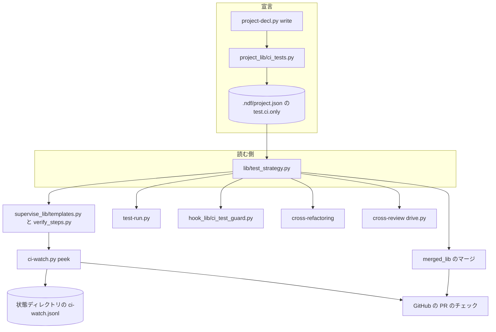
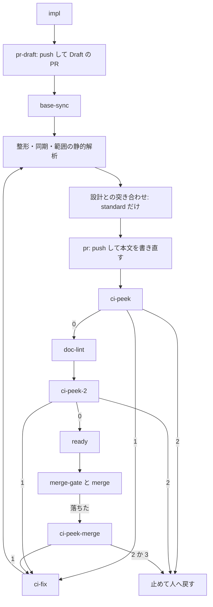

# テストを CI に寄せる: CI テストの宣言があるリポジトリでは手元でテストを走らせず、PR の CI の結果で合否を決めて直す（#3056）

## 目的

- **今どうなっているか**: NDF のプランは範囲テスト・全体テスト・cross-refactoring の点検と最終ゲートを、作業しているマシンで走らせる。並列のレーンが同時に走らせると 8 コアの負荷が 30〜60 になり、2026-11-11 には 1 回の点検が 72 分かかった。CI で同じテストが走るリポジトリでも手元で走らせており、cross-refactoring はこの負荷のため止めてある
- **誰に効くか**: CI（GitHub Actions）でテストを走らせている、NDF を使うリポジトリの利用者
- **変えると何が成り立つか**: 解析が CI テストの宣言を `.ndf/project.json` に書き、宣言のあるリポジトリでは手元のテストが 0 件になる。合否は PR の CI の結果で決め、プランは CI の結果を待たずに進み、失敗を見つけたら上限の回数まで直して push する。cross-refactoring も CI の結果で点検して工程へ戻る

## 適用範囲

- **働く範囲**: NDF を導入したすべてのリポジトリ。働くのは CI テストの宣言（`test.ci.only: true`）を持つリポジトリだけで、宣言の無いリポジトリの振る舞いは変えない
- **プロジェクトごとに違うもの**: 宣言の有無と、合否に使うチェックの名前（`test.ci.check`、無ければ `ci.required_checks`）は設定（`.ndf/project.json`）で受ける。引数は足さない
- **当たるモード**: 実装のプラン（`supervise.py new impl` / `fix`）と検査のプラン（`new check`）を流すすべてのモード。リファクタリングは工程表でリファクタリングを持つモード（`standard` / `legacy-refactor`）

## あるべき姿の根拠

| 根拠 | 種類 | 何を示すか |
| --- | --- | --- |
| 依頼の原文（#3056 の「依頼（原文）」、2026-11-12） | 利用者の指示の原文 | 宣言・手元で走らせない・非同期の監視と改修・早めの PR・cross-refactoring の改修の 5 点を求めている |
| 範囲テストが全体の 8,436 件になり 72 分かかった・worker が全体テストを打ち直して 30 分で打ち切られた（#3049・要求の「調べた事実」） | 実測 | 手元のテストが検査の工程を延ばしている |
| GitHub の coding agent は作業の始めに Draft の PR を開き、push のたびに CI が走る。落ちた CI からは修正のセッションを起こす（PRD1） | 外部の一次情報 | 早めの Draft の PR と、CI の失敗を起点にした改修は、主要な製品が採る形である |
| 条件で飛ばしたジョブは成功を報告し、必須のチェックでもマージを止めない（STD1） | 外部の一次情報 | マージと監視で、飛ばしたチェックを成功として読む根拠 |

要求と受け入れ条件は #3056 の本文にある（コピーは `issues/issue-3056-requirements.md`）。この文書は「どう作るか」だけを扱う。

## ドメインモデル

### コンテキスト

| コンテキスト | 何の語が 1 つの意味に決まるか |
| --- | --- |
| NDF の開発の工程（`ndf-workflow`） | CI テストの宣言・手元のテスト・CI の結果の監視・CI の失敗の改修・テストのチェック・プラン・ステップ |

変更は 1 つのコンテキストに収まる。次の 5 つは、同じコンテキストの別の構成要素である。

- 解析（`project-decl.py`）
- プランのテンプレート（`supervise_lib`）
- hook
- cross-refactoring
- cross-review

宣言を読む側は、すべて `lib/test_strategy.py` の 1 つの関数を通す。

### 集約

| 集約 | 持ち主（書き換えてよいもの） | 根 | エンティティ | 値オブジェクト |
| --- | --- | --- | --- | --- |
| プロジェクトの宣言 | 解析の書き出し（`project-decl.py write`）と人 | `.ndf/project.json` | テストの suite | CI テストの宣言（`test.ci.only`）・テストのチェックの名前 |
| CI の監視ログ | CI の監視のステップ（`ci-watch.py peek`） | プランの状態ディレクトリの `work/ci-watch.jsonl` | 見た 1 回（head の SHA ごと） | 結論（`passed` / `failed` / `pending` / `unknown`）・改修の回数 |
| プラン | プランのテンプレート（`supervise.py new`） | プランのファイル | ステップ | テストの戦略（`ci_only` を含む） |

CI の監視ログは追記だけで持ち、改修の回数は記録から数える（過去の行を書き換えない）。

### 不変条件

| # | 集約 | 条件 | 破れたときの扱い |
| --- | --- | --- | --- |
| I1 | プロジェクトの宣言 | 解析が `test.ci.only: true` を書くのは、`kind` が `test`（未指定を含む）の suite のうち 1 つ以上が `ci_jobs` を持ち、その `ci_jobs` のファイル（`#` より前）がリポジトリにあるときだけである | 条件を満たさなければ書かない。前の解析が書いた値は消す。人が書いた値は残す |
| I2 | プラン | 宣言のあるリポジトリのプランは、テストの suite のコマンドを手元で走らせるステップ（`test-limited`・`test-all`）を持たない | `supervise.py new` のテストが落ちる |
| I3 | プラン | 宣言のあるリポジトリの実装のプランは、実装のステップの直後に Draft の PR を出すステップ（`pr-draft`）を持つ | 同上 |
| I4 | プラン | マージのステップより前に、CI の結果を待って止まるステップが無い（監視のステップは 1 回読むだけで、待たない） | 同上 |
| I5 | CI の監視ログ | 改修を起こす回数は上限（`supervise.ci-fix` の `attempts`、既定 3）を超えない | 上限に当たったら改修を起こさず、理由を添えてプランを止める |
| I6 | CI の監視ログ | CI の結果を取得できないとき、監視のステップは失敗を記録して次へ進む（プランを止めない） | — |
| I7 | プロジェクトの宣言 | 宣言のあるリポジトリのマージは、テストのチェックがすべて現れて通った（成功・中立・飛ばした）ときだけ行う。落ちた・未完了・現れない・取得できないときはマージしない | マージのステップが失敗を返す |
| I8 | プロジェクトの宣言 | 宣言の無いリポジトリでは、プラン・hook・cross-refactoring・cross-review の振る舞いが今と同じである | 既存のテストが落ちる |
| I9 | プロジェクトの宣言 | 宣言のあるリポジトリで、テストの suite の起動の形に当たる Bash のコマンドは hook が拒む。静的解析の suite のコマンドは拒まない | — |

### ドメインイベント

| # | イベント | 発生元 | 受け手 |
| --- | --- | --- | --- |
| E1 | CI でテストが走ることを検知した | 解析の書き出し | 解析の書き出し（E2） |
| E2 | CI テストの宣言を `.ndf/` に書いた | 解析の書き出し | プランのテンプレート・hook・test-run.py・cross-refactoring・cross-review |
| E3 | 手元のテストのステップを持たないプランを組んだ | プランのテンプレート | プランの駆動（`supervise.py run`） |
| E4 | 実装の最初のコミットを push した | `pr-draft` のステップ | GitHub（CI の起動） |
| E5 | Draft の PR を出した | `pr-draft` のステップ | CI の監視のステップ |
| E6 | CI が走り始めた | GitHub | CI の監視のステップ |
| E7 | CI の結果の監視を始めた | 最初の `ci-peek` のステップ | CI の監視ログ |
| E8 | CI のテストの失敗を検知した | `ci-peek` / `ci-peek-merge` のステップ | `ci-fix` のステップ |
| E9 | CI の失敗の改修を push した | `ci-fix` の後の push（`pr` のステップか `git push`） | 次の `ci-peek` |
| E10 | 手元でテストのコマンドを打とうとして hook が止めた | hook（`ci_test_guard`） | worker・supervisor（拒否の理由を読む） |
| E11 | cross-refactoring が項目の改修を push し、CI の結果で点検した | cross-refactoring の最終ゲート | 最終ゲート修正（落ちたとき） |
| E12 | マージのステップが CI の緑を確かめてマージした | `merge-when-green` | プランの後続（後片付け） |

### 用語

| 用語 | 意味 | 用語集への反映 |
| --- | --- | --- |
| CI テストの宣言 | `.ndf/project.json` の `test.ci.only: true`。このリポジトリのテストは CI でだけ走らせると表し、宣言があれば手元でテストを走らせない | 意味の変更（置き場と形を `test.ci.only` に決めた） |
| 手元のテスト | worker・supervisor・プランのステップ・cross-refactoring が、作業しているマシンで走らせるテスト（範囲テスト・全体テスト・指摘の検証・打ち直しを含む） | 追加済み（変えない） |
| CI の結果の監視 | PR の CI のテストのチェックを、待たずに 1 回だけ読むステップ（`ci-peek`）をプランの区切りに置き、失敗を見つけたら CI の失敗の改修を起こす仕組み | 意味の変更（担い手をプランのステップに決めた） |
| CI の失敗の改修 | CI の結果の監視が見つけたテストの失敗を直し、同じ PR へ push すること（`ci-fix` のステップ） | 追加済み（変えない） |
| テストのチェック | 合否に使う PR のチェックの名前の集まり。`test.ci.check` があればその 1 つ、無ければ `ci.required_checks`、どちらも無ければ head のすべてのチェック | 追加 |

## 外部の調査

| 種類 | 調べるか | 理由 |
| --- | --- | --- |
| 標準・仕様 | 調べる | 飛ばしたチェック・Draft の PR の CI の起動について、GitHub の公式の振る舞いが合否の読み方を決める |
| 主要な製品 | 調べる | AI のコーディングの担い手が PR と CI をどう組み合わせているかを比べる |
| ライブラリとサービス | 調べる | CI の結果を 1 回だけ読む手段に、既存の CLI と API があるかを確かめる |

### 標準・仕様

| # | 標準・仕様 | 何を定めているか | 設計への反映 | 出典 |
| --- | --- | --- | --- | --- |
| STD1 | GitHub Actions の条件によるジョブの実行 | 条件で飛ばしたジョブは成功を報告し、必須のチェックでもマージを止めない。ワークフローごと飛ばされた（パス・ブランチの絞り込み）チェックは Pending のまま残る | マージと監視は SKIPPED を通過として読む。現れないチェックは通過にしない（I7） | https://docs.github.com/en/actions/how-tos/write-workflows/choose-when-workflows-run/control-jobs-with-conditions ・ https://docs.github.com/en/pull-requests/how-tos/merge-and-close-pull-requests/troubleshooting-required-status-checks （2026-11-11） |
| STD2 | `pull_request` のイベントの既定の種類 | 既定では opened・synchronize・reopened で走り、Draft の PR でも走る。衝突のある PR では走らない | Draft の PR を出せば以後の push で CI が走る。衝突があると CI が走らないため、既存の起点の取り込み（`base-sync`）を残す | https://docs.github.com/en/actions/reference/workflows-and-actions/events-that-trigger-workflows （2026-11-11） |

### 主要な製品

| # | 製品 | どう解いているか | 設計への反映 | 出典 |
| --- | --- | --- | --- | --- |
| PRD1 | GitHub Copilot の coding agent | 課題を受けるとすぐに Draft の PR を開き、作業を push していく。落ちたワークフローからは修正のセッションを起こし、原因を調べて同じブランチへ push する | 実装の直後に Draft の PR を出す（`pr-draft`）。CI の失敗は同じ PR へ直して push する（`ci-fix`） | https://docs.github.com/en/copilot/how-tos/copilot-on-github/use-copilot-agents/kick-off-a-task ・ https://docs.github.com/en/copilot/how-tos/use-copilot-agents/coding-agent/troubleshoot-coding-agent （2026-11-11） |

### ライブラリとサービス

| # | 候補 | 版 | ライセンス | 最後のリリースの日付 | 終了のアナウンス | 要件を満たすか | 出典 |
| --- | --- | --- | --- | --- | --- | --- | --- |
| LIB1 | GitHub CLI の `gh pr checks`（`--json bucket`。`--watch` は待つ形） | 2.103.3 | MIT | 2026-10-26 | 無し | 1 回だけ読むなら満たす。`--watch` は待って止まるため監視には使わない | `gh pr checks --help`・`gh --version`（2026-11-11） |
| LIB2 | NDF の既存の部品 `merged-steps.py probe`（`statusCheckRollup` を 1 回読み、failed / running / passed などに分ける） | リポジトリの HEAD | リポジトリと同じ | — | 無し | 満たす。マージの待ちと同じ読み方（SKIPPED を通過）で 1 回読める | `plugins/ndf/scripts/merged-steps.py:33`・`plugins/ndf/scripts/merged_lib/reading.py:55`（2026-11-11） |
| LIB3 | NDF の既存の部品 `gate_ci.ci_gate`・`test-run.py whole` の CI の待ち（`gh_checks.checks_outcome` と `test_triage.wait_check`） | リポジトリの HEAD | リポジトリと同じ | — | 無し | 待つ形のため監視には使わない。cross-refactoring の最終ゲートはこれをそのまま使う | `plugins/ndf/skills/cross-refactoring/scripts/refactor_lib/gate_ci.py:45`（2026-11-11） |

### 確かめられなかったこと

| 対象 | 試した手段 | 結果と理由 |
| --- | --- | --- |
| GitHub の coding agent の push で CI が自動で走るか | 検索の語 `GitHub Copilot coding agent opens draft pull request pushes commits runs GitHub Actions` | 検索結果の要約は「承認するまで走らない」とするが、出典の頁は 541 日前の版の表示で、今の振る舞いを確かめられなかった。この設計は NDF の利用者の権限で push するため、この振る舞いに依らない |

調べた量: 候補 6 件・取得の試み 4 回。

## 機能一覧

| # | 機能 | 誰が使うか |
| --- | --- | --- |
| F1 | 解析が CI テストの宣言を書く・消す | conductor（手順 0 の解析） |
| F2 | 宣言のあるリポジトリのプランが手元のテストのステップを持たない | supervisor（`supervise.py new`） |
| F3 | 実装の直後に Draft の PR を出す | supervisor |
| F4 | CI の結果を待たずに覗き、失敗なら改修して push する（回数の上限つき） | supervisor（プランのステップ） |
| F5 | マージはテストのチェックがすべて通ったときだけ行う | supervisor（`merge-when-green`） |
| F6 | 手元でテストのコマンドを打つと hook が止める | worker・supervisor（Claude Code・Codex） |
| F7 | `test-run.py scope` がテストの suite を走らせず静的解析だけを走らせる | プランのステップ・worker |
| F8 | cross-refactoring が手元のテストを走らせず CI の結果で点検し、工程へ戻る | 検査のプラン |
| F9 | cross-review の指摘の検証と完了判定が CI の結果を証跡にする | cross-review の担当・`quality-gates` |
| F10 | 要求の規則 1〜4 を Skill とエージェント定義と worker の指示文に書く | worker・supervisor・conductor |

## 構成要素

| 要素 | 責務 |
| --- | --- |
| `project_lib/model.py` の `TestCi` | `only: bool \| null` を足す。スキーマ（`project.schema.json`）はここから生成する |
| `project_lib/ci_tests.py`（新設） | I1 の条件で `test.ci.only` を決める純粋な関数 `declare(decl, root_files)`。書き出し（`project-decl.py write`）が `merge.merge_project` の後に呼ぶ。人が書いた値は既存の指紋の規則（`analysis.written`）で残す |
| `lib/test_strategy.py` | `Strategy.ci_only` を足し、`resolve` が宣言から載せる。`whole_on_ci` は `ci_only` でも真にする。`ci_only` のとき `verify_commands` はテストの suite を返さず、`scope_runs` はテストの suite を組まない。テストのチェックの名前（`ci.checks`）が空なら「head のすべて」を表す空の並びのまま渡し、読む側が全件と読む |
| `test-run.py` | `scope` は `ci_only` ならテストの suite を走らせず、静的解析だけを走らせ、テストを CI に任せた旨を結果の `notes` に書く |
| `lib/ci_watch.py`・`ci-watch.py`（新設） | `peek`: PR の head のテストのチェックを 1 回だけ読み（`merged-steps.py probe` と同じ読み方）、記録に 1 行を足して終了コードで結論を返す。落ちたチェックの名前・リンク・失敗したジョブのログの末尾（`gh run view --log-failed` の最後の 200 行）を出力に載せる |
| `contracts/limits.json` | `supervise.ci-fix`（`attempts: 3`）を足す。改修の回数の上限の値の正本 |
| `supervise_lib/verify_steps.py` | `ci_only(a)`・`ci_watch_steps(...)`（`ci-peek`・`ci-peek-merge`・`ci-fix` を組む）・`without_local_tests(...)`（`test-limited`・`test-all` と、それだけを入力に持つ judge・fix を外す）を足す。`ci-watch.py` の起動の形は `supervise_lib/paths.py` の定数に置く |
| `supervise_lib/templates.py` | `ci_only` のとき、実装のプランへ `pr-draft` と CI の監視のステップを入れ、テストのステップを外す。検査のプラン 2 種へ CI の監視のステップを入れる。`CROSS_REFACTORING_SUSPENDED = False` にする |
| `supervise_lib/prompts.py`・`supervise_lib/worker_steps.py` | `ci_only` のプランの worker の指示文で、「全体テストを打たない…テストは範囲だけ」の行を「テストを手元で打たない。合否は PR の CI の結果（`gh pr checks <PR>`）で読む」に置き換える |
| `merged_lib/merge.py`・`merged_lib/checks.py` | `ci_only` のとき、テストのチェックがすべて現れて通るまでマージしない（I7）。チェックが 1 件も載らない終わり（`no_checks`）を完了として扱わない |
| `hook_lib/ci_test_guard.py`（新設）・`hook.py` | PreToolUse の Bash を、宣言のあるリポジトリでテストの suite の起動の形と照合し、当たれば拒む（I9）。Claude Code と Codex の両方の hook から呼ばれる |
| cross-refactoring の `refactor_lib/baseline.py`・`scope_verdict.py`・`commands/implement.py`・`template_check.py`・`gate_ci.py` | `ci_only` のとき、着手前のテスト・項目ごとの点検の範囲テスト・足したテストの試走・テンプレートの試走を走らせない（静的解析は走らせる）。最終ゲートは既存の CI の判定（`ci_gate`）で決める。テストのチェックが空なら head のすべてを読む |
| cross-review の `scripts/drive.py` | 最終スイープの指示の行（`sweep_verify_lines`）を、`ci_only` なら「テストを手元で打たず、PR の CI の結果を読む」にする |
| Skill とエージェント定義 | `development-workflow`（SKILL.md と `references/project-analysis.md`）・`quality-gates`・`cross-review`・`cross-refactoring` の SKILL.md、`agents/worker.md`・`agents/supervisor.md` に要求の規則 1〜4 を書く |
| `.ndf/project.json`（このリポジトリ） | `test.ci.only: true` を足す（`pytest` の suite が `.github/workflows/pytest.yml` を `ci_jobs` に持つ） |



図には宣言を書く・読むコードの構成要素だけを描く。次のものは描かない。

- 上限の表（`contracts/limits.json`）
- worker の指示文（`prompts.py`・`worker_steps.py`）
- スクリプトの置き場の定数（`paths.py`）
- `hook.py` の振り分け
- Skill とエージェント定義
- このリポジトリの宣言

## 入出力の契約

### CI テストの宣言（`.ndf/project.json`）

```json
{"test": {"ci": {"only": true, "check": null, "junit_artifacts": null}, "suites": ["…"]}}
```

| 項目 | 型 | 意味 |
| --- | --- | --- |
| `test.ci.only` | `true` / `false` / 無し | `true` で CI テストの宣言。`false` は人が明示して手元で走らせる指定で、解析は書き換えない。無しは宣言なし |

互換性: 足すだけで、既存の項目の意味は変えない。`test.strategy` の 3 つの値は残し、`only: true` は戦略の値に関わらず手元のテストを止める（要求の前提 5）。

解析の答えの形（`references/project-analysis.md` の `test` の行）に `suites[].ci_jobs` を足す。conductor はワークフローのファイルからテストのジョブを答え、`only` は答えずに書き出しが I1 で決める。

### `ci-watch.py peek`

| 項目 | 内容 |
| --- | --- |
| 入力 | `--pr <番号>`（必須）・`--state <状態ディレクトリ>`（必須）・`--after-merge`（マージが落ちた後に読む印）・`--root <dir>` |
| 出力 | 1 行の結果 JSON（`step_result`）。`items` に見たチェック（名前・結論・リンク）、`metrics` に `head`・`verdict`・`fixes`（記録から数えた改修の回数）・`limit` |
| 記録 | `<状態>/work/ci-watch.jsonl` へ 1 行（`at`・`head`・`verdict`・`failed`・`after_merge`）を足す |

| 終了コード | 意味 | プランの行き先 |
| --- | --- | --- |
| 0 | 進めてよい（通った・未完了・チェックがまだ無い・取得できなかった） | `next` |
| 1 | テストのチェックが落ちた。改修の回数は上限の内 | `on_fail` → `ci-fix` |
| 2 | 落ちたが改修の回数が上限に当たった | `on_exit` → `stop`（理由: 改修の回数と落ちたチェック） |
| 3 | `--after-merge` で、落ちたテストのチェックが無い（マージが CI 以外の理由で落ちた） | `on_exit` → `stop` |

改修の回数は、記録のうち `verdict: failed` の行の `head` の異なる数である。同じ head を何度覗いても 1 回と数える。

### hook の拒否

| 項目 | 内容 |
| --- | --- |
| 対象 | Bash のツールのコマンド。作業場所から上へ辿って最初の `.ndf/project.json` が `test.ci.only: true` のときだけ |
| 照合 | コマンドを `&&`・`\|\|`・`;`・`\|` で区切った各部分（既存の `hook_lib/shell_checks.py` の分け方）の語の並びが、`kind: test` の suite の起動の形の前置きで始まるか。起動の形は suite の `command` の語のうち `runner` と同じ語まで（`runner` が語に無ければ `scope_command` の `{paths}` の前まで）。前置きが 1 語だけになるときは、`command` の 2 語目まで含める |
| 拒否の出力 | 既存の `deny()` の形（`permissionDecision: deny`）。理由に「CI テストの宣言があるため手元でテストを走らせない。結果は `gh pr checks <PR>` か `python3 <NDF>/scripts/merged-steps.py probe --pr <PR>` で読む」を書く |
| 拒まないもの | `kind: lint` の suite のコマンド・`test-run.py`（自分で静的解析だけを走らせる）・宣言の無いリポジトリのすべて |

### `merge-when-green`（宣言のあるリポジトリだけ）

| 状態 | 今 | 宣言のあるリポジトリ |
| --- | --- | --- |
| テストのチェックがすべて SUCCESS / NEUTRAL / SKIPPED | マージする | マージする |
| テストのチェックのどれかが現れない | 現れたチェックだけで判定する | 待ちの上限まで待ち、現れなければマージせず `stopped` |
| チェックが 1 件も載らない（`no_checks`） | 完了として扱う | マージせず `stopped` |
| 取得できない | 終了コード 1 | 今と同じ（マージしない） |

## 処理の流れ

### 実装のプラン（宣言のあるリポジトリ）

宣言の無いリポジトリの並びは変えない。今の並びは次のとおりである。

```text
impl → base-sync → 整形・同期・範囲の静的解析 → test-limited → 設計との突き合わせ → pr → test-all → doc-lint → ready → マージ
```

宣言のあるリポジトリでは次の並びにする。



- `pr-draft` は `pr` の種類のステップで、本文を機械のテンプレート（`body: template`）で作り、LLM を呼ばない。PR が既にあれば何もしない
- `ci-peek`・`ci-peek-2` は待たない。CI が走っている間は 0 で次へ進む
- `ci-fix` は修正の worker で、入力は落ちた `ci-peek` の出力（落ちたチェックとログの末尾）である。直してコミットし（push しない）、整形から流れ直して `pr` のステップが push する
- `merge` が落ちたら `ci-peek-merge` が読み直す。CI の失敗なら `ci-fix`、それ以外の理由なら止める（judge を通さない）
- 設計との突き合わせが「設計と違う点」の節を欠いて `pr` が止まったときの戻りは、今の judge の経路のまま残す

### 検査のプラン（宣言のあるリポジトリ）

対象は `new check --pr` と `new check --since-last` である。`whole_on_ci` を `ci_only` でも真にするため、今の `trim_check_steps` がこの 2 つから `test-all` を外す。`test-all` だけを入力に持つ judge・fix も外れる。そこへ次を足す。

- リファクタリング（`assess` → `refactor`）を戻す（`CROSS_REFACTORING_SUSPENDED = False`）。`refactor` の中の点検は下の「cross-refactoring」のとおり
- `review` の後、`ready`（差分の検査では `finish`）の前に `ci-peek` を置く。`ci-fix` は直してコミットし `git push` して `ci-peek` へ戻る
- `merge` が落ちたら `ci-peek-merge` へ進む（実装のプランと同じ）

### cross-refactoring（宣言のあるリポジトリ）

| 場面 | 今 | 宣言のあるリポジトリ |
| --- | --- | --- |
| 着手前のテスト（`run_baseline`） | 手元で全体テストか範囲テストを走らせる | テストを走らせない。静的解析だけを走らせる |
| テンプレートの試走（`template_check`） | テストのファイルを入れて試走する | 試走しない |
| 項目ごとの点検（`cmd_verify` → `_run_scope`） | 範囲テストを手元で走らせる | テストを走らせず、静的解析だけで点検する。テストの合否は最終ゲートへ回す |
| 足したテストの試走（`_run_added_tests`） | 手元で走らせる | 走らせない |
| 危険フラグの全体テスト | `whole_on_ci` なら 0 秒 | 同じ（`whole_on_ci` が真） |
| 最終ゲート | `ci_mode` なら `ci_gate`、無ければ手元 | `ci_gate`（項目のコミットを push した後の head の CI を待つ） |
| 最終ゲートが落ちた | CI の JUnit で見分け、変更起因なら最終ゲート修正へ（原因の項目を手がかりで向け先にする） | 同じ |

着手前のテストを走らせないため、既存失敗の見分けは着手時の head の CI の JUnit で行う。最終ゲートの時点では着手時の head の CI は終わっているため、待たずに読める。

### 解析の書き出し

`project-decl.py write` は `merge.merge_project` の後に `ci_tests.declare` を呼ぶ。I1 の条件を満たせば `test.ci.only: true` を書き、満たさず前の値が解析の書いたもの（指紋が一致）なら消す。`false` と人が書いた値は変えない。出力に `CI テストの宣言: 書いた / 消した / 変えない（<理由>）` の 1 行を出す。

## 非機能の実現方式

| 大項目 | 実現方式 |
| --- | --- |
| 性能・拡張性 | プランのテストのステップを外し（I2）、hook がテストの起動を拒み（I9）、cross-refactoring の試走と点検を止める。確かめ方は、プランのステップの一覧に `test-limited`・`test-all` が無いことと、hook の拒否の記録（進捗の記録の `deny` の行）で数える |
| 可用性 | `ci-peek` は取得の失敗を `unknown` として記録し 0 で返す（I6）。マージは I7 のとおりテストのチェックを確かめられたときだけ行う |
| 運用・保守性 | 監視の結果と改修の回数はプランの状態ディレクトリの `work/ci-watch.jsonl` に追記で残る。`ci-fix` の push は PR のコミットとして残る |
| 移行性 | 宣言は次の解析で書かれる。書かれるまでは今の振る舞いのまま動く（I8） |

## 決定の記録

### 決定 1: 戦略の値と独立に読めるよう、宣言を `test.ci.only` の真偽値にする

要求の前提 5 は既存の戦略の 3 つの値を残し、宣言を別の情報として読むことを求める。`test.strategy` に値を足すと、範囲テストを選べない `round-only` と CI テストの宣言を同時に表せず、戦略を導く関数（`propose`）の分岐も増える。CI の読み方の設定は `test.ci`（`check`・`junit_artifacts`）がすでに持つため、同じ場所に真偽値を置く。

`test.strategy` に `ci-only` を足す形は、戦略の値を前提に書かれた分岐（`whole_on_ci`・`scoped_suites` の呼び手）を値ごとに直すことになるため採らない。

根拠: Value 4 / Value 8 / Value 11（MVV 版 7）

### 決定 2: 解析と人の書いた値がぶつからないよう、宣言は書き出しが条件から決め、人の値は残す

conductor の答えに任せると、同じリポジトリでも答え手によって宣言の有無が変わる。I1 の条件は宣言とファイルの有無だけで決まるため、書き出しが決める。人が `false` を書いたリポジトリは、既存の指紋の規則で解析が書き換えない。

根拠: Value 3 / C7（MVV 版 7）

### 決定 3: 合否の読み方をマージとそろえるため、CI の監視は `merged-steps.py probe` と同じ読み方で 1 回だけ読む

監視とマージで SKIPPED の扱いが違うと、監視が通したものをマージが止める。マージの待ちが使う `statusCheckRollup` の読み方（SKIPPED を通過。STD1）を監視にも使い、テストのチェックの名前で絞る。`gh pr checks --watch` と `test_triage.wait_check` は待って止まるため、監視には使わない。

- 作り方: 自前で作る・標準に倣う
- 比べた候補: LIB1 / LIB2 / LIB3 / STD1

根拠: Value 3 / Value 11（MVV 版 7）

### 決定 4: プランの遷移の検査と再開に乗せるため、CI の監視の担い手をプランのステップにする

監視は待たずに 1 回読むステップ（`ci-peek`）として、プランの区切り（`pr` の後・`doc-lint` の後・`ready` の前・マージが落ちた後）に置く。ステップなら、遷移の上限の計算（`limits.fill`）・耐久ワークフローの再開・進捗の記録がそのまま効き、プロセスが落ちても監視が消えない。

別のプロセスとして背景で常駐させる形は、プランの遷移を外から変えられず、プランが終わった後に残るプロセスを片付ける仕組みが要るため採らない。駆動部（engine）がステップの合間に暗黙に覗く形は、遷移が計画のファイルに現れず、上限の計算と再開の記録が食い違うため採らない。

- 作り方: 自前で作る
- 比べた候補: LIB1 / LIB2 / PRD1

根拠: Value 3 / Value 6 / Value 9（MVV 版 7）

### 決定 5: 改修を際限なく繰り返さないよう、改修の回数の上限を 3 にし、上限に当たったら止めて人へ戻す

要求の前提 6 は上限を求める。数えるのは落ちた head の数で、同じ head を何度覗いても 1 回とする。3 は、既存の「2 回直しても同じ失敗なら止める」（`RULE_IMPL`）に、別の原因の失敗が 1 回続く余地を足した値である。値の正本は `contracts/limits.json` の `supervise.ci-fix` に置く。

根拠: Value 2（MVV 版 7）

### 決定 6: マージが CI で落ちたときの改修も同じ上限で数えるため、マージの失敗は `ci-peek-merge` を通す

マージの待ちは落ちたチェックを見ると止まるため、実際の検知の多くはマージのステップで起きる。マージの失敗を judge へ回すと、監視ログを通らずに改修が起き、上限から漏れる。`--after-merge` で読み直し、CI の失敗なら `ci-fix`、ほかの理由なら止める。

根拠: Value 2 / Value 3（MVV 版 7）

### 決定 7: 最初の push で CI を走らせるため、`pr-draft` を実装のステップの直後に置き、本文は機械のテンプレートで作る

要求の規則 4 は最初の push の時点で Draft の PR を求める。`pr-draft` は起点の取り込みより前に置き、CI の 1 回目を最も早く起こす。本文は後の `pr` のステップが書き直すため、`pr-draft` で LLM を呼ばない。PR を早く出すために worker へ push と PR の作成を任せる形は、PR の題と本文の書き手が 2 つになるため採らない。

根拠: Value 2 / Value 5（MVV 版 7）

### 決定 8: 宣言のあるリポジトリのマージは、テストのチェックがすべて現れて通ったときだけ行う

宣言のあるリポジトリでは手元で一度もテストを走らせないため、CI のテストが走らなかった変更をマージすると、テストを通らない変更がベースブランチへ入る。今の `merge-when-green` はチェックが 1 件も載らないときを完了として扱うため、宣言のあるリポジトリではこれを止めにする。テストのチェックの名前は `test.ci.check` → `ci.required_checks` の順で決める。この順は cross-refactoring と `test-run.py` と同じである。どちらも無ければ head のすべてのチェックにする。照合は名前の完全一致、SKIPPED は通過（STD1）。宣言の無いリポジトリは今のままにする。

根拠: Value 13 / Value 7（MVV 版 7）

### 決定 9: 静的解析は手元に残す

依頼の原文が手元で止めるのはテストである。静的解析は範囲を絞れば数秒で終わる。CI の往復より速く、push の前に落とせる。CI の往復は、このリポジトリの静的解析のワークフローで 19〜113 秒である（`.ndf/project.json` の `ci.workflows`）。範囲の静的解析（`lint-limited`）・cross-refactoring の公開前の静的解析は今のまま走らせる。CI でも走る静的解析を手元から外す形は、push の前の検査が無くなり CI の往復が増えるため採らない。

根拠: Value 2 / Value 5（MVV 版 7）

### 決定 10: 誤検知を抑えつつ worker の言い換えを止めるため、hook はテストの suite の起動の形の前置きで照合する

宣言の `command` との完全一致では、worker がオプションやパスを変えた打ち方（`… pytest plugins/x -q`）を止められない。ランナーの名前の語だけで照合すると、`npm` のような起動の語を持つリポジトリで無関係なコマンドを止める。suite の `command` の `runner` までの語を前置きにすれば、宣言の打ち方の言い換えを止め、無関係なコマンドは止めない。人が自分の端末で打つコマンドは hook の対象外のため、例外の手段は設けない。

根拠: Value 3 / Value 4（MVV 版 7）

### 決定 11: cross-refactoring で CI が落ちた項目は、既存の最終ゲートの失敗の扱いで直す

項目ごとの点検でテストを走らせないため、テストの合否は最終ゲートの CI の結果だけで決まる。落ちたときの見分け（CI の JUnit で変更起因・既存失敗・フレーキーを分ける）と、原因の項目を手がかりにした最終ゲート修正は、全体テストを CI に任せる戦略ですでに動いている。項目ごとに CI を往復させる形は、1 往復 15 分（`pytest.yml` の壁時計 922 秒）が項目の数だけ掛かり予算に収まらないため採らない。

根拠: Value 2 / Value 11（MVV 版 7）

### 決定 12: 改修が終わったため、cross-refactoring の停止を外す

停止の理由は手元のテストの負荷だった。宣言のあるリポジトリではこの変更で手元のテストが無くなり、宣言の無いリポジトリは停止の前と同じ振る舞いに戻る。停止は全モードに効く 1 つの定数のため、宣言の有無で分けずに外す。

根拠: Mission / Value 10（MVV 版 7）

## テスト設計

| 受け入れ条件・不変条件 | どの振る舞いで縛るか | どう壊したら落ちるべきか |
| --- | --- | --- |
| 受け入れ条件 1・I1 | `ci_tests.declare` に、テストの suite が実在する `ci_jobs` を持つ宣言を渡すと `test.ci.only: true` が入る。`project-decl.py write` を通しても入る | 条件を `kind` を見ずに判定する・`#` 付きのジョブのファイルの有無を `#` ごと照合する |
| 受け入れ条件 2・I1 | `ci_jobs` が無い・ファイルが無い・静的解析の suite だけが持つ宣言では書かれない。前に解析が書いた `true` は消え、人が書いた `false` は残る | 静的解析の suite の `ci_jobs` で書く・人の値を上書きする |
| 受け入れ条件 3・I2 | 宣言のあるリポジトリで `new impl` / `new fix` / `new check` / `new check --since-last` のステップの id に `test-limited`・`test-all` が無い | `without_local_tests` を通さない・judge の入力に `test-limited` が残る |
| 受け入れ条件 4 | `ci_only` の戦略で `verify_commands` がテストの suite を返さない。`drive.py` の最終スイープの指示に手元のテストのコマンドが載らない | `verify_commands` が `whole_commands()` を返したままになる |
| 受け入れ条件 5・I3 | 宣言のあるリポジトリの実装のプランで、`impl` の次が `pr-draft`、`pr-draft` の `body` が `template` | `pr-draft` を `pr` の後ろに置く |
| 受け入れ条件 6・I4 | 宣言のあるリポジトリのプランで、`merge` より前のステップに CI を待つコマンド（`test-run.py whole`・`--watch`）が無い。`ci-peek` は CI が未完了のとき 0 を返す | `ci-peek` が未完了で 1 を返す・待つ |
| 受け入れ条件 7・I5 | 落ちた head を 1 つ記録した `ci-peek` は 1 を返し、異なる 3 つの head の失敗を記録した後は 2 を返す。同じ head を 2 回覗いても回数は 1 | 行の数で数える・上限を読まずに固定値で比べる |
| 受け入れ条件 7 | 実装のプランで `ci-peek` の `on_fail` が `ci-fix`、`ci-fix` の後に `pr` を通って `ci-peek` へ戻る | `ci-fix` から `ci-peek` を通らずに `ready` へ進む |
| 受け入れ条件 8・I7 | 宣言のあるリポジトリの `merge-when-green` は、テストのチェックが現れない・`no_checks`・落ちたときにマージしない。SKIPPED は通過 | `no_checks` を完了として扱う・SKIPPED を失敗にする |
| I6 | `gh` が失敗したとき `ci-peek` は `unknown` の行を記録して 0 を返す | 取得の失敗で 1 か 2 を返す |
| 受け入れ条件 9・I9 | 宣言のあるリポジトリで、suite の `command`・`scope_command` にパスを入れたもの・前置きにオプションを足したものを hook が拒み、理由に CI の結果の見方が入る。静的解析の suite のコマンドと `test-run.py` は拒まない | `kind` を見ない・前置きを 1 語にして `uv run ruff` まで止める |
| 受け入れ条件 10 | 文言の照合テストは書かない（`AGENTS.md` の DON'T）。`instructions-check.py`・`check-ndf-contracts.py` が参照切れを見る | — |
| 受け入れ条件 11 | `ci_only` の状態で `run_baseline`・`_run_scope`・`_run_added_tests`・`template_check` がテストのコマンドを起動しない。最終ゲートの `gate.mode` が `ci`。`CROSS_REFACTORING_SUSPENDED` が `False` で、検査のプランに `assess`・`refactor` がある | `ci_mode` だけを見て `ci_only` を見ない・停止を残す |
| 受け入れ条件 12・I8 | 宣言の無い既存のテスト（`test_supervise.py`・hook・cross-refactoring・cross-review）がそのまま通る。宣言の無いリポジトリで hook が何も拒まない | 宣言の無いときにも `ci_only` の分岐へ入る |

## 設計の結果

| 課題 | 扱い | 取り込み先 | 触るファイル |
| --- | --- | --- | --- |
| #3056 | 実装する | — | `plugins/ndf/scripts/project_lib/model.py`、`plugins/ndf/scripts/project_lib/ci_tests.py`（新設）、`plugins/ndf/scripts/project-decl.py`、`plugins/ndf/skills/development-workflow/schemas/project.schema.json`、`plugins/ndf/scripts/lib/test_strategy.py`、`plugins/ndf/scripts/test-run.py`、`plugins/ndf/scripts/ci-watch.py`（新設）、`plugins/ndf/scripts/lib/ci_watch.py`（新設）、`plugins/ndf/contracts/limits.json`、`plugins/ndf/scripts/supervise_lib/verify_steps.py`、`plugins/ndf/scripts/supervise_lib/templates.py`、`plugins/ndf/scripts/supervise_lib/prompts.py`、`plugins/ndf/scripts/supervise_lib/worker_steps.py`、`plugins/ndf/scripts/supervise_lib/paths.py`、`plugins/ndf/scripts/merged_lib/merge.py`、`plugins/ndf/scripts/merged_lib/checks.py`、`plugins/ndf/scripts/hook.py`、`plugins/ndf/scripts/hook_lib/ci_test_guard.py`（新設）、`plugins/ndf/skills/cross-refactoring/scripts/refactor_lib/baseline.py`、`plugins/ndf/skills/cross-refactoring/scripts/refactor_lib/scope_verdict.py`、`plugins/ndf/skills/cross-refactoring/scripts/refactor_lib/commands/implement.py`、`plugins/ndf/skills/cross-refactoring/scripts/refactor_lib/template_check.py`、`plugins/ndf/skills/cross-refactoring/scripts/refactor_lib/gate_ci.py`、`plugins/ndf/skills/cross-review/scripts/drive.py`、`plugins/ndf/skills/development-workflow/SKILL.md`、`plugins/ndf/skills/development-workflow/references/project-analysis.md`、`plugins/ndf/skills/quality-gates/SKILL.md`、`plugins/ndf/skills/cross-review/SKILL.md`、`plugins/ndf/skills/cross-refactoring/SKILL.md`、`plugins/ndf/agents/worker.md`、`plugins/ndf/agents/supervisor.md`、`.ndf/project.json`、`plugins/ndf/scripts/tests/`、`plugins/ndf/skills/cross-refactoring/tests/`、`plugins/ndf/skills/cross-review/tests/` |

## 人へ残す判断

| 判断 | 当たるレッドライン | なぜ当たるか |
| --- | --- | --- |
| このリポジトリの `.ndf/project.json` に `test.ci.only: true` を足す | C7 | 利用者の設定（`.ndf/`）を書き換える。変更は実装の中でコミットし、リリース承認ゲートで人が見る |

## 未確認のまま残ること

| 項目 | 内容 |
| --- | --- |
| 手元のテストのプロセスが 0 件になるか | hook の照合が worker の実際の打ち方をすべて拾うかは、リリースの後にこのリポジトリで 1 スプリントを回し、進捗の記録の拒否の行とプロセスの記録で確かめる（要求の手動確認 (b)） |
| CI の監視が実際の失敗を検知して改修が起きるか | 区切りの `ci-peek` の時点で CI が終わっている頻度は、CI の壁時計（`pytest.yml` で 922 秒）とステップの所要で決まり、実測は無い。リリースの後の 1 スプリントで、`ci-watch.jsonl` の `failed` の行と、マージの後の `ci-peek-merge` の行の数を数えて分かる（要求の手動確認 (c)） |
| cross-refactoring が CI の結果で予算の中で最後まで進むか | 最終ゲートの CI の待ちと最終ゲート修正の往復が予算に収まるかは、リリースの後の検査のプランで分かる（要求の手動確認 (d)） |
