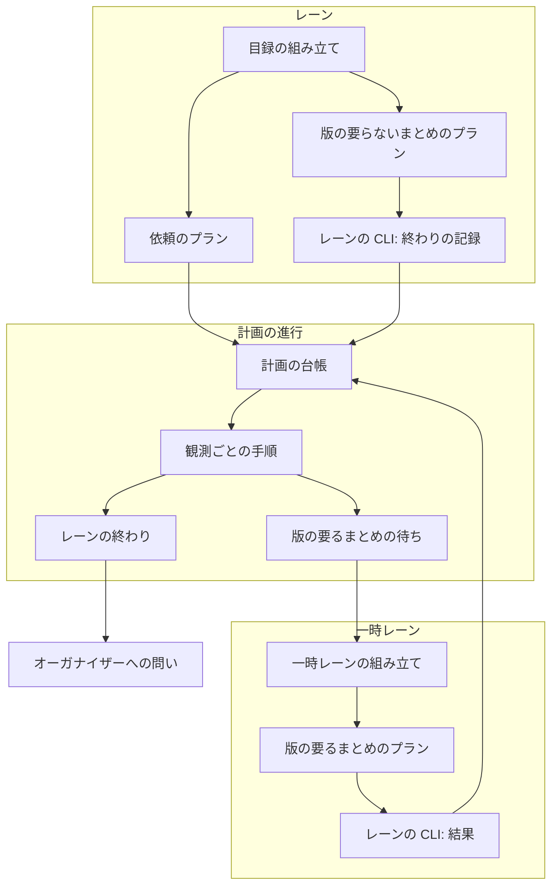
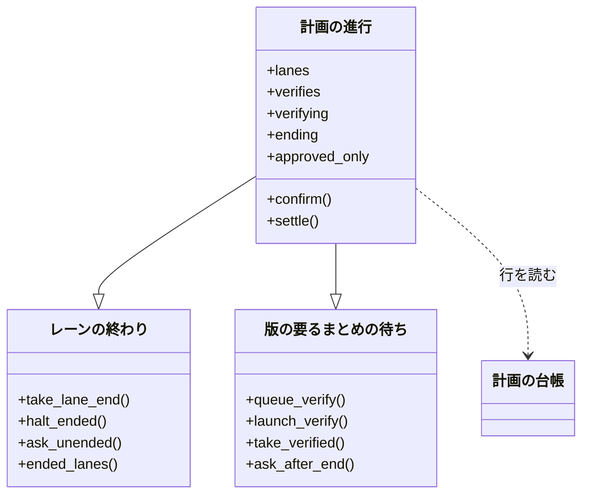
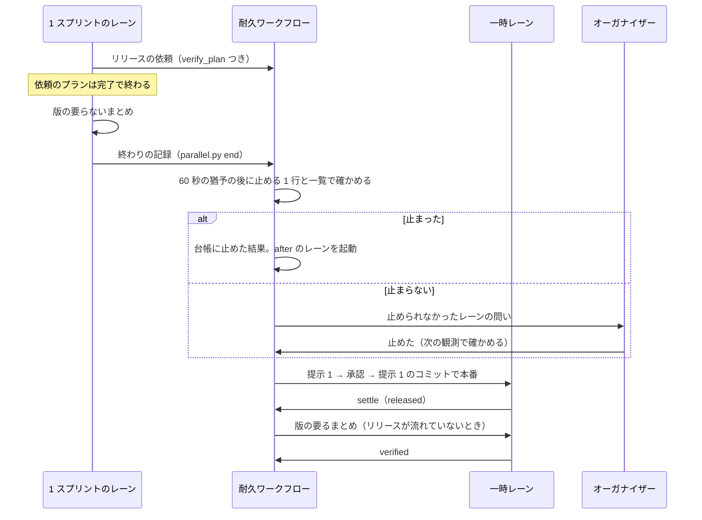
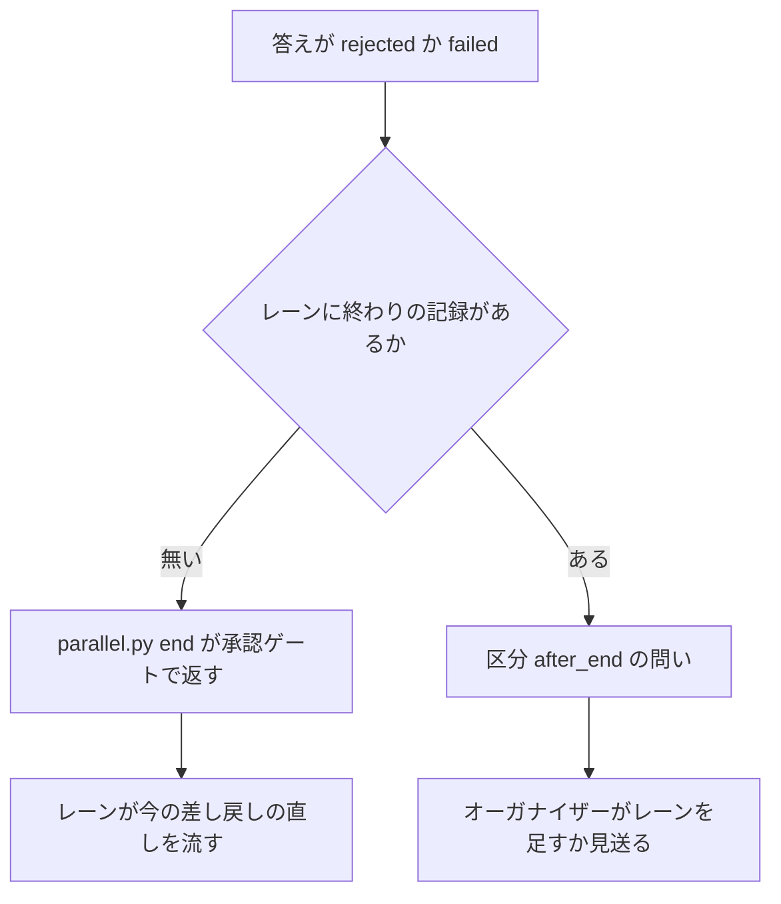
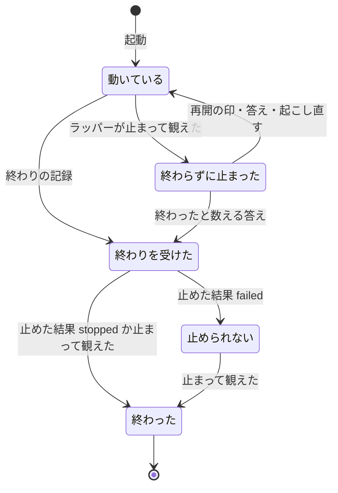

# 並列の計画: 1 スプリントのレーンがリリースを待たずにまとめへ進み、耐久ワークフローに止められ、承認した範囲のまま出る（#3058 #3060 #3070）

## 目的

- **今どうなっているか**: 1 スプリントのレーンはリリースの依頼を送った後、答えが届くまで何もせずに待ち、まとめの後に止まるかは conductor の判断に任されている。止まらないと、`after` でそのレーンを待つレーンが起動しない。まとめたリリースは、承認の答えの時点で `develop` が進んでいると同じリリースを出し直しの提示でもう一度問う（計画 p5 で 6 回のうち 3 回）
- **誰に効くか**: 並列の計画を回すオーガナイザーと、リリース承認ゲートで答える利用者
- **変えると何が成り立つか**: レーンは依頼の直後に版の要らないまとめを流して終わり、耐久ワークフローがそのラッパーを止め、待っていたレーンが起動する。リリース後テストと課題を閉じる作業は、出した版の上で一時レーンが流す。承認したリリースは承認したコミットのまま出て、同じリリースを 2 度問わない

## 適用範囲

- **働く範囲**: 並列の計画（`--parallel <計画名>`）を動かすすべてのリポジトリ。計画の外のスプリントと、外のオーガナイザー（`NDF_ORGANIZER_DIR`）のレーンの振る舞いは変えない
- **プロジェクトごとに違うもの**: リリースの経路（`.ndf/supervise.json` の `release.form` と `.ndf/project.json` の `delivery`）。新しい設定は足さない
- **当たるモード**: `standard`（レーンの中のスプリントのモードは問わない）

## あるべき姿の根拠

| 根拠 | 種類 | 何を示すか |
| --- | --- | --- |
| 「レーンを終了させるのは耐久ワークフローの責務とし、耐久ワークフローで止められなかった場合はオーガナイザーが終了させるものとします。」（#3058、2026-11-12） | 利用者の指示の原文 | 止める主体を耐久ワークフロー、予備をオーガナイザーにする |
| 「リリースの完了を待つ必要なくないですか？ ルールを変更してください」（#3060、2026-11-12） | 利用者の指示の原文 | 版の要らない作業はリリースを待たない |
| 「この出し直しが毎回発生しているのを直したい」（#3070、2026-11-12） | 利用者の指示の原文 | 承認の後に `develop` が進んだことで出し直しを起こさない |
| 計画 p5 のリリース 6 回のうち 3 回（1・4・6）で提示 2 が作られた（`.ndf/parallel/p5/releases/<n>/2/`） | 実測 | 出し直しの判定が並列の計画の通常の流れで起きる |
| STD1（ジョブの終わりは完了の条件で決まり、片付けは別の主体が行う）・STD3（リリースブランチを切った後の変更は次のリリースへ入る） | 外部の一次情報 | 終わりの記録と止める主体を分ける形、承認したコミットから切る形 |

要求と受け入れ条件は #3058 の本文にある（コピーは [issue-3058-requirements.md](issue-3058-requirements.md) ）。#3060 と #3070 の受け入れ内容は、その B と C に含まれている。この文書は「どう作るか」だけを扱う。

## ドメインモデル

### コンテキスト

| コンテキスト | 何の語が 1 つの意味に決まるか |
| --- | --- |
| NDF の開発ワークフロー（`ndf-workflow`） | レーン・まとめ・終わりの記録・まとめたリリース・一時レーン。並列の計画の語はすべてここにある |

1 つのコンテキストに収まるため、コンテキストマップの関係は宣言しない。

### 集約

| 集約 | 持ち主（書き換えてよいもの） | 根 | エンティティ | 値オブジェクト |
| --- | --- | --- | --- | --- |
| 計画の進行 | 耐久ワークフロー（`parallel.py run`） | 計画の進行 | レーン・まとめたリリース・受けている依頼・版の要るまとめの待ち | 終わりの記録・止めた結果・承認したコミット |
| スプリントの目録 | `supervise.py new sprint` | 目録（`sprint.json`） | ステージ | まとめのプランのパス・版の要るまとめのプランのパス |

計画の進行の外の書き手（レーン・一時レーン・オーガナイザーの CLI）は、計画の台帳（`ledger.jsonl`）へ行を足して耐久ワークフローへ知らせるだけで、状態を書き換えない。目録はレーンの conductor が読み、書き換えない。

### 不変条件

| # | 集約 | 条件 | 破れたときの扱い |
| --- | --- | --- | --- |
| I1 | 計画の進行 | 終わりの記録はレーン 1 本につき最初の 1 件だけが効く。1 スプリントのレーン以外からの終わりの記録は状態を変えない | 後の記録とレーンの種類が違う記録は読み捨て、実行の記録（`run.log`）へ警告を残す |
| I2 | 計画の進行 | 新しい記録の計画では、1 スプリントのレーンを `after` の依存で「止まった」と数えるのは、終わりの記録があり、ラッパーが止まって観えたときだけである | 終わりの記録の無い停止は起動の判定から外す（A5） |
| I3 | 計画の進行 | 終わりの記録のあるレーンへ止める 1 行を打つのは、耐久ワークフローの作り直しを越えて 1 回だけである | 止めた結果をチェックポイントと台帳の行の両方に持ち、どちらかがあれば打たない |
| I4 | 計画の進行 | 止められなかったレーンの問いは、そのレーンが止まって観えるまで答え待ちの依頼から消えない | 答えが届いても、次の観測で動いて観えれば同じレーンの問いを立て直す |
| I5 | 計画の進行 | 新しい記録の計画では、承認したリリースの範囲は提示 1 のコミットまでで、承認の答えの時点の `develop` の先頭で変わらない | 提示 2 を作らない。古い記録の打ち直しは今の道を通す |
| I6 | 計画の進行 | 版の要るまとめは `released` で答えた依頼についてだけ流れ、待ちが残る間は計画を終えない | 待ちが残れば終わりの判定を偽にする |
| I7 | 計画の進行 | 一時レーンは同時に 1 本までである。リリースを流す一時レーンと版の要るまとめを流す一時レーンを同時に起動しない | 片方が動いている間は、もう片方の起動を耐久ワークフローの次の観測の後へ送る |
| I8 | スプリントの目録 | 版の要らないまとめのプランは課題を閉じるステップを持たない。課題を閉じるのは版の要るまとめのプランか、本番をレーンの中で流し終えた経路のまとめのプランだけである | 目録を組む時点で検査し、課題を閉じるステップがあれば組まずに止まる |
| I9 | 計画の進行 | 差し戻し（`rejected`）と失敗（`failed`）の答えは失われない。レーンが終わる前ならレーンへ、終わった後ならオーガナイザーへの問いとして届く | 終わりの記録を送る CLI が答えを確かめ、差し戻しがあれば記録を書かずに承認ゲートで返す |
| I10 | 計画の進行 | 開発ループのレーンと一時レーンの最初の入力・終わり方・止め方は変わらない | 今のテストが落ちる |

### ドメインイベント

| # | イベント | 発生元 | 受け手 |
| --- | --- | --- | --- |
| E1 | レーンがリリースの依頼を送った | 1 スプリントのレーン（依頼のプラン） | 耐久ワークフロー |
| E2 | 耐久ワークフローがリリースの範囲を決め、承認資料を作った（提示 1） | 耐久ワークフロー・一時レーン | オーガナイザー |
| E3 | レーンが版の要らないまとめを流し切った | 1 スプリントのレーン（まとめのプラン） | 同じプランの終わりの記録のステップ |
| E4 | 終わりの記録が書かれた | 1 スプリントのレーン（`parallel.py end`） | 耐久ワークフロー |
| E5 | 耐久ワークフローが終わりの記録を観測し、レーンのラッパーを止めた | 耐久ワークフロー | 計画の台帳 |
| E6 | 耐久ワークフローが止められなかったことを問いで返し、オーガナイザーが止めた | 耐久ワークフロー → オーガナイザー | 耐久ワークフロー（答えと次の観測） |
| E7 | レーンが終わったと数えられ、`after` で待つレーンが起動した | 耐久ワークフロー | 待っていたレーン |
| E8 | 利用者がリリース承認ゲートで承認した | オーガナイザー | 耐久ワークフロー |
| E9 | 承認したコミットのまま本番へ入った（`released`） | 一時レーン（`parallel.py settle`） | 耐久ワークフロー・依頼したレーン |
| E10 | 版の要るまとめが出した版の上で流れた | 一時レーン（`parallel.py verified`） | 耐久ワークフロー |
| E11 | リリースが `rejected` で答えられた | 耐久ワークフロー | レーン（終わる前）かオーガナイザー（終わった後） |
| E12 | 加わった範囲が次のリリースの範囲に入った | 耐久ワークフロー | 次のリリースで答えを受けるレーン |

### 用語

| 用語 | 意味 | 用語集への反映 |
| --- | --- | --- |
| 一時レーン | 持ち主のいない共有の作業（まとめたリリースプランの実行・その失敗の対応・止まったレーンの保留したループの 1 回の残り・`released` の後の版の要るまとめ）のために耐久ワークフローが起動するラッパー。同時に 1 本まで | 意味の変更（版の要るまとめを足す） |
| 出し直しの提示 | まとめたリリースで、承認の答えの時点でベースブランチが進んでいたとき、加わった範囲を添えて同じリリース承認ゲートをもう 1 回出す提示。この版より前に始めた計画の記録の打ち直しでだけ現れ、新しく始めた計画では出さない | 意味の変更 |
| 加わった範囲 | 提示 1 で承認したコミットから承認の答えの時点のベースブランチの先頭までに入った変更。新しく始めた計画では今のリリースに入らず、次のリリースの範囲に入る | 意味の変更 |
| 止められなかったレーンの問い | 終わりの記録のあるレーンを耐久ワークフローが止められなかったときに立てる問い（区分 `halt`）。止める 1 行を持ち、レーンが止まって観えるまで消えない | 追加 |
| 終わりの記録の無い停止の問い | 1 スプリントのレーンが終わりの記録も答え待ちも無いまま停滞の区切りより長く止まって観えたときに立てる問い（区分 `unended`） | 追加 |

## 外部の調査

| 種類 | 調べるか | 理由 |
| --- | --- | --- |
| 標準・仕様 | 調べる | 「仕事の終わり」と「実行の単位を止める主体」を分ける形と、リリースブランチの切り方に定着した形がある |
| 主要な製品 | 調べる | 耐久実行の製品が、親が終わった後の子の扱いをどう決めているかを比べる |
| ライブラリとサービス | 調べる | 既に依存している耐久実行のライブラリ（DBOS）で、メッセージの一度だけの届けと、動いている実行の記録の版の扱いを確かめる |

### 標準・仕様

| # | 標準・仕様 | 何を定めているか | 設計への反映 | 出典 |
| --- | --- | --- | --- | --- |
| STD1 | Kubernetes の Job | 成功した Pod の数が完了数に達すると Job に `Complete` の条件が付く。"When a Job completes, no more Pods are created, but the Pods are usually not deleted either." 片付けは利用者か TTL の制御が行う | 終わり（終わりの記録）を仕事の側が宣言し、止めるのは別の主体（耐久ワークフロー）にする | https://kubernetes.io/docs/concepts/workloads/controllers/job/ （2026-11-12） |
| STD2 | Kubernetes の TTL-after-finished | Job が `Complete` か `Failed` になってからタイマーを始め、期限の後に "it will delete it cascadingly" | 終わりの記録から猶予（60 秒）を置いて止める | https://kubernetes.io/docs/concepts/workloads/controllers/ttlafterfinished/ （2026-11-12） |
| STD3 | git-flow のリリースブランチ | "Release branches are created from the `develop` branch." 切った後の変更は "must be merged into `develop`, and therefore, wait for the next big release." リリースブランチは `master` と `develop` の両方へ戻す | 承認したコミットから `release/v<版>` を切り、加わった範囲は次のリリースへ回す | https://nvie.com/posts/a-successful-git-branching-model/ （2026-11-12） |

### 主要な製品

| # | 製品 | どう解いているか | 設計への反映 | 出典 |
| --- | --- | --- | --- | --- |
| PRD1 | Temporal の Parent Close Policy | 親のワークフローが閉じたときの子の扱いを TERMINATE（既定）/ ABANDON / REQUEST_CANCEL で子ごとに決める | レーン（子）の止め方は計画の進行（親）が決め、レーンの側の判断にしない。ABANDON に当たる「止めずに残す」は採らない | https://docs.temporal.io/parent-close-policy （2026-11-12） |

### ライブラリとサービス

| # | 候補 | 版 | ライセンス | 最後のリリースの日付 | 終了のアナウンス | 要件を満たすか | 出典 |
| --- | --- | --- | --- | --- | --- | --- | --- |
| LIB1 | DBOS（Python）のメッセージとイベント | 3.1.0（`uv.lock`） | MIT | 確かめていない | 無し | 満たす。"All messages are persisted to the database"、ワークフローの中から送るときは "exactly-once delivery"。外から送るときは冪等のキーが要る（台帳の `key` がこれに当たる） | https://docs.dbos.dev/python/tutorials/workflow-communication （2026-11-12）、`uv.lock` |
| LIB2 | DBOS の patching | 3.1.0 | MIT | 確かめていない | 無し | 満たす。`DBOS.patch()` は新しい実行で真、古い実行の打ち直しで偽を返す。動いている計画の途中の入れ替えをこの印で分ける | https://docs.dbos.dev/python/tutorials/upgrading-workflows （2026-11-12） |

### 確かめられなかったこと

| 対象 | 試した手段 | 結果と理由 |
| --- | --- | --- |
| Kubernetes の Job のページの後半（約 27,000 文字） | https://kubernetes.io/docs/concepts/workloads/controllers/job/ の取得 | 取得の結果が要約され、後半を読めていない。反映した記述は前半と TTL のページにある |
| DBOS の最後のリリースの日付とライセンスの原文 | 試していない | 依存の版（`uv.lock`）だけを確かめた。ライセンスはリポジトリの依存の記録の値 |

調べた量: 候補 6 件・取得の試み 7 回。

## 機能一覧

| # | 機能 | 誰が使うか |
| --- | --- | --- |
| F1 | 1 スプリントのレーンの目録に、本番の後のまとめのステージが組まれる | レーンの conductor |
| F2 | リリースの依頼を送ったレーンが、答えを待たずに版の要らないまとめを流す | レーンの conductor |
| F3 | 版の要らないまとめの最後に終わりの記録を送り、レーンが終わる | レーンの conductor |
| F4 | 耐久ワークフローが終わったレーンのラッパーを止め、止めた結果を台帳に残す | 耐久ワークフロー |
| F5 | 止められなかったレーンを、止める 1 行を添えた問いでオーガナイザーへ返す | オーガナイザー |
| F6 | 終わったレーンを待つレーンが起動する | 耐久ワークフロー |
| F7 | `released` の後に、一時レーンが版の要るまとめ（リリース後テスト → 課題を閉じる）を流す | 耐久ワークフロー・一時レーン |
| F8 | 差し戻しと失敗の答えを、レーンの終わりの前後で失わずに届ける | レーンの conductor・オーガナイザー |
| F9 | 承認したリリースを承認したコミットのまま出し、出し直しの提示を出さない | 利用者・オーガナイザー |
| F10 | 終わりの記録の無いまま止まったレーンを問いで知らせる | オーガナイザー |

## 構成要素

| 要素 | 責務 |
| --- | --- |
| 目録の組み立て（`supervise_lib/sprint.py`） | 1 スプリントのレーンのとき、本番の後にまとめのステージを足す。依頼の経路では依頼のプランへ版の要るまとめのプランのパスを渡す |
| レーンのまとめのプラン（`supervise_lib/sprint_lane_close.py`、新設） | 版の要らないまとめのプラン・版の要るまとめのプラン・本番を流し終えた経路のまとめのプランを組む。どれも最後のステップ以外は今のまとめのステップを使い回す |
| 依頼のプラン（`lib/parallel_release.py` の `plan_release_request`） | 1 スプリントのレーンでは、依頼を送った後の承認ゲート（終了コード 10）をプランの完了へ向け、続きのステージへ進める |
| レーンの CLI（`parallel.py` の `end`・`request --verify-plan`・`verified`） | 終わりの記録・版の要るまとめの依頼・版の要るまとめの結果を台帳へ書いて耐久ワークフローへ送る |
| レーンの開始の入力（`lib/parallel_plan.py` の `Lane.start_command`） | 1 スプリントのレーンの開始の 1 行へ「-- 終わり:」を足す |
| レーンの終わり（`lib/parallel_end.py`、新設。`_Run` が継ぐ） | 終わりの記録の受け取り・猶予の後の停止・止められなかったレーンの問い・終わりの記録の無い停止の問い・依存の判定で終わったと数える集合 |
| 版の要るまとめの待ち（`lib/parallel_end.py`） | `released` の依頼から待ちを作り、一時レーンを 1 本ずつ起動し、結果で待ちから外す。差し戻しと失敗の答えを終わったレーンの問いにする |
| 計画の進行（`lib/parallel_run.py` の `_Run`） | 観測ごとに打つ手順の並びにレーンの終わりと版の要るまとめを足す。承認の答えで出し直しの判定をしない（新しい記録） |
| 計画の台帳（`lib/parallel_ledger.py`・`contracts/forms/parallel-ledger.json`） | 行の種類 `lane_end`・`lane_halt`・`verify`・`verified` を足し、チェックポイントへ版の要るまとめの待ちを持つ |
| 一時レーンの組み立て（`lib/parallel_helper.py`） | 版の要るまとめを流す一時レーンの入力（`--parallel-helper <計画名> verify <依頼>`）と流すもの |
| 依頼の形（`contracts/forms/parallel-request.json`） | 依頼へ任意の `verify_plan` を足す |
| 手順書（`skills/development-workflow/references/parallel.md`） | まとめたリリース・一時レーン・レーンの側・止める・異常のときの節を、この設計の規則で書き直す |



開始の入力と依頼の形と手順書は、レーンの conductor が読む文書と契約で、図の要素へは描かない。

### パッケージ・モジュール構成

```text
plugins/ndf/
├── contracts/forms/
│   ├── parallel-ledger.json        （行の種類を足す）
│   └── parallel-request.json       （verify_plan を足す）
├── scripts/
│   ├── parallel.py                 （end・verified・request --verify-plan）
│   ├── lib/
│   │   ├── parallel_end.py         （新設）
│   │   ├── parallel_helper.py
│   │   ├── parallel_lane.py
│   │   ├── parallel_ledger.py
│   │   ├── parallel_plan.py
│   │   ├── parallel_release.py
│   │   ├── parallel_run.py
│   │   └── README.md               （索引に 1 行）
│   └── supervise_lib/
│       ├── sprint.py
│       └── sprint_lane_close.py    （新設）
└── skills/development-workflow/references/parallel.md
```

## 構造



レーン 1 本の状態（`lanes[<レーン>]`）に足す値:

| 値 | 意味 | 空のとき |
| --- | --- | --- |
| `ended` | 終わりの記録の時刻（UTC）と書き手（レーン名か `organizer`） | 終わりの記録が無い |
| `halt` | 止めた結果（時刻・`stopped` / `failed`・止める 1 行の終了コード・観えた状態） | まだ止めていない |

## データ構造

計画の台帳は足すだけの行の記録（事象の記録）で、チェックポイントは導いた状態を置き換える。この形は変えない。既存の行は変えず、足した種類の行を古い版の読み手は知らない種類として反映せずに残す（台帳の今の規則）。レーン 1 本は終わりの記録と止めた結果をそれぞれ 0 か 1 件持ち、依頼 1 件は版の要るまとめの待ちを 0 か 1 件生む。足す行の種類:

| 行の種類 | 書き手 | `key` | `msg` の値 | 状態への反映 |
| --- | --- | --- | --- | --- |
| `lane_end` | レーンの CLI（`parallel.py end`）。区分 `unended` の問いへの「終わったと数える」の答えの行も、耐久ワークフローが同じ値へ反映する | `lane_end:<レーン>` | `lane`・`by`・`at` | `lanes[<レーン>].ended`（最初の 1 件だけ。I1） |
| `lane_halt` | 耐久ステップ（止める 1 行の後） | `lane_halt:<レーン>` | `lane`・`result`（`stopped` / `failed`）・`code`・`state`・`at` | `lanes[<レーン>].halt` |
| `verify` | レーンの CLI（`request` が「既に本番にある」で依頼を送らないとき） | `verify:<依頼>` | `id`・`lane`・`plan`・`version` | 版の要るまとめの待ちへ足す |
| `verified` | 一時レーンの CLI（`parallel.py verified`） | `verified:<依頼>` | `id`・`result`（`完了` / `失敗`）・`at` | 待ちから外す |

| 依頼の値（`parallel-request.json`） | 型 | 空を許すか | 意味 |
| --- | --- | --- | --- |
| `verify_plan` | 文字列（絶対パス） | 許す | 版の要るまとめのプランのファイル。空は「レーンの中で本番を流し終えた経路」か開発ループのレーンで、版の要るまとめの待ちを作らない |

| チェックポイントの値 | 意味 |
| --- | --- |
| `verifies` | 版の要るまとめの待ち（`id`・`lane`・`plan`・`version`・`release`）。先に入ったものから流す |
| `verifying` | 流している待ちの `id`。空は流していない |

| 機能 | 終わりの記録 | 止めた結果 | 版の要るまとめの待ち | 依頼 |
| --- | --- | --- | --- | --- |
| F3 終わりの記録を送る | C | — | — | R |
| F4 止める | R | C | — | — |
| F5 止められなかった問い | R | R | — | — |
| F6 依存の判定 | R | R | — | — |
| F7 版の要るまとめ | — | — | C・U・D | R |
| F8 差し戻しの届け | R | — | — | R |
| F10 終わりの記録の無い停止の問い | R・C（答え） | — | — | — |

## 入出力の契約

| 名前 | 入力 | 出力 | 失敗の形 | 互換性 |
| --- | --- | --- | --- | --- |
| `parallel.py end <計画> --lane <レーン> [--request <依頼の記録>]` | 計画名・レーン名・依頼の記録のパス（依頼の経路だけ） | 成功: `status: ok`、要約 `[ndf-parallel] lane-end <計画> <レーン>`、台帳に `lane_end` の行 | 依頼の答えが `rejected` / `failed`: `status: gate`・終了コード 10・`reason`、行を書かない。計画が動いていない: `status: stopped`・1。外のオーガナイザーのレーン: `status: ok`・行を書かない | 新設 |
| `parallel.py request ... --verify-plan <パス>` | 今の引数に版の要るまとめのプランのパスを足す | 依頼に `verify_plan` が載る。既に本番にあるときは `verify` の行を送り、今の `released` を返す | 今のとおり | 足すだけ。省いたときは今と同じ |
| `parallel.py verified <計画> <依頼> --done <D>` | 版の要るまとめの queue の結果 | `status: ok`、台帳に `verified` の行 | 結果を読めない: 2 | 新設 |
| 1 スプリントのレーンの開始の 1 行 | — | `/goal /ndf:development-workflow #<課題> -- 終わり: [ndf-parallel] lane-end <計画> <レーン> の行を出したとき` | — | 足すだけ。開発ループのレーンは変えない |
| `wait` の結果の問い（区分 `halt`） | — | `lane`・`question`・`options: ["止めた"]`・`commands: {"止めた": "python3 <relay.py> stop <レーン>"}`・`attach` | — | 問いの区分を足すだけ |
| `wait` の結果の問い（区分 `unended`） | — | `lane`・`options: ["終わったと数える", "起こし直す", "待つ"]` | — | 同上 |
| `wait` の結果の問い（区分 `after_end`） | — | `lane`・`release`・`result`・`reason`・`options: ["レーンを足して直す", "見送る"]`。「レーンを足して直す」には `lane add` の手順を添える | — | 同上 |
| 目録（`sprint.json`）のまとめのステージ | — | `名前: "まとめ"`、`plans` に版の要らないまとめ（依頼の経路）かまとめ（ほかの経路）のプラン 1 本、`then_of` は本番と同じ先頭 | — | ステージを足すだけ。今のキーは変えない |

## 処理の流れ



差し戻しと失敗の流れ:



1 スプリントのレーンの状態（耐久ワークフローから観たもの）:



`終わった` から `動いている` へ戻る遷移は無い。終わった後の差し戻しは、レーンを起こし直さずにオーガナイザーへの問いにする（決定 5）。

## 非機能の実現方式

| 大項目 | 要求の条件 | 実現方式 | 確かめ方 |
| --- | --- | --- | --- |
| 可用性 | 耐久ワークフローを作り直しても、止めたことの記録（A2）を読み直し、同じレーンへ止める 1 行を打ち直さない。止められなかった返し（A3）は、オーガナイザーが止めるまで `wait` の結果から消えない | 止めた結果を耐久ステップの戻り値・チェックポイントの `lanes`・台帳の `lane_halt` の行の 3 か所から戻す。止められなかった問いは、答えの後も次の観測で動いて観えれば立て直す | 止めた後に作り直したテストで止める 1 行が 1 回だけ打たれる。答えた後も動いて観えるテストで問いが残る |
| 運用・保守性 | 止めた・止められなかったは計画の台帳と `wait` の結果から追える。オーガナイザーが打つ 1 行は `wait` の結果にそのまま載る | 台帳の `lane_halt` の行に結果・終了コード・観えた状態を持つ。問いの `commands` に止める 1 行を載せる | 台帳の行と `wait` の結果の問いの値を読むテスト |
| 移行性 | 動いている計画の途中で入れ替わっても、終わりの記録を持たない既存のレーンが終わったと数えられずに残り続けない | 印 `parallel-lane-end` の無い古い記録は今の数え方（止まって観えれば止まった）を通す。新しい記録でも、終わりの記録も答え待ちも無いまま停滞の区切り（60 分）より長く止まった 1 スプリントのレーンは区分 `unended` の問いで知らせ、「終わったと数える」で終わりの記録を書く | 印の無い打ち直しのテストと、区切りを越えた停止のテスト |

## 決定の記録

### 決定 1: 終わりを決める者と止める者を分けるため、終わりの記録はまとめのプランの最後のステップが台帳へ書く

終わりは版の要らないまとめを流し切った時点なので、それを知るのはまとめのプラン自身である。プランの最後のステップ（`parallel.py end`）が台帳へ `lane_end` の行を書き、耐久ワークフローはその行だけを読んで止める。conductor の判断も画面の出力も通らないため、レーンの終わりがスクリプトで固定される。止める主体を耐久ワークフローに置くのは利用者の指示による。

レーンの引継ぎ文書へ印を書く形は採らない。耐久ワークフローは台帳の行とメッセージだけを入力にしており、ファイルを読む耐久ステップを足すと作り直しの材料が 2 つになる。conductor が `relay.py stop` を打つ今の形も採らない（打つかどうかが conductor の判断に残る）。

- 作り方: 自前で作る・標準に倣う
- 比べた候補: STD1 / STD2 / PRD1 / LIB1

根拠: Value 3 / Value 1（MVV 版 7）

### 決定 2: 止める途中でレーンの記録を壊さないため、終わりの記録から 60 秒の猶予を置いて止め、一覧で止まったかを確かめる

終わりの記録を書いた直後は、まとめのプランの queue がまだ結果のファイルを書いている。猶予の起点は台帳の行の時刻、比べる時刻は観測の耐久ステップの時刻で、打ち直しでも同じ道を通る。止める 1 行の終了コードが 0 か 3（既に止まっている）で、続く一覧（5 秒ごと、3 回まで）でそのレーンが止まっているか一覧に無ければ `stopped`、ほかは `failed` とする。猶予の値は設定にせず定数にする（変える理由が観測されていない）。

止める 1 行の終了コードだけで決める形は採らない。要求の前提 5 のとおり、止めた後も動いて観えることがある。

- 作り方: 自前で作る・標準に倣う
- 比べた候補: STD2 / LIB1

根拠: Value 3 / Value 13（MVV 版 7）

### 決定 3: 止められなかったレーンを人の手で確実に止めるため、止める 1 行を持つ問い（区分 `halt`）で返し、止まって観えるまで消さない

`wait` が返すものは問いの一覧とイベントで、オーガナイザーが読む経路はすでにある。問いにすれば、答え待ちの依頼として計画の終わりも止め、作り直しでも台帳から戻る。答え「止めた」の後は次の観測で確かめ、まだ動いていれば同じレーンの問いを新しい ID で立て直す。

`wait` の結果へ新しいキーを足す形は採らない。問いと別のキーにすると、オーガナイザーの手順と状況報告に新しい経路が 2 つ増える。

- 作り方: 自前で作る
- 比べた候補: PRD1 / LIB1

根拠: Value 1 / Value 11（MVV 版 7）

### 決定 4: リリース後テストを出した版の上で確実に流すため、版の要るまとめは `released` の後に耐久ワークフローが起こす一時レーンで流す

レーンは版の要らないまとめの後に終わって止まっているため、`released` を受け取れる者は耐久ワークフローだけである。一時レーンはすでに「持ち主のいない共有の作業」を流す仕組みで、起動・立ち上がりの確かめ・止まったときの問いがそろっている。版の要るまとめのプランは目録を組む時点にレーンの状態ディレクトリへ書き、そのパスを依頼に載せる。一時レーンはそのプランを `supervise.py queue` で流し、`parallel.py verified` で結果を返す。リリース後テストの失敗は今のまとめの扱い（課題を閉じずに止まる）のままで、結果は `verified` の行に残る。

終わったレーンを起こし直す形は採らない。レーンの数の上限に数えられ、`after` で起動した後続のレーンと枠を取り合う。耐久ワークフロー自身が流す形も採らない。リリース後テストは Claude の作業で、耐久ステップの中で流せない。

- 作り方: 自前で作る
- 比べた候補: PRD1 / LIB1

根拠: Value 5 / Value 13 / Value 3（MVV 版 7）

### 決定 5: 一時レーンを同時に 1 本に保つため、版の要るまとめは流れているリリースが無いときだけ起動し、その間は次のリリースを組まない

一時レーンの同時の数（1 本）はメモリの上限から来ており、版の要るまとめのために 2 本目を許すと、レーン数の上限（一時レーンは 1 本だけ超えられる）で見積もったマシンの資源の前提が崩れる。観測ごとに打つ手順の並びは「リリースを開く」の前に「版の要るまとめを起動する」を置き、リリースが流れていなければ待ちの先頭を流す。流している間は新しいリリースを開かない。待ちは先に入ったものから流す。

リリースを優先して版の要るまとめを後へ回す形は採らない。依頼が続く計画では版の要るまとめが流れず、課題が閉じない。

根拠: Value 2 / Value 5（MVV 版 7）

### 決定 6: 差し戻しを失わないため、レーンが終わる前は終わりの記録を拒んでレーンへ返し、終わった後はオーガナイザーへの問い（区分 `after_end`）にする

`parallel.py end` は終わりの記録を書く前に自分の依頼の答えを読み、`rejected` か `failed` なら記録を書かずに承認ゲート（終了コード 10）で返す。レーンは今のリリース承認ゲートの差し戻しと同じに直しを流し、版の要らないまとめで書いた確定仕様と振り返りは、直しのスプリントのまとめが上書きする。終わった後に届いた差し戻しは、耐久ワークフローが区分 `after_end` の問いでオーガナイザーへ渡す。直すにはレーンを足す（今の `lane add` の手順）。

終わったレーンを起こし直して直させる形は採らない。レーンは開始の 1 行の「終わり」をすでに満たしており、起こし直しても直しの指示が届く経路が無い。

根拠: Value 7 / Value 1（MVV 版 7）

### 決定 7: 依頼の後にレーンを止めないため、1 スプリントのレーンの依頼のプランは承認ゲートの終了コードを完了へ向ける

依頼のプランは依頼を送ると終了コード 10 で承認ゲートとして終わり、`--then` のつながりがそこで止まる。1 スプリントのレーンで組むときだけ、依頼のステップに終了コード 10 の行き先を `end` とする対応（プランの `on_exit`）を足し、プランを完了で終えてまとめのステージへ進む。開発ループのレーンは、承認ゲートで終わった依頼のプランを「リリース待ち」として読むため、今のままにする。`parallel.py request` の終了コードは変えない。

`parallel.py request` が 0 を返すように変える形は採らない。開発ループのレーンの読み方（I10）が変わる。

根拠: Value 3 / Value 5（MVV 版 7）

### 決定 8: 目録とプランの並びを 1 か所で決めるため、まとめのステージは経路ごとに中身を変え、版の要らないまとめと版の要るまとめは今のステップを分けて使い回す

| レーンの本番の経路 | まとめのステージのプラン | 版の要るまとめのプラン |
| --- | --- | --- |
| リリースの依頼（テンプレートで出す同じリポジトリ） | 確定仕様化 → Pull Request → 起動の判定 → 振り返り → 棚卸し → マージ → 終わりの記録 | リリース後テスト（控えを取る・比べるを含む）→ 課題を閉じる。一時レーンが流す |
| レーンの中で本番を流し終える（リリースの Pull Request・マージで届く・別のリポジトリ） | 今のまとめ（リリース後テストと課題を閉じるを含む）→ 終わりの記録 | 作らない |

課題を閉じるステップは版の要るまとめにだけ置き、最終工程の判定は 2 つのプランの進行の記録を読む。どちらも 1 スプリントのレーンのときだけ組み、計画の外のスプリントの目録は変えない。

根拠: Value 11 / Value 3（MVV 版 7）

### 決定 9: 承認した範囲のまま出すため、新しい記録の計画では承認の答えで `develop` の先頭と比べず、提示 1 で確定する

本番のプランはすでに提示のプランの承認したコミットから `release/v<版>` を切り、版数の衝突は `release/v<版>-sync` で解く（`docs/versioning-and-distribution.md` の「正式版を出す」）。出し直しの判定だけが答えの時点の先頭を見ている。加わった範囲の依頼は今の答えの規則（範囲の Pull Request で全部が出る依頼にだけ答える）で次のリリースへ回る。`main` へ入るのは承認したコミットまでで、`check-pr-base.sh` の条件（先頭が `origin/develop` の祖先の `release/v<版>`）をそのまま満たす。

出し直しの提示と出し直しを省く経路（`carried`）は、印 `parallel-approved-sha` の無い古い記録の打ち直しのためにだけ残し、新しい記録では通らない。手順書の「出し直しを省く条件」は、その範囲に限ると書き換える。古い記録が残らなくなった後の経路の削除は課題に起こさず、棚卸しの「使わなくなったコード」の整理に任せる（Value 6）。

- 作り方: 標準に倣う
- 比べた候補: STD3 / LIB2

根拠: Value 1 / Value 5（MVV 版 7）

### 決定 10: 動いている計画を壊さないため、数え方と確定の変更は耐久ワークフローの印で分け、終わりの記録の無い停止は問いで知らせる

印 `parallel-lane-end`（依存の判定と止める）と `parallel-approved-sha`（確定）を足し、印の無い古い記録は今の道を通す。新しい記録でも、版が入れ替わる前に組んだ目録のレーンは終わりの記録を書かない。終わりの記録も答え待ち・再開の印・起こし直しの待ちも無いまま停滞の区切り（60 分、`NDF_PARALLEL_STALL_MINUTES`）より長く止まって観えた 1 スプリントのレーンへ、区分 `unended` の問いを立てる。「終わったと数える」の答えを、耐久ワークフローが書き手 `organizer` の終わりの記録として反映する（ラッパーは止まっているので止める 1 行は打たない）。

- 作り方: ライブラリやサービスを使う
- 比べた候補: LIB2 / LIB1

根拠: Value 4 / Value 7（MVV 版 7）

## テスト設計

| 受け入れ条件・不変条件 | どの振る舞いで縛るか | どう壊したら落ちるべきか |
| --- | --- | --- |
| A1 | 1 スプリントのレーンの開始の 1 行が「-- 終わり: [ndf-parallel] lane-end <計画> <レーン>」を持ち、`parallel.py end` が台帳へ `lane_end` の行を書く | 「終わり」を外す・行を書かない |
| A2・I3 | 終わりの記録から猶予の後に止める 1 行が 1 回だけ打たれ、台帳に `lane_halt` の行が 1 行残る。作り直しの後も打たない | 猶予を見ない・作り直しで打ち直す・行を書かない |
| A3・I4 | 止める 1 行の失敗と、止めた後も動いて観える場合に区分 `halt` の問いが止める 1 行つきで立ち、止まって観えるまで消えない | 失敗を `stopped` と読む・答えで問いを消して立て直さない |
| A4・I2 | 終わりの記録があり止まって観えたレーンを待つレーンが起動する | 終わりの記録を見ない |
| A5・I2 | 終わりの記録の無いまま止まった 1 スプリントのレーンを待つレーンは起動しない | 止まって観えただけで数える |
| A6 | conductor が先に止めたレーン（止める 1 行が 3 を返す）も `stopped` として数える | 3 を失敗と読む |
| A7・I8 | 1 スプリントのレーンの目録で本番の後にまとめのステージがあり、版の要らないまとめのプランに課題を閉じるステップが無い。計画の外のスプリントの目録は変わらない | ステージを置かない・課題を閉じるステップを版の要らないまとめへ入れる・計画の外へも足す |
| A8・I10 | 開発ループのレーンの開始の 1 行・依頼のプランの承認ゲート・一時レーンの終わり方が今と同じ | 開発ループの依頼のプランへ終了コードの対応を足す |
| B1 | 1 スプリントのレーンの依頼のプランが終了コード 10 で完了になり、続きのまとめのステージへ進む | 対応を外す |
| B2・I6 | `released` の答えで版の要るまとめの待ちができ、一時レーンが流し、`verified` で待ちから外れる。待ちが残る間は計画が終わらない | 待ちを作らない・待ちを見ずに終える |
| B3・I8 | 課題を閉じるステップは版の要るまとめのプランにだけある | 版の要らないまとめで閉じる |
| B4・I9 | 終わる前の差し戻しで `end` が承認ゲートで返り行を書かない。終わった後の差し戻しで区分 `after_end` の問いが立つ | 差し戻しを見ずに記録を書く・終わった後の差し戻しを捨てる |
| B5 | 目録のまとめのステージの並びが決定 8 の表のとおり | 並びを変える |
| I7 | 一時レーンが動いている間に版の要るまとめもリリースも 2 本目を起動しない | 同時に起動する |
| C1・I5 | 新しい記録で、承認の答えの時点で `develop` が進んでいても提示 2 を作らずに提示 1 で確定する | 先頭と比べる |
| C2 | 加わった範囲の依頼が今のリリースで答えられずに残り、次のリリースで答えられる | 加わった範囲の依頼へ今のリリースで答える |
| C3 | 本番のプランが提示 1 の承認したコミットから `release/v<版>` を切る | 切る元を先頭にする |
| C4 | 印の無い古い記録の打ち直しでは今の出し直しの判定を通る | 古い記録でも判定を省く |
| C5 | 計画 p5 のリリース 6 の形（提示 1 の後にコードを含む Pull Request と開発版の版上げが入り、その後に承認）で提示 2 が作られず、提示 1 のコミットで `released` になる | 先頭と比べる |
| I1 | 2 件目の終わりの記録と開発ループのレーンからの記録で状態が変わらない | 後の記録で時刻を書き換える |
| 移行性 | 終わりの記録も答え待ちも無いまま区切りより長く止まった 1 スプリントのレーンに区分 `unended` の問いが立ち、「終わったと数える」で数えられる | 問いを立てない・答えで記録を書かない |

## 設計の結果

| 課題 | 扱い | 取り込み先 | 触るファイル |
| --- | --- | --- | --- |
| #3058 | 実装する | — | `plugins/ndf/scripts/lib/parallel_end.py`、`plugins/ndf/scripts/lib/parallel_run.py`、`plugins/ndf/scripts/lib/parallel_plan.py`、`plugins/ndf/scripts/lib/parallel_ledger.py`、`plugins/ndf/scripts/lib/parallel_lane.py`、`plugins/ndf/scripts/lib/parallel_release.py`、`plugins/ndf/scripts/lib/parallel_helper.py`、`plugins/ndf/scripts/lib/README.md`、`plugins/ndf/scripts/parallel.py`、`plugins/ndf/scripts/supervise_lib/sprint.py`、`plugins/ndf/scripts/supervise_lib/sprint_lane_close.py`、`plugins/ndf/contracts/forms/parallel-ledger.json`、`plugins/ndf/contracts/forms/parallel-request.json`、`plugins/ndf/skills/development-workflow/references/parallel.md`、`plugins/ndf/scripts/tests/test_parallel_end.py`、`plugins/ndf/scripts/tests/test_parallel_run.py`、`plugins/ndf/scripts/tests/test_parallel_plan.py`、`plugins/ndf/scripts/tests/test_parallel_carry.py`、`plugins/ndf/scripts/tests/test_sprint_lane_close.py` |
| #3060 | 取り込む | #3058 | — |
| #3070 | 取り込む | #3058 | — |

## 人へ残す判断

無し

## 未確認のまま残ること

| 項目 | 内容 |
| --- | --- |
| 猶予 60 秒の足り方 | 終わりの記録の後、まとめのプランの queue が結果を書き終えるまでの時間は測っていない。次の並列の計画で、止めた時刻とまとめのプランの結果のファイルの時刻を台帳とプランの状態ディレクトリで比べて分かる |
| 版の要るまとめが次のリリースを待たせる時間 | リリース後テストのステップの上限は 3600 秒で、流している間は次のリリースを開かない。実際の所要は計画 p5 の記録から数えていない。次の並列の計画の台帳の `verify`・`verified` の行の時刻で分かる |
| 版の要るまとめのプランのファイルが流す時点まで残るか | プランはレーンのスプリントの状態ディレクトリに置く。レーンの終わりからリリースまでの間に後片付けがそのディレクトリを消すかは確かめていない。実装のテストで後片付けの対象を確かめて分かる |
