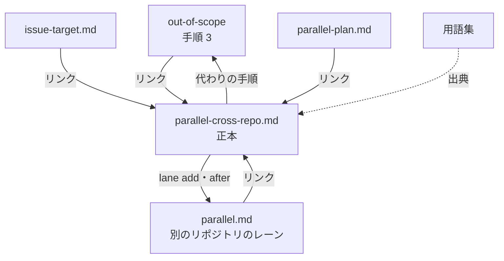
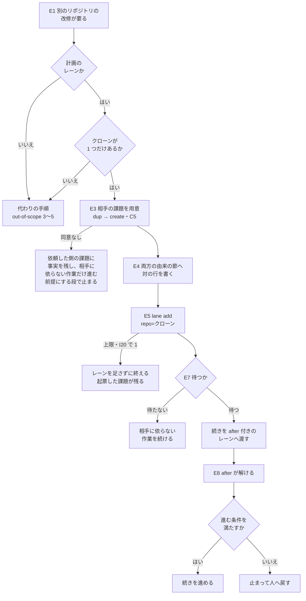

# 並列開発: 別のリポジトリの改修が要ると分かったレーンが、そのリポジトリのクローンで動くレーンを足して改修を進める（#3074）

## 目的

- **今どうなっているか**: 開発の途中で別のリポジトリ（上流の NDF など）の改修が先に要ると分かると、既定の扱いは相手のリポジトリへ範囲外の課題を起票して終わる。誰がいつ直すかが決まらず、依頼した側の設計は「相手の側の変更が先に要る」と書いたまま止まる
- **誰に効くか**: 並列の計画（`--parallel`）でレーンを動かし、同じマシンに相手のリポジトリのクローンを置いている利用者
- **変えると何が成り立つか**: 依頼した側のレーンが、相手のリポジトリへの起票（人の承認つき）に続けて、そのクローンで動くレーンを計画へ足す。相手の改修は同じオーガナイザーの下で、相手のリポジトリの規約のまま進む。依頼した側は、相手のレーンの後に起動するレーンへ続きを渡して待てる

## 適用範囲

- **働く範囲**: NDF を使うすべてのリポジトリの、並列の計画の下のレーン。並列の計画を使っていないセッションは、今の範囲外の起票（`out-of-scope` の手順 3〜5）のまま変わらない
- **プロジェクトごとに違うもの**: 相手のリポジトリとそのクローンの場所。新しい設定と引数は足さず、クローンは依頼した側のメインディレクトリと同じ親ディレクトリから、origin の URL で探す
- **当たるモード**: どのモードでも、範囲外の課題が別のリポジトリへ当たったとき（`out-of-scope` を呼ぶ工程すべて）

## あるべき姿の根拠

| 根拠 | 種類 | 何を示すか |
| --- | --- | --- |
| 「このオーガナイザーで、対象のリポジトリのクローンが置いてあるディレクトリ（例えば /work/ai-plugins）をカレントディレクトリとするレーンを起動する。この手法を NDF の並行開発機能を利用しており、他のリポジトリの改修を必要とする場合のデフォルトとして ai-plugins 自体で定義する」 | 利用者の指示の原文 | 既定の手順を「クローンを cwd にしたレーンの起動」にし、NDF の文書に定めること |
| 並列の計画の宣言の `repo` と検査の規則 `I20`（`lib/parallel_plan.py`）、耐久ワークフローがレーンのリポジトリで起動する振る舞い（#2733） | 既存の形 | 別のリポジトリでレーンを動かす仕組みはすでにあり、スクリプトを変えずに手順だけで既定にできる |
| `after` は起動に成功していないレーンだけを対象にし、答えを待って止まったレーンを「止まった」と数えない（`lib/parallel_plan.py` の `ready_lanes`、`lib/parallel_run.py` の `_spawn_ready`） | 既存の形 | 待つ形は「起動前のレーンへ `after` を付ける」に限られる |
| GitHub は `<所有者>/<リポジトリ>#<番号>` をリポジトリをまたぐ課題の参照として自動でリンクにする（STD1） | 外部の一次情報 | 対に結ぶ書き方に、GitHub の標準の参照の形を使う |

要求と受け入れ条件は #3074 の本文にある（コピーは [issue-3074-requirements.md](issue-3074-requirements.md) ）。この文書は「どう作るか」だけを扱う。

## ドメインモデル

### コンテキスト

| コンテキスト | 何の語が 1 つの意味に決まるか |
| --- | --- |
| `ndf-workflow` | 依頼した側・相手のリポジトリ・相手のレーン・別のリポジトリのレーン・代わりの手順・完全な形の参照・`after` |

1 つのコンテキストに収まる。相手のリポジトリの課題と承認ゲートは、相手のリポジトリの規約がそのまま決める。
依頼した側はその規約に順応する（順応者）。相手のリポジトリの語を依頼した側の語へ翻訳しない。

### 集約

この変更はスクリプトとデータの形を変えない。手順が触る集約と、それを書き換えてよい持ち主は次のとおりである。

| 集約 | 持ち主（書き換えてよいもの） | 根 | エンティティ | 値オブジェクト |
| --- | --- | --- | --- | --- |
| 並列の計画 | `parallel.py lane add` / `lane set`（計画の検査の規則 `I1`〜`I4`・`I19`・`I20` と上限を通ったときだけ書く） | 計画（計画名） | レーン | `repo`・`input`・`after` |
| 相手の課題 | 相手のリポジトリ。依頼した側は `issue-file.py create` の承認（C5）を通したときだけ作る | 課題（完全な形の参照） | — | 由来の節の行 |
| 依頼した側の課題 | 依頼した側のレーン（自分のリポジトリの課題の本文） | 課題（完全な形の参照） | — | 由来の節の行 |
| 正本の手順 | 新しい参照の文書 `parallel-cross-repo.md` だけ。ほかの文書はリンクだけを持つ | 文書 | — | — |

### 不変条件

| # | 集約 | 条件 | 破れたときの扱い |
| --- | --- | --- | --- |
| I1 | 正本の手順 | 手順の本文は `parallel-cross-repo.md` の 1 か所だけにあり、`out-of-scope`・`issue-target.md`・`parallel-plan.md`・`parallel.md` は手順を写さずにリンクだけを持つ | レビューで複製した段を消し、リンクへ置き換える |
| I2 | 相手の課題 | 相手のリポジトリへの起票と 1 行の書き込みは、`issue-file.py` の承認資料（終了コード 10）と `ndf-ask:redline:C5` の同意を通してからだけ行う。どの段もこれを省かない | 同意が無ければ起票せず、レーンも足さない。依頼した側の課題に事実を残し、相手の改修に依らない作業だけを進める。相手の改修を前提にする段では止まって人へ戻す（I7） |
| I3 | 並列の計画 | 相手のレーンは `parallel.py lane add` だけで足す。レーン数の上限は人の指示なしに変えない | `lane add` が 1（上限・`I20`）で終われば、レーンを足さずに代わりの手順の結果（起票した課題）で終える |
| I4 | 相手の課題・依頼した側の課題 | 対に結ぶ行は、両方の課題の由来の節に完全な形の参照で書く。ただし 2 つのリポジトリの公開の範囲が違う組（どちらの向きでも）では、公開の側の課題に非公開の側のリポジトリの名前と番号を書かない | 公開の側の課題には名前と番号の無い行を書く。依頼した側が公開なら、相手の完全な形の参照は依頼した側のレーンの引継ぎ文書へ書く |
| I5 | 相手の課題 | 相手の課題の本文に、依頼した側の規約・インフラの値・業務の情報を書かない。書くのは相手のリポジトリで直す内容だけである | C5 の承認資料を見た人が差し戻す。相手のリポジトリの漏れの検査が落とす |
| I6 | 並列の計画 | `after` は起動前のレーンにだけ付ける。動いているレーンへ `lane set` で `after` を付けて待たせない | 待てない場面（1 スプリントのレーン）は待たずに進み、相手の改修が要る段で止まって人へ戻す |
| I7 | 依頼した側の課題 | 依頼した側は、相手の改修を前提にする作業へ進む前に、進む条件（相手の課題が完了で閉じている。リリース対象を通じて使う変更なら、依頼した側の環境の版がその変更を含む）を確かめる | 満たさなければ進まず、止まって人へ戻す |
| I8 | 正本の手順 | 並列の計画を使っていないセッションの範囲外の課題の手順（`out-of-scope` の手順 3〜5）は、代わりの手順として変えない | 退行としてレビューで差し戻す |

### ドメインイベント

| # | イベント | 発生元 | 受け手 |
| --- | --- | --- | --- |
| E1 | 依頼した側のレーンが、別のリポジトリの改修が先に要ると分かった | 依頼した側のレーン（`out-of-scope` の手順 3 で起票先が別のリポジトリになった） | 正本の手順 |
| E2 | 既定の手順か代わりの手順かを選んだ | 依頼した側のレーン | 依頼した側のレーン |
| E3 | 相手のリポジトリに改修の課題が用意された | `issue-file.py create`（C5 の同意の後）か、`dup` で見つけた既存の課題 | 依頼した側のレーン |
| E4 | 依頼した側の課題と相手の課題が対に結ばれた | 依頼した側のレーン | 相手のレーン・人（課題の画面） |
| E5 | 相手のクローンを `repo` にしたレーンが計画へ足された | `parallel.py lane add` | 耐久ワークフロー（起動の候補に入れる） |
| E6 | 相手のレーンが相手のリポジトリの規約で改修を進めた | 相手のレーン | オーガナイザー（承認ゲートの依頼） |
| E7 | 依頼した側が待つか待たずに進むかを決めた | 依頼した側のレーン | 並列の計画（待つなら `after` 付きのレーン） |
| E8 | 相手のレーンが止まり、`after` の待ちが解けた | 耐久ワークフロー | 待っていたレーン（進む条件を確かめる） |

### 用語

| 用語 | 意味 | 用語集への反映 |
| --- | --- | --- |
| 相手のレーン | 依頼した側が足す、相手のリポジトリのクローンを `repo` にした別のリポジトリのレーン。相手の課題を最初の入力に持つ | 追加 |
| 依頼した側 | 作業の途中で、別のリポジトリの改修が先に要ると分かったレーンと、そのレーンが進めている課題 | 追加（要求の工程で足した。出典を正本の文書へ移す） |
| 相手のリポジトリ | 依頼した側が改修を必要とする、依頼した側と違うリポジトリ | 追加（同上） |
| 完全な形の参照 | `<所有者>/<リポジトリ>#<番号>` の形で課題を指す書き方 | 追加（同上） |
| 代わりの手順 | 既定の手順を使えないときに取る、`out-of-scope` の別のリポジトリへの起票 | 追加（同上） |

## 外部の調査

| 種類 | 調べるか | 理由 |
| --- | --- | --- |
| 標準・仕様 | 調べる | リポジトリをまたいで課題を指す書き方に、GitHub の標準の形がある |
| 主要な製品 | 調べる | 課題の依存（先に要る課題）を表す仕組みを、課題管理の製品が持っている |
| ライブラリとサービス | 調べない | 文書の手順の変更で、スクリプトと依存を足さない（前提 2） |

### 標準・仕様

| # | 標準・仕様 | 何を定めているか | 設計への反映 | 出典 |
| --- | --- | --- | --- | --- |
| STD1 | GitHub の自動リンクの参照（Autolinked references） | 課題と Pull Request は `#26`・`GH-26`・`<所有者>/<リポジトリ>#26`・URL で参照でき、会話の中で自動でリンクになる。リポジトリの中のファイルではリンクにならない | 対に結ぶ行に `<所有者>/<リポジトリ>#<番号>` を使う。番号だけの形は相手のリポジトリでは別の課題を指すため使わない | `gh api repos/github/docs/contents/content/get-started/writing-on-github/working-with-advanced-formatting/autolinked-references-and-urls.md`（2026-11-11） |

### 主要な製品

| # | 製品 | どう解いているか | 設計への反映 | 出典 |
| --- | --- | --- | --- | --- |
| PRD1 | GitHub の課題の依存（Issue dependencies） | 課題に「blocked by」「blocking」の関係を付け、`gh issue edit --add-blocked-by <番号か URL>` で書ける。ボードと一覧に「Blocked」の印が出る | 対に結ぶ形には採らない（決定 3）。リポジトリをまたぐ関係と、非公開のリポジトリから公開のリポジトリへの関係の見え方が文書に書かれていない | `gh api repos/github/docs/contents/content/issues/tracking-your-work-with-issues/using-issues/creating-issue-dependencies.md`（2026-11-11）、`gh issue edit --help`（gh 2.103.3） |

### 確かめられなかったこと

| 対象 | 試した手段 | 結果と理由 |
| --- | --- | --- |
| 課題の依存がリポジトリをまたいで付けられるか、非公開のリポジトリの課題が公開のリポジトリの課題の「Blocking」にどう見えるか | 上の PRD1 の文書を読んだ | 文書に記述が無い。実際に付けて確かめていない（付けると相手のリポジトリへ書き込むため C5 に当たる） |

調べた量: 候補 2 件・取得の試み 4 回。

## 機能一覧

| # | 機能 | 誰が使うか |
| --- | --- | --- |
| F1 | 別のリポジトリの改修が要ると分かったとき、既定の手順か代わりの手順かを判定する | 依頼した側のレーン |
| F2 | 相手のリポジトリへ課題を用意し、依頼した側の課題と対に結ぶ | 依頼した側のレーン |
| F3 | 相手のクローンを `repo` にしたレーンを計画へ足す | 依頼した側のレーン |
| F4 | 相手のレーンを待つか待たずに進むかを決め、待つなら続きを `after` 付きのレーンへ渡す | 依頼した側のレーン |
| F5 | 進む条件（相手の改修が届いたこと）を確かめてから続ける | 待っていたレーン |
| F6 | 正本の手順へ、範囲外の起票と並列の計画の文書からたどる | `out-of-scope` を読む担当・計画を書く担当 |

## 構成要素

| 要素 | 責務 |
| --- | --- |
| `plugins/ndf/skills/development-workflow/references/parallel-cross-repo.md`（新設） | 既定の手順の正本。判定・課題の用意と対の結び・レーンの追加・待つ形・進む条件・相手のリポジトリの規約・代わりの手順へ戻る 3 つの場面を持つ |
| `plugins/ndf/skills/development-workflow/references/parallel.md` | 「別のリポジトリのレーン」の節に、正本へのリンクを 1 行足す |
| `plugins/ndf/skills/out-of-scope/SKILL.md` | 手順 3 に「起票先が別のリポジトリで、並列の計画のレーンなら、先に正本を読む」の 1 行とリンクを足す。手順 3〜5 の本文は変えない |
| `plugins/ndf/skills/out-of-scope/references/issue-target.md` | 判断表の後に、並列の計画のレーンでは正本へ進む 1 行とリンクを足す |
| `plugins/ndf/skills/issue-plan-strategy/references/parallel-plan.md` | `repo` の行の後の段落に、正本へのリンクを 1 行足す |
| `docs/glossary/glossary.json`・`docs/glossary.md` | 「相手のレーン」を足し、要求で足した 4 語の出典を正本の文書へ移す（`glossary.py render`） |



## 処理の流れ

正本の手順が依頼した側のレーンに打たせる順序である。



### 手順の中身

正本の文書へ書く手順である。番号は正本の文書の段の番号になる。

1. **判定する**。次の 3 つがすべて成り立つときだけ既定の手順へ進み、どれかが成り立たなければ代わりの手順（`out-of-scope` の手順 3〜5 のまま）へ戻る
   - 並列の計画のレーンである（`NDF_RELAY_NAME` が動いている計画のレーンにある。引継ぎ文書が計画名とレーン名を持つ）
   - 相手のリポジトリのクローンが 1 つだけ見つかる。探す範囲は、依頼した側のメインディレクトリと同じ親ディレクトリの直下である。候補は次の 2 つを満たすものに限る。2 つ以上見つかったら選ばずに代わりの手順へ戻る
     - origin の URL から取った `<所有者>/<リポジトリ>` が相手と一致する
     - `git rev-parse --git-common-dir` がそのディレクトリの `.git` を返す（worktree でない）
   - 後段の `lane add` が `I20` で断らない（断られたら手順 4 で代わりの手順の結果に切り替える）
2. **相手の課題を用意する**。`out-of-scope` の手順 4（`dup`）で既存の課題を探し、あればそれを使う。無ければ手順 5（`create`）で起票する。どちらも別のリポジトリへの書き込みなので、承認資料（終了コード 10）を `ndf-ask:redline:C5` で示して同意を得てから `--approved` で打ち直す。同意が無ければ起票せず、レーンも足さない。このときは依頼した側の課題の由来の節に事実を残し、相手の改修に依らない作業だけを進め、相手の改修を前提にする段では止まって人へ戻す（I7）。相手の課題の本文には相手のリポジトリで直す内容だけを書き、依頼した側の規約・インフラの値・業務の情報を書かない
3. **対に結ぶ**。両方の課題の由来の節へ、完全な形の参照で 1 行ずつ書く
   - 相手の課題: `依頼した側: <所有者>/<リポジトリ>#<番号>`。起票するときは本文のファイルの由来の節へ書いておく（`create` は由来の節の既存の行を残す）。既存の課題なら `note` の 1 行（C5）で残す。`create` が由来の節の先頭へ入れる番号だけの行（`issue #<番号>`）は相手のリポジトリの別の課題を指す。直すのは devbasex/ai-plugins#3077 で、この手順では完全な形の行を対の結びとして読む
   - 依頼した側の課題: `相手の課題: <所有者>/<リポジトリ>#<番号>`。自分のリポジトリの課題なので `gh issue edit --body-file` で本文の由来の節を書き直す
   - 2 つのリポジトリの公開の範囲が違う組では、公開の側の課題に非公開の側の名前と番号を書かない。公開の範囲は `gh repo view <リポジトリ> --json visibility` で両方について読む
     - 依頼した側が非公開で相手が公開: 相手の課題の行を `依頼した側: 非公開のリポジトリの課題` にする
     - 依頼した側が公開で相手が非公開: 依頼した側の課題の行を `相手の課題: 非公開のリポジトリの課題` にする。相手の完全な形の参照は依頼した側のレーンの引継ぎ文書へ書き、手順 5・6 はそこから読む
4. **相手のレーンを足す**。次の宣言を `parallel.py lane p1 add --from <JSON>` で打つ（[parallel.md](../plugins/ndf/skills/development-workflow/references/parallel.md) の「レーンを足す」）。

   ```text
   {"name": <名前>, "repo": <クローンの絶対パス>, "input": {"kind": "sprint", "issues": [<相手の番号>]}, "plans": 1, "touches": []}
   ```

   上限で 1 なら上限を変えずにレーンを足さない。`I20` で 1 なら代わりの手順に切り替える。どちらも起票した課題が残るので、依頼した側の課題の由来の節にレーンを足せなかった理由を 1 行足して終える
5. **待つかを決める**。依頼した側の受け入れ条件が相手の改修なしに満たせるなら待たずに進む。満たせないなら待つ。待つ形は依頼した側の課題が今どこにあるかで決まる

   | 依頼した側の課題の場所 | 待つ形 |
   | --- | --- |
   | まだどのレーンも起動していない（起動前のレーンの課題） | そのレーンに `lane set` で `after: [<相手のレーン>]` を付ける |
   | 開発ループのレーンで動いている | `sprint-state.py loop exclude <ループ> <番号> --reason "<相手の完全な形の参照> を待つ"` で外し、`{"kind": "sprint", "issues": [<番号>]}` と `after: [<相手のレーン>]` のレーンを `lane add` で足す。`I19` か上限で足せなければ外したままにし、引継ぎ文書の「次にやること」へ進む条件を書く |
   | 1 スプリントのレーンで動いている | 待つ形を持たない。相手の改修に依らない作業を進め、相手の改修が要る段で進む条件を確かめ、満たさなければ止まって人へ戻す |

6. **進む条件を確かめる**。確かめるのは、`after` が解けて起動したレーンと、5 で止まる段に来たレーンである。`gh issue view <番号> --repo <相手> --json state,stateReason` が `CLOSED`・`COMPLETED` を返すことを確かめる。リリース対象を通じて使う変更（NDF の Skill など）なら、加えて依頼した側の環境の版がその変更を含むことを確かめる。満たさなければ進まず、止まって人へ戻す
7. **相手のレーンの規約**。相手のレーンは相手のリポジトリの設定（`.ndf/`）・課題・設計承認ゲート・リリース承認ゲート・漏れの検査で進む。承認ゲートの問いはオーガナイザーの依頼の一覧に届く（[parallel.md](../plugins/ndf/skills/development-workflow/references/parallel.md) の「別のリポジトリのレーン」）。依頼した側の規約と情報を相手のレーンの引継ぎ文書と課題へ持ち込まない

## 非機能の実現方式

| 大項目 | 実現方式 |
| --- | --- |
| セキュリティ | 相手のリポジトリへの書き込みは `issue-file.py` の承認資料と `ndf-ask:redline:C5` を通す（手順 2・3）。相手の課題へ書く内容は直す内容だけに限り、公開の範囲が違う組では公開の側の課題に非公開の側の名前と番号を書かない（I4・I5）。残りは相手のリポジトリの漏れの検査が守る |
| 運用・保守性 | 手順の本文は正本の文書 1 か所に置き、4 つの文書はリンクだけを持つ（I1） |

## 決定の記録

### 決定 1: 行数の上限を超えないため、正本を `parallel.md` ではなく新しい参照の文書 `parallel-cross-repo.md` に置く

`parallel.md` は 486 行で、手順（およそ 60 行）を足すと検査 `check-doc-line-limit.py` の上限 500 行を超える。
同じ `development-workflow/references/` に置けば、前提 1 の「並列開発の文書の近く」を満たす。
`parallel.md` の「別のリポジトリのレーン」の節からも 1 行でたどれる。

`parallel.md` の既存の節を削って収める形は採らない。この変更の範囲外の節を動かすことになる。

根拠: Value 11（MVV 版 7）

### 決定 2: 起票の承認を 1 回で済ませるため、相手の課題は依頼した側が起票する

相手のレーンの最初の入力（`{"kind": "sprint", "issues": [...]}`）は課題の番号を要るため、レーンを足す前に課題が
あると手順が 1 本で通る。依頼した側が `out-of-scope` の手順 4・5 をそのまま使えば、C5 の承認資料と同意の
仕組みが今のまま働く。

相手のレーンが自分のリポジトリで起票する形は採らない。番号の要らない最初の入力はループだけで、ループは
マイルストーンを単位にするため、課題 1 件の改修に合わない。

根拠: Value 3 / C5（MVV 版 7）

### 決定 3: 追加の書き込みを増やさないため、対に結ぶ場所を両方の課題の由来の節にする

`issue-file.py create --counterpart` が相手の課題の番号を由来の節へ書く既存の形（`issue-target.md` の
「両方にまたがる課題」）に揃える。由来の節は `retrospective` が起票した課題を辿るときに読む場所でもある。

GitHub の課題の依存（PRD1）は採らない。リポジトリをまたぐ関係と、非公開のリポジトリの課題がどう見えるかを
確かめられておらず（「確かめられなかったこと」）、付けると相手のリポジトリへの書き込みが 1 回増える。

- 作り方: 標準に倣う
- 比べた候補: STD1 / PRD1

根拠: Value 11 / Value 14（MVV 版 7）

### 決定 4: `after` の意味と食い違わないよう、待つ形を課題の場所ごとに分け、動いているレーンへ `after` を付けない

`after` は起動に成功していないレーンだけを対象にし（`ready_lanes`）、動いているレーンへ `lane set` で付けても
効かない。開発ループのレーンは課題を外す手段（`loop exclude`）を持つため、続きを `after` 付きの新しいレーンへ
渡せる。1 スプリントのレーンには動いている途中で課題を外す手段が無いため、待つ形を持たせず、進む条件を
確かめる段で止まって人へ戻す。

依頼した側のレーンを止めて `after` 付きで起こし直す形は採らない。起こし直し（`lane set` の `rule: relaunch`）は
`after` を見ずにすぐ起動する。答え待ちの停止で待つ形も採らない。他のレーンの完了を待つことは問いの区分
（`asking.md`）のどれにも当たらず、hook が問いを止める。

根拠: Value 3 / Value 13（MVV 版 7）

### 決定 5: 失敗で止まった相手のレーンでも待ちが解けるため、続きの前に進む条件を確かめる

`after` は相手のレーンが答えを待たずに止まれば解け、改修が出たかは見ない。続きのレーンは、相手の課題が
完了で閉じていること（`gh issue view` の `state`・`stateReason`）を確かめてから進む。リリース対象を通じて使う変更は、
課題が閉じても依頼した側の環境へ届くまで使えないため、版も確かめる。

相手の Pull Request のマージだけで確かめる形は採らない。課題 1 件の改修が複数の Pull Request にまたがる。

根拠: Value 13（MVV 版 7）

### 決定 6: 相手を選び違えないため、クローンは同じ親ディレクトリの直下から origin の一致で探し、1 つに絞れなければ代わりの手順へ戻る

マーケットプレイスの取得元（`~/.claude/plugins/marketplaces/`）も NDF のクローンだが、プラグインの導入元で、
開発の作業場所ではない。探す範囲を依頼した側のメインディレクトリと同じ親ディレクトリに限ると、作業用の
クローンだけが候補に残る。同じ origin のクローンが 2 つあるマシンを実測で確かめており、選ぶ規則を足さずに
戻すほうが、選び違えて別の作業場所でレーンを動かすより安い。

利用者に場所を問う形は採らない。場所の選択は問いの区分に当たらず、代わりの手順で課題は残る。

根拠: Value 4 / Value 1（MVV 版 7）

### 決定 7: 非公開のリポジトリの情報を公開のリポジトリへ出さないため、公開の範囲が違う組では公開の側の課題に非公開の側の名前と番号を書かない

受け入れ条件 3 は両方の課題へ完全な形の参照を書くことを求め、受け入れ条件 4 は依頼した側の情報を相手の
リポジトリへ持ち込まないことを求める。公開の範囲が違う組では、どちらの向きでも、非公開の側のリポジトリの名前と
課題の番号そのものが公開の側へ出る情報になる。

- 依頼した側が非公開で相手が公開: 相手の課題の行を `依頼した側: 非公開のリポジトリの課題` にし、対の結びは
  依頼した側の課題の行から辿る
- 依頼した側が公開で相手が非公開: 依頼した側の課題の行を `相手の課題: 非公開のリポジトリの課題` にし、相手の
  完全な形の参照は依頼した側のレーンの引継ぎ文書に持つ。進む条件の確かめ（手順 6）はそこから相手の課題を読む

公開の範囲は `gh repo view --json visibility` で両方について読む。

根拠: C5 / Value 7（MVV 版 7）

## テスト設計

文書の変更のため、テストのコードを足さない（`.md` の文言を照合するテストを書かない）。確かめ方はチェックスクリプトと
レビューで読む項目である。

| 受け入れ条件・不変条件 | どの振る舞いで縛るか | どう壊したら落ちるべきか |
| --- | --- | --- |
| 受け入れ条件 1・I1 | `grep -rn "別のリポジトリの改修が要るとき" plugins/ndf/skills/` で、手順の本文が `parallel-cross-repo.md` だけにあり、ほかの 4 文書はリンクの行だけが当たる | 手順の段をほかの文書へ写すと、2 か所目の本文が当たる |
| 受け入れ条件 2 | 正本の手順 1 に 3 つの判定の条件と、代わりの手順へ戻る 3 つの場面（クローンが無い・計画を使っていない・`I20`）が書かれている | 場面を 1 つ消すと、レビューで欠けが読める |
| 受け入れ条件 3・I4 | 手順 3 の行の形が両方の課題について 1 つに決まり、書く場所が由来の節だけである | 本文の別の節へ書く道を足すと、場所が 2 つになる |
| 受け入れ条件 4・I5 | 手順 2・7 に、相手のリポジトリの規約で進むことと持ち込まない情報が書かれている | 依頼した側の値を引継ぎ文書へ写す段を足すと読める |
| 受け入れ条件 5・I6 | 手順 5 の表が、`after` を起動前のレーンにだけ付ける | 動いているレーンへ `lane set` で `after` を付ける段を足すと、`ready_lanes` の振る舞いと食い違う |
| 受け入れ条件 6・I2 | 手順 2・3 の相手のリポジトリへの書き込みがすべて `--approved` の前に承認資料と `ndf-ask:redline:C5` を通る | 承認資料を飛ばして `--approved` を打つ段を足すと読める |
| 受け入れ条件 7 | `python3 scripts/check-skill-frontmatter.py`・`python3 scripts/check-markdown-links.py`・`python3 scripts/check-doc-line-limit.py`・`python3 plugins/ndf/scripts/instructions-check.py --root .` が 0 で終わる | リンク先の見出しを変える・正本を 500 行より長くすると落ちる |
| 受け入れ条件 8・I8 | `out-of-scope` の手順 3〜5 の本文の差分が、正本へのリンクの 1 行だけである | 手順 3〜5 の段を書き換えると差分に出る |
| I3 | 手順 4 が上限で 1 のときにレーンを足さず、上限を変える段を持たない | `relay.py cap` を打つ段を足すと読める |
| I7 | 手順 6 が、続きの前に課題の状態と版を確かめる | 確かめずに続きへ進む段にすると読める |

## 設計の結果

| 課題 | 扱い | 取り込み先 | 触るファイル |
| --- | --- | --- | --- |
| #3074 | 実装する | — | `plugins/ndf/skills/development-workflow/references/parallel-cross-repo.md`（新設）、`plugins/ndf/skills/development-workflow/references/parallel.md`、`plugins/ndf/skills/out-of-scope/SKILL.md`、`plugins/ndf/skills/out-of-scope/references/issue-target.md`、`plugins/ndf/skills/issue-plan-strategy/references/parallel-plan.md`、`docs/glossary/glossary.json`、`docs/glossary.md` |

## 人へ残す判断

| 判断 | 当たるレッドライン | なぜ当たるか |
| --- | --- | --- |
| 公開の範囲が違う組では、公開の側の課題に非公開の側の名前と番号を書かず、受け入れ条件 3 の両方向の結びを片方向にする（依頼した側が公開なら、相手の参照は引継ぎ文書に持つ。決定 7） | C5 | 他のリポジトリへ公開する内容の範囲を決め、受け入れ条件 3 の形を狭める |

## 未確認のまま残ること

| 項目 | 内容 |
| --- | --- |
| 依頼した側が計画の置き場と違うリポジトリのレーンのとき、そのリポジトリから `parallel.py lane add` が計画を見つけられるか | 計画の所在の一覧から見つける仕組みはあるが、別のリポジトリのレーンから `lane add` を打った実測が無い。リリース後テストで、別のリポジトリのレーンから 1 回打って確かめる |
| 正本の手順を読んだレーンが、実際に相手のレーンを足すか代わりの手順を選ぶか | 文書の変更のため、マージの前に確かめられない。リリース後テストで、別のリポジトリの改修が要る場面に当たったレーンで確かめる（要求の「検証手段」） |
