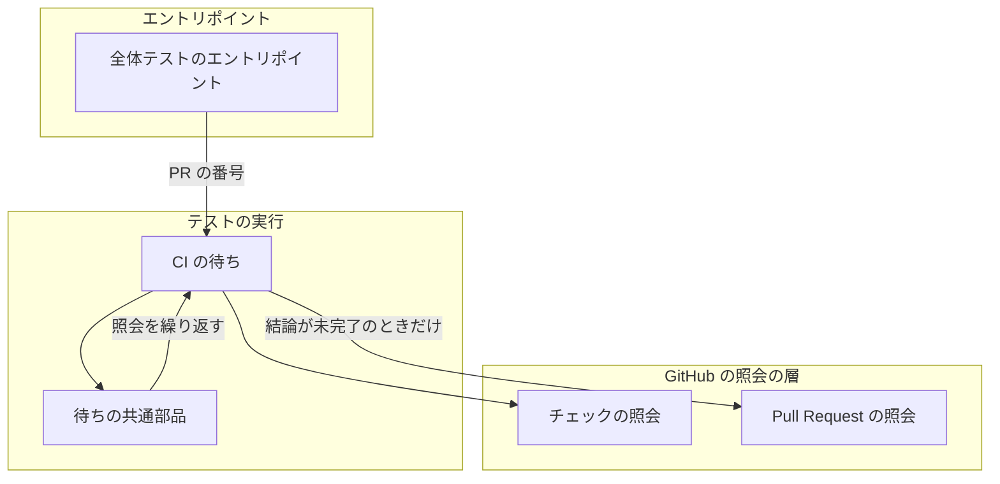
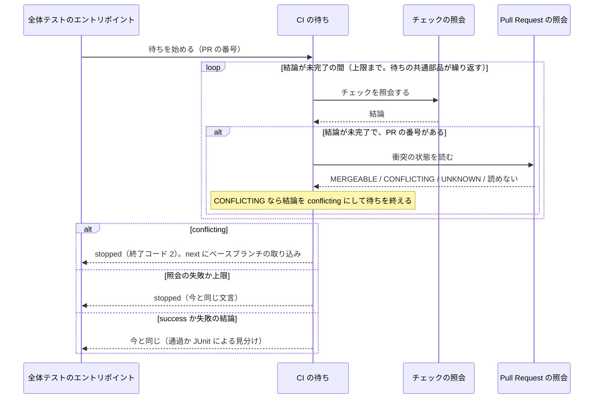

# 全体テスト: 衝突した Pull Request では上限まで待たずに止まり、ベースブランチの取り込みを示す（#3076）

## 目的

- **今どうなっているか**: ベースブランチと衝突した Pull Request でも、全体テストは CI の結論を上限（`ci_wait_timeout`）まで待つ。対象は CI に任せる戦略の全体テスト（`test-run.py whole --pr <番号>`）である。衝突した Pull Request では GitHub が `pull_request` のワークフローを起動せず、チェックが一覧に現れない。そのため待ちは「未完了」を読み続ける。2026-11-12 の PR #3069 では 40 分以上待った
- **誰に効くか**: 開発ループの全体テストのステップと、止まったレーンを読むオーガナイザーと人
- **変えると何が成り立つか**: 衝突を読んだ時点で `stopped` で戻り、結果の要約に衝突が、次の 1 手にベースブランチの取り込みのコマンドが書かれる。衝突の無い Pull Request の待ちは今と変わらない

## 適用範囲

- **働く範囲**: NDF の `test-run.py` を使うすべてのリポジトリで働く。対象は、全体テストを CI に任せる戦略（`.ndf/project.json` の `test.whole_on_ci`）で `--pr` を渡した呼び出しである
- **プロジェクトごとに違うもの**: 無し（待つチェックの名前と上限は今と同じく宣言から読む。衝突の読み方はどのリポジトリでも同じ）
- **当たるモード**: `standard`

## あるべき姿の根拠

| 根拠 | 種類 | 何を示すか |
| --- | --- | --- |
| STD2（GitHub Actions のイベントの文書） | 外部の一次情報 | 衝突した Pull Request では `pull_request` のワークフローが動かない。チェックが現れるのを待っても結論は出ない |
| STD1（GitHub の REST の Pull Request の文書） | 外部の一次情報 | 取り込めるかは Pull Request の `mergeable` で読め、`null` は計算中で、時間を置いて読み直す値である |
| PR #3069 の照会（2026-11-12） | 実測 | 同じ Pull Request で、REST の `mergeable` は `false`・`mergeable_state` は `dirty`、`gh pr view` の `mergeable` は `CONFLICTING` を返した。REST の `false` が GraphQL の `CONFLICTING` に当たる |

要求と受け入れ条件は #3076 の本文にある（コピーは [issue-3076-requirements.md](issue-3076-requirements.md) ）。この文書は「どう作るか」だけを扱う。

## ドメインモデル

### コンテキスト

| コンテキスト | 何の語が 1 つの意味に決まるか |
| --- | --- |
| テストの実行（`ndf-test`） | 全体テスト・CI に任せる戦略・CI の待ち・チェックの結論 |
| GitHub（外部の系） | 衝突の状態（`mergeable`）・チェックの実行 |

テストの実行が下流、GitHub が上流の **腐敗防止層** の関係にする。GitHub の語は REST の `mergeable` の `true` / `false` / `null` である。
Pull Request の照会の層（`lib/gh_pr_info.py`）がこれを 3 つの値（`MERGEABLE` / `CONFLICTING` / `UNKNOWN`）へ訳す。`test-run.py` はこの 3 つの値だけを読む。

### 集約

| 集約 | 持ち主（書き換えてよいもの） | 根 | エンティティ | 値オブジェクト |
| --- | --- | --- | --- | --- |
| CI の待ち | `test-run.py` の CI の待ち（`_wait_ci`） | 1 回の CI の待ち | — | 照会の結論（`success` / 失敗の結論 / `pending` / `conflicting` / 照会の失敗）・衝突の状態・待った秒・照会の回数 |

衝突の状態は GitHub が持つ値で、CI の待ちは読むだけで書き換えない。Pull Request は番号（ID）でだけ参照する。

### 不変条件

| # | 集約 | 条件 | 破れたときの扱い |
| --- | --- | --- | --- |
| I1 | CI の待ち | 衝突の状態を読むのは、`--pr` が渡され、かつその回のチェックの照会が `pending` を返したときだけで、照会 1 回につき 1 回までである | GitHub への照会が増え、受け入れ条件 5・6 と非機能の条件（性能）を破る。テストが落とす |
| I2 | CI の待ち | 衝突の状態が `CONFLICTING` のときだけ待ちを打ち切る。`MERGEABLE`・`UNKNOWN`・読めなかったときは待ちを続ける | 一時的な照会の失敗や計算中の値で、衝突の無い Pull Request が止まる。テストが落とす |
| I3 | CI の待ち | 衝突で打ち切ったときは、状態 `stopped`・終了コード 2 で戻り、要約に Pull Request の番号と衝突を、`next` にベースブランチの取り込みのコマンドを置く。JUnit による見分けへ進まない | 衝突が「落ちた」として見分けへ流れるか、次の 1 手が欠ける。テストが落とす |

### ドメインイベント

| # | イベント | 発生元 | 受け手 |
| --- | --- | --- | --- |
| E1 | 全体テストのステップが CI の待ちを始めた | `test-run.py whole --pr` の `cmd_whole` | CI の待ち（`_wait_ci`） |
| E2 | チェックを照会し、結論が未完了だった | CI の待ちの照会（`fetch`） | 同じ照会の中で衝突の状態を読む（E3） |
| E3 | Pull Request の衝突の状態を読んだ | 照会の層（`gh_pr_info.fetch_mergeable`） | CI の待ちの照会（`CONFLICTING` なら照会の結論を `conflicting` にする） |
| E4 | 衝突のため待ちを打ち切り、`stopped` で戻った | CI の待ち（`_wait_ci`） | 工程（`supervise.py queue` の全体テストのステップ。終了コード 2 を「止まった」と読む） |
| E5 | チェックの結論が出たか、上限に達した | 待ちの共通部品（`test_triage.wait_check`） | CI の待ち（今と同じ扱い） |

### 用語

| 用語 | 意味 | 用語集への反映 |
| --- | --- | --- |
| 衝突の状態 | Pull Request をベースブランチへ取り込めるかを GitHub が計算した値（`mergeable`）。`MERGEABLE`・`CONFLICTING`・`UNKNOWN` | 無し（要求で追加済み。意味は変えない） |
| CI の待ち | CI に任せる戦略の全体テストで、`test-run.py` が Pull Request のチェックの結論が出るまで照会を繰り返すこと | 無し（要求で追加済み。意味は変えない） |

## 外部の調査

| 種類 | 調べるか | 理由 |
| --- | --- | --- |
| 標準・仕様 | 調べる | 衝突した Pull Request で CI が動かないことと、衝突の状態の読み方は GitHub の仕様が決める |
| 主要な製品 | 調べない | 直す対象は NDF の待ちの判定で、他の製品の待ち方に倣う形が無い。外の振る舞いは GitHub の仕様が決め、標準・仕様で調べる |
| ライブラリとサービス | 調べる | 衝突の状態を読む手段を、既に依存している GitHub のクライアントと `gh` から選ぶ |

### 標準・仕様

| # | 標準・仕様 | 何を定めているか | 設計への反映 | 出典 |
| --- | --- | --- | --- | --- |
| STD1 | GitHub REST API の Pull Request（Get a pull request） | `mergeable` は `true` / `false` / `null`。`null` は GitHub が計算を背景で始めた状態で、時間を置いて読み直すと値が入る | `null` を `UNKNOWN` に訳し、止めずに次の照会で読み直す（決定 2・I2） | https://docs.github.com/en/rest/pulls/pulls?apiVersion=2022-11-28 （2026-11-12） |
| STD2 | GitHub Actions のワークフローを起動するイベント | 「Pull Request に衝突があると `pull_request` のワークフローは動かない。先に衝突を解く」。`pull_request_target` は衝突があっても動く | 衝突を読んだら待っても結論が出ないと判断して打ち切る（決定 1）。`pull_request_target` で動くチェックの扱いは「未確認のまま残ること」へ | https://docs.github.com/en/actions/reference/workflows-and-actions/events-that-trigger-workflows （2026-11-12） |

### ライブラリとサービス

| # | 候補 | 版 | ライセンス | 最後のリリースの日付 | 終了のアナウンス | 要件を満たすか | 出典 |
| --- | --- | --- | --- | --- | --- | --- | --- |
| LIB1 | githubkit（`lib/gh_call.py` の `rest_cached` が使う。ETag の読み直しが GitHub の API のレート制限に数えられない） | 0.16.1（このリポジトリの `uv.lock`）。最新 0.17.1 | MIT | 2026-11-06（0.17.1） | 無し | 満たす。`repos/<owner>/<repo>/pulls/<番号>` を ETag 付きで読める。githubkit が使えない環境では `gh api` へ退避する | https://pypi.org/pypi/githubkit/json （2026-11-12）、`uv.lock` |
| LIB2 | GitHub CLI の `gh pr view --json mergeable`（`lib/gh_pr_info.py` の `fetch_pr_meta` と同じ経路。GraphQL） | 手元の `gh` | MIT | 未確認 | 無し | 満たすが、照会のたびに GraphQL のレート制限を消費する | `gh pr view 3069 --json mergeable` の実行（2026-11-12） |

### 確かめられなかったこと

| 対象 | 試した手段 | 結果と理由 |
| --- | --- | --- |
| GraphQL の `MergeableState` の列挙の定義 | https://docs.github.com/en/graphql/reference/enums の取得 | HTTP 200 だが、取得した本文に `MergeableState` の語が無かった（描画で読み込む部分と推定。未確認）。値の対応は PR #3069 の実測で代える |
| GitHub CLI の最後のリリースの日付 | 試していない | 既に依存していて採らない候補のため、調べる量に入れなかった |

調べた量: 候補 4 件・取得の試み 8 回。

## 機能一覧

| # | 機能 | 誰が使うか |
| --- | --- | --- |
| F1 | 衝突した Pull Request の全体テストが、上限を待たずに止まり、衝突とベースブランチの取り込みのコマンドを返す | 開発ループの全体テストのステップ・オーガナイザー・人 |
| F2 | 衝突の状態を読めない・計算中のときは、今と同じく待ちを続ける | 同上 |

## 構成要素

| 要素 | 責務 | 変更 |
| --- | --- | --- |
| Pull Request の照会の層（`lib/gh_pr_info.py` の `fetch_mergeable`） | REST の `repos/<owner>/<repo>/pulls/<番号>` を ETag 付きで 1 回読み、`mergeable` を `MERGEABLE` / `CONFLICTING` / `UNKNOWN` へ訳す。読めなければ `None` | 新設（関数 1 つ） |
| CI の待ち（`test-run.py` の `_wait_ci`） | 照会の中で、結論が `pending` で `--pr` があるときだけ衝突の状態を読み、`CONFLICTING` なら結論を `conflicting` にする。待ちの後、`conflicting` を `stopped` の結果へ組む | 変更 |
| 全体テストのエントリポイント（`test-run.py` の `cmd_whole`） | `--pr` の値を CI の待ちへ渡す | 変更（引数を 1 つ渡す） |
| 待ちの共通部品（`lib/test_triage.py` の `wait_check`） | `pending` の間だけ照会を繰り返す。`pending` 以外の値（`conflicting` を含む）はそのまま返す | 変えない |
| チェックの照会（`lib/gh_checks.py` の `checks_outcome` と、`test_triage.gh_json` による照会） | Pull Request のコミットのチェックを読み、結論（`success` / 失敗の結論 / `pending` / 照会の失敗）を返す | 変えない |



## 構造

`OutcomeContext` などの型は変えない。変わるのは関数の引数と、照会の結論の値の集合である。

| 対象 | 変更 |
| --- | --- |
| `_wait_ci(root, ctx, base)` | `pr: int \| None` を受ける。`cmd_whole` が `a.pr` を渡す |
| 照会の結論の値の集合 | `None`・`success`・失敗の結論・`pending` に `conflicting` を足す。`conflicting` は `_wait_ci` の照会だけが作り、`gh_checks.checks_outcome` は作らない |
| `gh_pr_info.fetch_mergeable(repo, pr) -> str \| None` | 新設。戻りは `"MERGEABLE"` / `"CONFLICTING"` / `"UNKNOWN"` / `None`（照会の失敗） |

値の集合へ `conflicting` を足すため、この集合で分岐する規則を集めて判定した。呼び出し元は次の検索で探し、テスト以外の呼び出しは `test-run.py` の 2 行だけだった。

```bash
grep -rn "wait_check(\|checks_outcome(" plugins/ndf/scripts --include=*.py
```

| 規則 | 場所 | 新しい値に当てはまるか | 扱い |
| --- | --- | --- | --- |
| `pending` 以外で待ちを終え、値をそのまま返す | `test_triage.wait_check` | 当てはまる（`conflicting` で待ちを終え、そのまま返る） | 変えない |
| `None` なら「結論を得られなかった」で `stopped` | `_wait_ci` | 当てはまらない（`conflicting` は `None` でない） | `conflicting` の分岐をこの前に足す |
| `success` 以外は失敗の結論として JUnit で見分ける | `_wait_ci` | 当てはまらない（衝突を落ちたテストとして見分けてしまう） | `conflicting` の分岐をこの前に置き、見分けへ進ませない（I3） |

## 処理の流れ



衝突で止まったときの結果の形（`step_result.result` の既存の形のまま）:

| 欄 | 値 |
| --- | --- |
| `status` | `stopped`（終了コード 2） |
| `summary` | `PR #<番号> はベースブランチと衝突していて CI が起動しない（衝突の状態 CONFLICTING）。<既存の待ちの詳細: チェックの名前・コミット・待った秒・照会の回数・上限>` |
| `items` | `[{"waited_seconds": <待った秒>}]`（上限で止まったときと同じ形） |
| `next` | `python3 plugins/ndf/scripts/merged-steps.py base-sync --pr <番号>` |

## 非機能の実現方式

| 大項目 | 要求の条件 | 実現方式 | 確かめ方 |
| --- | --- | --- | --- |
| 性能・拡張性 | 衝突の状態の照会は、未完了を返したチェックの照会 1 回につき 1 回まで。衝突の無い Pull Request の CI の待ちで増える GitHub の照会はこれだけとする | 照会の関数の中で、結論が `pending` のときだけ 1 回読む。ETag 付きで読み、値が変わらなければ 304 で返る（REST のレート制限に数えられない） | 偽の照会で、`pending` を N 回返したとき Pull Request の照会が N 回以下で、最初から結論が出たとき 0 回であることをテストで数える |
| 可用性 | 衝突の状態の照会の失敗で、CI の待ちを止めない（前提 3） | `fetch_mergeable` は失敗を `None` で返し、例外を投げない。`None` のときは結論を `pending` のまま返す | 照会の失敗を差し込んで、待ちが続き次のチェックの照会へ進むことをテストで見る |

## 決定の記録

### 決定 1: 計算中や途中で生じた衝突も拾うため、衝突の状態はチェックの照会が未完了を返すたびに読む

衝突の状態は、待ちの最初に `UNKNOWN`（計算中）を返すことがあり（STD1）、待つ間にベースブランチが進んで衝突が生じることもある。
最初の未完了のときに 1 回だけ読むと、どちらの場合も上限まで待つ。照会のたびに読み、`CONFLICTING` を読んだ時点で待ちを打ち切る。
照会の回数は要求が決めた回数（照会 1 回につき 1 回まで）に収まり、ETag の読み直しでレート制限の消費も抑えられる。

待ちの前に 1 回だけ読む形は、計算中の値で衝突を見逃すため採らない。打ち切りは待ちの共通部品へ「止める条件」を足さず、
照会の結論を `conflicting` にして共通部品の「`pending` 以外で終える」規則に乗せる。共通部品の引数を増やすと、
ほかの待ちにも衝突の概念が入るためである。

- 作り方: 自前で作る・標準に倣う
- 比べた候補: STD1 / STD2

根拠: Value 1 / Value 2 / Value 5（MVV 版 7）

### 決定 2: レート制限を消費せずに繰り返し読むため、衝突の状態は REST の Pull Request を ETag 付きで読み、照会の層で 3 つの値へ訳す

`gh_call.rest_cached` は githubkit（LIB1）で ETag 付きの読み直しを行い、値が変わらなければ 304 を返す。304 は REST のレート制限に数えられない。
そのため照会のたびに読んでも、レート制限を消費するのは値が変わったときだけになる。

照会の層に新しい関数 `gh_pr_info.fetch_mergeable` を置く。この関数が REST の `mergeable` の `true` / `false` / `null` を `MERGEABLE` / `CONFLICTING` / `UNKNOWN` へ訳す。
`false` と `CONFLICTING` の対応は PR #3069 の実測で一致した。`test-run.py` は GitHub の語を読まない。

`gh pr view --json mergeable`（LIB2）は照会のたびに GraphQL のレート制限を消費し、ETag の読み直しを持たないため採らない。
GraphQL のマージの状態（`mergeStateStatus` の `DIRTY`。`gh_pr_status` が使う）は、スレッドと課題の照会と一緒に読む部品で、
衝突だけを繰り返し読む用途には照会が大きいため採らない。

- 作り方: ライブラリやサービスを使う
- 比べた候補: LIB1 / LIB2 / STD1

根拠: Value 2 / Value 9 / Value 11（MVV 版 7）

### 決定 3: 公開インタフェースを変えないため、衝突で止まったときは既存の `stopped`・終了コード 2 で返す

要求の受け入れ条件 1 と「影響」の表は、終了コードの意味を変えないことを求めている。終了コードの表には衝突を表す 4（`EXIT_BASE_CONFLICT`）がある。
これは `merge-when-green` が返し、プランのマージのステップがベースブランチの取り込みへ戻る契約である。全体テストのステップが 4 を返すと、
工程の側の読み方を変える必要が出る。衝突であることは要約に、次の 1 手は `next` に書けば、読み手は取り込みへ進める。

全体テストが 4 を返してプランを取り込みへ戻す形は、工程の契約の変更で要求の範囲（含まない: 自動で `base-sync` を打つこと）を超えるため採らない。

根拠: Value 1 / Value 3（MVV 版 7）

### 決定 4: 衝突を落ちたテストとして扱わないため、衝突で止まったときは CI の JUnit による見分けへ進まない

衝突した Pull Request では CI が動いておらず、見分ける JUnit が無い。見分けへ進めると、成果物の取得の照会が無駄に増え、
結果が「テストが落ちた」と読める。`_wait_ci` の分岐で `conflicting` を `None` と `success` より前に判定し、そこで返す。

根拠: Value 2 / Value 7（MVV 版 7）

## テスト設計

テストは 2 つのファイルに置く。

| ファイル | 確かめる振る舞い |
| --- | --- |
| `plugins/ndf/scripts/tests/test_test_run.py` | `_wait_ci` の振る舞い |
| `plugins/ndf/scripts/tests/test_gh_pr_info.py`（新設） | 訳し方 |

GitHub の照会と待ちの `sleep` は差し替え、実際の GitHub へ問い合わせない（受け入れ条件 7）。

| 受け入れ条件・不変条件 | どの振る舞いで縛るか | どう壊したら落ちるべきか |
| --- | --- | --- |
| 受け入れ条件 1・I3 | チェックの照会が `pending`、衝突の状態が `CONFLICTING` のとき、`whole --pr` が `stopped`・終了コード 2 で返り、チェックの照会は 1 回で終わる | 衝突を読まずに上限まで待つ・2 回目のチェックの照会へ進むと落ちる |
| 受け入れ条件 2・I3 | 1 の結果の `summary` に PR の番号と衝突が、`next` に `merged-steps.py base-sync --pr <番号>` が入る。JUnit の取得が呼ばれない | `next` を欠く・見分けへ進むと落ちる |
| 受け入れ条件 3・I2 | 衝突の状態が `MERGEABLE` のとき、成功なら通過・失敗の結論なら見分け・上限なら既存の文言の `stopped` | `MERGEABLE` で止める・既存の文言を変えると落ちる |
| 受け入れ条件 4・I2 | `UNKNOWN` と照会の失敗（`None`）では次のチェックの照会へ進み、その後に `CONFLICTING` を読めば止まる | `UNKNOWN` か `None` で止めると落ちる |
| 受け入れ条件 5・I1 | `--pr` を渡さないとき、Pull Request の照会が 0 回で、今と同じに待つ | `--pr` 無しで照会すると落ちる |
| 受け入れ条件 6・I1 | チェックの照会が最初から `success` か失敗の結論を返すとき、Pull Request の照会が 0 回 | 結論が出ているのに衝突を読むと落ちる |
| 非機能（性能）・I1 | `pending` を N 回返す間の Pull Request の照会が N 回以下 | 照会 1 回につき 2 回以上読むと落ちる |
| `fetch_mergeable` の訳し方 | REST の `mergeable` の `false`→`CONFLICTING`・`true`→`MERGEABLE`・`null`→`UNKNOWN`、照会の失敗→`None` | 値の対応を取り違える・失敗で例外を投げると落ちる |

## 設計の結果

| 課題 | 扱い | 取り込み先 | 触るファイル |
| --- | --- | --- | --- |
| #3076 | 実装する | — | `plugins/ndf/scripts/test-run.py`、`plugins/ndf/scripts/lib/gh_pr_info.py`、`plugins/ndf/scripts/tests/test_test_run.py`、`plugins/ndf/scripts/tests/test_gh_pr_info.py` |

## 人へ残す判断

無し

## 未確認のまま残ること

| 項目 | 内容 |
| --- | --- |
| `pull_request_target` で動くチェックを待つリポジトリ | STD2 では `pull_request_target` のワークフローは衝突があっても動く。待つチェックがそれだけのリポジトリでは、衝突で止めると結論の出るチェックを待たずに止まる。このリポジトリのワークフローは `pull_request_target` を使っていない（`grep -c pull_request_target .github/workflows/*.yml` がすべて 0、2026-11-12）。利用先のリポジトリの設定はリリース後テストで、衝突させた検証用の Pull Request に打って確かめる |
| REST の `mergeable` が `false` になるのは衝突だけか | STD1 は `false` の理由を衝突に限って書いていない。PR #3069 の実測では衝突（`dirty`）と一致した。ほかの理由で `false` になる場合があるかは、リリース後テストと運用の記録で確かめる |
