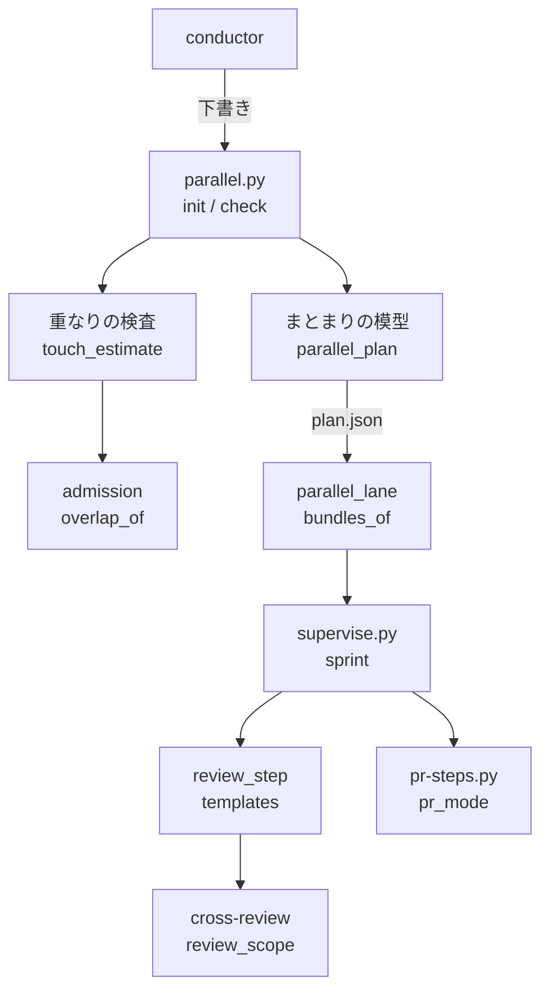
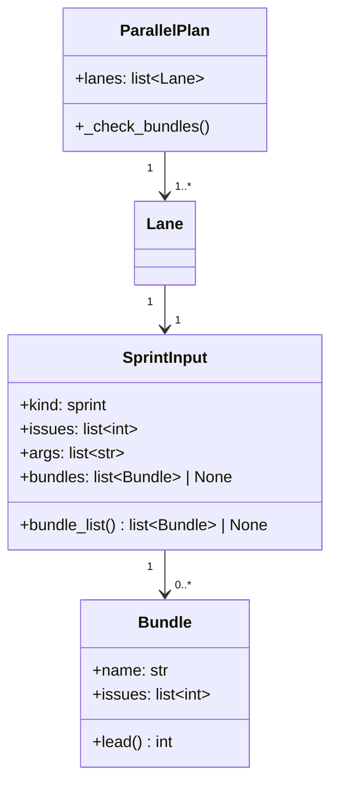
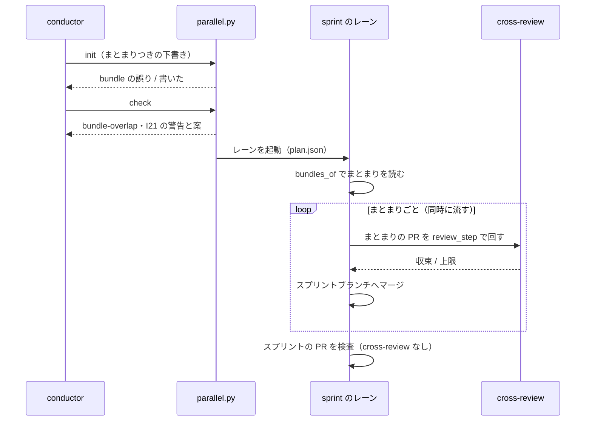
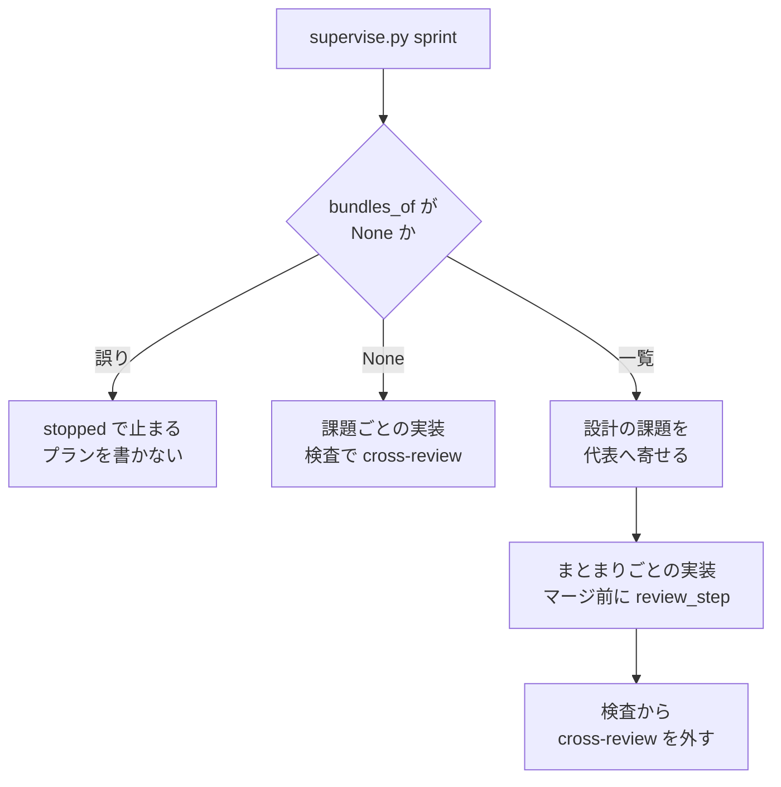

# 並列の計画: 課題のまとまりでスプリントを組み、まとまりごとにレビューする（#3081）

## 目的

- **今どうなっているか**: 並列の計画のスプリントのレーンは、テーマの似た課題で組まれる。課題の Pull Request はレビューを通さずにスプリントブランチへ集まり、スプリントの Pull Request 1 本で全差分を cross-review する。似た課題は触るファイルが重なり、実装が 1 本ずつしか流れない（lcost-1 では 480 分のあいだ 1 本。#2997 の調べ）。複数のテーマを 1 回のレビューで見るため、収束しない（lcost-1 のスプリントの Pull Request は 11 ラウンドで上限。#3050）
- **誰に効くか**: 並列の計画を作る conductor（オーガナイザー）と、計画のレーンの結果を待つ利用者
- **変えると何が成り立つか**: 似た課題は計画の時点で課題のまとまりへまとまり、まとまり 1 つが実装の Pull Request 1 本になる。同じスプリントの異なるまとまりの見込みの重なりは検査が警告し、まとまりの Pull Request はスプリントブランチへ入る前に、そのまとまりの差分だけで cross-review を回す

## 適用範囲

- **働く範囲**: NDF を使うすべてのリポジトリの並列の計画（`parallel.py`）のスプリントのレーンと、そのレーンで動くスプリント（`supervise.py sprint`）
- **プロジェクトごとに違うもの**: 無し（並列の計画の記録 `plan.json` の欄で受ける。リポジトリの設定は増やさない）
- **当たるモード**: `standard`。まとまりの記録の無いスプリント（単独のスプリント・開発ループのスプリント・まとまりの欄の無い計画のレーン）は今のまま動く

## あるべき姿の根拠

| 根拠 | 種類 | 何を示すか |
| --- | --- | --- |
| 依頼の原文の「レビューは単一内容（issue または同じ issue をまとめたもの）の範囲に限定して、かつ短い差分に対して行われる」 | 利用者の指示の原文 | レビューの単位をまとまりにする |
| 依頼の原文の「スプリント内の issue は触るファイルが異なる領域で構成され、並行に開発される」 | 利用者の指示の原文 | 同じスプリントの異なるまとまりの見込みの重なりを検査で見つける |
| STD1（小さい変更のレビュー） | 外部の一次情報 | 1 つの変更は自己完結した 1 つの内容にし、小さい変更ほど速く丁寧にレビューされる |
| STD2（Pull Request の three-dot の差分） | 外部の一次情報 | Pull Request の差分の基準は merge base で、base が進んでも topic の変更だけを示す。まとまりの差分の範囲を merge base から取る根拠 |
| lcost-1 の実測（同時に動く本数 1 本・スプリントの Pull Request 11 ラウンド） | 実測 | 今の組み方で並列と収束が成り立っていない |

要求と受け入れ条件は #3081 の本文にある（コピーは [issue-3081-requirements.md](issue-3081-requirements.md) ）。この文書は「どう作るか」だけを扱う。

## ドメインモデル

### コンテキスト

| コンテキスト | 何の語が 1 つの意味に決まるか |
| --- | --- |
| 並列の計画（`parallel`） | レーン・課題のまとまり・代表の課題・見込みの重なり |
| スプリントの進行（`sprint`） | 実装のプラン・課題の Pull Request・スプリントの Pull Request |
| 収束レビュー（`cross-review`） | レビュー範囲・ラウンド |

関係は**公開された言語**とする。並列の計画が `plan.json` の形（pydantic のモデル `ParallelPlan`）を公開し、スプリントの進行はその形のまとまりの欄を読むだけで書き換えない。収束レビューはまとまりを知らず、Pull Request の base と head からレビュー範囲を求める。

### 集約

| 集約 | 持ち主（書き換えてよいもの） | 根 | エンティティ | 値オブジェクト |
| --- | --- | --- | --- | --- |
| 並列の計画 | `parallel.py init`（conductor の下書きを検査して書く） | 計画 | レーン・課題のまとまり | 課題の番号・まとまりの名前・触る場所の見込み |
| スプリントのプランの組 | `supervise.py sprint`（組んだ時点で並列の計画を 1 度読む） | ステージの一覧 | 実装のプラン | まとまりの課題の並び |
| 収束レビューの状態 | cross-review の `state.py`（今のまま） | 状態ファイル | ラウンド | レビュー範囲（base・head・ファイル数） |

課題のまとまりは、スプリントのレーンの入力（`input`）の中に置く。まとまりがレーンをまたがないことが形で決まり、レーンを書き換えずにまとまりだけを書き換える経路ができない。

起動の前に conductor が `plan.json` を手で直すことは、今の決まりのまま認める。I1〜I3 は計画の模型（`Bundle`・`SprintInput`）の検証が守り、`init`・`check` と、計画を読む経路（`load_valid_plan`。レーンの起動・スプリントの組み立てが通る）が同じ検証を通す。レーンの判定（`parallel_lane.lane_of`）は検証に通らない計画を飛ばして「レーンでない」と返すため、スプリントの組み立てはレーンの判定に頼らず、まとまりの読み出し（`bundles_of`）が検証の失敗を「レーンでない」と区別して止める（「構成要素」の `bundles_of`）。手の直しで I1〜I3 が破れた計画は、`init`・`check`・レーンの起動・スプリントの組み立てのどれからも誤りとして止まり、まとまりの記録の無いスプリントとして黙って動くことは無い。

### 不変条件

| # | 集約 | 条件 | 破れたときの扱い |
| --- | --- | --- | --- |
| I1 | 並列の計画 | どの課題も 2 つ以上のまとまりに入らない | 検査の規則 `bundle` の誤り。`init` は書かない |
| I2 | 並列の計画 | まとまりの課題は、そのまとまりを持つスプリントのレーンの `input.issues` にある | 規則 `bundle` の誤り |
| I3 | 並列の計画 | まとまりの名前は形（英小文字・数字・`-`・`_`、32 字まで）に合い、同じレーンの中で、I4 が補う名前を含めて一意。別のレーンのまとまりとは同じ名前でもよい | 規則 `bundle` の誤り |
| I4 | 並列の計画 | まとまりの欄があるレーンで、どのまとまりにも入っていない課題は、その 1 件だけのまとまりとして扱う（名前は `issue-<番号>`） | 誤りにしない。検査とスプリントが同じ関数で補う |
| I5a | 並列の計画 | 同じスプリントのレーンの異なるまとまりの課題の見込みが重なれば、規則 `bundle-overlap` の警告を出す | 警告。終了コードは 0 のまま |
| I5b | 並列の計画 | 同じまとまりの課題どうしの見込みの重なりには、規則 `bundle-overlap` の警告を出さない | テストが落とす |
| I6 | 並列の計画 | 見込みの重なりの判定は、実装のキューと同じ `admission.overlap_of` と共有の一覧だけで行い、規則 `I21` と同じ入力に同じ組を返す | テストが落とす |
| I7 | 並列の計画 | まとまりの欄の無い計画は今と同じに読み、既存の規則（`I4`・`I19`・`I21`）の項目の欄は消さず、足すだけにする | テストが落とす |
| I8a | スプリントのプランの組 | まとまりの記録があるスプリントでは、まとまり 1 つにつき実装のプランが 1 本 | テストが落とす |
| I8b | スプリントのプランの組 | まとまりの記録があるスプリントでは、実装のプランの Pull Request はスプリントブランチへ入る前に cross-review を通す | テストが落とす |
| I8c | スプリントのプランの組 | まとまりの記録があるスプリントでは、スプリントの Pull Request の検査は cross-review を回さない | テストが落とす |
| I9 | スプリントのプランの組 | まとまりの記録の無いスプリントは、課題ごとの実装のプランと、スプリントの Pull Request の全差分への cross-review 1 回を今のまま組む | テストが落とす |
| I10 | 収束レビューの状態 | レビュー範囲の全差分の base は、PR の base のブランチの今の先頭と head の merge base である。base のブランチが進んで head に取り込まれても、他のまとまりのファイルは範囲に入らない | テストが落とす |

### ドメインイベント

| # | イベント | 発生元 | 受け手 |
| --- | --- | --- | --- |
| E1 | 計画に入れる課題をテーマから集めた | conductor | conductor（E2 の材料） |
| E2 | 似た課題を課題のまとまりへまとめた（代表の課題へ寄せた、または重複として閉じた） | conductor | `parallel.py init`（下書きの検査） |
| E3 | まとまりごとに触る場所の見込みを出した | `parallel.py check`（`touch_estimate.lane_estimates`） | 同じ検査（E5） |
| E4 | まとまりをレーンとスプリントへ割り当て、計画の記録へ書いた | `parallel.py init` | オーガナイザー（レーンの起動）・`supervise.py sprint` |
| E5 | 異なるまとまりの見込みの重なりと組み替えの案を出した | `parallel.py check` | conductor（計画を直すかを決める） |
| E6 | まとまりの Pull Request のレビューが収束した | cross-review の駆動（実装のプランのステップ） | 実装のプラン（マージへ進む） |
| E7 | スプリントの Pull Request がベースブランチへマージされた | 検査のプラン | リリースの工程 |
| E8 | 同時に動く本数とまとまりのレビューの規模を記録した | リリース後テスト（`parallel-measure.py`・cross-review の状態ファイルの集計） | #3081 の本文（受け入れ条件 7・9） |

### 用語

| 用語 | 意味 | 用語集への反映 |
| --- | --- | --- |
| 課題のまとまり | 並列の計画を作る時点で、似た課題を 1 つのレビューの単位としてまとめたもの。スプリントのレーンの入力に書き、まとまり 1 つが実装の Pull Request 1 本になる。1 件の課題だけのまとまりもある | 追加 |
| 代表の課題 | 課題のまとまりの先頭の課題。まとまりの設計文書と実装の Pull Request はこの課題の番号で作り、ほかの課題の受け入れ条件を取り込む | 追加 |
| 疎なまとまり | 触る場所の見込みが互いに重ならない、課題のまとまりの組 | 追加 |
| まとまりの単位のレビュー | 1 つの課題のまとまりの課題が変えた差分だけを範囲にした cross-review | 追加 |

## 外部の調査

| 種類 | 調べるか | 理由 |
| --- | --- | --- |
| 標準・仕様 | 調べる | 変更をレビューに出す単位の指針と、Pull Request の差分の基準を確かめる |
| 主要な製品 | 調べる | 課題の親子と重複の扱いを、利用している課題管理（GitHub Issues）がどう持つかを確かめる |
| ライブラリとサービス | 調べない | 重なりの判定と見込みの出し方は既存の関数（#2997）を使うと要求の前提 2 が決めており、課題を組へ分ける処理は conductor の判断で、新しい依存の候補が無い |

### 標準・仕様

| # | 標準・仕様 | 何を定めているか | 設計への反映 | 出典 |
| --- | --- | --- | --- | --- |
| STD1 | Google Engineering Practices「Small CLs」 | 1 つの変更は自己完結した 1 つの内容にする。小さい変更は速く丁寧にレビューされる。分け方に stacking・ファイルの組・機能の単位がある | まとまり 1 つを実装の Pull Request 1 本にし、そこでレビューする（決定 2） | https://google.github.io/eng-practices/review/developer/small-cls.html （2026-11-12） |
| STD2 | GitHub Docs「About comparing branches in pull requests」 | Pull Request の差分は three-dot（merge base と head の比較）で、base が進んでも topic の変更だけを示す | レビュー範囲の全差分を、base のブランチの今の先頭との merge base から取る（決定 6） | https://docs.github.com/en/pull-requests/collaborating-with-pull-requests/proposing-changes-to-your-work-with-pull-requests/about-comparing-branches-in-pull-requests （2026-11-12） |

### 主要な製品

| # | 製品 | どう解いているか | 設計への反映 | 出典 |
| --- | --- | --- | --- | --- |
| PRD1 | GitHub Issues の sub-issue | 親 1 件に子 100 件・8 階層まで。`gh issue edit --add-sub-issue`・`--parent` で付け外しする | 親の課題を新しく起こす形を採らない理由の材料（決定 1） | https://docs.github.com/en/issues/tracking-your-work-with-issues/using-issues/adding-sub-issues （2026-11-12）・`gh issue edit --help`（gh 2.103.3） |
| PRD2 | GitHub Issues の重複として閉じる | `gh issue close <番号> --duplicate-of <番号>`（理由 `duplicate`）で閉じ、`gh issue reopen` で開き直せる | 統合は重複として閉じる形で書く（決定 1） | `gh issue close --help`・`gh issue reopen --help`（gh 2.103.3、2026-11-12） |

### 確かめられなかったこと

| 対象 | 試した手段 | 結果と理由 |
| --- | --- | --- |
| GitHub Docs の重複の課題を閉じる説明 | https://docs.github.com/en/issues/tracking-your-work-with-issues/administering-issues/closing-duplicate-issues | HTTP 404。手元の `gh` のヘルプで機能を確かめた（PRD2） |
| REST の Pull Request の `base.sha` が base のブランチが進んだときに更新されるか | 試していない | 決定 6 はどちらでも範囲が同じになる形にしたため、確かめずに進める |

調べた量: 候補 4 件・取得の試み 6 回。

## 機能一覧

| # | 機能 | 誰が使うか |
| --- | --- | --- |
| F1 | 似た課題をまとまりへまとめる手順（代表の課題へ寄せるか、重複として閉じるかの条件） | conductor（オーガナイザー） |
| F2 | スプリントのレーンの入力にまとまりを書き、検査が形を確かめる | conductor・`parallel.py init` / `check` |
| F3 | 同じスプリントの異なるまとまりの見込みの重なりと、組み替えの案を出す | conductor・`parallel.py check` |
| F4 | まとまり 1 つを実装のプラン 1 本で流し、その Pull Request をスプリントブランチへ入れる前に cross-review する | スプリントのレーン（`supervise.py sprint`） |
| F5 | まとまりの差分だけをレビュー範囲にする | cross-review |
| F6 | 同時に動く本数とまとまりのレビューの規模を測って記録する | リリース後テスト |

## 構成要素

| 要素 | 責務 |
| --- | --- |
| まとまりの模型（`parallel_plan.py` の `Bundle`・`SprintInput.bundles`） | まとまりの形と I1〜I3 の検査。I4 の補い（`SprintInput.bundle_list()`） |
| まとまりの重なりの検査（`parallel_plan.py` の `check_data`・`touch_estimate.py` の `bundle_overlaps`） | 規則 `bundle-overlap` の項目。規則 `I21` の項目へ `bundles` の欄を足す |
| 計画の描画（`parallel_plan.py` の `render_md`） | `plan.md` にまとまりの表を足す |
| レーンのまとまりの読み出し（`parallel_lane.py` の `bundles_of`） | 動いている計画のこのレーンのまとまりの一覧を返す。レーンでなければ、まとまりの欄が無ければ None。計画の置き場の中に検証に通らない（`load_valid_plan` が `ValueError` を投げる）計画があり、その `plan.json` の生の値が次の 3 つをすべて満たせば、None を返さず誤り（`ValueError` の派生、計画の名前と検証の誤りを持つ）を投げる。`lanes[].name` にこのレーンの名前（`NDF_RELAY_NAME`）がある。そのレーンのリポジトリ（`repo`。省略時は計画の置き場）が自分のメインディレクトリ（`main`）と一致する。計画の状態（`plan_state`）が `running` か `lost` である。3 つは `lane_of` がレーンを当てる条件と同じ範囲で、閉じた計画と別のリポジトリの計画は止める理由にしない。`lane_of` の振る舞いは変えない |
| スプリントの組み立て（`supervise_lib/sprint.py`・`sprint_waves.py`） | まとまりの記録があれば、設計の課題を代表の課題へ寄せ、実装のステージをまとまりごとのプランにし、検査のプランから cross-review を外す |
| レビューのステップ（`supervise_lib/templates.py` の `review_step`） | コードレビューの cross-review のステップを 1 か所で組む。検査のプランとまとまりの実装のプランが共有する |
| レビュー範囲（cross-review の `review_lib/review_scope.py`・`commands/start_round.py`） | 全差分の base を、base のブランチの今の先頭との merge base にする |
| 手順（`issue-plan-strategy` の `references/parallel-plan.md`・`execution-plan.md`、`development-workflow` の `references/parallel-checks.md`、`pr` の SKILL.md） | まとめ方の条件・まとまりの欄・規則 `bundle-overlap` の読み方・スプリントブランチ宛てのレビューの区分 |
| 宛て先の区分（`lib/pr_mode.py`・`pr-steps.py`） | まとまりの記録のあるスプリントブランチ宛てを、レビューを通す区分として返す |



図に含めない要素: 計画の描画（まとまりの模型と同じファイルの関数）と手順の文書（コードから参照されない）。

## 構造



- `Bundle.lead()` は `issues[0]`（代表の課題）
- `SprintInput.bundle_list()` は、`bundles` が None なら None を返す。あれば、書かれたまとまりと、どのまとまりにも無い課題の 1 件のまとまり（I4）を `input.issues` の順に返す
- `LoopInput` には欄を足さない（決定 5）。`extra="forbid"` のため、ループのレーンにまとまりを書くと形の誤り（`form`）になる

## データ構造

並列の計画の記録（`plan.json`）のスプリントのレーンの入力に、任意の欄 `bundles` を足す。版（`version: 1`）は変えない。欄の無い記録は今と同じに読む（I7）。

```json
{"kind": "sprint", "issues": [3001, 3004, 3010, 3012],
 "bundles": [{"name": "review-scope", "issues": [3004, 3001]}]}
```

| 欄 | 型 | 空の扱い | 意味 |
| --- | --- | --- | --- |
| `bundles` | まとまりの配列 | 省くと「まとまりの記録なし」（今の動き）。空の配列は「すべての課題が 1 件のまとまり」 | このレーンのスプリントをまとまりの単位で組む |
| `bundles[].name` | 文字列 | 省けない | まとまりの名前（I3） |
| `bundles[].issues` | 整数の配列（1 件以上） | 省けない | まとまりの課題。先頭が代表の課題 |

上の例では、まとまりは `review-scope`（#3004・#3001。代表は #3004）・`issue-3010`・`issue-3012` の 3 つになる。

課題の集合の正本は `input.issues` のままで、`bundles` は課題をどのまとまりに入れるかの対応だけを持つ。統合で閉じた課題は `input.issues` にも `bundles` にも書かない（閉じた記録は GitHub の重複の印が持つ）。

| 機能 | `input.issues` | `bundles` |
| --- | --- | --- |
| F2 計画を書く（`init`） | 作る | 作る |
| F2・F3 検査（`check`） | 読む | 読む |
| F4 スプリントを組む | 読む | 読む |
| 起動の前の手の直し | 更新する | 更新する |

## 入出力の契約

### 検査の規則

`parallel.py init` / `check` の統一 JSON レポートの `items[]` に、規則を 2 つ足す。

| 規則 | 水準 | 出す条件 | 欄 |
| --- | --- | --- | --- |
| `bundle` | error | I1〜I3 が破れた | `level`・`rule`・`at`（例: `lanes.1.input.bundles`）・`message` |
| `bundle-overlap` | warning（`check` だけ） | 同じスプリントのレーンの異なるまとまりの課題の見込みが重なる（I5a） | `level`・`rule`・`at: "lanes"`・`message`・`lanes`（1 レーン）・`bundles`（2 つの名前）・`issues`（2 つの課題）・`paths`・`proposals` |

`bundle-overlap` の項目の例:

```json
{"level": "warning", "rule": "bundle-overlap", "at": "lanes",
 "message": "同じスプリントの異なるまとまりの課題の見込みが重なる: s1 の review-scope #3004・issue-3010 #3010（plugins/ndf/scripts/lib/parallel_plan.py）",
 "lanes": ["s1"], "bundles": ["review-scope", "issue-3010"], "issues": [3004, 3010],
 "paths": ["plugins/ndf/scripts/lib/parallel_plan.py"],
 "proposals": [{"kind": "move", "bundle": "issue-3010", "from": "s1"},
               {"kind": "after", "bundle": "issue-3010", "from": "s1"}]}
```

| 案 | 意味 |
| --- | --- |
| `move` | 後ろのまとまりを、同じ時間帯に動かない別のスプリントのレーンへ移す。移す先は conductor が決める |
| `after` | 後ろのまとまりを新しいレーンへ移し、そのレーンの `after` に `from` のレーンを足す |

規則 `I21` の項目は、2 つのレーンのどちらかにまとまりの欄があるとき、欄 `bundles`（2 つのまとまりの名前。欄の無いレーンの側は `issue-<番号>`）と、`move` の案に欄 `bundle` を足す。既存の欄（`lanes`・`issues`・`paths`・`proposals` の `kind`・`issue`・`from`・`to`・`lane`・`after`）は変えない（I7）。

### スプリントブランチ宛ての Pull Request の区分

`pr-steps.py plan` の `metrics.review` は、スプリントブランチ宛てでも、そのスプリントにまとまりの記録があれば `true` を返す。宛て先の区分 `metrics.target` は `sprint` のままである。`pr_mode.needs_review(base, bundled=False)` に引数を足し、`pr-steps.py` は `parallel_lane.bundles_of` で決める。

### レビュー範囲

cross-review の状態ファイルの `rounds[].review_scope` の形（`range`・`base_sha`・`head_sha`・`files`）は変えない。`range` が `full` のときの `base_sha` を、PR の base のブランチ（`base_branch`）を fetch した先頭と head の merge base にする。base のブランチを fetch できなければ、今の値（REST の `base.sha`）に戻す。

## 処理の流れ



スプリントの組み立ての分岐:



まとまりの実装のプランは、まとまりのすべての課題を `issue` に持ち、ブランチと Pull Request は代表の課題の番号で作る（`feat/issue-<代表>-<スプリント名>`）。設計の結果でまとまりの課題が「取り込む」「閉じる」になっていても、まとまりのプランは 1 本である。`review_step` は今の検査のプランの `review` のステップ（`cross-review {pr} --max-rounds 4`、収束しなければ落ちたとして止まる）と同じ定義を使う。

## 非機能の実現方式

| 大項目 | 実現方式 |
| --- | --- |
| 性能・拡張性 | レビューの回数はまとまりの数だけ増える。受け入れ条件 9 の記録で、スプリントあたりのレビューの合計の所要時間と費用を、スプリント単位で回した値と並べる。合計の費用が増えたときは、理由と代わりの案（まとまりの上限の本数・ラウンドの上限）を記録に書く |
| 運用・保守性 | 重なりの判定は `admission.overlap_of` と `touch_estimate.lane_estimates` の見込みだけを使う（I6）。まとまりの形は `ParallelPlan` の pydantic のモデルが正本で、契約の登録（`plugins/ndf/contracts/files/plan-json.json`）は変えない |
| 移行性 | まとまりの欄の無い記録は「まとまりの記録なし」として今の組み方で読む（I7・I9）。移行の作業は要らない |

## 決定の記録

### 決定 1: 課題の一覧を増やさずにまとまりを表すため、親の課題を起こさず代表の課題へ寄せ、同じ要求の課題だけを重複として閉じる

まとめ方は次の順で決める。条件は、同じ課題の組に対して誰が読んでも同じ答えになる形にする。

| 順 | 条件 | まとめ方 |
| --- | --- | --- |
| 1 | 2 件の課題の一方の受け入れ条件が、すべて他方の受け入れ条件に含まれる（同じ事象の報告を含む） | 統合する。含まれる側にしか無い記述（再現手順・出典）を残す側の本文へ移してから、`gh issue close <含まれる側> --duplicate-of <残す側>` で閉じる。両方が互いに含むときは番号の小さい側を残す |
| 2 | 1 に当たらず、次のどちらかに当たる: (a) `parallel.py check` が 2 件を重なる組として出した（規則 `bundle-overlap` か規則 `I21`）、(b) 一方の本文の「前提」か「関連」が他方の番号を挙げ、他方の結果を前提にすると書いている | 同じまとまりにする。代表の課題は、他方の結果を前提にされる側（(b) の前提の側）、無ければ番号の小さい側 |
| 3 | どちらにも当たらない | まとめない（1 件のまとまり） |

親の課題を新しく起こす形は採らない。親の課題は受け入れ条件を子から写すことになり、同じ事実を 2 か所に持つ。課題の一覧も計画のたびに増える。GitHub の sub-issue（PRD1）で子を親へ付ける形も採らない。まとまりの正本は計画の記録で、GitHub へ写すと 2 か所を揃える手間が生まれる。「同じ機能」を似ている条件に入れないのは、読む人で答えが変わるためである。

- 作り方: 自前で作る・標準に倣う
- 比べた候補: PRD1 / PRD2 / STD1

根拠: Value 3 / Value 6 / Value 8（MVV 版 7）

### 決定 2: レビューをまとまりの差分に限るため、まとまり 1 つを実装の Pull Request 1 本にし、スプリントブランチへ入れる前に cross-review する

まとまりの Pull Request はまとまりの課題の変更だけを持つため、そこでレビューすれば範囲が自然にまとまりへ限られる。まとまりごとに独立して収束し、同じスプリントのほかのまとまりの完了を待たない（要求の E6）。

スプリントの Pull Request のレビューをまとまりのファイルの範囲に分けて回す形は採らない。すべてのまとまりの実装が終わるまでレビューが始まらず、直しはスプリントブランチの 1 本の作業場所で順に行うことになり、並列にならない。

- 作り方: 自前で作る・標準に倣う
- 比べた候補: STD1 / STD2

根拠: Value 5 / Value 3（MVV 版 7）

### 決定 3: まとまりを 1 つのレーンに閉じ込めるため、まとまりをスプリントのレーンの入力の中に置く

計画の全体に置くと、まとまりがレーンをまたぐ記録を書けてしまい、検査の規則を 1 つ足すことになる。レーンの入力の中に置けば、またがないことが形で決まる。課題の集合の正本は `input.issues` のままにし、`bundles` は対応だけを持つ。`input.issues` を `bundles` から作る形にすると、既存の読み手をすべて書き換えることになる。既存の読み手は規則 `I19`・`lane_estimates`・`start_command`・`handoff_name` である。

根拠: Value 8 / Value 9（MVV 版 7）

### 決定 4: まとまりの間の食い違いは CI と完了判定に任せ、スプリントの Pull Request では cross-review を回さない

同じスプリントの異なるまとまりは、`bundle-overlap` の警告で触る場所が重ならないように組まれる。食い違いが起きるのは、見込みに出ない間接の依存で、これは全体テストと完了判定が見る。スプリントの Pull Request で全差分を 1 ラウンドだけ見る形は採らない。lcost-1 の 11 ラウンドは全差分を見る範囲の広さから起きており、1 ラウンドでも広い範囲の指摘を直す繰り返しが戻る。リファクタリング（cross-refactoring）と完了判定は今のまま残す。

根拠: Value 2 / Value 5（MVV 版 7）

### 決定 5: ループの選定は変えず、まとまりはスプリントのレーンだけに置く

開発ループのスプリントの中身は、ループが動く時点で選定（#2997 の並べ替え）が決め、見込みの重なる課題を同じスプリントに集めない形が既にある。計画の時点で組んだまとまりは、ループが後で選ぶ課題に届かない。ループのレーンの入力に欄を足さず、ループのスプリントは今のまま全差分を 1 回レビューする（受け入れ条件 11）。

根拠: Value 3 / Value 11（MVV 版 7）

### 決定 6: 他のまとまりの変更をレビュー範囲に入れないため、全差分の base を base のブランチの今の先頭との merge base にする

まとまりの Pull Request は、実装のプランの取り込み（base-sync）でスプリントブランチを何度も取り込む。範囲の base が取り込む前のスプリントブランチの先頭のままだと、取り込んだ他のまとまりのファイルが範囲に入る。base のブランチの今の先頭との merge base を取れば、Pull Request の差分の画面（STD2）と同じ範囲になる。REST の `base.sha` がいつ更新されるかに依らずに範囲が決まる。

- 作り方: 標準に倣う
- 比べた候補: STD2

根拠: Value 3 / Value 13（MVV 版 7）

### 決定 7: マイルストーンはテーマ別のまま残す

マイルストーンは計画に入れる課題を集める単位（要求の前提 3）で、レーンとスプリントの組み方はまとまりと見込みの重なりが決める。付け直すとリリース済み版の名前の規則（`AGENTS.md` の「版とリリースの方針」）と棚卸しの課題グループにも波及するが、この変更の目的には要らない。

根拠: Value 6（MVV 版 7）

### 決定 8: まとまりの記録の有無で組み方を分け、欄の無い計画とスプリントは今のまま動かす

まとまりの欄（空の配列を含む）が書かれたレーンだけが、まとまりの単位で組まれる。欄の無い計画・単独のスプリント・ループのスプリントは今の組み方を通る（受け入れ条件 10・11）。組み方を全体で切り替える設定は足さない。

根拠: Value 4（MVV 版 7）

## テスト設計

| 受け入れ条件・不変条件 | どの振る舞いで縛るか | どう壊したら落ちるべきか |
| --- | --- | --- |
| 受け入れ条件 1 | 手順の例の課題の組に決定 1 の表を当てる（設計承認ゲートで読む） | — |
| 受け入れ条件 2・I1 | 2 つのまとまりに同じ課題を書いた下書きで `check_data` が規則 `bundle` の誤りを返し、`init` が書かない | 重なりの検査を外す |
| I2 | `input.issues` に無い課題をまとまりに書くと規則 `bundle` の誤り | 所属の検査を外す |
| I1〜I3（計画を読む経路） | 起動の後に手で I1〜I3 を破った `plan.json` のレーンで、`bundles_of` が誤りを投げ、`supervise.py sprint` が `stopped`（プランを書かない）で止まる。同じ置き場にこのレーンを含まない壊れた計画があっても、このレーンの `bundles_of` は止まらない。閉じた（`plan_state` が `running` でも `lost` でもない）壊れた計画と、別のリポジトリをレーンのリポジトリに持つ壊れた計画が同じレーンの名前を持っても、`bundles_of` は止まらない | 検証の失敗を None として扱う（`lane_of` と同じく飛ばす）・壊れた計画のレーンの名前を照合しない・壊れた計画のリポジトリと計画の状態を照合しない |
| I3 | 名前の形が違うまとまり・同じレーンの中で名前が重なるまとまり（I4 が補う `issue-<番号>` と重なる名前を含む）で規則 `bundle` の誤り。別のリポジトリの同じ番号の課題を持つ 2 レーンに `bundles: []` を書いた計画は誤りにならない | 形か一意の検査を外す・一意の範囲を計画全体へ広げる |
| 受け入れ条件 3・I4 | `bundles: []` のレーンで `bundle_list()` が課題ごとの 1 件のまとまりを返し、`bundle-overlap` が 1 件のまとまりの間でも出る | 補いを外す・空の配列を None と同じに扱う |
| 受け入れ条件 4・I5a | 同じレーンの異なるまとまりの見込みが重なると `bundle-overlap` が `bundles`・`issues`・`paths`・`move` / `after` の案を出す。`after` の付かない 2 レーンの異なるまとまりの重なりは規則 `I21` が `bundles` の欄つきで出す | 同じレーンの組を見ない・案を落とす |
| 受け入れ条件 5・I5b | 同じまとまりの 2 課題の見込みが重なっても `bundle-overlap` が出ない | まとまりで組を除くのをやめる |
| 受け入れ条件 6・I6 | 同じ見込みと共有の一覧に対して、`bundle-overlap` の課題の組と、同じ 2 課題を別レーンに置いたときの規則 `I21` の組が一致する | 判定を `overlap_of` 以外へ差し替える |
| 受け入れ条件 7 | リリース後テストで計測する（未確認のまま残ること） | — |
| 受け入れ条件 8・I10 | base のブランチが head へ取り込まれた後でも、`compute_scope` の `files` がまとまりの変えたファイルだけを数える | base を REST の `base.sha` に戻す |
| I8a | まとまりの記録のあるスプリントの組み立てで、実装のステージのプランがまとまりの数だけある | まとまりの記録を読まない |
| I8b | 同じ組み立てで、実装のステージの各プランに `review` のステップがあり、`pr-steps.py plan` の `metrics.review` が `true` | `review_step` を足さない |
| I8c | 同じ組み立てで、検査のプランに `review` のステップが無い | 検査のプランにも `review_step` を足す |
| 受け入れ条件 9 | リリース後テストで計測する（未確認のまま残ること） | — |
| 受け入れ条件 10・I7 | まとまりの欄の無い既存の `plan.json` を `check_data` と `load_valid_plan` が今と同じ計画として読み、規則 `I4`・`I19`・`I21` の項目の既存の欄が変わらない | 欄を必須にする・既存の欄を消す |
| 受け入れ条件 11・I9 | まとまりの記録の無いスプリント（レーンでない・ループのレーン・欄の無いレーン）の組み立てが今と同じステージとステップを返す | まとまりの記録の無いときにも組み方を切り替える |

## 設計の結果

| 課題 | 扱い | 取り込み先 | 触るファイル |
| --- | --- | --- | --- |
| #3081 | 実装する | — | `plugins/ndf/scripts/lib/parallel_plan.py`、`plugins/ndf/scripts/lib/touch_estimate.py`、`plugins/ndf/scripts/lib/parallel_lane.py`、`plugins/ndf/scripts/lib/pr_mode.py`、`plugins/ndf/scripts/pr-steps.py`、`plugins/ndf/scripts/supervise_lib/sprint.py`、`plugins/ndf/scripts/supervise_lib/sprint_waves.py`、`plugins/ndf/scripts/supervise_lib/templates.py`、`plugins/ndf/skills/cross-review/scripts/review_lib/review_scope.py`、`plugins/ndf/skills/cross-review/scripts/review_lib/commands/start_round.py`、`plugins/ndf/skills/issue-plan-strategy/references/parallel-plan.md`、`plugins/ndf/skills/issue-plan-strategy/references/execution-plan.md`、`plugins/ndf/skills/development-workflow/references/parallel-checks.md`、`plugins/ndf/skills/pr/SKILL.md`、`plugins/ndf/scripts/tests/test_parallel_bundles.py`（新設）、`plugins/ndf/scripts/tests/test_parallel_touch_estimate.py`、`plugins/ndf/scripts/tests/test_sprint_bundles.py`（新設）、`plugins/ndf/skills/cross-review/tests/test_review_scope.py` |

## 人へ残す判断

無し

## 未確認のまま残ること

| 項目 | 内容 |
| --- | --- |
| 同時に動く本数（受け入れ条件 7） | まとまりで組んだ計画を 1 つ回した後に、`parallel-measure.py concurrency` で実装のステージの平均を出し、基準の 1.08 本と `experimental/selection-replay.py` で今の選び方を模擬した値と並べる。リリース後テストで分かる |
| まとまりのレビューの規模（受け入れ条件 9） | まとまりの Pull Request ごとの差分の行数（`gh pr view --json additions,deletions`）・ラウンド数と所要（cross-review の状態ファイル）・費用（`run_metrics.py aggregate`）を、lcost-1 のスプリントの Pull Request の値と並べる。1 回のレビューの費用を状態ファイルから引けるかは、集計を打つまで分からない |
| まとまりのレビューの合計の費用 | まとまりの数だけレビューが増えるため、スプリントあたりの合計が今より増えるかは実測するまで分からない。受け入れ条件 9 の記録で分かる |
