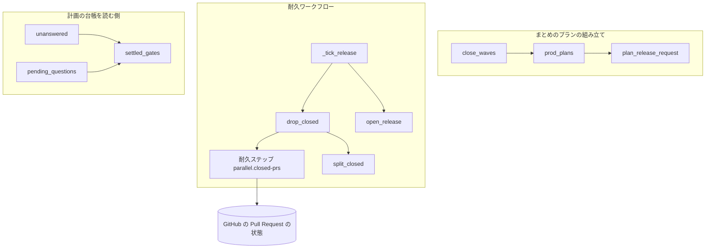
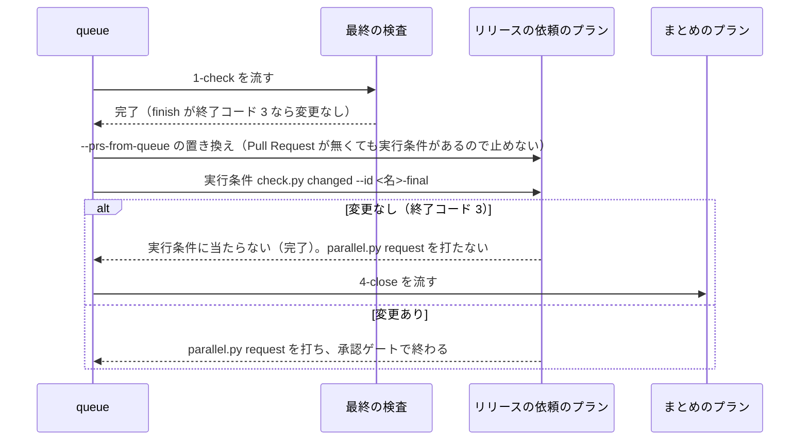
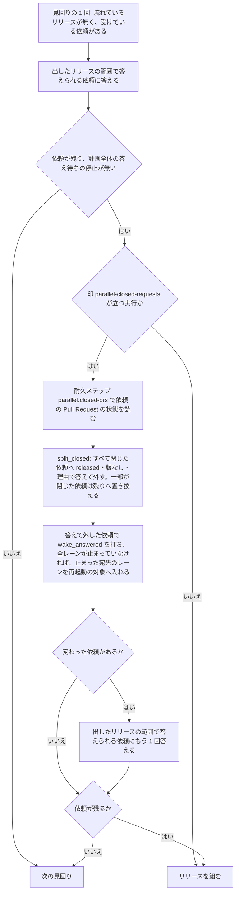

# 並列の計画: 中身の無いリリースの依頼と処理済みのリリース承認ゲートが、スプリントのまとめと計画の終わりを止めない（#3083）

## 目的

- **今どうなっているか**: 並列の計画のレーンでスプリントのまとめを流すと、最終の検査が変更なしでもリリースの依頼が送られる。そのため、まとめが流れない（2026-11-12 のレーン lgate-1・lflow-1）。送られた依頼の Pull Request はマージされずに閉じている。耐久ワークフローは依頼に答えられず、リリースを組み直し続けて計画を終えられない。あわせて、確定か締めで処理したリリース承認ゲートが答え待ちの依頼に数えられる。オーガナイザーの切り替えの判定は「報告して待つ」から動かない
- **誰に効くか**: 並列の計画を流すオーガナイザーとレーン、その承認を待つ人
- **変えると何が成り立つか**: 最終の検査が変更なしのまとめは、人の介入なしに流れる。中身の無い依頼は答えられて一覧から外れ、計画は `finished` で終われる。処理済みのリリース承認ゲートは切り替えの判定を止めない

## 適用範囲

- **働く範囲**: NDF の並列の計画（`parallel.py`・`supervise.py new close`）を使うすべてのリポジトリ。変更は NDF のスクリプトの中で閉じる
- **プロジェクトごとに違うもの**: 無し（リリースの経路・最終の検査の名前は今と同じく宣言と `--name` の引数で受ける）
- **当たるモード**: `standard`（この課題のモード）。まとめのプランの変更は、並列の計画のレーンでスプリントのまとめを組むときに、そのスプリントのモードに依らず働く

## あるべき姿の根拠

| 根拠 | 種類 | 何を示すか |
| --- | --- | --- |
| 2026-11-12 の lgate-1 のまとめ（#3083 の「事象」） | 実測 | 開発版のプランは最終の検査の変更なしで飛び、リリースの依頼のプランは飛ばずに依頼を送った。同じ条件を持つべき 2 つのプランの一方だけが条件を持つ |
| 2026-11-12 の計画 p5 のリリース 7・8（#3085 の「事象」） | 実測 | Pull Request がすべて閉じた依頼は、どのリリースの範囲にも入らず答えられないまま残り、差し戻すたびに同じ依頼からリリースが組まれた |
| 2026-11-12 07:10 JST の `wait p5`（#3080 の「事象」） | 実測 | 確定・締め済みのリリース承認ゲート 9 行が `unanswered: 9` に数えられ、同じ時点の `wait p5 --after 0` は問いを 1 件も返さなかった |

要求と受け入れ条件は #3083 の本文にある。コピーは [issue-3083-requirements.md](issue-3083-requirements.md) にある。#3085 と #3080 の受け入れ内容もこの要求に含めた。この文書は「どう作るか」だけを扱う。

## ドメインモデル

### コンテキスト

| コンテキスト | 何の語が 1 つの意味に決まるか |
| --- | --- |
| NDF の開発ワークフロー（`ndf-workflow`） | スプリントのまとめ・最終の検査・実行条件・リリースの依頼・耐久ワークフロー・計画の台帳・答え待ちの依頼 |

変更は 1 つのコンテキストに収まる。

### 集約

| 集約 | 持ち主（書き換えてよいもの） | 根 | エンティティ | 値オブジェクト |
| --- | --- | --- | --- | --- |
| まとめのプラン（スプリントの終わりのステージの並び） | まとめのプランの組み立て（`supervise_lib/sprint.py` の `close_waves`・`prod_plans`） | ステージの並び | プラン（最終の検査・開発版・本番かリリースの依頼・まとめ） | 実行条件（コマンドと飛ばす終了コード） |
| 受けている依頼の一覧 | 耐久ワークフロー（`lib/parallel_run.py` の `_Run`。依頼を外す処理はリリースの組み方の部品 `lib/parallel_route.py` の `ReleaseRouting`） | 耐久ワークフローの状態 | リリースの依頼（ID・レーン・Pull Request の番号） | 依頼への答え（結果・版・連番・理由） |
| 計画の台帳 | 台帳の読み書き（`lib/parallel_ledger.py`） | 計画の置き場の `ledger.jsonl` | 行（問い・答え・再開） | 行の種類・リリースの連番 |

計画の台帳は追記だけで持ち、この変更は行の形を変えない。答え待ちの依頼の数え方は、台帳を読む側の規則である。規則は台帳の持ち主（`lib/parallel_ledger.py`）に 1 か所で置き、`lib/parallel_status.py` はそれを呼ぶ。

### 不変条件

| # | 集約 | 条件 | 破れたときの扱い |
| --- | --- | --- | --- |
| I1 | まとめのプラン | レーンでまとめのプランが組むリリースの依頼のプランは、同じまとめの開発版のプランと同じ実行条件（最終の検査の変更の有無を見るコマンドと、飛ばす終了コード 3）を持つ | テストが落ちる |
| I2 | まとめのプラン | レーンでないまとめの本番のプラン、`new sprint` と `pace: fast` の本番のステージ（リリースの依頼のプランを含む）は、今と同じ形のまま組まれる | テストが落ちる |
| I3 | 受けている依頼の一覧 | リリースを組む前に、Pull Request がすべてマージされずに閉じた依頼を一覧から外し、`released`・版なし・理由（閉じた Pull Request の番号）で答える。その依頼のためにリリースを組まない。答えを待って止まっていた宛先のレーンは、全レーンが止まっていないときに限り再起動の対象に入る（全レーンが止まっていれば再起動の対象へ入れず、受け入れ条件 7 の `finished` へ進む） | テストが落ちる |
| I4 | 受けている依頼の一覧 | 一部の Pull Request だけが閉じた依頼は、閉じた Pull Request を除いた残りで範囲の判定（`answerable`）を受ける。除いた番号は依頼に残す | テストが落ちる |
| I5 | 受けている依頼の一覧 | 状態を取得できなかった Pull Request は閉じたと見なさない。取得そのものが失敗したときは、どの依頼も外さない | テストが落ちる |
| I6 | 受けている依頼の一覧 | Pull Request の状態の取得は、リリースを組もうとする直前の 1 回だけ行う。見回りごとには取得しない | テストが落ちる |
| I7 | 受けている依頼の一覧 | 依頼を外す処理を持たない版で始まった耐久ワークフローの記録を打ち直すときは、今までの道（依頼を外さない）を通る | テストが落ちる |
| I8 | 計画の台帳 | リリース承認ゲートの行は、同じ連番の確定（`resume:confirm:<連番>:…`）か締め（`resume:settle:<連番>`）の行が台帳でそれより後にあれば、答え待ちの依頼に数えない。台帳に `opened` の行がある計画でも同じ | テストが落ちる |
| I9 | 計画の台帳 | 確定も締めも後に無いリリースの承認ゲート（出し直しの提示で届いた 2 回目を含む）は、今どおり答え待ちの依頼に数える | テストが落ちる |
| I10 | 計画の台帳 | 設計の承認（`gate1`）・承認ゲートの外の問い（`ask`）・宛先の無い答えの知らせ（`unmatched`）の数え方は変わらない | テストが落ちる |

### ドメインイベント

| # | イベント | 発生元 | 受け手 |
| --- | --- | --- | --- |
| E1 | まとめのプランを組んだ | `supervise.py new close` | queue |
| E2 | 最終の検査が終わった（変更あり / 変更なし） | queue（`1-check`） | 開発版・リリースの依頼の実行条件 |
| E3 | 開発版のプランを流した / 飛ばした | queue | 後続のステージ |
| E4 | リリースの依頼を送った / 飛ばした | queue（実行条件で決まる） | 耐久ワークフロー（送ったとき）・まとめのステージ |
| E5 | まとめのプランを流した | queue | — （スプリントの終わり） |
| E6 | 耐久ワークフローが依頼を受けた | レーンの `parallel.py request` | 受けている依頼の一覧 |
| E7 | 依頼の Pull Request の状態を確かめた | 耐久ワークフロー（リリースを組む直前） | 依頼を外す処理 |
| E8 | 依頼に「出すものが無い」と答えて外した | 耐久ワークフロー | 依頼を送ったレーン（答え `answer-<依頼>`） |
| E9 | 計画が終わった（`finished`） | 耐久ワークフロー | オーガナイザー |
| E10 | リリース承認ゲートを確定 / 締めた | `parallel.py confirm` / `settle` | 計画の台帳（`resume` の行） |
| E11 | 答え待ちの依頼を数えた | `parallel.py wait` の上限・`parallel.py status` | 切り替えの判定・答えを待つレーンの欄 |

### 用語

| 用語 | 意味 | 用語集への反映 |
| --- | --- | --- |
| 中身の無い依頼 | リリースの依頼のうち、載せた Pull Request がすべてマージされずに閉じたもの。耐久ワークフローはリリースを組まずに答えて外す | 追加 |
| 処理済みのリリース承認ゲート | 計画の台帳で、同じ連番の確定か締めの行が後にあるリリース承認ゲートの行。答え待ちの依頼に数えない | 追加 |
| 最終の検査 | スプリントのまとめの先頭で流す検査（`<スプリント名>-final`）。変更が無ければ終了コード 3 で終わり、後続の開発版・本番・リリースの依頼のプランは実行条件で飛ぶ | 変更なし（要求で追加済み） |
| 実行条件 | プランを流す前に打つコマンド。`skip_code` を返せば worktree を作らずに完了とする | 変更なし |
| 答え待ちの依頼 | オーガナイザーに届いて、まだ答えていない依頼 | 変更なし（処理済みのリリース承認ゲートを含まないことは、この設計の不変条件 I8 が持つ） |

## 外部の調査

省く: 3 件とも NDF の中の取り決めだけで形が決まる。取り決めは、まとめのプランの実行条件・耐久ワークフローの依頼の扱い・計画の台帳の数え方である。Pull Request の状態の取得は、リポジトリの既存の部品をそのまま使い、外部の判断を要らない。部品は `release_lib/included.py` の `pr_fields` で、GitHub の GraphQL で 100 件ずつまとめて読む。

## 機能一覧

| # | 機能 | 誰が使うか |
| --- | --- | --- |
| F1 | 最終の検査が変更なしのとき、レーンのまとめがリリースの依頼を送らずにまとめまで流れる | レーン（queue） |
| F2 | Pull Request がすべて閉じたリリースの依頼に「出すものが無い」と答えて一覧から外す | 耐久ワークフロー・依頼を送ったレーン |
| F3 | 一部の Pull Request が閉じたリリースの依頼を、残りの Pull Request で判定する | 耐久ワークフロー |
| F4 | 処理済みのリリース承認ゲートを答え待ちの依頼に数えない | オーガナイザー（`wait` の切り替えの判定・`status`） |

## 構成要素

| 要素 | 責務 | 変更 |
| --- | --- | --- |
| `supervise_lib/sprint.py` の `prod_plans` | 本番のステージのプラン（レーンならリリースの依頼、そうでなければ本番）を組む | 引数 `condition` を足し、レーンの分岐で組むリリースの依頼のプランに実行条件として載せる。省けば今と同じ |
| `supervise_lib/sprint.py` の `close_waves` | スプリントの終わりのステージの並びを組む | 本番のステージの `prod_plans` へ、開発版と同じ実行条件 `changed` を渡す |
| `lib/parallel_release.py` の `plan_release_request` | リリースの依頼のプランを組む | 変えない（実行条件は呼ぶ側の `prod_plans` がプランへ足す） |
| `lib/parallel_release.py`（新しい関数 `split_closed`） | 受けている依頼と閉じた Pull Request の番号から、外す依頼と、閉じた番号を除いた残りの依頼を決める。純粋な関数 | 追加 |
| `lib/parallel_route.py`（新しい耐久ステップ `parallel.closed-prs`） | 受けている依頼の Pull Request の状態を 1 回でまとめて読み、マージされずに閉じた番号を返す。取得に失敗すれば空を返す | 追加 |
| `lib/parallel_route.py` の `ReleaseRouting`（新しいメソッド `drop_closed`） | 耐久ステップの結果と `split_closed` で、中身の無い依頼へ答えて外し、一部が閉じた依頼の番号を残りへ置き換える。答えて外した依頼で `wake_answered` を打ち、全レーンが止まっていなければ、止まった宛先のレーンを再起動の対象へ入れる（`skip_release`・`refuse_release` と同じ） | 追加 |
| `lib/parallel_run.py` の `_tick_release`・`parallel_workflow` | 見回りの 1 回でリリースを組む手順。印 `parallel-closed-requests` が立つ実行だけ、`open_release` の直前に `drop_closed` を打つ | 変更 |
| `lib/parallel_ledger.py`（新しい関数 `settled_gates`）と `pending_questions` | 台帳の行から、処理済みのリリース承認ゲートの行の ID を求める。`pending_questions` はそれを除く | 追加・変更 |
| `lib/parallel_status.py` の `unanswered` | 答え待ちの依頼を数える（`opened` の行が無い計画の枝） | `settled_gates` で求めた ID を除く |

数え方を読む側の次のファイルは変えない。数え方を持つ 2 つの関数を直せば、読む側はそのまま正しい数を受ける。

| 変えない読む側 | 役割 |
| --- | --- |
| `lib/parallel_switch.py` | 切り替えの判定 |
| `lib/parallel_status.py` の `_ledger_view` | 答えを待つレーンの欄 |
| `lib/parallel_answer.py`・`lib/parallel_machine.py` | `pending_questions` を読む |

## 処理の流れ

### まとめのプランが最終の検査の結果で飛ぶ（F1）

queue の `fill_queue_prs` は、`{queue_prs}` を埋める Pull Request が無くても止めない。プランに実行条件があれば、条件へ判断を任せる（今の振る舞い）。リリースの依頼のプランに実行条件が載れば、次の両方でプランは実行条件で飛ぶ。

- 検査の Pull Request が閉じた場合（番号が埋まる）
- Pull Request が無い場合（埋まらない）

### 中身の無い依頼を外す（F2・F3）

依頼が 1 件も残らなければ、リリースを組まない。ほかに依頼もリリースの途中も無く全レーンが止まっていれば、次の見回りの終わりの判定（`_run_finished`）が計画を `finished` で終える。外した依頼への答えは `answer-<依頼>` のイベントとして立ち、台帳のチェックポイントの `published` に控えられる。

### 処理済みのリリース承認ゲートを除く（F4）

`settled_gates(rows)` は、台帳の行を位置の順に読み、処理済みのリリース承認ゲートの行の ID を返す。リリース承認ゲート（`gate2`）の行ごとに、次の行がその行より後にあるかを判定する。

- 同じ連番（`msg.n`）の `resume` の行
- 段階が確定（`confirm`）か締め（`settle`）

規則を当てる範囲は、数える関数ごとに次のとおりである。

| 関数 | 規則を当てる範囲 |
| --- | --- |
| `unanswered` | `opened` の行の無い計画で、台帳の全行 |
| `pending_questions` | チェックポイントの後の行。チェックポイントの問いの中のリリース承認ゲートは、チェックポイントの後に同じ連番の確定か締めの行があれば除く |

チェックポイントの問いは、チェックポイントの後の行より前に届いている。そのため、後の行に確定か締めがあれば処理済みと読める。

## 非機能の実現方式

| 大項目 | 条件 | 実現方式 |
| --- | --- | --- |
| 運用・保守性 | 外した依頼の ID と理由（閉じた Pull Request の番号）が耐久ワークフローの記録に残る | 依頼への答え `answer-<依頼>` の `reason` に `Pull Request #<番号> はマージされずに閉じた（出すものが無い）` を載せる。答えは耐久ワークフローの記録と台帳のチェックポイントの `published` に残る。一部が閉じた依頼は、受けている依頼の項目に除いた番号（`closed`）を残し、チェックポイントの `pending` に載る |
| 性能・拡張性 | 取得は依頼 1 件につき Pull Request の数の範囲。見回りのたびに全依頼を取得し直さない | 取得はリリースを組もうとする直前の 1 回だけで、受けている依頼の Pull Request の番号を重ねずにまとめ、`pr_fields` の GraphQL で 100 件ごとに 1 回読む。取得の回数は組もうとしたリリースの数で抑えられる（取得の後は、リリースを組むか、依頼が無くなるかのどちらか） |

## 決定の記録

### 決定 1: 開発版と本番で同じ条件を 1 か所で持つため、実行条件はまとめのプランの組み立てが `prod_plans` の引数で渡す

`close_waves` は開発版のプランへ渡す実行条件 `changed` を既に組んでいる。同じ値を `prod_plans` へ渡し、レーンの分岐でリリースの依頼のプランへ載せる。そうすれば、条件の書き手は `close_waves` の 1 か所に保たれる。`prod_plans` は引数を省けば今と同じプランを返す。そのため、`new sprint` と `pace: fast` の本番のステージは変わらない（I2）。

`plan_release_request` に条件を持たせる形は採らない。リリースの依頼のプランはスプリントの途中のステージでも組まれ、そこには最終の検査が無い。条件を持つかは呼ぶ側の文脈で決まる。

根拠: Value 11 / Value 7（MVV 版 7）

### 決定 2: 依頼が出た後に Pull Request が閉じた場合も拾うため、状態はリリースを組む直前に確かめる

依頼を受けた時点で確かめると、受けた後に閉じた Pull Request（差し戻しの後に閉じたものなど）を拾えない。計画 p5 のリリース 8 は、リリース 7 を差し戻した後に同じ依頼から組まれた。リリースを組む直前なら、組み直しのたびに最新の状態で判定できる。取得はリリースを組もうとするときだけで、組んだ後と依頼が無くなった後は取得しない。そのため、見回りごとの取得にならない（I6）。

見回りごとに確かめる形は採らない。リリースの途中や計画全体の停止の間も GitHub を読み続け、非機能の条件に合わない。

根拠: Value 7 / Value 2（MVV 版 7）

### 決定 3: レーンの読み手を変えずに続きへ進めるため、中身の無い依頼への答えは `released`・版なし・理由つきにする

レーンの側の読み手は、開発ループの `lib/sprint_loop_gate2.py` の `answered_lap`・`settle_release`・`settle_refused` である。読み手は `released` を「続きへ進む」と読み、ほかの値を差し戻しか失敗として扱う。新しい値を足すと、それらの読み手すべてに分岐を足す必要があり、足し忘れた読み手は失敗として止まる。リリースを組まないリポジトリへの答え（`skip_release`）も、`released`・版なし・理由つきで返す。中身の無い依頼への答えも同じ形に揃う。理由に閉じた Pull Request の番号を載せ、リリース済みとの区別は理由と版の有無で読める。

新しい結果の値（`nothing` など）を足す形は採らない。答えの値の集合を前提にした読み手が上の 3 関数にあり、契約を広げる費用に見合う区別が読み手の側に無い。

根拠: Value 3 / Value 11（MVV 版 7）

### 決定 4: 一部が閉じた依頼を今の判定にそのまま通すため、依頼の Pull Request の番号を残りへ置き換え、除いた番号は別の項目に残す

`answerable` は依頼の `prs` を全部が範囲に入るかで判定する。閉じた番号を除いた残りへ `prs` を置き換えれば、次の 3 つを変えずに I4 が成り立つ。判定の関数、締め（`settle`）、出したリリースの範囲からの答え（`answer_from_ranges`）である。除いた番号は依頼の `closed` に残し、後から理由をたどれるようにする。置き換えは耐久ステップの結果だけから決まるため、打ち直しでも同じ値になる。

`answerable` に閉じた番号の集合を渡す形は採らない。`answerable` を呼ぶ 2 か所すべてに同じ集合を渡し続ける必要があり、渡し忘れた呼び出しが今の誤りを残す。

根拠: Value 11 / Value 8（MVV 版 7）

### 決定 5: 動いている計画の耐久ワークフローを壊さないため、依頼を外す処理は印 `parallel-closed-requests` が立つ実行だけで打つ

耐久ワークフローは、落ちた後や版を上げた後に記録から同じ道を打ち直す。古い記録の途中に新しい耐久ステップを差し込むと、記録と打ち直しの道が食い違う。既存の変更（`parallel-docs-carry`・`parallel-admit` など）と同じく、`parallel_workflow` の頭で印を読む。印が立たない古い記録は、今までの道を通す（I7）。古い記録の計画は、作り直すか次の計画から新しい道を通る。

根拠: Value 3（MVV 版 7）

### 決定 6: 出し直しの提示の 2 回目を取りこぼさないため、処理済みのリリース承認ゲートは台帳の位置の順で判定する

同じ連番のリリースでも、承認の時点でベースブランチが進んでいれば出し直しの提示が届く。このとき、確定（1 回目の答え）の後に 2 回目のリリース承認ゲートの行が書かれる。連番の一致だけで除くと、答えていない 2 回目まで除いてしまう（I9）。台帳は追記だけなので、行の位置の前後で「後に確定か締めがあるか」を決められる。そうすれば 2 回目は除かれず、2 回目への確定か締めが届いた後に除かれる。

耐久ワークフローの状態（チェックポイントの問い）だけから数える形は採らない。`opened` の行の無い計画はチェックポイントを持たず、台帳の行しか材料が無い。

根拠: Value 8 / Value 13（MVV 版 7）

### 決定 7: 数え方を 1 つにするため、処理済みのリリース承認ゲートの規則は台帳の持ち主に置き、2 つの数え方から呼ぶ

答え待ちの依頼は、次の 2 つの関数が数える。

| 関数 | 使う場面 |
| --- | --- |
| `unanswered` | `opened` の行の無い計画 |
| `pending_questions` | `opened` の行のある計画と、問いの取り直し・起動の判定 |

要求の前提 4 を確かめると、`pending_questions` もチェックポイントの後の行では `answer` の行だけを答えとして数えている。そのため、次の 2 つで同じ数え違いが起きる。

- 確定と締めの行が台帳に書かれてから、耐久ワークフローが読むまでの間
- 失われた計画

規則を `lib/parallel_ledger.py` の `settled_gates` に 1 つ置き、両方から呼ぶ。

`parallel_status.py` に規則を置く形は採らない。`pending_questions` は台帳の側にあり、`parallel_status.py` を読むと依存の向きが逆になる。

根拠: Value 11 / Value 9（MVV 版 7）

## テスト設計

| 受け入れ条件・不変条件 | どの振る舞いで縛るか | どう壊したら落ちるべきか |
| --- | --- | --- |
| 受け入れ条件 1・I1 | レーンの計画の中で `close_waves` を組むと、本番のステージのリリースの依頼のプランが、開発版のプランと等しい `実行の条件` を持つ | `close_waves` が `prod_plans` へ条件を渡さない・`prod_plans` がレーンの分岐で条件を落とすと落ちる |
| 受け入れ条件 2 | 最終の検査が変更なし（`changed` が 3）のとき、組んだリリースの依頼のプランは queue で実行条件に当たらず完了し、`parallel.py request` を打たない。`{queue_prs}` を埋める Pull Request がある場合と無い場合の両方で、まとめのプランが続けて流れる | プランから実行条件を外すと、Pull Request が無い場合は置き換えで止まり、ある場合は依頼のコマンドが打たれて落ちる |
| 受け入れ条件 3 | 最終の検査で変更がある（`changed` が 0）とき、リリースの依頼のプランは今どおり依頼を打って承認ゲートで終わる | 条件の飛ばす終了コードを 0 にすると落ちる |
| 受け入れ条件 4・I2 | レーンでないまとめの本番のプラン、`new sprint`・`pace: fast` の本番のステージのリリースの依頼のプランが、今と同じ形（後者は実行条件なし）で組まれる | `prod_plans` が条件を省いた呼び出しにも条件を足すと落ちる |
| 受け入れ条件 5・I3 | Pull Request がすべて閉じた依頼だけを受けた耐久ワークフローが、リリースを組まず（`parallel.build` を打たない）、依頼へ `released`・版なし・閉じた番号を含む理由で答え、一覧から外す。答えを待って止まっていた宛先のレーンが再起動の対象（`wake`）に入る。テストは止まっていないレーンを 1 本以上残して組む（全レーンが止まっていれば `wake_answered` は再起動の対象へ入れず、受け入れ条件 7 の `finished` へ進む） | 依頼を外さない・リリースを組んでから答える・答えの理由に番号が無い・`wake_answered` を打たずにレーンが止まったままだと落ちる |
| 受け入れ条件 6・I4 | 一部の Pull Request だけが閉じた依頼が、残りの番号が出したリリースの範囲に入ったときに答えられ、入らなければ残る。依頼に除いた番号が残る | 閉じた番号を除かずに判定すると、残りが範囲に入っても答えられずに落ちる |
| 受け入れ条件 7 | 受け入れ条件 5 で依頼を外した後、ほかに依頼もリリースの途中も無く全レーンが止まると、耐久ワークフローが `finished` を返す | 外した依頼が一覧に残ると `finished` にならずに落ちる |
| 受け入れ条件 8・I5 | マージ済みか開いている Pull Request の依頼、状態を取得できなかった Pull Request を含む依頼、取得そのものが失敗したときの依頼が、今と同じ判定を受ける | 取得の失敗を閉じたと読むと、依頼が外れて落ちる |
| I6 | 依頼が残り、リリースが流れている見回りと計画全体の停止の見回りでは、`parallel.closed-prs` が打たれない。組もうとする見回りでは 1 回だけ打たれる | 見回りごとに取得すると、打たれた回数が合わずに落ちる |
| I7 | 印 `parallel-closed-requests` の無い記録の打ち直しでは、`parallel.closed-prs` を打たずに今までの道（依頼から組む）を通る | 印を読まずに取得を打つと落ちる |
| 受け入れ条件 9・I8 | リリースを 1 回出した（リリース承認ゲート・確定・締めの行がある）計画で、ほかに問いが無ければ `parallel.py wait` の上限の戻りの `metrics.switch.inputs.unanswered` が 0 になる | 確定・締めの行を答えに数えないと 1 以上になって落ちる |
| 受け入れ条件 10・I9 | 提示中で確定も締めも無いリリース承認ゲートと、確定の後に届いた出し直しの提示の 2 回目のリリース承認ゲートは、答え待ちの依頼に数える | 連番の一致だけで除くと 2 回目が除かれて落ちる |
| 受け入れ条件 11・I10 | `gate1`・`ask`・`unmatched` の行の数え方が変わらない。台帳に `opened` の行がある計画の `pending_questions` も、チェックポイントの後に確定か締めの行があるリリース承認ゲートを返さない | `pending_questions` に規則を当てないと、`opened` の行のある計画で落ちる |
| 受け入れ条件 12 | 処理済みのリリース承認ゲートだけを持つ一時レーンが、`parallel.py status` の答えを待つレーンに載らない | `_ledger_view` が数え方の関数を通らない形に戻ると落ちる |

受け入れ条件 13 は、修正の前のコードで失敗し、後に通ることである。上の各行のテストを修正の前に流し、失敗を確かめて満たす（`tdd-cycle`）。

## 設計の結果

| 課題 | 扱い | 取り込み先 | 触るファイル |
| --- | --- | --- | --- |
| #3083 | 実装する | — | `plugins/ndf/scripts/supervise_lib/sprint.py`、`plugins/ndf/scripts/lib/parallel_release.py`、`plugins/ndf/scripts/lib/parallel_route.py`、`plugins/ndf/scripts/lib/parallel_run.py`、`plugins/ndf/scripts/lib/parallel_ledger.py`、`plugins/ndf/scripts/lib/parallel_status.py`、`plugins/ndf/scripts/tests/test_lane_prod_stage.py`、`plugins/ndf/scripts/tests/test_parallel_run.py`、`plugins/ndf/scripts/tests/test_parallel_ledger.py`、`plugins/ndf/scripts/tests/test_parallel_switch.py` |
| #3085 | 取り込む | #3083 | — |
| #3080 | 取り込む | #3083 | — |

## 人へ残す判断

無し

## 未確認のまま残ること

| 項目 | 内容 |
| --- | --- |
| 動いている計画 p5 の耐久ワークフローへの効き | p5 は依頼を外す処理を持たない版で始まった記録のため、決定 5 により今までの道を通り、残っている依頼 `lgate-r887924761751` は外れない。新しい道は次に始めるか作り直す計画から働く。既に台帳に残る依頼の後始末は要求の対象範囲の外である |
| 実運用での取得の失敗の頻度 | GitHub の GraphQL の取得が失敗すると、その回は依頼を外さずに今どおりリリースを組む（I5）。失敗がどの程度起き、そのとき依頼が残り続けるかは、次の並列の計画のリリース後テストで、耐久ワークフローの記録の `parallel.closed-prs` の結果を数えて確かめる |
