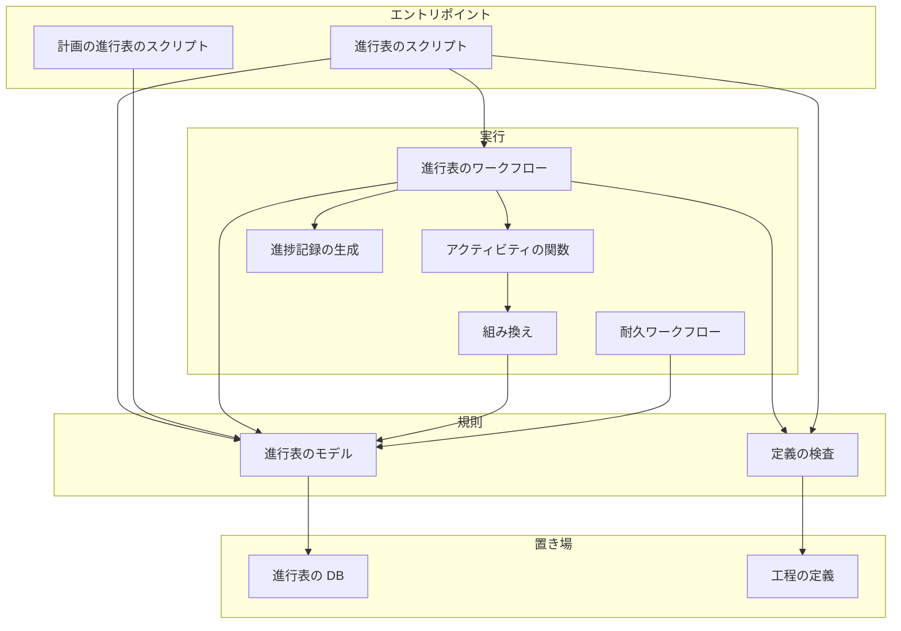
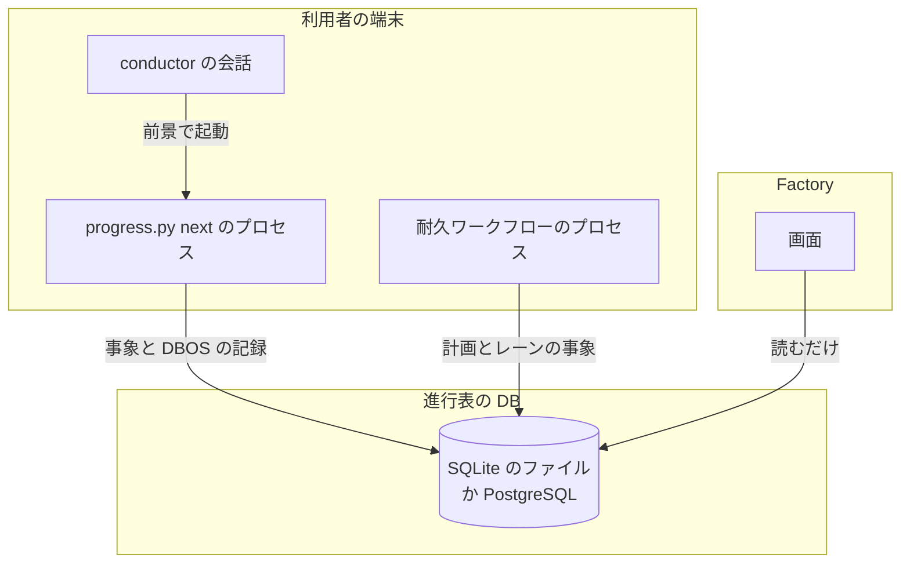
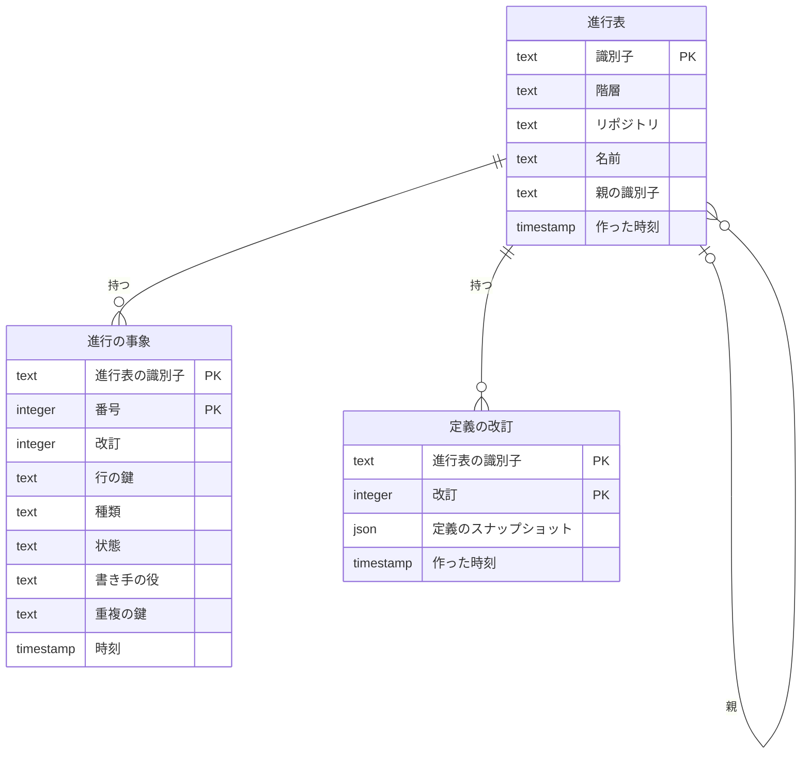
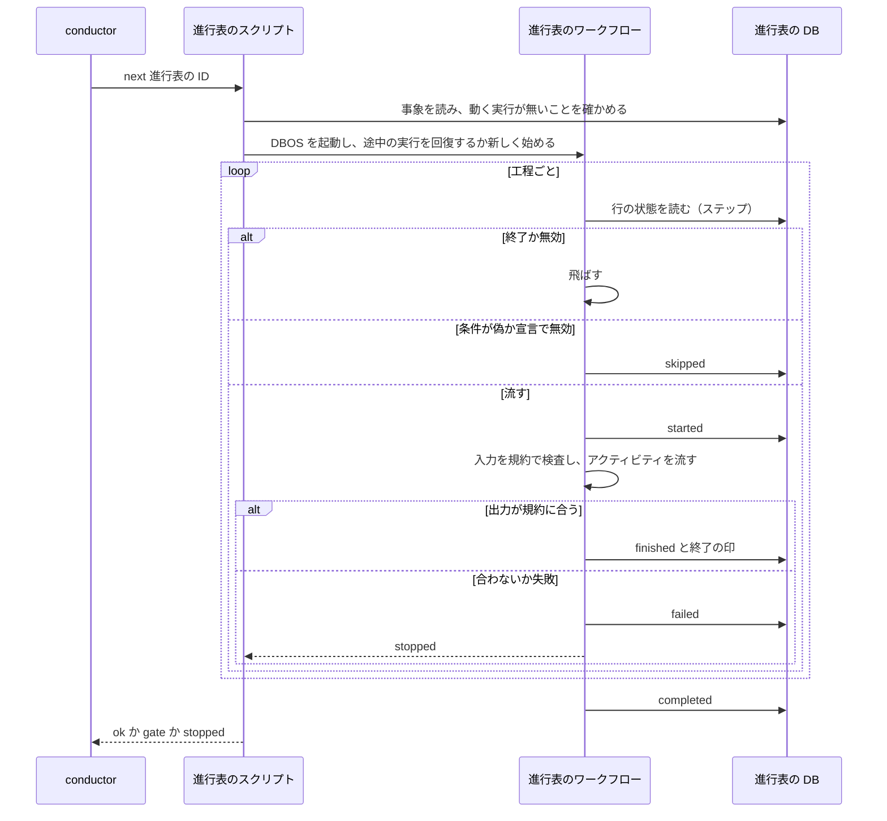
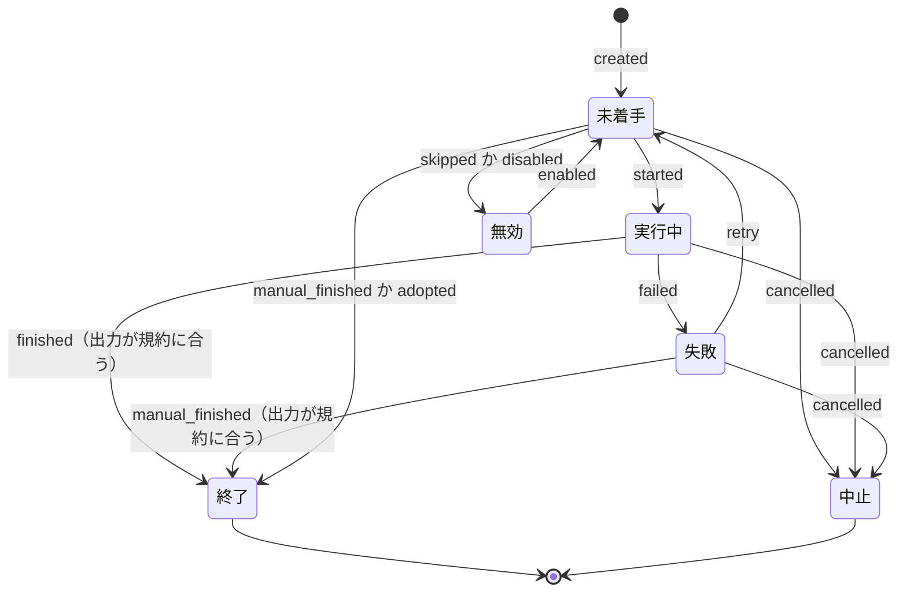
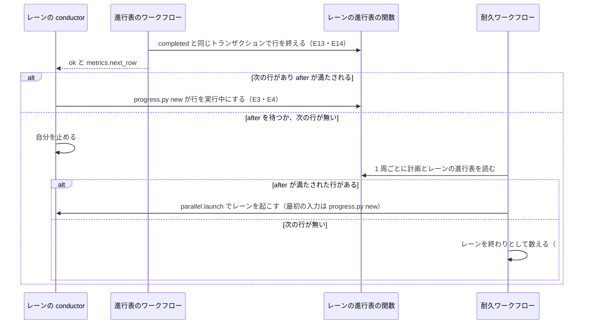
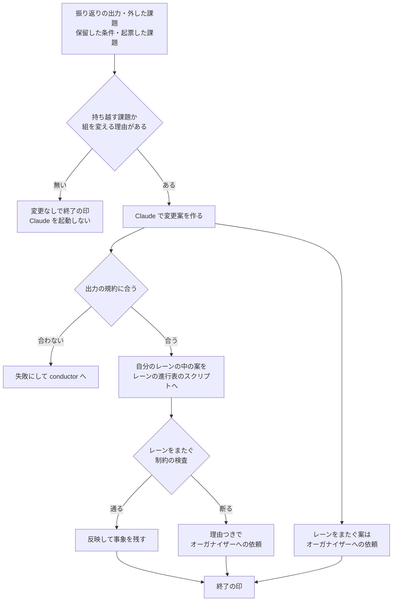

# 工程の進行表の作り: データ構造・入出力の契約・処理の流れ（#3092）

[issue-3092-design.md](issue-3092-design.md) の続きである。決定の番号・不変条件（I<番号>）・機能（F<番号>）・調査の番号（STD・LIB）はそちらを指す。語（conductor・オーガナイザー・レーン・耐久ワークフローなど）と、受け入れ条件・要求の番号の参照先は、そちらの「語と参照先」にある。

## 構成要素の図と配置

### 構成要素



進行表のモデルが事象の追記の関数（進行表の DB）を呼ぶ唯一の要素で、書き手の表（I6）をそこで検査する。耐久の記録の包みは、進行表のワークフローと耐久ワークフローが DBOS を起動するときに使う（図に含めない）。

### 配置



境界をまたぐのは、進行の事象（JSON の値を持つ行）と DBOS の記録だけである。課題の本文・ボード・Pull Request へは、進捗記録の生成が `gh` で書く（今の経路と同じ）。

### パッケージの構成

```text
plugins/ndf/
├── contracts/workflow/                       # 新設
│   ├── serverless-workflow-1.0.3.schema.json # 借りた標準のスキーマ（JSON に直したもの）
│   ├── modes/<モード>.json                    # 5 つ。工程の文書を順に呼ぶ
│   ├── stages/<工程の ID>.json                # 工程ごとのアクティビティの並び
│   └── schemas/                              # 入出力規約（report・工程ごと・組み換え）
└── scripts/
    ├── progress.py                           # 新設。進行表のスクリプト
    ├── parallel.py                           # 副命令の中身を進行表へ替える
    └── lib/
        ├── workflow_def.py                   # 新設。定義の検査
        ├── progress_model.py                 # 新設。畳み込み・次の行・書き手の表
        ├── progress_db.py                    # 新設。URL・表・追記
        ├── progress_run.py                   # 新設。進行表のワークフロー
        ├── progress_activities.py            # 新設。call の名前 → 関数
        ├── progress_projection.py            # 新設。進捗記録の生成
        └── reshuffle.py                      # 新設。組み換え
```

## データ構造

### ER 図



親子は、計画の進行表 → レーンの進行表 → スプリントの進行表の 3 階層である。DBOS の表（`dbos` のスキーマ。SQLite は同じファイル）は DBOS が持ち、この設計では作らない。

### テーブル定義

進行表（`ndf_progress_tables`）。作った後に変えない。

| 列 | 型 | 空を許すか | 意味 |
| --- | --- | --- | --- |
| `id` | text | 許さない | 主キー。`<階層>:<リポジトリの短い鍵>:<名前>`。I1 をここで守る（決定 15） |
| `level` | text | 許さない | `plan` / `lane` / `sprint` |
| `repo` | text | 許さない | リポジトリの識別（origin の URL。無ければメインディレクトリの絶対パス） |
| `name` | text | 許さない | 計画名・`<計画名>/<レーン名>`・スプリント名 |
| `parent_id` | text | 許す | 親の進行表の識別子。空は「計画の進行表」か「計画の外の単独のスプリント」。一意の制約には含めない |
| `created_at` | timestamp | 許さない | 作った時刻（UTC） |

一意: 主キー `id` だけ。(`level`, `repo`, `name`) から `id` が決まるため、同じ組の 2 つ目の作成は主キーのぶつかりで断られる。

定義の改訂（`ndf_progress_definitions`）。スプリントの進行表だけが持つ。追記だけ（決定 16）。

| 列 | 型 | 空を許すか | 意味 |
| --- | --- | --- | --- |
| `table_id` | text | 許さない | 主キーの 1 つ目。進行表の識別子 |
| `rev` | integer | 許さない | 主キーの 2 つ目。作成で 1、範囲とモードの変更で 1 ずつ増える |
| `definition` | json | 許さない | 定義のスナップショット（モード・定義の文書の版・sha256・工程とアクティビティの並び・有効と無効の宣言の結果） |
| `created_at` | timestamp | 許さない | 書いた時刻（UTC） |

進行の事象（`ndf_progress_events`）。追記だけ（I2）。

| 列 | 型 | 空を許すか | 意味 |
| --- | --- | --- | --- |
| `table_id` | text | 許さない | 主キーの 1 つ目。進行表の識別子 |
| `seq` | integer | 許さない | 主キーの 2 つ目。表ごとに 1 から 1 ずつ増える。追記する側が「読んだ最後の番号 + 1」を渡し、ぶつかれば断られる |
| `rev` | integer | 許す | スプリントの事象の改訂。スプリントでは空を許さない（検査で断る）。空は「計画とレーンの事象」 |
| `row_key` | text | 許す | 工程の名前（工程表の行名）・`<工程>/<アクティビティの ID>`・`<工程>#<課題番号>`・レーン名・順番表の行の番号。スプリントの行は（`rev`, `row_key`）で決まる。空は「進行表全体の事象」 |
| `kind` | text | 許さない | 事象の種類（下の「事象の種類と書き手の表」） |
| `state` | text | 許す | 事象の後の行の状態。空は「状態を変えない事象」（表示の変更・依頼の記録） |
| `actor` | text | 許さない | 書き手の役 |
| `reason` | text | 許す | 理由。conductor の操作・無効・中止では必須で、空を許さない（検査で断る） |
| `payload` | json | 許す | 出力の要約・出力のファイルのパス・実行の ID・定義の版・変更案など、種類ごとの値 |
| `dedupe_key` | text | 許す | ワークフローが書く事象の重複の鍵（`<実行の ID>:<行の鍵>:<種類>`）。一意。空は「人の操作の事象」 |
| `at` | timestamp | 許さない | 書いた時刻（UTC） |

表の版（`ndf_progress_meta`）: `schema_version` の 1 行。起動の時に足りない表と列を足して版を上げる（決定 2）。

### 状態

| 階層 | 行の状態 | 進行表全体の状態 |
| --- | --- | --- |
| スプリント | 未着手・実行中・終了・失敗・無効・中止（要求の S5。[issue-3092-requirements.md](issue-3092-requirements.md) の「起票者の推定」） | 実行中・完了・中止 |
| レーン | 未着手・実行中・完了・中止 | （持たない。計画の進行表から読む） |
| 計画 | （レーンの行は状態を持たず、レーンの進行表から出す） | 未着手・実行中・完了・中止 |

### 事象の種類と書き手の表

I6 の正本である。進行表のモデルがこの表を定数で持ち、追記の関数が検査する。

| 事象の種類 | 階層 | 書ける役 | 変わる状態 |
| --- | --- | --- | --- |
| `created`（行の並びは定義か入力から） | 全階層 | conductor（スプリント・レーンの行の追加）・オーガナイザー（計画とレーンの最初の順番表）・取り込み（取り込んだ進行表の行。決定 19） | 未着手 |
| `execution`（今の実行の ID） | スプリント | 進行表のワークフロー | — |
| `started` / `finished` / `failed` | スプリント | 進行表のワークフロー | 実行中 / 終了 / 失敗 |
| `skipped`（無効として飛ばした） | スプリント | 進行表のワークフロー | 無効 |
| `disabled` / `enabled` / `retry` / `manual_finished` / `scope_changed` / `mode_raised` | スプリント | conductor | 無効 / 未着手 / 未着手（失敗の行だけ） / 終了 / — / — |
| `carried`（前の改訂の状態を新しい改訂へ写す） | スプリント | conductor（`scope` の中だけ。決定 16） | 終了か無効（前の改訂と同じ） |
| `answered`（承認ゲートの答え・リリースの結果） | スプリント | オーガナイザー・conductor | — |
| `cancelled` | スプリント | conductor（計画の中止で起こされたレーンの conductor を含む。「計画の進行表のスクリプト」の `stop`） | 中止（残りの行も中止） |
| `completed` | スプリント | 進行表のワークフロー | 完了 |
| `row_added` / `row_moved` / `row_cancelled` | レーン | conductor・進行表のワークフロー（組み換えのアクティビティ）・オーガナイザー（レーンをまたぐ移動と、計画の中止での未着手の行の中止） | 未着手 / — / 中止 |
| `row_started` | レーン | conductor（スプリントの作成）・取り込み（実行中のスプリントを取り込んだ行） | 実行中 |
| `row_ended` | レーン | レーンの進行表の行を終える関数だけ。`completed` か `cancelled` と同じトランザクションの中で呼ばれ、役はそれを書いた役（進行表のワークフローか conductor）を継ぐ（決定 17） | 完了・中止 |
| `lane_added` / `lane_changed` / `request_opened` / `request_closed` | 計画 | オーガナイザー（`request_opened` は進行表のワークフローの組み換えのアクティビティも。`lane_added` と `request_opened` は取り込みも） | — |
| `plan_started` / `plan_completed` / `plan_cancelled` | 計画 | オーガナイザー・取り込み / 耐久ワークフロー / オーガナイザー | 実行中 / 完了 / 中止 |
| `adopted` | 全階層 | 取り込み | 終了か失敗（決定 19） |

取り込み（`progress.py adopt`）が書けるのは、`created`・`adopted`・`row_started`・`lane_added`・`request_opened`・`plan_started` の 6 つである。進行表を作り（`created`）、終わったか一部だけ終わった工程を閉じ（`adopted`）、1 つも終わっていない工程は `created` のまま残す（決定 19）。計画の取り込みでは、レーン（`lane_added`）・計画の開始（`plan_started`）・実行中のスプリントを指すレーンの行（`row_started`）・答えていない依頼（`request_opened`）を書く。工程の実行の事象（`started`・`finished`・`failed`）と終わりの事象（`completed`・`cancelled`・`row_ended`）は書かない。

### CRUD 図

| 機能 | 進行表 | 進行の事象 | DBOS の記録 |
| --- | --- | --- | --- |
| F2 スプリントの進行表を作る | C（定義の改訂 1 も） | C | — |
| F3 次の工程を流す | R | C R | C R U |
| F4 状態を変える | R（範囲とモードの変更は定義の改訂を C） | C R | U（範囲とモードの変更と中止の取り消しだけ） |
| F5 答えを送る | R | C | C（送る） |
| F6 表示する | R | R | R |
| F7 進捗記録の生成 | R | R | — |
| F8 計画とレーンの進行表 | C R | C R | R（耐久ワークフロー） |
| F9・F10 順番表を変える・組み換え | R | C R | — |
| F11 取り込む | C（定義の改訂 1 も） | C | — |

事象と定義の改訂を「更新」「削除」する機能は無い。DBOS の記録の更新は、DBOS 自身の状態の書き換え（取り消し・回復）だけである。

### 時系列の扱い

**事象の記録を採る。** 何が起きたかの順序（始めた・失敗した・やり直した・手で終了にした）が意味を持ち、Factory と振り返りが履歴を読むためである。行の今の状態は、行の鍵ごとに最新の `state` を持つ事象から畳み込む（進行表のモデル）。1 スプリントの事象は数百件の規模で、索引（`table_id`, `seq`）で読み切れる。

### 検査の手段

次のコマンドを、`NDF_PROGRESS_DB` を SQLite と PostgreSQL の URL に替えて 2 回流す。

```bash
uv run --frozen --project . --all-extras pytest plugins/ndf/scripts/tests/test_progress_db.py -q
```

CI は `pytest.yml` の PostgreSQL のサービスで 2 回目を流す。

## 入出力の契約

### 工程の定義の形

モードの文書（`modes/standard.json` の先頭）:

```json
{
  "document": {"dsl": "1.0.3", "namespace": "ndf", "name": "standard", "version": "1.0.0"},
  "do": [
    {"要求と受け入れ条件": {"run": {"workflow": {"namespace": "ndf", "name": "requirements", "version": "1.0.0"}}}},
    {"作業場所の用意": {"run": {"workflow": {"namespace": "ndf", "name": "worktree", "version": "1.0.0"}}}}
  ]
}
```

工程の文書（`stages/reshuffle.json` の形。アクティビティは `call`）:

```json
{
  "document": {"dsl": "1.0.3", "namespace": "ndf", "name": "reshuffle", "version": "1.0.0"},
  "input": {"schema": {"resource": {"endpoint": "file:schemas/stage-io.schema.json#/$defs/reshuffle-in"}}},
  "output": {"schema": {"resource": {"endpoint": "file:schemas/stage-io.schema.json#/$defs/reshuffle-out"}}},
  "metadata": {"ndf": {"stage": "組み換え", "when": ["retro_enabled"]}},
  "do": [
    {"judge": {"call": "ndf.reshuffle", "metadata": {"ndf": {"kind": "record", "range": "lane"}},
               "output": {"schema": {"resource": {"endpoint": "file:schemas/reshuffle.schema.json"}}}}}
  ]
}
```

`metadata.ndf` の語彙（閉じた一覧。定義の検査が持ち、知らない語を断る。決定 5）:

| キー | 値 | 意味 |
| --- | --- | --- |
| `stage` | 工程表の行名 | 工程の行の鍵。I11 の突き合わせに使う |
| `when` | `code_in_diff` / `docs_only_diff` / `behavior_docs_in_diff` / `ci_declared` / `prod_branch` / `release_record` / `retro_enabled` / `design_pr` | すべてが真のときだけ有効。偽なら「無効（条件の名前）」で飛ばす |
| `kind` | `review` / `test` / `release` / `verify` / `merge` / `work` / `gate` / `record` | 順序の決まり（I8〜I10）の対象を決める。`verify` はリリースした版を確かめるアクティビティ（リリース後テスト）で、取り込み前の検査（`review`・`test`）と分ける |
| `range` | `sprint_diff` / `issue_diff` / `released` / `lane` / `none` | 入力の範囲。`review` と `test` は `sprint_diff` か `issue_diff` だけ、`verify` は `released`（リリースした版）だけ（I9） |
| `subject` | `code` / `docs` / `design` | レビューの対象。`kind: review` では必須で、ほかでは書かない（I10） |
| `per_issue` | `true` | `fast` で課題ごとの子の行にする工程（決定 9） |

順序の決まりの検査（I8〜I10）は、モードの全工程のアクティビティを並びの順に平らにして行う。`kind: release` のアクティビティより後ろに、同じ `range` の `review`・`test` があれば断る。`verify` は同じ並びの `kind: release` のアクティビティより後ろにだけ置け、前にあるか `kind: release` が無ければ断る。`review`・`test` の `range` が差分でなければ断り、`verify` の `range` が `released` でなければ断る。同じ `range` と `subject` の組の `review` が 2 つあれば断る（コードレビューの `code` とドキュメントレビューの `docs` は範囲が同じでも通る）。同じ `range` の `test` が 2 つあっても断る（決定 5。プランの中で流すテストは `work` の一部で、`test` を付けない）。

### 入出力規約

| 規約 | 置き場 | 中身 |
| --- | --- | --- |
| 統一 JSON レポート | `schemas/report.schema.json` | `tool`・`status`（`ok`・`gate`・`stopped`）・`summary`・`items`・`metrics`。`step_result.py` の形を JSON Schema で書いたもの（決定 10） |
| アクティビティの出力 | 工程の文書の `output.schema` | `allOf: [report.schema.json, <アクティビティの追加の必須項目>]` |
| 工程の入力と出力 | `schemas/stage-io.schema.json` の `$defs/<工程の ID>-in`・`-out` | 入力: 課題・モード・進め方・範囲（ベースとヘッドのコミット）・前の工程の出力の参照。出力: アクティビティの出力の一覧と工程の要約 |
| 組み換えの出力 | `schemas/reshuffle.schema.json` | `decision`（`unchanged` / `changed`）・`lane_changes`（行の追加・入れ替え・取り消しと理由）・`requests`（レーンをまたぐ依頼と理由）・`refused`（断られた案と理由） |

### 進行表のスクリプト（`progress.py`）

結果はすべて統一 JSON レポートの 1 行で返す。終了コードは 0（`ok`）・2（引数か定義の誤り）・3（`gate`: 待ちに入った）・6（`stopped`: 工程の失敗・断られた操作）。

| 副命令 | 入力 | 出力（成功） | 失敗の形 |
| --- | --- | --- | --- |
| `new <スプリント名> --mode <モード> --issues <番号>... [--pace <進め方>] [--lane <レーンの進行表の ID> --row <番号>] [--disable <工程>=<理由>]...` | 要求と受け入れ条件・モード判定の出力のパス（`--requirements`・`--judgment`） | 進行表の ID・行の数・無効の行 | 同じスプリントがあれば 6 と今の ID（I1）。定義の検査の誤りは 2 |
| `next <進行表の ID>` | — | 流した工程・終了の印・次の工程。完了したときは `metrics.next_row`（同じレーンの次の行の `progress.py new` の引数・`waiting_after`・`null`。決定 7） | 待ちは 3（`items` に待っている承認ゲート）。工程の失敗は 6（理由と出力のパス）。動いている実行があれば 6（I14） |
| `show <進行表の ID>` | — | 工程ごとの状態・時刻・出力の要約・無効の理由・事象の履歴 | 無い ID は 2 |
| `disable` / `enable <ID> <工程> --reason <理由>` | — | 書いた事象 | 実行中の行は 6（I4） |
| `retry <ID> <工程> --reason <理由>` | — | 書いた事象 | 失敗でない行と、動いている実行がある間は 6（決定 6） |
| `finish <ID> <工程> --output <ファイル> --reason <理由>` | 出力のファイル | 書いた事象 | 規約に合わなければ 6 と検査の誤り（I17） |
| `scope <ID> (--add <番号> \| --drop <番号> \| --mode <モード>) --reason <理由>` | — | 上げた改訂と、やり直す最初の工程・取り消した実行（決定 16）。`--drop` で外した課題は、レーンの進行表があれば同じレーンの順番表の次の行へ足す（受け入れ条件 15） | モードを下げれば 6（I5）。動いている実行がある間は 6（I22）。次の行への追加がレーンをまたぐ制約で断られたら 6 と理由（オーガナイザーへの依頼を残す） |
| `cancel <ID> --reason <理由>` | — | 中止にした行の数・取り消した実行・終えたレーンの行（決定 17） | 完了の表と、動いている実行がある間は 6 |
| `answer <ID> <工程> (--approved \| --rejected \| --release-result <ファイル>)` | — | 送った答え | 待っていない工程は 6 |
| `lane add-row` / `move-row` / `cancel-row <レーンの進行表の ID> ...` | 課題・位置・理由 | 書いた事象 | レーンをまたぐ制約で 6（I12・I13・I18〜I21） |
| `adopt (--sprint <sprint.json> \| --plan <計画名>)` | 今の目録か計画 | 作った進行表の ID・失敗にした工程と理由（決定 19） | 読めない・対応の無いステージ・I1 は 2 で、何も書かない（1 つのトランザクション） |

### 計画の進行表のスクリプト（`parallel.py`）

| 副命令 | 変わること | 互換性 |
| --- | --- | --- |
| `init` / `start` | 計画の検査（今の `parallel_plan` の検査）を通してから、計画の進行表とレーンの進行表（最初の順番表）を作る | 引数と `plan.json` の形を保つ。`plan.json` は入力として読み、状態は書かない |
| `lane add` / `set` | 計画の進行表への `lane_added` / `lane_changed`。移す先の行はレーンの進行表のスクリプトを通す | 引数を保つ |
| `stop` | 計画の進行表へ `plan_cancelled` を書き、未着手の行を `row_cancelled` で中止にする。実行中の行のスプリントは、オーガナイザーが書かず（受け入れ条件 10）、レーンの conductor が `progress.py cancel` で中止にする（下の「計画の中止」） | 引数を保つ |
| `status` | 2 つの進行表から作る（受け入れ条件 16） | 出力の形を保つ。台帳は読まない |
| `await` | 承認の答えの送り先を `progress.py answer` と同じ経路に替える | 引数を保つ |
| `request close <計画名> <依頼の ID> --reason <理由>` | 答えていない依頼を、採らずに `request_closed`（理由つき）で閉じる。`lane add`・`set` で応えたときは、その副命令が同じ事象を書く | 新しく足す副命令。既存の副命令と引数は変えない |

**計画の中止。** `stop` が上の 2 つの事象を書いた後、今と同じく停止の指示を受けた耐久ワークフローが起動済みのレーンへ `relay.py stop` を打ってレーンの conductor を止める（[docs/specifications/ndf-parallel-organizer.md](../docs/specifications/ndf-parallel-organizer.md) の停止の手順）。耐久ワークフローはそこで終わらず、実行中の行が残るレーンを次の 1 周から `parallel.launch` で起こし、最初の入力を `progress.py cancel <スプリントの進行表の ID> --reason 計画の中止` にする。起きた conductor が中止を書き、同じトランザクションで行が終わる（決定 17）。承認待ちのスプリントにはプロセスが無いが、`cancel` が待ちの実行を `DBOS.cancel_workflow` で取り消す（決定 6）。止める前に `progress.py next` を打っていた conductor のために、進行表のワークフローは工程を始める前に計画の進行表の状態を読み、中止なら工程を始めずに `stopped`（`metrics.plan_cancelled: true`）で返す。conductor はこれを受けて `progress.py cancel` を打つ。耐久ワークフローは、実行中の行が無くなったら `stopped` で終わる（E15）。

### 環境変数と設定

| 名前 | 形 | 既定 |
| --- | --- | --- |
| `NDF_PROGRESS_DB` | SQLAlchemy の URL（`sqlite:///…`・`postgresql+psycopg://…`） | `sqlite:///<メインディレクトリ>/.ndf/progress/ndf-progress.sqlite`。メインディレクトリは `lib/decl.py` の `main_dir` で決め、どの worktree から打っても同じファイルになる（決定 2） |
| `.ndf/project.json` の `workflow.stages.<工程>` | `{"enabled": bool, "reason": str}` | 無し（定義の条件だけで決まる） |

PostgreSQL のドライバ（`psycopg`）は Factory の側が入れる。NDF の依存には足さず、CI のテストのグループだけが持つ。

## 処理の流れ

### 次の工程を流す



承認ゲートとリリースの結果の待ちは `listen` のアクティビティが DBOS の受信で待つ。答えが DB に無ければ、実行を途中のまま残して `gate` で返す（決定 7）。答えは `progress.py answer` が DBOS の送信と `answered` の事象で書く。
`listen` のアクティビティは、受信の前に今の改訂のその行の `answered` の事象を読み、あれば受信を待たずにそれを使う（決定 21）。この流れが頼る DBOS の挙動の実測は [issue-3092-design-dbos-behavior.md](issue-3092-design-dbos-behavior.md) にある。

### 工程の行の状態



描いていない遷移は起こらない。実行中から無効へは移れない（I4）。NDF の版が上がって途中の実行を回復できないときは、実行中の行が `failed` で失敗になる（決定 21）。`retry` は失敗の行だけに当たる（決定 6）。終了から別の状態へは移れない。終わった工程をやり直したいときは、範囲の変更（改訂を上げ、その工程から後ろを新しい改訂の行として作る。決定 16）を使う。図は 1 つの改訂の中の遷移である。改訂を上げた後の新しい行は `created` か `carried` で始まる。

### スプリントの終わりから次のスプリントへ



計画の外の単独のスプリントでは、レーンの行が無く、耐久ワークフローも無い。完了の結果の `metrics.next_row` は `null` である。

### 組み換え



依頼は、計画の進行表に `request_opened` で残る（I16 の「答えていない依頼」）。オーガナイザーが `parallel.py lane add`・`set` で応えたら、その副命令が `request_closed` を書く。採らないと決めたとき（断られた案の差し戻しを受け取っただけのときなど）は、オーガナイザーが `parallel.py request close` で理由つきの `request_closed` を書く。どちらでも依頼は閉じ、I16 の完了を止めない。要否の判定は純粋な処理で、入力の 4 種類がすべて空で、他のレーンとの触る場所の重なりが無いときだけ「変更なし」にする。

## 非機能の実現方式

| 大項目 | 要求の条件 | 実現方式 | 確かめ方 |
| --- | --- | --- | --- |
| 可用性 | conductor のセッションやプロセスが途中で止まっても、再開は最後に終了の印が付いた工程（ステップ）の次から始まり、終わった工程を流し直さない | 行の状態を事象から読んで飛ばす（決定 6）。アクティビティの中の途中は DBOS の回復が続ける。持ち主は `progress.py next` の前景のプロセス（決定 7）。NDF の版が上がって回復できない実行は、`next` が取り消して実行中の行を失敗にし、conductor が `retry` で続ける（決定 21） | アクティビティの途中でプロセスを止め、`next` を打ち直して、終わったアクティビティが流れないことをテストで見る |
| 性能・拡張性 | 組み換えの「変更なし」と、次の工程の判断は LLM を起動しない。スプリントは数時間〜数日続き、承認待ちを挟んでも進行表が状態を失わない | 次の行の選択と組み換えの要否は純粋な処理。待ちは DB に残し、プロセスを抜ける | 起動の数を数えるテストで、変更なしと次の判断で Claude の起動が 0 回であることを見る |
| 運用・保守性 | 進行表の変更（誰が・いつ・何を・理由）は履歴へ追記だけで残し、消さない。進行表の表示は統一 JSON レポートで返す | 事象の表に更新と削除の関数を作らない（I2）。`show` は統一 JSON レポート | 追記の関数だけが表へ書くことを、書き込みの関数の呼び元の検索のテストで見る |
| 移行性 | リリースの時点で動いているスプリントと計画は、`progress.py adopt` が今の目録 `sprint.json`・進捗記録のファイル・`plan.json`・計画の台帳から進行表へ取り込む（要求の前提 7）。元のファイルは消さない。取り込みの手順は実装の Pull Request の「移行の手順」に書く | `progress.py adopt`（下の「移行」。判定と戻し方は決定 19）。元のファイルは消さない | 計画 p5 のコピーの `sprint.json` と `plan.json` を取り込み、`show` と `parallel.py status` が元と同じ工程の状態を出すことを見る |
| システム環境 | ローカルでは追加の常駐サーバーを要さず、SQLite で動く。Factory では PostgreSQL の URL で動く。追加する依存は `jsonschema` 1 つで、DBOS は 3.1.0 の系列のまま据え置く（要求の前提 7） | 既定は SQLite のファイル。足す依存は `jsonschema` 1 つ（決定 3）。SQLAlchemy は DBOS の依存として既にある。DBOS は 3.1.0 のまま（決定 2） | `uv.lock` の差分が `jsonschema` とその依存だけであることを PR で見る |

要求の条件と違う点は無い。

## 移行

| 今のもの | 移し先 | 移し方 |
| --- | --- | --- |
| `sprint.json` のステージ（`スプリントブランチ`・`設計`・`実装`・`検査`・`実装レビュー`・`開発版`・`デプロイ`・`リリース`・`本番`・`最終の検査`・`まとめ`） | スプリントの進行表の工程の行 | `done-<番号>.json` が終わりを示すステージに当たる工程を `adopted` で終了にする。対応（左がステージ、右が工程表の行名）は、`設計` → `設計`・`ドキュメント再構成`・`ドキュメントレビュー`、`実装` → `実装`、`検査` → `構造改善`・`実装レビュー`・`完了判定`、`実装レビュー` → `実装レビュー`、`開発版` と `デプロイ` → `Pull Request`・`後片付け`・`デプロイ`、`本番` → `デプロイ`、`まとめ` → `確定仕様化` から `棚卸し` まで。`スプリントブランチ`・`最終の検査`・`リリース` は、それぞれ `作業場所の用意`・`実装レビュー`・`デプロイ` の工程のアクティビティに当たる |
| （上の行の続き） | 判定の規則 | 1 つの工程に 2 つ以上のステージが当たるときは、すべて終わっていれば終了、1 つも終わっていなければ未着手、一部だけなら失敗（理由に終わったステージと終わっていないステージ）にする。取り込みは 1 つのトランザクションで、失敗したら何も書かない（決定 19） |
| 課題の本文の `## 進行` | 進捗記録の生成（F7） | 取り込みの後、事象から書き直す |
| `plan.json` | 計画の進行表とレーンの進行表 | レーンごとに順番表の最初の行を作り、`input` を行の値にする |
| 計画の台帳（`ledger.jsonl`・`checkpoint.json`） | 計画の進行表の事象 | 計画の開始を `plan_started`、レーンを `lane_added`、実行中のスプリントを指すレーンの行を `row_started`、終わったレーンの行を `adopted`、答えていない依頼を `request_opened` の事象にする。書ける事象は「事象の種類と書き手の表」の役「取り込み」の 6 つに限る |
| 耐久ワークフローの DBOS の記録 | そのまま | 計画の進行表を読む新しい版の耐久ワークフローは、新しい実行として始める（形式の版を上げる） |

## 遷移を書く箇所の検索

受け入れ条件 11 の確かめ方である。実装の Pull Request は次の検索の結果と、残した箇所ごとの理由を本文に載せる。

```bash
grep -rnE 'queue --resume|--from [a-z<]|new close|new sprint|sprint-state.py next|sprint\.json|projects-sync.sh [^ ]+ stage' \
  plugins/ndf/skills plugins/ndf/agents plugins/ndf/scripts --include=*.md --include=*.py --include=*.sh | grep -v '/tests/'
```

2026-11-13 の時点で、正規表現の先頭の 4 つのどれかに当たるファイルは 53 件ある（`--include` を同じにして `grep -rlE` で数えた）。4 つは `queue --resume`・`--from`・`new close`・`new sprint` である。扱いは次の 3 つに分ける。

| 扱い | 対象 |
| --- | --- |
| 進行表を指す文へ書き換える | `development-workflow` の手順書（`parallel.md`・`pace.md`・`waiting.md`・`interrupt-resume.md`・`conductor-entrypoints.md`・`relay.md`・`handoff.md`・`loop.md`・`context-window.md`・`agent-layers.md`・`approval-request.md`・`production-merge.md`・`work-vessels.md`・`parallel-cross-repo.md`・`glossary.md`）と `progress-tracking`・`worktree` の `SKILL.md` |
| 取り除くか進行表を読む形にする | `supervise_lib` の `sprint.py`・`queue_resume.py`・`sprint_close_steps.py`・`sprint_routes.py`・`sprint_waves.py`・`new_args.py`・`advance.py`、`supervise.py`、`sprint-state.py`、`lib/` の `sprint_loop*.py`・`parallel_*.py` のうち遷移を決める関数 |
| 残す（遷移を決めない） | プランの中の `--from` を持たない `queue` の実行（アクティビティの中の実行）、`refactoring` の `lang-*.md` の語の一致（別の意味の `--from`）、`context-policy.py` 系の語の一致 |
