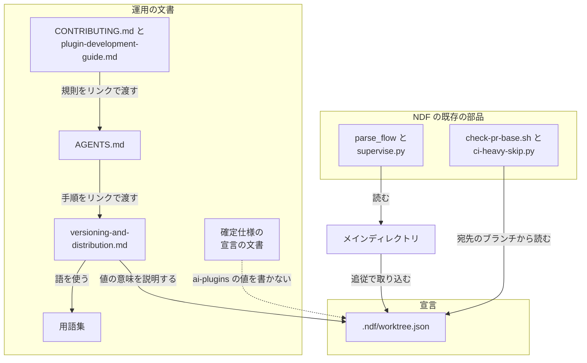
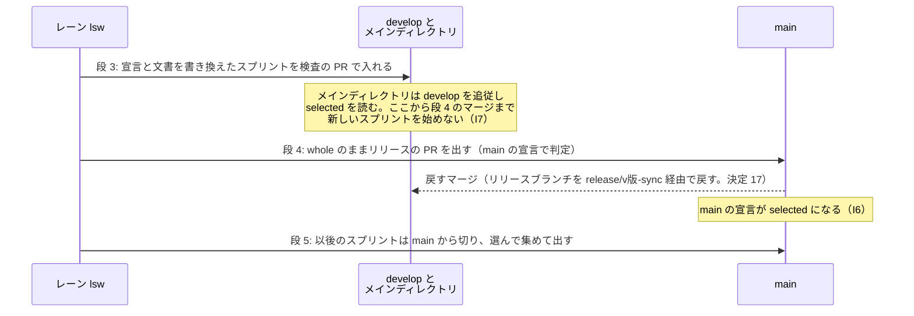
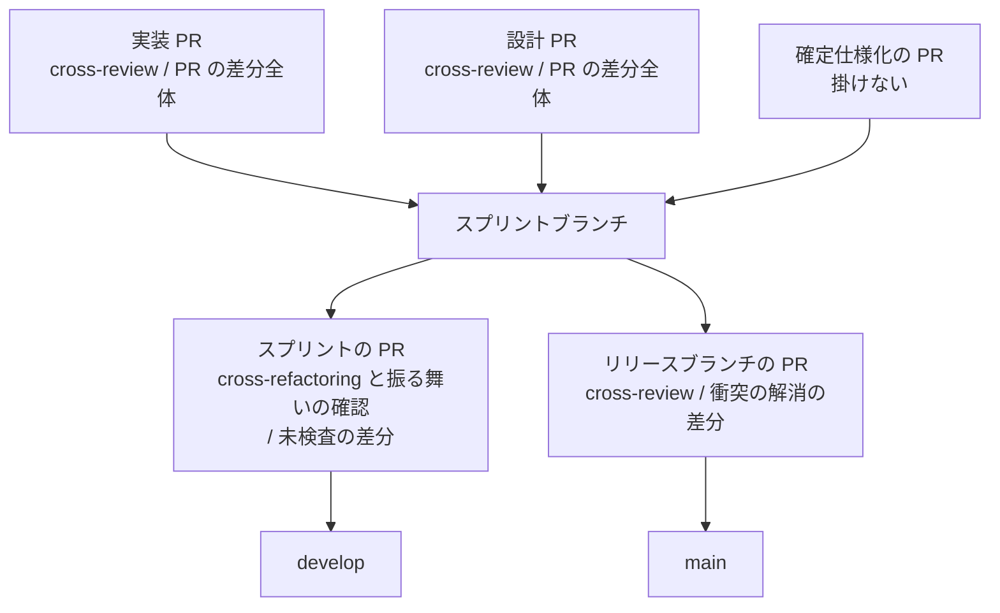

# ai-plugins のブランチ運用: 承認したスプリントだけをリリースブランチで本番チャネルへ届け、PR の種類ごとのレビューを宣言で決める（#3119）

## 目的

- **今どうなっているか**: ai-plugins のスプリントは開発版のブランチ（`develop`）から切り、リリースは `develop` を丸ごと正式版のブランチ（`main`）へ入れる。並列の計画では、承認していないスプリントもリリースに載る（2026-11-12 のリリース 9 に計画の外のスプリントが入った）
- **誰に効くか**: ai-plugins で開発を進める conductor・レーンと、リリースを担うオーガナイザー・一時レーン
- **変えると何が成り立つか**: スプリントを `main` から切り、承認したスプリントだけをリリースブランチへ集めて `main` へ入れる。`develop` は開発版のデプロイとスプリントどうしの結合を試す場になり、`main` へは流れない。PR の種類ごとに掛けるレビューが 1 つの宣言で決まり、同じ差分を 2 度レビューすることも、どこでもレビューされない実装の差分も生じない
- **要求との差**: 要求の目的は「どこでもレビューされない差分」を生じさせないことで、実装の差分に限っていない。この設計では、確定仕様化の PR の差分（文書）を cross-review する PR が無い（決定 1）。この差を残すかは設計承認ゲートで確かめる（「人へ残す判断」）

## 適用範囲

- **働く範囲**: ai-plugins のリポジトリだけ。NDF のコードは変えない（NDF の側は #3121・#3163 で、どんなブランチ運用も宣言で受けられる形になっている）
- **プロジェクトごとに違うもの**: ブランチの流れとレビューの単位は、リポジトリの宣言（`.ndf/worktree.json` の `branch_flow`）の値で受ける。この課題は ai-plugins の値を決めて書く
- **当たるモード**: スプリントを組むすべてのモード（`standard`・`light`・`operation`・`documentation`・`legacy-refactor`）。`pace: fast` は、選んで集める取り込み方と組めない（[ndf-branch-flow-declaration.md](../docs/specifications/ndf-branch-flow-declaration.md) の「組み合わせの制限」）

## あるべき姿の根拠

| 根拠 | 種類 | 何を示すか |
| --- | --- | --- |
| STD1 | 外部の一次情報 | トピックブランチを最も古い取り込み先（本番）から切り、結合は使い捨てのブランチで試す。結合のブランチを本番へ流さない |
| PRD1・PRD2 | 外部の一次情報 | 主要なコード管理の製品は、レビューの要否を宛先のブランチごとの規則として宣言させる |
| PRD4 | 外部の一次情報 | 小さい変更の単位で見るレビューは速く、深く見られる。課題のまとまりごとの cross-review の根拠になる |
| 2026-11-12 のリリース 9 | 実測 | 範囲が `develop` 全体で決まるため、計画の外のスプリント（#3074 の PR 3 件）がリリースに入った |
| 利用者の指示（2026-11-12） | 利用者の指示の原文 | 「各スプリントの変更だけをmainに届けられる仕組みが必要」「ndf自体の制約ではなく、あくまでもこのリポジトリのルールとして実現」「レビューをどの単位でやるかのルールも入れたい」 |

要求と受け入れ条件は #3119 の本文にある（コピーは [issue-3119-requirements.md](issue-3119-requirements.md) ）。この文書は「どう作るか」だけを扱う。
ブランチの流れ（受け入れ条件 1〜6）は、決定 11〜20 が決める。決定 11〜20 は [issue-3121-design-repo-rules.md](issue-3121-design-repo-rules.md) と確定仕様
[ndf-branch-flow-declaration.md](../docs/specifications/ndf-branch-flow-declaration.md) が持ち、この文書は写さずに番号で参照する。
レビューの単位の仕組みは [ndf-branch-flow-review-units.md](../docs/specifications/ndf-branch-flow-review-units.md) にある。

## ドメインモデル

### コンテキスト

| コンテキスト | 何の語が 1 つの意味に決まるか |
| --- | --- |
| プロジェクトの宣言（NDF の `lib/branch_flow.py`） | 起点・文書の宛先・取り込み方・レビューの単位の値と、許す組み合わせ |
| ai-plugins の運用（`.ndf/worktree.json`・`AGENTS.md`・`docs/versioning-and-distribution.md`） | ai-plugins のどのブランチが何の役で、正式版をどう組み、PR ごとにどのレビューを掛けるか |

関係は**公表された言語**とする。NDF は許す値の表（`REVIEW_ALLOWED` と取り込み方の表）とスキーマを公表し、ai-plugins はその形式で値を書く。
ai-plugins の運用の文書は値の意味を説明するだけで、NDF の語を言い換えない。NDF の側は ai-plugins の値を前提にしない。
NDF の確定仕様に ai-plugins の値や置き場を書き込まない。確定仕様にある ai-plugins の今の値の 1 文は、事実と食い違うため削除だけを行う（決定 5）。

### 集約

| 集約 | 持ち主（書き換えてよいもの） | 根 | エンティティ | 値オブジェクト |
| --- | --- | --- | --- | --- |
| ai-plugins のブランチ運用の宣言 | リポジトリの管理者 | `.ndf/worktree.json` の `branch_flow` | — | ブランチの流れの 4 項目、レビューの単位の 5 行 |
| ai-plugins の運用の文書 | リポジトリの管理者 | `docs/versioning-and-distribution.md`（正本） | `AGENTS.md` の 2 節、`CONTRIBUTING.md`・`docs/plugin-development-guide.md` の宛先の段落 | レビューの単位の表 |

持ち主はどちらもリポジトリの管理者 1 人に決まる。
書き換えの経路は持ち主の下の操作であり、持ち主を増やさない。
C7 に当たる書き換え（`.ndf/` と `AGENTS.md` の運用の節）は、PR ごとの承認を足さず、既存のリリース承認ゲートで管理者が見る。

| 集約 | 持ち主の下の操作 |
| --- | --- |
| 宣言 | この課題の実装 PR で書き換える。以後は PR の中の手の編集か `project-decl.py write` で書き換える |
| 文書 | この課題の実装 PR で書き換える。以後は宣言を変える PR が同じ PR で文書を合わせる。文書だけを変える PR でも書き換えてよい |

運用の文書は宣言の値を写さず、意味の説明とリンクを持つ。レビューの単位の表だけは、受け入れ条件 8 が求める説明として値を並べる（決定 3）。

構成要素のうち次の 2 つは、どちらの集約にも入れない。この課題では書き換えるだけで、ai-plugins の運用の不変条件を持たないためである。

| 構成要素 | 属する先 |
| --- | --- |
| 確定仕様の宣言の文書（`docs/specifications/ndf-branch-flow-declaration.md`） | プロジェクトの宣言のコンテキスト（NDF の側）。ai-plugins の値を書かない（決定 5） |
| 用語集（`docs/glossary/glossary.json`・`docs/glossary.md`） | 用語集の正本（`glossary.json`）から `glossary.py render` で作る。この課題は用語を 1 つ足すだけである |

### 不変条件

| # | 集約 | 条件 | 破れたときの扱い |
| --- | --- | --- | --- |
| I1 | 宣言 | `branch_flow` のブランチの流れは `start: production`・`integrate: check`・`doc_prs: sprint`・`promotion: selected`、`base_branch` は `develop`・`production_branch` は `main` のまま | `parse_flow` が指摘を返し、宣言を読む工程が止まる。実装 PR の確認の手順で落とす |
| I2 | 宣言 | `reviews` は 5 種類すべての行を持ち、各行は許す値の表の値で、実装の差分をどの PR でも cross-review しない組（NDF の I4）と既定値の行との重なり（NDF の I12）を生じない | 同上 |
| I3 | 文書 | 正本の文書のレビューの単位の表は、宣言の `reviews` の 5 行と同じ値を持つ | コードレビューで見る（`.md` の文言を照合するテストは書かない） |
| I4 | 文書 | `AGENTS.md` は判断の基準だけを持ち、手順と実測を正本の文書へリンクで渡す。指示書のチェックが 0 を返す | `instructions-check.py` が 1 を返す |
| I5 | 文書 | `develop` を宛先にする記述が、新しい運用で `develop` へ入れる PR（開発版の版上げ・戻すマージ・スプリントの検査の PR）だけに残る | コードレビューで見る |
| I6 | 宣言 | `main` の宣言は、`main` 宛の PR のマージでだけ変わる（`selected` への切り替えは段 4、`whole` へ戻すのは決定 20 の順序） | `main` 宛の検査は `main` の宣言で判定するため、ほかの経路では入らない（#3121 の決定 12） |
| I7 | 宣言 | 段 3 のマージから段 4 のマージまでの間に、新しいスプリントを始めない | 始めたスプリントは `main` から切られ、`main` の検査（まだ `whole`）でリリースの PR が断られる。始めたスプリントを止め、段 4 の後に切り直す |
| I8 | 宣言 | 段 3 のスプリントの PR を `develop` へ入れるのは、#3308（リリースを組む取り込み方を本番チャネルの宣言で決める）の版が本番へ出た後である | 先に入れると、段 4 のまとめたリリースがメインディレクトリの `selected` の宣言で組まれ、`main` の検査（まだ `whole` の規則）に断られる（決定 10） |

### ドメインイベント

| # | イベント | 発生元 | 受け手 |
| --- | --- | --- | --- |
| E1 | 宣言を新しい運用の値へ書き換えた | この課題の実装 PR | 宣言を読む工程（`supervise.py new sprint`・`project-decl.py check`） |
| E2 | `AGENTS.md` と正本の文書を新しい運用へ書き換えた | この課題の実装 PR | conductor・レーン・外部の貢献者 |
| E3 | このスプリントを `develop` へ入れた | スプリントの検査の PR | 開発版のデプロイ、メインディレクトリの追従 |
| E4 | このスプリントを `whole` のまま `main` へ出した（段 4） | リリース承認ゲートの承認 | CD（正式版のデプロイ） |
| E4a | `main` の宣言が `selected` に切り替わった（E4 のマージに宣言の書き換えが載るため。I6） | E4 のマージ | `main` 宛の検査（以後 `selected` で判定） |
| E5 | リリースブランチを `release/v<版>-sync` 経由で `develop` へ戻した | 段 4 の後の戻すマージ（決定 17） | メインディレクトリの追従、開発版のデプロイ |
| E6 | 新しいスプリントを `main` から切った | 段 4 の後に始めるスプリント | スプリントの目録のスナップショット |
| E7 | 選んだスプリントだけでリリースブランチを組み、`main` へ出した | 段 5 のリリース | `main` 宛の検査・CD |
| E8 | PR の種類ごとに宣言どおりのレビューを掛けた | 段 5 の各 PR | `project-decl.py drift` |

### 用語

| 用語 | 意味 | 用語集への反映 |
| --- | --- | --- |
| 取り込み方 | スプリントの変更を本番チャネルへ入れる方法（`branch_flow.promotion`） | 追加（要求の段で反映済み） |
| 戻すマージ | 正式版のリリースの後、リリースブランチを `release/v<版>-sync` 経由でベースブランチへ取り込むマージ。版数の衝突は本番の版を取る | 追加 |

ベースブランチ・本番チャネル・リリースブランチ・スプリントブランチ・レビューの単位・未検査の差分・衝突の解消の差分は、用語集の既存の意味で使う。

## 外部の調査

| 種類 | 調べるか | 理由 |
| --- | --- | --- |
| 標準・仕様 | 調べる | トピックブランチの起点と結合のブランチの扱い、マージのコミットだけをレビューする差分の取り方に一次資料がある |
| 主要な製品 | 調べる | レビューの要否を宛先のブランチごとに決める形と、マージのコミットの見せ方を主要な製品と比べる |
| ライブラリとサービス | 調べない | コードを足さない。宣言の読み分けとレビューの差し込みは NDF の既存の部品（#3121・#3163）が持つ |

### 標準・仕様

| # | 標準・仕様 | 何を定めているか | 設計への反映 | 出典 |
| --- | --- | --- | --- | --- |
| STD1 | gitworkflows(7) の Topic branches・Throw-away integration | トピックブランチは最終的に取り込む中で最も古い統合ブランチから切る。組み合わせは使い捨ての統合ブランチで試し、安定したブランチへは入れない | スプリントを `main` から切り、`develop` を結合の場にして `main` へ流さない（I1） | https://git-scm.com/docs/gitworkflows （2026-11-13） |
| STD2 | git log の `--remerge-diff` | マージのコミットを、親を自動でマージし直した結果と比べた差分で見せる | リリースブランチの行を「衝突の解消の差分だけを cross-review」にする根拠（決定 1） | https://git-scm.com/docs/git-log （2026-11-13） |

### 主要な製品

| # | 製品 | どう解いているか | 設計への反映 | 出典 |
| --- | --- | --- | --- | --- |
| PRD1 | GitHub のルールセット | 宛先のブランチごとに「マージの前に PR を必須にする」「必須のステータスチェック」を規則として置く。head のブランチを制限する規則は無い | レビューの要否を PR の種類（宛先と head の組）ごとに宣言する形と合う。宛先の制限は既存の `guard` が持つ（#3121 の決定 13） | https://docs.github.com/en/repositories/configuring-branches-and-merges-in-your-repository/managing-rulesets/available-rules-for-rulesets （2026-11-13） |
| PRD2 | GitLab のマージリクエストの承認の規則 | 承認の規則を宛先のブランチ（すべての保護ブランチか特定のブランチ）ごとに適用する | 同上 | https://docs.gitlab.com/user/project/merge_requests/approvals/rules/ （2026-11-13） |
| PRD3 | Gerrit の変更の画面 | マージのコミットには、取り込まれる変更の一覧（Merge List）を別の項目として見せ、取り込む中身と分けて扱う | リリースブランチの PR では、取り込むスプリントの差分を読み直さず、マージで生じた差分だけを見る（決定 1） | https://gerrit-review.googlesource.com/Documentation/user-review-ui.html （2026-11-13） |
| PRD4 | Google のコードレビューの指針（Small CLs） | 小さい変更は速く、深くレビューされる | 実装 PR の単位で cross-review し、スプリントの大きな差分にまとめない（決定 1） | https://google.github.io/eng-practices/review/developer/small-cls.html （2026-11-13） |

### 確かめられなかったこと

| 対象 | 試した手段 | 結果と理由 |
| --- | --- | --- |
| Gerrit がマージのコミットを自動のマージの結果と比べて見せる機能（確定仕様の記述） | https://gerrit-review.googlesource.com/Documentation/user-review-ui.html の取得と「Auto Merge」の検索 | 取得は HTTP 200。取得した本文に「Auto Merge」の語は無く、この機能の記述は確かめていない。PRD3 には取得した本文にある Merge List だけを書いた |

調べた量: 候補 6 件・取得の試み 6 回。

## 機能一覧

| # | 機能 | 誰が使うか |
| --- | --- | --- |
| F1 | 新しいスプリントを `main` から始め、設計 PR・実装 PR・確定仕様化の PR をスプリントブランチへ入れる | conductor・レーン |
| F2 | スプリントの検査の後、スプリントブランチを `develop` へ入れて結合を試し、開発版として配る | レーン・開発版の利用者 |
| F3 | 承認したスプリントだけをリリースブランチへ集め、正式版として `main` へ出す | オーガナイザー・一時レーン |
| F4 | 正式版のリリースの後、リリースブランチを `release/v<版>-sync` 経由で `develop` へ戻す | オーガナイザー・一時レーン |
| F5 | 前のスプリントに依存するスプリントを出す | conductor・オーガナイザー |
| F6 | 本番の不具合の直しを、課題 1 つのスプリントとして出す | conductor・オーガナイザー |
| F7 | PR の種類ごとに、宣言で決めたレビューを掛ける | NDF のプラン（レーン・一時レーンが回す） |
| F8 | 選んで集める取り込み方から、丸ごと入れる取り込み方へ戻す | リポジトリの管理者 |
| F9 | NDF のスプリントの外で変更を出す（外部の貢献者・手の変更） | 外部の貢献者・保守者 |

## 構成要素

| 要素 | 責務 |
| --- | --- |
| `.ndf/worktree.json`（宣言） | ブランチの流れの 4 項目とレビューの単位の 5 行を持つ。ai-plugins の運用の値の正本（I1・I2） |
| `docs/versioning-and-distribution.md`（正本の文書） | 「チャネルと ref」に各ブランチの役割、「正式版を出す」に選んで集める手順・戻すマージ・依存するスプリント・本番の不具合の直し・取り込み方を戻す条件と順序・レビューの単位の表を持つ（I3・I5） |
| `AGENTS.md` | 「Git運用ルール」に起点と宛先、「版とリリースの方針」にチャネルの役割と取り込み方とレビューの単位の要点を持ち、手順は正本の文書へリンクする。「ベストプラクティス」の DO の宛先の行も合わせる（I4・I5） |
| `CONTRIBUTING.md` | NDF のスプリントの外の変更の起点と宛先（決定 4）を持つ。「開発の進め方」の宛先と worktree を切る起点、「一括の整形の前から続くブランチを取り込む」の取り込む先、「Pull Request を出す」の宛先の 4 か所（I5） |
| `docs/plugin-development-guide.md` | 「プラグインの削除」の手順の宛先と `gh pr create` の例を決定 4 に合わせる（I5） |
| `docs/specifications/ndf-branch-flow-declaration.md` | 末尾の「ai-plugins の `.ndf/worktree.json` は `branch_flow` を持たず、既定値の行で動いている」の 1 文を削除する。代わりの文は書かない（決定 5） |
| `docs/glossary/glossary.json`・`docs/glossary.md` | 用語「戻すマージ」を足し、`glossary.py render` で作り直す |
| メインディレクトリ | 要求の段で書き起こした未コミットの宣言（`whole` の値）を、`develop` の追従の前に戻す（決定 6） |



## 処理の流れ

切り替えは #3121 の決定 19 の段 3〜5 で行う。この課題のスプリントが段 3、そのリリースが段 4 である。段 2（動いているスプリントを出し切る）は、
2026-11-13 の時点で計画 p6 に動いているスプリントが lsw だけのため待ちが無い（要求の前提 3）。



段 4 のリリースの PR は、`main` の宣言（`branch_flow` が無い）で判定されるため、今の規則（head が `develop` の祖先の `release/v<版>`）で通る。
リリースを組む工程は目録の開始時の値を読まず、組む時点の宣言を読み直す（`plan_parallel_release` → `apply_decls` → `decl.flow_snapshot`。
`pin_flow` を呼ぶのは `supervise_lib/sprint.py` だけ）。今の版のままでは、段 4 はメインディレクトリの `selected` の宣言で組まれて `main` の検査に断られる。
このため段 4 は、リリースを組む取り込み方を本番チャネルの宣言で決める #3308 の版が出た後に組む（決定 10・I8）。そうすれば段 4 は `main` の宣言（まだ無い）で
`whole` に組まれ、`main` へ入った後のリリースから `selected` になる。段 5 の流れは
[ndf-branch-flow-declaration.md](../docs/specifications/ndf-branch-flow-declaration.md) の「スプリントの流れ（選んで集める取り込み方）」にある。

この図には宣言を読むメインディレクトリとブランチだけを描く。構成要素の表の文書（正本の文書・`AGENTS.md`・`CONTRIBUTING.md`・
`docs/plugin-development-guide.md`・確定仕様・用語集）は描かない。これらは段 3 の PR に宣言と一緒に載るだけで、流れの中で読み手を持たない。

段 5 で各 PR に掛けるレビューは次のとおりである（決定 1 の値）。



## 非機能の実現方式

| 大項目 | 実現方式 |
| --- | --- |
| 運用・保守性 | 値の正本は `.ndf/worktree.json` の 1 か所に置く。`AGENTS.md` は値を写さず要点とリンクだけを持つ。正本の文書のレビューの単位の表は値の説明として置き、宣言との食い違いは実装 PR のコードレビューで見る（I3）。値の読み分けは `parse_flow` が持ち、文書の側で検査を足さない |
| 移行性 | 切り替えは決定 19 の段 3→4→5 の順で行い、強制 push・ルールセットの変更・検査の緩和を使わない。戻すときは決定 20 の 4 段の順で、宣言を `main` 経由で戻す。どちらの順序も正本の文書の「取り込み方を戻す」の節に置く（戻す側だけ。切り替える側は 1 回限りのため、この設計とリリースの依頼に置く） |

## 決定の記録

### 決定 1: 同じ差分を 1 回だけ、小さい単位で見るため、レビューの単位を実装 PR の cross-review・スプリントの検査・衝突の解消の差分の 3 か所に分ける

宣言の `reviews` に次の値を書く。

```json
"reviews": {
  "impl": {"checks": ["cross-review"], "diff": "pr"},
  "sprint": {"checks": ["cross-refactoring", "behavior"], "diff": "unchecked"},
  "release": {"checks": ["cross-review"], "diff": "resolution"},
  "design": {"checks": ["cross-review"], "diff": "pr"},
  "spec": {"checks": [], "diff": "none"}
}
```

| PR の種類 | 掛けるレビュー | 対象の差分 | 理由 |
| --- | --- | --- | --- |
| 実装 PR（→ スプリントブランチ） | cross-review | PR の差分全体 | 小さい単位で深く見る（PRD4）。実装の差分を cross-review するのはここだけにする |
| スプリントの PR（→ `develop`） | cross-refactoring・振る舞いの確認 | 未検査の差分 | 構造の改善と、組み上がった振る舞いの確認はスプリントの単位で 1 回にする。実装 PR で見た差分を cross-review し直さない |
| リリースブランチの PR（→ `main`） | cross-review | 衝突の解消の差分 | スプリントの差分は見済みで、集めたときに初めて生じるのはマージのコミットの差分だけである（STD2・PRD3）。組み合わせの不具合は、この差分と全体テスト（決定 15）で拾う |
| 設計 PR（→ スプリントブランチ） | cross-review | PR の差分全体 | 実装の前に設計の誤りを止める。NDF の既定値と同じ |
| 確定仕様化の PR（→ スプリントブランチ） | 掛けない | 掛けない | 中身は、設計承認ゲートを通った設計と、実装 PR で cross-review した実装を確定仕様へ書き直したものである。`doc_prs: sprint` ではこの PR はリリースの前にスプリントブランチへ入るため、リリース承認ゲートを通った後の書き直しではない。NDF の既定値と同じ |

確定仕様化の PR の差分（文書）を cross-review する PR は、この値では無い。スプリントの PR は未検査の差分を見るが、掛けるのは cross-refactoring と振る舞いの確認だけである。
リリースブランチの PR は衝突の解消の差分だけを見る。要求の目的「どこでもレビューされない差分も生じない」との差であり、設計承認ゲートで確かめる（「人へ残す判断」）。

実装 PR でレビューしない値（スプリントの PR だけで cross-review と cross-refactoring を 1 回）は採らない。課題のまとまりごとの指摘がスプリントの大きな差分に混ざり、課題のまとまりごとに cross-review する手法（#3081）の動機に反する。
リリースブランチの PR で範囲全体を cross-review し直す値（`release` を `cross-review / pr`）も採らない。実装 PR と同じ差分を 2 度見ることになり、リリースの範囲が大きいほど費用が増える。
この値は NDF の I12 の指摘には当たらない（I12 は書いていない行の既定値との重なりだけを見る）ため、2 度のレビューは値の選び方で避ける。

`parse_flow` はこの値を `promotion: selected` と組み合わせて指摘なしで読む（2026-11-13 に実行して確かめた。下のエビデンス）。

```console
$ python3 - （plugins/ndf/scripts で、ブランチの流れ 4 項目と各 reviews を parse_flow に渡し、指摘の理由を出す）
決めた値 : 指摘なし
impl の行を消す : 課題のまとまりの記録が無いとき、実装の差分がどの PR でも cross-review されない
sprint の行を消す : 既定値の sprint が、書いた impl と同じ実装の差分を cross-review する
```

2 行目は NDF の I4、3 行目は NDF の I12 の指摘である。同じ値を `promotion: whole` と組むと、`release` の行と起点・文書の宛先に「`promotion = whole`」の指摘が出る（同じ日に実行）。

根拠: Value 2 / Value 11 / Value 1（MVV 版 7）

### 決定 2: 課題のまとまりの記録の有無で掛け方が変わらないよう、5 種類すべての行を書く

NDF は書いていない種類を、課題のまとまりの記録の有無で 2 列の既定値から解く。実装 PR とスプリントの PR を既定値に任せると、まとまりの記録が無いスプリントでは
実装 PR で cross-review せず、スプリントの PR で 3 つすべてを掛ける。どの PR で何を見るかがスプリントの外の事情で変わり、正本の文書の表と食い違う。
5 種類すべてを書けば、掛け方は宣言だけで決まる（受け入れ条件 7）。

まとまりの記録が無いスプリントでは、実装 PR は課題 1 つずつになり、cross-review の回数は課題の数と同じになる。この費用は段 5 の最初のスプリントで実測する（「未確認のまま残ること」）。

根拠: Value 3 / Value 11（MVV 版 7）

### 決定 3: 読み手が値の意味を 1 か所で読めるよう、レビューの単位の表は正本の文書にだけ置き、`AGENTS.md` には要点だけを置く

正本の文書の「正式版を出す」に、PR の種類ごとの掛けるレビュー・対象の差分・理由の表を置く（受け入れ条件 8）。値の正本は宣言で、表は値の説明である。
`AGENTS.md` には「PR の種類ごとに掛けるレビューは宣言の `reviews` が決め、表は正本の文書にある」の要点とリンクだけを置く。
`AGENTS.md` にも表を置くと、値を 3 か所に持つことになり、食い違いを見る箇所が増える。

根拠: Value 11 / Value 14（MVV 版 7）

### 決定 4: 承認したスプリントだけが `main` へ入る規則を、NDF の外の変更にも当てるため、外部の貢献者と手の変更も `main` から切り、スプリントブランチへ出す

`CONTRIBUTING.md` と `docs/plugin-development-guide.md` は「`develop` から切り、`--base develop` で出す」と書いている。`selected` では `develop` は `main` へ流れないため、
この手順で入れた変更は正式版に届かない。`main` 宛の検査も、スプリントブランチ（origin の `sprint/*`）の祖先でないコミットを断る（#3121 の決定 14）。

そのため、NDF のスプリントの外の変更も `main` から切り、宛先は保守者が課題に示すスプリントブランチ（`sprint/<名前>`）にする。
保守者は受け付けた変更ごとにスプリントブランチを `main` から作り、ほかのスプリントと同じ検査とリリースブランチの手順で出す。
宛先を `develop` のまま残し、保守者が後からスプリントブランチへ移す形は採らない。移す操作が手で 1 回増え、移し忘れた変更は `develop` にだけ残って `main` へ届かない。

根拠: Value 4 / Value 13（MVV 版 7）

### 決定 5: 確定仕様に今の値と食い違う記述を残さず、NDF の仕様に ai-plugins の置き場を持ち込まないため、宣言の文書の末尾の 1 文を削除する

[ndf-branch-flow-declaration.md](../docs/specifications/ndf-branch-flow-declaration.md) の末尾には次の 1 文がある。「ai-plugins の `.ndf/worktree.json` は `branch_flow` を持たず、既定値の行で動いている」。
この課題のマージで事実と食い違うため、この 1 文を削除し、代わりの文は書かない。
この文書は NDF の「プロジェクトの宣言」が公表する仕様であり、NDF の側は ai-plugins の値を前提にしない（「コンテキスト」）。

1 文を ai-plugins の置き場への参照に置き換える形は採らない。NDF の仕様に ai-plugins の置き場を書き込むことになり、公表された言語の関係に合わない。

根拠: Value 11 / Value 13 / Value 4（MVV 版 7）

### 決定 6: メインディレクトリが `develop` を追従できるよう、要求の段で書き起こした未コミットの宣言は、宣言をコミットした PR のマージの後に戻す

要求の段で `project-decl.py write` がメインディレクトリの `.ndf/worktree.json` に今の運用の値（`whole`）を書き、未コミットのまま残っている（要求の前提 4）。
宣言を読む工程はメインディレクトリのファイルを読む（`branch_flow.read_flow`）。この差分が残ると、メインディレクトリが `develop` を取り込むときに同じファイルの変更として衝突し、取り込みが止まる。

書き換えは worktree の中でコミットする。スプリントの検査の PR が `develop` へ入った後、メインディレクトリの `.ndf/worktree.json` の未コミットの差分を戻してから `develop` を取り込む。
戻す値は要求の前提 4 に記録があり、新しい値はコミットに入っているため、戻しても失われる情報は無い。メインディレクトリの `.ndf/project.json` の未コミットの差分は、この課題の対象の外のため触らない。

メインディレクトリで直接コミットする形は採らない。開発の変更は worktree の中で行う規則（`AGENTS.md` の「Git運用ルール」）に合わない。

根拠: Value 6 / Value 3（MVV 版 7）

### 決定 7: I5 を満たすため、要求の対象範囲の外の文書（`CONTRIBUTING.md`・`docs/plugin-development-guide.md`・宣言の確定仕様・用語集）も同じ変更で書き換え、外部の貢献者の手順を決定 4 のとおり決める

要求の「含む」は宣言・`AGENTS.md`・`docs/versioning-and-distribution.md`・レビューの単位の 4 つだが、`CONTRIBUTING.md` などに「`develop` 宛」の手順が残ると、切り替えの後に外部の貢献者と AI が古い宛先へ PR を出す（I5）。
範囲を広げても新しい振る舞いは足さず、同じ運用の記述を合わせるだけである。別の Issue へ分けると、分けた Issue が出るまで文書どうしが食い違う。conductor が決めた。設計承認ゲートの承認資料に載せる。

根拠: Value 3 / Value 13（MVV 版 7）

### 決定 8: 確定仕様化の PR は、レビュー済みの設計と実装を写す差分のため cross-review を掛けず（`spec`: none）、要求の「どこでもレビューされない差分を生じない」は実装の差分について保証する

確定仕様化の PR の中身は、設計 PR で cross-review を通した設計文書と、実装 PR で cross-review を通した振る舞いを、確定仕様の形へ写したものである。文書の検査（doc-lint・用語チェック）は今のまま掛かる。
`spec` に cross-review を掛けると、同じ内容を 2 度レビューする（決定 1 の目的に反する）。NDF の既定値（`REVIEW_DEFAULTS` の `spec`）とも同じ値である。conductor が決めた。設計承認ゲートの承認資料に載せる。

根拠: Value 13（MVV 版 7）

### 決定 9: ai-plugins では `promotion: selected` と組めない `pace: fast` を使わず、スプリントは `pace: auto` か `normal` で回す

`pace: fast` は実装の PR をベースブランチへ直接入れるため、選んだスプリントブランチを集める取り込み方と組めない（「適用範囲」）。p6 のレーンは `auto` で回しており、承認を MVV 判定へ寄せる利点は `auto` で保てる。
`.ndf/pace.json` の `fast` は残し、`new sprint --pace fast` が組めない組として断る振る舞いに任せる。conductor が決めた。設計承認ゲートの承認資料に載せる。

根拠: Value 3 / Value 13（MVV 版 7）

### 決定 10: 段 4 を `whole` で組むため、リリースを組む取り込み方を本番チャネルの宣言で決める NDF の直し（#3308）を、段 3 の PR を `develop` へ入れる前に出す

まとめたリリースを組む工程はメインディレクトリ（`develop` を追従）の宣言を読む。`main` 宛の検査は `main` の宣言で判定する（#3121 の決定 12）。
読む宣言が 2 つに分かれているため、段 3 で `selected` が `develop` に入ると、段 4 は `selected` で組まれ `main` の検査に断られる（設計単体のレビューの指摘 3、MVV 判定）。
#3121 の決定 19 の「段 4 は `whole`」は、この食い違いのために成り立っていない。

リリースを組む側も本番チャネルの宣言を読むようにすれば、宣言の読み手が「本番へ入るものは本番チャネルの宣言で決める」の 1 つの規則にそろい、切り替えのリリースは
手の操作なしに `whole` で組まれる。NDF の変更は要求の「含まない」に当たるため #3308 として起票し、この課題では順序の条件（I8）だけを持つ。
#3308 を先に出す順序は、段 3 の PR が `develop` へ入る前に #3308 の版が `develop` を経て本番へ出ることを求める（#3308 のリリースも `whole` で組まれる）。

採らなかった案: (a) 宣言だけを段 4 の後の別の PR とリリースへ分ける — 分けた側のリリースを組む時点で `develop` に `selected` が入っており、同じ食い違いが 1 段後ろへずれるだけで解けない。
(b) 段 4 の間だけメインディレクトリの宣言を手で `whole` に書き換える — リリースの作業場所（`develop` から切る）の宣言が先に読まれる場合は効かず、効く場合も戻し忘れが残る。
(c) リリースのプランへ開始時の値を渡す仕組みを足す — まとめたリリースは複数のレーンのスプリントを集めるため、どのスプリントの開始時の値を採るかが決まらない。
conductor が決めた。設計承認ゲートの承認資料に載せる。

根拠: Value 7 / Value 13（MVV 版 7）

## テスト設計

この課題はテストを足さない（要求の「前提とする取り決め」）。振る舞いは #3121・#3163 のテストが縛り、この課題では宣言の値と文書を確かめる。

| 受け入れ条件・不変条件 | どの振る舞いで縛るか | どう壊したら落ちるべきか |
| --- | --- | --- |
| 受け入れ条件 1・I1 | worktree でコミットした `.ndf/worktree.json` を `branch_flow.read_flow` で読み、4 項目と `base_branch`・`production_branch` が期待の値で、指摘が出ない | 4 項目のどれかを `whole` の組み合わせへ戻すと、`parse_flow` が組み合わせの指摘を返す |
| 受け入れ条件 2 | #3121 の受け入れ条件 14 のテスト（`test_sprint_branch_flow.py`）が、この宣言の値で起点 `origin/main`・設計 PR の宛先 `sprint/<名前>` を返す | 宣言の `start` を読まないと落ちる |
| 受け入れ条件 3 | #3121 の受け入れ条件 15 のテスト（`scripts/tests/test_pr_base_guard.py`）で、head が `develop` の `main` 宛を `check-pr-base.sh` が 1 で断る | worktree の宣言を読むと落ちる |
| 受け入れ条件 4 | #3121 の受け入れ条件 16 のテストで、選んでいないスプリントのコミットを含む head を `check-pr-base.sh` が 1 で断る。承認資料の範囲は、このスプリントでは確かめず、段 5 の最初のリリースで見る（「未確認のまま残ること」） | 決定 14 の 3 つ目の条件を外すと落ちる |
| 受け入れ条件 5 | 正本の文書に戻すマージの手順があることをコードレビューで見る。版上げのコミットが入らないことは #3121 の受け入れ条件 17 のテスト | スプリントブランチへ `develop` を取り込むと落ちる |
| 受け入れ条件 6 | #3121 の受け入れ条件 18 のテストで、宛先の宣言が `selected` のとき `ci-heavy-skip.py` が規則 3 で省かない | 規則 3 で宣言を見ないと落ちる |
| 受け入れ条件 7・I2 | コミットした宣言の `reviews` が 5 種類の行を持ち、`parse_flow` が指摘なしで読む | `impl` の行を消すと I4 の指摘、`sprint` の行を消すと I12 の指摘が出る（決定 1 のエビデンス） |
| 受け入れ条件 8・I3 | 正本の文書の表の 5 行と宣言の `reviews` が同じ値であることをコードレビューで見る。決定 1 に理由と採らなかった値がある | 表と宣言の片方だけを変えると、レビューで食い違いとして指摘される |
| 受け入れ条件 9 | 段 5 の最初のスプリントのリリース後テストで、`project-decl.py measure --out <ファイル>` → `project-decl.py drift --measure <ファイル>` のずれが 0 件（標本 3 件未満の種類は `unknown`） | 宣言と違うレビューを掛けた PR が 3 件以上あれば、その種類のずれが出る |
| 受け入れ条件 10・I4 | `python3 plugins/ndf/scripts/instructions-check.py --root .` が 0 | `AGENTS.md` に手順を書き足して上限を超えると 1 |
| I5 | `--base develop`・「develop 宛」・`origin/develop` から切る記述を、リポジトリの説明の文書（`issues/`・`plugins/`・確定仕様・アーカイブ・`CHANGELOG.md` を除く）から検索で集め、残る行が開発版の版上げ・戻すマージ・スプリントの検査の PR だけであることをコードレビューで見る | `CONTRIBUTING.md` の宛先を直さずに残すと、検索に残る |
| I6 | `main` 宛の検査が `main` の宣言で判定すること（#3121 の受け入れ条件 15 のテスト） | worktree の宣言を読むと落ちる |
| I7 | 段 3 のマージから段 4 のマージまでの間に開始したスプリントが無いことを、段 4 のリリースの依頼の前に計画の状態で確かめる | — （運用の順序の条件で、テストでは縛らない） |
| I8 | 段 3 のスプリントの PR のマージの前に、`origin/main` の NDF の版が #3308 を含むことを `git show origin/main:CHANGELOG.md` で確かめる | — （運用の順序の条件で、テストでは縛らない。#3308 の振る舞いは #3308 のテストが持つ） |

範囲のテストは要求の「検証手段」のコマンドを使う。

## 設計の結果

| 課題 | 扱い | 取り込み先 | 触るファイル |
| --- | --- | --- | --- |
| #3119 | 実装する | — | `.ndf/worktree.json`、`AGENTS.md`、`docs/versioning-and-distribution.md`、`CONTRIBUTING.md`、`docs/plugin-development-guide.md`、`docs/specifications/ndf-branch-flow-declaration.md`、`docs/glossary/glossary.json`、`docs/glossary.md` |

## 人へ残す判断

| 判断 | 当たるレッドライン | なぜ当たるか |
| --- | --- | --- |
| `.ndf/worktree.json` の `branch_flow` と `AGENTS.md` の運用の節を書き換えてよいか | C7 | 利用者の設定と指示書の運用の節の書き換えである。実装の中でコミットし、リリース承認ゲートで人が見る |
| 正式版の組み方を `develop` 丸ごとから選んだスプリントだけへ変えてよいか | P1 | 正式版のブランチへ何が載るかの規則を変え、利用者全員に効く。リリース承認ゲートで人が見る |

## 未確認のまま残ること

| 項目 | 内容 |
| --- | --- |
| 実装 PR ごとの cross-review の費用 | まとまりの記録が無いスプリントで、課題の数だけ cross-review が走ったときの token と時間は実測が無い。段 5 の最初のスプリントの検査の記録で分かる |
| 衝突の解消の差分の大きさ | リリースブランチへ集めたときの衝突の解消の差分が、cross-review に見合う大きさになるかは実測が無い。段 5 の最初のリリースの `review-open` の結果で分かる |
| 受け入れ条件 9 の標本 | 段 5 の最初のスプリントだけでは、種類によって標本が 3 件に満たず `unknown` になる。ずれ 0 件の確かめは、標本がそろう種類から順に分かる |
| 受け入れ条件 4 の承認資料の範囲 | 「承認資料の範囲は、含めたスプリントブランチの PR の和と一致する」は、このスプリントでは確かめない。段 5 の最初のリリースで、承認資料に載った PR の一覧と、含めた各スプリントブランチへマージされた PR（`gh pr list --base sprint/<名前> --state merged`）とスプリントの PR の和を比べ、過不足が 0 件であることを見る |
| 外部の貢献者の宛先の運用 | 保守者が課題ごとにスプリントブランチを示す手順（決定 4）が、外部の貢献で回るかは実例が無い。最初の外部の PR で分かる |
