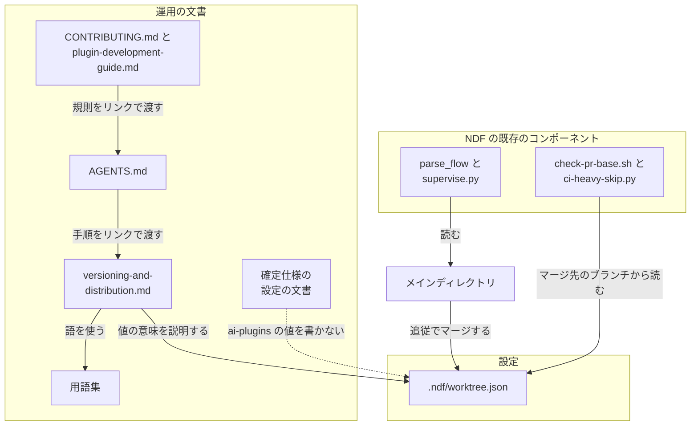
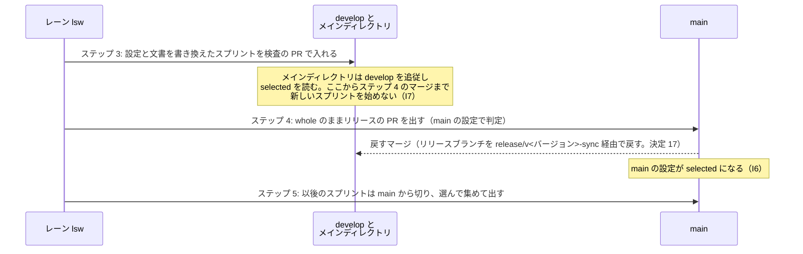
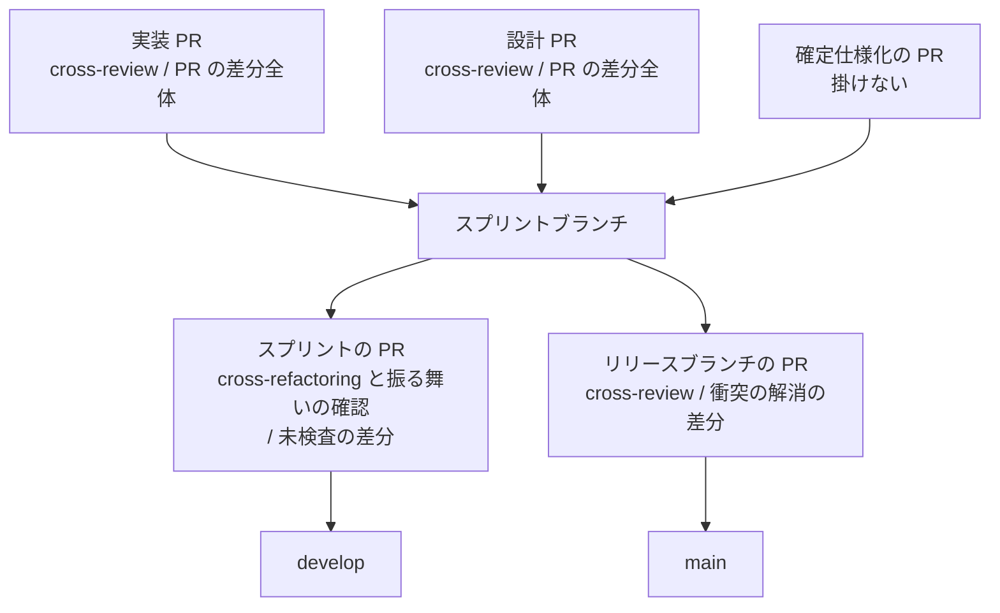

# ai-plugins のブランチ運用: 承認したスプリントだけをリリースブランチで本番チャネルへ届け、PR の種類ごとのレビューを設定で決める（#3119）

## 目的

- **今どうなっているか**: ai-plugins のスプリントは開発版のブランチ（`develop`）から切り、リリースは `develop` を丸ごと正式版のブランチ（`main`）へ入れる。並列の計画では、承認していないスプリントもリリースに載る（2026-11-12 のリリース 9 に計画の外のスプリントが入った）
- **誰に効くか**: ai-plugins で開発を進める conductor・レーンと、リリースを担うオーガナイザー・一時レーン
- **変えると何が成り立つか**: スプリントを `main` から切り、スプリントの PR を `main` へマージしてリリースする（GitHub flow）。`develop` と常設のリリースブランチを持たず、マージの前の検証は検証マーケットプレイスで行う（決定 21。ブランチ戦略の一覧は develop を持つリポジトリ向けの 2 行も残し、ai-plugins が `trunk` を選ぶ）。PR の種類ごとに掛けるレビューが 1 つの設定で決まり、同じ差分を 2 度レビューすることも、どこでもレビューされない実装の差分も生じない
- **要求との差**: 要求の目的は「どこでもレビューされない差分」を生じさせないことで、実装の差分に限っていない。この設計では、確定仕様化の PR の差分（文書）を cross-review する PR が無い（決定 1）。この差を残すかは設計承認ゲートで確かめる（「人へ残す判断」）

## 適用範囲

- **働く範囲**: ai-plugins のリポジトリだけ。NDF のコードは変えない（NDF の側は #3121・#3163 で、どんなブランチ運用も設定で受けられる形になっている）
- **プロジェクトごとに違うもの**: ブランチの流れとレビューの単位は、リポジトリの設定（`.ndf/branch-strategy.json` のセクション `branch_strategy`。#3572 の決定 27）の値で受ける。この課題は ai-plugins の値を決めて書く
- **当たるモード**: スプリントを作るすべてのモード（`standard`・`light`・`operation`・`documentation`・`legacy-refactor`）。`pace: fast` は、選んで集めるリリース方式と組み合わせられない（[ndf-branch-flow-declaration.md](../docs/specifications/ndf-branch-flow-declaration.md) の「組み合わせの制限」）

## あるべき姿の根拠

| 根拠 | 種類 | 何を示すか |
| --- | --- | --- |
| STD1 | 外部の一次情報 | トピックブランチを最も古いマージ先（本番）から切り、結合は使い捨てのブランチで試す。結合のブランチを本番へマージしない |
| PRD1・PRD2 | 外部の一次情報 | 主要なコード管理の製品は、レビューの要否をマージ先のブランチごとの規則として設定させる |
| PRD4 | 外部の一次情報 | 小さい変更の単位で見るレビューは速く、深く見られる。課題のまとまりごとの cross-review の根拠になる |
| 2026-11-12 のリリース 9 | 実測 | 範囲が `develop` 全体で決まるため、計画の外のスプリント（#3074 の PR 3 件）がリリースに入った |
| 利用者の指示（2026-11-12） | 利用者の指示の原文 | 「各スプリントの変更だけをmainに届けられる仕組みが必要」「ndf自体の制約ではなく、あくまでもこのリポジトリのルールとして実現」「レビューをどの単位でやるかのルールも入れたい」 |

要求と受け入れ条件は #3119 の本文にある（コピーは [issue-3119-requirements.md](issue-3119-requirements.md) ）。この文書は「どう作るか」だけを扱う。
ブランチの流れ（受け入れ条件 1〜6）は、決定 11〜20 が決める。決定 11〜20 は [issue-3121-design-repo-rules.md](issue-3121-design-repo-rules.md) と確定仕様
[ndf-branch-flow-declaration.md](../docs/specifications/ndf-branch-flow-declaration.md) が持ち、この文書は写さずに番号で参照する。
レビューの単位の仕組みは [ndf-branch-flow-review-units.md](../docs/specifications/ndf-branch-flow-review-units.md) にある。

## ドメインモデル

### コンテキスト

| コンテキスト | 何の語が 1 つの意味に決まるか |
| --- | --- |
| プロジェクトの設定（NDF の `lib/branch_flow.py`） | 分岐元・文書のマージ先・リリース方式・レビューの単位の値と、許す組み合わせ |
| ai-plugins の運用（`.ndf/worktree.json`・`AGENTS.md`・`docs/versioning-and-distribution.md`） | ai-plugins のどのブランチが何の役で、正式版をどう作成し、PR ごとにどのレビューを掛けるか |

関係は**公表された言語**とする。NDF は許す値の表（`REVIEW_ALLOWED` とブランチ戦略の一覧）とスキーマを公表し、ai-plugins はその形式で値を書く。
ai-plugins の運用の文書は値の意味を説明するだけで、NDF の語を言い換えない。NDF の側は ai-plugins の値を前提にしない。
NDF の確定仕様に ai-plugins の値や保存先を書き込まない。確定仕様にある ai-plugins の今の値の 1 文は、事実と食い違うため削除だけを行う（決定 5）。

### 集約

| 集約 | 持ち主（書き換えてよいもの） | 根 | エンティティ | 値オブジェクト |
| --- | --- | --- | --- | --- |
| ai-plugins のブランチ運用の設定 | リポジトリの管理者 | `.ndf/branch-strategy.json` のセクション `branch_strategy` | — | ブランチの流れの 4 項目、レビューの単位の 4 行 |
| ai-plugins の運用の文書 | リポジトリの管理者 | `docs/versioning-and-distribution.md`（正本） | `AGENTS.md` の 2 セクション、`CONTRIBUTING.md`・`docs/plugin-development-guide.md` のマージ先の段落 | レビューの単位の表 |

持ち主はどちらもリポジトリの管理者 1 人に決まる。
書き換えの経路は持ち主の下の操作であり、持ち主を増やさない。
C7 に当たる書き換え（`.ndf/` と `AGENTS.md` の運用のセクション）は、PR ごとの承認を足さず、既存のリリース承認ゲートで管理者が見る。

| 集約 | 持ち主の下の操作 |
| --- | --- |
| 設定 | この課題の実装 PR で書き換える。以後は PR の中の手の編集か `project-decl.py write` で書き換える |
| 文書 | この課題の実装 PR で書き換える。以後は設定を変える PR が同じ PR で文書を合わせる。文書だけを変える PR でも書き換えてよい |

運用の文書は設定の値を写さず、意味の説明とリンクを持つ。レビューの単位の表だけは、受け入れ条件 8 が求める説明として値を並べる（決定 3）。

構成要素のうち次の 2 つは、どちらの集約にも入れない。この課題では書き換えるだけで、ai-plugins の運用の不変条件を持たないためである。

| 構成要素 | 属する先 |
| --- | --- |
| 確定仕様の設定の文書（`docs/specifications/ndf-branch-flow-declaration.md`） | プロジェクトの設定のコンテキスト（NDF の側）。ai-plugins の値を書かない（決定 5） |
| 用語集（`docs/glossary/glossary.json`・`docs/glossary.md`） | 用語集の正本（`glossary.json`）から `glossary.py render` で作る。この課題は用語を 1 つ足すだけである |

### 不変条件

| # | 集約 | 条件 | 破れたときの扱い |
| --- | --- | --- | --- |
| I1 | 設定 | セクション `branch_strategy` のブランチの流れは `start: production`・`integrate: release`・`doc_prs: sprint`・`release_strategy: trunk`（決定 21）、`base_branch` と `production_branch` はどちらも `main` | キーごとの値の誤りと、`release_strategy: trunk` に `start: base` を組み合わせるなど行が許さない組み合わせは、セクションのスキーマ（`if`/`then`。#3572 の決定 28）の検査（`ndf check spec-decl` とセクションを読む関数）が断り、設定を読む工程が止まる。`base_branch` と `production_branch` が `main` であることは ai-plugins の値で、実装 PR の確認の手順で見る |
| I2 | 設定 | `reviews` は GitHub flow の行（`trunk`）で書ける 4 種類（`impl`・`sprint`・`design`・`spec`）すべての行を持ち、`release` の行を持たない（決定 21）。各行は許す値の表の値で、実装の差分をどの PR でも cross-review しない組（NDF の I4）と既定値の行との重なり（NDF の I12）を生じない | 2 つに分けて見る。書けない種類の行（`release`）と、書いた `impl`・`sprint` の行のどちらも cross-review しない組は、ndf-next の main 宛ての PR の検査（`release-steps pr-check`。#3572 の詳細設計の `declaration.review_problems`）が PR のチェックを落とす。この検査はどのプロジェクトにも掛かり、書いていない種類を既定値に任せる。4 種類すべての行を持つことは ai-plugins の値で、実装 PR の確認の手順で見る（下の「テスト設計」）。行の値の形の誤りは設定のスキーマの検査が落とす |
| I3 | 文書 | 正本の文書のレビューの単位の表は、設定の `reviews` の 4 行と同じ値を持つ | コードレビューで見る（`.md` の文言を検証するテストは書かない） |
| I4 | 文書 | `AGENTS.md` は判断の基準だけを持ち、手順と実測を正本の文書へリンクで渡す。指示書のチェックが 0 を返す | `instructions-check.py` が 1 を返す |
| I5 | 文書 | `develop` をマージ先にする記述が、新しい運用で `develop` へ入れる PR（開発版のバージョンアップ・戻すマージ・スプリントの検査の PR）だけに残る | コードレビューで見る |
| I6 | 設定 | `main` の設定は、`main` 宛の PR のマージでだけ変わる（`trunk` への切り替えは 1 回だけで、ndf-next への入れ替えの `main` 宛の PR で行う。`whole` へ戻すのは決定 20 の順序。決定 21） | `main` 宛の検査は `main` の設定で判定するため、ほかの経路では入らない（#3121 の決定 12） |
| I7 | 設定 | ステップ 3 のマージからステップ 4 のマージまでの間に、新しいスプリントを始めない | 始めたスプリントは `main` から切られ、`main` の検査（まだ `whole`）でリリースの PR が断られる。始めたスプリントを止め、ステップ 4 の後に切り直す |
| I8 | 設定 | ステップ 3 のスプリントの PR を `develop` へ入れるのは、#3308（リリースを作成するときのリリース方式を本番チャネルの設定で決める）のバージョンが本番へ出た後である | 先に入れると、ステップ 4 のまとめたリリースがメインディレクトリの `selected` の設定で作成され、`main` の検査（まだ `whole` の規則）に断られる（決定 10） |

### ドメインイベント

| # | イベント | 発生元 | 受け手 |
| --- | --- | --- | --- |
| E1 | 設定を新しい運用の値へ書き換えた | この課題の実装 PR | 設定を読む工程（`supervise.py new sprint`・`project-decl.py check`） |
| E2 | `AGENTS.md` と正本の文書を新しい運用へ書き換えた | この課題の実装 PR | conductor・レーン・外部の貢献者 |
| E3 | このスプリントを `develop` へ入れた | スプリントの検査の PR | 開発版のデプロイ、メインディレクトリの追従 |
| E4 | このスプリントを `whole` のまま `main` へ出した（ステップ 4） | リリース承認ゲートの承認 | CD（正式版のデプロイ） |
| E4a | `main` の設定が `trunk` に切り替わった（設定の書き換えを載せた `main` 宛の PR のマージ。I6・決定 21） | 設定の書き換えを載せた `main` 宛の PR のマージ | `main` 宛の検査（以後 `trunk` で判定） |
| E5 | リリースブランチを `release/v<版>-sync` 経由で `develop` へ戻した | ステップ 4 の後の戻すマージ（決定 17） | メインディレクトリの追従、開発版のデプロイ |
| E6 | 新しいスプリントを `main` から切った | ステップ 4 の後に始めるスプリント | スプリントの目録のスナップショット |
| E7 | スプリントの PR を `main` へマージしてリリースした（決定 21） | E4a の後のリリース | `main` 宛の検査・CD（バージョンアップとタグ） |
| E8 | PR の種類ごとに設定どおりのレビューを掛けた | ステップ 5 の各 PR | `project-decl.py drift` |

### 用語

| 用語 | 意味 | 用語集への反映 |
| --- | --- | --- |
| リリース方式（用語集の名前は「取り込み方」） | スプリントの変更を本番チャネルへ入れる方法（`branch_flow.promotion`） | 追加（要求定義の工程で反映済み） |
| 戻すマージ | 正式版のリリースの後、リリースブランチを `release/v<版>-sync` 経由でベースブランチへ入れるマージ。バージョン番号の衝突は本番のバージョンを取る | 追加 |

ベースブランチ・本番チャネル・リリースブランチ・スプリントブランチ・レビューの単位・未検査の差分・衝突の解消の差分は、用語集の既存の意味で使う。

## 外部の調査

| 種類 | 調べるか | 理由 |
| --- | --- | --- |
| 標準・仕様 | 調べる | トピックブランチの分岐元と結合のブランチの扱い、マージのコミットだけをレビューする差分の取り方に一次資料がある |
| 主要な製品 | 調べる | レビューの要否をマージ先のブランチごとに決める形と、マージのコミットの見せ方を主要な製品と比べる |
| ライブラリとサービス | 調べない | コードを足さない。設定のパースとレビューの差し込みは NDF の既存のコンポーネント（#3121・#3163）が持つ |

### 標準・仕様

| # | 標準・仕様 | 何を定めているか | 設計への反映 | 出典 |
| --- | --- | --- | --- | --- |
| STD1 | gitworkflows(7) の Topic branches・Throw-away integration | トピックブランチは最終的にマージされる中で最も古い統合ブランチから切る。組み合わせは使い捨ての統合ブランチで試し、安定したブランチへは入れない | スプリントを `main` から切り、`develop` を結合の場にして `main` へマージしない（I1） | https://git-scm.com/docs/gitworkflows （2026-11-13） |
| STD2 | git log の `--remerge-diff` | マージのコミットを、親を自動でマージし直した結果と比べた差分で見せる | リリースブランチの行を「衝突の解消の差分だけを cross-review」にする根拠（決定 1） | https://git-scm.com/docs/git-log （2026-11-13） |

### 主要な製品

| # | 製品 | どう解いているか | 設計への反映 | 出典 |
| --- | --- | --- | --- | --- |
| PRD1 | GitHub のルールセット | マージ先のブランチごとに「マージの前に PR を必須にする」「必須のステータスチェック」を規則として置く。head のブランチを制限する規則は無い | レビューの要否を PR の種類（マージ先と head の組）ごとに設定する形と合う。マージ先の制限は既存の `guard` が持つ（#3121 の決定 13） | https://docs.github.com/en/repositories/configuring-branches-and-merges-in-your-repository/managing-rulesets/available-rules-for-rulesets （2026-11-13） |
| PRD2 | GitLab のマージリクエストの承認の規則 | 承認の規則をマージ先のブランチ（すべての保護ブランチか特定のブランチ）ごとに適用する | 同上 | https://docs.gitlab.com/user/project/merge_requests/approvals/rules/ （2026-11-13） |
| PRD3 | Gerrit の変更の画面 | マージのコミットには、マージされる変更の一覧（Merge List）を別の項目として見せ、マージする中身と分けて扱う | リリースブランチの PR では、マージするスプリントの差分を読み直さず、マージで生じた差分だけを見る（決定 1） | https://gerrit-review.googlesource.com/Documentation/user-review-ui.html （2026-11-13） |
| PRD4 | Google のコードレビューの指針（Small CLs） | 小さい変更は速く、深くレビューされる | 実装 PR の単位で cross-review し、スプリントの大きな差分にまとめない（決定 1） | https://google.github.io/eng-practices/review/developer/small-cls.html （2026-11-13） |

### 確かめられなかったこと

| 対象 | 試した手段 | 結果と理由 |
| --- | --- | --- |
| Gerrit がマージのコミットを自動のマージの結果と比べて見せる機能（確定仕様の記述） | https://gerrit-review.googlesource.com/Documentation/user-review-ui.html の取得と「Auto Merge」の検索 | 取得は HTTP 200。取得した本文に「Auto Merge」の語は無く、この機能の記述は確かめていない。PRD3 には取得した本文にある Merge List だけを書いた |

調べた量: 候補 6 件・取得の試み 6 回。

## 機能一覧

| # | 機能 | 誰が使うか |
| --- | --- | --- |
| F1 | 新しいスプリントを `main` から始め、設計 PR・実装 PR・確定仕様化の PR をスプリントブランチへ入れる | conductor・レーン |
| F2 | スプリントの検査の後、スプリントブランチを次のバージョンのリリースブランチへ入れ、リリースブランチから `develop` へ入れて検証し、開発版として配る | レーン・開発版の利用者 |
| F3 | リリースブランチへ入ったスプリントを、承認済みのコミットで正式版として `main` へ出し、次のバージョンのリリースブランチを `main` から用意する | オーガナイザー・一時レーン |
| F4 | 正式版のリリースの後、リリースブランチを `release/v<版>-sync` 経由で `develop` へ戻す | オーガナイザー・一時レーン |
| F5 | 前のスプリントに依存するスプリントを出す | conductor・オーガナイザー |
| F6 | 本番の不具合の直しを、課題 1 つのスプリントとして出す | conductor・オーガナイザー |
| F7 | PR の種類ごとに、設定で決めたレビューを掛ける | NDF のプラン（レーン・一時レーンが回す） |
| F8 | 選んで集めるリリース方式から、丸ごと入れるリリース方式へ戻す | リポジトリの管理者 |
| F9 | NDF のスプリントの外で変更を出す（外部の貢献者・手の変更） | 外部の貢献者・保守者 |

## 構成要素

| 要素 | 責務 |
| --- | --- |
| `.ndf/branch-strategy.json`（設定。#3572 の決定 27） | セクション `branch_strategy` に、ブランチの流れの 4 項目とレビューの単位の 4 行を持つ。ai-plugins の運用の値の正本（I1・I2）。入れ替えの前の `.ndf/worktree.json` の `branch_flow` から移す |
| `docs/versioning-and-distribution.md`（正本の文書） | 「チャネルと ref」に各ブランチの役割、「正式版を出す」に選んで集める手順・戻すマージ・依存するスプリント・本番の不具合の直し・リリース方式を戻す条件と順序・レビューの単位の表を持つ（I3・I5） |
| `AGENTS.md` | 「Git運用ルール」に分岐元とマージ先、「版とリリースの方針」にチャネルの役割とリリース方式とレビューの単位の要点を持ち、手順は正本の文書へリンクする。「ベストプラクティス」の DO のマージ先の行も合わせる（I4・I5） |
| `CONTRIBUTING.md` | NDF のスプリントの外の変更の分岐元とマージ先（決定 4）を持つ。「開発の進め方」のマージ先と worktree を切る分岐元、「一括の整形の前から続くブランチを取り込む」のマージする先、「Pull Request を出す」のマージ先の 4 か所（I5） |
| `docs/plugin-development-guide.md` | 「プラグインの削除」の手順のマージ先と `gh pr create` の例を決定 4 に合わせる（I5） |
| `docs/specifications/ndf-branch-flow-declaration.md` | 末尾の「ai-plugins の `.ndf/worktree.json` は `branch_flow` を持たず、既定値の行で動いている」の 1 文を削除する。代わりの文は書かない（決定 5） |
| `docs/glossary/glossary.json`・`docs/glossary.md` | 用語「戻すマージ」を足し、`glossary.py render` で作り直す |
| メインディレクトリ | 要求定義の工程で書いた未コミットの設定（`whole` の値）を、`develop` の追従の前に戻す（決定 6） |



## 処理の流れ

切り替えは #3121 の決定 19 のステップ 3〜5 で行う。この課題のスプリントがステップ 3、そのリリースがステップ 4 である。ステップ 2（動いているスプリントを出し切る）は、
2026-11-13 の時点で計画 p6 に動いているスプリントが lsw だけのため待ちが無い（要求の前提 3）。



ステップ 4 のリリースの PR は、`main` の設定（`branch_flow` が無い）で判定されるため、今の規則（head が `develop` の祖先の `release/v<版>`）で通る。
リリースを作成する工程は目録の開始時の値を読まず、作成する時点の設定を読み直す（`plan_parallel_release` → `apply_decls` → `decl.flow_snapshot`。
`pin_flow` を呼ぶのは `supervise_lib/sprint.py` だけ）。今のバージョンのままでは、ステップ 4 はメインディレクトリの `selected` の設定で作成されて `main` の検査に断られる。
このためステップ 4 は、リリースを作成するときのリリース方式を本番チャネルの設定で決める #3308 のバージョンが出た後に作成する（決定 10・I8）。そうすればステップ 4 は `main` の設定（まだ無い）で
`whole` で作成され、`main` へ入った後のリリースから `selected` になる。ステップ 5 の流れは
[ndf-branch-flow-declaration.md](../docs/specifications/ndf-branch-flow-declaration.md) の「スプリントの流れ（選んで集める取り込み方）」にある。

この図には設定を読むメインディレクトリとブランチだけを描く。構成要素の表の文書（正本の文書・`AGENTS.md`・`CONTRIBUTING.md`・
`docs/plugin-development-guide.md`・確定仕様・用語集）は描かない。これらはステップ 3 の PR に設定と一緒に載るだけで、流れの中で読み手を持たない。

ステップ 5 で各 PR に掛けるレビューは次のとおりである（決定 1 の値）。



## 非機能の実現方式

| 大項目 | 実現方式 |
| --- | --- |
| 運用・保守性 | 値の正本は `.ndf/branch-strategy.json` のセクション `branch_strategy` の 1 か所に置く。`AGENTS.md` は値を写さず要点とリンクだけを持つ。正本の文書のレビューの単位の表は値の説明として置き、設定との食い違いは実装 PR のコードレビューで見る（I3）。値のパースは ndf-next の設定の読み取り（#3572 の `declaration.flow_of`・`declaration.review_problems`）が持ち、文書の側で検査を足さない |
| 移行性 | 切り替えは決定 19 のステップ 3→4→5 の順で行い、強制 push・ルールセットの変更・検査の緩和を使わない。戻すときは決定 20 の 4 ステップの順で、設定を `main` 経由で戻す。どちらの順序も正本の文書の「リリース方式を戻す」のセクションに置く（戻す側だけ。切り替える側は 1 回限りのため、この設計とリリースのリクエストに置く） |

## 決定の記録

### 決定 1: 同じ差分を 1 回だけ、小さい単位で見るため、レビューの単位を実装 PR の cross-review・スプリントの検査・衝突の解消の差分の 3 か所に分ける

設定の `reviews` に次の値を書く。

```json
"reviews": {
  "impl": {"checks": ["cross-review"], "diff": "pr"},
  "sprint": {"checks": ["cross-refactoring", "behavior"], "diff": "unchecked"},
  "release": {"checks": ["cross-review"], "diff": "resolution"},
  "design": {"checks": ["cross-review"], "diff": "pr"},
  "spec": {"checks": [], "diff": "none"}
}
```

| PR の種類 | 掛けるレビュー | 対象の差分 | 理由 |
| --- | --- | --- | --- |
| 実装 PR（→ スプリントブランチ） | cross-review | PR の差分全体 | 小さい単位で深く見る（PRD4）。実装の差分を cross-review するのはここだけにする |
| スプリントの PR（→ `develop`） | cross-refactoring・振る舞いの確認 | 未検査の差分 | 構造の改善と、統合した後の振る舞いの確認はスプリントの単位で 1 回にする。実装 PR で見た差分を cross-review し直さない |
| リリースブランチの PR（→ `main`） | cross-review | 衝突の解消の差分 | スプリントの差分は見済みで、集めたときに初めて生じるのはマージのコミットの差分だけである（STD2・PRD3）。組み合わせの不具合は、この差分と全体テスト（決定 15）で拾う |
| 設計 PR（→ スプリントブランチ） | cross-review | PR の差分全体 | 実装の前に設計の誤りを止める。NDF の既定値と同じ |
| 確定仕様化の PR（→ スプリントブランチ） | 掛けない | 掛けない | 中身は、設計承認ゲートを通った設計と、実装 PR で cross-review した実装を確定仕様へ書き直したものである。`doc_prs: sprint` ではこの PR はリリースの前にスプリントブランチへ入るため、リリース承認ゲートを通った後の書き直しではない。NDF の既定値と同じ |

確定仕様化の PR の差分（文書）を cross-review する PR は、この値では無い。スプリントの PR は未検査の差分を見るが、掛けるのは cross-refactoring と振る舞いの確認だけである。
リリースブランチの PR は衝突の解消の差分だけを見る。要求の目的「どこでもレビューされない差分も生じない」との差であり、設計承認ゲートで確かめる（「人へ残す判断」）。

実装 PR でレビューしない値（スプリントの PR だけで cross-review と cross-refactoring を 1 回）は採らない。課題のまとまりごとの指摘がスプリントの大きな差分に混ざり、課題のまとまりごとに cross-review する手法（#3081）の動機に反する。
リリースブランチの PR で範囲全体を cross-review し直す値（`release` を `cross-review / pr`）も採らない。実装 PR と同じ差分を 2 度見ることになり、リリースの範囲が大きいほど費用が増える。
この値は NDF の I12 の指摘には当たらない（I12 は書いていない行の既定値との重なりだけを見る）ため、2 度のレビューは値の選び方で避ける。

`parse_flow` はこの値を `promotion: selected` と組み合わせて指摘なしで読む（2026-11-13 に実行して確かめた。下のエビデンス）。

```console
$ python3 - （plugins/ndf/scripts で、ブランチの流れ 4 項目と各 reviews を parse_flow に渡し、指摘の理由を出す）
決めた値 : 指摘なし
impl の行を消す : 課題のまとまりの記録が無いとき、実装の差分がどの PR でも cross-review されない
sprint の行を消す : 既定値の sprint が、書いた impl と同じ実装の差分を cross-review する
```

2 行目は NDF の I4、3 行目は NDF の I12 の指摘である。同じ値を `promotion: whole` と組み合わせると、`release` の行と分岐元・文書のマージ先に「`promotion = whole`」の指摘が出る（同じ日に実行）。

根拠: Value 2 / Value 11 / Value 1（MVV 版 7）

### 決定 2: 課題のまとまりの記録の有無で掛け方が変わらないよう、書ける種類すべての行を書く

NDF は書いていない種類を、課題のまとまりの記録の有無で 2 列の既定値から解く。実装 PR とスプリントの PR を既定値に任せると、まとまりの記録が無いスプリントでは
実装 PR で cross-review せず、スプリントの PR で 3 つすべてを掛ける。どの PR で何を見るかがスプリントの外の事情で変わり、正本の文書の表と食い違う。
書ける種類すべてを書けば、掛け方は設定だけで決まる（受け入れ条件 7）。GitHub flow の行（`trunk`）では `release` の行を書けない（決定 21）ため、
書くのは `impl`・`sprint`・`design`・`spec` の 4 種類で、決定 1 の値から `release` の行を除いたものになる。

まとまりの記録が無いスプリントでは、実装 PR は課題 1 つずつになり、cross-review の回数は課題の数と同じになる。この費用はステップ 5 の最初のスプリントで実測する（「未確認のまま残ること」）。

根拠: Value 3 / Value 11（MVV 版 7）

### 決定 3: 読み手が値の意味を 1 か所で読めるよう、レビューの単位の表は正本の文書にだけ置き、`AGENTS.md` には要点だけを置く

正本の文書の「正式版を出す」に、PR の種類ごとの掛けるレビュー・対象の差分・理由の表を置く（受け入れ条件 8）。値の正本は設定で、表は値の説明である。
`AGENTS.md` には「PR の種類ごとに掛けるレビューは設定の `reviews` が決め、表は正本の文書にある」の要点とリンクだけを置く。
`AGENTS.md` にも表を置くと、値を 3 か所に持つことになり、食い違いを見る箇所が増える。

根拠: Value 11 / Value 14（MVV 版 7）

### 決定 4: 承認したスプリントだけが `main` へ入る規則を、NDF の外の変更にも当てるため、外部の貢献者と手の変更も `main` から切り、スプリントブランチへ出す

`CONTRIBUTING.md` と `docs/plugin-development-guide.md` は「`develop` から切り、`--base develop` で出す」と書いている。`selected` では `develop` は `main` へマージされないため、
この手順で入れた変更は正式版に届かない。`main` 宛の検査も、スプリントブランチ（origin の `sprint/*`）の祖先でないコミットを断る（#3121 の決定 14）。

そのため、NDF のスプリントの外の変更も `main` から切り、マージ先は保守者が課題に示すスプリントブランチ（`sprint/<名前>`）にする。
保守者は受け付けた変更ごとにスプリントブランチを `main` から作り、ほかのスプリントと同じ検査とリリースブランチの手順で出す。
マージ先を `develop` のまま残し、保守者が後からスプリントブランチへ移す形は採らない。移す操作が手で 1 回増え、移し忘れた変更は `develop` にだけ残って `main` へ届かない。

根拠: Value 4 / Value 13（MVV 版 7）

### 決定 5: 確定仕様に今の値と食い違う記述を残さず、NDF の仕様に ai-plugins の保存先を持ち込まないため、設定の文書の末尾の 1 文を削除する

[ndf-branch-flow-declaration.md](../docs/specifications/ndf-branch-flow-declaration.md) の末尾には次の 1 文がある。「ai-plugins の `.ndf/worktree.json` は `branch_flow` を持たず、既定値の行で動いている」。
この課題のマージで事実と食い違うため、この 1 文を削除し、代わりの文は書かない。
この文書は NDF の「プロジェクトの設定」が公表する仕様であり、NDF の側は ai-plugins の値を前提にしない（「コンテキスト」）。

1 文を ai-plugins の保存先への参照に置き換える形は採らない。NDF の仕様に ai-plugins の保存先を書き込むことになり、公表された言語の関係に合わない。

根拠: Value 11 / Value 13 / Value 4（MVV 版 7）

### 決定 6: メインディレクトリが `develop` を追従できるよう、要求定義の工程で書いた未コミットの設定は、設定をコミットした PR のマージの後に戻す

要求定義の工程で `project-decl.py write` がメインディレクトリの `.ndf/worktree.json` に今の運用の値（`whole`）を書き、未コミットのまま残っている（要求の前提 4）。
設定を読む工程はメインディレクトリのファイルを読む（`branch_flow.read_flow`）。この差分が残ると、メインディレクトリが `develop` をマージするときに同じファイルの変更として衝突し、マージが止まる。

書き換えは worktree の中でコミットする。スプリントの検査の PR が `develop` へ入った後、メインディレクトリの `.ndf/worktree.json` の未コミットの差分を戻してから `develop` をマージする。
戻す値は要求の前提 4 に記録があり、新しい値はコミットに入っているため、戻しても失われる情報は無い。メインディレクトリの `.ndf/project.json` の未コミットの差分は、この課題の対象の外のため触らない。

メインディレクトリで直接コミットする形は採らない。開発の変更は worktree の中で行う規則（`AGENTS.md` の「Git運用ルール」）に合わない。

根拠: Value 6 / Value 3（MVV 版 7）

### 決定 7: I5 を満たすため、要求の対象範囲の外の文書（`CONTRIBUTING.md`・`docs/plugin-development-guide.md`・設定の確定仕様・用語集）も同じ変更で書き換え、外部の貢献者の手順を決定 4 のとおり決める

要求の「含む」は設定・`AGENTS.md`・`docs/versioning-and-distribution.md`・レビューの単位の 4 つだが、`CONTRIBUTING.md` などに「`develop` 宛」の手順が残ると、切り替えの後に外部の貢献者と AI が古いマージ先へ PR を出す（I5）。
範囲を広げても新しい振る舞いは足さず、同じ運用の記述を合わせるだけである。別の Issue へ分けると、分けた Issue が出るまで文書どうしが食い違う。conductor が決めた。設計承認ゲートの承認資料に載せる。

根拠: Value 3 / Value 13（MVV 版 7）

### 決定 8: 確定仕様化の PR は、レビュー済みの設計と実装を写す差分のため cross-review を掛けず（`spec`: none）、要求の「どこでもレビューされない差分を生じない」は実装の差分について保証する

確定仕様化の PR の中身は、設計 PR で cross-review を通した設計文書と、実装 PR で cross-review を通した振る舞いを、確定仕様の形へ写したものである。文書の検査（doc-lint・用語チェック）は今のまま掛かる。
`spec` に cross-review を掛けると、同じ内容を 2 度レビューする（決定 1 の目的に反する）。NDF の既定値（`REVIEW_DEFAULTS` の `spec`）とも同じ値である。conductor が決めた。設計承認ゲートの承認資料に載せる。

根拠: Value 13（MVV 版 7）

### 決定 9: ai-plugins では `promotion: selected` と組み合わせられない `pace: fast` を使わず、スプリントは `pace: auto` か `normal` で回す

`pace: fast` は実装の PR をベースブランチへ直接入れるため、選んだスプリントブランチを集めるリリース方式と組み合わせられない（「適用範囲」）。p6 のレーンは `auto` で回しており、承認を MVV 判定へ寄せる利点は `auto` で保てる。
`.ndf/pace.json` の `fast` は残し、`new sprint --pace fast` が組み合わせられない組として断る振る舞いに任せる。conductor が決めた。設計承認ゲートの承認資料に載せる。

根拠: Value 3 / Value 13（MVV 版 7）

### 決定 10: ステップ 4 を `whole` で作成するため、リリースを作成するときのリリース方式を本番チャネルの設定で決める NDF の直し（#3308）を、ステップ 3 の PR を `develop` へ入れる前に出す

まとめたリリースを作成する工程はメインディレクトリ（`develop` を追従）の設定を読む。`main` 宛の検査は `main` の設定で判定する（#3121 の決定 12）。
読む設定が 2 つに分かれているため、ステップ 3 で `selected` が `develop` に入ると、ステップ 4 は `selected` で作成され `main` の検査に断られる（設計単体のレビューの指摘 3、MVV 判定）。
#3121 の決定 19 の「ステップ 4 は `whole`」は、この食い違いのために成り立っていない。

リリースを作成する側も本番チャネルの設定を読むようにすれば、設定の読み手が「本番へ入るものは本番チャネルの設定で決める」の 1 つの規則にそろい、切り替えのリリースは
手の操作なしに `whole` で作成される。NDF の変更は要求の「含まない」に当たるため #3308 として起票し、この課題では順序の条件（I8）だけを持つ。
#3308 を先に出す順序は、ステップ 3 の PR が `develop` へ入る前に #3308 のバージョンが `develop` を経て本番へ出ることを求める（#3308 のリリースも `whole` で作成される）。

採らなかった案: (a) 設定だけをステップ 4 の後の別の PR とリリースへ分ける — 分けた側のリリースを作成する時点で `develop` に `selected` が入っており、同じ食い違いが 1 ステップ後ろへずれるだけで解けない。
(b) ステップ 4 の間だけメインディレクトリの設定を手で `whole` に書き換える — リリースの作業場所（`develop` から切る）の設定が先に読まれる場合は効かず、効く場合も戻し忘れが残る。
(c) リリースのプランへ開始時の値を渡す仕組みを足す — まとめたリリースは複数のレーンのスプリントを集めるため、どのスプリントの開始時の値を採るかが決まらない。
conductor が決めた。設計承認ゲートの承認資料に載せる。

根拠: Value 7 / Value 13（MVV 版 7）

### 決定 21: ai-plugins のブランチ戦略を設定ファイルで選ぶため、ai-plugins の設定ファイルをブランチ戦略 `trunk` にし、実装を ndf-next（11.0.0）で行う

ブランチ戦略はリポジトリごとに設定ファイルで選ぶ（#3121 の「リポジトリの決まりは設定の値で受け、NDF の制約にしない」）。ai-plugins は GitHub flow を選び、
スプリントブランチを `main` から切って PR で `main` へマージし、`develop` と常設のリリースブランチを持たない（#3572 の課題の本文の「方針の転換」と
「設計のやり直し」、2026-11-15・2026-11-16）。マージがそのままリリースで、バージョンとタグは CD がマージの時点に作る。決定 1〜10 が前提にした
行 `release_branch` はスプリントを `develop` へ入れ、リリースの時点で選んで集めるため、ai-plugins の選ぶ運用と違う。
キーと値の名前は #3613 の改名の後の名前で書く（#3572 の決定 26）。ai-plugins の設定は `.ndf/branch-strategy.json` のセクション `branch_strategy` に書き（#3572 の決定 27）、
#3572 が ndf-next のブランチ戦略の一覧へ足す次の行を選び、`base_branch` を `main` にする（行の意味と理由は
[issue-3572-design-decisions.md](issue-3572-design-decisions.md) の決定 5・16）。行が許す値はセクションのスキーマが持ち、表は振る舞いの列だけを持つ（#3572 の決定 28）。

| 定義する場所 | キー | 値 |
| --- | --- | --- |
| ブランチ戦略の一覧の行 | `release_strategy` | `trunk` |
| セクションのスキーマ（行 `trunk` が許す値） | `start` | `production` |
| セクションのスキーマ（行 `trunk` が許す値） | `doc_prs` | `sprint` |
| セクションのスキーマ（行 `trunk` が許す値） | `integrate` | `release` |
| ブランチ戦略の一覧の行 | `keeps_sprint` | `false` |
| ブランチ戦略の一覧の行 | `release_from` | `production` |
| ブランチ戦略の一覧の行 | `release_units` | `false` |

**ブランチ戦略の一覧は `merge_base_branch`・`release_branch` の 2 行を残す。** `trunk` は選べる行の 1 つで、ai-plugins がそれを選ぶのは ai-plugins の
設定ファイルの値である。develop と main を分けるリポジトリは今の 2 行を選び続け、既定の行も `merge_base_branch` のままである（#3572 の決定 16）。
ai-plugins のほかの選択も同じセクションの値で受ける。マージの前の検証はセクションの `verify` の種類 `marketplace`（検証マーケットプレイス、#3572 の決定 21）、
同時に承認された PR の組み合わせの確かめはセクションの `production_merge.method` の `merge-queue`（#3572 の決定 17）、バージョンの保存先はセクションの `release.version_store` の `plugin`（#3572 の決定 22）で、main の ruleset へ merge queue を足すのは入れ替えの
PR と同じ時点に人の承認の後に行う（#3572 の決定 23）。

このリリース方式は今の NDF（`plugins/ndf/`）のブランチ戦略の一覧に無いため、設定ファイルの書き換え（受け入れ条件 1。`.ndf/branch-strategy.json` の作成と、`.ndf/worktree.json` から `base_branch`・`production_branch`・`branch_flow` を外すこと）は ndf-next への入れ替え（11.0.0）と同じ時点で、#3613 の移行のコマンドで行う。
`release_branch` への途中の切り替えは行わない（切り替えを 2 回にすると、`release_branch` の間に始めたスプリントのマージ先を付け直す手間が残る）。
「処理の流れ」の切り替えの順序・決定 10・I7・I8 は `release_branch` への切り替えを前提にしており、GitHub flow への 1 回の切り替えとして詳細設計の工程で書き直す。
今の NDF の読み取り（`plugins/ndf/scripts/lib/branch_flow.py` の `parse_flow`）は GitHub flow の行を持たず、`release_strategy: trunk` の設定を読めない。
そのため I1・I2 のうちどのプロジェクトにも掛かる検査は ndf-next のコンポーネント（#3572 のセクションのスキーマと `declaration.flow_of`・`declaration.review_problems`）が持つ。
ai-plugins の値（`base_branch` と `production_branch` が `main`・`reviews` が 4 種類の行を持つ）は、ndf-next のコンポーネントへ持ち込まず、実装 PR の確認の手順で見る（NDF の側は ai-plugins の値を前提にしない）。
レビューの単位（決定 1）は、リリースブランチの PR の行（`release`）を持たない。`trunk` の行ではスプリントの PR が本番の PR を兼ね、集めたときに
生じる衝突の解消の差分が無いためである。承認済みのコミットでのマージ・バージョンアップ・検証環境・同期の PR の扱いは #3572 の設計
（[issue-3572-design.md](issue-3572-design.md) の決定 1〜25）が持つ。詳細設計（[issue-3119-design-detail.md](issue-3119-design-detail.md)）の
設定ファイルの値（「`.ndf/branch-strategy.json` の作成と `.ndf/worktree.json` の書き換え」「内部のデータと定数」）はこの決定の値にしてある。運用の文書（`AGENTS.md`・
`docs/versioning-and-distribution.md`）の書き換えは #3572 の決定 12 が持ち、詳細設計のセクションごとの変更の表は #3572 の詳細設計の工程でそれに合わせる。

根拠: Value 4 / P1（MVV 版 7）

## テスト設計

この課題はテストを足さない（要求の「前提とする取り決め」）。振る舞いは #3121・#3163 のテストが縛り、この課題では設定の値と文書を確かめる。

| 受け入れ条件・不変条件 | どの振る舞いで縛るか | どう壊したら落ちるべきか |
| --- | --- | --- |
| 受け入れ条件 1・I1 | worktree でコミットした `.ndf/branch-strategy.json` がセクションのスキーマの検査に通り、`declaration.flow_of` が `trunk` を返し、`base_branch`・`production_branch` が `main` である | `release_strategy` を表に無い値にするか、`release_strategy: trunk` に `start: base` を組み合わせると、セクションのスキーマの検査が落ち、セクションを読む関数が原因 `precondition` で止まる（#3572 の決定 28・確かめ 8） |
| 受け入れ条件 2 | #3121 の受け入れ条件 14 のテスト（`test_sprint_branch_flow.py`）が、この設定の値で分岐元 `origin/main`・設計 PR のマージ先 `sprint/<名前>` を返す | 設定の `start` を読まないと落ちる |
| 受け入れ条件 3 | #3121 の受け入れ条件 15 のテスト（`scripts/tests/test_pr_base_guard.py`）で、head が `develop` の `main` 宛を `check-pr-base.sh` が 1 で断る | worktree の設定を読むと落ちる |
| 受け入れ条件 4 | #3121 の受け入れ条件 16 のテストで、選んでいないスプリントのコミットを含む head を `check-pr-base.sh` が 1 で断る。承認資料の範囲は、このスプリントでは確かめず、ステップ 5 の最初のリリースで見る（「未確認のまま残ること」） | 決定 14 の 3 つ目の条件を外すと落ちる |
| 受け入れ条件 5 | 正本の文書に戻すマージの手順があることをコードレビューで見る。バージョンアップのコミットが入らないことは #3121 の受け入れ条件 17 のテスト | スプリントブランチへ `develop` をマージすると落ちる |
| 受け入れ条件 6 | #3121 の受け入れ条件 18 のテストで、マージ先の設定が `selected` のとき `ci-heavy-skip.py` が規則 3 で省かない | 規則 3 で設定を見ないと落ちる |
| 受け入れ条件 7・I2 | コミットした設定で `declaration.review_problems` が空を返す（テストは #3572 の `test_release_pr_check.py`）。4 種類の行を持つことは、実装 PR の確認の手順で `jq -e '.branch_strategy.reviews \| keys == ["design","impl","spec","sprint"]' .ndf/branch-strategy.json` が 0 を返すことで見る | `release` の行を足すと `reviews`・`release` の破れが出る。`impl` の行を消すと `jq` が 1 を返す |
| 受け入れ条件 8・I3 | 正本の文書の表の 4 行と設定の `reviews` が同じ値であることをコードレビューで見る。決定 1 に理由と採らなかった値がある | 表と設定の片方だけを変えると、レビューで食い違いとして指摘される |
| 受け入れ条件 9 | ステップ 5 の最初のスプリントのリリース後テストで、`project-decl.py measure --out <ファイル>` → `project-decl.py drift --measure <ファイル>` のずれが 0 件（標本 3 件未満の種類は `unknown`） | 設定と違うレビューを掛けた PR が 3 件以上あれば、その種類のずれが出る |
| 受け入れ条件 10・I4 | `python3 plugins/ndf/scripts/instructions-check.py --root .` が 0 | `AGENTS.md` に手順を書き足して上限を超えると 1 |
| I5 | `--base develop`・「develop 宛」・`origin/develop` から切る記述を、リポジトリの説明の文書（`issues/`・`plugins/`・確定仕様・アーカイブ・`CHANGELOG.md` を除く）から検索で集め、残る行が開発版のバージョンアップ・戻すマージ・スプリントの検査の PR だけであることをコードレビューで見る | `CONTRIBUTING.md` のマージ先を直さずに残すと、検索に残る |
| I6 | `main` 宛の検査が `main` の設定で判定すること（#3121 の受け入れ条件 15 のテスト） | worktree の設定を読むと落ちる |
| I7 | ステップ 3 のマージからステップ 4 のマージまでの間に開始したスプリントが無いことを、ステップ 4 のリリースのリクエストの前に計画の状態で確かめる | — （運用の順序の条件で、テストでは縛らない） |
| I8 | ステップ 3 のスプリントの PR のマージの前に、`origin/main` の NDF のバージョンが #3308 を含むことを `git show origin/main:CHANGELOG.md` で確かめる | — （運用の順序の条件で、テストでは縛らない。#3308 の振る舞いは #3308 のテストが持つ） |

範囲のテストは要求の「検証手段」のコマンドを使う。

## 設計の結果

| 課題 | 扱い | 取り込み先 | 触るファイル |
| --- | --- | --- | --- |
| #3119 | 実装する | — | `.ndf/branch-strategy.json`、`.ndf/worktree.json`、`AGENTS.md`、`docs/versioning-and-distribution.md`、`CONTRIBUTING.md`、`docs/plugin-development-guide.md`、`docs/specifications/ndf-branch-flow-declaration.md`、`docs/glossary/glossary.json`、`docs/glossary.md` |

## 人へ残す判断

| 判断 | 当たるレッドライン | なぜ当たるか |
| --- | --- | --- |
| `.ndf/branch-strategy.json` の作成と `.ndf/worktree.json` の `branch_flow` などの移動、`AGENTS.md` の運用のセクションを書き換えてよいか | C7 | 利用者の設定と指示書の運用のセクションの書き換えである。実装の中でコミットし、リリース承認ゲートで人が見る |
| 正式版の作り方を `develop` 丸ごとから、`main` へマージしたスプリントの PR ごと（GitHub flow）へ変えてよいか | P1 | 正式版のブランチへ何が載るかの規則を変え、利用者全員に効く。リリース承認ゲートで人が見る |

## 未確認のまま残ること

| 項目 | 内容 |
| --- | --- |
| 実装 PR ごとの cross-review の費用 | まとまりの記録が無いスプリントで、課題の数だけ cross-review が走ったときの token と時間は実測が無い。ステップ 5 の最初のスプリントの検査の記録で分かる |
| 衝突の解消の差分の大きさ | リリースブランチへ集めたときの衝突の解消の差分が、cross-review に見合う大きさになるかは実測が無い。ステップ 5 の最初のリリースの `review-open` の結果で分かる |
| 受け入れ条件 9 の標本 | ステップ 5 の最初のスプリントだけでは、種類によって標本が 3 件に満たず `unknown` になる。ずれ 0 件の確かめは、標本がそろう種類から順に分かる |
| 受け入れ条件 4 の承認資料の範囲 | 「承認資料の範囲は、含めたスプリントブランチの PR の和と一致する」は、このスプリントでは確かめない。ステップ 5 の最初のリリースで、承認資料に載った PR の一覧と、含めた各スプリントブランチへマージされた PR（`gh pr list --base sprint/<名前> --state merged`）とスプリントの PR の和を比べ、過不足が 0 件であることを見る |
| 外部の貢献者のマージ先の運用 | 保守者が課題ごとにスプリントブランチを示す手順（決定 4）が、外部の貢献で回るかは実例が無い。最初の外部の PR で分かる |
