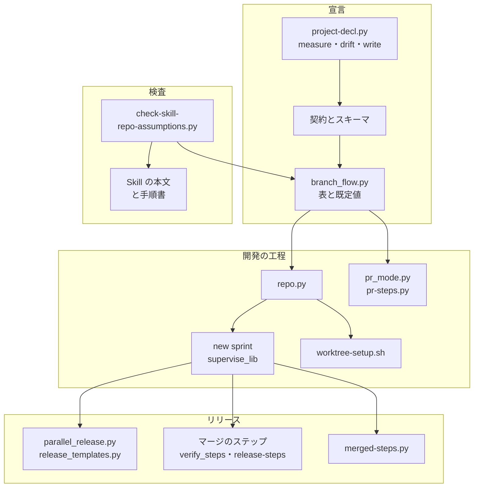
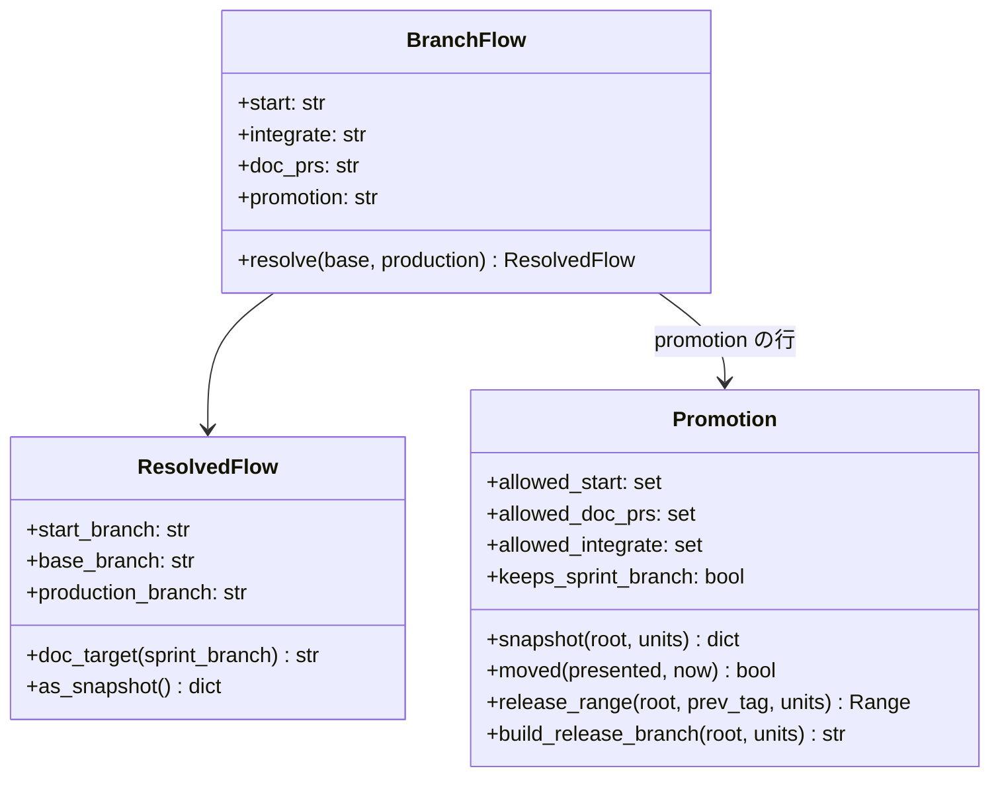
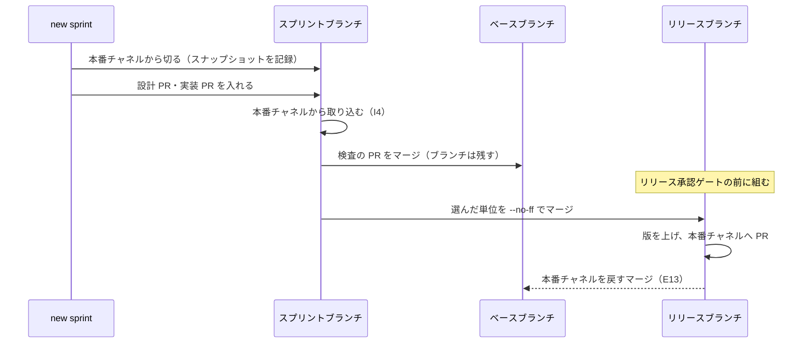
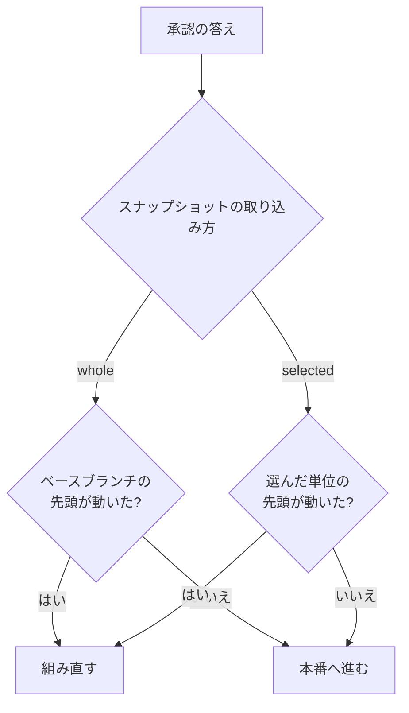

# ブランチ運用の宣言: スプリントの起点・結合・本番への取り込み方をリポジトリごとに選べる（#3121）

## 目的

- **今どうなっているか**: NDF はスプリントブランチをいつもベースブランチから切り、設計 PR をベースブランチへ出し、リリースではベースブランチを丸ごと本番チャネルへ入れる。リポジトリが「本番チャネルからスプリントを切り、承認したスプリントだけをリリースブランチで本番へ届ける」運用を選ぶと、NDF がそれに合わせて動けない
- **誰に効くか**: NDF を使うリポジトリの conductor・レーン・リリースの担い手。ai-plugins では、計画の外のスプリント（2026-11-12 のリリース 9 に入った aixrepo-1）が本番へ混ざらなくなる
- **変えると何が成り立つか**: ブランチ運用をリポジトリの宣言で受け、NDF は宣言どおりに起点・宛先・リリースの範囲を選ぶ。宣言の無いリポジトリは今の振る舞いのまま動く。宣言は測って作り、ずれを検出して直せる

## 適用範囲

- **働く範囲**: NDF を使うすべてのリポジトリ（宣言の読み分け・測定・ずれの検出）。ai-plugins の運用の切り替え（#3119 の受け入れ内容）は ai-plugins だけで、[issue-3121-design-repo-rules.md](issue-3121-design-repo-rules.md) が持つ
- **プロジェクトごとに違うもの**: 設定（`.ndf/worktree.json` の `branch_flow`）で受ける。引数では受けない
- **当たるモード**: `standard`（スプリント・並列の計画）。`light` の単独の Pull Request は宛先の区分と worktree の起点だけが当たる

## あるべき姿の根拠

| 根拠 | 種類 | 何を示すか |
| --- | --- | --- |
| STD1 | 外部の一次情報 | トピックブランチは取り込む先のうち一番古いブランチから切り、結合を試すブランチは本番へ流さない |
| STD3 | 外部の一次情報 | 結合ブランチで解いた衝突を、リリースブランチで同じ解き方のまま再利用できる |
| 利用者の指示（2026-11-12） | 利用者の指示の原文 | 「ブランチルールはリポジトリの事情によって決まり、ndfはどんなルールでも対応できるように設計されるべき」 |
| 変更前のプランの値（下の「変更前の値」） | 実測 | 宣言の無いリポジトリで保つ値が、起点 `origin/<ベースブランチ>`・宛先 `<ベースブランチ>` であること |

### 変更前の値

受け入れ条件 2 の前提として、変更前の版（10.27.59）のプランの値を 2026-11-12 に確かめた。宣言は ai-plugins の値
（`base_branch: develop`・`production_branch: main`・`branch_flow` なし）である。組んだコマンドは `supervise.py new sprint --issue 3121 --design 3121 --name baseline3121` である。
得た値は次のとおりである。実装後に同じ入力で組み、すべて一致することを確かめる。

| プラン | 値 | 変更前の値 |
| --- | --- | --- |
| 設計（`1-design-3121.json`） | `起点` | `origin/develop` |
| 設計 | `pr` のステップの `base`（設計 PR の宛先） | `develop` |
| 設計 | 用語チェックの比べる元（`--diff`） | `origin/develop` |
| スプリントブランチ（`5-sprint-branch.json`） | 作る起点 | `worktree-setup.sh create sprint/baseline3121`（`--from` なし = `base_branch`） |
| 検査（`7-check.json`） | `pr` のステップの `base` | `develop` |
| 開発版のデプロイ（`8-release.json`） | `起点`・`--base`・`--ref`（範囲の比べる元） | `origin/develop`・`develop`・`develop` |

要求と受け入れ条件は #3121 の本文にある（コピーは [issue-3121-requirements.md](issue-3121-requirements.md) ）。
#3119 の受け入れ内容（受け入れ条件 14〜19）は分冊 [issue-3121-design-repo-rules.md](issue-3121-design-repo-rules.md) にある。
この文書は「どう作るか」だけを扱う。

## ドメインモデル

### コンテキスト

| コンテキスト | 何の語が 1 つの意味に決まるか |
| --- | --- |
| 開発の工程（`ndf-workflow`） | ベースブランチ・スプリントの起点・ブランチ運用の宣言・文書の Pull Request の宛先・本番への取り込み方・リリースブランチ・リリースの単位 |
| リリース（`ndf-release`） | リリースの承認資料・リリースの Pull Request（この変更では意味を変えない） |

開発の工程が供給者、リリースが顧客の関係（顧客 / 供給者）。リリースは、開発の工程がスプリントの開始時に記録した
ブランチ運用のスナップショット（下の集約「スプリント」の値）だけを読み、宣言のファイルを読み直さない。

### 集約

| 集約 | 持ち主（書き換えてよいもの） | 根 | エンティティ | 値オブジェクト |
| --- | --- | --- | --- | --- |
| ブランチ運用の宣言 | `project-decl.py write`（測定と答えから書く）と利用者の手の編集 | `.ndf/worktree.json` の `branch_flow` | — | 4 項目の値（起点・結合の時点・文書の宛先・取り込み方） |
| スプリント | `supervise.py new sprint`（開始時に 1 回だけ書く） | スプリントの目録（`sprint.json`） | スプリントブランチ | ブランチ運用のスナップショット（解決済みのブランチ名つき） |
| リリース | 並列の計画のまとめたリリースと `new sprint` のリリースのプラン | 提示（`presented.json`） | リリースブランチ | 選んだリリースの単位と、提示の時点のそれぞれの先頭 |

### 不変条件

| # | 集約 | 条件 | 破れたときの扱い |
| --- | --- | --- | --- |
| I1 | ブランチ運用の宣言 | 4 項目の値は取り込み方の表の行が許す組み合わせだけを取る（選んで集める取り込み方は、起点が本番チャネル・文書の宛先がスプリントブランチ） | 読む側が終了コード 2 と直す項目を出して止まる。既定の振る舞いへ倒さない |
| I2 | ブランチ運用の宣言 | `branch_flow` が無いときの振る舞いは、変更前の振る舞いと同じ値を出す（既定値の行） | 変更前の値の表と比べるテストが落ちる |
| I3 | スプリント | スプリントの後の工程（設計・実装・検査・開発版・本番・まとめ）は、開始時のスナップショットを読み、宣言のファイルを読み直さない | スナップショットが無い目録は、宣言の無いリポジトリのスナップショットとして読む（変更前の目録の互換） |
| I4 | スプリント | 選んで集める取り込み方のスプリントブランチには、ベースブランチにだけあるコミットが入らない（ベースブランチの取り込みは起点から行う） | ベースブランチの取り込みのステップが、起点の外のコミットを含むときは止めて人へ戻す |
| I5 | リリース | 選んで集める取り込み方のリリースブランチは、本番チャネルの先頭と、選んだリリースの単位のマージだけからなる | リリースブランチを組む処理が止まり、承認資料を出さない |
| I6 | リリース | 1 つのリリースで集めるスプリントのスナップショットは、取り込み方が同じである | 提示を止め、スナップショットの違うレーンを人へ戻す |
| I7 | リリース | 選んで集める取り込み方では、提示した後にベースブランチが動いてもリリースを組み直さない。選んだ単位の先頭が動いたときだけ組み直す | 比べる関数のテストが落ちる |

### ドメインイベント

| # | イベント | 発生元 | 受け手 |
| --- | --- | --- | --- |
| E1 | ブランチの使い方を測った | `project-decl.py measure` | conductor（答えを書く） |
| E2 | 宣言の案を出した | `project-decl.py measure` | conductor |
| E3 | 宣言を書いた | `project-decl.py write` | `new sprint`・`worktree-setup.sh`・`pr-steps.py` |
| E4・E5 | スプリントを始め、スナップショットを記録した | `supervise.py new sprint` | スプリントの各プラン・リリース |
| E6 | スプリントブランチを起点から切った | スプリントブランチのプラン | 実装のプラン |
| E7 | 文書の Pull Request を宣言の宛先へ出した | 設計のプラン・まとめのプラン | 設計承認ゲート・確定仕様化 |
| E8 | スプリントブランチをベースブランチへ入れた | 検査のプラン | 開発版のデプロイ |
| E9・E10 | リリースの単位を選び、リリースブランチを組んだ | まとめたリリースの提示・リリースのプラン | リリース承認ゲート |
| E11 | 承認資料の範囲を決めた | 承認資料のステップ（`release-steps.py approval-facts`） | リリース承認ゲート |
| E12 | 本番チャネルへ入れた | リリースの Pull Request のマージ | 後片付け |
| E13 | 本番チャネルをベースブランチへ戻した | 本番のリリースのプランの後段 | 開発版のチャネル |
| E14 | 宣言と実際の使い方のずれを見つけた | `project-decl.py drift` | 振り返り・棚卸し・conductor |
| E15 | 宣言を変えた・外した | `project-decl.py write`・手の編集 | 次に始めるスプリント |

### 用語

| 用語 | 意味 | 用語集への反映 |
| --- | --- | --- |
| ベースブランチ | Pull Request の宛先で、スプリントどうしを結合して試すブランチ。開発版のチャネルを兼ねることがある。宣言の `base_branch`。worktree の分岐元はスプリントの起点が決める | 意味の変更（`ndf-workflow`） |
| 結合ブランチ | ベースブランチを、スプリントどうしの組み合わせを試す役割で呼ぶときの名前。この文書はベースブランチと書く | 意味の変更（`ndf-workflow`） |
| ブランチ運用の宣言 | スプリントの起点・ベースブランチへ入れる時点・文書の Pull Request の宛先・本番への取り込み方を書いた `.ndf/worktree.json` の `branch_flow` | 追加（`ndf-workflow`） |
| スプリントの起点 | スプリントブランチと worktree を切る元のブランチ。ベースブランチか本番チャネルをチャネルの名前で指す | 追加（`ndf-workflow`） |
| 文書の Pull Request の宛先 | 設計 PR と確定仕様化の PR の宛先。ベースブランチかスプリントブランチ | 追加（`ndf-workflow`） |
| 本番への取り込み方 | 本番チャネルへ何をどう入れるか。ベースブランチを丸ごと出すか、選んだリリースの単位を集めるか | 追加（`ndf-workflow`） |
| リリースブランチ | 本番チャネルへ入れる変更を集め、版を上げるブランチ（`release/v<版>`） | 追加（`ndf-workflow`） |
| リリースの単位 | 選んで集める取り込み方で、リリースが選ぶ 1 つのブランチ。本番チャネルに含まれていないコミットを持つスプリントブランチ | 追加（`ndf-workflow`） |

## 外部の調査

| 種類 | 調べるか | 理由 |
| --- | --- | --- |
| 標準・仕様 | 調べる | トピックブランチと結合ブランチの運用に git 本家の一次資料がある |
| 主要な製品 | 調べる | 宛先の制限をホスティングの機能（ルールセット）で持てるかが、リポジトリの側の検査の作り方を決める |
| ライブラリとサービス | 調べる | ブランチ運用を宣言で受ける既存のツールがあれば、自前の読み分けを置き換えられる |

### 標準・仕様

| # | 標準・仕様 | 何を定めているか | 設計への反映 | 出典 |
| --- | --- | --- | --- | --- |
| STD1 | gitworkflows(7) の Graduation・Throw-away integration | トピックブランチを最も古い取り込み先から切り、結合は使い捨てのブランチで試し、安定したものから上のブランチへ入れる | 選んで集める取り込み方の起点を本番チャネルにし、ベースブランチを本番へ流さない（I1・I4） | https://git-scm.com/docs/gitworkflows （2026-11-12） |
| STD2 | gitworkflows(7) の「Rewind and rebuild next」 | リリース後に結合を試すブランチ（next）を本番の先頭から作り直してよい。作り直したらアナウンスする | 作り直しは採らず、本番チャネルを戻すマージだけを手順にする（決定 6） | https://git-scm.com/docs/gitworkflows （2026-11-12） |
| STD3 | git-rerere | 長く生きるトピックブランチで同じ衝突を繰り返し解くとき、記録した解き方を再利用する | リリースブランチを組む処理は、結合で解いた衝突を rerere で再利用する（分冊の手順） | https://git-scm.com/docs/git-rerere （2026-11-12） |

### 主要な製品

| # | 製品 | どう解いているか | 設計への反映 | 出典 |
| --- | --- | --- | --- | --- |
| PRD1 | GitHub のルールセット | 規則は作成・更新・削除の制限、PR の必須、必須のステータスチェックなど。Pull Request の head のブランチを制限する規則は一覧に無い | 宛先の制限は CI のジョブ（必須のステータスチェック）で持つ（分冊の決定） | https://docs.github.com/en/repositories/configuring-branches-and-merges-in-your-repository/managing-rulesets/available-rules-for-rulesets （2026-11-12） |
| PRD2 | ai-plugins のルールセット（`protect main`・`protect develop`） | 両方とも `guard`（宛先の検査）と `pytest` を必須のステータスチェックに持つ | ルールセットは変えずに、`guard` のジョブの判定を変える（分冊） | `gh api repos/devbasex/ai-plugins/rulesets/<id>`（2026-11-12） |
| PRD3 | ブランチ運用のパターン（リリーストレイン） | 決まった便に、完成した機能のどれを載せるかを選ぶ | 「どのリリースの単位を載せるか」をリリースの提示で選ぶ（E9） | https://martinfowler.com/articles/branching-patterns.html （2026-11-12） |

### ライブラリとサービス

| # | 候補 | 版 | ライセンス | 最後のリリースの日付 | 終了のアナウンス | 要件を満たすか | 出典 |
| --- | --- | --- | --- | --- | --- | --- | --- |
| LIB1 | git（`merge-base --is-ancestor`・`rerere`・`merge --no-ff`） | 手元の版 | GPL-2.0 | 確かめていない | 無し | 満たす。範囲の判定と集める操作の部品として使う | `git --version`・STD1・STD3（2026-11-12） |
| LIB2 | pydantic（宣言の形の検査。NDF の `schema.Shape` が既に依存） | 確かめていない | MIT | 確かめていない | 無し | 満たす。宣言の検査に使う | `plugins/ndf/scripts/supervise_lib/decl.py`（2026-11-12） |

### 確かめられなかったこと

| 対象 | 試した手段 | 結果と理由 |
| --- | --- | --- |
| ブランチ運用を宣言で受け、スプリントの起点とリリースの範囲を切り替える既存のツール | 試していない | 上限の前に、git の部品（LIB1）と既存の宣言の読み手で足りると判断して調べなかった |
| LIB1・LIB2 の版と最後のリリースの日付 | 試していない | 既に依存している部品で、新しく足さないため |

調べた量: 候補 8 件・取得の試み 8 回。

## 機能一覧

| # | 機能 | 誰が使うか |
| --- | --- | --- |
| F1 | ブランチ運用の宣言を書き、形の誤りを直す箇所つきで知る | 利用者・conductor |
| F2 | 宣言どおりの起点からスプリントブランチと worktree を切る | `new sprint`・`worktree-setup.sh` |
| F3 | 設計 PR・確定仕様化の PR を宣言どおりの宛先へ出す | 設計とまとめのプラン |
| F4 | 宣言どおりの取り込み方でリリースを組み、承認資料の範囲を決める | リリースのプラン・まとめたリリース |
| F5 | 既存のリポジトリのブランチの使い方を測り、宣言の案を根拠つきで出す | conductor（手順 0） |
| F6 | 宣言と実際の使い方のずれを見つけ、更新の案を出す | 振り返り・棚卸し・conductor |
| F7 | 始めた時点の宣言でスプリントを最後まで進める | スプリントの各プラン |
| F8 | 特定のブランチ名と運用の決め打ちを検査で塞ぐ | CI（`skill-repo-assumptions-check`） |

## 構成要素

| 要素 | 責務 |
| --- | --- |
| `lib/branch_flow.py`（新設） | 宣言の読み分け・既定値・取り込み方の表・スナップショットの形。ブランチ名の既定値と測る候補の唯一の置き場 |
| 宣言の契約とスキーマ（`contracts/settings/worktree.json.json`・`skills/worktree/schemas/worktree.schema.json`） | `branch_flow` のキーと置き場（メインディレクトリ）。スキーマの `branch_flow` は表から作る |
| `lib/repo.py` | 既定ブランチの候補を `branch_flow.py` から読む。worktree の起点をスナップショットか宣言から解く |
| `supervise_lib/decl.py`・`sprint_waves.py`・`sprint.py`・`templates.py`・`procedures.py` | スナップショットを目録へ記録し、起点・文書の宛先・ベースブランチの取り込みの元をスナップショットから組む |
| `worktree-setup.sh`・`lib/worktree-branch.sh` | `create` の既定の起点をスプリントの起点にする |
| `lib/parallel_release.py`・`release_lib/`・`supervise_lib/release_templates.py` | 取り込み方の行に範囲・組み直しの判定・リリースブランチの組み方を任せる |
| `lib/pr_mode.py`・`pr-steps.py` | 宛先の区分を `sprint` / `base` にする（ブランチ名を区分の名前にしない） |
| `merged-steps.py`（後片付け） | 選んで集める取り込み方では、本番チャネルに含まれるまでスプリントブランチを消さない |
| `supervise_lib/verify_steps.py`・`release-steps.py`（マージのステップ） | 選んで集める取り込み方では、検査の PR のマージで消えたスプリントブランチを push し直す（決定 7） |
| `project-decl.py`・`project_lib/measure_branch_flow.py`（新設）・`project_lib/merge.py` | 測定・案・書き出し・ずれの検出（`drift`） |
| `scripts/check-skill-repo-assumptions.py` と例外リスト | ブランチ名の語を足し、エージェントの本文を走査に入れる |
| Skill の本文と手順書（下の「設計の結果」の一覧） | ブランチ名で書いた手順を、ベースブランチ・本番チャネル・スプリントの起点の語へ書き換える |



## 構造



`Promotion` は取り込み方の表の 1 行で、`whole`（ベースブランチを丸ごと出す）と `selected`（選んで集める）の 2 行を持つ。
取り込み方を足すときは、この表に行を 1 つ足し、行のメソッドを実装する。呼ぶ側（`parallel_release.py`・
`release_templates.py`・`merged-steps.py`・スキーマの生成）は行のメソッドと属性だけを読み、値の名前で分岐しない。

## データ構造

### 宣言の形

`.ndf/worktree.json` に任意のキー `branch_flow` を足す。キーが無ければ既定値の行（下の表の「既定」）を使う。

| キー | 値 | 既定 | 意味 |
| --- | --- | --- | --- |
| `start` | `base` / `production` | `base` | スプリントの起点。ブランチ名は写さず、`base_branch`・`production_branch` をチャネルで指す |
| `integrate` | `check` | `check` | スプリントブランチをベースブランチへ入れる時点。`check` = 検査の Pull Request のマージ。時点を足すときは、値と、その時点の検査の Pull Request の宛先を `branch_flow.py` の表に足す |
| `doc_prs` | `base` / `sprint` | `base` | 設計 PR と確定仕様化の PR の宛先 |
| `promotion` | `whole` / `selected` | `whole` | 本番への取り込み方 |

取り込み方の表（`branch_flow.py` の唯一の定義。スキーマの enum と I1 の検査はこの表から作る）:

| `promotion` | 許す `start` | 許す `doc_prs` | 許す `integrate` | スプリントブランチを残すか | 範囲の決め方 | 組み直す条件 |
| --- | --- | --- | --- | --- | --- | --- |
| `whole` | `base` | `base` | `check` | 残さない | 本番チャネル..提示したベースブランチのコミット | ベースブランチの先頭が提示から動いた（今の `moved`） |
| `selected` | `production` | `sprint` | `check` | 本番チャネルに含まれるまで残す | 前の本番のタグ..リリースブランチの先頭 | 選んだ単位の先頭のどれかが提示から動いた |

### スナップショットの形

`new sprint` は目録 `sprint.json` にキー `ブランチ運用` を足し、解決済みの値を書く。後の工程はこれだけを読む（I3）。

```json
{
  "ブランチ運用": {
    "start": "production", "integrate": "check", "doc_prs": "sprint", "promotion": "selected",
    "start_branch": "main", "base_branch": "develop", "production_branch": "main",
    "source": ".ndf/worktree.json の branch_flow"
  }
}
```

### CRUD 図

| 機能 | 宣言（`branch_flow`） | スナップショット（`sprint.json`） | 提示（`presented.json`） |
| --- | --- | --- | --- |
| F1 宣言を書く | C・U・D（手の編集） | — | — |
| F2・F3・F7 スプリント | R | C（開始時）・R | — |
| F4 リリース | — | R | C・R |
| F5 測定 | C（`write`） | — | — |
| F6 ずれの検出 | R | — | — |

宣言を外す（D）と既定値の行へ戻る（受け入れ条件 13）。宣言は `.ndf/` にコミットされ、履歴は git に残る。

## 入出力の契約

| 呼び出し | 入力 | 出力・終了コード |
| --- | --- | --- |
| `branch_flow.read(root)` | メインディレクトリの `.ndf/worktree.json` | `BranchFlow`。形の誤り・I1 に合わない組は `FlowError`（直すキーと許す値を持つ） |
| `supervise.py new sprint` | 宣言（`--base` があればベースブランチだけ上書き） | 宣言が壊れていれば終了コード 2・`items` に直すキー。スナップショットを書けなければスプリントを作らない |
| `project-decl.py measure` | `--out FILE` | 既存の出力に `branch_flow` の項目を足す。4 項目それぞれ `{value, confidence, evidence[]}` か `{unknown: 理由}` |
| `project-decl.py drift`（新設） | `--measure FILE` | ずれた項目ごとに `items` の行（項目・宣言の値・測った値・根拠・更新の案）。ずれが無ければ `items` は空で 0。宣言が壊れていれば 3 |
| `project-decl.py write` | 測定と答え | `branch_flow` を書く。答えが I1 に合わなければ書かずに 1 |
| `pr_mode.pr_target(base)` | 宛先 | `sprint` / `base`（`develop` を返さない） |

`measure` の確からしさ: 直近のマージ済みの Pull Request（最大 100 件）のうち推した値に合う割合が 0.9 以上で `高`、
0.6 以上で `中`。標本が 3 件未満か 0.6 未満なら値を出さず `unknown` と理由を出す（受け入れ条件 9）。測る項目と
調べ方は要求の「`measure` が調べるもの」の表のとおりで、守らせている仕組み（ルールセット・CI の宛先の検査）は
根拠の行としてだけ出す。`gh` の出力は既存の伏せ字（`project_lib/secret.py`）を通す。

## 処理の流れ

### スプリント（選んで集める取り込み方）



### まとめたリリースの組み直しの判定



宣言の無いリポジトリでは、スナップショットが `whole` の行になり、今の流れ（ベースブランチから `release/v<版>` を切る）を通る。

### 選んで集める取り込み方の、リリースの単位の決め方

| リリースを組む経路 | 選ぶ単位 | 組む時点 |
| --- | --- | --- |
| `new sprint` のリリースのプラン（`pace: normal`・`fast`・`auto`） | そのスプリントのブランチ 1 つ | 開発版のデプロイの後、本番のプランの承認資料のステップの前 |
| 並列の計画のまとめたリリース（提示） | 提示の時点でリリースの依頼を送ったレーンのスプリントブランチ | 提示のプランの承認資料のステップの前。承認したコミットはリリースブランチの先頭 |

選んだ単位を外したいときは、承認する人がリリース承認ゲートで差し戻し、依頼を外した提示を組み直す（今の出し直しの経路）。
リリースブランチを組む処理は `git rerere` を有効にして本番チャネルからマージし、衝突が残れば止めて人へ戻す（E10）。

## 非機能の実現方式

| 大項目 | 実現方式 |
| --- | --- |
| 運用・保守性 | `measure` と `drift` は項目ごとに打ったコマンドと結果の要約を `evidence` に持ち、`--out` のファイルに残る |
| 移行性 | `branch_flow` が無ければ既定値の行（I2）。スナップショットの無い目録は既定値として読む（I3）。ai-plugins の切り替えの順は分冊にある |
| セキュリティ | `branch_flow` はメインディレクトリから読む（`production_branch` と同じ置き場）。Pull Request の変更だけでリリースの範囲の決め方を変えられない。`gh` の出力は伏せ字を通す |

## 決定の記録

### 決定 1: 既存の読み手と置き場を共有するため、宣言を `.ndf/worktree.json` の `branch_flow` に置く

起点・本番チャネルを読む関数（`lib/repo.py`・`supervise_lib/decl.py`・`worktree-branch.sh`）は既に `worktree.json` を読む。
`project-decl.py` の書き出しも同じファイルへ書く。同じファイルに置けば読み手を増やさない。`.ndf/project.json` は解析が書く宣言で、
ブランチの項目は既に `worktree.json` へ書き出す形になっている（P6）。

- 作り方: 自前で作る・標準に倣う
- 比べた候補: STD1 / LIB2

根拠: Value 4 / Value 11（MVV 版 7）

### 決定 2: 同じ事実を 2 か所に持たないため、起点と文書の宛先をブランチ名ではなくチャネルで指す

`start` は `base` / `production` を取り、名前は `base_branch`・`production_branch` から解く。`delivery` の `channel` と同じ考え方で、
本番チャネルの名前を変えても宣言を 2 か所直さずに済む。

根拠: Value 8 / Value 11（MVV 版 7）

### 決定 3: 取り込み方を足すときにほかを書き換えないため、取り込み方を表の行とし、範囲・組み直し・集め方を行が持つ

呼ぶ側は行のメソッドだけを読む（前提 2）。値ごとの分岐を呼ぶ側に置くと、値を足すたびにリリースのプラン・並列のリリース・
後片付けを直すことになる。cherry-pick で集める取り込み方は要求の「含まない」のとおり行を作らない。

- 作り方: 自前で作る・標準に倣う
- 比べた候補: STD1 / PRD3 / LIB1

根拠: Value 9 / Value 11（MVV 版 7）

### 決定 4: 動いているスプリントを宣言の変更から守るため、開始時のスナップショットを目録に書き、後の工程はスナップショットだけを読む

プランは `new sprint` の時点でほぼすべて組まれるため、値は既にプランへ焼き込まれる。後から組むもの（まとめたリリースの提示・
`new close`）が宣言を読み直すと、途中で取り込み方が変わる。スナップショットを 1 か所に置けば、後から組むものもそこを読める。

根拠: Value 3 / Value 8（MVV 版 7）

### 決定 5: 選んで集める取り込み方の範囲を正しく保つため、スプリントブランチへはベースブランチを取り込まず、起点から取り込む

ベースブランチの取り込み（`base_sync_steps`）がベースブランチを取り込むと、本番へ出していない別のスプリントがスプリント
ブランチに入る。それがリリースブランチへ混ざる（2026-11-12 のリリース 9 と同じ形）。取り込みの元をスナップショットの `start_branch` にする。
宣言の無いリポジトリでは `start_branch` がベースブランチなので、今の振る舞いと同じである。ベースブランチとの衝突は検査の
Pull Request のマージで現れ、止めて人へ戻す（E8）。

根拠: Value 7 / Value 13（MVV 版 7）

### 決定 6: 強制 push を要さないため、リリース後は本番チャネルをベースブランチへ戻すマージだけを行い、作り直さない

結合を試すブランチの作り直し（STD2）はベースブランチの強制 push を要し、共通原則の C4 とルールセットの `non_fast_forward` に当たる。
戻すマージなら Pull Request で行え、版数の衝突は今の規則（本番の版を取る）で解ける。

根拠: Value 3 / C4（MVV 版 7）

### 決定 7: 本番へ届くまでスプリントブランチを残すため、後片付けは本番チャネルに含まれたスプリントブランチだけを消す

選んで集める取り込み方では、検査の Pull Request をベースブランチへマージした後もスプリントブランチがリリースの単位として
要る。後片付けは `git merge-base --is-ancestor <スプリントブランチ> origin/<本番チャネル>` が真のときだけ消す。確定仕様化の
PR はスプリントブランチへ入り、本番チャネルに含まれていないコミットを持つため、次のリリースの単位になる。

GitHub の設定「マージした head のブランチを自動で消す」（`delete_branch_on_merge`）が有効なリポジトリがある。
そこでは、検査の Pull Request のマージで origin のスプリントブランチが消える。ai-plugins は有効である
（`gh api repos/devbasex/ai-plugins` で 2026-11-12 に確かめた）。リポジトリの設定は NDF が変えないので、マージのステップの後に、消えていればローカルの先端を
push し直す。開発版の PR で `release/v<版>` を戻す `release-steps.py` の `_restore_branch` が同じ処理なので、
`lib/repo.py` へ移して両方から呼ぶ。強制 push はしない。

根拠: Value 6 / Value 11 / Value 13（MVV 版 7）

### 決定 8: 既存の検査を使うため、ブランチ名の決め打ちは `check-skill-repo-assumptions.py` の語を足して塞ぐ

この検査は既に語の一覧・例外リスト（数つき）・CI の必須のジョブを持つ。新しい検査を作ると同じ仕組みが 2 つになる。語に
ブランチ名の形（`develop` の語・`origin/main`・`--base main` など）を足し、走査にエージェントの本文を足す。既定値と測る候補を
置く `branch_flow.py` だけを例外リスト（`not-a-violation`）に載せる。正規表現の細部は実装で走らせて決める。

- 作り方: 自前で作る
- 比べた候補: PRD2（既存の CI の必須のジョブ）

根拠: Value 11 / Value 4（MVV 版 7）

### 決定 9: ずれの検出で `check` を重くしないため、ずれは `measure` の結果を読む新しい `drift` が出す

`check` は `gh` も LLM も呼ばない約束で、手順 0 で毎回打たれる。ずれは `gh` の結果が要るので、`measure` の出力と宣言を
突き合わせる `drift` に置く。振り返りと棚卸しは `measure` → `drift` を打つ。`check` は `branch_flow` の形の誤り（I1）だけを見る。

根拠: Value 2 / Value 3（MVV 版 7）

### 決定 10: 宛先の区分の名前を宣言に依らないものにするため、`pr_target` の `develop` を `base` にする

区分の値は結果の JSON（`pr-steps.py` の `target`）に出る。ブランチ名を区分の名前にすると、ベースブランチの名前が違う
リポジトリで読み手が誤る。読む側は `!= "sprint"` だけを見ており、値を変えても判定は変わらない。

根拠: Value 4 / Value 14（MVV 版 7）

## テスト設計

| 受け入れ条件・不変条件 | どの振る舞いで縛るか | どう壊したら落ちるべきか |
| --- | --- | --- |
| 1・I1 | 表に合わない組・知らないキー・型の違う値を読むと `FlowError`（直すキーつき）、`new sprint` は終了コード 2 | 誤りを既定値へ倒すと落ちる |
| 2・13・I2 | `branch_flow` の無い宣言と、外した宣言の両方で、上の「変更前の値」の 6 行がすべて一致する | 既定の起点を本番チャネルにすると落ちる |
| 3 | 変更前の並列のリリースのテスト（`moved` を使う `test_parallel_carry.py`・`test_parallel_hold_flow.py`・`test_parallel_plan.py`・`test_parallel_run.py`）を手を入れずに通す | `moved` の意味を変えると落ちる |
| 4 | 選んで集める宣言で、設計のプランの `起点` が `origin/<本番チャネル>`、`pr` の `base` が `sprint/<名前>` | 起点をベースブランチのままにすると落ちる |
| 5・I5 | 一時の git リポジトリで、選んだ単位だけをマージしたリリースブランチに、選ばない単位の先頭が `--is-ancestor` で含まれない | 本番チャネルの代わりにベースブランチから組むと落ちる |
| 6・I7 | 承認資料の範囲がタグ..リリースブランチの先頭になり、ベースブランチだけを進めても組み直さない。選んだ単位を進めると組み直す | 比べる相手をベースブランチの先頭にすると落ちる |
| 7 | 語の一覧に当たる行を例外リストの外のファイルへ足すと検査が 1 で落ちる | 語を一覧から外すと落ちる |
| 8 | `worktree` の手順書の `branch_flow` の例を読み出してスキーマに通すと通る | 例の値を表に無い値にすると落ちる |
| 9 | 合成した履歴で、4 項目に値・確からしさ・根拠が出る。標本の足りない項目は `unknown` と理由 | 標本の足りない項目に値を出すと落ちる |
| 10・I3 | スナップショットが `whole` のスプリントは、宣言を `selected` に変えた後も、組み直したリリースのプランと後片付けが `whole` で動く | 後の工程が宣言を読み直すと落ちる |
| 11 | ai-plugins の履歴をスナップショットした合成の入力で、`start=base`・`doc_prs=base`・`promotion=whole` の案が出る | 測定が本番チャネル宛ての head を読み違えると落ちる |
| 12 | ずれた宣言で `drift` が項目・根拠・案を出し、合った宣言では `items` が空 | ずれが無いのに行を出すと落ちる |
| I4 | 選んで集めるスプリントの検査のプランで、ベースブランチの取り込みの元が `origin/<本番チャネル>` | 元をベースブランチに戻すと落ちる |
| I6 | スナップショットの取り込み方が違う 2 レーンの提示が止まり、レーンの名前を出す | 混ぜたまま提示すると落ちる |
| 決定 7 | 本番チャネルに含まれないスプリントブランチを後片付けが消さず、含まれたものは消す。マージで origin から消えたスプリントブランチは push し直される | 検査の PR のマージで消したままにすると落ちる |

## 設計の結果

| 課題 | 扱い | 取り込み先 | 触るファイル |
| --- | --- | --- | --- |
| #3121 | 実装する | — | `plugins/ndf/scripts/lib/branch_flow.py`（新設）、`plugins/ndf/scripts/lib/repo.py`、`plugins/ndf/contracts/settings/worktree.json.json`、`plugins/ndf/skills/worktree/schemas/worktree.schema.json`、`plugins/ndf/skills/worktree/references/declaration.md`、`plugins/ndf/scripts/supervise_lib/decl.py`、`plugins/ndf/scripts/supervise_lib/sprint_waves.py`、`plugins/ndf/scripts/supervise_lib/sprint.py`、`plugins/ndf/scripts/supervise_lib/templates.py`、`plugins/ndf/scripts/supervise_lib/procedures.py`、`plugins/ndf/scripts/supervise_lib/release_templates.py`、`plugins/ndf/scripts/worktree-setup.sh`、`plugins/ndf/scripts/lib/worktree-branch.sh`、`plugins/ndf/scripts/lib/parallel_release.py`、`plugins/ndf/scripts/lib/pr_mode.py`、`plugins/ndf/scripts/pr-steps.py`、`plugins/ndf/scripts/merged-steps.py`、`plugins/ndf/scripts/supervise_lib/verify_steps.py`、`plugins/ndf/scripts/release-steps.py`、`plugins/ndf/scripts/project-decl.py`、`plugins/ndf/scripts/project_lib/__init__.py`、`plugins/ndf/scripts/project_lib/measure_branch_flow.py`（新設）、`plugins/ndf/scripts/project_lib/measure_repo.py`、`plugins/ndf/scripts/project_lib/fingerprint.py`、`plugins/ndf/scripts/project_lib/merge.py`、`plugins/ndf/scripts/project_lib/model.py`、`scripts/check-skill-repo-assumptions.py`、`plugins/ndf/skills/development-workflow/SKILL.md`、`plugins/ndf/skills/development-workflow/references/parallel.md`、`plugins/ndf/skills/development-workflow/references/parallel-work.md`、`plugins/ndf/skills/development-workflow/references/production-merge.md`、`plugins/ndf/skills/development-workflow/references/project-analysis.md`、`plugins/ndf/skills/development-workflow/references/pace.md`、`plugins/ndf/skills/development-workflow/references/agent-layers.md`、`plugins/ndf/skills/development-workflow/references/glossary.md`、`plugins/ndf/skills/release/references/release-steps.md`、`plugins/ndf/skills/issue-plan-strategy/references/parallel-plan.md`、`plugins/ndf/skills/pr/SKILL.md`、`plugins/ndf/skills/worktree/SKILL.md`、`plugins/ndf/skills/merged/SKILL.md`、`plugins/ndf/skills/retrospective/SKILL.md`、`plugins/ndf/skills/backlog-refinement/SKILL.md`、`plugins/ndf/skills/release-verification/SKILL.md`、`plugins/ndf/agents/debugger.md`、`docs/glossary/glossary.json`、`docs/glossary.md`、`plugins/ndf/scripts/tests/test_branch_flow.py`（新設）、`plugins/ndf/scripts/tests/test_pr_mode.py`、`plugins/ndf/scripts/tests/test_project_decl_branch_flow.py`（新設）、`plugins/ndf/scripts/tests/test_sprint_branch_flow.py`（新設）、`scripts/check-pr-base.sh`、`scripts/ci-heavy-skip.py`、`.github/workflows/pr-base-guard.yml`、`scripts/tests/test_pr_base_guard.py`、`scripts/tests/test_ci_heavy_skip.py` |

#3119 はこの表に載せない。この表は #3121 のスプリントで実装するものだけを持ち、#3119 の切り替え（ai-plugins の宣言・
`AGENTS.md`・`docs/versioning-and-distribution.md`）は #3121 の版を本番へ出した後のスプリントで行う（前提 5）。
表の `scripts/` と `.github/` の 5 ファイルは、宣言に `branch_flow` が無い間は今の判定のまま動く形で #3121 と一緒に入れる。
切り替えの中身と順序は分冊 [issue-3121-design-repo-rules.md](issue-3121-design-repo-rules.md) にある。
Skill の本文の行は、2026-11-12 に `grep -rlw develop` と `main`・`master` のブランチの形で当たったファイルである。
検査（決定 8）の語を足した後に当たる残りは、実装で同じ課題の中で直す。

## 人へ残す判断

| 判断 | 当たるレッドライン | なぜ当たるか |
| --- | --- | --- |
| ai-plugins の `.ndf/worktree.json` に `branch_flow` を書き、`AGENTS.md` の「Git運用ルール」「版とリリースの方針」を #3119 の運用へ書き換える | C7 | 利用者の設定と指示書の運用の節を書き換える。設計承認ゲートとリリース承認ゲートで人が見る |
| `main` 宛の Pull Request を通す条件（必須のチェック `guard` が走らせる `scripts/check-pr-base.sh`）を、`selected` の宣言で分冊の決定 14 の判定に変える | C2 | 本番チャネルへ何を入れてよいかの判定を変える。設計承認ゲートで人が見る |

## 未確認のまま残ること

| 項目 | 内容 |
| --- | --- |
| `measure` の確からしさの閾値（0.9・0.6・3 件） | ai-plugins 以外の履歴で値が妥当かは分からない。NDF の外のリポジトリで `measure` を打った結果（リリース後テストと次の棚卸し）で分かる |
| 選んで集める取り込み方での衝突の頻度 | 並列のレーンが同じファイルを触るとき、リリースブランチを組む処理が止まる回数は実測が無い。切り替え後の最初の 3 回のリリースで分かる |
