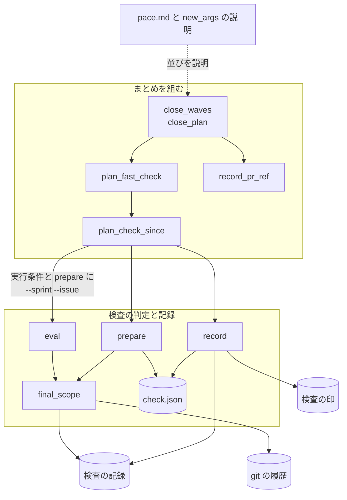
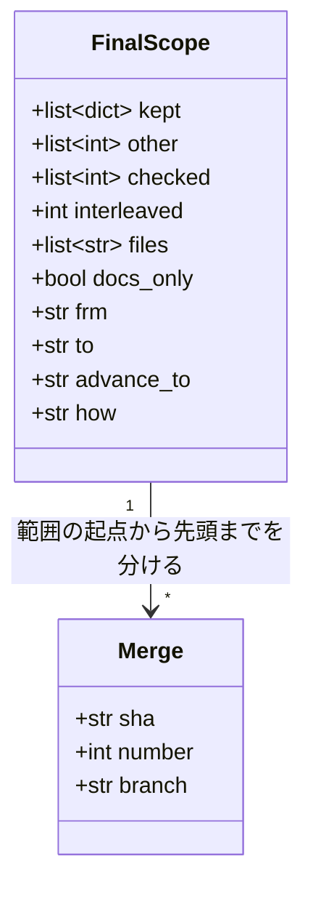
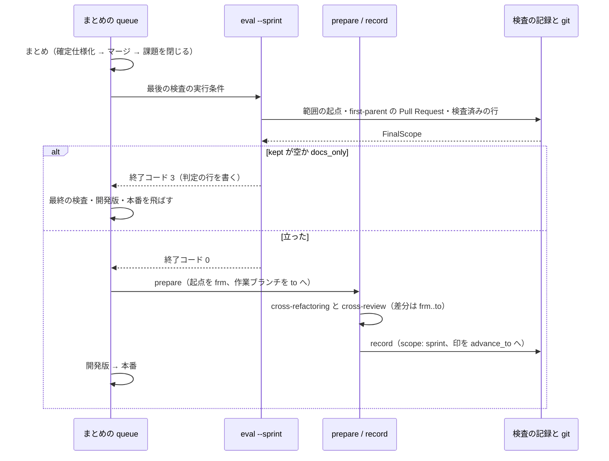
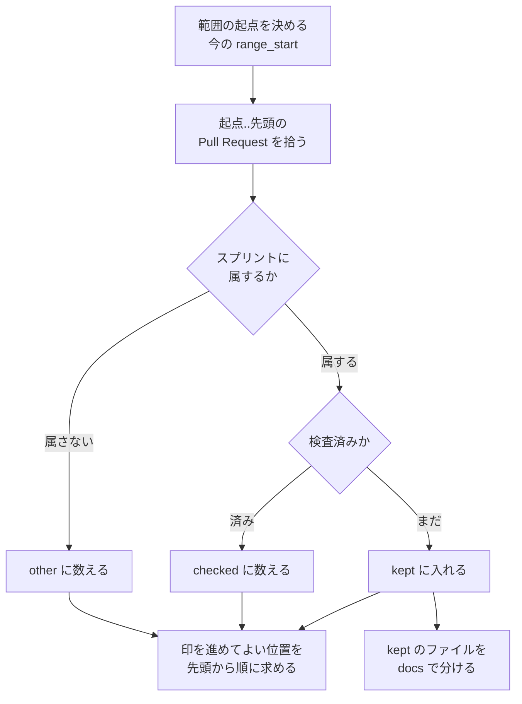

# 最後の検査: 確定仕様化の後に、そのスプリントのまだ検査していない差分だけを見る（#3126）

## 目的

- **今どうなっているか**: スプリントのまとめの最初のプラン「最後の検査」が、本番のリリースの後に、リポジトリに 1 本ずつの検査の印から今のベースブランチの先頭までの全部を検査する。2026-11-12 のレーン lci では、スプリントの検査で cross-review 済みの差分・ほかのレーンの確定仕様化・リリースの版を含む PR 4 本・ファイル 99 件が範囲になり、cross-review が 40 分を超えても終わらなかった
- **誰に効くか**: `supervise.py new close` でまとめを流す利用者（並列の計画のレーンと、直列の計画の `pace: fast` / `normal`）と、`after` でそのレーンを待つレーン
- **変えると何が成り立つか**: 最後の検査は確定仕様化の Pull Request のマージの後に流れ、範囲はそのスプリントに属する Pull Request のうち、どの検査もまだ見ていないものだけになる。範囲が空か文書のファイルだけなら cross-review と cross-refactoring を起動しない

## 適用範囲

- **働く範囲**: NDF の `supervise.py new close` を使うすべてのリポジトリ。検査の記録と検査の印は利用先のリポジトリごとに分かれる
- **プロジェクトごとに違うもの**: 文書のファイルの分け方は、今と同じくリポジトリの宣言 `docs`（`.ndf/project.json`）で受ける。新しい宣言は足さない
- **当たるモード**: `standard`

## あるべき姿の根拠

| 根拠 | 種類 | 何を示すか |
| --- | --- | --- |
| PRD1（GitHub の Pull Request の比較） | 外部の一次情報 | Pull Request の差分は base と head の merge base から head までの 3 点の比較である。cross-review が見る差分を絞るには、検査の Pull Request の起点と先頭の両方を範囲に合わせる必要がある |
| STD1（git log の `--first-parent`） | 外部の一次情報 | ベースブランチの first-parent の履歴は、マージした Pull Request を 1 本ずつの単位で並べる。Pull Request ごとに「誰のものか」「検査済みか」を判定できる |
| 2026-11-12 のレーン lci の検査の記録（#3126 の本文「検査の記録で確かめたこと」） | 実測 | 範囲を印からベースブランチの先頭までで決めると、印がリポジトリに 1 本ずつのため、ほかのレーンの変更とスプリントの検査が見た差分が範囲に入る |

要求と受け入れ条件は #3126 の本文にある（コピーは [issue-3126-requirements.md](issue-3126-requirements.md)）。この文書は「どう作るか」だけを扱う。

## ドメインモデル

### コンテキスト

| コンテキスト | 何の語が 1 つの意味に決まるか |
| --- | --- |
| NDF の開発ワークフロー（`ndf-workflow`） | 最後の検査・スプリントの検査・検査の印・最後の検査の範囲・スプリントに属する Pull Request・まとめのステージ |

1 つのコンテキストの中で閉じる。cross-review と cross-refactoring（`ndf-cross-review`・`ndf-cross-refactoring`）は Pull Request 1 本を入力に取る今の呼び出しのまま変えない。

### 集約

| 集約 | 持ち主（書き換えてよいもの） | 根 | エンティティ | 値オブジェクト |
| --- | --- | --- | --- | --- |
| 検査の記録 | `check-trigger.py` の `eval`（判定の行）と `record`（検査の行）。追記だけで持つ | 検査の記録のファイル（リポジトリごとの jsonl） | 判定の行・検査の行 | 範囲（起点・先頭）・Pull Request の番号の並び |
| 検査の印 | `check-trigger.py` の `record`（fast-forward だけで送る） | origin の `check-done/check`・`check-done/review` | — | 見終えた位置のコミット |
| 最後の検査の範囲 | `check-trigger.py` の `eval` と `prepare` が、そのつど検査の記録と git の履歴から作る。保存しない（`prepare` が検査の状態ディレクトリへコピーを置く） | — | — | 範囲に入る Pull Request・外した Pull Request とその理由・印を進めてよい位置・文書だけか |
| まとめのステージの並び | `supervise.py new close`（`supervise_lib/sprint.py` の `close_waves`） | まとめの `sprint.json` | ステージ | ステージの名前と `then_of` |

### 不変条件

| # | 集約 | 条件 | 破れたときの扱い |
| --- | --- | --- | --- |
| I1 | 最後の検査の範囲 | 範囲に入る Pull Request は、すべてスプリントに属する Pull Request である | 判定の対象から外す（ほかのレーン・ほかのスプリントの Pull Request は「ほか」として数えるだけ） |
| I2 | 最後の検査の範囲 | 検査済みの Pull Request（下の「検査済み」の定義）は範囲に入らない | 判定の対象から外す（「検査済み」として数える） |
| I3 | 最後の検査の範囲 | 範囲に入るファイルのうち、コードのファイルと振る舞いを決める文書が 0 件なら、トリガーは立たない | 立てない。要約に「文書のファイルだけ」と理由を出し、終了コード 3 |
| I4 | 検査の印 | 最後の検査は、検査の印を、まだその種類の検査を通していない Pull Request の後へ進めない | 進める位置を、通していない最初の Pull Request の手前で止める。手前に進める位置が無ければ進めない |
| I5 | 検査の記録 | 検査の行の `to` は、その検査が検査の印を進めた位置と同じである（進めなかった検査は空） | `record` が同じ値から両方を書く。次の範囲の起点が印と記録で食い違わない |
| I6 | まとめのステージの並び | `pace: fast` / `normal` のまとめでは、最後の検査は確定仕様化の Pull Request をマージした後に流れる | `close_waves` がまとめを先頭のステージにし、最後の検査と開発版・本番を `then_of: まとめ` で後ろに置く |
| I7 | まとめのステージの並び | `pace: auto` のまとめはまとめのステージだけである（前提 4） | 今の分岐を保つ |
| I8 | 検査の記録 | 足す前の行（新しい項目を持たない行）は今と同じに読める | 読む側は新しい項目を `.get` で読み、無ければ今の扱いにする |

「検査済み」は次のどちらかに当たる Pull Request を指す（I2・I4 が読む）。

| 最後の検査の種類 | 検査済みとする行（結果が `merged` か `no_change`） |
| --- | --- |
| リファクタリングを含む（`--final`） | PR を指す検査の行（`scope: pr`）の `target_pr`（コードレビューだけの回を含む）／ リファクタリングを含む検査の行（`only` が `review` でない）の `prs` |
| コードレビューだけ（`--review`） | PR を指す検査の行の `target_pr` ／ すべての検査の行の `prs` |

PR を指す検査の行をコードレビューだけの回でも検査済みに数えるのは、それがスプリントの検査（スプリントの Pull Request を対象にした検査）であり、最後の検査の役割はその後に入った差分を拾うことだからである（前提 1）。印を進めてよいか（I4）は別に判定し、そちらではコードレビューだけの回をリファクタリングを含む検査に数えない（前提 3）。

### ドメインイベント

| # | イベント | 発生元 | 受け手 |
| --- | --- | --- | --- |
| E1 | スプリントの実装の Pull Request をベースブランチへマージした | スプリントのプランのマージのステップ | スプリントの検査（`normal` / `auto`）、スプリントの途中の検査（`fast`） |
| E2 | スプリントの検査を記録した | 検査のプランの `record` | 最後の検査の範囲（検査済みの判定） |
| E3 | 検査の印を進めた | `record`（`push_done`） | 次の検査の範囲の起点 |
| E4 | ほかのレーンがベースブランチへマージし、検査し、リリースした | ほかのレーンのプラン | 最後の検査の範囲（「ほか」として外す。範囲は変わらない） |
| E5 | スプリントの開発版と本番をリリースした | スプリントのプランのリリースのステージ | まとめ |
| E6 | まとめを始めた | 本番のリリースの答え（`released`） | まとめのステージ |
| E9 | 確定仕様化の Pull Request をマージした | まとめのプランの `merge` | 最後の検査（このイベントの後に範囲を決める） |
| E7 | 最後の検査の範囲を決めた | 最後の検査の実行条件（`eval --final --sprint`） | 最後の検査のプラン（立てば流れ、立たなければ飛ぶ）・検査の記録の判定の行 |
| E8 | 最後の検査を飛ばした、または通した | 最後の検査のプランと `record` | 開発版と本番の実行条件（`changed --id <スプリント>-final`）・検査の印 |

要求の E7 と E9 の順序は決定 1 で E9 → E7 に決めた。表はその順に並べている。

### 用語

| 用語 | 意味 | 用語集への反映 |
| --- | --- | --- |
| 最後の検査 | スプリントの終わりに `supervise.py new close` が組む検査（計画名 `<スプリント>-final`）。確定仕様化の Pull Request をマージした後に流れ、スプリントに属する Pull Request のうち、どの検査もまだ見ていない差分を拾う | 意味の変更 |
| 最後の検査の範囲 | 最後の検査が見る差分。スプリントに属する Pull Request のうち、検査済みでないもの。範囲が空か文書のファイルだけなら、最後の検査は流れない | 意味の変更 |
| スプリントに属する Pull Request | head のブランチの最後の区切りがスプリントの名前に等しい（`sprint/<名前>`・`spec/<名前>`）か、ブランチ名がスプリントの課題の番号を `issue-<番号>` の形で持つ Pull Request | 追加 |

## 外部の調査

| 種類 | 調べるか | 理由 |
| --- | --- | --- |
| 標準・仕様 | 調べる | 範囲を Pull Request の単位で数える前提が、git の履歴の辿り方（first-parent）の仕様に依る |
| 主要な製品 | 調べる | cross-review が読む Pull Request の差分の取り方と、複数の Pull Request をまとめて検査する主要な製品の範囲の決め方を確かめる |
| ライブラリとサービス | 調べない | 範囲の判定は既に依存している git と、このリポジトリの `lib/merged_range.py`・`lib/diff_kinds.py` の組み合わせで決まる。検査の記録とスプリントの名前を読む外部のライブラリは要件に当たらない |

### 標準・仕様

| # | 標準・仕様 | 何を定めているか | 設計への反映 | 出典 |
| --- | --- | --- | --- | --- |
| STD1 | git log の `--first-parent` | マージのコミットに出会ったら最初の親だけを辿る。取り込まれたトピックブランチの個々のコミットは一覧に出ない | ベースブランチの first-parent の履歴から Pull Request を 1 本ずつ拾い、所属と検査済みを Pull Request の単位で判定する（今の `merged_range.merges_in` をそのまま使う） | https://git-scm.com/docs/git-log （2026-11-12） |

### 主要な製品

| # | 製品 | どう解いているか | 設計への反映 | 出典 |
| --- | --- | --- | --- | --- |
| PRD1 | GitHub の Pull Request の比較 | Pull Request の差分は、base と head の merge base から head の最新までの 3 点の比較で表示する | 検査の Pull Request の起点（`check-base/<名>`）を範囲の最初の Pull Request の手前に、先頭（`check/<名>`）を範囲の最後の Pull Request のマージのコミットに置き、cross-review が見る差分を範囲に合わせる。打ち消しのコミットを積んだ起点では merge base が変わらず、差分を絞れない | https://docs.github.com/en/pull-requests/collaborating-with-pull-requests/proposing-changes-to-your-work-with-pull-requests/about-comparing-branches-in-pull-requests （2026-11-12） |
| PRD2 | GitHub の merge queue | 各 Pull Request を、ベースブランチの最新と先に並んだ Pull Request の変更を合わせた一時ブランチで検査する（範囲は累積） | 範囲を「印から先頭までの累積」で決める形は merge queue と同じで、累積の中のほかの変更も検査する。最後の検査はマージ済みの差分の検査なので累積を取らず、スプリントに属する Pull Request で絞る | https://docs.github.com/en/repositories/configuring-branches-and-merges-in-your-repository/configuring-pull-request-merges/managing-a-merge-queue （2026-11-12） |

### 確かめられなかったこと

| 対象 | 試した手段 | 結果と理由 |
| --- | --- | --- |
| git log の `--first-parent` の原文の段落 | https://git-scm.com/docs/git-log の取得 | HTTP 200。ページの先頭約 40,000 文字までは原文を読み、`--first-parent` の項目は取得の手段が返した要約で確かめた。手元の `git log --help` はマニュアルが入っておらず読めない |

調べた量: 候補 3 件・取得の試み 3 回。

## 機能一覧

| # | 機能 | 誰が使うか |
| --- | --- | --- |
| F1 | 最後の検査の範囲を、スプリントに属しまだ検査していない Pull Request に絞って判定する | まとめの実行条件（`eval`）と、判定の出力を読む人 |
| F2 | 範囲が空か文書のファイルだけなら、最後の検査・開発版・本番を飛ばす | まとめを流す利用者 |
| F3 | 検査の Pull Request の差分を、範囲の Pull Request の最初から最後までに合わせる | cross-review と cross-refactoring |
| F4 | 検査の印を、まだ検査していないほかの差分の後へ進めずに記録する | 次の検査の範囲を決める `eval` |
| F5 | まとめの並びを、確定仕様化 → 最後の検査 → 開発版・本番にする | `supervise.py new close` の利用者 |

## 構成要素

| 要素 | 責務 |
| --- | --- |
| `check-trigger.py` の範囲の判定（`final_scope` を新設） | スプリントの名前と課題の番号を受け、範囲の起点から先頭までの Pull Request を「範囲に入る」「ほか」「検査済み」に分け、文書だけか・印を進めてよい位置・間に挟まったほかの Pull Request の数を返す。git と検査の記録を読むだけで書かない |
| `check-trigger.py` の `eval` | `--sprint` があれば範囲の判定を使い、`final`（`--review` なら `review`）のトリガーだけを判定する。判定の行に決め方と外した数を足す |
| `check-trigger.py` の `prepare` | `--sprint` があれば範囲の判定を使い、`check-base/<名>` を範囲の最初の Pull Request の手前に置き、作業ブランチを範囲の最後の Pull Request のマージのコミットへ合わせ、`check.json` に範囲と印を進めてよい位置を書く |
| `check-trigger.py` の `record` | `check.json` に `sprint` があれば、検査の行を `scope: sprint` で書き、`to` と印を進める位置を、印を進めてよい位置にする |
| `supervise_lib/templates.py` の `plan_check_since` | 最後の検査の実行条件と `prepare` に `--sprint <名前> --issue <番号>...` を足す |
| `supervise_lib/sprint_waves.py` の `plan_fast_check` | 最後の検査を組むときにスプリントの名前と課題を渡す |
| `supervise_lib/sprint.py` の `close_waves` と `close_plan` | まとめを先頭のステージにし、最後の検査と開発版・本番をその後ろへ置く。まとめが読むリリース記録の参照を、まとめより前の本番の記録（`{queue_record}`）にする |
| `supervise_lib/sprint_routes.py` の `record_pr_ref` | まとめのリリース記録の参照を、届けない経路だけなら `0`、それ以外は `{queue_record}` にする |
| `supervise_lib/new_args.py` | `new close` の説明の文をステージの新しい並びに合わせる |
| `plugins/ndf/skills/development-workflow/references/pace.md` | スプリントの終わりの並びと `final` のトリガーの説明を新しい並びと範囲に合わせる |

## 構造

範囲の判定の結果を 1 つの値オブジェクトにまとめ、`eval`・`prepare`・`record` が同じ値を読む。

| 項目 | 意味 |
| --- | --- |
| `kept` | 範囲に入る Pull Request（今の `merged_prs` と同じ形の `{"pr", "branch", "common", "points"}`）。ベースブランチに入った順 |
| `other` / `checked` | 外した Pull Request の番号。スプリントに属さない（I1）／検査済み（I2） |
| `interleaved` | `kept` の最初と最後の間に入ったほかの Pull Request の数（cross-review の差分に残る数） |
| `files` | `kept` の Pull Request が変えたファイルの和 |
| `docs_only` | `files` をリポジトリの宣言 `docs` で分け、コードのファイルと振る舞いを決める文書が 0 件で文書のファイルが 1 件以上（I3） |
| `frm` / `to` | `kept` の最初の Pull Request のマージのコミットの 1 つ目の親／最後の Pull Request のマージのコミット。`kept` が空なら範囲の起点と先頭 |
| `advance_to` | 検査の印を進めてよい位置（I4）。空なら進めない |
| `how` | 範囲の起点の決め方（今の `range_start` の文）とスプリントの名前 |

`dataclass(frozen=True)` で `check-trigger.py` に置く。ほかのスクリプトからは使わない。

## 入出力の契約

### `check-trigger.py eval`

| 項目 | 内容 |
| --- | --- |
| 入力 | 今の引数に、省略可能な `--sprint <名前>` と `--issue <番号> [<番号> ...]` を足す。`--issue` は `--sprint` と一緒にだけ渡す |
| 出力（`--sprint` あり） | トリガーは `--final` なら `final`、`--review` なら `review` だけを判定する（しきい値のトリガー `score`・`lines`・`escapes`・`hours` は見ない）。`kept` が 1 本以上で `docs_only` でなければ立つ。`metrics` に今のキーと `sprint`・`other`・`checked`・`interleaved`・`docs_only`・`advance_to` を足す。`prs`・`score`・`lines` は `kept` から数える |
| 要約 | 立たないとき、`kept` が空なら「スプリント <名前> の検査していない Pull Request が無い」、`docs_only` なら「スプリント <名前> の範囲は文書のファイルだけ（<件数> 件）」と出す。どちらも「外した: ほか <n> 本・検査済み <m> 本」を添える |
| 失敗の形 | 今と同じ（立った 0 / 立たない 3 / 宣言・git・範囲が読めない 2）。`--issue` だけを渡したら 2 |
| 互換性 | `--sprint` を省いた呼び出しは今と同じ範囲とトリガーで判定する |

判定の行（検査の記録の `kind: eval`）には、`--sprint` があるときだけ `sprint`・`how`・`excluded`（`{"other": n, "checked": m}`）を足す。今の行の項目は変えない。

### `check-trigger.py prepare`

| 項目 | 内容 |
| --- | --- |
| 入力 | 今の引数に、省略可能な `--sprint <名前>` と `--issue <番号>...` を足す |
| 動き（`--sprint` あり） | `check-base/<名>` を `frm` に置いて送る。作業ブランチ（`check/<名>`）を `to` へ合わせる（`git reset --hard <to>`。作業ブランチは直前にベースブランチの先頭から作った検査専用のもので、手元の変更を持たない） |
| 出力 | `check.json` に今の項目と `sprint`・`advance_to`・`other`・`checked` を書く。`prs` と `files` は `kept` から書く |
| 失敗の形 | `kept` が空（`eval` の後に履歴が変わった）なら終了コード 2 で「範囲の Pull Request が 0 本」と出す。今の失敗の形は変えない |
| 互換性 | `--sprint` を省いた呼び出しは今と同じ |

### `check-trigger.py record`

| 項目 | 内容 |
| --- | --- |
| 入力 | 変えない |
| 動き | `check.json` に `sprint` があれば、検査の行を `scope: "sprint"`・`sprint: <名前>`・`to: <advance_to>` で書き、結果が `merged` / `no_change` のとき `advance_to` が空でなければ検査の印をそこへ送る（コードレビューだけの回は今と同じく `check-done/review` だけ） |
| 互換性 | `sprint` の無い `check.json` は今と同じ。`stats` は `scope` が `since` の行だけで時刻の窓を切るため、`scope: sprint` の行は窓を切らない（PR を指す検査の行と同じ扱い） |

### `supervise.py new close` が組む `sprint.json`

| `pace` | ステージの並び |
| --- | --- |
| `fast` / `normal`（リリースのテンプレートあり） | `まとめ` → `最終の検査` → `開発版` → `本番` |
| `fast` / `normal`（テンプレートで組まない経路） | `まとめ` → `最終の検査` → 経路ごとのステージ |
| `auto` | `まとめ`（変えない） |

ステージ `最終の検査` は最後の検査を流すステージである（名前は変えない）。`最終の検査`・`開発版`・`本番`・経路ごとのステージは `then_of: まとめ` を持つ。開発版・本番の実行条件（`changed --id <名前>-final`）は変えない。`new close` の引数は変えない。

## 処理の流れ

範囲の判定（`final_scope`）の中の順序:

印を進めてよい位置は、範囲の起点から first-parent の順に Pull Request を見て、次のどれかに当たる限り進めた最後のマージのコミットである。最初に当たらない Pull Request が出たら止める。

- この検査の `kept`（この検査が見る）
- 検査の Pull Request（記録の `pr`）と、ブランチが `release/`・`check/` の Pull Request（今の `merged_prs` が外すもの）
- その種類の検査を通した Pull Request（リファクタリングを含む最後の検査では、リファクタリングを含む検査の行の `prs` と `target_pr`。コードレビューだけの回の行は数えない）

## 非機能の実現方式

| 大項目 | 要求の条件 | 実現方式 | 確かめ方 |
| --- | --- | --- | --- |
| 性能・拡張性 | 最後の検査の実行条件は、通信せずに git の履歴と検査の記録だけで範囲を決める（今の `eval` と同じ）。並行するレーンの数が増えても、範囲の Pull Request の本数は S の Pull Request の本数を超えない | 範囲の判定は今の `merged_prs` と同じ読み方（git の first-parent の履歴と、squash の Pull Request のブランチだけを読む `with_heads`）を使い、所属の判定はブランチ名だけで行う。`kept` はスプリントに属する Pull Request の部分集合である（I1） | 一時リポジトリのテストで、ほかのレーンの Pull Request を増やしても `metrics.prs` が増えないこと |
| 運用・保守性 | 最後の検査が範囲をどう決めたか（起点のコミットと決め方、外した Pull Request の本数と理由）が判定の出力と検査の記録の `eval` の行に残る | 判定の出力の `metrics` と判定の行に `how`・`excluded`（ほか・検査済み）・`from` を書く | 判定の行を読むテストで、`how` と `excluded` の値を確かめる |
| 移行性 | 既存の検査の記録と origin の印のブランチをそのまま読む。移行の手順は要らない | 新しい項目は足すだけで、読む側は項目が無ければ今の扱いにする（I8） | 新しい項目を持たない行だけの記録で、`--sprint` 無しの `eval` と `stats` が今と同じ値を返すこと |

## 決定の記録

### 決定 1: 確定仕様化の差分まで拾い、スプリントの途中の検査を変えないため、最後の検査を確定仕様化の Pull Request のマージの後に置く

最後の検査の役割は、スプリントの検査の後に入ったそのスプリントの差分を拾うことである（前提 1）。その差分の代表は確定仕様化の Pull Request で、まとめの中で作られるため、まとめの後に置けば拾える。本番のリリースの前に置くには、`new sprint` のステージ（検査・コードレビュー・開発版・本番）に最後の検査を足すことになり、スプリントの途中の検査を変えない条件（受け入れ条件 7・対象範囲の「含まない」）から外れる。また本番の前に置いても、確定仕様化の差分は本番の後に入るため拾えない。

まとめのリリース記録の参照は、まとめより前の本番の記録（`{queue_record}`。`pace: auto` と同じ）にする。まとめの後ろに置いた本番はまとめより後に流れるため、まとめから参照できない。最後の検査で変更があったときの開発版と本番は、それぞれのプランの導入の確認で確かめる。

受け入れ条件 1 の「まとめの確定仕様化へ進む」は、この並びでは「確定仕様化を終えたまとめの後で、最後の検査・開発版・本番を飛ばして終える」と読む。

根拠: Value 5 / Value 2 / Value 13（MVV 版 7）

### 決定 2: ほかのレーンの変更を範囲に入れないため、範囲をスプリントに属する Pull Request に絞り、所属をブランチ名で判定する

範囲の起点は今と同じ決め方（検査の印 → 手元の記録 → `--since` → 正式版のタグ → 分岐点）で決め、その中の Pull Request をスプリントに属するかで分ける。所属は head のブランチ名で決める。NDF が組むスプリントのブランチは `sprint/<名前>`（旧名の接頭辞を含む）・`spec/<名前>`・`feat/issue-<番号>-<名前>` で、修正のブランチも課題の番号を `issue-<番号>` の形で持つ。ブランチ名は今の `merged_prs` が既に読んでおり、読み方を増やさない。

スプリントごとの検査の印を origin に足す形は採らない。印のブランチがスプリントの数だけ増え、消す時点を新しく決める必要がある。範囲の起点をスプリントの検査の `to` へ移すだけの形も採らない。スプリントの検査の後に入ったほかのレーンの Pull Request が残る（受け入れ条件 2）。

- 作り方: 自前で作る
- 比べた候補: STD1 / PRD2

根拠: Value 2 / Value 5 / Value 11（MVV 版 7）

### 決定 3: スプリントの検査が見た差分を見直さないため、PR を指す検査の行をコードレビューだけの回でも検査済みに数える

lci ではリファクタリングを止めていた間にスプリントの検査がコードレビューだけの回になり、リファクタリングを含む最後の検査がスプリント PR をもう一度範囲に入れた。最後の検査は止めていたリファクタリングを取り戻す仕組みではなく、取り戻すのは検査の印が残る次のリファクタリングを含む検査である（前提 3）。そこで範囲（I2）では PR を指す検査の行を種類によらず検査済みとし、印を進めてよい位置（I4）ではコードレビューだけの回を数えない。

`pace: fast` のコードレビューのステージ（差分の検査で `only: review`）は、範囲の判定でもリファクタリングを含む検査に数えない。トリガーが立たずにリファクタリングを通らなかった実装の Pull Request は、今と同じく最後の検査の範囲に入る（前提 5・受け入れ条件 4）。

根拠: Value 2 / Value 3（MVV 版 7）

### 決定 4: 印をほかの差分の後へ進めないため、印を進める位置を範囲の判定が求め、検査の行の `to` と揃える

範囲を絞ると、範囲の先頭より手前にまだ検査していないほかのレーンの Pull Request が残る。今の `record` は `to`（範囲の先頭）まで印を進めるため、そのまま使うとほかの差分がリファクタリングの範囲から落ちる（前提 3・受け入れ条件 7）。範囲の判定が first-parent の順に「検査済み・この検査が見る・外してよい」Pull Request が続く所までを印を進めてよい位置として求め、`record` はそこまでだけ印を進める。検査の行の `to` も同じ値にし、次の範囲の起点が印と手元の記録で食い違わないようにする（I5）。

検査の行の `to` を常に空で書き、印を一度も進めない形は採らない。`pace: fast` の直列の計画では、最後の検査が印を進める唯一の検査になることがあり、進めないと次のスプリントの検査が毎回同じ古い起点から数え直す。

根拠: Value 8 / Value 2（MVV 版 7）

### 決定 5: cross-review が見る差分を範囲に合わせるため、検査の Pull Request の起点と先頭を範囲の最初と最後の Pull Request に置く

GitHub の Pull Request の差分は merge base から head までである（PRD1）。起点を範囲の最初の Pull Request の手前に置くだけでは、範囲の最後の Pull Request より後にマージされたほかのレーンの変更が差分に入る。`prepare` が作業ブランチを範囲の最後の Pull Request のマージのコミットへ合わせ、差分を範囲の最初から最後までにする。全体テストの前の取り込み（`base-sync`）と、終わった後の宛先の付け替え（`finish`）は今のまま働く。

起点に打ち消しのコミットを積み、ほかの差分を消す形は採らない。merge base が起点の元のコミットのままで、差分が空になる（PRD1）。範囲の Pull Request の間に挟まったほかの Pull Request は差分に残る。数を `interleaved` として判定の出力に出す。

- 作り方: 自前で作る
- 比べた候補: PRD1 / PRD2

根拠: Value 2 / Value 13（MVV 版 7）

### 決定 6: 判定を 1 つの理由で読めるよう、`--sprint` のある判定では `final` / `review` のトリガーだけを見る

最後の検査は、スプリントの検査していない差分があれば必ず通す検査である。しきい値のトリガー（`score`・`lines`・`escapes`・`hours`）はスプリントの途中の検査が流れるかを決めるもので、`escapes` と `hours` は範囲が空でも立ちうる。範囲が空か文書だけのときに立たないこと（受け入れ条件 1・5）を、しきい値の値によらず保つ。`--sprint` の無い呼び出し（スプリントの途中の検査と `new check --final` の手打ち）は今のまま見る。

根拠: Value 3（MVV 版 7）

## テスト設計

| 受け入れ条件・不変条件 | どの振る舞いで縛るか | どう壊したら落ちるべきか |
| --- | --- | --- |
| 受け入れ条件 1・I2 | コードレビューだけの回で記録したスプリントの検査の後に S の変更が無い一時リポジトリで、`eval --final --sprint S` が `metrics.prs` 0・終了コード 3 を返す | PR を指す検査の行を `only: review` のとき検査済みから外すと落ちる |
| 受け入れ条件 2・I1 | スプリントの検査の後に T のスプリント PR と `release/v<版>` の Pull Request が入った一時リポジトリで、`eval` の `metrics.prs`・`prepare` の `check.json` の `prs` と `files` に T とリリースが現れない | 所属の判定を外す、または `files` を範囲の起点から先頭までの差分で書くと落ちる |
| 受け入れ条件 3 | スプリントの検査の後に S の課題のブランチ（コードを触る）がマージされた一時リポジトリで、その 1 本だけが範囲に入り `final` が立つ | `issue-<番号>` の所属の判定を外すと落ちる |
| 受け入れ条件 4・決定 3 | PR を指す検査の行が無く、`only: review` の差分の検査の行だけがある S の実装の Pull Request が範囲に入り `final` が立つ | 差分の検査のコードレビューだけの回を検査済みに数えると落ちる |
| 受け入れ条件 5・I3 | 範囲が `.md`（振る舞いを決める文書の外）だけで終了コード 3、要約に「文書のファイルだけ」。`skills/**/*.md` を 1 件含めると立つ | 振る舞いを決める文書を文書だけに数える、または分類を外すと落ちる |
| 受け入れ条件 6・I6 | `new close --pace fast` の `sprint.json` のステージの名前が「まとめ → 最終の検査 → 開発版 → 本番」の順で、後ろの 3 つが `then_of: まとめ` を持つ。まとめの close の `--record-pr` が `{queue_record}` | 並びを今のまま残すと落ちる |
| 受け入れ条件 7・I7 | `new close --pace auto` の並び、`--sprint` 無しの `eval` の範囲とトリガー、`new sprint` の検査のプランの実行条件が変わらない（既存のテストが通る） | 所属の絞り込みを `--sprint` 無しの判定にも掛けると落ちる |
| 受け入れ条件 8 | lci と同じ並び（古いリファクタリングを含む検査の印・スプリント PR のマージにあるコードレビューの印・後に入ったほかのレーンのスプリント PR とリリースの版）で範囲が空になる | 範囲の起点を印から先頭までのまま数えると落ちる |
| I4 | 範囲の起点の直後にリファクタリングを通していないほかの Pull Request があると `advance_to` が空、全部が検査済みかこの検査の範囲なら最後の Pull Request のマージのコミット | 印を範囲の先頭へ進めると落ちる |
| I5 | `check.json` に `sprint` がある `record` の行の `to` が `advance_to` と等しく、送る位置も同じ | 行の `to` に範囲の先頭を書くと落ちる |
| I8 | 新しい項目を持たない行だけの記録で、`--sprint` 無しの `eval` と `stats` の出力が変わらない | 新しい項目を必須として読むと落ちる |
| 決定 5 | `prepare --sprint` の後、`check-base/<名>` が `frm`、作業ブランチの先頭が `to` にある | 作業ブランチをベースブランチの先頭のまま残すと落ちる |

テストは `plugins/ndf/scripts/tests/test_check_trigger.py`（範囲の判定・`eval`・`prepare`・`record`）と、`test_supervise_pace.py`・`test_supervise_close_auto.py`・`test_supervise_new.py`・`test_supervise_pace_verify.py`（まとめの並び）に足す。まとめの並びを固定している既存のテストと、`new close` の契約のコピー（`tests/fixtures/supervise-contract/plans/close/`）は新しい並びに書き換える。

## 設計の結果

| 課題 | 扱い | 取り込み先 | 触るファイル |
| --- | --- | --- | --- |
| #3126 | 実装する | — | `plugins/ndf/scripts/check-trigger.py`、`plugins/ndf/scripts/supervise_lib/templates.py`、`plugins/ndf/scripts/supervise_lib/sprint_waves.py`、`plugins/ndf/scripts/supervise_lib/sprint.py`、`plugins/ndf/scripts/supervise_lib/sprint_routes.py`、`plugins/ndf/scripts/supervise_lib/new_args.py`、`plugins/ndf/skills/development-workflow/references/pace.md`、`plugins/ndf/scripts/tests/test_check_trigger.py`、`plugins/ndf/scripts/tests/test_supervise_pace.py`、`plugins/ndf/scripts/tests/test_supervise_close_auto.py`、`plugins/ndf/scripts/tests/test_supervise_new.py`、`plugins/ndf/scripts/tests/test_supervise_pace_verify.py`、`plugins/ndf/scripts/tests/fixtures/supervise-contract/plans/close/sprint.json`、`plugins/ndf/scripts/tests/fixtures/supervise-contract/plans/close/1-check.json`、`plugins/ndf/scripts/tests/fixtures/supervise-contract/plans/close/2-release.json`、`plugins/ndf/scripts/tests/fixtures/supervise-contract/plans/close/3-release-prod.json`、`plugins/ndf/scripts/tests/fixtures/supervise-contract/plans/close/4-close.json`、`plugins/ndf/scripts/tests/fixtures/supervise-contract/plans/close/1-close.json`、`plugins/ndf/scripts/tests/fixtures/supervise-contract/plans/close/2-check.json`、`plugins/ndf/scripts/tests/fixtures/supervise-contract/plans/close/3-release.json`、`plugins/ndf/scripts/tests/fixtures/supervise-contract/plans/close/4-release-prod.json`（前の 4 つを消し、後の 4 つを新しい並びで作る） |

## 人へ残す判断

無し

## 未確認のまま残ること

| 項目 | 内容 |
| --- | --- |
| 間に挟まったほかの Pull Request | `pace: fast` の並列の計画では、S の実装の Pull Request の間にほかのレーンの Pull Request が入りうる。それらは cross-review の差分に残る（範囲の Pull Request・ファイル・リファクタリングの範囲からは外れる）。実際の件数は次の並列の計画のまとめで、判定の出力の `interleaved` を読んで分かる |
| ブランチ名の規約に合わない Pull Request | 人が手で作った、スプリントの名前も課題の番号も持たないブランチの Pull Request は、スプリントに属すると判定されず範囲から外れ、ほかの検査の印の範囲に残る。実際に起きるかは、次の並列の計画のまとめで判定の出力の `other` の内訳を読んで分かる |
| 確定仕様化の Pull Request の中身 | 確定仕様化の Pull Request が文書のファイルだけで、最後の検査が飛ぶことを期待している。コードのファイルを含む回の頻度は、リリース後テストで判定の出力の `docs_only` を読んで分かる |
